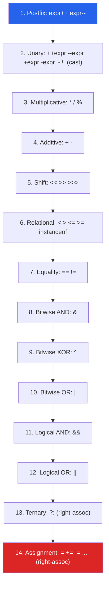
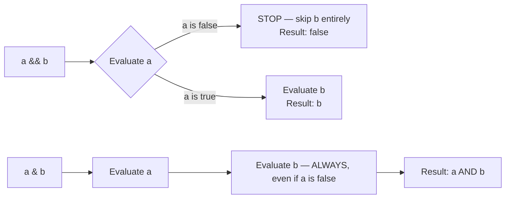

:::tip[TL;DR (30-Second Interview Pitch)]
Java has **14 precedence levels**, evaluated highest-to-lowest whenever an expression has no explicit parentheses, with **assignment and the ternary operator being right-associative** while almost everything else is left-associative. Operands are always evaluated **left to right**. The parts that trip up real code (and "predict the output" rounds) aren't the table itself — it's **`i = i++`**, **`==` vs `equals`**, **short-circuit vs eager boolean operators**, **silent integer overflow**, **shift distances that wrap**, **ternary type promotion**, and **narrowing casts hidden inside compound assignment**.
:::

<PriorityKey />

## ⚡ Essential Interview Recall

- 🔴 **14 precedence levels**, highest to lowest: `postfix` → `unary` → `multiplicative` → `additive` → `shift` → `relational`/`instanceof` → `equality` → `&` → `^` → `|` → `&&` → `||` → `?:` → assignment.
- 🔴 **Associativity**: left-to-right except **unary**, **ternary (`?:`)** and **assignment**, which are **right-to-left**. **Evaluation order** of operands is always **left to right** (JLS §15.7) — precedence only decides grouping.
- 🔴 **`i = i++` leaves `i` unchanged**: the old value is saved, `i` is incremented, then the saved old value is assigned back.
- 🔴 **`==` on objects compares references**; `.equals()` compares content. String literals and **compile-time constants** are pooled, so `"ja" + "va" == "java"` is `true`, but a runtime concatenation isn't.
- 🔴 `&&` / `||` **short-circuit**; `&` / `|` on `boolean` always evaluate **both** sides.
- 🔴 **Compound assignment hides a cast**: `x += y` means `x = (T)(x + y)`. So `byte b = 1; b += 200;` compiles (and wraps) while `b = b + 200;` doesn't.
- 🔴 **Integer overflow wraps silently**: `Integer.MAX_VALUE + 1 == Integer.MIN_VALUE`. Use `Math.addExact`/`multiplyExact` to get an exception.
- 🟠 **Shift distance is masked**: for `int` only the low **5 bits** count (`1 << 32 == 1`), for `long` the low **6 bits**.
- 🟠 `>>` keeps the sign (arithmetic), `>>>` fills with zeros (logical). `byte`/`short` are promoted to `int` **before** shifting, so `(byte) -1 >>> 4` is `268435455`, not `15`.
- 🟠 Integer `/ 0` and `% 0` throw `ArithmeticException`; floating-point gives `Infinity`/`NaN`. `%` takes the **sign of the dividend** (`-7 % 3 == -1`); `/` truncates toward zero (`-7 / 2 == -3`).
- 🟠 `Math.abs(Integer.MIN_VALUE)` is **negative**; so is `Integer.MIN_VALUE / -1`.
- 🟠 **Ternary type rules**: mixed numeric branches are promoted (`true ? 1 : 2.0` is `1.0`), a boxed + primitive mix is **unboxed** (NPE on `null`), and `true ? Integer.valueOf(1) : Double.valueOf(2)` prints **`1.0`**.
- 🟡 Bit tricks: `x & (x - 1)` clears the lowest set bit (power-of-two test), `x & -x` isolates it, XOR of a list finds the unique element, `(lo + hi) >>> 1` is an overflow-safe midpoint.
- 🟡 `+` on `String`s is the only operator "overloading"; since **Java 9** it compiles to `invokedynamic` + `StringConcatFactory` (before that, `StringBuilder.append` chains).

:::speak[What's the difference between == and equals?]
"`==` compares the values of its operands directly. For primitives that's the numeric value; for objects it's the **reference**, so it's `true` only when both sides point to the **same object**. `equals` is a method, and by default (`Object.equals`) it's the same identity check, but classes like `String`, `Integer` and records override it to compare **content**. Two traps follow from that. String literals and compile-time constants are interned, so `==` on strings sometimes *seems* to work in tests and fails on strings built at runtime. And wrapper caches make `==` on `Integer` work up to 127 and fail from 128. So: `==` for primitives, enums and deliberate identity checks; `equals`, or `Objects.equals` for null safety, for everything else."
:::

## The Mental Model





:::analogy[Precedence is grouping, not timing]
Precedence is like brackets the teacher draws on the board: `2 + 3 * 4` becomes `2 + (3 * 4)`. But the class still reads the board **left to right**: Java works out the `2` before it ever looks at `3 * 4`. That's why `i++ + i` always uses the old `i` on the left, whatever the precedence table says.
:::

## The Paradigm / Core Concepts

### 🔴 Full precedence table (highest → lowest)

| # | Category | Operators | Associativity |
|---|---|---|---|
| 1 | Postfix | `expr++` `expr--` | Left → Right |
| 2 | Unary | `++expr` `--expr` `+expr` `-expr` `~` `!` `(type)` cast | **Right → Left** |
| 3 | Multiplicative | `*` `/` `%` | Left → Right |
| 4 | Additive | `+` `-` | Left → Right |
| 5 | Shift | `<<` `>>` `>>>` | Left → Right |
| 6 | Relational | `<` `>` `<=` `>=` `instanceof` | Left → Right |
| 7 | Equality | `==` `!=` | Left → Right |
| 8 | Bitwise AND | `&` | Left → Right |
| 9 | Bitwise XOR | `^` | Left → Right |
| 10 | Bitwise OR | `\|` | Left → Right |
| 11 | Logical AND | `&&` | Left → Right |
| 12 | Logical OR | `\|\|` | Left → Right |
| 13 | Ternary | `?:` | **Right → Left** |
| 14 | Assignment | `=` `+=` `-=` `*=` `/=` `%=` `&=` `^=` `\|=` `<<=` `>>=` `>>>=` | **Right → Left** |

### 🔴 Short-circuit vs eager boolean operators

| | `&&` / `\|\|` | `&` / `\|` (on booleans) |
|---|---|---|
| Evaluates right operand | Only if needed | **Always** |
| Use case | Guard conditions (`obj != null && obj.isValid()`) | Forcing a side effect regardless of the left result |
| Risk if misused | None — this is the safe default | **`NullPointerException`** if used to replace `&&` carelessly |

### 🔴 `==` vs `equals`

| Comparison | `==` | `.equals()` |
|---|---|---|
| Two `int`s | Value | n/a (primitives have no methods) |
| `Integer` vs `int` | **Unboxes**, compares values | Boxes the `int`, compares values |
| Two `Integer`s | **Reference** (cache makes -128..127 look right) | Value |
| Two `String`s | **Reference** (literals/constants are pooled, runtime strings aren't) | Characters |
| Two enums | Reference = value (each constant is a singleton) — `==` is preferred, it's null-safe | Same result |
| Arrays | Reference | Reference too! Use `Arrays.equals` |

<RuleCard name="When can == compare Strings?" tag="Constant folding" why="javac evaluates constant expressions at compile time and pools the result, so only constants share one object." remember="Constants are pooled; runtime strings are new.">

`==` is `true` only if both sides are the **same object**. That happens for literals and **compile-time constant expressions**: `"ja" + "va"`, or `fp + "va"` where `final String fp = "ja";`. Anything computed at runtime (a non-final variable, `concat`, `substring`, `new String`, a `StringBuilder`, data read from a request) is a **new object** unless you `intern()` it.

</RuleCard>

### 🟠 Bitwise operators and shifts

| Operator | Meaning | Example (`int`) |
|---|---|---|
| `&` | AND: 1 if both bits are 1 | `0b1100 & 0b1010 = 0b1000` |
| `\|` | OR: 1 if either bit is 1 | `0b1100 \| 0b1010 = 0b1110` |
| `^` | XOR: 1 if the bits differ | `0b1100 ^ 0b1010 = 0b0110` |
| `~` | NOT: flip every bit (`~x == -x - 1`) | `~5 = -6` |
| `<<` | Shift left, fill with 0 (`x << n` = `x · 2ⁿ` until overflow) | `3 << 2 = 12` |
| `>>` | Shift right, **copy the sign bit** (floor division by 2ⁿ) | `-16 >> 2 = -4`, `-5 >> 1 = -3` |
| `>>>` | Shift right, **fill with 0** (treats the value as unsigned) | `-16 >>> 28 = 15`, `-1 >>> 1 = 2147483647` |

## ⚙️ Under the Hood (JVM Mechanics)

- **Evaluation order is strictly left to right (JLS §15.7).** The left operand is fully evaluated (side effects included) before the right one; method arguments are evaluated left to right; in `a[i] = i = 1`, the array index is evaluated **before** the right-hand side runs.
- **Postfix and prefix in bytecode** — `i = i++` compiles to `iload` (push the old value), `iinc` (increment the local slot in place), `istore` (pop the **old** value back into `i`). `i = ++i` is `iinc` first, then `iload`/`istore`, so the new value is stored. Both just compile to `iinc` when used as a statement on their own.
- **Short-circuit evaluation is a branch, not a boolean op:** `a && b` compiles to a conditional jump (`ifeq`) that skips `b` entirely; there is no "logical and" instruction. `a & b` on booleans evaluates both sides and executes `iand`.
- **Compound assignment hides a narrowing cast (JLS §15.26.2):** `E1 op= E2` is `E1 = (T)((E1) op (E2))`, where `T` is `E1`'s type, and `E1` is evaluated **only once** (matters for `arr[next()] += 1`). So `byte b = 100; b += 50;` is `b = (byte)(b + 50)` → `-106`. Even `char c = 'A'; c += 1.7;` compiles: `(char)(65 + 1.7)` → `'B'`.
- **String `+`**: since **Java 9 (JEP 280)** `javac` compiles `"x=" + x + y` to one `invokedynamic` call bootstrapped by `StringConcatFactory`, which the JVM turns into an optimized concatenation at runtime. Before Java 9 it was a `new StringBuilder().append(...).append(...).toString()` chain. Either way, **`+` inside a loop** still creates a new `String` per iteration: use one `StringBuilder` outside the loop.
- **Integer overflow is silent by design** — `iadd`, `imul`, … wrap using two's-complement arithmetic with no overflow flag. `Math.addExact()`/`multiplyExact()` opt into an `ArithmeticException`; the JIT turns them into a CPU overflow-flag check, so they're cheap.
- **Shift distances are masked**, matching what the CPU's shift instruction does: `x << n` for `int` uses `n & 0x1F`, for `long` `n & 0x3F`. So `1 << 32` is `1 << 0`, `8 >> 35` is `8 >> 3 = 1`, and `1 << -1` is `1 << 31`.
- **`%` is remainder, not modulo** — `irem` satisfies `(a / b) * b + (a % b) == a` with `/` truncating toward zero, so the remainder takes the **dividend's** sign: `-7 % 3 == -1`, `7 % -3 == 1`. `Math.floorMod`/`floorDiv` give mathematical modulo and floor division.
- **Ternary typing** (JLS §15.25): if both branches are numeric, binary numeric promotion picks one type for the whole expression; an `int` **constant** that fits in `char` lets the result stay `char`; and if one branch is a boxed type and the other a primitive, the boxed one is **unboxed**.

:::danger[Interview Trap]
**`&` and `|` on `boolean`s compile and run fine — they just don't short-circuit.** `if (user != null & user.isActive())` looks almost identical to the safe `&&` version but throws `NullPointerException` when `user` is `null`.
:::

:::danger[Interview Trap]
**The ternary operator has one static type for both branches.** `true ? Integer.valueOf(1) : Double.valueOf(2)` prints **`1.0`**: both branches are unboxed and promoted to `double`, then boxed back as a `Double`. And `cond ? nullableInteger : 0` unboxes the `Integer`, throwing `NullPointerException` when it's `null`.
:::

## 💻 Java Implementation

:::tip[Run it yourself]
Every snippet below runs as-is in **`jshell`** (shipped with the JDK since Java 9), and every output comment comes from a run on JDK 21. Lines marked in **red** are the mistake: they fail to compile, throw, or give a surprising result.
:::

### Precedence: `*` binds tighter than `+`

```java showLineNumbers
// highlight-next-line
int result = 2 + 3 * 4;     // 14, not 20: * is evaluated before +
int forced = (2 + 3) * 4;   // 20: parentheses override precedence
```

### Prefix, postfix and the `i = i++` trap

```java showLineNumbers
int x = 5;
// highlight-start
int postfix = x++;   // returns 5, THEN x becomes 6
int prefix  = ++x;   // x becomes 7, THEN returns 7
// highlight-end
System.out.println(postfix + " " + prefix + " " + x);   // 5 7 7

int i = 5;
// error-next-line
i = i++;             // ❌ i is still 5: the old value is assigned back over the increment
// success-next-line
i++;                 // ✅ 6

int j = 5;
j = j++ + ++j;       // 12: left to right → 5 (j becomes 6) + 7 (j becomes 7)
int k = 1;
k += k++ + ++k;      // 5: k = 1 + (1 + 3); the left k was read BEFORE the increments
```

<Animation src="operators/postfix-trap" caption="i++ pushes the old value of i onto the operand stack, then increments the variable in place. The assignment then pops the old value back into i, wiping out the increment." />

### `==` vs `equals` on Strings

```java showLineNumbers
String s1 = "java";
String s2 = "ja" + "va";             // constant expression: folded at compile time → pooled
String part = "ja";
String s3 = part + "va";             // runtime concatenation → NEW object
final String fp = "ja";
String s4 = fp + "va";               // fp is a constant variable → folded → pooled
String s5 = new String("java");      // always a new object

System.out.println(s1 == s2);        // true
// error-next-line
System.out.println(s1 == s3);        // false
System.out.println(s1 == s4);        // true
// error-next-line
System.out.println(s1 == s5);        // false
// success-start
System.out.println(s1.equals(s5));   // true: compare content
System.out.println(s1 == s3.intern());   // true: intern() returns the pooled instance
// success-end
```

### Short-circuit `&&` vs eager `&`

```java showLineNumbers
String text = null;

// success-next-line
if (text != null && text.length() > 0) { }   // ✅ stops at first false: no NPE

// error-next-line
if (text != null & text.length() > 0) { }    // ❌ evaluates BOTH sides → NPE
```

### Compound assignment hides a narrowing cast

```java showLineNumbers
byte b = 100;

// error-next-line
b = b + 50;    // ❌ compile error: b + 50 is promoted to int
// highlight-next-line
b += 50;       // compiles! silently becomes b = (byte)(b + 50) → wraps to -106

char c = 'A';
c += 1.7;      // compiles: (char)(65 + 1.7) → 'B'
```

### Integer overflow, division and remainder

```java showLineNumbers
int maxed = Integer.MAX_VALUE;
// error-next-line
System.out.println(maxed + 1);                 // -2147483648: wraps to MIN_VALUE, no exception
// success-start
try {
    Math.addExact(maxed, 1);                   // ✅ opt-in overflow checking
} catch (ArithmeticException e) {
    System.out.println(e.getMessage());        // integer overflow
}
// success-end

// error-start
System.out.println(Math.abs(Integer.MIN_VALUE));   // -2147483648: there is no +2147483648
System.out.println(Integer.MIN_VALUE / -1);        // -2147483648: overflow again
// error-end

// error-next-line
int boom = 1 / 0;                              // ❌ ArithmeticException: / by zero (same for % 0)
System.out.println(1.0 / 0);                   // Infinity
System.out.println(5.0 % 0);                   // NaN

// highlight-next-line
System.out.println(-7 % 3);                    // -1: sign of the DIVIDEND
System.out.println(7 % -3);                    // 1
System.out.println(-7 / 2);                    // -3: integer division truncates toward zero
System.out.println(Math.floorMod(-7, 3));      // 2: mathematical modulo (use it for bucket indexes)
System.out.println(Math.floorDiv(-7, 2));      // -4
```

### Shifts: masking and sign

```java showLineNumbers
// error-start
System.out.println(1 << 32);        // 1: only the low 5 bits of the distance count (32 & 31 == 0)
System.out.println(1 << -1);        // -2147483648: -1 & 31 == 31
// error-end
System.out.println(1L << 32);       // 4294967296: long uses the low 6 bits
System.out.println(-16 >> 2);       // -4: arithmetic shift keeps the sign
System.out.println(-16 >>> 28);     // 15: logical shift fills with zeros
System.out.println(-5 >> 1);        // -3: >> rounds toward NEGATIVE infinity (unlike -5 / 2 == -2)

byte flags = -1;                    // 0xFF
// error-next-line
System.out.println(flags >>> 4);    // 268435455: promoted to int (0xFFFFFFFF) BEFORE shifting
// success-next-line
System.out.println((flags & 0xFF) >>> 4);   // 15: mask to the unsigned byte value first
```

### The ternary operator: right-associative and type-promoting

```java showLineNumbers
int score = 72;
// highlight-next-line
String grade = score >= 90 ? "A" : score >= 80 ? "B" : score >= 70 ? "C" : "F";
// parsed as: score >= 90 ? "A" : (score >= 80 ? "B" : (score >= 70 ? "C" : "F"))
System.out.println(grade);                    // C

System.out.println(false ? 1 : 2.0);          // 2.0: int and double → double
// error-next-line
System.out.println(true ? Integer.valueOf(1) : Double.valueOf(2));   // 1.0, not 1
System.out.println(true ? 'a' : 0);           // a: 0 is a constant that fits in char → type char
int zero = 0;
System.out.println(true ? 'a' : zero);        // 97: zero is a variable → type int
```

### `instanceof` pattern matching <Since v="16" />

```java showLineNumbers
Object obj = "hello";

// s is bound by the pattern AND usable later in the same && chain
// highlight-next-line
if (obj instanceof String s && s.length() > 3) {
    System.out.println(s.toUpperCase());           // HELLO
}
```

### Bit manipulation for coding rounds

| Trick | Code | Example (`n = 40 = 0b101000`) |
|---|---|---|
| Is power of two? | `n > 0 && (n & (n - 1)) == 0` | `40 & 39 = 32` → no; `64 & 63 = 0` → yes |
| Clear lowest set bit | `n & (n - 1)` | `32` (`0b100000`) |
| Isolate lowest set bit | `n & -n` | `8` (`0b001000`) |
| Count set bits | `Integer.bitCount(n)` (or loop with `n &= n - 1`) | `2` |
| Test bit k | `(n >> k) & 1` | bit 3 → `1` |
| Set / clear / toggle bit k | `n \| (1 << k)`, `n & ~(1 << k)`, `n ^ (1 << k)` | |
| Unique element (others appear twice) | XOR everything: `x ^ x = 0`, `x ^ 0 = x` | `4 ^ 1 ^ 2 ^ 1 ^ 2 = 4` |
| Overflow-safe midpoint | `(lo + hi) >>> 1` or `lo + (hi - lo) / 2` | see below |

```java showLineNumbers
int lo = 2_000_000_000, hi = 2_100_000_000;
// error-next-line
int mid = (lo + hi) / 2;          // -97483648: lo + hi overflowed (the famous binary search bug)
// success-start
int mid1 = (lo + hi) >>> 1;       // 2050000000: the sum's bits are right; read them as unsigned
int mid2 = lo + (hi - lo) / 2;    // 2050000000
// success-end

int[] nums = {4, 1, 2, 1, 2};
int unique = 0;
for (int v : nums) unique ^= v;   // pairs cancel out
System.out.println(unique);       // 4
```

## 🧪 Predict the Output

<Predict n="1" title="The classic" output="5">

```java
int i = 5;
i = i++;
System.out.println(i);
```

`i++` evaluates to the **old** value (5) and increments `i` to 6 as a side effect. Then the assignment stores the expression's value, 5, back into `i`, overwriting the 6. In bytecode: `iload` (push 5), `iinc` (slot becomes 6), `istore` (pop 5 into the slot). The animation above shows exactly this.

</Predict>

<Predict n="2" title="Left to right, always" output="16">

```java
int m = 5;
m = m++ * 2 + m;
System.out.println(m);
```

Operands are evaluated **left to right**: `m++` yields 5 (and `m` becomes 6), `* 2` gives 10, then the right-hand `m` is read as **6**: 10 + 6 = 16. Precedence only decided that `*` groups before `+`; it didn't move the evaluation of `m` earlier.

</Predict>

<Predict n="3" title="String + numbers" output="3x12, then 195c">

```java
System.out.println(1 + 2 + "x" + 1 + 2);
System.out.println('a' + 'b' + "c");
```

`+` is left-associative. `1 + 2` is integer addition (3), then `3 + "x"` becomes string concatenation, and from then on every `+` concatenates: `"3x1"`, `"3x12"`. In the second line, `'a' + 'b'` is `char + char`, promoted to `int`: 97 + 98 = 195, then `195 + "c"`.

</Predict>

<Predict n="4" title="The shifting surprise" output="1 1 4294967296">

```java
System.out.println(1 << 32);
System.out.println(8 >> 35);
System.out.println(1L << 32);
```

For an `int`, the shift distance is masked to its low 5 bits: `32 & 31 = 0`, so `1 << 32` is `1 << 0 = 1`; `35 & 31 = 3`, so `8 >> 35` is `8 >> 3 = 1`. A `long` uses 6 bits, so `1L << 32` really shifts by 32. Common bug: building a 64-bit mask with `1 << n` instead of `1L << n`.

</Predict>

<Predict n="5" title="Ternary with boxes" output="1.0">

```java
Object o = true ? Integer.valueOf(1) : Double.valueOf(2);
System.out.println(o);
```

When both branches are convertible to numeric types, the conditional is a **numeric conditional**: both sides are unboxed, promoted to the wider type (`double`), and the result is boxed again as a `Double`. So you get `1.0`, even though the `Integer` branch was chosen. Assigning to `Object` doesn't change this; the type is decided by the branches alone.

</Predict>

<Predict n="6" title="Assignment inside an index" output="1 0 1">

```java
int[] ar = {0, 0};
int idx = 0;
ar[idx] = idx = 1;
System.out.println(ar[0] + " " + ar[1] + " " + idx);
```

Assignment is right-associative (`ar[idx] = (idx = 1)`), but **evaluation is left to right**: the array reference and the index `idx` (0) on the left are evaluated **first**, then the right side sets `idx` to 1 and yields 1, which is stored into `ar[0]`.

</Predict>

## 🪜 Follow-up Ladder

<Ladder title="From x++ to the binary search bug">
<Rung q="What's the difference between i++ and ++i?">

Both increment `i`. `i++` *evaluates to* the old value, `++i` to the new one. As a standalone statement they compile to the same `iinc` instruction: no performance difference in Java.

</Rung>
<Rung q="So what does i = i++ do?">

Nothing visible: the old value is saved, `i` is incremented, then the saved value is assigned back. (In C/C++ it's undefined behaviour; Java defines it exactly, through left-to-right evaluation.)

</Rung>
<Rung q="What happens when an int calculation exceeds Integer.MAX_VALUE?">

It wraps silently (two's complement): `MAX_VALUE + 1 == MIN_VALUE`. No exception unless you use `Math.addExact` and friends, or widen to `long` *before* the operation.

</Rung>
<Rung q="Where has that caused real bugs?">

The classic: `int mid = (low + high) / 2;` in binary search (in the JDK's own `Arrays.binarySearch` until 2006) overflows for arrays over about a billion elements. Fix: `low + (high - low) / 2` or `(low + high) >>> 1`. Others: `Math.abs(hashCode()) % n` returning a negative bucket for `MIN_VALUE`, millisecond arithmetic in `int`, and `compareTo` written as `return a - b`, which flips the sign when it overflows.

</Rung>
<Rung q="How should compare() be written then?">

`Integer.compare(a, b)` (or `Comparator.comparingInt(...)`), never `a - b`. With `a = Integer.MIN_VALUE` and `b = 1`, `a - b` overflows to a large positive number and sorts the values the wrong way round.

</Rung>
</Ladder>

## 🚑 Production Scenario

:::incident[Sorting broke for some customers]
A leaderboard sorted with `(p1, p2) -> p1.score - p2.score` showed a few players with huge negative scores at the **top**, and a `TreeMap` keyed with the same comparator occasionally "lost" entries.

- **Why:** for large opposite-sign scores, `p1.score - p2.score` **overflows** and flips sign, so the comparator says *a < b* when actually *a > b*. That breaks the comparator contract (it's no longer transitive): sorting gives wrong orders, and `TimSort` can even throw `IllegalArgumentException: Comparison method violates its general contract!`.
- **Fix:** `Comparator.comparingInt(Player::score)` or `Integer.compare(p1.score, p2.score)`. Ban subtraction-based comparators in code review, and enable the static-analysis rule that flags them.
:::

## 🚨 Interview Gotchas & Edge Cases

:::warning[The Most Common Question]
**"What's the difference between `&&` and `&` (or `||` and `|`) in Java?"** `&&`/`||` short-circuit: the right operand is skipped once the result is known. `&`/`|` always evaluate both operands, even on `boolean`s, and on integers they're **bitwise** operators. This matters whenever the right-hand side has a side effect or can throw (the classic null-check guard). Expect the follow-up *"then when would you ever use `&` on booleans?"*: when both sides must run, e.g. validating every field so all errors get reported.
:::

- **Bitwise precedence is lower than `==`, but Java catches the classic C bug.** `flags & MASK == MASK` parses as `flags & (MASK == MASK)`, which is `int & boolean`: a **compile error** ("bad operand types") in Java, where C would silently compile it. With `boolean` operands it does compile, so still write `(flags & MASK) == MASK`.
- **Assignment is an expression** that returns the assigned value: chained `a = b = c = 0` works, and `if (done = true)` **compiles** when `done` is a `boolean` (and is always true). With non-boolean types Java rejects `if (x = 5)`.
- **Mixed-type arithmetic promotes before the operator runs**: `1 / 2` is `0` (integer division), `1 / 2.0` is `0.5`. `double avg = sum / count;` with two `int`s is still integer division; cast one operand first.
- **`String` concatenation in loops**: each `s += x` creates a new `String` and copies the whole contents: O(n²) overall. Use a `StringBuilder` (or `String.join`/`Collectors.joining`).
- **`==` between `Integer` and `int` unboxes**, so `Integer x = null; x == 5` throws `NullPointerException`.
- **`instanceof` with `null`** is always `false` (never throws), which is why `equals` implementations use it as a combined null-and-type check.
- **The cast is a unary operator with higher precedence than arithmetic**: `(int) 3.7 + 0.5` is `3.5` (cast first), while `(int) (3.7 + 0.5)` is `4`.

Sources:
- [The Java™ Tutorials — Operators](https://docs.oracle.com/javase/tutorial/java/nutsandbolts/operators.html)
- [JLS §15.7 — Evaluation Order](https://docs.oracle.com/javase/specs/jls/se21/html/jls-15.html#jls-15.7)
- [JLS §15.26.2 — Compound Assignment Operators, via SEI CERT NUM52-J](https://wiki.sei.cmu.edu/confluence/spaces/java/pages/88487568/NUM52-J.+Be+aware+of+numeric+promotion+behavior)
- [JEP 280 — Indify String Concatenation](https://openjdk.org/jeps/280)
