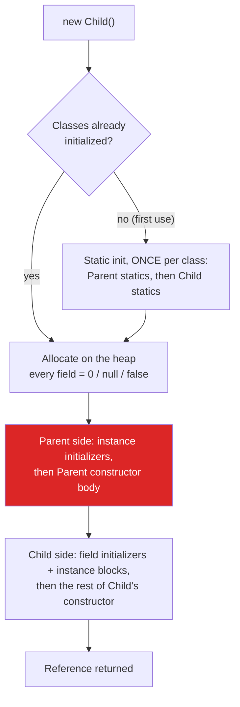

:::tip[TL;DR (30-Second Interview Pitch)]
Every Java class silently inherits **contracts** from `java.lang.Object`. The most important is that **equal objects must have equal hash codes**, or `HashMap` and `HashSet` quietly break. On top of that, interviewers probe how objects come to life (**static → instance initializers → constructors, parent first**), how to make a class **immutable** (and why `String` is), the four kinds of **nested classes**, why **`clone()` is broken**, and what **records** <Since v="16" /> give you for free.
:::

<PriorityKey />

## ⚡ Essential Interview Recall

- 🔴 `Object` gives every class: `equals`, `hashCode`, `toString`, `getClass`, `clone` (protected), `finalize` (deprecated), and `wait`/`notify`/`notifyAll`.
- 🔴 **equals/hashCode contract**: if `a.equals(b)` then `a.hashCode() == b.hashCode()`. The reverse is **not** required (collisions are allowed). Override **both or neither**.
- 🔴 `equals` must be **reflexive, symmetric, transitive, consistent**, and `x.equals(null)` must be `false`.
- 🔴 Never use **mutable fields** in `hashCode` of an object that sits in a hash collection: change the field and the object is lost in the wrong bucket.
- 🔴 **Immutable class recipe**: `final` class, `private final` fields, no setters, **defensive copies** in the constructor *and* in getters for mutable components, no `this` escaping from the constructor.
- 🔴 `String` is immutable for the **string pool**, **security** (class names, file paths, URLs can't change after a check), **cached hash code**, and **thread safety**.
- 🔴 Initialization order: **static** (parent, then child, once per class) → per object: **parent instance initializers + constructor** → **child field initializers / instance blocks** → **child constructor body**.
- 🔴 Calling an **overridable method from a constructor** lets the subclass override run before the subclass's fields are set (they're still `null`/`0`).
- 🟠 `this(...)` or `super(...)` must be the **first** statement of a constructor (relaxed in Java 25 for code that doesn't touch `this`); you can't call both. With neither, `javac` inserts `super()`.
- 🟠 Nested classes: **static nested** (no outer instance), **inner** (holds a hidden reference to the outer instance), **local** and **anonymous** (can capture only **effectively final** locals).
- 🟡 `clone()` is a **shallow** copy and `Cloneable` is a broken design (no `clone` method in the interface, a checked exception, bypasses constructors). Prefer **copy constructors** or static factories.
- 🟡 Objects can be created with `new`, **reflection**, **`clone()`**, **deserialization** (skips your constructor!), and factories/builders (which use `new` underneath).
- 🟡 **Records** <Since v="16" />: final, `private final` fields, canonical constructor, accessors, `equals`/`hashCode`/`toString` generated. Shallowly immutable.

:::speak[Why must you override hashCode when you override equals?]
"Hash-based collections use `hashCode` **first**, to choose a bucket, and only call `equals` inside that bucket. The contract says equal objects must have equal hash codes. If I override `equals` but keep `Object`'s identity-based `hashCode`, two logically equal keys almost always land in **different buckets**, so `map.get(new Key(1))` returns `null` and a `HashSet` happily stores duplicates. The fix is to compute `hashCode` from exactly the fields `equals` compares, for example with `Objects.hash`, or to use a **record** that generates both. And those fields should be **immutable**: if a key's hash changes after it was inserted, the map looks in the wrong bucket and the entry is effectively lost."
:::

## The Mental Model



*Red box: if the parent's constructor calls an overridable method, the child's version runs here, before the child's fields have been initialized.*

<Animation src="oop/init-order" caption="Statics run once per class, parent first. For every object, the whole parent side finishes before the child's field initializers run, which is why a method called from the parent constructor sees the child's fields as null." />

## The Paradigm / Core Concepts

### 🔴 What every object inherits from `Object`

| Method | Default behaviour | Override when |
|---|---|---|
| `equals(Object)` | Identity: `this == o` | The class is a **value** (two instances with the same data are "the same") |
| `hashCode()` | Identity hash (derived per object, stored in the header once computed) | **Always** together with `equals` |
| `toString()` | `ClassName@hexHash` | Almost always: logs and debuggers use it |
| `getClass()` | Runtime class, `final` | Never (can't) |
| `clone()` | `protected`, shallow field copy; throws `CloneNotSupportedException` unless the class implements `Cloneable` | Prefer not to (see below) |
| `finalize()` | Does nothing; deprecated for removal | Never: use try-with-resources or `Cleaner` |
| `wait()` / `notify()` / `notifyAll()` | Monitor operations; must hold the object's lock (`synchronized`) | Never (final). Prefer `java.util.concurrent` |

### 🔴 The equals/hashCode contract

<RuleCard name="equals ⇒ same hashCode" tag="java.lang.Object" why="HashMap and HashSet pick the bucket from hashCode and only then compare with equals. Equal objects in different buckets never meet." remember="Equal objects, equal hashes. Not the other way round.">

If `a.equals(b)` is `true`, then `a.hashCode() == b.hashCode()` **must** be true. Two **unequal** objects *may* share a hash code (a collision): that's legal, just slower.

```java
@Override public int hashCode() { return Objects.hash(currency, cents); }   // same fields as equals
```

</RuleCard>

| `equals` property | Meaning | How it usually breaks |
|---|---|---|
| **Reflexive** | `x.equals(x)` | Rarely broken |
| **Symmetric** | `x.equals(y)` ⇔ `y.equals(x)` | A subclass adds a field and uses `instanceof` in **its** equals (Predict #4) |
| **Transitive** | `x = y` and `y = z` ⇒ `x = z` | Mixing types that compare "loosely" |
| **Consistent** | Same answer every time, if nothing changed | Depending on mutable or external state (a URL resolving to an IP: `java.net.URL.equals` does a DNS lookup!) |
| **Non-null** | `x.equals(null)` is `false` | Throwing `NullPointerException` instead |

**`instanceof` vs `getClass()` in `equals`:**

| | `if (!(o instanceof Point p))` | `if (o == null \|\| getClass() != o.getClass())` |
|---|---|---|
| Subclass instance equal to parent instance? | Yes, if the fields match | Never |
| Risk | Breaks **symmetry** once a subclass adds state to `equals` | Breaks **Liskov**: a harmless subclass (or a Hibernate proxy) is never equal to the real thing |
| Use when | The class is `final` (records are), or subclasses must not change equality | You need strict type equality and control all subclasses |

- **`compareTo` should be consistent with `equals`**: `TreeSet`/`TreeMap` use `compareTo` only. `new BigDecimal("1.0")` and `new BigDecimal("1.00")` are **not** `equals` (different scale) but `compareTo` returns 0: a `HashSet` keeps **2**, a `TreeSet` keeps **1**.

### 🔴 Immutability

<RuleCard name="The immutable class recipe" tag="Effective Java Item 17" why="Immutable objects are automatically thread-safe, can be shared and cached freely, make perfect map keys, and can't be corrupted by callers." remember="Final class, final fields, copy in, copy out.">

1. Declare the class **`final`** (or make the constructor private and use static factories), so no subclass can add mutable state.
2. Make every field **`private final`**.
3. Provide **no setters**; "modifying" methods return a **new** object (`plusDays`, `withName`).
4. **Defensively copy** mutable inputs in the constructor (`List.copyOf`, `new Date(d.getTime())`).
5. **Never hand out** a reference to an internal mutable object: return copies or unmodifiable views.
6. Don't let `this` escape during construction (no registering listeners or starting threads in the constructor).

</RuleCard>

**Why `String` is immutable** — the five answers interviewers want:

| Reason | Explanation |
|---|---|
| **String pool** | Literals are shared between every class in the JVM. If one caller could change `"admin"`, everyone else's `"admin"` would change too |
| **Security** | File paths, URLs, class names and DB credentials are checked and then used. Immutability means nobody can change the value between the check and the use |
| **Cached hash code** | `String.hashCode()` is computed once and stored in a field, which makes `String` the fastest common `HashMap` key |
| **Thread safety** | Shared freely between threads with no synchronization |
| **Class loading** | The classloader receives the class name as a `String`; if it could mutate, you could load a different class than the one that was checked |

### 🟠 Constructor chaining

- Every constructor starts with **exactly one** of `this(...)` (another constructor in the same class) or `super(...)` (a parent constructor). If you write neither, `javac` inserts **`super()`**, which fails to compile when the parent has no no-arg constructor.
- `this(...)` and `super(...)` can't both appear, because each must be the **first** statement. Instance initializers are copied by `javac` into every constructor that calls `super(...)`, never into ones that call `this(...)`, so they run exactly once.
- **Java 25** (JEP 513, *flexible constructor bodies*) allows statements **before** `super(...)`/`this(...)`, as long as they don't use `this`: argument validation and computing values no longer need a static helper.
- Constructors are **not inherited** and **not polymorphic**; an abstract class's constructor runs through `super(...)` from a concrete subclass.

### 🟠 Nested classes

| Kind | Outer `this`? | Create with | Typical use |
|---|---|---|---|
| **Static nested**<br/>`static class Node` | ❌ — sees only the outer class's **static** members (private ones too) | `new Outer.Node()` | Builders, `Map.Entry`, `LinkedList.Node`, the holder idiom |
| **Inner** (non-static member)<br/>`class Itr` | ✅ hidden field `this$0` — sees everything in its outer object | `outer.new Itr()` | Iterators bound to one collection |
| **Local**<br/>declared in a method body | ✅ in instance methods; captures **effectively final** locals | `new Local()` inside that method | Rare: a helper for one method |
| **Anonymous**<br/>`new Iface() { ... }` | ✅ in instance methods; captures **effectively final** locals | Inline, exactly once | Old-style callbacks, mostly replaced by lambdas |
| *Lambda*<br/>`x -> ...` | Not a class: `this` means the **enclosing** object | — | Any single-method interface |

- **The memory-leak trap**: an inner/anonymous class instance keeps its **outer instance alive**. Hand one to a long-lived owner (a static event bus, a thread pool queue) and the whole outer object can't be collected. Default to **`static` nested** classes (Effective Java, Item 24).
- **Why effectively final?** A local variable lives in the method's stack frame and disappears when the method returns; the lambda or inner class may run later on another thread. Java **copies the value** into the captured object, and forbidding reassignment guarantees the copy and the original never disagree.

:::analogy[An inner class carries its parent's house key]
A static nested class is a neighbour: they live on the same street (same source file) but have their own house. An inner class is a child who always carries a key to the parent's house. As long as the child is around (still referenced somewhere), the parent's house can't be demolished, even if nobody else visits it.
:::

### 🟡 Copying objects: `clone()` vs copy constructors

| | `clone()` + `Cloneable` | Copy constructor / factory |
|---|---|---|
| Depth | **Shallow**: fields copied, referenced objects shared | Whatever you write (usually deep for mutable parts) |
| Calls a constructor? | ❌ No: creates the object "extra-linguistically" | ✅ Yes, so invariants and validation run |
| `final` fields | Can't be reassigned for a deep copy | Fine |
| API | `Cloneable` has **no methods**; `clone()` is protected on `Object`; checked `CloneNotSupportedException` | Plain Java: `new Team(other)`, `List.copyOf(list)` |
| Verdict | Only for arrays (`array.clone()` is fine and fast) | **Preferred** (Effective Java, Item 13) |

### 🟡 Five ways to create an object

| Way | Constructor runs? | Notes |
|---|---|---|
| `new Order()` | ✅ | The normal way |
| **Reflection**<br/>`ctor.newInstance()` | ✅ | How Spring, Hibernate and Jackson create beans and entities (why JPA needs a no-arg constructor) |
| **Cloning**<br/>`original.clone()` | ❌ | Field-by-field copy of an existing object |
| **Deserialization**<br/>`in.readObject()` | ❌ | Only the no-arg constructor of the first **non-serializable** superclass runs, so your constructor's checks are skipped: validate in `readObject` or use a serialization proxy |
| **Factory / builder**<br/>`List.of(...)`, `builder().build()` | ✅ (they call `new` inside) | Can cache, return subtypes, and have meaningful names |

### 🟡 Records <Since v="16" />

```java title="Money.java" showLineNumbers
public record Money(String currency, long cents) {

    // highlight-start
    public Money {                                   // compact canonical constructor: validation only
        Objects.requireNonNull(currency);
        if (cents < 0) throw new IllegalArgumentException("negative amount");
    }
    // highlight-end

    public Money plus(Money other) {                 // "withers" return a new record
        return new Money(currency, cents + other.cents);
    }
}
// Generated: private final fields, accessors currency() and cents(), equals, hashCode, toString
// new Money("INR", 100).equals(new Money("INR", 100))  → true
// new Money("INR", 100).toString()                     → Money[currency=INR, cents=100]
```

- Records are implicitly **final**, can't extend another class (they extend `java.lang.Record`), can implement interfaces, and can't declare extra **instance** fields.
- They are only **shallowly** immutable: a `record Team(List<String> members)` still exposes a mutable list unless the compact constructor does `members = List.copyOf(members);`.
- Great for DTOs, map keys, events and value objects. **Not** a fit for JPA entities (entities need a no-arg constructor, mutable state and identity-based equality).

## ⚙️ Under the Hood (JVM Mechanics)

- **`<clinit>` and `<init>`**: `javac` gathers every static field initializer and `static { }` block, in source order, into one hidden method `<clinit>`, run once at class initialization under a JVM lock. Each constructor becomes an `<init>` method; instance field initializers and `{ }` blocks are copied into every `<init>` that calls `super(...)`, right after that call.
- **Identity hash code**: `Object.hashCode()` is *not* the memory address (objects move during GC). HotSpot generates a random-based value the first time it's asked for and stores it in the object's **mark word**, so it stays stable for the object's lifetime.
- **`String` caches its hash** in a private `hash` field (computed lazily, recomputed only if it was 0). Since Java 9, a `String` stores its characters in a `byte[]` (LATIN-1 or UTF-16, *compact strings*), so ASCII text takes half the memory it did in Java 8.
- **Records' `equals`/`hashCode`/`toString`** are not written into the class file as normal code: they're `invokedynamic` calls bootstrapped by `java.lang.runtime.ObjectMethods`, so the JVM can optimize them.
- **Inner classes are a compiler trick**: `Outer$Inner` gets a synthetic `final Outer this$0` field and a constructor parameter for it. Anonymous classes become `Outer$1`, `Outer$2`, ... Lambdas, by contrast, compile to a private method plus an `invokedynamic` call site (no extra class file).
- **Final field semantics (JMM)**: values written to `final` fields in a constructor are guaranteed visible to every thread that sees the object reference after construction finishes, *without* synchronization, provided `this` didn't escape. That's the formal reason immutable objects are thread-safe.

:::danger[Interview Trap]
**A final field doesn't make a class immutable.** `private final List<String> skills;` stops the field from pointing elsewhere, but if the constructor stored the caller's list (no copy) or a getter returns it, callers can still `add()` to it. Immutability needs `final` **and** defensive copies (or unmodifiable collections) on the way in and out.
:::

:::danger[Interview Trap]
**Deserialization doesn't call your constructor.** Any validation in the constructor (`if (cents < 0) throw ...`) is bypassed for objects read from a stream, which has been the root of real security bugs. Validate again in `readObject`, use a serialization proxy, or avoid Java serialization altogether (JSON, Protobuf).
:::

## 💻 Java Implementation

Every output below is from a run on JDK 21.

### 1. A correct value class: `equals`, `hashCode`, `toString`

```java title="Point.java" showLineNumbers
import java.util.Objects;

public final class Point {                        // final: no subclass can break symmetry
    private final int x;
    private final int y;

    public Point(int x, int y) { this.x = x; this.y = y; }

    @Override
    public boolean equals(Object o) {
        if (this == o) return true;               // fast path, also guarantees reflexivity
        // highlight-next-line
        if (!(o instanceof Point p)) return false;    // handles null too: null instanceof X is false
        return x == p.x && y == p.y;
    }

    @Override
    public int hashCode() {
        // highlight-next-line
        return Objects.hash(x, y);                // exactly the fields used in equals
    }

    @Override
    public String toString() { return "Point(" + x + ", " + y + ")"; }
}
```

### 2. What breaks without `hashCode`

```java title="❌ equals without hashCode" showLineNumbers
class Key {
    final int id;
    Key(int id) { this.id = id; }
    @Override public boolean equals(Object o) { return o instanceof Key k && k.id == id; }
    // no hashCode() → identity hash from Object
}

Map<Key, String> map = new HashMap<>();
map.put(new Key(1), "one");
// error-next-line
System.out.println(map.get(new Key(1)));   // ❌ null: the lookup hashed into a different bucket
```

### 3. An immutable class with defensive copies

```java title="Employee.java" showLineNumbers
public final class Employee {
    private final String name;
    private final List<String> skills;
    private final Date joined;                          // Date is mutable (prefer LocalDate)

    public Employee(String name, List<String> skills, Date joined) {
        this.name = name;
        // highlight-start
        this.skills = List.copyOf(skills);              // copy IN: caller's list can't affect us
        this.joined = new Date(joined.getTime());       // copy IN
        // highlight-end
    }

    public String name()         { return name; }
    public List<String> skills() { return skills; }     // already unmodifiable (List.copyOf)
    // highlight-next-line
    public Date joined()         { return new Date(joined.getTime()); }   // copy OUT
}
```

```java title="Proof"
List<String> src = new ArrayList<>(List.of("java"));
Date d = new Date(0);
Employee e = new Employee("Asha", src, d);
src.add("go");                     // modify the caller's objects…
d.setTime(999);
System.out.println(e.skills() + " " + e.joined().getTime());   // […but the Employee doesn't change] → [java] 0
// error-next-line
e.skills().add("x");               // ❌ UnsupportedOperationException
```

### 4. Constructor chaining

```java title="Account.java" showLineNumbers
public class Account {
    private final String id;
    private final String currency;
    private final long balance;

    public Account(String id) {
        // highlight-next-line
        this(id, "INR");                       // delegate: must be the first statement
    }

    public Account(String id, String currency) {
        this(id, currency, 0L);
    }

    public Account(String id, String currency, long balance) {   // the one "real" constructor
        // implicit super() here: Object()
        if (balance < 0) throw new IllegalArgumentException("negative balance");
        this.id = id;
        this.currency = currency;
        this.balance = balance;
    }
}
```

```java title="❌ Both in one constructor"
Account(String id) {
    this(id, "INR");
    // error-next-line
    super();                                   // ❌ call to super must be first statement in constructor
}
```

### 5. The four nested classes

```java title="Outer.java" showLineNumbers
public class Outer {
    private int counter = 7;
    private static String prefix = "id-";

    // highlight-next-line
    static class Builder { String p = prefix; }        // static nested: no Outer instance needed

    class Tracker { int seen = counter; }               // inner: reads THIS outer object's field

    void process(List<String> items) {
        int limit = 10;                                 // effectively final: never reassigned

        class Validator {                               // local class
            boolean ok(String s) { return s.length() < limit; }
        }

        Runnable task = new Runnable() {                // anonymous class
            @Override public void run() { System.out.println(items.size() + " / " + limit); }
        };
    }

    public static void main(String[] args) {
        Builder b = new Builder();                      // ✅ fine from static code
        Outer outer = new Outer();
        // highlight-next-line
        Outer.Tracker t = outer.new Tracker();          // inner needs an outer instance
        // error-next-line
        Tracker bad = new Tracker();                    // ❌ non-static variable this cannot be referenced from a static context
    }
}
```

```java title="❌ Capturing a variable that changes"
int limit = 10;
Runnable r = () -> System.out.println(limit);
// error-next-line
limit++;      // ❌ local variables referenced from a lambda expression must be final or effectively final
```

### 6. Shallow vs deep copy

```java title="Team.java" showLineNumbers
class Team implements Cloneable {
    String name;
    List<String> members = new ArrayList<>();

    @Override
    public Team clone() {
        try {
            return (Team) super.clone();                // field-by-field: members is SHARED
        } catch (CloneNotSupportedException e) {
            throw new AssertionError(e);
        }
    }

    // success-start
    Team(Team other) {                                  // ✅ copy constructor: explicit deep copy
        this.name = other.name;
        this.members = new ArrayList<>(other.members);
    }
    // success-end
    Team() { }
}

Team t = new Team();
t.members.add("a");
Team c = t.clone();
c.members.add("b");
// error-next-line
System.out.println(t.members + " " + (t.members == c.members));   // [a, b] true: the original changed too
```

## 🧪 Predict the Output

<Predict n="1" title="Overridable method in a constructor" output="Child.describe sees name=null">

```java
class Parent {
    Parent() { describe(); }
    void describe() { System.out.println("Parent.describe"); }
}
class Child extends Parent {
    private String name = "set";
    @Override void describe() { System.out.println("Child.describe sees name=" + name); }
}

new Child();
```

`new Child()` → `Child()` → implicit `super()` → `Parent()` calls `describe()`. Dispatch is dynamic even inside a constructor, so **`Child.describe()`** runs, but `Child`'s field initializer (`name = "set"`) only runs **after** `super()` returns. At that moment `name` still has its default value, `null`. If `name` were a `final` field initialized in the constructor, it would also read as `null` here. Rule: constructors must not call overridable methods (Effective Java, Item 19).

</Predict>

<Predict n="2" title="Full initialization order" output="1, 2, 3, 4, Child.describe sees name=null, 5, 6 — then for the 2nd object: 3, 4, Child.describe..., 5, 6">

```java
class Parent {
    static { System.out.println("1 Parent static block"); }
    { System.out.println("3 Parent instance block"); }
    Parent() { System.out.println("4 Parent constructor"); describe(); }
    void describe() { }
}
class Child extends Parent {
    static { System.out.println("2 Child static block"); }
    private String name = "set";
    { System.out.println("5 Child instance block, name=" + name); }
    Child() { super(); System.out.println("6 Child constructor"); }
    @Override void describe() { System.out.println("Child.describe sees name=" + name); }
}

new Child();
new Child();
```

Statics run **once per class**, parent first. Every object then runs the whole parent side (instance blocks, constructor body) before the child's field initializers and instance blocks, then the child's constructor body. Notice that in step 5 `name` is already `"set"`: field initializers and instance blocks run **in source order**, and `name = "set"` appears above the block.

</Predict>

<Predict n="3" title="Mutating a key inside a HashSet" output="false false 1">

```java
class Point {
    int x;
    Point(int x) { this.x = x; }
    @Override public boolean equals(Object o) { return o instanceof Point p && p.x == x; }
    @Override public int hashCode() { return Integer.hashCode(x); }
}

Set<Point> set = new HashSet<>();
Point p = new Point(1);
set.add(p);
p.x = 2;
System.out.println(set.contains(p) + " " + set.contains(new Point(1)) + " " + set.size());
```

`p` was stored in the bucket for hash `1`. After the mutation its hash is `2`:

- `contains(p)` looks in bucket 2: **not found**.
- `contains(new Point(1))` looks in bucket 1, finds `p`, but `equals` compares `1` with `2`: **not found**.
- The object is still in the set (`size` is 1), but it can never be found or removed. That's a memory leak *and* a logic bug. Keys must be immutable.

</Predict>

<Predict n="4" title="instanceof breaks symmetry" output="true false">

```java
class Point {
    final int x, y;
    // equals uses: o instanceof Point p && x == p.x && y == p.y
}
class ColorPoint extends Point {
    final String colour;
    // equals uses: o instanceof ColorPoint cp && super.equals(cp) && colour.equals(cp.colour)
}

Point p = new Point(1, 2);
ColorPoint cp = new ColorPoint(1, 2, "red");
System.out.println(p.equals(cp) + " " + cp.equals(p));
```

`p.equals(cp)` uses `Point`'s rule: a `ColorPoint` **is a** `Point` with the same coordinates → `true`. `cp.equals(p)` uses `ColorPoint`'s rule: a plain `Point` isn't a `ColorPoint` → `false`. **Symmetry is broken**, and a `List.contains` result now depends on which object is on which side. There is no way to extend an instantiable class with a new value field and keep the `equals` contract (Effective Java, Item 10): use **composition** (a `ColorPoint` *has a* `Point`) instead.

</Predict>

<Predict n="5" title="Does deserialization call the constructor?" output="User() constructor ran (twice), deserializing..., u">

```java
class User implements Serializable {
    String n = "u";
    User() { System.out.println("User() constructor ran"); }
}

User u1 = new User();                                                   // A
User u2 = User.class.getDeclaredConstructor().newInstance();            // B
byte[] bytes = serialize(u1);
System.out.println("deserializing...");
User u3 = (User) new ObjectInputStream(new ByteArrayInputStream(bytes)).readObject();   // C
System.out.println(u3.n);
```

`new` (A) and reflection (B) both run the constructor. Deserialization (C) does **not**: it allocates the object, runs the no-arg constructor of the first **non-serializable** superclass (here `Object`), and then writes the stored field values (`n = "u"`) straight into the object. Field initializers in `User` don't run either: `n` is `"u"` only because that value was in the stream.

</Predict>

## 🪜 Follow-up Ladder

<Ladder title="equals and hashCode, down to HashMap">
<Rung q="Why override hashCode with equals?">

Hash collections choose a bucket by `hashCode`, then compare with `equals` inside the bucket. Equal objects with different hashes land in different buckets and never meet: `get` returns `null`, sets keep duplicates.

</Rung>
<Rung q="What makes a good hashCode?">

It uses exactly the fields `equals` uses, spreads values evenly, and is cheap. `Objects.hash(a, b)` is fine (it allocates a varargs array, so hand-write `31 * a.hashCode() + b` for very hot paths). Returning a constant is *legal* but turns the map into a linked list.

</Rung>
<Rung q="What does HashMap do with collisions?">

Each bucket holds a linked list of nodes. Since Java 8, a bucket with **8+** entries (in a table of at least 64 buckets) becomes a **red-black tree**, so the worst case is O(log n) instead of O(n). `HashMap` also spreads the hash (`h ^ (h >>> 16)`) because the bucket index uses only the low bits.

</Rung>
<Rung q="What if a key is mutated after insertion?">

Its hash changes but it stays in the old bucket: lookups miss, it can't be removed, the map leaks (Predict #3). Keys should be immutable: `String`, `Integer`, records, enums.

</Rung>
<Rung q="How do you write equals/hashCode for a JPA entity?">

Not from mutable fields, and not from a database-generated id alone (it's `null` before `persist`, so the hash changes after saving). Use a **natural business key** (e.g. an ISBN), or compare by id when it's not null and return a **constant** `hashCode` (like `getClass().hashCode()`). Use `instanceof` rather than `getClass()` because Hibernate hands out **proxy subclasses**.

</Rung>
</Ladder>

## 🚑 Production Scenario

:::incident[Entities vanish from a Set after saving]
A service adds new `OrderLine` entities to a `HashSet`, calls `repository.saveAll(lines)`, and afterwards `lines.contains(line)` returns `false` and `lines.remove(line)` does nothing. Duplicate lines then appear in the database.

- **Why:** `equals`/`hashCode` were generated from the `@Id` field. Before saving, `id` is `null`, so every line was hashed into the same bucket with the "null id" hash. After `save`, Hibernate set the generated ids, every hash changed, and each line was now in the **wrong bucket** (Predict #3 in production).
- **Fix:** base equality on an immutable **business key**, or use the id-based `equals` with a **constant `hashCode`** (as described in the ladder above), and never rely on `getClass()` because of Hibernate proxies. Add a test that puts an entity into a `HashSet`, persists it, and asserts it's still found.
:::

## 🚨 Interview Gotchas & Edge Cases

:::warning[The Most Common Question]
**"How would you make a class immutable? Is `String` immutable, and why?"** Final class, private final fields, no setters, defensive copies in and out, no `this` escape. `String` is immutable for the string pool, security, the cached hash code, thread safety and class loading. The follow-up is often *"can you break it?"*: only with reflection on its private `value` array, which strong encapsulation of `java.base` blocks by default since Java 16/17.
:::

- **`equals(Object)`, not `equals(Point)`.** Writing `public boolean equals(Point p)` **overloads** instead of overriding, so collections (which call `equals(Object)`) never use it. Always add `@Override` and the compiler catches this.
- **`hashCode` may change between JVM runs** for objects that use the identity hash, and `String.hashCode` is specified (stable everywhere). Never persist identity hash codes.
- **Arrays don't override `equals`/`hashCode`**: `new int[]{1}.equals(new int[]{1})` is `false`. Use `Arrays.equals` / `Arrays.hashCode` (and `Arrays.deepEquals` for nested arrays). Records with array components inherit this problem.
- **`toString` in bidirectional relationships** (JPA `Order` ↔ `OrderLine`, or Lombok `@ToString`/`@Data` on both sides) recurses forever → `StackOverflowError`. Same for `hashCode` and Jackson serialization.
- **Static blocks run once per *classloader***, not once per JVM. Two web apps on one server each initialize their own copy.
- **Instance initializer blocks are rare in real code** but common in puzzles; the only legit use is the "double-brace initialization" anti-pattern (`new HashMap<>() {{ put(...); }}`), which creates an anonymous subclass that **captures the outer instance**.
- **Lambdas vs anonymous classes**: in a lambda, `this` is the enclosing object; in an anonymous class, `this` is the anonymous object itself. Lambdas also can't shadow local variable names.
- **`Object.clone()` on an array is fine** (`int[] copy = arr.clone();`): it's public for arrays, returns the right type and needs no cast or exception handling. It's still shallow for arrays of objects.
