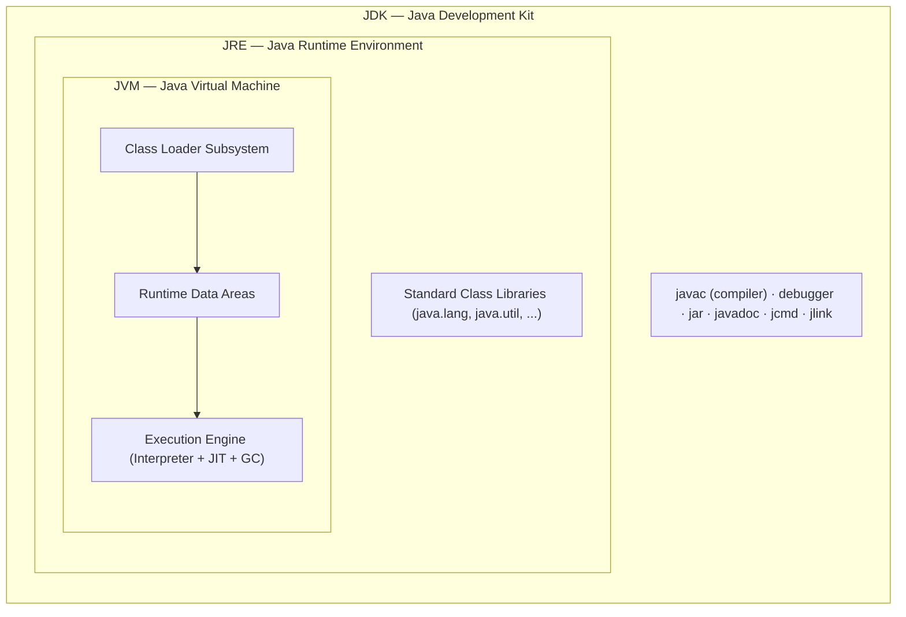
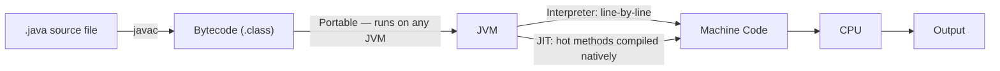
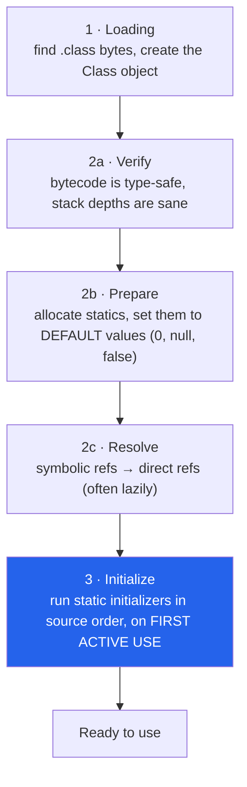

:::tip[TL;DR (30-Second Interview Pitch)]
**JVM** is the abstract, platform-dependent engine that executes bytecode. **JRE** is the JVM plus the standard class libraries needed to *run* a Java program. **JDK** is the JRE plus the compiler (`javac`), debugger, and other tools needed to *develop* one. The relationship is nested: `JDK ⊃ JRE ⊃ JVM`. This trio is exactly what gives Java its **WORA** (Write Once, Run Anywhere) promise — the *bytecode* is platform-independent even though every JVM implementation itself is platform-dependent. Top companies then go one level deeper: **how a class gets loaded and initialized, which memory area throws which error, and what the JIT does to your code.**
:::

<PriorityKey />

## ⚡ Essential Interview Recall

- 🔴 **JVM** = abstract spec + concrete engine that runs **bytecode** → machine code. **Platform-dependent** (you install a different JVM per OS).
- 🔴 **JRE** = JVM + core **class libraries**. Lets you *run* Java apps, not compile them. **JDK** = JRE + `javac` + debugger + tools. Nesting: **JDK ⊃ JRE ⊃ JVM**.
- 🔴 Compiled output (`.class` bytecode) is **platform-independent**; the JVM that runs it is **platform-dependent**.
- 🔴 JVM has 3 subsystems: **Class Loader Subsystem → Runtime Data Areas → Execution Engine** (Interpreter + JIT + GC).
- 🔴 Class loading = **Loading → Linking (Verify → Prepare → Resolve) → Initialization**. *Prepare* sets static fields to **default** values; *Initialization* runs `<clinit>` (static initializers, top to bottom) — **lazily, on first active use**.
- 🔴 Delegation model: **Bootstrap → Platform → Application**; each loader asks its **parent first**. A class's identity is **(fully-qualified name + defining classloader)**.
- 🔴 **`ClassNotFoundException`** (checked, *you* asked for a class by name and it isn't there) vs **`NoClassDefFoundError`** (Error, the class was there at compile time but the JVM can't find or initialize it now).
- 🔴 Error map: **heap** → `OutOfMemoryError: Java heap space`; **Metaspace** → `OutOfMemoryError: Metaspace`; **thread stack** → `StackOverflowError`; **too many threads** → `OutOfMemoryError: unable to create native thread`.
- 🟠 **String pool** lives on the **heap** since Java 7 (it was in PermGen before). **Metaspace** (native memory) replaced **PermGen** in Java 8.
- 🟠 Static field **values** live on the heap (inside the `java.lang.Class` object); Metaspace holds only class **metadata**.
- 🔴 **JIT** compiles hot methods to native code at runtime. **Tiered**: interpreter (tier 0) → **C1** (fast compile, tiers 1–3) → **C2** (aggressive optimization, tier 4).
- 🟡 JIT tricks: **inlining**, **escape analysis** (scalar replacement, lock elision), **loop unrolling**, **on-stack replacement**, and **deoptimization** when an assumption breaks.
- 🟠 Since **Java 11**, Oracle ships no standalone JRE; `jlink` (Java 9) builds a minimal custom runtime. LTS releases: **8, 11, 17, 21, 25**.
- 🟡 `finalize()` is deprecated (Java 9) and **deprecated for removal** (Java 18) → use **try-with-resources** or `java.lang.ref.Cleaner`.

:::speak[What happens when you type java Main?]
"The launcher starts a JVM for my OS. The **application classloader** is asked for `Main`; it first delegates up to the **platform** and **bootstrap** loaders, and when neither has it, it reads `Main.class` from the classpath. The class is **verified**, its statics get default values in **prepare**, symbolic references are **resolved**, and then the **static initializer runs** on first active use. `main` gets a **stack frame** on the main thread's JVM stack, objects go on the **heap**, and the **interpreter** starts executing bytecode. Methods that get hot are compiled by **C1** and then **C2** into native code, while the **garbage collector** reclaims unreachable objects in the background. If memory runs out I'd expect `OutOfMemoryError` from the heap or Metaspace, or `StackOverflowError` from runaway recursion."
:::

## The Mental Model





**The life of a class**, from bytes on disk to ready-to-use:



:::analogy[Classloader delegation is asking your manager first]
A new joiner (the application classloader) gets a request for "String". Before building anything, they ask their manager (platform loader), who asks the director (bootstrap). The director already has an official "String", so that one is used, and nobody lower down can sneak in a fake. Only if every manager says "never heard of it" does the new joiner go and fetch it from the classpath.
:::

## The Paradigm / Core Concepts

| Component | Contains | Purpose | Platform-dependent? |
|---|---|---|---|
| **JVM** | Class loader, runtime data areas, execution engine | Executes bytecode | Yes — one build per OS/CPU |
| **JRE** | JVM + standard class libraries | *Run* Java applications | Yes (inherits from JVM) |
| **JDK** | JRE + `javac`, debugger, `jar`, `javadoc`, `jcmd`, `jlink`, profilers | *Develop* Java applications | Yes (inherits from JRE) |
| **Bytecode (`.class`)** | Platform-neutral instructions | The portable artifact | **No** — this is what's WORA |

**Java platform editions:**

| Edition | Scope |
|---|---|
| **JSE** (Java Standard Edition) | Core language + core APIs — the foundation all other editions build on |
| **JEE / Jakarta EE** (Enterprise Edition) | JSE + Servlets + JSP + Transaction API + Persistence API — for enterprise/web apps |
| **JME** (Micro/Mobile Edition) | Stripped-down APIs for embedded and mobile devices |

**🟠 Long-term-support releases interviewers expect you to place:**

| LTS | Year | Headline features worth naming |
|---|---|---|
| **8** | 2014 | Lambdas, streams, `Optional`, default methods, Metaspace replaces PermGen |
| **11** | 2018 | `var` in lambdas, `HttpClient`, no standalone Oracle JRE, ZGC (experimental), Epsilon GC |
| **17** | 2021 | Records, sealed classes, pattern matching for `instanceof`, text blocks, switch expressions |
| **21** | 2023 | **Virtual threads**, record patterns, pattern matching for `switch`, generational ZGC, sequenced collections |
| **25** | 2025 | Compact source files and instance `main`, scoped values, compact object headers, AOT cache improvements |

## ⚙️ Under the Hood (JVM Mechanics)

### 🔴 Class Loader Subsystem: who loads what

- **Bootstrap Classloader** (native code, loads core `java.lang.*`/`java.util.*` from the `java.base` module; `rt.jar` before Java 9) → has no Java-level parent, and `String.class.getClassLoader()` returns `null`.
- **Platform Classloader** (called *Extension* Classloader before Java 9) — loads the remaining JDK modules (`java.sql`, `java.xml`, ...), parented to Bootstrap.
- **Application Classloader** (often called the "System" classloader) — loads your classpath / module path, parented to Platform.
- Each loader delegates *upward* first — a child only loads a class itself if none of its ancestors can. This prevents core classes like `java.lang.String` from being silently shadowed by application code.

### 🔴 Class loading phases: Load → Link → Initialize

| Phase | What happens | Can fail with |
|---|---|---|
| **Loading** | Classloader finds the bytes, JVM parses them, creates the `java.lang.Class` object | `ClassNotFoundException` / `NoClassDefFoundError`, `ClassFormatError`, `UnsupportedClassVersionError` (compiled for a newer Java) |
| **Verify** | Bytecode verifier proves type safety: no stack underflow, no jumping into the middle of an instruction, no treating an `int` as a reference | `VerifyError` |
| **Prepare** | Memory for static fields is allocated and set to **default** values (`0`, `null`, `false`). Your `= 42` has **not** run yet | — |
| **Resolve** | Symbolic references in the constant pool (`"java/lang/String"`) become direct pointers. HotSpot does this **lazily**, the first time each instruction runs | `NoSuchMethodError`, `NoSuchFieldError`, `IllegalAccessError` |
| **Initialize** | JVM runs the class's `<clinit>` method: every static field initializer and `static { }` block, **in source order**, exactly once, **thread-safely** | `ExceptionInInitializerError` (first time), then `NoClassDefFoundError: Could not initialize class X` (every later time) |

<RuleCard name="When does a class get initialized?" tag="JLS 12.4.1" why="Lazy initialization keeps startup fast: a class you never actively use never runs its static code." remember="Active use triggers it; just mentioning it does not.">

A class is initialized on its **first active use**: `new`, calling a static method, reading or writing a **non-constant** static field, `Class.forName("X")`, initializing a **subclass** (parent goes first), or being the **main class**.

It is **not** initialized by: reading a **compile-time constant** (`static final int X = 10` is copied into the caller at compile time), creating an **array** of the type (`new Foo[10]`), the `Foo.class` literal, `ClassLoader.loadClass()`, or reading a parent's static field **through a subclass name** (only the declaring class initializes).

</RuleCard>

- The JVM guarantees `<clinit>` runs **once, under a lock**. That's why the **initialization-on-demand holder** idiom is a lazy, thread-safe singleton with zero synchronization code:

```java title="Singleton.java — holder idiom" showLineNumbers
public final class Singleton {
    private Singleton() { }

    private static class Holder {
        // highlight-next-line
        static final Singleton INSTANCE = new Singleton();   // runs only when Holder is first used
    }

    public static Singleton getInstance() {
        return Holder.INSTANCE;   // first call initializes Holder; the JVM's init lock makes it thread-safe
    }
}
```

### 🟠 Breaking delegation: app servers, plugins and class identity

- **Class identity = name + defining loader.** The same `com.acme.User` loaded by two different classloaders is **two different classes**. Casting between them throws the famous `ClassCastException: com.acme.User cannot be cast to com.acme.User`.
- **Tomcat and other servlet containers deliberately break parent-first delegation**: each web app gets its own `WebappClassLoader` that looks in `WEB-INF/classes` and `WEB-INF/lib` **first** (child-first), except for `java.*` and container classes. That's how two apps on one server can use different versions of the same library.
- **Thread context classloader (TCCL)**: core JDK code (loaded by Bootstrap) sometimes has to load *your* classes, e.g. JDBC drivers via `ServiceLoader`. Bootstrap can't see the classpath, so it borrows `Thread.currentThread().getContextClassLoader()`. Spring, JNDI and Java SPI all rely on it.
- **Custom classloaders** extend `ClassLoader` and override `findClass()` (keep delegation) or `loadClass()` (break it). Used for plugins, hot reload (Spring DevTools uses a restart classloader), and bytecode instrumentation.
- **Classloader leak**: a class is unloaded only when its **classloader** becomes unreachable, together with every class it loaded and every instance of them. One stray reference (a `ThreadLocal` on a pooled thread, a JDBC driver registered in `DriverManager`, a static cache in a parent-loaded library) pins the whole old web app in **Metaspace** after a redeploy. Do it a few times and you get `OutOfMemoryError: Metaspace`.

### 🔴 Runtime data areas

| Area | Shared or per-thread | Holds | Sized by |
|---|---|---|---|
| **Heap** | Shared | Every object and array, static field values (inside `Class` objects), the **String pool** | `-Xms`, `-Xmx` |
| **Metaspace** (Method Area) | Shared, **native** memory | Class metadata: bytecode, constant pool, field/method descriptors, vtables | `-XX:MaxMetaspaceSize` (unbounded by default) |
| **JVM Stack** | Per thread | One **frame** per method call | `-Xss` (default 1 MB on 64-bit Linux) |
| **PC Register** | Per thread | Address of the current bytecode instruction (undefined while in native code) | — |
| **Native Method Stack** | Per thread | Frames for JNI/native code | — |
| **Code Cache** | Shared, native | Machine code produced by the JIT | `-XX:ReservedCodeCacheSize` (240 MB with tiered compilation) |

- **Anatomy of a stack frame:**
  - **Local variable array**: slot 0 is `this` for instance methods, then the parameters, then the locals. `long`/`double` take two slots.
  - **Operand stack**: the scratch pad bytecode works on. `iload_1` pushes, `iadd` pops two and pushes one, `istore_2` pops into a local.
  - **Frame data**: a reference to the class's runtime constant pool, plus the return address.
- The Java stack never holds objects, only **primitives and references**. (The JIT's escape analysis may still avoid the heap allocation; see below.)

:::analogy[Metaspace is the blueprint office, the heap is the factory floor]
Metaspace keeps one blueprint per class: how a `Car` is laid out, and the instructions for each method. The heap is the factory floor where every actual `Car` object is built. A thousand cars share one blueprint, so a Metaspace problem usually means too many **blueprints** (classes) piling up, while a heap problem means too many **cars** (objects).
:::

### 🔴 Which area throws which error

| Error message | Area | Typical root cause | First thing to check |
|---|---|---|---|
| `OutOfMemoryError: Java heap space` | Heap | Leak (unbounded cache, static collection), or `-Xmx` simply too small for the load | Heap dump → dominator tree in Eclipse MAT |
| `OutOfMemoryError: GC overhead limit exceeded` | Heap | Parallel GC spent over 98% of its time collecting and freed under 2% of the heap: a leak that hasn't quite hit the wall yet | Same as above |
| `OutOfMemoryError: Requested array size exceeds VM limit` | Heap | Allocating an array near `Integer.MAX_VALUE` elements | The code computing the size |
| `OutOfMemoryError: Metaspace` | Metaspace | Classloader leak on redeploy, or runaway dynamic proxy/bytecode generation | Class histogram: are there several copies of the same app's classes? |
| `OutOfMemoryError: unable to create native thread` | Native (OS) | Too many threads (each needs native stack memory), or the OS/container process limit (`ulimit -u`, pids limit) | Thread count in a thread dump; use a pool (or virtual threads) |
| `OutOfMemoryError: Cannot reserve N bytes of direct buffer memory` | Direct (off-heap) | NIO/Netty direct buffers not released, or `-XX:MaxDirectMemorySize` too low | Netty leak detector, NMT (`-XX:NativeMemoryTracking`) |
| `StackOverflowError` | JVM stack | Unbounded or very deep recursion (including accidental: `toString()` calling itself, bidirectional JPA relations in JSON) | The repeating frames at the top of the stack trace |
| Process killed, **no** Java error (`OOMKilled`, exit 137) | Whole process vs container limit | Heap + Metaspace + thread stacks + direct memory + code cache exceeded the container's memory limit | Leave headroom: `-XX:MaxRAMPercentage=75`, not 100 |

### 🟠 The String pool

- The pool (`StringTable`) is a hash table of **references to `String` objects on the heap**. It moved from PermGen to the heap in **Java 7**, so pooled strings can be garbage-collected like any other object.
- All **string literals** and compile-time constant expressions (`"a" + "b"`) are pooled automatically when the class is loaded/resolved.
- `s.intern()` returns the pooled instance; since Java 7, if no equal string is pooled yet, it pools **`s` itself** (it no longer copies it).
- `new String("hello")` always creates a **new** heap object, even though the literal `"hello"` is already in the pool.
- Don't confuse interning with **G1 string deduplication** (`-XX:+UseStringDeduplication`): dedup makes equal strings share one backing `byte[]` but they stay different objects, so `==` is still `false`.

### 🔴 Execution engine: interpreter + JIT

- **Interpreter** — reads bytecode and executes it instruction-by-instruction. Fast to start, slow per instruction.
- **JIT (Just-In-Time) Compiler** — part of **HotSpot** (named for finding the "hot" code paths). The JVM keeps **invocation and back-edge (loop) counters** per method; once they cross a threshold, the method is compiled to native code into the **code cache**, and later calls jump straight there.
- **Tiered compilation** (default since Java 8):

| Tier | Who | What it does |
|---|---|---|
| 0 | Interpreter | Runs bytecode and **collects profiles** (which branches are taken, which receiver types appear) |
| 1–3 | **C1** (client compiler) | Quick compile, light optimization; tier 3 keeps profiling (around 200 invocations to get here) |
| 4 | **C2** (server compiler) | Slow compile, aggressive **profile-guided** optimization (around 5,000 invocations) |

- **Garbage Collector** — reclaims heap memory for unreachable objects; part of the execution engine. Full detail on the [Garbage Collection & JVM Tuning](./garbage-collection.md) page.

:::analogy[The JIT is an interpreter who memorizes your favourite phrases]
A tourist guide translates every sentence you say, one at a time (the interpreter). After hearing "where is the train station?" fifty times, she memorizes the translation and just says it instantly (C1). After a thousand times she has rewritten it into the shortest local slang for your exact route (C2). If you suddenly start asking about a different station, she drops the memorized version and translates carefully again (deoptimization).
:::

### 🟡 What the JIT actually does to your code

- **Inlining** — the most important optimization: the body of a small method is pasted into its caller (bytecode up to 35 bytes always, hot methods up to 325 bytes), which removes call overhead and unlocks every other optimization. This is why getters/setters cost nothing.
- **Monomorphic call-site optimization** — if profiling shows `shape.area()` only ever sees `Circle`, C2 inlines `Circle.area()` behind a cheap type check. Two types (bimorphic) are handled too; three or more (megamorphic) fall back to a real vtable/itable call.
- **Escape analysis** — if an object never escapes the method (not returned, not stored in a field, not passed to unknown code), C2 can:
  - **Scalar-replace** it: keep its fields in registers, so **no heap allocation** happens at all.
  - **Elide locks**: `synchronized` on an object no other thread can see is removed.
- **Loop optimizations** — unrolling, range-check elimination, vectorization (SIMD).
- **On-stack replacement (OSR)** — a long-running loop inside `main` gets compiled *while it is still running*, and execution jumps into the compiled version mid-loop.
- **Deoptimization** — C2's optimizations rest on **speculative assumptions** ("only `Circle` reaches here", "this branch is never taken"). When one breaks, for example a new subclass is loaded, the JVM throws away the compiled code (an *uncommon trap*), falls back to the interpreter and recompiles later. Shows up as `made not entrant` in `-XX:+PrintCompilation`.
- **Code cache full** → `CodeCache is full. Compiler has been disabled.` warning, and the app silently slows down to interpreter speed. Fix with `-XX:ReservedCodeCacheSize`.

### 🟡 Startup and warm-up: CDS, AOT cache and native images

| Technique | What it saves | Trade-off |
|---|---|---|
| **CDS / AppCDS** (Class Data Sharing) | Pre-parsed class metadata mapped from an archive file at startup; JDK classes have a default archive since Java 12 | Archive must match the JDK and classpath |
| **AOT cache** <Since v="24" /> (Project Leyden) | Classes already loaded and linked from a training run; Java 25 also stores method profiles so the JIT warms up faster | Needs a representative training run |
| **GraalVM Native Image** | Compiles the whole app ahead of time into a native executable: starts in milliseconds, small memory footprint | **Closed-world**: reflection, proxies and resources must be declared up front; build is slow; peak throughput can be lower than a warmed-up C2 |
| **CRaC** (Coordinated Restore at Checkpoint) | Snapshot of a warmed-up JVM restored in milliseconds | Linux-only; open files and sockets must be closed and reopened around the checkpoint |

:::danger[Interview Trap]
**"Download the JRE" is outdated advice.** Oracle stopped shipping a standalone JRE starting with Java 11 — the JDK bundles everything, and `jlink` (Java 9) assembles a minimal runtime containing only the modules your app needs. (Other vendors such as Eclipse Temurin still publish JRE builds.)
:::

:::danger[Interview Trap]
**WORA is a property of bytecode, not of the JVM.** The JVM itself is native code and *fully platform-dependent* — you need a different JVM binary for Windows vs Linux vs macOS. What's portable is the `.class` bytecode. Saying "Java is platform-independent because the JVM runs everywhere" gets the causality backwards.
:::

:::danger[Interview Trap]
**`static final` does not always mean "the class gets initialized when I read it".** If the field is a **compile-time constant** (a primitive or `String` initialized with a constant expression), `javac` copies the value into the caller's bytecode. Reading it never touches the class, so its static block **does not run**. The flip side: change the constant and recompile only the declaring class, and old callers keep the **old value**.
:::

## 💻 Java Implementation

You don't "write" a JDK, JRE or JVM, but inspecting them from code and knowing the compile → load → execute pipeline is standard interview ground.

### 1. Ask the JVM about itself

```java title="PlatformProbe.java" showLineNumbers
public class PlatformProbe {

    public static void main(String[] args) {
        // highlight-start
        System.out.println("Java version: " + System.getProperty("java.version"));
        System.out.println("JVM name:     " + System.getProperty("java.vm.name"));
        System.out.println("Max heap MB:  " + Runtime.getRuntime().maxMemory() / (1024 * 1024));
        System.out.println("CPUs:         " + Runtime.getRuntime().availableProcessors());
        // highlight-end

        for (int i = 0; i < 20_000; i++) {
            // highlight-next-line
            doWork(i);   // called 20k times → "hot" → JIT compiles it natively
        }
    }

    private static int doWork(int i) {
        return i * 2;
    }
}
```

### 2. What happens when you run it

| # | Step | Who does it | Result |
|---|---|---|---|
| 1 | `javac PlatformProbe.java` | **JDK** compiler | `PlatformProbe.class`: platform-independent **bytecode** |
| 2 | `java PlatformProbe` | **Application ClassLoader** (after delegating up) | Class is loaded → verified → prepared |
| 3 | Before `main()` | JVM | `PlatformProbe` is **initialized** (it's the main class) |
| 4 | `main()` starts | **Interpreter** | A frame is pushed on the main thread's stack; bytecode runs |
| 5 | `doWork()` gets hot | **JIT** (C1, then C2) | Method compiled to **native machine code**, probably inlined into the loop |
| 6 | Program keeps running | **Execution Engine** + **GC** | GC manages the heap in the background |

### 3. Watch it from the terminal

```bash title="Terminal"
java -version                                   # JVM version and vendor
javac -version                                  # compiler version (JDK only)
javac PlatformProbe.java                        # produces PlatformProbe.class
javap -c PlatformProbe                          # disassemble: see the actual bytecode
# highlight-next-line
java -XX:+PrintCompilation PlatformProbe        # watch the JIT compile doWork() live
java -Xlog:class+load PlatformProbe | head      # every class as it is loaded, and from where
```

### 4. Initialization is lazy, and constants don't trigger it

Every output below comes from running the code on JDK 21.

```java title="InitDemo.java" showLineNumbers
public class InitDemo {
    static class A { static final int X = 10;  static { System.out.println("A init"); } }
    static class P { static int v = 1;         static { System.out.println("P init"); } }
    static class C extends P {                 static { System.out.println("C init"); } }
    static class B {                           static { System.out.println("B init"); } }

    public static void main(String[] args) throws Exception {
        // highlight-next-line
        System.out.println(A.X);         // 10 only: X is a compile-time constant, A never initializes
        // highlight-next-line
        System.out.println(C.v);         // "P init" then 1: v is declared in P, so C is NOT initialized
        B[] arr = new B[5];              // nothing printed: an array of B is not a use of B
        Class<?> k = B.class;            // nothing printed: a class literal doesn't initialize either
        // success-next-line
        Class.forName("InitDemo$B");     // ✅ "B init": forName initializes by default
    }
}
```

### 5. `ClassNotFoundException` vs `NoClassDefFoundError`

```java title="LoadingFailures.java" showLineNumbers
public class LoadingFailures {
    static class Bad {
        static int v = 1 / Integer.parseInt("0");   // static initializer throws
    }

    public static void main(String[] args) {
        // error-start
        try { Class.forName("com.acme.Missing"); }  // ❌ you asked by name: checked exception
        catch (ClassNotFoundException e) { System.out.println(e); }
        // error-end
        // → java.lang.ClassNotFoundException: com.acme.Missing

        // highlight-start
        try { System.out.println(Bad.v); } catch (Throwable t) { System.out.println("1st: " + t); }
        try { System.out.println(Bad.v); } catch (Throwable t) { System.out.println("2nd: " + t); }
        // highlight-end
        // → 1st: java.lang.ExceptionInInitializerError
        // → 2nd: java.lang.NoClassDefFoundError: Could not initialize class LoadingFailures$Bad
    }
}
```

| | `ClassNotFoundException` | `NoClassDefFoundError` |
|---|---|---|
| Type | **Checked exception** | **Error** (`LinkageError`) |
| Raised when | *Your code* loads a class **by name**: `Class.forName`, `loadClass`, deserialization | The **JVM** implicitly needs a class that compiled fine: `new Helper()`, a method call, a field access |
| Classic cause | Driver/plugin JAR missing, typo in the class name | JAR missing at **runtime** but present at compile time; **static initializer failed earlier**; version conflict |
| Cause chain | — | Often wraps a `ClassNotFoundException` (`Caused by: ...`) or follows an earlier `ExceptionInInitializerError` |

### 6. JVM flags you're expected to know

| Flag | What it does | Production note |
|---|---|---|
| `-Xms` / `-Xmx` | Initial / maximum heap | In containers, set them **equal** so the heap never has to grow or shrink |
| `-XX:MaxRAMPercentage=75` | Max heap as a percentage of the container's memory limit (default 25%) | Better than a hard-coded `-Xmx` in Kubernetes; JVMs are container-aware since 8u191 / 10 |
| `-Xss512k` | Thread stack size (default 1 MB) | Lower it for thousands of platform threads; raise it for deep recursion |
| `-XX:MaxMetaspaceSize=256m` | Cap Metaspace (unbounded by default) | Turns a slow native-memory leak into a clear `OutOfMemoryError: Metaspace` |
| `-XX:+UseG1GC` / `-XX:+UseZGC` / `-XX:+UseParallelGC` | Choose the collector | G1 is the default on server-class machines |
| `-Xlog:gc*:file=gc.log:time,uptime` | Unified GC logging (Java 9+; replaces `-XX:+PrintGCDetails`) | Always on in production; the overhead is negligible |
| `-XX:+HeapDumpOnOutOfMemoryError -XX:HeapDumpPath=/dumps` | Write a heap dump when an OOM happens | The single most useful flag for a post-mortem |
| `-XX:+ExitOnOutOfMemoryError` | Kill the JVM on OOM so the orchestrator restarts it | A half-dead JVM after an OOM is worse than a restart |
| `-XX:NativeMemoryTracking=summary` | Track native memory by area, read with `jcmd <pid> VM.native_memory` | For when RSS is far bigger than `-Xmx` |

### 7. The diagnostics toolkit

```bash title="Terminal — given a running JVM with process id 4242"
jcmd                                         # list running JVMs and their pids
jcmd 4242 VM.flags                           # the flags actually in effect
# highlight-start
jcmd 4242 Thread.print > threads.txt         # thread dump (same as jstack 4242)
jcmd 4242 GC.heap_dump /tmp/heap.hprof       # heap dump (same as jmap -dump:live,format=b,file=...)
# highlight-end
jcmd 4242 GC.class_histogram | head -20      # which classes hold the most instances and bytes
jstat -gcutil 4242 1000                      # GC occupancy and counts, every second
jcmd 4242 JFR.start duration=60s filename=rec.jfr   # Java Flight Recorder: low-overhead profiling
```

| Symptom | Tool | What you look for |
|---|---|---|
| App hung, CPU idle | **Thread dump** (take 3, a few seconds apart) | Threads `BLOCKED` on the same monitor; the dump prints `Found one Java-level deadlock` when there is one |
| CPU at 100% | `top -H -p <pid>` + thread dump | Convert the hot thread id to hex and find the matching `nid=0x...` in the dump |
| Memory grows until OOM | **Heap dump** in Eclipse MAT / VisualVM | Dominator tree, "Leak Suspects" report, paths to GC roots |
| Latency spikes | **GC log** + JFR | Long pauses, `Full GC`, `to-space exhausted`, allocation rate |
| Slow, no obvious cause | **JFR** / async-profiler flame graph | Hot methods, lock contention, allocation hot spots |

## 🧪 Predict the Output

<Predict n="1" title="Reading a constant" output="10">

```java
class Config {
    static final int TIMEOUT = 10;
    static { System.out.println("Config loaded"); }
}
// in main:
System.out.println(Config.TIMEOUT);
```

`TIMEOUT` is a **compile-time constant**, so `javac` replaced `Config.TIMEOUT` with the literal `10` in the caller's bytecode. `Config` is never initialized and its static block never runs. Change it to `static final Integer TIMEOUT = 10;` (not a constant: boxing is a method call) and `Config loaded` **does** print first.

</Predict>

<Predict n="2" title="Static field through a subclass" output="P init, then 1">

```java
class P { static int v = 1; static { System.out.println("P init"); } }
class C extends P { static { System.out.println("C init"); } }
// in main:
System.out.println(C.v);
```

`v` is declared in `P`. The bytecode says `getstatic C.v`, but the JVM resolves the field to its **declaring** class and initializes only that one. **`C init` is never printed.** Had you called `new C()`, both would print, parent first: `P init`, `C init`.

</Predict>

<Predict n="3" title="The second call is a different error" output="ExceptionInInitializerError, then NoClassDefFoundError: Could not initialize class Bad">

```java
class Bad { static int v = 1 / 0; }   // the compiler allows it
// in main:
try { int x = Bad.v; } catch (Throwable t) { System.out.println(t); }
try { int x = Bad.v; } catch (Throwable t) { System.out.println(t); }
```

The first access runs `<clinit>`, which throws, and the JVM wraps it in `ExceptionInInitializerError`. The class is then marked **erroneous** and is **never** retried, so every later access gets `NoClassDefFoundError`. In production logs you often see only the second error, because the first one scrolled away hours earlier. Always search the logs for the first `ExceptionInInitializerError`.

</Predict>

<Predict n="4" title="intern() since Java 7" output="true, false, true">

```java
String built = new StringBuilder("wiki").append("Pool42").toString();
System.out.println(built.intern() == built);    // A

String s = new String("hello");
System.out.println(s.intern() == s);            // B

System.out.println("wikiPool42" == built);      // C
```

- **A `true`**: `"wikiPool42"` wasn't pooled yet, so since Java 7 `intern()` puts **this very object** into the pool and returns it. (In Java 6 the pool was in PermGen and it got a *copy*: `false`.)
- **B `false`**: the literal `"hello"` was already pooled when the class loaded, so `intern()` returns that **other** object.
- **C `true`**: the literal resolves to whatever the pool holds, which is `built`.

</Predict>

<Predict n="5" title="Arrays and class literals" output="Only: B init">

```java
class B { static { System.out.println("B init"); } }
// in main:
B[] arr = new B[5];
Class<?> k = B.class;
Object o = Class.forName("B");
```

Creating an array of `B` creates an object of a JVM-synthesized array class `[LB;`, which is not a use of `B`. The class literal loads `B` but doesn't initialize it. `Class.forName(name)` initializes by default (the 3-argument overload lets you pass `initialize = false`). This is exactly how old JDBC code worked: `Class.forName("com.mysql.jdbc.Driver")` ran the driver's static block, which registered it with `DriverManager`.

</Predict>

## 🪜 Follow-up Ladder

<Ladder title="From java Main to warm-up tuning">
<Rung q="What happens when you run java Main?">

Launcher starts the JVM → application classloader delegates up, then loads `Main.class` → verify, prepare, resolve → initialize → `main` runs in the interpreter → hot code is JIT-compiled.

</Rung>
<Rung q="How does the JVM decide a method is hot?">

Per-method **invocation counters** and **back-edge counters** (loop iterations). Around 200 calls gets a C1 compile with profiling (tier 3), around 5,000 gets C2 (tier 4). A long loop can trigger **OSR** compilation without the method ever returning.

</Rung>
<Rung q="What does C2 do that C1 doesn't?">

**Profile-guided speculation**: aggressive inlining of the receiver types it actually saw, escape analysis (no allocation, no locks for non-escaping objects), loop unrolling and vectorization, and dead branch elimination for branches never taken.

</Rung>
<Rung q="What if a speculation turns out wrong?">

**Deoptimization**: the compiled code is marked "not entrant", the frame is rebuilt as an interpreter frame, and execution continues in the interpreter. The method gets re-profiled and recompiled with the new facts. Many deopts in a loop show up as a CPU spike in `-XX:+PrintCompilation`.

</Rung>
<Rung q="After each deploy, our p99 latency is bad for the first few minutes. What would you do?">

That's JIT warm-up (and cold caches). Options, from cheapest:

- Send synthetic **warm-up traffic** before the pod is marked ready (readiness probe).
- Use **AppCDS** or the **AOT cache** (Java 24+) to skip class loading and linking work.
- Use **CRaC** to restore a warmed-up checkpoint.
- Build a **GraalVM native image** if startup matters more than peak throughput (e.g. serverless).
- Don't throttle the container's CPU too hard: the JIT compiler threads need CPU too.

</Rung>
</Ladder>

## 🚑 Production Scenarios

:::incident[OutOfMemoryError: Metaspace after the fifth redeploy]
A Tomcat server runs fine for weeks but dies with `OutOfMemoryError: Metaspace` after a few hot redeploys of the same WAR.

- **Diagnosis:** `jcmd <pid> GC.class_histogram` shows several copies of the same `com.acme.*` classes, and a heap dump shows several `WebappClassLoader` instances, only one of them live.
- **Why:** something outside the web app still references an object of the old app, which pins its classloader and every class it loaded. The usual suspects: a `ThreadLocal` value left on a container thread, a JDBC driver registered in `DriverManager` and never deregistered, a shutdown hook, or a static cache in a library on the shared classpath.
- **Fix:** clean up in `ServletContextListener.contextDestroyed` (deregister drivers, stop executors, `ThreadLocal.remove()`), and cap Metaspace with `-XX:MaxMetaspaceSize` so it fails loudly instead of eating native memory. In practice, most teams stop hot-redeploying and restart the container instead.
:::

:::incident[NoClassDefFoundError in production, but the build is green]
A Spring Boot service fails at runtime with `NoClassDefFoundError: com/fasterxml/jackson/core/util/JacksonFeature`.

- **Why:** two libraries pulled in **different versions** of Jackson. Maven's "nearest wins" picked an older `jackson-core` that lacks the class a newer `jackson-databind` was compiled against. It compiled fine because the compiler saw a different classpath order.
- **Fix:** run `mvn dependency:tree -Dincludes=com.fasterxml.jackson.core`, align versions with a BOM (`jackson-bom` or Spring Boot's dependency management), and add the Maven Enforcer `dependencyConvergence` rule so it fails the build next time.
:::

## 🚨 Interview Gotchas & Edge Cases

:::warning[The Most Common Question]
**"If I give you only the JRE, can you compile a `.java` file?"** No — the JRE has the JVM and runtime libraries to *execute* bytecode, but not `javac`. Compiling requires the JDK. The senior follow-up is usually *"then what is in a `jlink` image?"*: only the modules your app needs, plus the JVM, with no compiler.
:::

- **The JVM is a specification *and* an implementation.** "JVM" can mean the abstract spec or a concrete engine like HotSpot, OpenJ9, or GraalVM — each with different GC algorithms and JIT strategies.
- **Interpreter and JIT coexist** — cold code stays interpreted; only methods crossing the thresholds get compiled. That's why benchmarks need a **warm-up** phase (use **JMH**, never `System.currentTimeMillis()` around a loop).
- **Metaspace replaced PermGen in Java 8.** PermGen was a fixed-size heap region prone to `OutOfMemoryError: PermGen space`; Metaspace uses native memory and grows dynamically, but can still be exhausted by classloader leaks.
- **Modules (JPMS, Java 9+)** added the **module path** and strong encapsulation: `requires`/`exports` visibility, and since Java 16/17 reflective access to JDK internals is denied by default (`--add-opens` to override).
- **Parent delegation prevents core-class spoofing** — even a child-first loader like Tomcat's always delegates `java.*`, and the JVM refuses to define classes in `java.*` packages from a non-bootstrap loader (`SecurityException: Prohibited package name`).
- **`UnsupportedClassVersionError`** = class compiled for a newer Java than the one running it (e.g. class file version 65 = Java 21, run on Java 17). Fix with `--release 17` when compiling.
- **`finalize()` is broken by design**: no guarantee it ever runs, it delays reclamation by at least one extra GC cycle, it can resurrect the object, and exceptions in it are silently ignored. Deprecated in Java 9, **deprecated for removal** in Java 18 (JEP 421). Use **try-with-resources** for deterministic cleanup and `Cleaner` (Java 9) as a safety net.
- **`System.gc()` is only a hint.** It usually triggers a **full** GC (with G1 it is a full stop-the-world collection), which is why many teams run with `-XX:+DisableExplicitGC`.
- **The default GC depends on the machine**: G1 on a "server-class" machine (2+ CPUs and about 2 GB+ of memory); otherwise **Serial**. A container limited to 1 CPU silently gets Serial GC.
