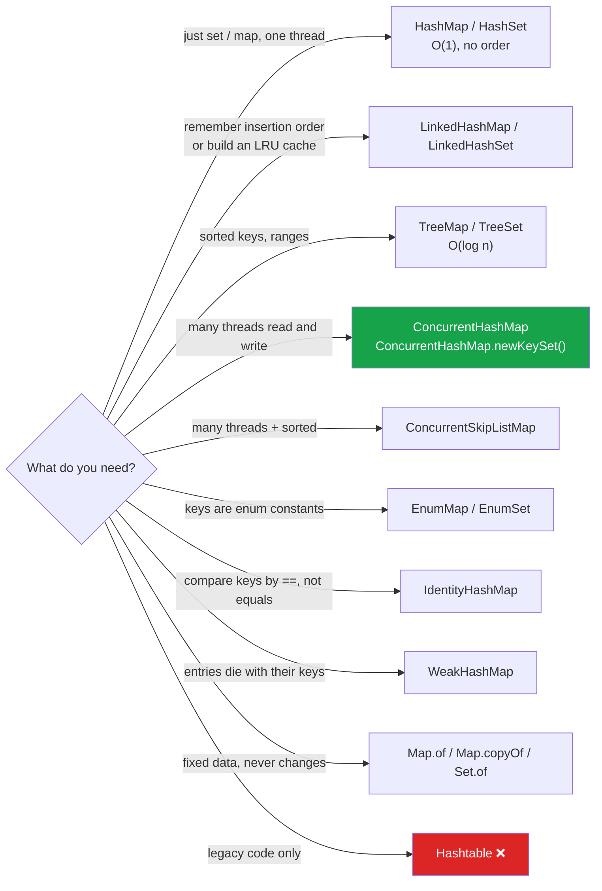

:::tip[TL;DR (30-Second Interview Pitch)]
Java has one hashing idea and many hash-based collections, each answering a different need: **`HashSet`** is a `HashMap` with dummy values, **`LinkedHashMap`** adds a doubly linked list for **insertion or access order** (an LRU cache in 6 lines), **`ConcurrentHashMap`** makes it **thread-safe without a global lock** (CAS on empty bins, `synchronized` on one bin head otherwise), and **`Hashtable`** is the legacy fully-synchronized version you should never pick. Specialists cover the rest: **`IdentityHashMap`** (`==` instead of `equals`), **`WeakHashMap`** (entries vanish when keys are garbage-collected), **`EnumMap`/`EnumSet`** (plain arrays and bit masks), and **`Map.of`** (immutable, open addressing).
:::

<PriorityKey />

## ⚡ Essential Interview Recall

- 🔴 **`HashSet`** = `HashMap<E, Object>` with a shared `PRESENT` value; `add(e)` is `map.put(e, PRESENT) == null`. Same O(1) average, same `equals`/`hashCode` rules.
- 🔴 **`LinkedHashMap`** = `HashMap` + a doubly linked list through all entries. Default **insertion order** (re-putting a key does **not** move it); `new LinkedHashMap<>(16, 0.75f, true)` gives **access order**; override `removeEldestEntry` → **LRU cache**.
- 🔴 **`Hashtable`**: every method `synchronized` (one lock for the whole map), **no null keys or values**, default capacity **11**, grows to `2n + 1`, index `(hash & 0x7FFFFFFF) % length`. Legacy (Java 1.0).
- 🔴 **`ConcurrentHashMap` (Java 8+)**: no segments; **CAS** to install the first node of an empty bin, **`synchronized` on the bin's head node** for everything else; `get` takes **no lock** (volatile reads). Writers block only on the **same bin**.
- 🔴 **Java 7 `ConcurrentHashMap`**: 16 **segments** (each a `ReentrantLock` + its own small hash table) → at most 16 concurrent writers. Removed in Java 8.
- 🔴 **No nulls in `ConcurrentHashMap`**: `get(k) == null` must mean "absent"; with concurrent writers you can't follow up with `containsKey` atomically.
- 🔴 **Atomic per-key operations** on `ConcurrentHashMap`: `putIfAbsent`, `computeIfAbsent`, `compute`, `merge`, `replace(k, old, new)`, `remove(k, v)`. A `get` followed by a `put` is **not** atomic (check-then-act race).
- 🔴 **Iterators**: `HashMap`/`LinkedHashMap`/`HashSet`/`Hashtable` iterators are **fail-fast** (`ConcurrentModificationException`); `ConcurrentHashMap` iterators are **weakly consistent** (never throw, may or may not show concurrent changes).
- 🟠 **`Collections.synchronizedMap(m)`**: one mutex around every call; you still must `synchronized (map) { … }` while **iterating** and for compound actions.
- 🟠 **`size()` on `ConcurrentHashMap`** is an estimate under concurrency (sum of `baseCount` + `CounterCell`s, a `LongAdder`-style counter); `mappingCount()` returns a `long`.
- 🟠 **`IdentityHashMap`**: `==` and `System.identityHashCode`, **open addressing** with linear probing, keys and values stored alternately in one array. For graph traversal, serialization, proxies.
- 🟠 **`WeakHashMap`**: keys held by **weak references**; when a key is only reachable through the map, the GC clears it and the entry is purged on the next access. Values must not reference their own key.
- 🟠 **`EnumMap`** = array indexed by `ordinal()`, kept in **declaration order**; **`EnumSet`** = bit vector (`long` for ≤ 64 constants). Faster and smaller than hash-based versions.
- 🟠 **`Map.of` / `Set.of` / `Map.copyOf`** <Since v="9" />: immutable, **reject nulls** (even `contains(null)` throws), reject duplicate keys (`IllegalArgumentException`), **randomized iteration order** per JVM run.
- 🟡 **`ConcurrentHashMap` resize** is **cooperative**: threads that touch a moving table help transfer bins; moved bins are marked with a `ForwardingNode` so readers follow it to the new table.
- 🟡 **`SequencedMap`** <Since v="21" />: `LinkedHashMap` gains `putFirst`, `putLast`, `firstEntry`, `pollLastEntry`, `reversed()`.

:::speak[How does ConcurrentHashMap achieve thread safety, and how is it different from Hashtable?]
"`Hashtable` makes every method `synchronized` on the map itself, so only one thread can read **or** write at a time: a single global lock. `ConcurrentHashMap` in Java 8 and later uses the same bucket array as `HashMap` but locks at the **bucket** level. If the target bucket is empty, a thread installs the new node with a single **CAS**, no lock at all. If the bucket already has nodes, it does `synchronized` on that bucket's **first node** only, so writers to different buckets run in parallel. Reads take no lock: the table and the node values are read through volatile reads, so a `get` always sees a fully published node. Resizing is shared: other threads help move buckets. On top of that it gives atomic per-key operations like `computeIfAbsent` and `merge`, iterators that never throw `ConcurrentModificationException`, and it rejects nulls so a `null` from `get` always means 'absent'. Java 7 used 16 segment locks instead; Java 8 removed them."
:::

## The Mental Model



<Animation src="hashing/chm-put" caption="Thread A installs a node into an empty bin with one compare-and-swap. Threads B and C lock only the head of their own bins, so both writes run in parallel, and get takes no lock at all." />

## The Paradigm / Core Concepts

### 🔴 The family at a glance

| | `HashMap` | `LinkedHashMap` | `TreeMap` | `Hashtable` | `ConcurrentHashMap` |
|---|---|---|---|---|---|
| Since | 1.2 | 1.4 | 1.2 | **1.0** | 1.5 (rewritten in 8) |
| Ordering | None | Insertion (or access) | Sorted by key | None | None |
| `get`/`put` | O(1) avg | O(1) avg | O(log n) | O(1) avg | O(1) avg |
| Null key / values | 1 / ✅ | 1 / ✅ | ❌ (natural order) / ✅ | ❌ / ❌ | ❌ / ❌ |
| Thread-safe | ❌ | ❌ | ❌ | ✅ (global lock) | ✅ (per-bin lock + CAS) |
| Iterator | Fail-fast | Fail-fast | Fail-fast | Fail-fast (`Enumeration` is not) | **Weakly consistent** |
| Collision handling | List → tree | List → tree | n/a (tree) | List only | List → tree (`TreeBin`) |
| Default capacity | 16 | 16 | n/a | **11** | 16 |
| Extra memory / entry | Node | Node + 2 links | Tree entry (6 fields) | Entry | Node (+ counter cells) |

### 🔴 `HashSet` is a `HashMap`

```java title="Inside java.util.HashSet (simplified)" showLineNumbers
public class HashSet<E> implements Set<E> {
    private transient HashMap<E, Object> map;
    private static final Object PRESENT = new Object();     // one shared dummy value

    public boolean add(E e)          { return map.put(e, PRESENT) == null; }   // null = key was new
    public boolean contains(Object o){ return map.containsKey(o); }
    public boolean remove(Object o)  { return map.remove(o) == PRESENT; }
}
```

- `LinkedHashSet` is the same over a `LinkedHashMap` (verified via reflection: the backing field is a `java.util.LinkedHashMap`).
- `TreeSet` is backed by a `TreeMap` in the same way.
- Consequence: a `HashSet` costs as much memory as a `HashMap` (one `Node` per element), and **every** rule about keys (immutability, `equals`/`hashCode`) applies to set elements.

### 🔴 `LinkedHashMap`: ordered hashing and the LRU cache

| Constructor | Order | Re-`put` of an existing key | `get` |
|---|---|---|---|
| `new LinkedHashMap<>()` | **Insertion** | Keeps its original position | No effect on order |
| `new LinkedHashMap<>(cap, 0.75f, true)` | **Access** (least recent first) | Moves to the end | **Moves to the end** (so `get` is a structural change for iterators!) |

<RuleCard name="LRU cache with LinkedHashMap" tag="Recipe" why="Access order keeps the least recently used entry at the head, and removeEldestEntry is called after every insert, so eviction is automatic and O(1)." remember="Access order true, evict eldest.">

```java
class LruCache<K, V> extends LinkedHashMap<K, V> {
    private final int capacity;
    LruCache(int capacity) { super(16, 0.75f, true); this.capacity = capacity; }   // true = access order
    @Override protected boolean removeEldestEntry(Map.Entry<K, V> eldest) { return size() > capacity; }
}
```

Not thread-safe: wrap with `Collections.synchronizedMap` or use Caffeine in production.

</RuleCard>

:::analogy[A hotel register with a ribbon through the pages]
`HashMap` is a hotel where guests are assigned rooms by a formula: finding a guest is instant, but walking the corridors gives you room-number order, not arrival order. `LinkedHashMap` also ties a ribbon from each guest to the next one who checked in, so you can list guests in arrival order. In access-order mode, whoever rings the front desk gets their ribbon moved to the end, so the guest at the front of the ribbon is the one nobody has asked about for the longest time: the one to evict.
:::

### 🔴 `HashMap` vs `Hashtable` vs `synchronizedMap` vs `ConcurrentHashMap`

| | `Hashtable` | `Collections.synchronizedMap(new HashMap<>())` | `ConcurrentHashMap` |
|---|---|---|---|
| Locking | `synchronized` methods (lock = the map) | `synchronized (mutex)` around each call | CAS + `synchronized` on one bin head |
| Concurrent readers | ❌ one at a time | ❌ one at a time | ✅ unlimited, lock-free |
| Concurrent writers | ❌ one at a time | ❌ one at a time | ✅ one per bin |
| Iterating safely | Must lock manually | **Must** `synchronized (map) { for (...) }` | Just iterate (weakly consistent) |
| Compound actions (check-then-put) | Must lock manually | Must lock manually | `computeIfAbsent`, `merge`, `putIfAbsent` are atomic |
| Nulls | ❌ | ✅ (whatever the wrapped map allows) | ❌ |
| Use today | Never (legacy APIs only) | Rarely: low contention, need nulls or a specific map type | **Default** for shared mutable maps |

### 🔴 `ConcurrentHashMap` in Java 8+

| Situation | What `put` does | Lock? |
|---|---|---|
| Table not created | `initTable()`: one thread wins a CAS on `sizeCtl` and allocates, others `Thread.yield()` | Spin + CAS |
| Target bin empty | `casTabAt(tab, i, null, newNode)`; if the CAS fails (another thread won), retry the loop | **No lock** |
| Bin head is a `ForwardingNode` (hash = `MOVED`, -1) | The table is being resized: **help transfer**, then retry on the new table | Helps |
| Bin has nodes | `synchronized (f)` on the head node, re-check it is still the head, then walk/append or `putTreeVal` | **Lock on that bin only** |
| After insert | `addCount()`: add to `baseCount` by CAS, or to a striped `CounterCell` under contention; maybe start a resize | CAS |

| `get(key)` | Why it needs no lock |
|---|---|
| Reads `table` and `tabAt(tab, i)` with **volatile** semantics (`Unsafe.getReferenceAcquire`) | A node is fully constructed before it is published by CAS or inside `synchronized`, so readers never see half-built nodes |
| `Node.val` and `Node.next` are `volatile` | Updates by writers become visible to readers |
| Special nodes (`hash < 0`) delegate to `find()` | `ForwardingNode` looks in the next table, `TreeBin` uses a read-write lock-like state for tree lookups |

| Java 7 (segments) | Java 8+ (bins) |
|---|---|
| `Segment[]` of 16 (by `concurrencyLevel`), each extends `ReentrantLock` with its own `HashEntry[]` | One `Node[]` table like `HashMap` |
| Max parallel writers = number of segments | Max parallel writers ≈ number of bins |
| Two hash steps (segment, then bucket) | One |
| Long buckets stay lists | Treeified (`TreeBin`) |
| `concurrencyLevel` mattered | Only a **sizing hint** now |

:::analogy[A supermarket with a lane per aisle]
`Hashtable` is a shop with one checkout: everyone queues, even if they only want to look at a price. `ConcurrentHashMap` gives each aisle its own tiny lock: two shoppers restocking different aisles never wait for each other, a shopper filling an empty shelf just drops the item in (CAS), and people who only want to **read** a price tag walk straight past without queuing at all.
:::

### 🟠 Atomic vs non-atomic usage of `ConcurrentHashMap`

| ❌ Race (check-then-act) | ✅ Atomic replacement |
|---|---|
| `if (!m.containsKey(k)) m.put(k, v);` | `m.putIfAbsent(k, v)` |
| `m.put(k, m.get(k) + 1);` | `m.merge(k, 1, Integer::sum)` |
| `List l = m.get(k); if (l == null) { l = new ArrayList<>(); m.put(k, l); } l.add(x);` | `m.computeIfAbsent(k, x -> new CopyOnWriteArrayList<>()).add(x)` (the **value** must be thread-safe too) |
| `if (m.get(k) == old) m.put(k, nu);` | `m.replace(k, old, nu)` |
| counters as `Integer` values | `m.computeIfAbsent(k, x -> new LongAdder()).increment()` |

One run on JDK 21, 2 threads × 100,000 increments of one key: `merge` gave **200,000**; `put(k, get(k) + 1)` on the same `ConcurrentHashMap` gave **132,287** (lost updates), and `merge` on a plain `HashMap` gave **154,689**.

:::danger[Interview Trap]
**"ConcurrentHashMap is thread-safe, so any code using it is thread-safe."** Each **single** call is atomic; a **sequence** of calls is not. `get` then `put` races exactly like on a `HashMap`. Also, the mapping functions passed to `compute*`/`merge` run while the bin is locked: keep them short, and **never touch the same map inside them** (`IllegalStateException: Recursive update`).
:::

### 🟠 The specialists

| Class | Hashing / equality | Structure | Use it for | Watch out |
|---|---|---|---|---|
| **`IdentityHashMap`** | `System.identityHashCode`, `==` | Open addressing, linear probing; `table[2i]` = key, `table[2i+1]` = value; default table length 64 | Object graphs (visited sets in serializers, deep copy), proxies, when `equals` is broken or expensive | Deliberately violates the `Map` contract (which says `equals`) |
| **`WeakHashMap`** | `equals`/`hashCode` | Chaining; keys wrapped in `WeakReference` with a `ReferenceQueue` | Metadata attached to objects you don't own (per-class caches, listeners) | String **literals** and boxed small ints are never collected (pool/cache); values that reference the key keep it alive forever |
| **`EnumMap`** | `ordinal()` | `Object[]` of size = number of constants | Any map keyed by an enum | Null keys not allowed |
| **`EnumSet`** | `ordinal()` | `RegularEnumSet` (one `long` bit mask, ≤ 64 constants) / `JumboEnumSet` (`long[]`) | Flags, days of week, permissions | Create with `EnumSet.of/noneOf/allOf/range` |
| **`Map.of` / `Set.of`** <Since v="9" /> | `equals`/`hashCode` | Open addressing (linear probing) in one array, table ≈ 2× size | Constants, config, return values | Nulls throw (even `contains(null)`), duplicates throw, iteration order randomized per run |
| **`ConcurrentSkipListMap`** | `compareTo` | Skip list | Sorted **and** concurrent (leaderboards, time-ordered events) | O(log n) |

### 🟡 `Hashtable` internals (for legacy questions)

- Default capacity **11** (a prime, because it uses `%`), load factor 0.75: the **9th** `put` rehashes to **23** (`2n + 1`), verified on JDK 21.
- Index `(hash & 0x7FFFFFFF) % tab.length`: clears the sign bit instead of masking, works with any length.
- New entries are inserted at the **head** of the bucket; no treeification.
- `Hashtable extends Dictionary` (an obsolete abstract class) and gained `Map` in 1.2. Its `keys()`/`elements()` return an `Enumeration` that is **not** fail-fast; its `keySet().iterator()` is.
- `Properties extends Hashtable<Object, Object>`, which is why it's synchronized and why `props.put(1, 2)` compiles.

## ⚙️ Under the Hood (JVM Mechanics)

- **`ConcurrentHashMap.sizeCtl`** (a volatile `int`) is the control word: `-1` while initializing, `-(1 + number of resizing threads)` during a resize, otherwise the next resize threshold (0.75 × n, computed as `n - (n >>> 2)`).
- **Transfer**: the resizing thread splits the old table into strides (at least 16 bins per thread); each thread claims a stride via CAS on `transferIndex`, moves its bins (lo/hi split like `HashMap`, while holding the bin's lock), and leaves a `ForwardingNode` behind. A `get` hitting a `ForwardingNode` continues in the new table, so reads never block during a resize.
- **Special hashes**: `MOVED = -1` (forwarding node), `TREEBIN = -2` (root of a tree bin), `RESERVED = -3` (placeholder during `computeIfAbsent`). Normal node hashes are kept non-negative with `& HASH_BITS (0x7fffffff)`.
- **Counting**: `size()` sums `baseCount` and all `CounterCell`s; cells are added (striped by a per-thread probe) only when CAS on `baseCount` fails, the same design as `LongAdder`, so counting doesn't become a hot spot.
- **Initial capacity semantics differ**: `new ConcurrentHashMap<>(16)` sizes for **16 entries** and allocates a **32**-bin table on first use, while `new HashMap<>(16)` allocates 16 bins (both verified on JDK 21).
- **`LinkedHashMap.Entry`** adds `before`/`after` pointers (8 more bytes per entry with compressed oops). `afterNodeAccess` relinks on `get` in access-order mode, which is why a `get` there increments `modCount`.
- **`WeakHashMap.expungeStaleEntries()`** polls the `ReferenceQueue` and unlinks cleared entries; it runs on most method calls, so a map nobody touches keeps stale entries (and their **values**) until the next call.
- **`EnumMap` / `EnumSet` never call `hashCode()`**: `ordinal()` is a final field read, so they beat `HashMap` in both speed and memory, and iterate in declaration order.

:::danger[Interview Trap]
**"ConcurrentHashMap locks segments."** That was Java 7. Since Java 8 there are no segments (the `Segment` class survives only for serialization compatibility). Locking is per **bin** via `synchronized` on the head node, plus CAS for empty bins. Interviewers at product companies ask this specifically to see whether your knowledge is post-2014.
:::

## 💻 Java Implementation

Every output below is from a run on **JDK 21**.

### 1. `HashSet` tells you whether the element was new

```java showLineNumbers
Set<String> seen = new HashSet<>();
seen.add("x");                                  // true   (new)
// highlight-next-line
seen.add("x");                                  // false  (already present: HashMap.put returned non-null)
new LinkedHashSet<>(List.of(3, 1, 3, 2));       // [3, 1, 2]  first-seen order, duplicates dropped
```

### 2. `LinkedHashMap`: insertion vs access order

```java showLineNumbers
LinkedHashMap<String, Integer> ins = new LinkedHashMap<>();
ins.put("a", 1); ins.put("b", 2);
ins.put("a", 9);                                // re-put keeps a's position
System.out.println(ins);                        // {a=9, b=2}

// highlight-next-line
LinkedHashMap<String, Integer> acc = new LinkedHashMap<>(16, 0.75f, true);
acc.put("a", 1); acc.put("b", 2); acc.put("c", 3);
acc.get("a");                                   // touching "a" moves it to the end
System.out.println(acc.keySet());               // [b, c, a]   → "b" is the LRU entry
```

### 3. An LRU cache

```java title="LruCache.java" showLineNumbers
import java.util.LinkedHashMap;
import java.util.Map;

public class LruCache<K, V> extends LinkedHashMap<K, V> {
    private final int capacity;

    public LruCache(int capacity) {
        // highlight-next-line
        super(16, 0.75f, true);                     // accessOrder = true
        this.capacity = capacity;
    }

    @Override
    protected boolean removeEldestEntry(Map.Entry<K, V> eldest) {
        return size() > capacity;                   // called after every put: evict the head
    }
}
// cap 2: put(1), put(2), get(1), put(3) → keys [1, 3]   (2 was least recently used)
```

**O(1) time** per `get`/`put`, **O(capacity) space**. For a hand-built version (HashMap + your own doubly linked list) see the DSA [HashSet & HashMap page](../../04-dsa/01-java-toolkit/03-collections/04-hashset-hashmap.md#lru-cache-in-6-lines).

### 4. Sequenced methods <Since v="21" />

```java showLineNumbers
LinkedHashMap<String, Integer> seq = new LinkedHashMap<>();
seq.put("b", 2);
seq.putFirst("a", 1);                           // {a=1, b=2}
seq.putLast("c", 3);                            // {a=1, b=2, c=3}
seq.firstEntry();                               // a=1
seq.reversed();                                 // {c=3, b=2, a=1}  (a view, not a copy)
```

### 5. Thread-safe counting with `ConcurrentHashMap`

```java title="WordCounter.java" showLineNumbers
import java.util.concurrent.ConcurrentHashMap;
import java.util.concurrent.atomic.LongAdder;

public class WordCounter {
    private final ConcurrentHashMap<String, LongAdder> counts = new ConcurrentHashMap<>();

    public void record(String word) {
        // highlight-next-line
        counts.computeIfAbsent(word, k -> new LongAdder()).increment();   // atomic create, contention-free add
    }

    public long count(String word) {
        LongAdder a = counts.get(word);
        return a == null ? 0 : a.sum();
    }
}
// "a b a c a b" → {a=3, b=2, c=1}
```

```java title="❌ Check-then-act on a ConcurrentHashMap" showLineNumbers
// error-start
Integer old = map.get("k");
map.put("k", old + 1);                          // ❌ two threads read the same old value: lost updates
// error-end
// success-next-line
map.merge("k", 1, Integer::sum);                // ✅ one atomic step per call
```

### 6. Nulls are rejected outside `HashMap`/`LinkedHashMap`

```java showLineNumbers
new HashMap<String, Integer>().put(null, 1);              // ✅ fine
// error-start
new Hashtable<String, Integer>().put(null, 1);            // ❌ NullPointerException: Cannot invoke "Object.hashCode()" because "key" is null
new ConcurrentHashMap<String, Integer>().put("k", null);  // ❌ NullPointerException
Map.of("a", null);                                        // ❌ NullPointerException
Set.of(1).contains(null);                                 // ❌ NullPointerException (even a query!)
Map.of("a", 1, "a", 2);                                   // ❌ IllegalArgumentException: duplicate key: a
// error-end
```

### 7. Unmodifiable view vs immutable copy

```java showLineNumbers
Map<String, Integer> src  = new HashMap<>(Map.of("a", 1));
Map<String, Integer> view = Collections.unmodifiableMap(src);   // read-only WINDOW onto src
// highlight-next-line
Map<String, Integer> copy = Map.copyOf(src);                    // independent immutable snapshot
src.put("b", 2);
System.out.println(view + " " + copy);                          // {a=1, b=2} {a=1}
```

### 8. `IdentityHashMap` vs `HashMap`

```java showLineNumbers
String s1 = new String("key"), s2 = new String("key");     // equal, but two objects
Map<String, Integer> ihm = new IdentityHashMap<>();
ihm.put(s1, 1); ihm.put(s2, 2); ihm.put("key", 3); ihm.put("key", 4);
ihm.size();                                                  // 3  (s1, s2, and the one interned literal)
Map<String, Integer> hm = new HashMap<>();
hm.put(s1, 1); hm.put(s2, 2);
hm.size();                                                   // 1  (equals says they're the same key)
```

### 9. `EnumMap` and `EnumSet`

```java showLineNumbers
enum Day { MON, TUE, WED }
Map<Day, Integer> em = new EnumMap<>(Day.class);
em.put(Day.WED, 3); em.put(Day.MON, 1);
System.out.println(em);                                      // {MON=1, WED=3}  declaration order, not insertion
EnumSet.range(DayOfWeek.MONDAY, DayOfWeek.FRIDAY);           // [MONDAY, ..., FRIDAY]  a RegularEnumSet (one long)
```

## 🧪 Predict the Output

<Predict n="1" title="Removing Shorts from a HashSet" output="5">

```java
Set<Short> s = new HashSet<>();
for (short i = 0; i < 5; i++) {
    s.add(i);
    s.remove(i - 1);
}
System.out.println(s.size());
```

`i - 1` is an **`int`** expression (arithmetic promotes `short` to `int`), so `remove` receives an `Integer`. `remove(Object)` isn't generic, so it compiles, but `Integer.equals(Short)` is `false`: nothing is ever removed. The set holds all 5 shorts. Same trap with `Map<Long, …>.remove(1)`.

</Predict>

<Predict n="2" title="Access-ordered LinkedHashMap" output="[b, c, a]">

```java
LinkedHashMap<String, Integer> m = new LinkedHashMap<>(16, 0.75f, true);
m.put("a", 1); m.put("b", 2); m.put("c", 3);
m.get("a");
System.out.println(m.keySet());
```

With `accessOrder = true`, every `get` (and `put` of an existing key) moves the entry to the **tail**. The head is now `b`, the least recently used: exactly the one an LRU cache evicts. With the default constructor it would print `[a, b, c]`.

</Predict>

<Predict n="3" title="Re-putting a key in insertion order" output="{a=9, b=2}">

```java
LinkedHashMap<String, Integer> m = new LinkedHashMap<>();
m.put("a", 1); m.put("b", 2); m.put("a", 9);
System.out.println(m);
```

In **insertion-order** mode, re-inserting a key only replaces its value; its position is where it was **first** inserted. To move it to the end, `remove` it first, or use `putLast` <Since v="21" />.

</Predict>

<Predict n="4" title="Identity vs equality" output="3 1">

```java
String s1 = new String("key"), s2 = new String("key");
Map<String, Integer> ihm = new IdentityHashMap<>();
ihm.put(s1, 1); ihm.put(s2, 2); ihm.put("key", 3); ihm.put("key", 4);
Map<String, Integer> hm = new HashMap<>();
hm.put(s1, 1); hm.put(s2, 2);
System.out.println(ihm.size() + " " + hm.size());
```

`IdentityHashMap` compares with `==`: `s1` and `s2` are different objects (two entries), and both `"key"` literals are the **same** interned object (one entry, value replaced by 4). Total **3**. `HashMap` uses `equals`, so `s1` and `s2` are one key: **1**.

</Predict>

<Predict n="5" title="Counting with get + put on ConcurrentHashMap" output="less than 200000 (one run: 132287)">

```java
Map<String, Integer> m = new ConcurrentHashMap<>();
m.put("k", 0);
Runnable r = () -> { for (int i = 0; i < 100_000; i++) m.put("k", m.get("k") + 1); };
Thread a = new Thread(r), b = new Thread(r);
a.start(); b.start(); a.join(); b.join();
System.out.println(m.get("k"));
```

`get` and `put` are each atomic, but the pair isn't: both threads read 41, both write 42, one increment is lost. The result varies every run and is almost never 200,000. `m.merge("k", 1, Integer::sum)` gives exactly **200000** because the read-modify-write happens under the bin lock.

</Predict>

<Predict n="6" title="Hashtable's Enumeration vs Iterator" output="Enumeration survived, Iterator threw ConcurrentModificationException">

```java
Hashtable<String, Integer> h = new Hashtable<>(Map.of("a", 1, "b", 2));
Enumeration<String> en = h.keys();
h.put("c", 3);
while (en.hasMoreElements()) en.nextElement();          // ?
Iterator<String> it = h.keySet().iterator();
h.put("d", 4);
it.next();                                               // ?
```

The legacy `Enumeration` predates the collections framework and doesn't check `modCount`. The `Iterator` from `keySet()` is fail-fast like every other JCF iterator. Neither makes concurrent iteration *correct*: one silently sees an inconsistent picture, the other throws.

</Predict>

<Predict n="7" title="Unmodifiable view vs copy" output="{a=1, b=2} {a=1}">

```java
Map<String, Integer> src = new HashMap<>(Map.of("a", 1));
Map<String, Integer> view = Collections.unmodifiableMap(src);
Map<String, Integer> copy = Map.copyOf(src);
src.put("b", 2);
System.out.println(view + " " + copy);
```

`unmodifiableMap` is a **read-only view**: you can't modify through it, but changes to `src` show through. `Map.copyOf` creates a truly **immutable** snapshot (and returns its argument unchanged if it's already an immutable `Map.of`).

</Predict>

## 🪜 Follow-up Ladder

<Ladder title="From HashSet to ConcurrentHashMap">
<Rung q="How is HashSet implemented?">

As a `HashMap` whose keys are the set's elements and whose values are one shared dummy object. `add` returns whether `put` returned `null`. So `HashSet` inherits O(1) average operations, the load factor, treeification and every `equals`/`hashCode` requirement.

</Rung>
<Rung q="HashMap vs Hashtable?">

`Hashtable` is synchronized on every method (one global lock), allows no nulls, uses capacity 11 with `%` indexing, never treeifies, and is legacy. `HashMap` is unsynchronized, allows one null key and null values, uses power-of-two tables and tree bins. For concurrency use `ConcurrentHashMap`, never `Hashtable`.

</Rung>
<Rung q="How does ConcurrentHashMap work in Java 8?">

Same bin array as `HashMap`. Empty bin: CAS in the new node. Non-empty: `synchronized` on the head node. Reads are lock-free volatile reads. Size is tracked with striped counters. Resizing is cooperative, with forwarding nodes so reads proceed. Long bins become `TreeBin`s. No nulls, weakly consistent iterators, atomic `compute*`/`merge`.

</Rung>
<Rung q="Why doesn't ConcurrentHashMap allow null keys or values?">

Ambiguity. In a single-threaded map, `get(k) == null` can be disambiguated with `containsKey(k)`. With concurrent writers, the key might be added or removed between the two calls, so a `null` result must unambiguously mean "absent". Doug Lea also considered nulls in concurrent maps a source of bugs. Use `Optional` or a sentinel object if you need "known missing".

</Rung>
<Rung q="Design a thread-safe in-memory cache with per-key loading and eviction.">

`ConcurrentHashMap<K, CompletableFuture<V>>` with `computeIfAbsent(k, key -> CompletableFuture.supplyAsync(() -> load(key)))` so each key loads once and the expensive call runs **outside** the bin lock; callers `join()` the future. Remove failed futures so errors aren't cached forever. For size/time eviction, don't hand-roll: **Caffeine** (W-TinyLFU admission, expiry, async loading, stats), or a `LinkedHashMap` LRU under a lock for small low-traffic caches.

</Rung>
</Ladder>

## 🚑 Production Scenarios

:::incident[computeIfAbsent turned into a global bottleneck]
**Symptom:** an API that caches exchange rates in a `ConcurrentHashMap` with `cache.computeIfAbsent(currency, c -> rateClient.fetch(c))` shows request threads piling up in `BLOCKED` state on cold start, and sometimes requests for **unrelated currencies** wait seconds too.

- **Why:** the mapping function runs **while holding the bin's lock**. `fetch` is a slow HTTP call, so every other thread wanting that bin waits, including threads for different keys that hash to the same bin (with a small table, many keys share bins). During a resize, transfer of that bin also waits.
- **Fix:** keep the work inside `computeIfAbsent` trivial: store a `CompletableFuture` (`computeIfAbsent(c, k -> CompletableFuture.supplyAsync(() -> rateClient.fetch(k), pool))`) and `join()` outside, or use Caffeine's `AsyncLoadingCache`. Pre-size the map.
- **Prevention:** a rule that `compute*` lambdas never do I/O or call other locks; thread dumps in load tests show it immediately (`BLOCKED` on a `ConcurrentHashMap$Node`).
:::

:::incident[A WeakHashMap that never shrinks]
**Symptom:** a library keeps per-request metadata in a `WeakHashMap<Object, Metadata>` "so entries disappear automatically", yet the heap grows until `OutOfMemoryError`.

- **Why:** each `Metadata` value held a reference back to its own key (for convenience). Values are **strongly** referenced by the map, so each key stays reachable through its own value and is never collected. A variant of the same bug: keys that are `String` literals or small boxed `Integer`s, which are held forever by the string pool / `Integer` cache.
- **Fix:** don't reference the key from the value (or wrap that back-reference in a `WeakReference`); use objects with a real lifecycle as keys.
- **Prevention:** prefer explicit lifecycle (remove on request end) or a cache with expiry (Caffeine `weakKeys()` + `expireAfterAccess`), and include heap-histogram checks in soak tests.
:::

## 🚨 Interview Gotchas & Edge Cases

:::warning[The Most Common Question]
**"Difference between HashMap, Hashtable and ConcurrentHashMap?"** Thread safety (none / global lock / per-bin lock + CAS + lock-free reads), nulls (allowed / no / no), performance under contention (n/a / poor / scales), iterators (fail-fast / fail-fast + legacy `Enumeration` / weakly consistent), and history (1.2 / 1.0 legacy / 1.5, rewritten in 8). Be ready for "how did CHM change between Java 7 and 8?" (segments → per-bin locking).
:::

- **`Collections.synchronizedMap` iteration**: the iterator is **not** synchronized; wrap the whole loop in `synchronized (map)` or you get `ConcurrentModificationException`s.
- **`ConcurrentHashMap.size()`** can be stale by the time you use it; never write `if (map.size() < LIMIT) map.put(...)` as a hard limit.
- **Values inside a `ConcurrentHashMap` aren't protected**: `map.get(k).add(x)` on an `ArrayList` value is still a data race. Use thread-safe values or `compute`.
- **Mutating a key in a `HashSet`** strands it exactly as in a `HashMap` ([Classes, Objects & Contracts](../02-oop/classes-objects-contracts.md), Predict #3).
- **`LinkedHashMap` in access-order mode**: `get` is a **structural modification**, so calling `get` while iterating throws `ConcurrentModificationException`.
- **`new ConcurrentHashMap<>(16)`** allocates 32 bins (it sizes for 16 entries); `new HashMap<>(16)` allocates 16.
- **`Map.of` iteration order changes between runs** (randomized salt): tests that compare `toString()` output of a `Map.of` are flaky.
- **`EnumMap` beats `HashMap<MyEnum, V>`** in speed and memory; and `HashMap<Enum, V>` iteration order isn't stable across JVMs because enum hashes are identity hashes.
- **`TreeMap` uses `compareTo`, not `equals`/`hashCode`**: keys that compare as 0 are the same key (`BigDecimal("1.0")` and `"1.00"`). See [HashMap Internals](./hashmap-internals.md) for the hash side and the DSA [TreeMap page](../../04-dsa/01-java-toolkit/03-collections/05-treemap-treeset.md) for the sorted side.
