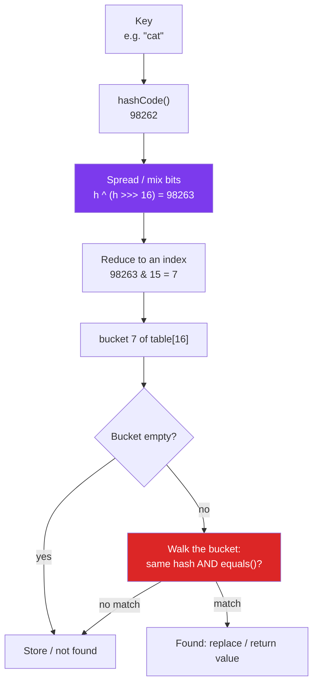

:::tip[TL;DR (30-Second Interview Pitch)]
**Hashing** turns a key (a number, a string, an object) into an `int` with a **hash function**, and uses that number as an **array index**. Because jumping to an array index costs the same whether the array has 10 or 10 million slots, lookups become **O(1) on average** instead of O(n) scans or O(log n) searches. Java builds this into every object through **`hashCode()`**; get the `equals`/`hashCode` contract wrong, or let keys **collide** too often, and `HashMap`, `HashSet` and every cache built on them silently break or slow to a crawl.
:::

<PriorityKey />

## ⚡ Essential Interview Recall

- 🔴 **Hash function**: key → fixed-size number. **Hash table**: an array where that number (reduced to `0 … n-1`) picks the slot, called a **bucket**.
- 🔴 **Why O(1)**: array access is `base address + index × slot size`, one multiplication and one memory read, independent of size. Hashing converts "find this key" into "go to this index".
- 🔴 **Collision**: two different keys, same bucket. **Unavoidable** (pigeonhole: infinitely many keys, finitely many buckets). Resolved by **chaining** (a list per bucket, what `HashMap` does) or **open addressing** (probe for the next free slot, what `IdentityHashMap` and `ThreadLocalMap` do).
- 🔴 **Load factor** = entries / buckets. Higher means more collisions; `HashMap` doubles its table when it passes **0.75**.
- 🔴 **Average O(1), worst O(n)** (all keys in one bucket). Java 8+ caps the worst case at **O(log n)** by turning long buckets into red-black trees.
- 🔴 **Contract**: `a.equals(b)` ⇒ `a.hashCode() == b.hashCode()`. Equal hashes do **not** imply equal objects. Override **both or neither** (full contract: [Classes, Objects & Contracts](../02-oop/classes-objects-contracts.md)).
- 🔴 **Lookup order**: `hashCode()` picks the bucket, then `equals()` finds the key inside it. A cheap `==` check on the cached hash runs first.
- 🔴 **`String.hashCode()`** = `s[0]·31ⁿ⁻¹ + s[1]·31ⁿ⁻² + … + s[n-1]`, computed once and **cached**. `"Aa"` and `"BB"` both hash to **2112**.
- 🔴 **Wrapper hashes**: `Integer` → the value, `Long` → `(int)(v ^ (v >>> 32))`, `Boolean` → **1231 / 1237**, `Character` → the code point, `Double` → bits of `doubleToLongBits` folded like `Long`.
- 🟠 **Arrays use identity hashCode**: `new int[]{1}` and `new int[]{1}` are different keys. Use `Arrays.hashCode` / `List.of(...)` as the key instead.
- 🟠 **`Object.hashCode()` is not the memory address**: HotSpot generates a random-ish number on first call and stores it in the object header (**mark word**). It differs between runs.
- 🟠 **Enum `hashCode()`** is the identity hash (it's `final` in `Enum`): stable within one JVM, **different across JVMs**. Never use it to shard, persist or route.
- 🟠 **Never `Math.abs(hash) % n`**: `Math.abs(Integer.MIN_VALUE)` is still negative. Use `Math.floorMod(hash, n)`, `(hash & 0x7fffffff) % n`, or `hash & (n - 1)` when `n` is a power of two.
- 🟡 **Why 31?** An odd prime, and `31 * h == (h << 5) - h`, which the JIT turns into a shift and a subtract.
- 🟡 **`hashCode()` ≠ cryptographic hash**: 32 bits, fast, trivially reversible and collidable. For integrity or passwords use **SHA-256** (`MessageDigest`), and for passwords specifically a slow salted hash (**bcrypt, scrypt, Argon2, PBKDF2**).

:::speak[What is hashing, and how does it make lookups O(1)?]
"Hashing is a way to find data **without searching for it**. A hash function turns the key, say a user id or a string, into an integer, and we reduce that integer to a valid array index. Since reading `array[i]` costs the same no matter how big the array is, storing and finding a key is O(1). The catch is **collisions**: two different keys can land on the same index, so each slot holds a small bucket, and we compare with `equals` inside it. As long as the hash function spreads keys evenly and the table resizes before it gets crowded, buckets stay tiny and the **average** cost stays O(1); the **worst** case is everything in one bucket. In Java every object has `hashCode()` for this. The rule I always keep is: equal objects must return equal hash codes, so I override `equals` and `hashCode` together, from the same **immutable** fields, or I use a `record` which generates both."
:::

## The Mental Model



*Purple: Java's extra mixing step. Red: the only place `equals()` is ever called, and only for keys already in the same bucket.*

<Animation src="hashing/key-to-bucket" caption="Each key goes through the same three steps: hashCode, mix in the high bits, keep the low 4 bits as the index. Aa and BB have the same hash 2112, so BB is chained in bucket 0 after equals says it is a different key." />

:::analogy[A cloakroom with numbered hooks]
At a theatre cloakroom you don't search every hook for your coat: your ticket number **is** the hook number, so the attendant walks straight to it. Hashing is the machine that prints the ticket from the coat itself. A collision is two coats getting the same number: the attendant hangs both on that hook and checks the name tag (`equals`) when you come back.
:::

## The Paradigm / Core Concepts

### 🔴 From linear search to direct addressing to hashing

| Approach | How you find key `k` | Lookup | Memory | Problem |
|---|---|---|---|---|
| **Unsorted array / list** | Scan every element | O(n) | O(n) | Slow for many lookups |
| **Sorted array + binary search** | Halve the range each step | O(log n) | O(n) | Inserts cost O(n) (shifting) |
| **Balanced BST** (`TreeMap`) | Walk down the tree, `compareTo` at each level | O(log n) | O(n) + 2 pointers per node | Needs an ordering |
| **Direct addressing** (`int[] count = new int[MAX+1]`) | `count[k]` | **O(1)** | **O(max key)** | Impossible for big or non-integer keys (a `long`, a `String`) |
| **Hash table** | `table[hash(k) % n]`, then `equals` inside the bucket | **O(1) average** | O(n) | Collisions; no ordering |

Hashing is **direct addressing for keys that are too big or not numbers**: squeeze any key into a small index range, and accept that a few keys will share a slot.

### 🔴 What makes a good hash function

<RuleCard name="A good hash function" tag="Design rule" why="The O(1) promise holds only if keys spread evenly over the buckets. A bad function piles keys into a few buckets and every lookup turns into a list scan." remember="Deterministic, uniform, cheap, all fields.">

1. **Deterministic**: the same key always gives the same hash (during one run of the program at least).
2. **Consistent with `equals`**: equal keys, equal hashes.
3. **Uniform**: different keys spread evenly over all `int` values, so they spread evenly over the buckets.
4. **Cheap**: O(1) for numbers, O(length) for a string, computed once and **cached** if the object is immutable.
5. **Uses every field `equals` uses**, and **position-aware** (`(1,2)` and `(2,1)` should differ).

</RuleCard>

| Bad `hashCode()` | What happens |
|---|---|
| `return 1;` | **Legal**, but every key lands in one bucket: O(n) lookups (O(log n) after treeifying if the keys are `Comparable`) |
| `return x ^ y;` | `(1,2)` and `(2,1)` both give 3; **every** `(v,v)` gives 0 |
| `return x + y;` | All points on a diagonal collide |
| Uses a **mutable** field | The key moves to a different bucket after you change it, and the map loses it |
| Uses a field **not** in `equals` | Equal objects get different hashes: contract broken, `get` returns `null` |

### 🔴 Collisions and how they're resolved

Collisions are **guaranteed**: there are 2³² `int` hashes but infinitely many strings, and only 16 buckets in a fresh `HashMap`. By the **birthday paradox**, with just 23 random keys in 365 buckets there's already a 50% chance two share one.

| | **Separate chaining** | **Open addressing** |
|---|---|---|
| Idea | Each bucket holds a linked list (or tree) of entries | All entries live in the array itself; on a collision, **probe** other slots |
| Probing | — | **Linear** (`i+1, i+2, …`), **quadratic** (`i+1², i+2², …`), **double hashing** (`i + k·h₂(key)`) |
| Load factor | Can exceed 1 (buckets just get longer) | Must stay below 1; performance falls off a cliff near full |
| Delete | Unlink the node | Needs **tombstones** (a deleted marker) so later probes don't stop early |
| Cache behaviour | Pointer chasing (nodes scattered on the heap) | Excellent: neighbouring slots, no extra objects |
| Memory | One `Node` object per entry (~32+ bytes) | Just the arrays |
| Java examples | **`HashMap`, `HashSet`, `Hashtable`, `ConcurrentHashMap`, `LinkedHashMap`** | **`IdentityHashMap`**, `ThreadLocal.ThreadLocalMap`, `Map.of`/`Set.of` immutable maps, Python's `dict` |

:::analogy[Chaining vs open addressing in a car park]
**Chaining**: every numbered bay has a little queue; if your bay is taken, you wait behind the car already there. **Open addressing**: if your bay is taken you drive to the next free bay and park there; when you come back, you start at your bay and walk forward until you find your car or hit an empty bay. Removing a car means leaving a "was occupied" cone (a tombstone), or the next person searching would give up too early.
:::

### 🔴 Load factor and rehashing

<Formula name="Load factor" tag="When to grow the table" words="How full the table is on average. HashMap grows (doubles and re-buckets everything) once the entry count passes capacity times 0.75." remember="Three-quarters full, then double.">

$$
\alpha = \frac{\text{entries } n}{\text{buckets } m}, \qquad \text{resize when } n > m \times 0.75
$$

- $n$: number of keys stored
- $m$: table length (a power of two in `HashMap`)
- $\alpha$: average bucket length; expected cost of a lookup is about $1 + \alpha/2$ comparisons with chaining

**Example:** a default `HashMap` has $m = 16$, so the threshold is $16 \times 0.75 = 12$: the **13th** `put` resizes it to 32 (verified on JDK 21 with reflection).

</Formula>

| Load factor | Memory | Speed | Who uses it |
|---|---|---|---|
| 0.5 | 2× buckets per entry | Fewest collisions | Open addressing tables (`IdentityHashMap` keeps ≤ 2/3) |
| **0.75** | Balanced | Short chains (Poisson: a bucket with 8+ entries has probability ~0.00000006) | `HashMap`, `HashSet`, `ConcurrentHashMap`, `Hashtable` |
| 1.0+ | Fewer empty buckets | Longer chains | Only with chaining, when memory is tight |

### 🔴 `hashCode()` for every common type

Every value below was printed on **JDK 21**.

| Type | Formula | Example |
|---|---|---|
| `Integer`, `Short`, `Byte` | the value itself | `42` → **42**, `-7` → **-7** |
| `Long` | `(int)(v ^ (v >>> 32))` (fold high 32 bits onto low 32) | `42L` → 42, `1L << 32` → **1**, `-1L` → **0** |
| `Character` | the char's code (`'a'` = 97) | `'a'` → **97** |
| `Boolean` | fixed primes | `true` → **1231**, `false` → **1237** |
| `Float` | `Float.floatToIntBits(f)` | `1.0f` → 1065353216 |
| `Double` | `bits = doubleToLongBits(d); (int)(bits ^ (bits >>> 32))` | `1.0` → 1072693248, `0.0` → **0**, `-0.0` → **-2147483648** |
| `String` | `s[0]·31ⁿ⁻¹ + … + s[n-1]`, `int` overflow allowed, **cached** | `"cat"` → **98262**, `""` → 0 |
| `enum` | **identity** hash (`Enum.hashCode()` is `final`) | differs between JVM runs |
| `Object` (not overridden) | **identity** hash, stored in the header | differs between runs |
| Arrays (`int[]`, `String[]`) | **identity** hash (arrays don't override it) | `{1,2,3}` and `{1,2,3}` differ |
| `Arrays.hashCode(int[])` | `31·h + element`, starting from 1 | `{1,2,3}` → **30817** |
| `List` (any implementation) | same `31·h + e.hashCode()` from 1 | `List.of(1,2,3)` → **30817** (`ArrayList` too) |
| `Set` | **sum** of element hashes (order-free) | `Set.of(1,2,3)` → **6** |
| `Map` | sum of `key.hashCode() ^ value.hashCode()` | `Map.of(1, 2)` → **3** |
| `Map.Entry` | `key.hashCode() ^ value.hashCode()` | |
| `Optional` | the value's hash, or 0 if empty | `Optional.of(42)` → 42 |
| `record` | combines all components (spec says "unspecified"; today `31·h + c`) | `Point(1,2)` → **33**, `Point(2,1)` → **63** |
| `Objects.hash(a, b, …)` | `Arrays.hashCode(new Object[]{a, b, …})` | `Objects.hash(42)` → **73**, not 42 |
| `Objects.hashCode(o)` | `o == null ? 0 : o.hashCode()` | `Objects.hashCode(null)` → 0 |
| `BigDecimal` | depends on **scale** | `1.0` → 311, `1.00` → 3102 (and they're not `equals`) |

:::danger[Interview Trap]
**`Objects.hash(x)` is not `x.hashCode()`.** With one argument it still wraps `x` in an array: `31 * 1 + 42 = 73`. Use `Objects.hashCode(x)` (singular) for a single nullable field.
:::

### 🔴 `String.hashCode()`, step by step

<Formula name="String hash (polynomial rolling hash)" tag="java.lang.String" words="Treat the string as a number written in base 31, one character per digit. int arithmetic wraps around on overflow, which is fine for a hash." remember="Base-31 number, left to right.">

$$
h(s) = s_0 \cdot 31^{n-1} + s_1 \cdot 31^{n-2} + \dots + s_{n-1} \;\; (\text{mod } 2^{32})
$$

- $s_i$: the `char` value at position $i$
- $n$: length of the string
- computed as a loop `h = 31 * h + s[i]` (Horner's rule): no powers needed

**Example:** `"cat"`: $99 \cdot 31^2 + 97 \cdot 31 + 116 = 95139 + 3007 + 116 = 98262$.

</Formula>

<Animation src="hashing/string-hashcode" caption="Horner's rule: h starts at 0 and becomes 31 times h plus the next character, giving 99, 3166 and finally 98262. Every character and its position affect the result, so act and cat get different hashes." />

- **Why 31?** It's an **odd prime** (an even multiplier would shift bits out and lose information on overflow), and `31 * h` compiles to `(h << 5) - h`. It's also what Effective Java recommends and what `List.hashCode` and `Arrays.hashCode` use.
- **Collisions are easy to build**: `"Aa"` and `"BB"` both give **2112** (`65·31 + 97 = 66·31 + 66`). Because the formula is a polynomial, any concatenation of such blocks also collides: `"AaAa"`, `"BBBB"`, `"AaBB"`, `"BBAa"` all hash to **2031744**. Attackers used this for **hash-flooding DoS** attacks against web servers; Java 8's tree bins are the defence.
- **Caching**: `String` has a private `int hash` field (plus `boolean hashIsZero` since Java 13, so strings whose hash really is 0 don't recompute every time). The first `hashCode()` call is O(length), every later call is O(1). That, plus immutability, makes `String` the ideal map key.

### 🟠 Turning a hash into a valid index

| Method | Code | Negative hash? | Speed | Used by |
|---|---|---|---|---|
| `Math.abs(h) % n` | ❌ | **Breaks** for `Integer.MIN_VALUE` (abs stays negative) | slow (`%`) | Bugs |
| `Math.floorMod(h, n)` | ✅ | Always `0 … n-1` | slow (`%`) | General code |
| `(h & 0x7fffffff) % n` | ✅ | Clears the sign bit | slow (`%`) | `Hashtable`, Kafka's partitioner |
| `h & (n - 1)` | ✅ | Works because `n` is a **power of two** | **one AND** | `HashMap`, `ConcurrentHashMap` |

`h & (n - 1)` keeps only the **low bits** of the hash, so `HashMap` first mixes the high bits in with `h ^ (h >>> 16)`. Without it, keys like `0x10000`, `0x20000`, `0x30000`, `0x40000` (all low 4 bits zero) would all land in bucket 0 of a 16-bucket table; with it they go to buckets 1, 2, 3, 4. Full detail in [HashMap Internals](./hashmap-internals.md).

### 🟠 Identity hash codes: `Object`, enums, arrays

- `Object.hashCode()` and `System.identityHashCode(o)` return the same number unless the class overrides `hashCode`. `identityHashCode` **ignores overrides**: it's what `IdentityHashMap` uses.
- It's **not** the memory address (the GC moves objects). HotSpot's default (`-XX:hashCode=5`) is a per-thread **xor-shift random number**, generated on the **first** call and stored in the object's **mark word**, so it never changes for that object afterwards.
- Enums: `Enum.hashCode()` is `final` and uses the identity hash. Two JVMs (two pods of the same service) give `Color.RED` **different** hashes. Use `name()` or `ordinal()` if you need something stable, and `EnumMap`/`EnumSet` for maps and sets of enums.

### 🟡 `hashCode()` vs cryptographic hashes

| | `hashCode()` | Cryptographic hash (SHA-256) | Password hash (bcrypt / Argon2) |
|---|---|---|---|
| Output | 32 bits | 256 bits | ~60-char string with salt and cost |
| Speed | Nanoseconds | Fast (hundreds of MB/s) | **Deliberately slow** (tunable) |
| Collisions | Easy to construct (`"Aa"`/`"BB"`) | Infeasible to find | Infeasible |
| Reversible / guessable | Trivially | Not reversible, but fast to brute-force short inputs | Slow to brute-force |
| Use for | Buckets in hash tables | File checksums, signatures, content addressing, ETags, dedup | **Storing passwords** |
| Java API | `obj.hashCode()` | `MessageDigest.getInstance("SHA-256")` | Spring Security `BCryptPasswordEncoder`, `Argon2PasswordEncoder` |

:::danger[Interview Trap]
**Never store passwords with `hashCode()`, MD5, SHA-1 or even plain SHA-256.** Fast hashes let an attacker try billions of guesses per second on a GPU. Use a **salted, slow, adaptive** hash (bcrypt, scrypt, Argon2id, PBKDF2) so each guess is expensive, and the salt makes identical passwords hash differently.
:::

## ⚙️ Under the Hood (JVM Mechanics)

- **`String` hash in bytecode**: `String.hashCode()` delegates to `StringLatin1.hashCode` or `StringUTF16.hashCode` depending on the **coder** (compact strings <Since v="9" />). Since **JDK 21** the Latin-1/UTF-16 hash loop is **vectorized** with an intrinsic on x86, so long strings hash several characters per CPU instruction.
- **Identity hash and locking**: the identity hash lives in the **mark word** (the first 8 bytes of every object header). When the object is locked, the mark word is temporarily needed for the lock, so HotSpot moves the hash into the lock record or the inflated monitor and puts it back afterwards. In Java 8–14, asking for an identity hash also **revoked biased locking** on that object (biased locking was disabled in 15 and removed in 18).
- **`hashCode()` is a virtual call**, so a `HashMap` with mixed key classes is megamorphic and slower; maps with one key type let the JIT **inline** `String.hashCode`/`equals`.
- **`Integer.hashCode()` is the value**, so sequential ints (1, 2, 3 …) land in sequential buckets: perfectly spread, no collisions until the table wraps. That's why integer-keyed maps are fast, and why `HashMap` iteration of small `Integer` keys *looks* sorted (it isn't guaranteed).
- **Records** generate `hashCode` via `invokedynamic` + `ObjectMethods.bootstrap`; the JDK is free to change the combination formula, so never persist a record's hash.
- **`hashCode()` of collections is O(n)** and **not cached**: using a `List` as a map key costs O(list length) on **every** `get`/`put`.

:::danger[Interview Trap]
**"Is `hashCode()` the memory address of the object?"** No. It may have been derived from the address in very old JVMs, but modern HotSpot uses a thread-local random generator, because the GC moves objects and an address-based hash would either change (breaking every `HashMap`) or have to be stored anyway. The value is stored in the header the first time it's requested.
:::

## 💻 Java Implementation

Every output below is from a run on **JDK 21**.

:::tip[Run it yourself]
The short snippets run as-is in `jshell` (`import java.util.*;` is pre-loaded).
:::

### 1. Built-in hash codes at a glance

```java showLineNumbers
Integer.valueOf(42).hashCode();          // 42
Long.valueOf(1L << 32).hashCode();       // 1    (high half folded onto the low half)
Boolean.TRUE.hashCode();                 // 1231
Character.valueOf('a').hashCode();       // 97
"cat".hashCode();                        // 98262
// highlight-next-line
"Aa".hashCode() == "BB".hashCode();      // true: 2112 == 2112, a real collision
List.of(1, 2, 3).hashCode();             // 30817  (same as Arrays.hashCode(new int[]{1, 2, 3}))
Set.of(1, 2, 3).hashCode();              // 6      (sum: order doesn't matter in a Set)
```

### 2. Three ways to write `hashCode()`

A class whose `equals` compares `name` and `age`:

```java title="Person.java" showLineNumbers
import java.util.Objects;

public final class Person {
    private final String name;                         // final: the hash can never change
    private final int age;

    public Person(String name, int age) { this.name = name; this.age = age; }

    @Override
    public boolean equals(Object o) {
        return o instanceof Person p && age == p.age && Objects.equals(name, p.name);
    }

    @Override
    public int hashCode() {
        // highlight-start
        int h = Objects.hashCode(name);                // null-safe: 0 for null
        h = 31 * h + Integer.hashCode(age);            // same fields as equals, order matters
        return h;
        // highlight-end
    }
}
```

| Option | Code | Trade-off |
|---|---|---|
| Hand-written | `31 * h + field` as above | Fastest, no allocation; most typing |
| `Objects.hash(name, age)` | one line | Allocates a varargs `Object[]` and **boxes** `age` on every call |
| `record Person(String name, int age) {}` | zero lines | Generated `equals`/`hashCode`/`toString`; class is final and fields are final |

### 3. Position matters: XOR is a weak combiner

```java title="❌ XOR combines symmetric fields badly" showLineNumbers
final class XorPoint {
    final int x, y;
    XorPoint(int x, int y) { this.x = x; this.y = y; }
    // error-next-line
    @Override public int hashCode() { return x ^ y; }  // ❌ (1,2) and (2,1) → 3; every (v,v) → 0
}

record Point(int x, int y) { }
// success-next-line
new Point(1, 2).hashCode();                            // ✅ 33
new Point(2, 1).hashCode();                            // ✅ 63
```

### 4. From hash to index, safely

```java showLineNumbers
int h = "polygenelubricants".hashCode();     // -2147483648 (Integer.MIN_VALUE)
// error-next-line
Math.abs(h) % 10;                            // ❌ -8: abs(MIN_VALUE) overflows, index is negative
// success-start
Math.floorMod(h, 10);                        // ✅ 2
(h & 0x7fffffff) % 10;                       // ✅ 0  (clear the sign bit)
h & (16 - 1);                                // ✅ 0  (table length is a power of two)
// success-end
```

### 5. Caching the hash in an immutable class

What `String` does, for any expensive immutable key:

```java title="Polygon.java" showLineNumbers
import java.util.List;

public final class Polygon {
    private final List<Point> vertices;
    private int hash;                                  // 0 = "not computed yet"

    public Polygon(List<Point> vertices) { this.vertices = List.copyOf(vertices); }

    @Override
    public int hashCode() {
        int h = hash;
        // highlight-start
        if (h == 0) {                                  // first call: O(number of vertices)
            h = vertices.hashCode();
            hash = h;                                  // benign data race: every thread computes the same value
        }
        // highlight-end
        return h;                                      // later calls: O(1)
    }

    @Override
    public boolean equals(Object o) { return o instanceof Polygon p && vertices.equals(p.vertices); }
}
```

The unsynchronized write is safe only because the class is **immutable** and `int` writes are atomic: the worst case is two threads computing the same number.

### 6. A cryptographic hash, for contrast

```java showLineNumbers
import java.security.MessageDigest;
import java.nio.charset.StandardCharsets;

byte[] d = MessageDigest.getInstance("SHA-256").digest("cat".getBytes(StandardCharsets.UTF_8));
HexFormat.of().formatHex(d);   // 77af778b51abd4a3c51c5ddd97204a9c3ae614ebccb75a606c3b6865aed6744e
// "cau" (one letter later):      bbcfcbdecdfec348f558015cc36d01ab27081c2cef9dad3e44d9277b46de2f72
```

A one-letter change scrambles all 256 bits (**avalanche effect**). `HexFormat` <Since v="17" /> replaces the old hand-written hex loops.

## 🧪 Predict the Output

<Predict n="1" title="Two strings, one hash" output="2112 2112 2">

```java
Set<String> s = new HashSet<>(List.of("Aa", "BB"));
System.out.println("Aa".hashCode() + " " + "BB".hashCode() + " " + s.size());
```

Both hash to `2112` (`'A'·31 + 'a' = 65·31 + 97` and `'B'·31 + 'B' = 66·31 + 66`), so they land in the **same bucket**. The set still holds **2** elements because `equals` tells them apart. Collisions cost speed, never correctness, as long as `equals` is right.

</Predict>

<Predict n="2" title="Math.abs on a hash" output="-8">

```java
int h = "polygenelubricants".hashCode();
System.out.println(Math.abs(h) % 10);
```

This string's hash is exactly `Integer.MIN_VALUE` (-2147483648). Its positive counterpart doesn't fit in an `int`, so `Math.abs` returns it **unchanged**, still negative, and `-2147483648 % 10` is **-8**. Used as an array index, that's an `ArrayIndexOutOfBoundsException` for one specific key, the hardest kind of bug to reproduce. Use `Math.floorMod(h, 10)` → `2`.

</Predict>

<Predict n="3" title="0.0 and -0.0 in a HashSet" output="false true">

```java
Set<Double> ds = new HashSet<>();
ds.add(0.0);
System.out.println(ds.contains(-0.0) + " " + (0.0 == -0.0));
```

`==` on primitives says `0.0 == -0.0` is **true** (IEEE 754). But `Double.equals` and `Double.hashCode` compare **bit patterns**: `0.0` hashes to `0`, `-0.0` to `-2147483648`, and `Double.valueOf(0.0).equals(-0.0)` is `false`. The mirror trap: `NaN == NaN` is `false`, but `Double.valueOf(NaN).equals(NaN)` is `true`, so a set can find `NaN`.

</Predict>

<Predict n="4" title="Arrays vs lists as keys" output="null x">

```java
Map<int[], String> am = new HashMap<>();
am.put(new int[]{1, 2}, "x");
System.out.println(am.get(new int[]{1, 2}));

Map<List<Integer>, String> lm = new HashMap<>();
lm.put(List.of(1, 2), "x");
System.out.println(lm.get(Arrays.asList(1, 2)));
```

Arrays inherit `Object.equals`/`hashCode` (identity), so a new array with the same contents is a **different key**: `null`. `List` defines `equals`/`hashCode` by **contents** for every implementation, so an `Arrays.asList` finds the entry stored under a `List.of`: `x`. In DSA, use `List<Integer>` or a `String` like `"1,2"` as a composite key, never `int[]`.

</Predict>

<Predict n="5" title="Objects.hash with one argument" output="73 42">

```java
System.out.println(Objects.hash(42) + " " + Integer.valueOf(42).hashCode());
```

`Objects.hash(Object... values)` is `Arrays.hashCode(values)`: start at 1, then `31 * 1 + 42 = 73`. That's harmless for correctness (it's still consistent), but it surprises people who expect `Objects.hash(x) == x.hashCode()`. For one field use `Objects.hashCode(x)`.

</Predict>

<Predict n="6" title="Long keys that collide" output="1 1 false">

```java
System.out.println(Long.valueOf(1L << 32).hashCode() + " "
        + Long.valueOf(1L).hashCode() + " "
        + Long.valueOf(1L << 32).equals(1L));
```

`Long.hashCode` XORs the high and low 32 bits. `1L << 32` has a 1 only in the high half, `1L` only in the low half: both fold to **1**. Different values, same hash: a collision, resolved by `equals` (`false`). Systematic patterns like this (ids that differ only in the high bits) can make many keys collide.

</Predict>

<Predict n="7" title="Character key, int lookup" output="null 1">

```java
Map<Character, Integer> cm = new HashMap<>();
cm.put('a', 1);
System.out.println(cm.get(97) + " " + cm.get((char) 97));
```

`get(Object)` takes **any** object: `97` is autoboxed to an `Integer`, whose hash (97) even matches `'a'`'s, but `Integer.equals(Character)` is `false`, so it returns `null`. No compile error, because `get` isn't generic. Same trap with `Map<Long, …>.get(1)` (an `Integer`).

</Predict>

## 🪜 Follow-up Ladder

<Ladder title="Hashing, from basics to production">
<Rung q="What is hashing and why is it O(1)?">

A hash function maps a key to an integer; reducing it modulo the table size gives an array index. Array access is constant time, so insert and lookup are O(1) **on average**, as long as keys spread evenly and the table isn't too full.

</Rung>
<Rung q="What is a collision and how is it handled?">

Two different keys mapping to the same index. Unavoidable (pigeonhole). **Chaining** keeps a list per bucket (`HashMap`); **open addressing** probes other slots (linear, quadratic, double hashing; `IdentityHashMap`). Either way `equals` decides which key is which.

</Rung>
<Rung q="What makes a good hashCode for a custom key?">

Uses exactly the fields `equals` uses, all of them immutable, combined position-aware (`31 * h + field`), cheap to compute, ideally cached. A `record` gives you this for free. Constant or XOR-of-fields hashes are legal but slow.

</Rung>
<Rung q="Why does HashMap use h ^ (h >>> 16) and a power-of-two table?">

The index is `hash & (n - 1)`, a single AND instead of a slow `%`, but it only looks at the **low** bits. XORing the high 16 bits into the low 16 lets keys that differ only in their high bits (`0x10000`, `0x20000`) still land in different buckets. See [HashMap Internals](./hashmap-internals.md).

</Rung>
<Rung q="Could an attacker slow your service down through hashing?">

Yes: **hash flooding**. If request parameters or JSON keys go into a `HashMap`, an attacker can send thousands of `String`s with the same hash (built from blocks like `"Aa"`/`"BB"`), turning each insert into a scan: O(n²) for the request. Java 8 mitigates it by treeifying long buckets (`String` is `Comparable`, so lookups become O(log n)). Defence in depth: limit the number of parameters/keys per request (Tomcat's `maxParameterCount`, Jackson limits), and never key maps by untrusted values whose class isn't `Comparable`.

</Rung>
</Ladder>

## 🚑 Production Scenarios

:::incident[One customer's orders crash the sharding layer]
**Symptom:** a payment service routes each customer to one of 10 database shards with `shard = Math.abs(customerId.hashCode()) % 10`. For months everything works; then one new customer's every request fails with `ArrayIndexOutOfBoundsException: Index -8 out of bounds for length 10`.

- **Why:** that customer's id string hashes to exactly `Integer.MIN_VALUE`. `Math.abs` can't negate it, so the shard index is negative (Predict #2). It affects roughly 1 in 4 billion keys, so tests never hit it.
- **Fix:** `Math.floorMod(hash, shards)` or `(hash & 0x7fffffff) % shards`.
- **Prevention:** a unit test with `"polygenelubricants"` (a known `MIN_VALUE` string); a static-analysis rule (SpotBugs `RV_ABSOLUTE_VALUE_OF_HASHCODE`); and for real sharding, a **stable** hash (Murmur3, xxHash) and **consistent hashing**, so adding a shard doesn't move every key (see [DSA: Hash Functions & Collisions](../../04-dsa/02-hashing/02-hash-functions-and-collisions.md)).
:::

:::incident[Two pods disagree about where a job belongs]
**Symptom:** a scheduler runs on 3 pods. Each pod picks the jobs it owns with `job.type().hashCode() % 3 == myIndex` (`type()` is an enum). Some jobs run on two pods, others on none, and the pattern changes after every deployment.

- **Why:** `Enum.hashCode()` is the **identity hash**: random per object, per JVM. Every pod computes a different value for the same enum constant.
- **Fix:** hash something **specified** and stable: `type().name().hashCode()` (the `String` algorithm is fixed by the Javadoc) or `type().ordinal()` (stable only while nobody reorders the enum).
- **Prevention:** treat `Object.hashCode()`, enum hashes and record hashes as **in-memory only**. Anything persisted, sent over the network or compared across processes needs an explicitly defined hash.
:::

## 🚨 Interview Gotchas & Edge Cases

:::warning[The Most Common Question]
**"Can two unequal objects have the same hashCode? Can two equal objects have different hashCodes?"** The first: **yes**, that's a collision, legal and handled by `equals` inside the bucket. The second: **no**, that breaks the contract and hash collections stop finding the object. Follow-up: *"what if hashCode always returns 1?"* It's correct but every key sits in one bucket, so the map degrades to O(n) (O(log n) after treeification, if the keys are `Comparable`).
:::

- **`hashCode()` may be negative.** Always reduce it with a mask or `floorMod`, never with `Math.abs`.
- **Mutable keys**: change a field used in `hashCode` after `put`, and the entry is stranded in the old bucket: not found, not removable, a memory leak (Predict #3 on [Classes, Objects & Contracts](../02-oop/classes-objects-contracts.md)). A `List` used as a key is mutable too.
- **`String` keys with different cases** (`"Hello"` 69609650 vs `"hello"` 99162322) are different keys; normalize (`toLowerCase(Locale.ROOT)`) before putting.
- **`hashCode` consistency across runs**: `String`, wrappers and `List` hashes are **specified** in the Javadoc and identical on every JVM. `Object`, enum, array and record hashes are **not**.
- **Lombok `@Data` / `@EqualsAndHashCode`** on JPA entities or bidirectional relationships: hashes mutable fields and can recurse infinitely (`StackOverflowError`). Exclude relationships or write them by hand.
- **`BigDecimal("1.0")` vs `BigDecimal("1.00")`**: not `equals`, different hashes (311 vs 3102). Normalize with `stripTrailingZeros()` before using as a key, or use a `TreeMap` (`compareTo` ignores scale).
- **Hash quality vs speed**: a perfect hash that takes microseconds is worse than a decent one that takes nanoseconds. Cache it if the object is immutable and hashing is expensive.
- Next: how `HashMap` actually uses these numbers, step by step, in [HashMap Internals](./hashmap-internals.md).
