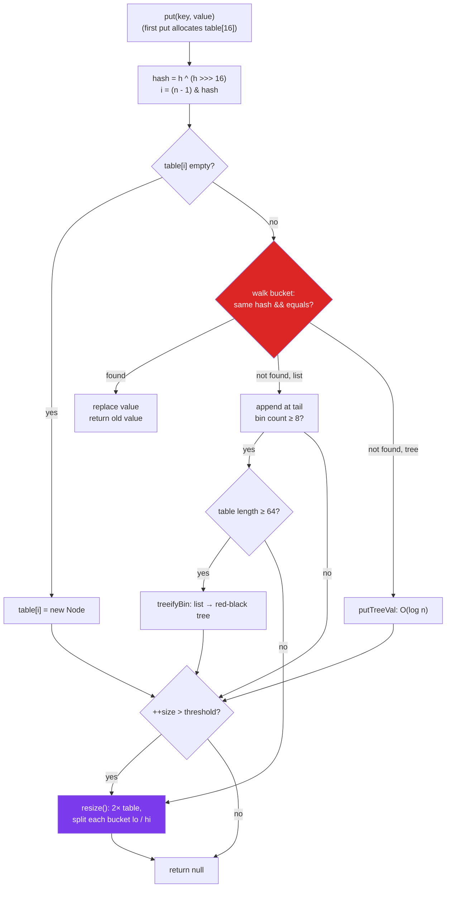

:::tip[TL;DR (30-Second Interview Pitch)]
`HashMap` is an **array of buckets** (`Node<K,V>[] table`, length always a **power of two**). `put` hashes the key, **mixes** the high bits into the low bits (`h ^ (h >>> 16)`), picks a bucket with `hash & (n - 1)`, and appends to that bucket's linked list. When the map passes **75% full** the table **doubles** and every bucket splits in two; when one bucket grows past **8** nodes (and the table has at least **64** buckets) it becomes a **red-black tree**. Result: O(1) average, O(log n) worst case, and **no thread safety at all**.
:::

<PriorityKey />

## ⚡ Essential Interview Recall

- 🔴 **Structure**: `transient Node<K,V>[] table`; each `Node` stores `hash`, `key`, `value`, `next`. A bucket is `null`, a linked list of `Node`s, or a red-black tree of `TreeNode`s.
- 🔴 **Defaults**: capacity **16**, load factor **0.75**, threshold **12**. The table is created **lazily** on the first `put`.
- 🔴 **Index**: `(n - 1) & hash`, which needs `n` to be a **power of two** (`new HashMap<>(10)` rounds up to 16, `100` to 128).
- 🔴 **Hash spreading**: `hash = h ^ (h >>> 16)`, because the mask only uses the low bits.
- 🔴 **put**: empty bucket → new node; else walk the bucket: same `hash` **and** (`==` or `equals`) → **replace the value and return the old one**; else append at the **tail** (Java 8+). Returns `null` for a new key.
- 🔴 **Resize** when `++size > threshold`: new table **2×**, each node either stays at index `j` or moves to `j + oldCap`, decided by one bit: `hash & oldCap`. Order inside a bucket is preserved; `hashCode()` is **not** called again.
- 🔴 **Treeify**: a bucket reaching **8** nodes is converted to a red-black tree when you add the next one, **but only if the table length is ≥ 64**; otherwise the map **resizes** instead. Trees shrink back to lists at **6** nodes (hysteresis).
- 🔴 **Null**: **one `null` key** (always bucket 0) and any number of `null` values. `get` returning `null` is ambiguous: use `containsKey`.
- 🔴 **Not thread-safe**: concurrent `put`s lose entries and corrupt `size`; Java 7 could even create a **cycle** during a concurrent resize (100% CPU in `get`). Use `ConcurrentHashMap`.
- 🔴 **Fail-fast iterators**: structural changes during iteration (except through `iterator.remove()`) throw `ConcurrentModificationException`, detected via **`modCount`**. Best-effort only.
- 🟠 **Iteration order** = bucket order: unspecified, changes after a resize. Need order? `LinkedHashMap` (insertion) or `TreeMap` (sorted).
- 🟠 **Pre-size**: `HashMap.newHashMap(n)` <Since v="19" /> sizes for `n` entries without resizing; `new HashMap<>(n)` sizes the **table** for `n`, so it still resizes once it holds more than `0.75 · n`.
- 🟡 **Tree bins** order nodes by hash, then `compareTo` if the keys are `Comparable` (same class), else by class name and **identity hash** (`tieBreakOrder`). Non-comparable colliding keys still degrade to O(n) lookups.
- 🟡 **Never shrinks**: removing every entry keeps the big table; iteration stays O(capacity).

:::speak[How does HashMap work internally?]
"A `HashMap` is an array of buckets whose length is always a power of two, 16 by default. On `put`, it calls the key's `hashCode()`, XORs the top 16 bits into the bottom 16 so the high bits matter, and masks it with `n - 1` to get the bucket index. If the bucket is empty, it stores a new node there. If not, it walks the bucket comparing the cached hash first and then `equals`; a match replaces the value, otherwise the new node is appended at the tail. After inserting, if the size passes capacity times the load factor, 0.75, the table doubles, and each bucket splits into a 'low' list that stays at the same index and a 'high' list that moves to index plus old capacity, decided by a single bit of the hash. Since Java 8, a bucket with more than eight nodes turns into a red-black tree once the table has at least 64 buckets, so the worst case is O(log n) instead of O(n). It allows one null key, and it's not thread-safe."
:::

## The Mental Model



<Animation src="hashing/resize-split" caption="When the table doubles from 16 to 32, the new index needs one more bit of the hash. Keys whose hash has bit 16 clear stay at j, keys with it set move to j plus 16, and each bucket keeps its order." />

:::analogy[A post office that grows by splitting shelves]
Letters are sorted into 16 shelves by the last digit of a number on the envelope. When the shelves overflow, the office builds 32 shelves and looks at **one more digit**: every letter from shelf 5 either stays on shelf 5 or goes to shelf 21, and nobody has to re-read the whole address. That's why `HashMap`'s resize is a simple split, not a full re-sort.
:::

## The Paradigm / Core Concepts

### 🔴 The constants you're expected to know

| Constant | Value | Meaning |
|---|---|---|
| `DEFAULT_INITIAL_CAPACITY` | **16** (`1 << 4`) | Table length after the first `put` |
| `MAXIMUM_CAPACITY` | **2³⁰** | The table never grows past this; threshold becomes `Integer.MAX_VALUE` |
| `DEFAULT_LOAD_FACTOR` | **0.75f** | Resize when `size > capacity × 0.75` |
| `TREEIFY_THRESHOLD` | **8** | A list bin is treeified when a node is added to a bin that already has 8 |
| `UNTREEIFY_THRESHOLD` | **6** | A tree bin with ≤ 6 nodes becomes a list again (after a resize split) |
| `MIN_TREEIFY_CAPACITY` | **64** | Below this table length, a long bin triggers a **resize** instead of a tree |

Measured on JDK 21 with reflection (see the code below): a default map's table is `null` until the first `put`, is **16** for entries 1–12, **32** from the 13th, **64** from the 25th.

### 🔴 `get(key)` step by step

| # | Step | Cost |
|---|---|---|
| 1 | `hash = key == null ? 0 : (h = key.hashCode()) ^ (h >>> 16)` | O(1), or O(L) for a fresh `String` of length L |
| 2 | `first = table[(n - 1) & hash]`; `null` → return `null` | O(1) |
| 3 | If `first.hash == hash && (first.key == key \|\| key.equals(first.key))` → return it | O(1) |
| 4 | If `first` is a `TreeNode` → `getTreeNode`: search the red-black tree | O(log k) |
| 5 | Else walk `next` pointers, same check at each node | O(k), k = bucket length (≈ 1 on average) |

The **`hash ==` check first** is an optimization: comparing two `int`s is far cheaper than `equals` (which for `String` compares every character), and nodes with different hashes are skipped without calling `equals` at all.

### 🔴 `put(key, value)` step by step

| # | Step |
|---|---|
| 1 | Table `null` or length 0 → `resize()` allocates it (16, or the size you asked for) |
| 2 | Compute `hash`, `i = (n - 1) & hash` |
| 3 | `table[i] == null` → `table[i] = newNode(hash, key, value, null)` |
| 4 | First node matches (same hash, `==` or `equals`) → remember it |
| 5 | Else if bin is a tree → `putTreeVal` |
| 6 | Else walk to the tail counting nodes; if a node matches stop; else append, and if the count reached `TREEIFY_THRESHOLD - 1` call `treeifyBin` |
| 7 | Existing mapping found → overwrite value (unless `putIfAbsent` and value non-null), **return old value**, `modCount` unchanged |
| 8 | New mapping → `++modCount`; if `++size > threshold` → `resize()`; return `null` |

### 🔴 Resize, and why the table is a power of two

| Why power of two | Explanation |
|---|---|
| **Fast index** | `hash & (n - 1)` is one CPU instruction; `hash % n` is a division (tens of cycles) and goes negative for negative hashes |
| **Cheap split** | Doubling `n` adds exactly one bit to the mask, so each node goes to `j` or `j + oldCap`: no need to recompute or even re-read `hashCode()` |
| **Order kept** | The lo and hi lists keep the original relative order (tail insertion), which fixed Java 7's reversal bug |
| **Downside** | Only low bits are used, so weak `hashCode()`s (multiples of 16, high-bit-only differences) would collide; hence **`h ^ (h >>> 16)`** |

<RuleCard name="Sizing a HashMap for n entries" tag="Performance" why="Each resize allocates a new array and relinks every node; pre-sizing does it zero times. But new HashMap with n sizes the table, not the entry count." remember="Capacity times 0.75 must exceed n.">

You need `capacity × 0.75 ≥ n`. On Java 19+ just write:

```java
Map<String, User> byId = HashMap.newHashMap(n);   // sized for n mappings, no resize while adding n
```

Before 19, use `new HashMap<>((int) Math.ceil(n / 0.75))` (or Guava's `Maps.newHashMapWithExpectedSize(n)`). `new HashMap<>(n)` makes a table of `n` rounded up to a power of two, which still resizes once it holds more than `0.75 · n` entries (e.g. `new HashMap<>(12)` resizes on the 13th `put`).

</RuleCard>

### 🔴 Treeification: Java 8's worst-case fix

<Animation src="hashing/treeify" caption="Eleven keys that all return hashCode 42. The 9th and 10th inserts make the table grow to 32 and then 64 instead of building a tree, because small tables are cheaper to resize. The 11th insert finally turns the bucket into a red-black tree." />

| | List bin | Tree bin |
|---|---|---|
| Node type | `HashMap.Node` (~32 bytes) | `TreeNode` (~56 bytes: parent, left, right, prev, red flag on top of a `LinkedHashMap.Entry`) |
| Lookup in a bin of k | O(k) | **O(log k)** if keys are `Comparable` with each other; O(k) at worst otherwise |
| When | Normal case (k ≈ 1) | k > 8 **and** table ≥ 64 |
| Ordering inside | Insertion order | By `hash`, then `compareTo` (if the classes match and implement `Comparable`), then `tieBreakOrder` (class name, `System.identityHashCode`) |

With a well-spread `hashCode()` and load factor 0.75, the HashMap source notes that the chance of a bucket reaching 8 entries is about **0.00000006** (Poisson distribution with λ = 0.5). Trees appear only with **bad hash functions or attacks**.

:::analogy[An overflowing in-tray turns into a filing cabinet]
Normally each desk has a small in-tray, and you flip through two or three papers. If one desk keeps getting buried (everyone sends it work), the office replaces that tray with an alphabetised filing cabinet. But if the office itself is tiny, it's cheaper to rent more desks first (resize) than to buy a cabinet.
:::

### 🟠 Java 7 vs Java 8+

| | Java 7 | Java 8+ |
|---|---|---|
| Bucket structure | Linked list only | List, or **red-black tree** after 8 |
| Worst-case lookup | O(n) | **O(log n)** (Comparable keys) |
| Insertion | **Head** of the list | **Tail** of the list |
| Resize | Re-hash every entry with `indexFor`; list order **reversed** | Split into lo/hi lists, **order preserved** |
| Concurrent resize bug | Two threads resizing could create a **cycle** → `get` spins forever at 100% CPU | No cycle, but still **lost updates** and corrupt `size` |
| Hash mixing | Several shifts and XORs (`h ^= (h >>> 20) ^ (h >>> 12)` …) | One XOR: `h ^ (h >>> 16)` (trees handle the rest) |
| String hash randomization | `jdk.map.althashing.threshold` (alternative hashing for `String` keys, 7u6) | Removed: trees replaced it |
| Table allocation | In the constructor | **Lazily**, on first `put` |

### 🟠 Null keys and values

- `put(null, v)` works: `hash(null)` is **0**, so the null key always sits in bucket 0 and is compared with `==`.
- `get(k)` returns `null` both for "absent" and for "present with a `null` value". Use `containsKey(k)`, or `getOrDefault`, which **only** applies the default when the key is absent (a key mapped to `null` returns `null`).
- `ConcurrentHashMap`, `Hashtable`, `Map.of` and `TreeMap` (natural ordering) **reject** null keys; see [the hash collections family](./hash-collections-family.md).

### 🟠 Views and iteration

| Method | Returns | Notes |
|---|---|---|
| `keySet()` | `Set<K>` view | Removing from it removes the mapping; can't `add` |
| `values()` | `Collection<V>` view | Duplicates allowed |
| `entrySet()` | `Set<Map.Entry<K,V>>` view | **Fastest** way to read keys and values together; `entry.setValue` writes through |
| `forEach((k, v) -> …)` | — | Iterates the table directly, checks `modCount` once at the end |
| `replaceAll((k, v) -> …)` | — | Rewrites every value in place |

- Iteration is **O(capacity + size)**: a map that once held a million entries and now holds 3 still scans its huge table.
- The views are **live**: no copying, so `map.keySet()` is O(1) to create.

### 🟡 The modern atomic-looking methods

| Method | Behaviour | Gotcha |
|---|---|---|
| `getOrDefault(k, d)` | value, or `d` if absent | `d` is evaluated even when not needed |
| `putIfAbsent(k, v)` | insert if absent **or mapped to null** | Returns the existing value |
| `computeIfAbsent(k, f)` | compute and store if absent; return the (new or old) value | If `f` returns `null`, nothing is stored. **Don't modify the map inside `f`**: `ConcurrentModificationException` <Since v="9" /> |
| `computeIfPresent(k, f)` | recompute if present; `null` result **removes** | |
| `compute(k, f)` | always recompute; `null` result removes | |
| `merge(k, v, f)` | absent → store `v`; present → `f(old, v)`; `null` result removes | `merge(word, 1, Integer::sum)` is the idiomatic counter |

On `HashMap` these are just conveniences (single lookup instead of two). On `ConcurrentHashMap` they are **atomic**, which is why they matter.

## ⚙️ Under the Hood (JVM Mechanics)

- **Memory per entry** (64-bit JVM, compressed oops): a `Node` is 32 bytes (12 header + 4 hash + 3 × 4 references, padded), plus 4 bytes for its table slot, plus the **boxed key and value** (`Integer` = 16 bytes each, unless cached). A `HashMap<Integer, Integer>` costs roughly **70–80 bytes per entry** versus 8 bytes for two `int`s in parallel arrays. That's why primitive maps (Eclipse Collections, fastutil, Agrona) exist.
- **The hash is cached in the node** (`final int hash`): `resize`, `get` and tree operations never call `hashCode()` again. Mutating a key changes `key.hashCode()` but not `node.hash`, which is exactly why the entry becomes unreachable.
- **`tableSizeFor(cap)`** rounds up to the next power of two with bit tricks (`-1 >>> Integer.numberOfLeadingZeros(cap - 1)`), and the result is stored in `threshold` until the lazy allocation.
- **`modCount`** is incremented on every structural change (new key, removal, clear, resize does not count separately). Iterators remember `expectedModCount` and compare on every `next()`. It is **not** volatile: fail-fast detection between threads is best-effort, never a concurrency guarantee.
- **Serialization**: `table` is `transient`. `writeObject` writes capacity, size and then each key/value pair; `readObject` re-hashes everything, because `hashCode()` values (identity hashes, enum hashes) may differ in the receiving JVM.
- **`TreeNode` extends `LinkedHashMap.Entry`** so the same tree code works for `LinkedHashMap`, and a tree bin keeps a `next` chain too, so iteration and untreeifying are cheap.
- **`LinkedHashMap`** hooks into three template methods `HashMap` calls: `afterNodeAccess`, `afterNodeInsertion` (eviction via `removeEldestEntry`) and `afterNodeRemoval`.

:::danger[Interview Trap]
**"HashMap allows duplicate keys if hashCode collides."** No. Collisions put two **different** keys in the same bucket. A key is a duplicate only if `equals` says so, and then `put` **replaces the value** (returning the old one). Collisions cost time, never correctness.
:::

:::danger[Interview Trap]
**"The load factor 0.75 means the map is resized when 75% of the buckets are occupied."** No: it's compared with the **entry count**, not the number of non-empty buckets. 13 keys that all collide into one bucket still trigger the resize of a 16-bucket table.
:::

## 💻 Java Implementation

Every output below is from a run on **JDK 21**.

### 1. `put` returns the previous value

```java showLineNumbers
Map<String, Integer> m = new HashMap<>();
m.put("a", 1);                                // null  (new key)
// highlight-next-line
m.put("a", 2);                                // 1     (old value: the key was REPLACED, not duplicated)
m.get("a");                                   // 2
m.put(null, 0);                               // null  (one null key is allowed, lives in bucket 0)
m.put("x", null);                             // null values are allowed too
m.get("x") + " " + m.containsKey("x");        // "null true"   get alone can't tell absent from null
m.getOrDefault("x", 5);                       // null  (key present → default ignored)
```

### 2. A small HashMap that works like the real one

The same algorithm as `java.util.HashMap` (lazy table, spread hash, power-of-two mask, tail insertion, lo/hi resize), minus trees and removal:

```java title="MiniHashMap.java" showLineNumbers
import java.util.Objects;

public class MiniHashMap<K, V> {

    static final class Node<K, V> {
        final int hash;                                    // cached spread hash: never recomputed
        final K key;
        V value;
        Node<K, V> next;
        Node(int hash, K key, V value, Node<K, V> next) {
            this.hash = hash; this.key = key; this.value = value; this.next = next;
        }
    }

    private Node<K, V>[] table;                            // allocated lazily on the first put
    private int size;
    private int threshold;                                 // capacity * 0.75

    static int hash(Object key) {
        int h;
        // highlight-next-line
        return (key == null) ? 0 : (h = key.hashCode()) ^ (h >>> 16);
    }

    public V get(Object key) {
        if (table == null) return null;
        int h = hash(key);
        // highlight-next-line
        for (Node<K, V> e = table[h & (table.length - 1)]; e != null; e = e.next) {
            if (e.hash == h && Objects.equals(e.key, key)) return e.value;   // int check first, then equals
        }
        return null;
    }

    public V put(K key, V value) {
        if (table == null) resize();
        int h = hash(key);
        int i = h & (table.length - 1);
        for (Node<K, V> e = table[i]; e != null; e = e.next) {
            if (e.hash == h && Objects.equals(e.key, key)) {
                V old = e.value;
                e.value = value;                           // existing key: replace and return old value
                return old;
            }
        }
        Node<K, V> n = new Node<>(h, key, value, null);
        if (table[i] == null) table[i] = n;
        else {
            Node<K, V> t = table[i];
            while (t.next != null) t = t.next;
            t.next = n;                                    // tail insertion (Java 8+)
        }
        // highlight-next-line
        if (++size > threshold) resize();
        return null;
    }

    @SuppressWarnings("unchecked")
    private void resize() {
        Node<K, V>[] old = table;
        int oldCap = (old == null) ? 0 : old.length;
        int newCap = (oldCap == 0) ? 16 : oldCap << 1;
        Node<K, V>[] tab = (Node<K, V>[]) new Node[newCap];
        threshold = (int) (newCap * 0.75f);
        for (int j = 0; j < oldCap; j++) {
            Node<K, V> loHead = null, loTail = null, hiHead = null, hiTail = null;
            for (Node<K, V> e = old[j]; e != null; e = e.next) {
                // highlight-next-line
                if ((e.hash & oldCap) == 0) {              // the one new bit is 0 → stay at j
                    if (loTail == null) loHead = e; else loTail.next = e;
                    loTail = e;
                } else {                                   // new bit is 1 → move to j + oldCap
                    if (hiTail == null) hiHead = e; else hiTail.next = e;
                    hiTail = e;
                }
            }
            if (loTail != null) { loTail.next = null; tab[j] = loHead; }
            if (hiTail != null) { hiTail.next = null; tab[j + oldCap] = hiHead; }
        }
        table = tab;
    }

    public int size() { return size; }
}
```

```java title="Using it"
MiniHashMap<String, Integer> m = new MiniHashMap<>();
m.put("cat", 1) + " " + m.put("cat", 2) + " " + m.get("cat");   // null 1 2
m.put("Aa", 10); m.put("BB", 20);                               // same bucket (hash 2112)
m.get("Aa") + " " + m.get("BB") + " " + m.get("zz");            // 10 20 null
// 13 Integer keys → capacity 32 (threshold 12 was passed), get(13) → 13
```

| Operation | Average | Worst (this version) | Worst (`java.util.HashMap`) | Space |
|---|---|---|---|---|
| `get` / `put` | O(1) | O(n) | O(log n) with `Comparable` keys | O(n) |
| `resize` | O(n), amortized O(1) per `put` | O(n) | O(n) | O(n) new table |

### 3. Peeking inside the real table

`table` is private; open the package to reflection to watch it grow:

```java title="TablePeek.java" showLineNumbers
import java.lang.reflect.Field;
import java.util.*;

// run with: java --add-opens java.base/java.util=ALL-UNNAMED TablePeek.java
public class TablePeek {
    public static void main(String[] args) throws Exception {
        Field f = HashMap.class.getDeclaredField("table");
        f.setAccessible(true);
        Map<Integer, Integer> m = new HashMap<>();
        System.out.println(f.get(m));                      // null  (lazy: nothing allocated yet)
        for (int i = 1; i <= 25; i++) {
            m.put(i, i);
            Object[] t = (Object[]) f.get(m);
            if (i == 1 || i == 12 || i == 13 || i == 24 || i == 25)
                System.out.print(i + "→" + t.length + " "); // 1→16 12→16 13→32 24→32 25→64
        }
    }
}
```

### 4. Pre-sizing

```java showLineNumbers
new HashMap<>(10);                   // table length 16 on first put (next power of two)
new HashMap<>(100);                  // 128
// highlight-next-line
HashMap.newHashMap(100);             // 256: room for 100 entries below the 0.75 threshold
// error-next-line
new HashMap<>(12);                   // ❌ resizes 16 → 32 on the 13th put (threshold is 12)
// success-next-line
HashMap.newHashMap(13);              // ✅ table 32 from the start: no resize while adding 13
```

### 5. What a terrible `hashCode()` costs

One run on JDK 21, 20,000 keys put and then looked up (ratios matter, not the milliseconds):

| Key class | `hashCode()` | Time |
|---|---|---|
| `record Good(int id)` | well spread | **1 ms** |
| `ConstCmp implements Comparable` | always `1` | 6 ms (~6×: one tree bin, O(log n) lookups) |
| `ConstNoCmp` (not `Comparable`) | always `1` | **2161 ms** (~2000×: the tree can't order the keys, lookups scan) |

```java title="❌ Constant hashCode, no Comparable" showLineNumbers
final class ConstNoCmp {
    final int id;
    ConstNoCmp(int id) { this.id = id; }
    // error-next-line
    @Override public int hashCode() { return 1; }              // ❌ every key in one bucket
    @Override public boolean equals(Object o) { return o instanceof ConstNoCmp c && c.id == id; }
}
```

### 6. Removing while iterating

```java showLineNumbers
Map<Integer, String> m = new HashMap<>(Map.of(1, "a", 2, "b", 3, "c"));
// error-start
for (Integer k : m.keySet())
    if (k == 1) m.remove(k);                               // ❌ ConcurrentModificationException
// error-end
// success-start
m.keySet().removeIf(k -> k == 1);                          // ✅ {2=b, 3=c}
m.entrySet().removeIf(e -> e.getValue().equals("b"));      // ✅ by value
for (Iterator<Integer> it = m.keySet().iterator(); it.hasNext(); )
    if (it.next() == 3) it.remove();                       // ✅ the iterator's own remove
// success-end
```

## 🧪 Predict the Output

<Predict n="1" title="Iteration order" output="{banana=6, date=4, apple=5, cherry=6, fig=3}">

```java
Map<String, Integer> m = new HashMap<>();
for (String s : List.of("banana", "apple", "cherry", "date", "fig")) m.put(s, s.length());
System.out.println(m);
```

`HashMap` iterates **bucket by bucket**, so the order follows `hash & 15`, not insertion or alphabetical order. It's stable for a given set of keys and capacity, which tricks people into relying on it, and it changes after a resize or a JDK change. Use `LinkedHashMap` for insertion order or `TreeMap` for sorted order.

</Predict>

<Predict n="2" title="Null keys and null values" output="{null=2, x=null} 2 true null null">

```java
Map<String, Integer> m = new HashMap<>();
m.put(null, 1);
m.put(null, 2);
m.put("x", null);
System.out.println(m + " " + m.get(null) + " " + m.containsKey("x") + " " + m.get("x") + " " + m.get("y"));
```

The second `put(null, 2)` **replaces** the first (one null key max). `get("x")` and `get("y")` both print `null`, though `"x"` is present and `"y"` isn't: only `containsKey` tells them apart.

</Predict>

<Predict n="3" title="Memoized Fibonacci with computeIfAbsent" output="java.util.ConcurrentModificationException">

```java
static long fib(Map<Integer, Long> memo, int n) {
    if (n < 2) return n;
    return memo.computeIfAbsent(n, k -> fib(memo, k - 1) + fib(memo, k - 2));
}

System.out.println(fib(new HashMap<>(), 30));
```

The mapping function **inserts into the same map** (through the recursive calls) while `computeIfAbsent` is in progress. Since Java 9, `HashMap` detects this through `modCount` and throws **`ConcurrentModificationException`** (Java 8 could silently corrupt the map). On a `ConcurrentHashMap` the same code throws **`IllegalStateException: Recursive update`**. Fix: check with `get`, compute, then `put`, or use an array for DP.

</Predict>

<Predict n="4" title="When does it resize?" output="16 32 32">

```java
// table length after the puts (read via reflection)
Map<Integer, Integer> a = new HashMap<>();      for (int i = 0; i < 12; i++) a.put(i, i);
Map<Integer, Integer> b = new HashMap<>();      for (int i = 0; i < 13; i++) b.put(i, i);
Map<Integer, Integer> c = new HashMap<>(12);    for (int i = 0; i < 13; i++) c.put(i, i);
```

Threshold = 16 × 0.75 = **12**, and the check is `++size > threshold`: 12 entries fit, the 13th resizes to 32. `new HashMap<>(12)` asks for a table of 12 → rounded to 16, threshold 12 again, so it also resizes on the 13th. The constructor argument is a **capacity**, not an expected size.

</Predict>

<Predict n="5" title="Nine colliding keys in a fresh map" output="table 32, bucket is still a list">

```java
// BadKey: hashCode() always 42, implements Comparable
Map<BadKey, Integer> m = new HashMap<>();
for (int i = 1; i <= 9; i++) m.put(new BadKey(i), i);
// table length? bucket type?
```

The 9th node in one bucket would trigger `treeifyBin`, but `treeifyBin` first checks the table: 16 < `MIN_TREEIFY_CAPACITY` (64), so it **resizes** to 32 instead. The 10th key resizes again to 64, and only the **11th** converts the bucket into `TreeNode`s (all measured with reflection on JDK 21). Small tables grow first because the collisions might just be from the table being too small.

</Predict>

<Predict n="6" title="getOrDefault with a null value" output="null 5">

```java
Map<String, Integer> m = new HashMap<>();
m.put("a", null);
System.out.println(m.getOrDefault("a", 5) + " " + m.getOrDefault("b", 5));
```

`getOrDefault` returns the default only if the key is **absent** (`containsKey` false). `"a"` is present with a `null` value, so you get `null`, and unboxing that into an `int` would throw `NullPointerException`.

</Predict>

## 🪜 Follow-up Ladder

<Ladder title="HashMap, from put to production">
<Rung q="What happens when you call put?">

Hash the key (`h ^ (h >>> 16)`), index with `(n - 1) & hash`, empty bucket → new node; else walk the bucket comparing hash then `equals`; match → replace value and return the old one; no match → append to the tail. Then `++size > threshold` triggers a resize.

</Rung>
<Rung q="Why is the capacity always a power of two?">

So the index is a single bitwise AND instead of a modulo, it's never negative, and resizing splits each bucket into exactly two (same index or index + old capacity) by checking one bit, without calling `hashCode()` again. The cost is that only low bits are used, hence the XOR of the high 16 bits.

</Rung>
<Rung q="What changed in Java 8 and why?">

Long buckets become red-black trees (8+ nodes, table ≥ 64), so the worst case dropped from O(n) to O(log n); this was a response to hash-flooding DoS attacks. Insertion moved from head to tail and resize preserves order, which removed the Java 7 infinite-loop on concurrent resize. Hash spreading was simplified to one XOR, and the table became lazily allocated.

</Rung>
<Rung q="Is a HashMap safe to read from many threads?">

Only if it was **fully built before** being published safely (final field, volatile, `static` initializer, or handed over through a concurrent queue) and nobody writes afterwards. Wrap it with `Map.copyOf` or `Collections.unmodifiableMap` to make that explicit. Any concurrent writer, even one, makes all readers unsafe: they can miss entries or see a half-resized table.

</Rung>
<Rung q="Your service's p99 latency jumped after adding a cache keyed by a new class. What do you check?">

The key's `hashCode`: constant, XOR-of-fields or based on a low-entropy field (e.g. a status enum) → giant buckets. Check whether the key is `Comparable` (tree bins only help then). Check for **mutable keys** (entries leak, the map grows forever and iteration slows). Check whether the map is shared between threads without synchronization (lost entries, CPU spin on old JVMs). Profile with JFR: time in `HashMap.getNode`/`putVal`/`TreeNode.find` and `equals` gives it away.

</Rung>
</Ladder>

## 🚑 Production Scenarios

:::incident[A shared HashMap cache that loses entries]
**Symptom:** a Spring singleton keeps a `private final Map<String, Rate> cache = new HashMap<>();` filled lazily by request threads. Under load, some rates are fetched from the database again and again, `cache.size()` is smaller than the number of distinct keys inserted, and on a legacy Java 7 node one pod sat at 100% CPU with threads stuck in `HashMap.get`.

- **Why:** two threads doing `put` at the same time can both write into the same empty bucket (one overwrites the other), both increment `size` non-atomically, and both resize at once, each building its own new table. One run on JDK 21 with 2 threads putting 100,000 distinct keys each ended with **191,583** entries instead of 200,000. On Java 7, the head-insertion resize could link nodes into a **cycle**, so `get` looped forever.
- **Fix:** `ConcurrentHashMap` and `cache.computeIfAbsent(key, this::loadRate)` (atomic per key, one load per key), or a real cache (Caffeine) with size limits and expiry.
- **Prevention:** treat any mutable field in a singleton bean as shared state; static analysis (ErrorProne, SpotBugs) and code review checklists for unsynchronized collections in `@Service`/`@Component` classes.
:::

:::incident[The cache that never stops growing]
**Symptom:** heap usage climbs for days until `OutOfMemoryError`. A heap dump shows one `HashMap` with millions of entries, many of them with **equal keys**.

- **Why:** the key class was mutable (`SearchCriteria` with setters, `hashCode` from all fields). The code reused one criteria object, changed a field, and put it again: the old entry stayed in the bucket for the old hash forever (unreachable by `get`, never evicted), and the new `put` added another.
- **Fix:** make keys immutable (`record SearchCriteria(...)`), or build the key with `List.copyOf`/a defensive copy before inserting. Bound the cache (Caffeine `maximumSize`, `LinkedHashMap` LRU).
- **Prevention:** a rule that map keys are records, enums, `String`s or boxed primitives; a test that inserts a key, mutates the original object and asserts the map is unaffected.
:::

## 🚨 Interview Gotchas & Edge Cases

:::warning[The Most Common Question]
**"Explain the internal working of HashMap, and what changed in Java 8."** Walk through: array of nodes, `hashCode` → spread → `(n-1) & hash`, empty bucket vs walk with hash+`equals`, replace vs tail append, load factor 0.75 → double and split lo/hi, treeify at 8 (table ≥ 64) back to list at 6, one null key, not thread-safe, fail-fast iterators. Then Java 8: trees, tail insertion, simpler hash, lazy table.
:::

- **`HashMap` vs `Hashtable` vs `ConcurrentHashMap`**: asked right after the internals question. Covered in [the hash collections family](./hash-collections-family.md).
- **`equals` and `hashCode` on keys** are what make it work; get them wrong and nothing on this page matters. Contract and fixes: [Hashing Fundamentals & hashCode()](./hashing-and-hashcode.md).
- **`containsValue` is O(n)**: it scans every bucket. If you need reverse lookups, keep a second map.
- **`clone()` is shallow**: the new map has new nodes but shares the key and value objects.
- **Changing the load factor** rarely helps: lower wastes memory, higher lengthens chains. Pre-sizing is the tuning knob that matters.
- **Integer keys and boxing**: `map.get(i)` with an `int` boxes on each call (cached for -128…127). In hot loops over primitive keys consider an `int[]` (when keys are small and dense) or a primitive map library.
- **`HashMap` iteration while another thread writes** can throw `ConcurrentModificationException`, loop, or silently skip entries: fail-fast is best effort, not a lock.
- **`keySet().remove(k)` and `values().remove(v)`** write through to the map; `values().remove(v)` removes only the **first** mapping with that value.
