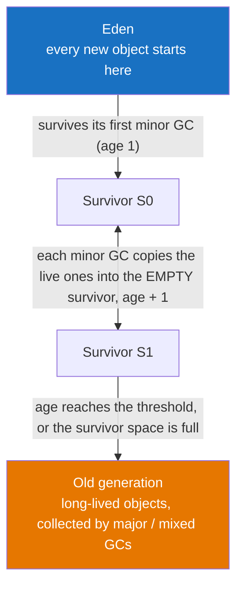
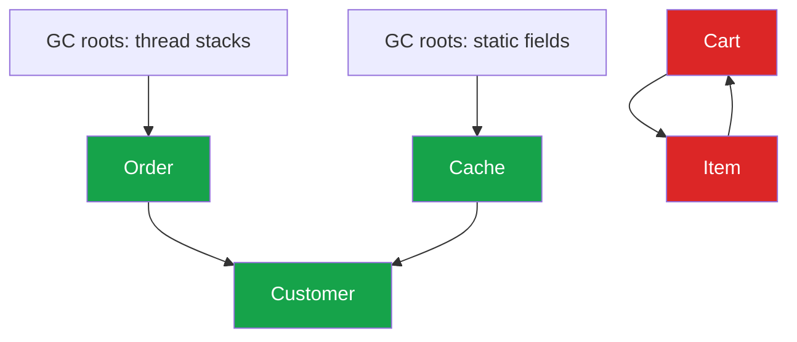

:::tip[TL;DR (30-Second Interview Pitch)]
The **garbage collector** frees heap memory used by objects that are no longer **reachable** from any **GC root** (live thread stacks, static fields, JNI handles). HotSpot exploits the fact that **most objects die young**: new objects go into a small **young generation** that is collected often and cheaply by copying the few survivors, and long-lived objects get **promoted** to the **old generation**. Choosing a collector is a trade-off between **throughput, latency and memory footprint**: **Parallel** for batch throughput, **G1** (the default) for balanced pause targets, **ZGC/Shenandoah** for sub-millisecond pauses on huge heaps.
:::

<PriorityKey />

## ⚡ Essential Interview Recall

- 🔴 Java uses **tracing** GC, not reference counting: an object is garbage when **no chain of references from a GC root** reaches it. That's why **cycles** (two objects pointing at each other) are still collected.
- 🔴 **GC roots**: local variables and operand-stack values in **active frames** of live threads, **static fields** of loaded classes, live **threads** themselves, **JNI** references, objects held as **monitors** (`synchronized`).
- 🔴 **Weak generational hypothesis**: most objects die young. Heap = **Young** (**Eden** + two **Survivor** spaces, S0/S1) + **Old** (tenured).
- 🔴 **Minor GC**: copies live objects from Eden + the "from" survivor into the "to" survivor, adds 1 to each object's **age**, and **promotes** objects older than the tenuring threshold (max **15**) to Old. Cost is proportional to **live** objects, not garbage.
- 🔴 **Major / Full GC**: collects the old generation (Full GC = whole heap, usually long **stop-the-world**).
- 🔴 **Stop-the-world (STW)**: all application threads paused at a **safepoint**. Every collector has some STW phases; modern ones keep them tiny.
- 🔴 Collectors: **Serial** (1 thread), **Parallel** (throughput, default in Java 8), **G1** (default since **Java 9**, region-based, pause target 200 ms), **ZGC** (sub-ms pauses, production in 15, generational in 21), **Shenandoah** (concurrent compaction), **Epsilon** (no-op). **CMS** was removed in **Java 14**.
- 🟠 Allocation is a **pointer bump** inside the thread's own **TLAB** (thread-local allocation buffer) in Eden: as cheap as a stack allocation.
- 🟠 Old-to-young references are tracked by a **card table** (write barrier), so a minor GC doesn't have to scan the whole old generation.
- 🟠 Reference strengths: **strong** > **soft** (cleared before an OOM, used for caches) > **weak** (cleared at the next GC, used by `WeakHashMap`) > **phantom** (post-mortem cleanup, used by `Cleaner`).
- 🟠 Java **can leak memory**: anything still reachable is kept, needed or not (static collections, caches without eviction, `ThreadLocal` on pooled threads, listeners never removed).
- 🟡 `System.gc()` is only a **hint**; it usually triggers a Full GC. `finalize()` is deprecated for removal.

:::speak[How does garbage collection work in Java?]
"Java uses a **tracing** collector. Starting from **GC roots**—thread stacks, static fields, JNI handles—it marks every object it can reach; everything else is garbage, cycles included. HotSpot is **generational** because most objects die young: new objects are bump-allocated in **Eden**, and a **minor GC** copies the few survivors into a survivor space, ageing them, and **promotes** long-lived ones to the **old generation**. Copying only touches live objects, so minor GCs are fast. The old generation is collected less often, either compacting in place or, in **G1**, by evacuating the regions with the most garbage first. The default **G1** aims for a pause target of 200 milliseconds; for very low latency I'd use **ZGC**, which does almost all its work concurrently with sub-millisecond pauses. For tuning, I start from **GC logs**: pause times, how often it runs and the allocation rate, never guesswork."
:::

## The Mental Model



*Young generation = Eden + S0 + S1. Metaspace (class metadata, native memory) is **not** part of the heap at all.*



*Green = reachable from a root, so kept. Red = a cycle that nothing reaches, so collected, even though each object still has a reference pointing at it.*

<Animation src="jvm/gc-generations" caption="Objects are born in Eden. Each minor GC copies only the survivors into the empty survivor space and ages them; an object that survives enough collections is promoted to the old generation." />

:::analogy[Generations are a newspaper office]
Most of the paper printed every day is thrown out the same evening (Eden). Each night someone walks through and only rescues the few pages still being used (survivors), which is quick because they ignore the rubbish. Pages that are still in use after two weeks of nightly checks get filed in the archive (old generation). The archive is cleaned rarely, because going through it takes far longer.
:::

## The Paradigm / Core Concepts

### 🔴 The collectors

| Collector | How it works | Pauses | Best for |
|---|---|---|---|
| **Serial**<br/>`-XX:+UseSerialGC` | One thread; copying (young) and mark-compact (old), everything stop-the-world | Long, grow with the heap | Tiny heaps, 1-CPU containers, client apps |
| **Parallel**<br/>`-XX:+UseParallelGC` | Same algorithms, many threads, still all stop-the-world | Medium–long | **Throughput**: batch jobs (default in Java 8) |
| **G1** (Garbage-First)<br/>`-XX:+UseG1GC` | Heap split into regions; young evacuation + concurrent marking + **mixed** collections | Short, aims for `MaxGCPauseMillis` (200 ms) | **General purpose**, the default since Java 9 |
| **ZGC**<br/>`-XX:+UseZGC` | Concurrent mark **and** concurrent relocation (coloured pointers + load barriers); generational since Java 21 | **Under 1 ms**, whatever the heap size | Low-latency services, heaps from GBs to TBs |
| **Shenandoah**<br/>`-XX:+UseShenandoahGC` | Concurrent compaction (load-reference barriers) | Under 10 ms | Low latency (mainly in Red Hat / OpenJDK builds) |
| **Epsilon**<br/>`-XX:+UseEpsilonGC` | **Never collects** (Java 11) | None, until it runs out and dies with OOM | Benchmarks, very short-lived jobs |
| ~~CMS~~ | Concurrent mark-sweep, no compaction → fragmentation | — | Deprecated in 9, **removed in Java 14** |

<RuleCard name="The tuning triangle" tag="GC trade-off" why="Every collector buys one property by spending another: concurrent collectors use CPU and barriers to shorten pauses; small heaps save memory but collect more often." remember="Throughput, latency, footprint: pick two.">

You can optimize for at most **two** of: **throughput** (percentage of time not spent in GC), **latency** (pause length), **footprint** (memory used).

- Batch job → throughput → **Parallel**.
- Typical microservice → balanced → **G1**.
- Trading, ad bidding, gaming, large heaps → latency → **ZGC**.

</RuleCard>

### 🟠 Reference strengths

| Type | Cleared when | `get()` after clearing | Classic use |
|---|---|---|---|
| **Strong** (normal reference) | Never, while reachable | — | Everything |
| **`SoftReference`** | Only when memory is tight; guaranteed **before** an `OutOfMemoryError` | `null` | Memory-sensitive caches |
| **`WeakReference`** | At the **next GC** once only weakly reachable | `null` | `WeakHashMap` keys, `ThreadLocalMap` keys, canonicalizing maps |
| **`PhantomReference`** | After the object is finalized; `get()` **always** returns `null` | always `null` | Post-mortem cleanup of native resources (`Cleaner`) |

## ⚙️ Under the Hood (JVM Mechanics)

### 🔴 Marking, sweeping, compacting and copying

| Phase / algorithm | What it does | Cost proportional to |
|---|---|---|
| **Mark** | Trace from roots, set a mark bit on every reachable object | Live objects |
| **Sweep** | Walk the heap, put unmarked memory on free lists | Heap size |
| **Compact** | Slide live objects together, fix up every reference to them | Live objects + references |
| **Copy (evacuate)** | Copy live objects to an empty space; the old space is then entirely free | **Live objects only** |

- Young generations use **copying** because almost everything there is dead: copying 5% of objects is far cheaper than sweeping 100% of memory. The price is an always-empty survivor space.
- Old generations use **mark-compact** (Serial/Parallel) or **region evacuation** (G1, ZGC) to avoid **fragmentation**, which was CMS's fatal flaw.

### 🔴 A minor GC, step by step

| # | Step |
|---|---|
| 1 | Eden fills up (each thread was bump-allocating in its own **TLAB**) → allocation fails → minor GC is triggered |
| 2 | All application threads stop at a **safepoint** |
| 3 | Roots **plus** the **card table** (old objects that point into young) are scanned |
| 4 | Live objects in **Eden** and the **from** survivor space are copied into the **to** survivor space; each copy's **age** (4 bits in the object header's mark word, so max 15) goes up by 1 |
| 5 | Objects whose age reaches the tenuring threshold, or that don't fit in the survivor space, are **promoted** to Old |
| 6 | Eden and the "from" space are now completely empty; the survivor spaces swap roles; threads resume |

- **Premature promotion**: if survivor spaces are too small, medium-lived objects get promoted early, fill the old generation and cause frequent old/full GCs. The GC log's tenuring distribution (`-Xlog:gc+age=trace`) shows it.
- **Write barrier + card table**: every reference store into an old object marks a 512-byte "card" as dirty, so the next minor GC scans only dirty cards instead of the entire old generation.

### 🔴 G1 in more depth

- The heap is cut into ~2,048 equal **regions** (1–32 MB each, a power of two). Any region can play **Eden, Survivor, Old or Humongous**, so generations are *logical*, not contiguous.
- **Young GC**: evacuates all Eden + survivor regions (STW, parallel). G1 resizes the young generation to meet the pause target.
- **Concurrent marking** starts when the heap passes the occupancy threshold (`-XX:InitiatingHeapOccupancyPercent`, adaptive by default). It runs alongside the app using **SATB** (snapshot-at-the-beginning) barriers.
- **Mixed GC**: evacuates young regions **plus the old regions with the most garbage** first — hence "**Garbage-First**". It reclaims the most memory per millisecond of pause.
- Each region keeps a **remembered set** (who points into me), so a region can be evacuated without scanning the whole heap.
- **Humongous objects** (at least half a region, e.g. a 1 MB array with 2 MB regions) get their own contiguous regions directly in the old generation. Lots of them cause fragmentation and premature full GCs.
- **Evacuation failure** (`to-space exhausted`) → G1 falls back to a **Full GC**: STW, parallel, slow. That's the pause you get paged for.

### 🟠 ZGC in one paragraph

- ZGC does marking **and** relocation (moving objects) concurrently with the app. It stores metadata in spare bits of each 64-bit reference (**coloured pointers**), and a **load barrier** fixes a stale reference the first time the app loads it after the object moved.
- STW pauses only scan thread stacks' roots, so they stay **below 1 ms whether the heap is 1 GB or 1 TB**.
- Cost: some throughput (barriers on every reference load) and it needs headroom. If allocation outruns the collector, threads hit an **allocation stall** (it shows up as `Allocation Stall` in the GC log).
- Generational ZGC arrived in **Java 21** (`-XX:+ZGenerational`), became the default ZGC mode in **Java 23**, and the non-generational mode was removed in **Java 24**.

### 🔴 Safepoints

- STW means each thread must reach a **safepoint**: a point where the JVM knows exactly where every reference is (method returns, loop back-edges, allocation sites).
- **Time-to-safepoint** can dominate a pause: one thread stuck in a long counted loop or a huge `System.arraycopy` makes *every* other thread wait. Loop strip mining (Java 10) mostly fixed the counted-loop case.

:::analogy[G1 cleans the messiest rooms first]
Imagine cleaning a hotel with 2,000 rooms and only 20 minutes before the guests come back. You don't clean the whole hotel; you check which rooms have the most rubbish and clean those first, as many as fit in 20 minutes. That's G1: it picks the regions with the most garbage to fit the pause target.
:::

:::danger[Interview Trap]
**"Java has no memory leaks because of the GC" is wrong.** The GC frees only *unreachable* objects. An object you'll never use again but that is still referenced—from a static `Map`, an unbounded cache, a listener list, a `ThreadLocal` on a pooled thread—is a leak the GC can't see. The tell-tale sign is a sawtooth heap graph whose **floor after each full GC keeps rising**.
:::

:::danger[Interview Trap]
**Setting a variable to `null` rarely helps.** Locals become unreachable as soon as the JIT sees they're no longer used, often *before* the method returns. Nulling helps only for long-lived references: fields of long-lived objects, elements of your own array-backed collections (that's why `ArrayList.remove` nulls the freed slot), static fields.
:::

## 💻 Java Implementation

### 1. Read a real GC log

Run on JDK 21 with a 32 MB heap; each line is one collection:

```bash title="java -Xms32m -Xmx32m -Xlog:gc Alloc"
[0.007s][info][gc] Using G1
# highlight-next-line
[0.043s][info][gc] GC(0) Pause Young (Normal) (G1 Evacuation Pause) 7M->1M(32M) 1.283ms
[0.050s][info][gc] GC(1) Pause Young (Normal) (G1 Evacuation Pause) 14M->2M(32M) 1.497ms
[0.057s][info][gc] GC(2) Pause Young (Normal) (G1 Evacuation Pause) 19M->4M(32M) 3.059ms
```

| Part | Meaning |
|---|---|
| `GC(0)` | Collection number |
| `Pause Young (Normal)` | A young (minor) STW pause; `Pause Young (Mixed)` would include old regions, `Pause Full` is the bad one |
| `7M->1M(32M)` | Heap used **before → after** (heap committed). Most of Eden was garbage |
| `1.283ms` | How long the application was paused |

The same program under ZGC logs `Allocation Stall (main) 7.864ms`: with only 32 MB, allocation outran the concurrent collector. ZGC needs headroom.

### 2. Reference strengths in code

```java title="References.java" showLineNumbers
import java.lang.ref.*;
import java.util.*;

public class References {
    public static void main(String[] args) {
        Object strong = new Object();                                   // kept while reachable

        // highlight-next-line
        SoftReference<byte[]> soft = new SoftReference<>(new byte[1_000_000]);  // dropped only under memory pressure
        WeakReference<Object> weak = new WeakReference<>(new Object());         // dropped at the next GC

        byte[] data = soft.get();        // may be null: ALWAYS check
        if (data == null) {
            data = new byte[1_000_000];  // recompute / reload
        }

        // WeakHashMap: the entry disappears once the KEY is no longer strongly reachable
        Map<Object, String> metadata = new WeakHashMap<>();
        Object key = new Object();
        metadata.put(key, "info");
        // highlight-next-line
        key = null;                      // after a later GC, the entry is removed automatically
    }
}
```

### 3. `Cleaner` instead of `finalize()`

```java title="NativeBuffer.java" showLineNumbers
import java.lang.ref.Cleaner;

public final class NativeBuffer implements AutoCloseable {
    private static final Cleaner CLEANER = Cleaner.create();

    // The cleanup action must NOT reference the NativeBuffer itself, or it can never become unreachable
    private record Release(long address) implements Runnable {
        public void run() { System.out.println("freeing " + address); }
    }

    private final Cleaner.Cleanable cleanable;

    public NativeBuffer(long address) {
        // highlight-next-line
        this.cleanable = CLEANER.register(this, new Release(address));
    }

    @Override
    public void close() {
        // success-next-line
        cleanable.clean();   // ✅ deterministic path: try-with-resources calls this; runs at most once
    }
}
```

```java title="Usage"
try (NativeBuffer buf = new NativeBuffer(0xCAFE)) {
    // use it
}   // close() → "freeing 51966". If someone forgets close(), the Cleaner runs it after GC as a safety net
```

### 4. Three classic leaks

```java title="❌ Leaks the GC can't see" showLineNumbers
// error-next-line
static final Map<String, Session> SESSIONS = new HashMap<>();   // ❌ grows forever: entries are never removed

// error-start
private static final ThreadLocal<byte[]> BUFFER =
        ThreadLocal.withInitial(() -> new byte[10_000_000]);    // ❌ lives as long as the pooled thread
// error-end

// error-next-line
eventBus.register(new Listener());   // ❌ the bus holds the listener (and its enclosing object) forever
```

```java title="✅ The fixes" showLineNumbers
// success-start
Cache<String, Session> sessions = Caffeine.newBuilder()
        .maximumSize(10_000)
        .expireAfterAccess(Duration.ofMinutes(30))
        .build();                                     // ✅ bounded, with eviction
// success-end

try {
    BUFFER.get();  // use it
} finally {
    // success-next-line
    BUFFER.remove();                                  // ✅ always clear ThreadLocals on pooled threads
}

eventBus.unregister(listener);                        // ✅ pair every register with an unregister
```

### 5. A sane production starting point

```bash title="JVM options for a containerized Spring Boot service"
java \
  -XX:MaxRAMPercentage=75 \
  -XX:+UseG1GC -XX:MaxGCPauseMillis=200 \
  -Xlog:gc*:file=/logs/gc.log:time,uptime:filecount=5,filesize=20M \
  # highlight-next-line
  -XX:+HeapDumpOnOutOfMemoryError -XX:HeapDumpPath=/dumps \
  -XX:+ExitOnOutOfMemoryError \
  -jar app.jar
```

| Option | Why it's there |
|---|---|
| `-XX:MaxRAMPercentage=75` | Heap = 75% of the container limit; the other 25% is for Metaspace, thread stacks, code cache and direct buffers |
| `-XX:+UseG1GC -XX:MaxGCPauseMillis=200` | The defaults, stated explicitly so nobody wonders which GC runs (a 1-CPU container would otherwise get Serial) |
| `-Xlog:gc*:file=...` | Rotating GC logs: 5 files of 20 MB |
| `-XX:+HeapDumpOnOutOfMemoryError` | The evidence you need for the post-mortem |
| `-XX:+ExitOnOutOfMemoryError` | Let Kubernetes restart a broken JVM instead of leaving it half-alive |

Tuning order: **measure first** (GC log, JFR) → fix allocation hot spots in code → size the heap → pick the collector → only then touch individual flags.

## 🧪 Predict the Output

<Predict n="1" title="Island of isolation" output="2 objects are eligible">

```java
class Node { Node next; }

Node a = new Node();
Node b = new Node();
a.next = b;
b.next = a;
a = null;
b = null;
// How many Node objects can be collected now?
```

Both nodes still reference each other, so each has a reference count of 1. A **reference-counting** collector would never free them. Java's **tracing** collector starts from the roots, can't reach either node, and collects both.

</Predict>

<Predict n="2" title="Is the literal collectable?" output="No">

```java
String s = "hello";
s = null;
// Is the String "hello" eligible for GC?
```

The object for a string **literal** is held by the **String pool** and by the class's constant pool, so it stays reachable as long as the class that uses the literal is loaded. A `new String("hello")` object, on the other hand, would be eligible once `s` is nulled.

</Predict>

<Predict n="3" title="Still in the list" output="0 objects are eligible">

```java
List<Order> orders = new ArrayList<>();
Order o = new Order();
orders.add(o);
o = null;
// How many Order objects can be collected?
```

Nulling the local `o` removes just **one** path. The list (still referenced by `orders`, a local in an active frame, which is a GC root) holds another reference to the same object. Reachability is about **any** path from a root, not the variable you happened to null.

</Predict>

<Predict n="4" title="The anonymous listener" output="The Screen object is never collected">

```java
class Screen {
    byte[] bitmap = new byte[50_000_000];
    Screen() {
        EventBus.GLOBAL.register(new Listener() {      // anonymous inner class
            public void onEvent(Event e) { /* ... */ }
        });
    }
}
// new Screen() is created and then dropped by the caller.
```

An anonymous (or any non-static inner) class holds a hidden reference `this$0` to its **enclosing instance**. A static `EventBus` → listener → `Screen` → 50 MB bitmap: a chain from a GC root, so nothing is freed. Fix: unregister, use a static nested class or a lambda that doesn't capture `this`, or register a weak listener.

</Predict>

<Predict n="5" title="Which pause is the worst?" output="GC(3)">

```text
GC(1) Pause Young (Normal) (G1 Evacuation Pause) 410M->120M(1024M) 12.4ms
GC(2) Pause Young (Mixed) (G1 Evacuation Pause) 600M->260M(1024M) 38.0ms
GC(3) Pause Full (G1 Compaction Pause) 1010M->980M(1024M) 2140.7ms
GC(4) Pause Young (Normal) (G1 Evacuation Pause) 1015M->990M(1024M) 9.1ms
```

`GC(3)` is a **2.1-second Full GC** that freed only 30 MB of a 1 GB heap: the live set almost fills the heap. That's either a **leak** or a heap that's too small for the real live data. Young pauses of 10–40 ms are normal; Full GCs that reclaim almost nothing come right before an `OutOfMemoryError`.

</Predict>

## 🪜 Follow-up Ladder

<Ladder title="Garbage collection">
<Rung q="What is garbage collection and how does the JVM decide what is garbage?">

Automatic memory reclamation by **tracing reachability** from GC roots (thread stacks, statics, JNI, monitors). Unreachable means garbage, cycles included.

</Rung>
<Rung q="Why is the heap split into generations?">

**Weak generational hypothesis**: most objects die young. Collecting a small young space often, by copying the few survivors, is cheap because its cost is proportional to the **live** objects. Old objects are collected rarely.

</Rung>
<Rung q="How does a minor GC avoid scanning the entire old generation?">

A **write barrier** marks a **card** dirty whenever an old object gets a reference to a young object. A minor GC scans roots plus dirty cards only. G1 keeps per-region **remembered sets** for the same reason.

</Rung>
<Rung q="Why did G1 replace Parallel and CMS as the default?">

Parallel's old-generation collections are full STW compactions, with pauses that grow with the heap. CMS didn't compact, so it fragmented and eventually fell back to long single-threaded full GCs. G1 splits the heap into regions and evacuates the most-garbage regions first within a **pause-time target**, compacting incrementally.

</Rung>
<Rung q="Our service has 2-second pauses on an 8 GB heap with G1. What do you do?">

1. Read the GC log: is it `Pause Full`? If so, why: `to-space exhausted` (evacuation failure), humongous allocations, metadata threshold, or an explicit `System.gc()`?
2. Check whether the **live set** after a full GC is close to the heap size. If yes, it's a leak (heap dump + MAT) or the heap is undersized.
3. If there are many humongous allocations, raise `-XX:G1HeapRegionSize` or stop allocating huge arrays.
4. If concurrent marking starts too late, lower `InitiatingHeapOccupancyPercent` or give G1 more headroom.
5. If the latency SLA is strict (p99 under 10 ms), switch to **generational ZGC**.

</Rung>
</Ladder>

## 🚑 Production Scenarios

:::incident[Heap climbs for days, then OutOfMemoryError]
The heap graph is a sawtooth, but the **low point after each GC rises a bit every day** until the pod dies with `OutOfMemoryError: Java heap space`.

- **Capture:** keep `-XX:+HeapDumpOnOutOfMemoryError` on, or take a live dump with `jcmd <pid> GC.heap_dump`.
- **Analyse:** open the dump in Eclipse MAT → *Leak Suspects* / *Dominator Tree*. One `HashMap` from a static field retaining 70% of the heap is the classic result.
- **Typical causes:** an in-memory cache without size or TTL limits, a `ConcurrentHashMap` keyed by request ids that are never removed, `ThreadLocal`s on Tomcat threads, a Hibernate session held across a whole batch job.
- **Fix:** a bounded cache (Caffeine), `remove()` in `finally`, batch-wise `clear()` of the persistence context. Then alert on **"old gen after GC"**, not on raw heap usage.
:::

:::incident[Pod restarts with OOMKilled but there is no Java error]
Kubernetes kills the container with exit code 137, but the app logs show no `OutOfMemoryError`.

- **Why:** the container limit covers the **whole process**: heap **plus** Metaspace, thread stacks (1 MB × threads), code cache, direct buffers, GC structures. With `-Xmx` set to the container limit, the heap alone can fill it.
- **Fix:** use `-XX:MaxRAMPercentage=75` (or `-Xmx` around 70–75% of the limit), cap thread pools, and turn on `-XX:NativeMemoryTracking=summary` to see where the rest goes.
:::

## 🚨 Interview Gotchas & Edge Cases

:::warning[The Most Common Question]
**"Explain the Java heap structure and how a minor GC works."** Eden + two survivors + old; new objects in Eden (TLAB bump allocation); when Eden fills, live objects are **copied** to the empty survivor and aged; after enough survivals (max 15) they're promoted to old. Then expect the follow-up: *"why two survivor spaces?"* Because copying needs an empty destination: one is always empty, so the live objects of Eden + the other one can be compacted into it in a single pass.
:::

- **Minor GCs are stop-the-world too** in Serial, Parallel and G1 (ZGC does its young collections concurrently). "Minor" means *small and frequent*, not *pauseless*.
- **`System.gc()` / `Runtime.gc()`** are hints that usually cause a full GC. Libraries calling it (old RMI did every hour) can wreck latency → `-XX:+DisableExplicitGC`. Note that direct-buffer allocation sometimes relies on it to free memory.
- **Bigger heap ≠ shorter pauses.** With Parallel/G1 full GCs, pause time grows with the live data set. ZGC's doesn't.
- **`-Xms` equal to `-Xmx`** avoids heap resizing pauses and makes container memory use predictable.
- **Large objects** (huge arrays, giant `StringBuilder`s) are humongous in G1: allocated straight into old regions, expensive and fragmenting.
- **Finalizers delay collection**: an object with `finalize()` needs at least two GC cycles, and a slow finalizer thread can cause an OOM on its own.
- **Escape analysis can remove allocations entirely**, so micro-benchmarks that "measure GC" often measure nothing. Use **JMH** with `Blackhole`.
- **`OutOfMemoryError` is an `Error`, so don't catch it** to "recover": by then any thread may have died half-way through an update. Dump, exit, restart.
