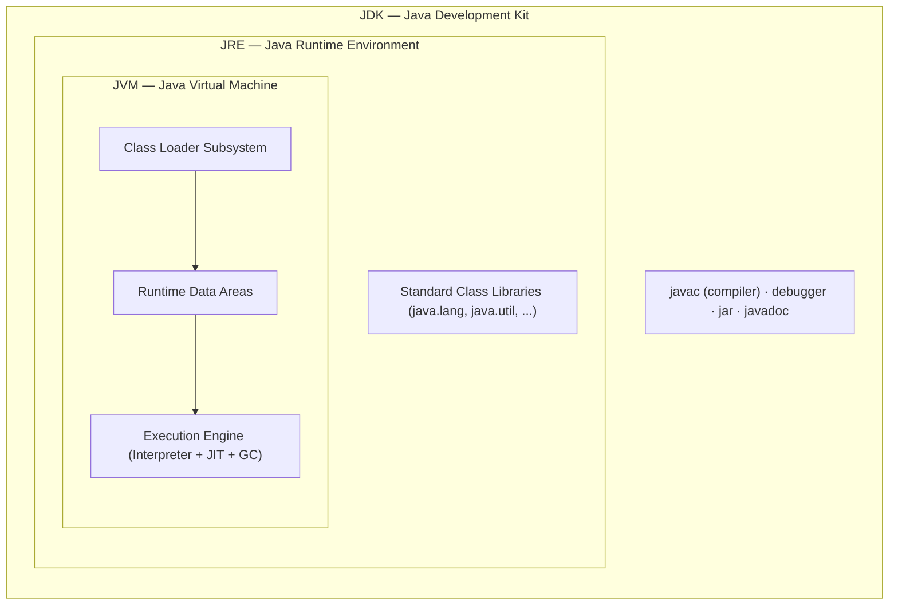
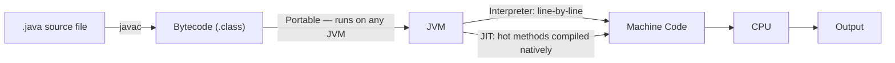

:::tip TL;DR (30-Second Interview Pitch)
**JVM** is the abstract, platform-dependent engine that executes bytecode. **JRE** is the JVM plus the standard class libraries needed to *run* a Java program. **JDK** is the JRE plus the compiler (`javac`), debugger, and other tools needed to *develop* one. The relationship is nested: `JDK ⊃ JRE ⊃ JVM`. This trio is exactly what gives Java its **WORA** (Write Once, Run Anywhere) promise — the *bytecode* is platform-independent even though every JVM implementation itself is platform-dependent.
:::

## ⚡ Essential Interview Recall

- **JVM** = abstract spec + concrete engine that runs **bytecode** → machine code. **Platform-dependent** (you install a different JVM per OS).
- **JRE** = JVM + core **class libraries**. Lets you *run* Java apps, not compile them.
- **JDK** = JRE + `javac` (compiler) + debugger + other dev tools. Needed to *write and build* Java apps.
- Nesting: **JDK ⊃ JRE ⊃ JVM**.
- Compiled output (`.class` bytecode) is **platform-independent**; the JVM that interprets it is **platform-dependent**.
- JVM has 3 major subsystems: **Class Loader Subsystem → Runtime Data Areas → Execution Engine**.
- Execution Engine = **Interpreter** + **JIT Compiler** (HotSpot) + **Garbage Collector**.
- JIT = **Just-In-Time** compiler — converts hot bytecode paths to native machine code at runtime, not ahead of time.
- Class loading follows the **delegation model**: Bootstrap → Platform/Extension → Application, each asking its parent first.
- Since **Java 9**, there is no separate downloadable "JRE" — the JDK ships everything, and `jlink` builds custom minimal runtime images.
- **JSE** (core Java) is the foundation; **JEE/Jakarta EE** = JSE + Servlets + JSP + Transaction API + Persistence API; **JME** = APIs for embedded/mobile.

## The Mental Model





## The Paradigm / Core Concepts

| Component | Contains | Purpose | Platform-dependent? |
|---|---|---|---|
| **JVM** | Class loader, runtime data areas, execution engine | Executes bytecode | Yes — one build per OS/CPU |
| **JRE** | JVM + standard class libraries | *Run* Java applications | Yes (inherits from JVM) |
| **JDK** | JRE + `javac`, debugger, `jar`, `javadoc`, profilers | *Develop* Java applications | Yes (inherits from JRE) |
| **Bytecode (`.class`)** | Platform-neutral instructions | The portable artifact | **No** — this is what's WORA |

**Java platform editions:**

| Edition | Scope |
|---|---|
| **JSE** (Java Standard Edition) | Core language + core APIs — the foundation all other editions build on |
| **JEE / Jakarta EE** (Enterprise Edition) | JSE + Servlets + JSP + Transaction API + Persistence API — for enterprise/web apps |
| **JME** (Micro/Mobile Edition) | Stripped-down APIs for embedded and mobile devices |

## ⚙️ Under the Hood (JVM Mechanics)

- **Class Loader Subsystem** — loads, links, and initializes `.class` files, following a strict **parent-delegation model**:
  - **Bootstrap Classloader** (native code, loads core `java.lang.*`/`java.util.*` from `rt.jar`/the modern module path) → has no Java-level parent.
  - **Platform Classloader** (called *Extension* Classloader pre-Java 9) — loads JDK-specific extension APIs, parented to Bootstrap.
  - **Application Classloader** (often mislabeled "System" classloader) — loads your application's classpath, parented to Platform.
  - Each loader delegates *upward* first — a child only loads a class itself if none of its ancestors already have. This prevents core classes like `java.lang.String` from being silently shadowed by application code.
- **Runtime Data Areas** — memory regions the JVM carves out at startup, split into **shared** (across threads) and **per-thread**:
  - **Method Area / Metaspace** (shared) — class metadata, static variables, constant pool.
  - **Heap** (shared) — all object instances, divided by the GC into generations (Young: Eden + Survivor, Old/Tenured).
  - **JVM Stack** (per-thread) — stack frames for method calls, local variables, partial results.
  - **PC Register** (per-thread) — address of the currently executing bytecode instruction.
  - **Native Method Stack** (per-thread) — supports native (JNI) method calls.
- **Execution Engine** — the part that actually runs bytecode:
  - **Interpreter** — reads bytecode and executes it instruction-by-instruction. Fast to start, slow per-instruction (no reuse of compiled work).
  - **JIT (Just-In-Time) Compiler** — part of the **HotSpot** engine (Sun/Oracle's reference JVM, named because it finds and optimizes "hot" — frequently executed — code paths). The JVM maintains an **invocation counter** per method/loop; once it crosses a threshold, that bytecode is compiled to native machine code and cached, so subsequent calls skip interpretation entirely.
  - **Tiered compilation**: **C1 ("client") compiler** produces quick, lightly-optimized native code for fast warm-up; **C2 ("server") compiler** kicks in for very hot code and applies aggressive optimizations (inlining, loop unrolling, escape analysis) at the cost of longer compile time.
  - **Garbage Collector** — reclaims heap memory for objects no longer reachable; runs as part of the execution engine, not a separate JVM component.

:::danger Interview Trap
**"Download the JRE" is outdated advice post-Java 9.** Oracle stopped shipping a standalone JRE distribution starting with Java 11 — the JDK now bundles everything, and `jlink` lets you assemble a custom, minimal runtime image containing only the modules your app needs. If a candidate says "install the JRE to run it, install the JDK to build it" as if they're separate downloads today, that's a stale mental model worth flagging.
:::

:::danger Interview Trap
**WORA is a property of bytecode, not of the JVM.** The JVM itself is compiled native code and is *fully platform-dependent* — you need a different JVM binary for Windows vs. Linux vs. macOS. What's portable is the `.class` bytecode: any conformant JVM, regardless of OS, can interpret/JIT-compile the same bytecode file. Candidates who say "Java is platform-independent because the JVM runs everywhere" have the causality backwards.
:::

## 💻 Java Implementation

You don't "write" JDK/JRE/JVM — but inspecting them programmatically and understanding the compile → bytecode → execute pipeline is standard interview ground.

```java
public class PlatformProbe {
    public static void main(String[] args) {
        // highlight-start
        System.out.println("Java version: " + System.getProperty("java.version"));
        System.out.println("JVM name:     " + System.getProperty("java.vm.name"));
        System.out.println("JVM vendor:   " + System.getProperty("java.vm.vendor"));
        // highlight-end

        // The pipeline this single call triggers:
        // 1. javac PlatformProbe.java  -> PlatformProbe.class (platform-independent bytecode)
        // 2. java PlatformProbe        -> Application Classloader loads PlatformProbe.class
        // 3. Bytecode is interpreted first; if main()'s loop/method gets hot, JIT compiles it natively
        // 4. Execution Engine runs the (possibly JIT-compiled) code, GC manages the Heap behind the scenes

        for (int i = 0; i < 1; i++) {
            // highlight-next-line
            doWork(i); // a tight loop here would eventually trigger C2 JIT compilation
        }
    }

    private static int doWork(int i) {
        return i * 2;
    }
}
```

```bash
# Inspect what's actually installed/running
java -version            # JRE/JVM version in use
javac -version           # Compiler version (JDK only)
java -XX:+PrintCompilation PlatformProbe   # Watch the JIT compile methods live
```

## 🚨 Interview Gotchas & Edge Cases

:::warning The Most Common Question
**"If I give you only the JRE, can you compile a `.java` file?"** No — the JRE has the JVM and runtime libraries to *execute* bytecode, but not `javac`. Compiling requires the JDK. This single question is the fastest way interviewers probe whether you actually understand the containment relationship (`JDK ⊃ JRE ⊃ JVM`) instead of reciting the acronyms.
:::

- **The JVM is a specification *and* an implementation.** "JVM" can mean the abstract spec (defined in the JVM Spec document) or a concrete engine like HotSpot, OpenJ9, or GraalVM — all of which implement that same spec differently, with different GC algorithms and JIT strategies.
- **Interpreter and JIT coexist** — the JVM doesn't switch entirely to compiled code. Cold/rarely-run code stays interpreted; only methods crossing the invocation-count threshold get JIT-compiled, balancing startup latency against peak throughput.
- **Metaspace replaced PermGen in Java 8.** PermGen was a fixed-size region prone to `OutOfMemoryError: PermGen space`; Metaspace uses native (off-heap) memory and grows dynamically by default, eliminating that class of OOM in most cases (though it can still exhaust native memory if classes leak, e.g., via classloader leaks in app servers).
- **Modules (JPMS, Java 9+)** changed classloading: the Extension Classloader was renamed **Platform Classloader**, and the classpath was supplemented by the **module path**, adding `requires`/`exports` visibility rules on top of the old delegation model.
- **Parent delegation prevents core-class spoofing** — you cannot define your own `java.lang.String` and have it silently override the JDK's, because the Application Classloader always defers to Bootstrap first for `java.*` packages.
