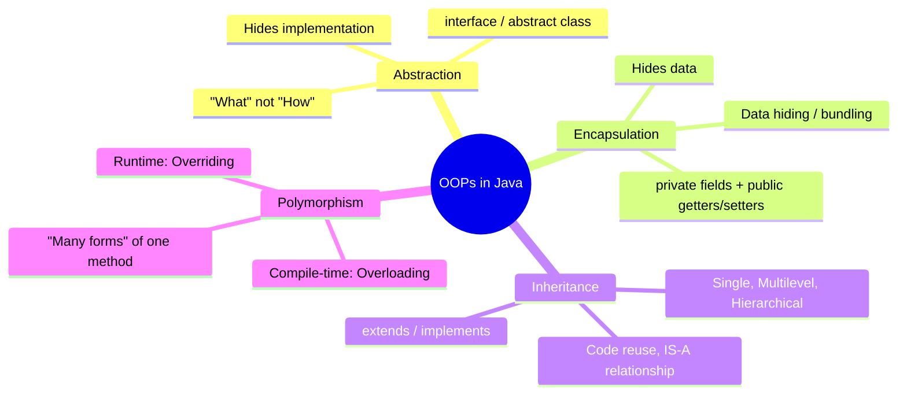
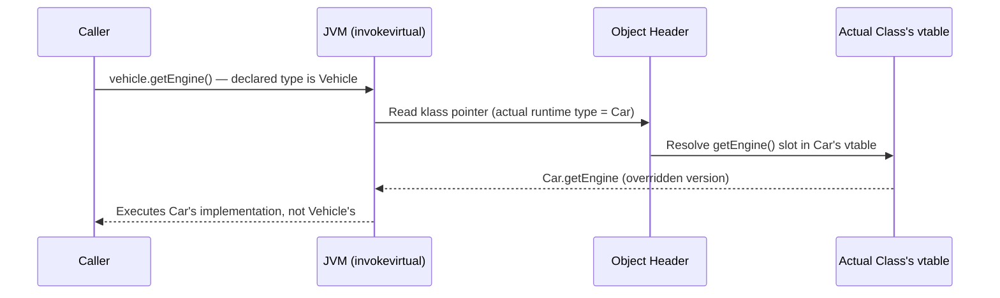

:::tip TL;DR (30-Second Interview Pitch)
Object-Oriented Programming models a system as **objects** (state + behavior) built from **class** blueprints, instead of procedures operating on loosely coupled data. Java's OOP rests on four pillars — **Abstraction, Encapsulation, Inheritance, Polymorphism** — which together deliver data hiding, code reuse, and runtime extensibility. This is what makes layered architectures (controller → service → repository), plugin systems, and mock-friendly testing possible in production.
:::

## ⚡ Essential Interview Recall

- **Class** = compile-time blueprint (no memory allocated). **Object** = runtime instance, allocated on the **heap**.
- Four pillars: **Abstraction** (hide implementation), **Encapsulation** (hide data), **Inheritance** (reuse via `extends`/`implements`), **Polymorphism** (one interface, many forms).
- **Overloading** → compile-time / **static binding** → resolved by `javac` using declared argument types.
- **Overriding** → runtime / **dynamic binding** → resolved by the JVM via the object's **vtable** at the `invokevirtual` call site.
- `private`, `static`, `final` methods → **never virtual**, always statically bound → cannot be overridden.
- Fields are **never polymorphic** — field access resolves by declared (reference) type, not actual object type.
- Constructors are **never inherited**.
- Java has **no multiple inheritance of state**, but **does** allow multiple inheritance of type/behavior via interfaces + `default` methods.
- **Diamond problem** with conflicting `default` methods → **compile-time error**, forces explicit `Interface.super.method()` disambiguation.
- **Aggregation** (HAS-A, independent lifecycle) vs. **Composition** (HAS-A, bound lifecycle) vs. **Inheritance** (IS-A).
- Effective Java Item 18: **favor composition over inheritance** to avoid the fragile base class problem.

## The Mental Model





## The Paradigm / Core Concepts

| Aspect | Procedural (C, Pascal, FORTRAN) | Object-Oriented (Java, C#, C++) |
|---|---|---|
| Decomposition unit | Functions | Objects |
| Data protection | Data moves freely, no hiding | Data hidden inside objects, accessed via methods |
| Overloading | Not possible | Possible (compile-time polymorphism) |
| Inheritance | Not possible | Possible — enables reuse and extension |
| Code reuse | Weak — logic duplicated | Strong — via inheritance and composition |

**The four pillars at a glance:**

| Pillar | Achieved via | Binding time |
|---|---|---|
| **Abstraction** | `interface`, `abstract class` | Compile-time (enforced by compiler) |
| **Encapsulation** | `private` fields + public accessors | Compile-time (access-control checks) |
| **Inheritance** | `extends` (class), `implements` (interface) | N/A — structural reuse |
| **Polymorphism** | Overloading / Overriding | Compile-time (overload) vs. runtime (override) |

## ⚙️ Under the Hood (JVM Mechanics)

- **A `class` is just metadata until instantiated.** `javac` compiles `class Student {...}` into a `Student.class` file (constant pool, field descriptors, method bytecode). No memory is touched.
- **`new Student()` at runtime**: (1) classloader loads/links/initializes `Student` if needed, (2) JVM allocates the instance on the **heap**, (3) fields are zero-initialized, (4) the constructor runs, (5) a **reference** to the heap block is returned.
- **Metaspace vs. Heap**: class metadata (bytecode, static fields, method table) lives in **Metaspace** (native memory, shared across instances); instance fields live per-object on the **heap**. Getters/setters are cheap because they're just method calls reading/writing offsets into that block.
- **Abstraction's bytecode cost**: calling through an `interface` reference uses `invokeinterface` (extra interface-table lookup); calling through a concrete/abstract class reference uses `invokevirtual`.
- **Overloading** is baked in at compile time — the compiler resolves the exact method signature from declared argument types and emits a resolved symbolic reference (`invokestatic`/`invokespecial`/`invokevirtual`).
- **Overriding** uses the **vtable**: every class has a virtual method table (an array of method pointers by slot). A subclass override replaces the pointer at the same slot. `invokevirtual` reads the object's *actual* class via its header → klass pointer, then jumps through *that* class's vtable slot. The JIT further optimizes repeat call sites with **inline caching** (monomorphic → polymorphic → megamorphic).

:::danger Interview Trap
`private`, `static`, and `final` methods are **never virtual** — they resolve via `invokestatic`/`invokespecial` at compile time, so there's no vtable indirection. You cannot *override* a static method, only **hide** it — calling it through a supertype reference always invokes the supertype's version, regardless of the object's actual runtime class.
:::

:::danger Interview Trap
**Fields are not polymorphic.** If `Car` declares a field with the same name as one in `Vehicle`, accessing it through a `Vehicle` reference always reads `Vehicle`'s field — resolved by the *declared* type at compile time — even though the object is actually a `Car`. Only methods get dynamic dispatch; fields get **field hiding**.
:::

## 💻 Java Implementation

A single worked example tying all four pillars together: a `Vehicle` hierarchy using abstraction (interface), encapsulation (private fields + accessors), inheritance (`Car extends Vehicle`), and polymorphism (overloading + overriding).

```java
// --- PILLAR 1: ABSTRACTION ---
// The interface exposes WHAT a vehicle can do, not HOW it's done.
interface Drivable {
    void applyBrake();
    void increaseSpeed(int delta);
}

// --- PILLAR 2: ENCAPSULATION ---
// Parent class. Fields are private; access is only through methods.
class Vehicle implements Drivable {

    // highlight-start
    private boolean engineOn;   // hidden state — no direct external access
    private int speed;
    // highlight-end

    public boolean isEngineOn() {
        return this.engineOn;
    }

    public void startEngine() {
        this.engineOn = true;
    }

    @Override
    public void applyBrake() {
        // highlight-next-line
        this.speed = Math.max(0, this.speed - 10); // internal mechanics hidden from caller
    }

    @Override
    public void increaseSpeed(int delta) {
        if (!engineOn) {
            throw new IllegalStateException("Cannot accelerate: engine is off");
        }
        this.speed += delta;
    }

    public int getSpeed() {
        return speed;
    }
}

// --- PILLAR 3: INHERITANCE ---
// Car IS-A Vehicle: it reuses Vehicle's fields/methods via `extends`
// and only adds what's specific to a car.
class Car extends Vehicle {

    private final String type; // HAS-A composition: Car "has" descriptive attributes

    public Car(String type) {
        this.type = type;
    }

    public String getCarType() {
        return this.type;
    }

    // --- PILLAR 4a: RUNTIME POLYMORPHISM (Overriding) ---
    // Same signature as Vehicle.applyBrake(), resolved at runtime via the vtable.
    // highlight-start
    @Override
    public void applyBrake() {
        super.applyBrake();     // reuse parent logic
        System.out.println("ABS engaged for " + type);
    }
    // highlight-end
}

// --- PILLAR 4b: COMPILE-TIME POLYMORPHISM (Overloading) ---
class SpeedCalculator {
    // highlight-start
    int combine(int a, int b) {
        return a + b;
    }

    int combine(int a, int b, int c) { // different parameter list -> resolved by compiler
        return a + b + c;
    }
    // highlight-end
}

public class OopsDemo {
    public static void main(String[] args) {
        Car swift = new Car("Hatchback");
        swift.startEngine();
        swift.increaseSpeed(40);

        // highlight-next-line
        Vehicle ref = swift;       // declared type Vehicle, actual type Car
        ref.applyBrake();          // dynamic dispatch -> runs Car.applyBrake(), not Vehicle's

        // Vehicle v = new Vehicle();
        // v.getCarType();         // Compile error: Vehicle has no getCarType() — IS-A is one-directional

        SpeedCalculator calc = new SpeedCalculator();
        System.out.println(calc.combine(2, 3));       // -> 5, binds to (int,int) at compile time
        System.out.println(calc.combine(2, 3, 4));     // -> 9, binds to (int,int,int) at compile time
    }
}
```

## 🚨 Interview Gotchas & Edge Cases

:::warning The Most Common Question
**"Overloading vs. Overriding — how does binding differ?"** Overloaded calls are resolved by the **compiler** using the *declared* type of the reference (**static binding**). Overridden calls are resolved by the **JVM at runtime** using the *actual* heap type of the object via the vtable (**dynamic binding**). This single distinction underlies almost every other gotcha below.
:::

- **Abstraction vs. Encapsulation — don't conflate them.** Abstraction is *design-level* (hide complexity, expose only essential behavior). Encapsulation is *implementation-level* (hide data via `private` + accessors). You can have one without the other.
- **Constructors are never inherited.** `super(...)` only *invokes* the parent's constructor — it doesn't inherit it.
- **Covariant return types are allowed in overriding** — an override can narrow the return type to a subtype, but must keep the same (or weaker) exception list and same/weaker access modifier.
- **Diamond problem with `default` methods** is a *compile-time* error in Java, not a runtime ambiguity — the implementing class must explicitly override and disambiguate with `InterfaceA.super.method()`.
- **Aggregation vs. Composition (both HAS-A)**: aggregation lets the contained object outlive the container (`School` has `Student`s); composition binds their lifecycles (`House` has `Room`s). Common system-design trick question.
- **Favor composition over inheritance** (Effective Java, Item 18) — deep hierarchies tightly couple subclasses to a parent's implementation, so an innocuous superclass change can silently break subclasses (the *fragile base class problem*).
- **Overload resolution order with autoboxing/varargs**: exact match → widening → autoboxing → varargs, in that order — a frequent "which overload gets called?" trap.
- **`instanceof` + downcasting breaks polymorphism's intent.** Needing type checks before calling subtype-specific methods usually signals the abstraction is incomplete — pull the method up into the shared interface instead.
