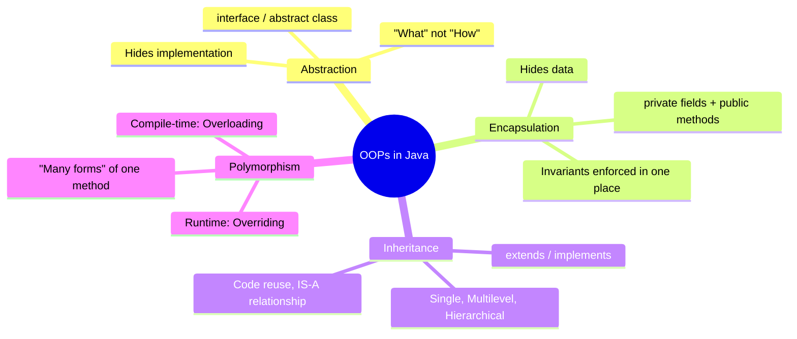
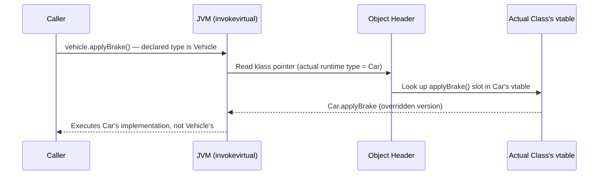

:::tip[TL;DR (30-Second Interview Pitch)]
Object-Oriented Programming models a system as **objects** (state + behavior) built from **class** blueprints, instead of procedures operating on loosely coupled data. Java's OOP rests on four pillars — **Abstraction, Encapsulation, Inheritance, Polymorphism** — which together deliver data hiding, code reuse, and runtime extensibility. Top companies test whether you can go past the definitions: **how the JVM picks the method at runtime, the exact overriding rules, when to pick an abstract class over an interface, and how SOLID shapes a design.**
:::

<PriorityKey />

## ⚡ Essential Interview Recall

- 🔴 **Class** = compile-time blueprint (no memory allocated). **Object** = runtime instance, allocated on the **heap**.
- 🔴 Four pillars: **Abstraction** (hide implementation), **Encapsulation** (hide data), **Inheritance** (reuse via `extends`/`implements`), **Polymorphism** (one interface, many forms).
- 🔴 **Overloading** → compile-time / **static binding** → `javac` picks the signature from the **declared** argument types.
- 🔴 **Overriding** → runtime / **dynamic binding** → the JVM picks the body from the object's **actual** class via its **vtable** (`invokevirtual`) or **itable** (`invokeinterface`).
- 🔴 Overriding rules: same signature; access **same or wider**; checked exceptions **same, narrower or none**; return type **same or a subtype** (covariant, references only).
- 🔴 `static` methods are **hidden**, not overridden; `private` methods aren't inherited; `final` methods can't be overridden (but are still `invokevirtual` calls). Constructors are **never inherited**.
- 🔴 **Fields are never polymorphic** — field access uses the declared (reference) type.
- 🔴 **Abstract class** = partial implementation + **state** + constructors, **single** inheritance. **Interface** = a capability contract, **multiple** inheritance of type; since Java 8 `default`/`static` methods, Java 9 `private` methods, but still **no instance state**.
- 🔴 **Diamond problem** with two conflicting `default` methods → **compile-time error**; the class must override and pick with `Iface.super.method()`.
- 🟠 Overload resolution phases: **exact/widening → boxing → varargs**. `m(null)` picks the **most specific** type, or fails as ambiguous.
- 🟠 **SOLID**: Single responsibility, Open/closed, **Liskov substitution**, Interface segregation, Dependency inversion.
- 🟠 **Aggregation** (HAS-A, independent lifecycle) vs **Composition** (HAS-A, bound lifecycle) vs **Inheritance** (IS-A). **Favor composition over inheritance** (Effective Java, Item 18).
- 🟡 **Sealed** classes/interfaces <Since v="17" /> restrict who may extend you; with **records** and **pattern matching** they give Java algebraic data types.

:::speak[Explain polymorphism and how Java implements it]
"Polymorphism means one interface, many implementations. Java has two kinds. **Compile-time** polymorphism is **overloading**: same method name with different parameter lists, and `javac` picks the version from the **declared** argument types. **Runtime** polymorphism is **overriding**: a subclass redefines an inherited method, and the call is resolved by the **actual object type**. Under the hood every class has a **vtable**, an array of method pointers. An override replaces the pointer in the same slot, so `invokevirtual` just reads the object's class from its header and jumps through that slot. Interface calls use `invokeinterface` and an itable. The JIT then optimizes call sites that only ever see one or two types with **inline caching**, so a virtual call is usually as cheap as a direct one. Static, private methods and fields are **not** polymorphic: they're resolved by the declared type."
:::

## The Mental Model





:::analogy[The vtable is a TV remote]
Every TV remote has the same button layout: button 3 is always "volume up". A Sony and a Samsung wire button 3 to completely different electronics. The caller only knows "press button 3" (the slot number fixed at compile time); which circuit actually runs depends on which TV (object) the remote is pointed at.
:::

## The Paradigm / Core Concepts

| Aspect | Procedural (C, Pascal, FORTRAN) | Object-Oriented (Java, C#, C++) |
|---|---|---|
| Decomposition unit | Functions | Objects |
| Data protection | Data moves freely, no hiding | Data hidden inside objects, accessed via methods |
| Overloading | Not possible | Possible (compile-time polymorphism) |
| Inheritance | Not possible | Possible — enables reuse and extension |
| Code reuse | Weak — logic duplicated | Strong — via inheritance and composition |

**The four pillars at a glance:**

| Pillar | Achieved via | Binding time |
|---|---|---|
| **Abstraction** | `interface`, `abstract class` | Compile-time (enforced by compiler) |
| **Encapsulation** | `private` fields + public methods | Compile-time (access-control checks) |
| **Inheritance** | `extends` (class), `implements` (interface) | N/A — structural reuse |
| **Polymorphism** | Overloading / Overriding | Compile-time (overload) vs runtime (override) |

### 🔴 Abstract class vs interface

| | Abstract class | Interface |
|---|---|---|
| Inheritance | A class can extend **one** | A class can implement **many** |
| State (instance fields) | ✅ Any fields | ❌ Only `public static final` constants |
| Constructors | ✅ Yes (run via `super(...)` from subclasses) | ❌ No |
| Method kinds | Abstract + concrete, any access level | Abstract, `default` (Java 8), `static` (Java 8), `private` (Java 9) |
| Default access of members | Package-private | `public` (methods), `public static final` (fields) |
| Relationship it expresses | **IS-A** with shared code and state (`AbstractList`) | **CAN-DO** capability (`Comparable`, `Runnable`, `Serializable`) |
| Evolving it later | Add a concrete method: subclasses get it for free | Add a `default` method (that's why Java 8 introduced them: `Collection.stream()`) |
| Functional interface / lambda target | ❌ | ✅ if it has exactly one abstract method |

<RuleCard name="Which one to choose" tag="Design" why="Interfaces keep types flexible (a class can have many capabilities), while abstract classes are the only way to share state and constructor logic." remember="Interface for the type, abstract class for the shared skeleton.">

Define the **type** as an **interface**. If several implementations share code and state, add an **abstract class** that implements the interface as a **skeleton** (the JDK's pattern: `List` → `AbstractList` → `ArrayList`). Callers depend only on the interface.

</RuleCard>

### 🔴 Overriding rules

| Rule | Allowed | Not allowed (compile error) |
|---|---|---|
| **Signature** | Exactly the same name + parameter types | Different parameters = an **overload**, not an override |
| **Access modifier** | Same or **wider** (`protected` → `public`) | Narrower (`public` → package-private) |
| **Checked exceptions** | Same, **subclasses** of them, fewer, or none; any unchecked exception | New or **broader** checked exceptions (`IOException` → `Exception`) |
| **Return type** | Same, or a **subtype** for reference types (covariant) | A different primitive (`int` → `long`) or an unrelated type |
| **`final` method** | — | Can't be overridden |
| **`static` method** | Re-declaring it as `static` in the subclass **hides** it | Making it an instance method (or vice versa) |
| **`private` method** | A method with the same name in the subclass is a brand-new method | `@Override` on it is a compile error |

<RuleCard name="The Liskov rule behind them" tag="Overriding" why="Code written against the parent type must keep working when handed a child object, so a child may promise more but never demand more." remember="Accept at least as much, promise at least as much.">

An override can **widen** what it accepts and **narrow** what it can throw or return, never the opposite. Every overriding rule above is this one idea: a `Vehicle` caller must never be surprised by a `Car`.

</RuleCard>

### 🟠 Access modifiers

| Modifier | Same class | Same package | Subclass (other package) | Everyone |
|---|:---:|:---:|:---:|:---:|
| `private` | ✅ | ❌ | ❌ | ❌ |
| *(none)* package-private | ✅ | ✅ | ❌ | ❌ |
| `protected` | ✅ | ✅ | ✅ (through inheritance only) | ❌ |
| `public` | ✅ | ✅ | ✅ | ✅ (and **exported** module, Java 9+) |

- Top-level classes can only be `public` or package-private.
- `protected` is **wider** than package-private, not narrower: it adds subclass access on top of package access.
- With JPMS, `public` alone isn't enough across modules: the package must also be `exports`-ed.

### 🟠 `static` and `final` in depth

| Keyword on | `static` means | `final` means |
|---|---|---|
| **Field** | One copy per **class**, stored on the heap in the `Class` object | Assigned **exactly once** (at declaration, in an initializer block or in every constructor) |
| **Method** | Belongs to the class; no `this`; **hidden**, not overridden | Can't be overridden (enables inlining assumptions, protects template methods) |
| **Class** | Only for **nested** classes: no reference to an outer instance | Can't be subclassed (`String`, `Integer`, records) |
| **Local variable / parameter** | Not allowed | Can't be reassigned. Lambdas and inner classes may only capture **effectively final** locals |
| **Block** | `static { }` runs once, at class initialization | — |

- A `final` **reference** doesn't make the object immutable: `final List<String> list` can't point elsewhere, but `list.add(...)` still works.
- `static final` primitive/String with a constant initializer = a **compile-time constant**, inlined into callers.
- **Static context restriction:** a static method has no `this`, so it can't touch instance fields or call instance methods directly — and can't create a non-static inner class without an outer instance.

### 🟠 SOLID with Java examples

| Principle | One-liner | Java smell → fix |
|---|---|---|
| **S**ingle responsibility | A class should have one reason to change | `OrderService` that also formats PDFs and sends emails → split into `InvoiceRenderer`, `Notifier` |
| **O**pen/closed | Open for extension, closed for modification | `switch (paymentType)` that grows every sprint → `PaymentStrategy` interface + one class per type |
| **L**iskov substitution | A subtype must be usable anywhere its parent is | `Square extends Rectangle` breaks `setWidth`/`setHeight` expectations → don't model it as inheritance |
| **I**nterface segregation | Don't force clients to depend on methods they don't use | A fat `Worker` with `work()` and `eat()` → `Workable`, `Feedable` |
| **D**ependency inversion | Depend on abstractions, not concretions | `new MySqlUserRepository()` inside a service → inject a `UserRepository` interface (what Spring's DI does) |

### 🟠 Composition, aggregation, coupling and cohesion

- **Aggregation** (weak HAS-A): the part can outlive the whole (`Team` has `Player`s).
- **Composition** (strong HAS-A): the part dies with the whole (`Order` has `OrderLine`s).
- **Favor composition over inheritance**: inheritance exposes the parent's implementation to the child (white-box reuse), so a harmless-looking parent change can break subclasses: the **fragile base class problem**. Composition reuses only the public API (black-box) and can swap the part at runtime.
- **Coupling** (how much classes depend on each other's internals) should be **low**; **cohesion** (how focused one class is) should be **high**. SOLID, DI and interfaces are all tools for exactly that.

:::analogy[Inheritance is a tattoo, composition is a backpack]
Inheriting from a class is like getting a tattoo: whatever the parent does now becomes permanently part of you, including the bits you didn't want. Composition is carrying a backpack: you use what's inside through its zips and pockets, and if a better backpack comes along you simply swap it.
:::

## ⚙️ Under the Hood (JVM Mechanics)

- **A `class` is just metadata until instantiated.** `javac` compiles `class Student {...}` into a `Student.class` file (constant pool, field descriptors, method bytecode). No memory is touched.
- **`new Student()` at runtime** — in order:
  1. Classloader loads/links/initializes `Student` (if not already done).
  2. JVM allocates the instance on the **heap** (usually a pointer bump in the thread's TLAB).
  3. Fields are zero-initialized (and the object header with its class pointer is written).
  4. The constructor chain runs, parent first (details on the [Classes, Objects & Contracts](./classes-objects-contracts) page).
  5. A **reference** to the heap block is returned.
- **Metaspace vs Heap**: class metadata (bytecode, field layout, vtable/itable) lives in **Metaspace**; instance fields live per object on the **heap**; static field values live on the heap too, inside the class's `java.lang.Class` object (HotSpot, Java 8+).
- **Object layout** (64-bit HotSpot, compressed class pointers): a **12-byte header** (8-byte *mark word*: hash code, GC age, lock state; 4-byte *class pointer*), then the fields, padded to a multiple of 8 bytes. A `new Object()` is 16 bytes.
- **Five invoke instructions:**

| Bytecode | Used for | Dispatch |
|---|---|---|
| `invokestatic` | `static` methods | Static (resolved once) |
| `invokespecial` | Constructors, `super.m()`, (pre-Java 11) private methods | Static |
| `invokevirtual` | Instance methods called through a **class** type (including `final`) | **vtable** slot |
| `invokeinterface` | Instance methods called through an **interface** type | **itable** search (slightly slower) |
| `invokedynamic` | Lambdas, string concatenation (Java 9+), records' `equals/hashCode/toString` | Bootstrap method links a call site at runtime |

- **The vtable**: a per-class array of method pointers, one slot per virtual method. A subclass inherits the parent's slots and overwrites the pointer for each override; new methods get new slots at the end. Same slot number for the same method in every subclass → a call is just *load class pointer, load slot, jump*.
- **Inline caching** in the JIT: a call site that has only ever seen `Car` (**monomorphic**) is compiled to "if class == Car, run Car's code inline"; two types (**bimorphic**) get two checks; three or more (**megamorphic**) fall back to the real vtable call. That's why hot interfaces with many implementations can be measurably slower.

:::danger[Interview Trap]
**`private` and `static` methods are never virtual**, and `final` methods can't be overridden but are still invoked with `invokevirtual` (the JIT can inline them knowing no override exists). You cannot *override* a static method, only **hide** it — calling it through a supertype reference always invokes the supertype's version, whatever the object's runtime class.
:::

:::danger[Interview Trap]
**Fields are not polymorphic.** If `Car` declares a field with the same name as one in `Vehicle`, accessing it through a `Vehicle` reference always reads `Vehicle`'s field — resolved by the *declared* type at compile time. Only methods get dynamic dispatch; fields get **field hiding**.
:::

:::danger[Interview Trap]
**Overloading is decided by the declared type, even when overriding is also involved.** If `Animal` has `speak(Animal)` and `Dog` adds `speak(Dog)`, then `Animal a = new Dog(); a.speak(new Dog())` runs `Dog.speak(Animal)`: the compiler could only see `speak(Animal)` on `Animal`, and the runtime then picked `Dog`'s override of **that** signature.
:::

## 💻 Java Implementation

One `Vehicle` hierarchy, built up one pillar at a time.

| Pillar | File | What to look at |
|---|---|---|
| **Abstraction** | `Drivable.java` | Interface = *what*, never *how* |
| **Encapsulation** | `Vehicle.java` | `private` fields, rules enforced inside methods |
| **Inheritance** + **Overriding** | `Car.java` | `extends`, `@Override`, `super` |
| **Overloading** | `SpeedCalculator.java` | Same name, different parameter list |
| **Dynamic dispatch** | `OopsDemo.java` | `Vehicle ref = swift;` runs `Car`'s method |

### Pillar 1: Abstraction

The interface exposes **what** a vehicle can do and says nothing about **how**.

```java title="Drivable.java" showLineNumbers
interface Drivable {
    void applyBrake();
    void increaseSpeed(int delta);
}
```

### Pillar 2: Encapsulation

State is `private`. The only way in or out is through methods that enforce the rules.

```java title="Vehicle.java" showLineNumbers
class Vehicle implements Drivable {

    // highlight-start
    private boolean engineOn;   // hidden state: no direct access from outside
    private int speed;
    // highlight-end

    public void startEngine()   { this.engineOn = true; }
    public boolean isEngineOn() { return engineOn; }
    public int getSpeed()       { return speed; }

    @Override
    public void applyBrake() {
        // highlight-next-line
        speed = Math.max(0, speed - 10);   // the rule lives HERE, not in callers
    }

    @Override
    public void increaseSpeed(int delta) {
        if (!engineOn) {
            // highlight-next-line
            throw new IllegalStateException("Cannot accelerate: engine is off");
        }
        speed += delta;
    }
}
```

```java title="❌ What encapsulation prevents"
Vehicle v = new Vehicle();
// error-next-line
v.speed = -50;      // ❌ compile error: speed has private access
// success-next-line
v.applyBrake();     // ✅ the only way in, and speed never goes below 0
```

### Pillar 3: Inheritance + Pillar 4a: Overriding (runtime polymorphism)

`Car` **IS-A** `Vehicle`. It inherits everything and adds only what's car-specific.

```java title="Car.java" showLineNumbers
// highlight-next-line
class Car extends Vehicle {

    private final String type;   // HAS-A: a Car has a descriptive attribute

    public Car(String type) {
        this.type = type;
    }

    public String getCarType() {
        return type;
    }

    // highlight-start
    @Override                    // same signature as Vehicle.applyBrake()
    public void applyBrake() {
        super.applyBrake();      // reuse the parent's logic…
        System.out.println("ABS engaged for " + type);   // …then extend it
    }
    // highlight-end
}
```

### Pillar 4b: Overloading (compile-time polymorphism)

Same method name, **different parameter list**. The **compiler** picks the version from the arguments.

```java title="SpeedCalculator.java" showLineNumbers
class SpeedCalculator {

    // highlight-next-line
    int combine(int a, int b)        { return a + b; }

    // highlight-next-line
    int combine(int a, int b, int c) { return a + b + c; }
}
```

### Putting it together: dynamic dispatch

```java title="OopsDemo.java" showLineNumbers
public class OopsDemo {

    public static void main(String[] args) {
        Car swift = new Car("Hatchback");
        swift.startEngine();
        swift.increaseSpeed(40);

        // highlight-start
        Vehicle ref = swift;   // declared type: Vehicle | actual object: Car
        ref.applyBrake();      // dynamic dispatch → runs Car.applyBrake()
        // highlight-end
        // prints: ABS engaged for Hatchback

        SpeedCalculator calc = new SpeedCalculator();
        // overload chosen at COMPILE time from the argument list
        System.out.println(calc.combine(2, 3));      // 5 → (int, int)
        System.out.println(calc.combine(2, 3, 4));   // 9 → (int, int, int)
    }
}
```

```java title="❌ IS-A only goes one way"
Vehicle v = new Vehicle();
// error-next-line
v.getCarType();             // ❌ Vehicle has no getCarType()

Vehicle ref = new Car("SUV");
// error-next-line
ref.getCarType();           // ❌ the DECLARED type (Vehicle) decides what you can call
// success-next-line
((Car) ref).getCarType();   // ✅ downcast first (safe: ref really is a Car)
```

### Overriding rules, as the compiler enforces them

```java title="❌ Every line marked red is a compile error (javac 21)" showLineNumbers
class Base {
    public void open() throws IOException { }
    Object create()                       { return null; }
    int size()                            { return 0; }
    static void util()                    { }
    final void lock()                     { }
}

class Derived extends Base {   // read each line on its own: a real class declares open() only once
    // error-next-line
    void open() { }                                   // ❌ public → package-private: access narrowed
    // error-next-line
    public void open() throws Exception { }           // ❌ broader checked exception
    // success-next-line
    public void open() throws FileNotFoundException { }   // ✅ narrower checked exception is fine
    // success-next-line
    String create() { return ""; }                    // ✅ covariant return: String IS-A Object
    // error-next-line
    long size()     { return 0; }                     // ❌ primitives are never covariant
    // error-next-line
    void util()     { }                               // ❌ an instance method can't override a static one
    // error-next-line
    void lock()     { }                               // ❌ final methods can't be overridden
}
```

### Abstract class + interface working together

```java title="Shapes.java" showLineNumbers
interface Shape {                                   // the TYPE: what every shape can do
    double area();

    // highlight-next-line
    default String describe() {                     // Java 8: new behaviour without breaking implementors
        return name() + " with area " + String.format("%.2f", area());
    }

    private String name() {                         // Java 9: private helper for default methods
        return getClass().getSimpleName();
    }

    static Shape unitSquare() { return new Square(1); }   // Java 8: static factory on the interface
}

abstract class AbstractShape implements Shape {     // the SKELETON: shared state + constructor
    protected final String colour;

    // highlight-next-line
    protected AbstractShape(String colour) {        // abstract classes CAN have constructors
        this.colour = colour;
    }
}

final class Square extends AbstractShape {
    private final double side;
    Square(double side) { super("red"); this.side = side; }
    public double area() { return side * side; }
}
```

### The diamond problem with default methods

```java title="Duck.java" showLineNumbers
interface Flyer   { default String move() { return "fly"; } }
interface Swimmer { default String move() { return "swim"; } }

class Duck implements Flyer, Swimmer {
    // Without this override: "types Flyer and Swimmer are incompatible" (compile error)
    @Override
    public String move() {
        // highlight-next-line
        return Flyer.super.move() + "+" + Swimmer.super.move();   // "fly+swim"
    }
}
```

The resolution rules: **(1)** a method in the class (or a superclass) always wins over interface defaults; **(2)** otherwise the most specific interface wins (a sub-interface's default beats its parent's); **(3)** otherwise it's ambiguous and you must override.

### Liskov violation: the Square/Rectangle classic

```java title="❌ Square IS-A Rectangle in maths, not in code" showLineNumbers
class Rectangle {
    protected int width, height;
    void setWidth(int w)  { width = w; }
    void setHeight(int h) { height = h; }
    int area()            { return width * height; }
}

class Square extends Rectangle {
    @Override void setWidth(int w)  { width = height = w; }   // keeps the square invariant…
    @Override void setHeight(int h) { width = height = h; }   // …but changes the parent's contract
}

void resize(Rectangle r) {
    r.setWidth(5);
    r.setHeight(4);
    // error-next-line
    assert r.area() == 20;    // ❌ fails for a Square: area is 16
}
```

Fix: don't make one a subtype of the other. Make both implement a `Shape` interface, or make them **immutable** (then a `Square` can never be "resized" into breaking the contract).

### Sealed hierarchies <Since v="17" />

```java title="Payment.java" showLineNumbers
// highlight-next-line
sealed interface Payment permits Card, Upi, NetBanking { }

record Card(String last4)        implements Payment { }
record Upi(String vpa)           implements Payment { }
record NetBanking(String bank)   implements Payment { }

static String route(Payment p) {
    return switch (p) {                       // Java 21: pattern matching for switch
        case Card c       -> "card gateway, ****" + c.last4();
        case Upi u        -> "UPI switch for " + u.vpa();
        case NetBanking n -> "bank redirect to " + n.bank();
        // no default needed: the compiler knows the list is complete
    };
}
```

Adding a fourth `Payment` type makes every non-exhaustive `switch` a **compile error**: the open/closed trade-off flipped on purpose, for closed domain models.

## 🧪 Predict the Output

<Predict n="1" title="Overloading meets overriding" output="Dog.speak(Animal)">

```java
class Animal { void speak(Animal a) { System.out.println("Animal.speak(Animal)"); } }
class Dog extends Animal {
    void speak(Dog d)              { System.out.println("Dog.speak(Dog)"); }
    @Override void speak(Animal a) { System.out.println("Dog.speak(Animal)"); }
}

Animal x = new Dog();
x.speak(new Dog());
```

Two separate decisions:

1. **Compile time (overloading):** the declared type of `x` is `Animal`, which only has `speak(Animal)`. That signature is fixed into the bytecode.
2. **Runtime (overriding):** the object is a `Dog`, and `Dog` overrides `speak(Animal)`, so that body runs.

`Dog.speak(Dog)` is never even considered. Calling it through a `Dog` reference would print `Dog.speak(Dog)`.

</Predict>

<Predict n="2" title="Static, field, method" output="A.static A B.me">

```java
class A { static String who() { return "A.static"; } String name = "A"; String me() { return "A.me"; } }
class B extends A { static String who() { return "B.static"; } String name = "B"; @Override String me() { return "B.me"; } }

A ab = new B();
System.out.println(ab.who() + " " + ab.name + " " + ab.me());
```

Only the **instance method** is dispatched on the actual object. The static method is **hidden** (resolved by the declared type `A`) and the field is **hidden** (also resolved by `A`). IDEs warn when you call a static method through an instance for exactly this reason.

</Predict>

<Predict n="3" title="Which overload gets null?" output="String">

```java
static void m(Object o) { System.out.println("Object"); }
static void m(String s) { System.out.println("String"); }

m(null);
```

`null` fits both. Java picks the **most specific** applicable method, and `String` is more specific than `Object` (a `String` can be passed to `m(Object)`, not the reverse). Add `m(Integer i)` and the call becomes a compile error, **reference to m is ambiguous**, because `String` and `Integer` are unrelated.

</Predict>

<Predict n="4" title="Widening vs boxing vs varargs" output="long, then k Object">

```java
static void n(long x)    { System.out.println("long"); }
static void n(Integer x) { System.out.println("Integer"); }
static void n(int... x)  { System.out.println("varargs"); }

static void k(Object o)  { System.out.println("k Object"); }
static void k(int... x)  { System.out.println("k varargs"); }

n(5);
k(5);
```

Overload resolution happens in **three phases**, and stops at the first phase that finds a match:

1. No boxing, no varargs: **widening** is allowed → `n(long)` matches. `n(Integer)` is never considered.
2. Boxing allowed: for `k(5)`, phase 1 finds nothing, phase 2 boxes `5` to `Integer`, which **is-an** `Object` → `k(Object)`.
3. Varargs only if both earlier phases fail.

This ordering exists so that code written before Java 5 (no boxing, no varargs) kept calling the same methods.

</Predict>

<Predict n="5" title="The fragile base class" output="6">

```java
class InstrumentedHashSet<E> extends HashSet<E> {
    int addCount = 0;
    @Override public boolean add(E e) { addCount++; return super.add(e); }
    @Override public boolean addAll(Collection<? extends E> c) {
        addCount += c.size();
        return super.addAll(c);
    }
}

InstrumentedHashSet<String> s = new InstrumentedHashSet<>();
s.addAll(List.of("a", "b", "c"));
System.out.println(s.addCount);
```

`HashSet.addAll` (inherited from `AbstractCollection`) is implemented by calling `add()` for each element, and that `add()` is **your override**. Each element is counted twice: 3 + 3 = **6**. Your subclass depends on an undocumented implementation detail of its parent. Effective Java's fix is composition: a **forwarding** wrapper that implements `Set` and holds a `Set`.

</Predict>

## 🪜 Follow-up Ladder

<Ladder title="Polymorphism, all the way down">
<Rung q="What is polymorphism? Give both kinds.">

One interface, many forms. **Overloading** (compile-time, same name with different parameters) and **overriding** (runtime, subclass redefines an inherited method).

</Rung>
<Rung q="How does the JVM know which overridden method to run?">

`invokevirtual` reads the object's class pointer from its header, then jumps through that class's **vtable** slot for the method. Interface calls (`invokeinterface`) search the **itable**.

</Rung>
<Rung q="Why can't static methods be overridden?">

They're called with `invokestatic`, which is bound to the **declared** class at link time; no object, no vtable lookup. A same-named static method in a subclass just **hides** the parent's.

</Rung>
<Rung q="Isn't a virtual call slow, then?">

Rarely. The JIT profiles each call site: if it only sees one receiver type (**monomorphic**) it inlines that method behind a cheap type check; two types (**bimorphic**) get two checks. Only **megamorphic** sites (3+ types) pay the real table lookup, and lose inlining.

</Rung>
<Rung q="How would you design a payment module so that adding a new method doesn't touch existing code?">

Open/closed principle: a `PaymentProcessor` interface, one implementation per method, chosen by a registry/factory (in Spring, inject a `Map<String, PaymentProcessor>` of beans). If the set of types is fixed and you *want* the compiler to force every `switch` to handle a new type, use a **sealed** interface plus records instead.

</Rung>
</Ladder>

## 🚑 Production Scenario

:::incident[A library upgrade silently doubled our metrics]
After upgrading an internal collections library, a counter subclass started reporting twice the real numbers. No code in the subclass had changed.

- **Why:** the subclass overrode both `add()` and `addAll()`. The new library version re-implemented `addAll()` by calling `add()` in a loop, so every element was counted twice. That's the **fragile base class problem** (Predict #5 above), now in production.
- **Fix:** replace inheritance with **composition**: implement the interface, hold the real collection in a field, forward every call, and count in the wrapper. Only depend on the parent's public contract, never on how it calls its own methods (*self-use*).
- **Prevention:** make classes `final` unless they're **designed and documented** for inheritance (Effective Java, Item 19).
:::

## 🚨 Interview Gotchas & Edge Cases

:::warning[The Most Common Question]
**"Overloading vs Overriding — how does binding differ?"** Overloaded calls are resolved by the **compiler** using the *declared* types (**static binding**). Overridden calls are resolved by the **JVM at runtime** using the *actual* class of the object via the vtable (**dynamic binding**). The usual follow-ups: "can you override a static method?" (no, it's hidden), "can an override throw a broader exception?" (no), "can it change the return type?" (only to a subtype).
:::

- **Abstraction vs Encapsulation — don't conflate them.** Abstraction is *design-level* (expose only essential behaviour). Encapsulation is *implementation-level* (hide data behind methods that guard invariants).
- **Constructors are never inherited** — `super(...)` only *invokes* the parent's constructor. If the parent has no no-arg constructor, every subclass constructor **must** call `super(args)` explicitly, or it won't compile.
- **An abstract class can have a constructor, a `main` method, and zero abstract methods.** You still can't instantiate it with `new` (but an anonymous subclass `new AbstractThing() { }` works).
- **An interface can't have instance fields**; anything declared is implicitly `public static final`. "Constant interfaces" (implementing an interface just to use its constants) are an anti-pattern; use a final class or an `enum`.
- **Marker interfaces** (`Serializable`, `Cloneable`, `RandomAccess`) carry no methods, only a type. Annotations can do the same, but a marker interface can be **checked at compile time** (a method can require a `Serializable` parameter).
- **`instanceof` + downcasting chains are a design smell** — usually the behaviour belongs on the shared interface (*tell, don't ask*). The exception: sealed hierarchies with pattern-matching `switch`, where exhaustiveness is checked by the compiler.
- **Calling an overridable method from a constructor is dangerous**: the subclass override runs before the subclass's fields are initialized. See Predict #1 on the [Classes, Objects & Contracts](./classes-objects-contracts) page.
- **Multiple inheritance**: Java has no multiple inheritance of **state** (classes) to avoid the diamond's ambiguous fields; it does allow multiple inheritance of **type** and of **behaviour** (`default` methods), with the compile-time diamond rule above.
