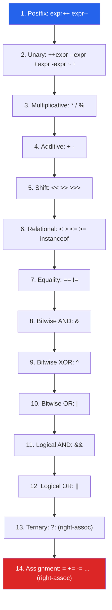
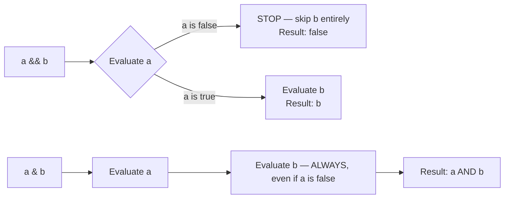

:::tip[TL;DR (30-Second Interview Pitch)]
Java has **14 precedence levels**, evaluated highest-to-lowest whenever an expression has no explicit parentheses, with **assignment and the ternary operator being right-associative** while almost everything else is left-associative. The parts that actually trip up production code aren't the table itself — it's **short-circuit vs. eager boolean evaluation** (`&&`/`||` vs `&`/`|`), **silent integer overflow**, and **implicit narrowing casts hidden inside compound assignment** (`byte b = 1; b += 200;` compiles and wraps silently).
:::

## ⚡ Essential Interview Recall

- **14 precedence levels**, highest to lowest: `postfix` → `unary` → `multiplicative` → `additive` → `shift` → `relational`/`instanceof` → `equality` → `bitwise AND` → `bitwise XOR` → `bitwise OR` → `logical AND` → `logical OR` → `ternary` → `assignment`.
- **Associativity**: everything is **left-to-right** except **ternary (`?:`)** and **assignment (`=`, `+=`, …)**, which are **right-to-left**.
- `&&` / `||` are **short-circuiting** — the right operand may never execute. `&` / `|` on `boolean` operands are **eager** — both sides always evaluate (used when the right side has a required side effect).
- **Compound assignment (`x += y`) silently inserts a narrowing cast**: `x += y` desugars to `x = (T)(x + y)` where `T` is `x`'s type — this is why `byte b = 1; b += 200;` compiles with no cast, but `b = b + 200;` is a compile error.
- **Integer overflow wraps silently** — no exception. `Integer.MAX_VALUE + 1` becomes `Integer.MIN_VALUE`.
- `%` is **remainder**, not mathematical modulo — the result takes the **sign of the dividend**, so `-7 % 3 == -1`, not `2`.
- **`instanceof` is a relational operator**, same precedence tier as `<`/`>`; since Java 16 it supports **pattern matching** (`if (obj instanceof String s)`), binding a variable inline.
- Java has **no operator overloading** for user types — the one built-in exception is `+` for `String` concatenation, which the compiler rewrites into `StringBuilder.append()` calls.
- Prefix (`++x`) returns the value *after* increment; postfix (`x++`) returns the value *before* — both still mutate `x` immediately, the difference is only what the **expression evaluates to**.
- Bitwise shift operators: `<<` (left shift), `>>` (arithmetic/signed right shift, preserves sign bit), `>>>` (logical/unsigned right shift, zero-fills).

## The Mental Model





## The Paradigm / Core Concepts

### Full precedence table (highest → lowest)

| # | Category | Operators | Associativity |
|---|---|---|---|
| 1 | Postfix | `expr++` `expr--` | Left → Right |
| 2 | Unary | `++expr` `--expr` `+expr` `-expr` `~` `!` | Right → Left |
| 3 | Multiplicative | `*` `/` `%` | Left → Right |
| 4 | Additive | `+` `-` | Left → Right |
| 5 | Shift | `<<` `>>` `>>>` | Left → Right |
| 6 | Relational | `<` `>` `<=` `>=` `instanceof` | Left → Right |
| 7 | Equality | `==` `!=` | Left → Right |
| 8 | Bitwise AND | `&` | Left → Right |
| 9 | Bitwise XOR | `^` | Left → Right |
| 10 | Bitwise OR | `\|` | Left → Right |
| 11 | Logical AND | `&&` | Left → Right |
| 12 | Logical OR | `\|\|` | Left → Right |
| 13 | Ternary | `?:` | **Right → Left** |
| 14 | Assignment | `=` `+=` `-=` `*=` `/=` `%=` `&=` `^=` `\|=` `<<=` `>>=` `>>>=` | **Right → Left** |

### Short-circuit vs. eager boolean operators

| | `&&` / `\|\|` | `&` / `\|` (on booleans) |
|---|---|---|
| Evaluates right operand | Only if needed | **Always** |
| Use case | Guard conditions (`obj != null && obj.isValid()`) | Forcing a side effect regardless of the left result |
| Risk if misused | None — this is the safe default | **`NullPointerException`** if used to replace `&&` carelessly |

## ⚙️ Under the Hood (JVM Mechanics)

- **Short-circuit evaluation is a branch, not a boolean op:**
  - `a && b` compiles to a conditional jump (`ifeq`) that skips evaluating `b` entirely if `a` is already `false` — there's no `iand` bytecode instruction involved.
  - `a & b` on booleans, by contrast, always evaluates both sides and then executes `iand`.
  - This is *why* `&&`/`||` can't be used where both sides must always run (e.g., validation methods with required logging side effects) — and why `&`/`|` exist for booleans at all despite looking redundant.
- **Compound assignment hides a narrowing cast (JLS §15.26.2):**
  - `E1 op= E2` is defined as `E1 = (T)((E1) op (E2))`, where `T` is `E1`'s declared type.
  - So `byte b = 100; b += 50;` silently becomes `b = (byte)(b + 50);` — the `+` promotes both operands to `int`, computes `150`, then the compiler-inserted cast truncates it back to a `byte`, wrapping to `-106`.
  - Plain `b = b + 50;` has no such implicit cast, so it just fails to compile.
- **`String + ` is the only overloaded operator in Java**, and it's compiler sugar: a chain like `"x=" + x + y` is rewritten (modern `javac`) into `StringBuilder` `append()` calls (historically `invokedynamic` with `StringConcatFactory` since Java 9), not real operator overloading — user-defined classes can never define their own `+`.
- **Integer overflow is silent by design** — arithmetic bytecodes (`iadd`, `imul`, …) wrap using two's-complement modulo arithmetic with no overflow flag checked. `Math.addExact()`/`Math.multiplyExact()` exist specifically to opt into an `ArithmeticException` when this isn't acceptable.
- **`%` implements *remainder*, not mathematical modulo** — the JVM's `irem`/`lrem` instructions satisfy `(a / b) * b + (a % b) == a`, which forces the result's sign to match the **dividend**, not the divisor. This is why `-7 % 3` is `-1` in Java, while Python's `%` (true modulo) gives `2` for the same inputs.
- **`instanceof` pattern matching (Java 16+)** still sits at the same precedence tier as classic `instanceof`, but additionally performs a cast and binds a new local — `if (obj instanceof String s)` both tests the type *and* introduces `s` as a definitely-assigned `String` inside the `true` branch, eliminating the old "check-then-cast" boilerplate.

:::danger[Interview Trap]
**`&` and `|` on `boolean`s compile and run fine — they just don't short-circuit.** A very common production bug: `if (user != null & user.isActive())` looks almost identical to the safe `&&` version but will throw `NullPointerException` when `user` is `null`, because `&` unconditionally evaluates `user.isActive()` regardless of the left side.
:::

:::danger[Interview Trap]
**The ternary operator's result type is computed by *binary numeric promotion* across both branches**, not just "whichever branch runs." `condition ? 1 : 2.0` has static type `double` even in the branch returning `1` — the compiler promotes the `int` literal to match the other branch's type *before* either branch is chosen, which can introduce unexpected boxing/unboxing or precision changes in mixed-type ternaries.
:::

## 💻 Java Implementation

```java
public class OperatorsDemo {
    public static void main(String[] args) {

        // --- PRECEDENCE: multiplicative binds tighter than additive ---
        // highlight-next-line
        int result = 2 + 3 * 4; // -> 14, not 20 — * evaluated before +
        System.out.println(result);

        // --- SHORT-CIRCUIT vs EAGER evaluation ---
        String nullableText = null;
        // highlight-start
        if (nullableText != null && nullableText.length() > 0) { // safe: length() never called on null
            System.out.println("non-empty");
        }
        // if (nullableText != null & nullableText.length() > 0) {} // UNSAFE: throws NPE
        // highlight-end

        // --- COMPOUND ASSIGNMENT'S HIDDEN NARROWING CAST ---
        byte b = 100;
        // highlight-next-line
        b += 50;                 // silently becomes b = (byte)(b + 50); wraps to -106
        System.out.println(b);   // -106

        // --- INTEGER OVERFLOW IS SILENT ---
        int maxed = Integer.MAX_VALUE;
        // highlight-next-line
        System.out.println(maxed + 1); // wraps to Integer.MIN_VALUE, no exception

        try {
            Math.addExact(maxed, 1);   // opt-in overflow checking
        } catch (ArithmeticException e) {
            System.out.println("Overflow caught: " + e.getMessage());
        }

        // --- REMAINDER TAKES THE SIGN OF THE DIVIDEND ---
        System.out.println(-7 % 3);  // -1, not 2

        // --- TERNARY IS RIGHT-ASSOCIATIVE ---
        int score = 72;
        // highlight-next-line
        String grade = score >= 90 ? "A" : score >= 80 ? "B" : score >= 70 ? "C" : "F";
        System.out.println(grade); // "C" — chains like an if/else-if ladder

        // --- PREFIX vs POSTFIX ---
        int x = 5;
        int postfix = x++; // postfix: evaluates to 5, THEN x becomes 6
        int prefix = ++x;  // prefix: x becomes 7, THEN evaluates to 7
        System.out.println(postfix + " " + prefix + " " + x); // 5 7 7

        // --- instanceof PATTERN MATCHING (Java 16+) ---
        Object obj = "hello";
        // highlight-next-line
        if (obj instanceof String s && s.length() > 3) { // s is bound AND usable in the && chain
            System.out.println(s.toUpperCase());
        }
    }
}
```

## 🚨 Interview Gotchas & Edge Cases

:::warning[The Most Common Question]
**"What's the difference between `&&` and `&` (or `||` and `|`) in Java?"** `&&`/`||` short-circuit — the right operand is skipped once the result is already determined. `&`/`|` always evaluate both operands, even on `boolean`s. This matters whenever the right-hand expression has a side effect or can throw (most classically, a null-check guard) — using the bitwise form there is a direct path to `NullPointerException` or wasted work.
:::

- **Operator precedence bugs are silent, not compile errors.** `a & b == c` parses as `a & (b == c)` because equality (`==`) binds *tighter* than bitwise AND — a frequent surprise for engineers coming from C-family languages with different precedence tables, and a real-world source of subtle masking bugs in flag-checking code.
- **Assignment is an expression, not just a statement**, and returns the assigned value — enabling (and inviting bugs from) chained assignment `a = b = c = 0;` and the classic `if (x = 5)`-style typo, though Java's type system blocks that specific case since `=` on a non-`boolean` can't satisfy an `if` condition.
- **`>>` vs `>>>` only differ for negative numbers.** `>>` is arithmetic shift (sign-extends, preserving negativity); `>>>` is logical shift (always zero-fills from the left). For positive operands they're identical — the difference only shows up once the sign bit is set.
- **Mixed-type arithmetic promotes to the widest operand's type before the operator runs** (binary numeric promotion) — `1 / 2` is integer division yielding `0`, but `1 / 2.0` promotes `1` to `double` first, yielding `0.5`. This is a precedence-adjacent gotcha: the promotion happens *within* a single operator application, before that operator's result feeds into the next precedence level.
- **`String` concatenation order matters with `+`'s left-to-right associativity**: `1 + 2 + "x"` is `"3x"` (both `int`s add first), but `"x" + 1 + 2` is `"x12"` (string concatenation forces every subsequent `+` to also concatenate) — same operator, same precedence, different result purely from left-to-right evaluation order.

Sources:
- [The Java™ Tutorials — Operators](https://docs.oracle.com/javase/tutorial/java/nutsandbolts/operators.html)
- [JLS §15.26.2 — Compound Assignment Operators, via SEI CERT NUM52-J](https://wiki.sei.cmu.edu/confluence/spaces/java/pages/88487568/NUM52-J.+Be+aware+of+numeric+promotion+behavior)
