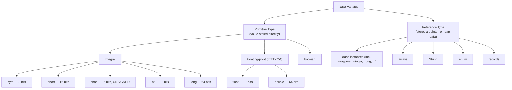
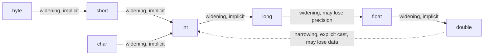

:::tip[TL;DR (30-Second Interview Pitch)]
A variable is a named, **statically and strongly typed** storage location. Java has exactly **8 primitive types** — 4 integral (`byte`, `short`, `int`, `long`), 2 IEEE-754 floating-point (`float`, `double`), `char`, and `boolean` — plus **reference types** that hold a pointer to heap data. Java is **always pass-by-value**: for objects, the *reference* is copied. The traps interviewers love all live here: **integer overflow**, **floating-point rounding**, the **`Integer` cache** that makes `==` lie, **unboxing `NullPointerException`s**, and why money code uses **`BigDecimal`** (built from a `String`).
:::

<PriorityKey />

## ⚡ Essential Interview Recall

- 🔴 Java is **statically typed** (type fixed at compile time) **and strongly typed** (no implicit unsafe conversions).
- 🔴 **8 primitives**: `byte`(1B), `short`(2B), `char`(2B, **unsigned**), `int`(4B), `long`(8B), `float`(4B), `double`(8B), `boolean` (size JVM-dependent).
- 🔴 **Java is always pass-by-value.** Primitives: the value is copied. Objects: the **reference** is copied, so a method can **mutate** the caller's object but can't make the caller's variable point to a different one.
- 🔴 Default values apply **only to fields** (`0`, `0.0`, `false`, `'\u0000'`, `null`). **Local variables get none**: reading one before assigning it is a compile error.
- 🔴 **Widening** is implicit; **narrowing** needs a cast and silently **wraps** (keeps only the low-order bits), with no exception.
- 🔴 **Binary numeric promotion**: `byte`/`short`/`char` become `int` before any arithmetic → `byte + byte` is an `int`.
- 🔴 **Integer cache**: `Integer.valueOf` (and autoboxing) returns cached objects for **-128..127**. So `Integer a = 127, b = 127; a == b` is `true`, but at `128` it's `false`. **Always compare wrappers with `equals`.**
- 🔴 **Unboxing `null` throws `NullPointerException`** — including the hidden unboxing in `int c = map.get(key)` and in `cond ? integerVar : 0`.
- 🟠 `int * int` **overflows before** it's widened: `long x = a * b` is wrong, `long x = (long) a * b` is right.
- 🟠 **NaN** is not equal to anything, itself included (`NaN != NaN`); `1.0 / 0` is `Infinity`; `0.0 == -0.0` is `true` but `Double.equals` says they differ.
- 🟠 **Money**: never `float`/`double`. Use `BigDecimal` **from a String** (`new BigDecimal("0.1")`), or integer paise/cents in a `long`. `BigDecimal.equals` compares **scale** (`2.0 ≠ 2.00`); use `compareTo` for numeric equality.
- 🟡 `var` <Since v="10" /> is **local type inference**, not dynamic typing: the type is fixed at compile time. Not allowed for fields, parameters, or without an initializer.
- 🟡 Literals: `010` is **octal** (8), `0b1010` binary (10), `0x1F` hex (31), `1_000_000` underscores, `'\u0041'` is `'A'`.

:::speak[Is Java pass-by-value or pass-by-reference?]
"Java is **always pass-by-value**. When I pass a primitive, the method gets a copy of the value. When I pass an object, what's actually passed is the **value of the reference**, a copy of the pointer. Both copies point to the same object on the heap, so if the method calls `account.deposit(100)`, the caller sees the change. But if the method assigns a new object to its parameter, it only changes its own copy of the reference; the caller's variable still points to the original. That's why a `swap(a, b)` method can't swap the caller's objects in Java, which it could in a real pass-by-reference language like C++ with `&` parameters."
:::

## The Mental Model





<Animation src="variables/pass-by-value" caption="The method's parameters are copies of the caller's references. Swapping the copies changes nothing for the caller, but mutating the shared object through a copy is visible to everyone." />

:::analogy[Pass-by-value is photocopying an address]
Passing an object to a method is like handing someone a photocopy of a house's address. They can go to that house and repaint the walls (mutate the object), and you'll see the new paint. But if they cross out the address on *their* photocopy and write a different one, your copy still has the original address.
:::

## The Paradigm / Core Concepts

### 🔴 The 8 primitive types

| Type | Size | Representation | Range | Default (fields only) | Wrapper |
|---|---|---|---|---|---|
| `byte` | 1 byte / 8 bits | Signed, 2's complement | -128 to 127 | `0` | `Byte` |
| `short` | 2 bytes / 16 bits | Signed, 2's complement | -32,768 to 32,767 | `0` | `Short` |
| `char` | 2 bytes / 16 bits | **Unsigned**, UTF-16 code unit | 0 to 65,535 | `'\u0000'` (NUL) | `Character` |
| `int` | 4 bytes / 32 bits | Signed, 2's complement | -2³¹ to 2³¹-1 (about ±2.1 billion) | `0` | `Integer` |
| `long` | 8 bytes / 64 bits | Signed, 2's complement | -2⁶³ to 2⁶³-1 | `0L` | `Long` |
| `float` | 4 bytes / 32 bits | IEEE-754 single (1-8-23, bias 127) | ~±3.4×10³⁸, ~7 significant digits | `0.0f` | `Float` |
| `double` | 8 bytes / 64 bits | IEEE-754 double (1-11-52, bias 1023) | ~±1.8×10³⁰⁸, ~15–16 significant digits | `0.0d` | `Double` |
| `boolean` | JVM-dependent (an `int` on the stack, 1 byte in arrays) | `true` / `false` only — no numeric mapping | — | **`false`** | `Boolean` |

### 🔴 Conversion rules

| Conversion | Direction | Automatic? | Risk |
|---|---|---|---|
| **Widening** | `byte→short→int→long→float→double`, `char→int` | Yes, implicit | None for integral→integral; `int`/`long`→`float` and `long`→`double` can lose **precision** (not magnitude) |
| **Narrowing** | Large type → small type | No — needs an explicit cast `(type)` | Silent **wrap-around** for integers; **truncation toward zero** for floating → integer |
| **Promotion** | `byte`/`short`/`char` operand in an expression | Yes, forced by the compiler | Result is `int` (or wider) — assigning back to the narrow type needs a cast (or a compound assignment) |
| **Boxing / unboxing** | `int` ↔ `Integer` etc. | Yes, implicit (Java 5+) | Unboxing `null` → `NullPointerException`; `==` on boxes compares **identity** |

### 🔴 Kinds of variables

| Kind | Scope | Lives in | Gets default value? |
|---|---|---|---|
| **Instance / member** | Per object | Heap (inside the object) | Yes |
| **Static / class** | One copy, shared via class name | Heap (inside the `java.lang.Class` object) | Yes |
| **Local** | Inside a method/block | JVM stack (frame's local variable array) | **No** — must be definitely assigned before use |
| **Parameter** | Inside the invoked method/constructor | JVM stack | N/A — caller supplies a **copy** of the value |

### 🔴 Wrapper classes and autoboxing

| Fact | Detail |
|---|---|
| Autoboxing | `Integer x = 5;` compiles to `Integer x = Integer.valueOf(5);` |
| Unboxing | `int y = x;` compiles to `int y = x.intValue();` → **NPE if `x` is `null`** |
| Caches | `Integer`, `Short`, `Byte`, `Long`: **-128..127**. `Character`: **0..127**. `Boolean`: `TRUE`/`FALSE`. `Float`/`Double`: **no cache** |
| Tuning | `-XX:AutoBoxCacheMax=<n>` raises the **`Integer`** cache's upper bound only |
| Constructors | `new Integer(5)` is deprecated **for removal** (Java 9 / 16): it always creates a new object and bypasses the cache |
| Equality | `==` on two wrappers compares **references**; `==` between a wrapper and a primitive **unboxes** and compares values |
| Wrappers are immutable | `Integer count; count++` creates a **new** `Integer` each time (it's `count = Integer.valueOf(count.intValue() + 1)`) |

<RuleCard name="Compare wrappers with equals, never ==" tag="Autoboxing" why="Autoboxing hides object creation. The cache makes == work for small values in tests and fail for real ids, amounts and counts in production." remember="Small numbers lie: == works until 128.">

```java
Integer a = 127, b = 127;   // a == b → true  (both from the cache)
Integer c = 128, d = 128;   // c == d → false (two different objects)
c.equals(d);                // true: always use equals (or compare unboxed ints)
```

</RuleCard>

### 🟠 Floating point: special values

| Expression | Result | Why |
|---|---|---|
| `0.1 + 0.2 == 0.3` | `false` | Both are rounded binary fractions; the sum is `0.30000000000000004` |
| `1.0 / 0` | `Infinity` | IEEE-754: no exception for floating-point division by zero |
| `0.0 / 0.0` | `NaN` | "Not a Number" |
| `Double.NaN == Double.NaN` | **`false`** | NaN is unordered: every comparison with it is `false` (`!=` is `true`) |
| `Double.isNaN(x)` / `Double.valueOf(NaN).equals(NaN)` | `true` / `true` | The right ways to test for NaN; `equals` compares bit patterns |
| `0.0 == -0.0` | `true` | IEEE-754 says they compare equal |
| `Double.valueOf(0.0).equals(-0.0)`, `Double.compare(0.0, -0.0)` | `false`, `1` | Bit patterns differ; `Math.min(0.0, -0.0)` is `-0.0` |
| `(int) Double.NaN`, `(int) 3.99e10` | `0`, `2147483647` | Floating → int narrowing **saturates** at the int range (unlike int → byte, which wraps) |
| `float f = 16_777_217; (int) f` | `16777216` | A `float` has 24 bits of precision: above 2²⁴ not every integer is representable |

### 🟠 Money: `BigDecimal` done right

<RuleCard name="BigDecimal rules" tag="Fintech favourite" why="A binary double can't hold most decimal fractions exactly, and the errors compound across millions of transactions." remember="Build from a String, compare with compareTo, always say how to round.">

1. **Construct from a `String`** (or `BigDecimal.valueOf(double)`), never `new BigDecimal(0.1)`, which captures the binary error: `0.1000000000000000055511151231257827021181583404541015625`.
2. **`equals` checks scale**: `new BigDecimal("2.0").equals(new BigDecimal("2.00"))` is `false`. Use `compareTo(...) == 0` for numeric equality (or `stripTrailingZeros()`).
3. **Division needs a scale and a `RoundingMode`**: `ONE.divide(THREE)` throws `ArithmeticException: Non-terminating decimal expansion`. Use `divide(three, 4, RoundingMode.HALF_EVEN)` (banker's rounding, standard in finance).
4. `BigDecimal` is **immutable**: `amount.add(fee)` returns a new object, so a bare `amount.add(fee);` does nothing.

</RuleCard>

## ⚙️ Under the Hood (JVM Mechanics)

- **Two's complement signed integers**: `-x = ~x + 1`. That's why ranges are asymmetric (`byte` is `-128..127`): zero takes one of the non-negative slots. It also means `Math.abs(Integer.MIN_VALUE)` and `-Integer.MIN_VALUE` are still **negative** (there's no +2³¹).
- **IEEE-754 float/double layout** — every finite value decodes as:

  $$
  \text{value} = (-1)^{\text{sign}} \times (1.\text{mantissa}) \times 2^{(\text{exponent} - \text{bias})}
  $$

  The leading `1.` is implicit (the "hidden bit"), so 23 stored mantissa bits give 24 bits of precision. Exponent all-ones encodes **Infinity** (mantissa 0) and **NaN** (mantissa ≠ 0); the sign bit alone separates `0.0` from `-0.0`.
- **Why `0.7f` isn't exactly `0.7`**: `0.7` in binary is a *repeating* fraction (`0.1011001100110011...`), like `1/3` in decimal. The finite mantissa stores the *closest representable* value.
- **Narrowing integer casts keep the low-order bits**: `(byte) 300` → `300 = 0b1_0010_1100` → keep the last 8 bits `0010_1100` = **44**. `(short) 40000` → **-25536**.
- **Binary numeric promotion (JLS §5.6)**: the JVM has no arithmetic instructions for `byte`/`short`/`char` — only `iadd`, `imul`, … on `int` (plus `l`/`f`/`d` variants). So `javac` must promote, and that's why `byte + byte` is an `int`.
- **`boolean` in the JVM**: there are no boolean instructions; `boolean` locals and fields are handled as `int` 0/1, and `boolean[]` uses one byte per element (`baload`/`bastore`).
- **Locals and parameters** live in the frame's **local variable array** (slot 0 is `this` in instance methods; `long`/`double` take two slots). A method call copies the argument values into the new frame's slots: **that copy is pass-by-value**.
- **Autoboxing is plain method calls** inserted by `javac`: `Integer.valueOf(int)` and `intValue()`. In a hot loop, `Long sum = 0L; sum += i;` allocates a new `Long` on almost every iteration (Effective Java, Item 61): use the primitive.
- **Static fields** live on the heap inside the class's `java.lang.Class` object (HotSpot, Java 8+); only class *metadata* is in Metaspace.

:::danger[Interview Trap]
**`boolean`'s default value is `false`, not `true`** — and only fields get it. A `Boolean` (wrapper) field defaults to **`null`**, so `if (user.isActive)` on an unset `Boolean` throws `NullPointerException` while unboxing.
:::

:::danger[Interview Trap]
**Local variables never get a default value.** Defaults (`0`, `false`, `null`) apply only to instance and static fields, which the JVM zero-fills when it creates the object or class. The compiler enforces **definite assignment** for locals: `variable x might not have been initialized`.
:::

:::danger[Interview Trap]
**`final` on a reference parameter doesn't protect the object.** `void process(final List<String> items)` stops `items = new ArrayList<>()` inside the method, but `items.clear()` still empties the caller's list. Pass-by-value copies the reference, not the object.
:::

## 💻 Java Implementation

:::tip[Run it yourself]
The snippets after the first class run as-is in **`jshell`** (shipped with the JDK since Java 9). Lines marked in **red** are the mistake: they fail to compile or give a surprising result. Every output comment comes from a run on JDK 21.
:::

### Three kinds of variables, three sets of rules

```java title="PrimitivesDemo.java" showLineNumbers
public class PrimitivesDemo {

    // instance: one copy PER OBJECT, inside the object on the heap
    // highlight-next-line
    private int instanceCounter;               // defaults to 0

    // static: ONE copy per class, held in its Class object on the heap
    // highlight-next-line
    private static int totalInstancesCreated;  // defaults to 0

    public PrimitivesDemo() {
        totalInstancesCreated++;
    }

    public static void main(String[] args) {
        // local: a slot in the stack frame, NO default value
        int localSum;
        // error-next-line
        System.out.println(localSum);   // ❌ might not have been initialized
        // success-next-line
        localSum = 10;                  // ✅ definitely assigned → readable now
        System.out.println(localSum);
    }
}
```

### Pass-by-value, proven

```java title="PassByValue.java" showLineNumbers
class Box { int v; Box(int v) { this.v = v; } }

static void swap(Box a, Box b)  { Box t = a; a = b; b = t; }   // swaps the COPIES
static void mutate(Box a)       { a.v = 99; }                  // follows the copy to the SAME object
static void reassign(Box a)     { a = new Box(-1); }           // repoints only the copy
static void inc(int x)          { x++; }                       // increments the copy

Box a = new Box(1), b = new Box(2);
// error-next-line
swap(a, b);       System.out.println(a.v + " " + b.v);   // 1 2: nothing swapped
// highlight-next-line
mutate(a);        System.out.println(a.v);               // 99: the shared object changed
reassign(a);      System.out.println(a.v);               // 99: caller's reference untouched
int n = 5;
inc(n);           System.out.println(n);                 // 5
```

### The 8 primitives and their literals

```java showLineNumbers
byte    byteVar   = 127;              // 8 bits,  signed: -128..127
short   shortVar  = 32_000;           // 16 bits, signed
char    charVar   = 'A';              // 16 bits, UNSIGNED (UTF-16 unit)
int     intVar    = 2_000_000_000;    // 32 bits, signed
// highlight-next-line
long    longVar   = 3_000_000_000L;   // 64 bits: L REQUIRED beyond int range
// highlight-next-line
float   floatVar  = 4.125f;           // 32-bit IEEE-754: f REQUIRED
double  doubleVar = 4.125;            // 64-bit IEEE-754: decimal literals are double
boolean flag      = false;            // true / false only

// error-start
long  tooBig = 3_000_000_000;         // ❌ integer number too large
float noF    = 4.125;                 // ❌ lossy conversion double → float
// error-end
```

```java showLineNumbers
// highlight-next-line
System.out.println(010);              // 8: a leading 0 means OCTAL
System.out.println(0b1010);           // 10: binary (Java 7)
System.out.println(0x1F);             // 31: hex
System.out.println('\u0041');    // A: unicode escape
System.out.println('A' + 1);          // 66: char + int is an int
System.out.println((char) ('A' + 1)); // B
// error-next-line
int bad = 09;                         // ❌ compile error: 9 is not an octal digit
```

### Widening vs narrowing

```java showLineNumbers
int intVar = 2_000_000_000;
// success-next-line
long widened = intVar;                   // ✅ int → long: implicit, no data loss

// error-start
byte narrowed = (byte) 300;              // 44: keeps the low 8 bits, no exception
short s       = (short) 40_000;          // -25536
// error-end
int truncated = (int) -2.9;              // -2: floating → int truncates toward ZERO
int saturated = (int) 3.99e10;           // 2147483647: floating → int saturates
```

### Promotion inside expressions (and the `char` gotcha)

```java showLineNumbers
byte a = 1, b = 127;
// error-next-line
byte sum = a + b;      // ❌ compile error: byte + byte is promoted to int
// success-next-line
int total = a + b;     // ✅ 128

char c = 'a';
// success-next-line
char d = 'a' + 1;      // ✅ compiles: 'a' + 1 is a CONSTANT expression that fits in char
// error-next-line
char e = c + 1;        // ❌ lossy conversion from int to char: c is a variable
// success-next-line
c += 1; c++;           // ✅ compound assignment and ++ include a hidden cast → 'c'
```

### Autoboxing traps

```java showLineNumbers
Integer i1 = 127, i2 = 127, i3 = 128, i4 = 128;
System.out.println(i1 == i2);          // true: both from the Integer cache
// error-next-line
System.out.println(i3 == i4);          // false: two different objects
// success-next-line
System.out.println(i3.equals(i4));     // true

Map<String, Integer> stock = new HashMap<>();
// error-next-line
int qty = stock.get("pen");            // ❌ NullPointerException: unboxing null
// success-next-line
int safe = stock.getOrDefault("pen", 0);   // ✅ 0

Integer missing = null;
// error-next-line
Integer r = true ? missing : 0;        // ❌ NPE! Integer + int branches → the type is int → unbox null
```

### Overflow before widening

```java showLineNumbers
int big = 1_000_000;
// error-next-line
long wrong = big * big;                // -727379968: int * int overflows FIRST, then widens
// success-next-line
long right = (long) big * big;         // 1000000000000: widen one operand BEFORE multiplying
long safe  = Math.multiplyExact((long) big, big);   // throws ArithmeticException on overflow
```

### Floating-point imprecision and the fix

```java showLineNumbers
import java.math.BigDecimal;
import java.math.RoundingMode;

// error-next-line
System.out.println(0.1 + 0.2 == 0.3);              // false: sum is 0.30000000000000004
System.out.println(0.1f + 0.2f == 0.3f);           // true, by luck: float rounding lands on 0.3f

// error-next-line
System.out.println(new BigDecimal(0.1));           // 0.1000000000000000055511151231257827021181583404541015625
// success-start
BigDecimal exact = new BigDecimal("0.1").add(new BigDecimal("0.2"));
System.out.println(exact);                         // 0.3, exactly
System.out.println(BigDecimal.valueOf(0.1));       // 0.1: valueOf goes through Double.toString
// success-end

System.out.println(new BigDecimal("2.0").equals(new BigDecimal("2.00")));       // false: scale differs
System.out.println(new BigDecimal("2.0").compareTo(new BigDecimal("2.00")));    // 0: numerically equal
System.out.println(BigDecimal.ONE.divide(new BigDecimal("3"), 4, RoundingMode.HALF_EVEN));   // 0.3333
```

### Special values and rounding

```java showLineNumbers
// error-next-line
System.out.println(Double.NaN == Double.NaN);      // false: NaN equals nothing, not even itself
System.out.println(Double.isNaN(0.0 / 0.0));       // true
System.out.println(1.0 / 0);                       // Infinity (but 1 / 0 throws ArithmeticException)
System.out.println(0.0 == -0.0);                   // true
System.out.println(Double.compare(0.0, -0.0));     // 1: compare/equals look at the bits

// highlight-next-line
System.out.println(Math.round(-2.5));              // -2: rounds half UP (toward +infinity), = floor(x + 0.5)
System.out.println(Math.round(2.5));               // 3
System.out.println(Math.rint(2.5));                // 2.0: rint rounds half to EVEN
```

### `var` (local type inference) <Since v="10" />

```java showLineNumbers
// success-start
var names = new ArrayList<String>();     // ✅ inferred: ArrayList<String>, fixed at compile time
for (var entry : map.entrySet()) { }     // ✅ great for long generic types
BiFunction<Integer, Integer, Integer> add = (var x, var y) -> x + y;   // ✅ Java 11: var in lambdas (for annotations)
// success-end

// error-start
var x;                                   // ❌ cannot infer type: no initializer
var nothing = null;                      // ❌ cannot infer type from null
var f = () -> 1;                         // ❌ a lambda needs a target type
var arr = {1, 2};                        // ❌ array initializer needs an explicit type
// error-end
int var = 3;                             // compiles! var is a reserved TYPE name, not a keyword
```

## 🧪 Predict the Output

<Predict n="1" title="Does swap work?" output="1 2">

```java
class Box { int v; Box(int v) { this.v = v; } }
static void swap(Box a, Box b) { Box t = a; a = b; b = t; }

Box x = new Box(1), y = new Box(2);
swap(x, y);
System.out.println(x.v + " " + y.v);
```

`swap` receives **copies** of the two references and swaps those copies inside its own stack frame. When it returns, the frame (and the swapped copies) disappear; `x` and `y` in the caller were never touched. This is the standard proof that Java isn't pass-by-reference.

</Predict>

<Predict n="2" title="The Integer cache" output="true false true">

```java
Integer a = 127, b = 127;
Integer c = 128, d = 128;
System.out.println(a == b);
System.out.println(c == d);
System.out.println(c.equals(d));
```

Autoboxing calls `Integer.valueOf`, which returns **cached** instances for -128..127. `a` and `b` are the same object, `c` and `d` are not. With `-XX:AutoBoxCacheMax=1000` the second line also prints `true`: that's precisely why the code is broken, its result depends on a JVM flag.

</Predict>

<Predict n="3" title="The ternary that throws" output="NullPointerException">

```java
Integer missing = null;
Integer r = true ? missing : 0;
System.out.println(r);
```

One branch is `Integer`, the other is the `int` literal `0`. The rules for the conditional operator make the whole expression type **`int`**, so `javac` inserts `missing.intValue()`, even though the result is then boxed back into `r`. Fix: make both branches the same type (`Integer.valueOf(0)`) or use an `if`.

</Predict>

<Predict n="4" title="Overflow first, widen later" output="-727379968">

```java
int big = 1_000_000;
long result = big * big;
System.out.println(result);
```

The multiplication is `int * int`, done in 32 bits, and overflows **before** the result is widened to `long`: 10¹² mod 2³² read as a signed int is `-727379968`. Writing `(long) big * big` widens the first operand, so the multiplication itself happens in 64 bits. Classic places this bites: `days * 24 * 60 * 60 * 1000` milliseconds, and `width * height * 4` buffer sizes.

</Predict>

<Predict n="5" title="Rounding negatives" output="3 -2 -3 -2">

```java
System.out.println(Math.round(2.5));
System.out.println(Math.round(-2.5));
System.out.println(Math.round(-2.6));
System.out.println((int) -2.9);
```

`Math.round(x)` is `floor(x + 0.5)`: ties go **up** (toward positive infinity), so `-2.5` → `-2`, not `-3`. `-2.6 + 0.5 = -2.1` → floor → `-3`. A cast to `int` simply **truncates toward zero**: `-2.9` → `-2`. For money, use `BigDecimal.setScale(2, RoundingMode.HALF_UP)` or `HALF_EVEN`, where the rule is explicit.

</Predict>

<Predict n="6" title="BigDecimal in a HashSet" output="2 1">

```java
var a = new BigDecimal("1.0");
var b = new BigDecimal("1.00");
System.out.println(new HashSet<>(List.of(a, b)).size());
System.out.println(new TreeSet<>(List.of(a, b)).size());
```

`HashSet` uses `equals`/`hashCode`, which include the **scale** (1 vs 2), so both values are kept. `TreeSet` uses `compareTo`, which compares **numerically**, so `1.0` and `1.00` are one element. `BigDecimal` is the JDK's famous example of `compareTo` being **inconsistent with `equals`**.

</Predict>

## 🪜 Follow-up Ladder

<Ladder title="From == to production money bugs">
<Rung q="Why does Integer a = 127, b = 127; a == b print true but not for 128?">

Autoboxing uses `Integer.valueOf`, which returns cached objects for -128..127. `==` compares references, so it's true only when both came from the cache.

</Rung>
<Rung q="Can you change the cache range? Should you?">

`-XX:AutoBoxCacheMax` raises the upper bound for `Integer` only. You shouldn't rely on it: the real bug is using `==` on wrapper objects. Fix the comparison with `equals`, `Objects.equals` (null-safe) or by unboxing.

</Rung>
<Rung q="What other bugs does autoboxing cause?">

Unboxing `null` → NPE (`map.get` results, ternaries, nullable DB columns mapped to `Integer` and assigned to `int`); hidden allocation in loops (`Long sum`); `List<Integer>.remove(1)` removes **index** 1, not the value 1 (use `remove(Integer.valueOf(1))`).

</Rung>
<Rung q="How do you represent money in Java?">

`BigDecimal` constructed from `String`s, with an explicit scale and `RoundingMode` on every division (HALF_EVEN for banking), compared with `compareTo`. Or a `long` of the smallest unit (paise/cents) when performance matters and only addition/subtraction happens. Never `double`. A `Money` value object (amount + currency) beats passing bare `BigDecimal`s around.

</Rung>
<Rung q="Your nightly reconciliation is off by a few paise. Where do you look?">

Places where `double` sneaks in: JSON parsing into `double`, `new BigDecimal(someDouble)`, `Math.round` on amounts, rounding **per line** versus rounding the **total** (round once, at the end, with a documented mode), currency conversion done in floating point, and DB columns typed `FLOAT` instead of `DECIMAL(19,4)`.

</Rung>
</Ladder>

## 🚑 Production Scenario

:::incident[Order ids stopped matching after the 128th order]
A cache lookup worked in every test, but in production orders above id 127 were reported as "not found".

- **Code:** `if (order.getCustomerId() == request.getCustomerId())`, where both getters return `Long`.
- **Why:** test data used small ids, which come from the `Long` cache (-128..127), so `==` compared the same cached objects. Real ids are large, each boxed into a new object, so `==` compared two different references and returned `false`.
- **Fix:** `Objects.equals(a, b)` or `a.equals(b)`; enable the static-analysis rules that flag `==` between boxed types (SonarQube `S4973`, IntelliJ's *Number comparison using ==*), and keep ids as primitives (`long`) where `null` isn't a valid value.
:::

## 🚨 Interview Gotchas & Edge Cases

:::warning[The Most Common Question]
**"Why is `0.1 + 0.2 == 0.3` false?"** Because `0.1` and `0.2` are repeating fractions in binary, rounded to the nearest representable `double`, and the rounding errors don't cancel: the sum is `0.30000000000000004`. (With `float`, `0.1f + 0.2f == 0.3f` happens to be `true`. Don't rely on that.) It's IEEE-754, shared by almost every language. The senior follow-up: **never use `float`/`double` for currency** — use `BigDecimal` from `String`s, or integer paise/cents in a `long`; and compare doubles with a tolerance (`Math.abs(a - b) < 1e-9`).
:::

- **Narrowing never throws — it silently corrupts data.** `(byte) 300` is `44`. A large computed `int` stored in a `short` column fails silently in production. Use `Math.toIntExact(long)` to fail loudly.
- **`Math.abs(Integer.MIN_VALUE)` is negative** (`-2147483648`): the classic bug in `Math.abs(hashCode()) % n` bucket selection. Use `Math.floorMod(hash, n)` instead.
- **Integer division vs floating division by zero**: `1 / 0` throws `ArithmeticException`, `1.0 / 0` is `Infinity`, `0.0 / 0` is `NaN`.
- **`char` is a number**: `'a' + 'b'` is `195` (an `int`), but `"" + 'a' + 'b'` is `"ab"`. And `char` is unsigned: `(char) -1` is `'\uFFFF'` (65535).
- **`long` → `float`/`double` loses precision silently**: `float f = 16_777_217;` stores `16777216`. Large `long` ids must never pass through a `double` (also true for JavaScript clients: JSON numbers above 2⁵³ lose precision, so send big ids as strings).
- **`List<Integer>.remove(1)`** calls `remove(int index)`, not `remove(Object)`: overload resolution prefers no boxing.
- **Variable naming rules**: identifiers start with a letter, `$` or `_` (a lone `_` is not allowed since Java 9, and became the *unnamed variable* in Java 22); reserved words are rejected. `var`, `record`, `yield`, `sealed` are *contextual* keywords, so `int var = 3;` still compiles.
