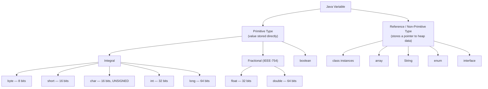
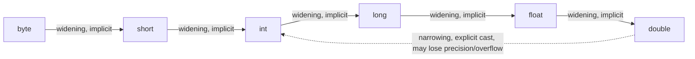

:::tip[TL;DR (30-Second Interview Pitch)]
A variable is a named, **statically and strongly typed** storage location. Java has exactly **8 primitive types** — 4 integral (`byte`, `short`, `int`, `long`), 2 fractional/IEEE-754 (`float`, `double`), `char`, and `boolean` — plus **reference types** (objects, arrays, interfaces) that point to heap data instead of holding it inline. Getting their exact bit-widths, signed representation, and conversion rules (widening vs. narrowing vs. promotion) right is foundational — it's what explains integer overflow bugs, floating-point rounding errors, and why production money code never uses `float`/`double`.
:::

## ⚡ Essential Interview Recall

- Java is **statically typed** (type fixed at compile time) **and strongly typed** (no implicit unsafe assignment — you can't assign a `String` to an `int`).
- **8 primitive types**: `byte`(1B), `short`(2B), `char`(2B, unsigned), `int`(4B), `long`(8B) — integral; `float`(4B), `double`(8B) — IEEE-754; `boolean`(JVM-impl-defined, conceptually 1 bit).
- All signed integral types use **two's complement** representation: `-x = ~x + 1`.
- `char` is Java's only **unsigned** primitive — range `0` to `65535` (`'\u0000'` to `'\uffff'`).
- Default values apply **only to fields** (instance/static) — `0`/`0.0`/`false`/`'\u0000'`/`null`. **Local variables get NO default value** — the compiler enforces *definite assignment* and refuses to compile if you read before writing.
- **`boolean`'s default value is `false`**, not `true` — a frequent slip.
- **Widening** (small → large) is implicit/automatic. **Narrowing** (large → small) requires an explicit cast and can silently **overflow/wrap around** (modulo-based truncation), losing data with no runtime exception.
- **Binary numeric promotion**: in any expression, `byte`/`short`/`char` operands are promoted to `int` *before* the operation runs — `byte + byte` yields an `int`, not a `byte`.
- IEEE-754 `float` = 1 sign bit + 8 exponent bits (bias **127**) + 23 mantissa bits. `double` = 1 + 11 (bias **1023**) + 52.
- Floating-point types **cannot exactly represent most decimal fractions** (e.g., `0.1f`, `0.7f`) — use `BigDecimal`, or scaled `long`/`int`, for money and exact arithmetic (Effective Java, Item 60).
- Variable kinds by scope/lifetime: **instance** (per-object, heap), **static/class** (one copy per class, stored in its `Class` object on the heap), **local** (per-call, stack frame, destroyed on method return), **method/constructor parameters** (local variables initialized by the caller).

## The Mental Model





## The Paradigm / Core Concepts

### The 8 primitive types

| Type | Size | Representation | Range | Default (fields only) |
|---|---|---|---|---|
| `byte` | 1 byte / 8 bits | Signed, 2's complement | -128 to 127 | `0` |
| `short` | 2 bytes / 16 bits | Signed, 2's complement | -32,768 to 32,767 | `0` |
| `char` | 2 bytes / 16 bits | **Unsigned**, UTF-16 code unit | 0 to 65,535 | `'\u0000'` (NUL) |
| `int` | 4 bytes / 32 bits | Signed, 2's complement | -2³¹ to 2³¹-1 | `0` |
| `long` | 8 bytes / 64 bits | Signed, 2's complement | -2⁶³ to 2⁶³-1 | `0L` |
| `float` | 4 bytes / 32 bits | IEEE-754 single (1-8-23, bias 127) | ~±3.4×10³⁸, ~7 sig. digits | `0.0f` |
| `double` | 8 bytes / 64 bits | IEEE-754 double (1-11-52, bias 1023) | ~±1.8×10³⁰⁸, ~15 sig. digits | `0.0d` |
| `boolean` | JVM-dependent (≈1 bit, often padded) | `true` / `false` only — no numeric mapping | — | **`false`** |

### Conversion rules

| Conversion | Direction | Automatic? | Risk |
|---|---|---|---|
| **Widening** | small type → large type (`byte→short→int→long→float→double`) | Yes, implicit | None for integral→integral; `int`/`long`→`float`/`double` can lose *precision* (not magnitude) |
| **Narrowing** | large type → small type | No — requires explicit cast `(type)` | Silent **overflow/truncation** via modulo arithmetic — no exception thrown |
| **Promotion** | `byte`/`short`/`char` operand in an expression | Yes, implicit (compiler-forced) | Result type is `int` (or wider) — assigning back to the narrow type needs a cast |

### Kinds of variables

| Kind | Scope | Lives in | Gets default value? |
|---|---|---|---|
| **Instance / member** | Per object | Heap (inside the object) | Yes |
| **Static / class** | One copy, shared via class name | Heap (inside the `java.lang.Class` object) | Yes |
| **Local** | Inside a method/block | JVM Stack (stack frame) | **No** — must be definitely assigned before use |
| **Method parameter** | Inside the invoked method | JVM Stack | N/A — caller supplies the value |
| **Constructor parameter** | Inside the constructor | JVM Stack | N/A — caller supplies the value |

## ⚙️ Under the Hood (JVM Mechanics)

- **Two's complement signed integers**: to get `-x`, invert every bit of `x` (one's complement) and add `1`. This is why signed integral ranges are asymmetric — e.g. `byte` is `-128..127`, not `-127..127` — there's exactly one more negative value than positive, because `0` only consumes one of the positive-side slots.
- **IEEE-754 float/double layout** — every value decodes as:

  $$
  \text{value} = (-1)^{\text{sign}} \times (1.\text{mantissa}) \times 2^{(\text{exponent} - \text{bias})}
  $$

  The leading `1.` before the mantissa is implicit (the "hidden bit") and never stored — that's why 23 mantissa bits give ~24 bits of effective precision.
- **Why `0.7f` isn't exactly `0.7`**: `0.7` in binary is a *repeating* fraction (`0.1011001100110011...`), just like `1/3` repeats in decimal. The mantissa field is finite (23 bits for `float`), so the value gets truncated/rounded — the stored result (~`0.69999...`) is the *closest representable* float, not the exact decimal.
- **Narrowing is pure modulo truncation at the bytecode level** — `(byte) 128` doesn't "clamp," it drops the high-order bits and reinterprets what's left, which is why it wraps to `-128`, then `(byte) 148` wraps to `-108`.
- **Binary numeric promotion (JLS §5.6)**: the JVM has no arithmetic bytecode instructions for `byte`/`short`/`char` — only `iadd`, `isub`, etc. operate on `int` (or `ladd`/`fadd`/`dadd` for wider types). So the compiler is *forced* to promote narrower operands to `int` before emitting arithmetic bytecode; there's no way around it.
- **Where each variable kind physically lives:**
  - Instance fields — slots inside the object's own memory block, on the **heap**.
  - Static fields — one copy, stored on the **heap** inside the class's `java.lang.Class` object (HotSpot, Java 8+). Only the class *metadata* (bytecode, field layout, constant pool) is in **Metaspace**.
  - Local variables & parameters — slots in the current method's **stack frame**, gone the instant that frame is popped.

:::danger[Interview Trap]
**`boolean`'s default value is `false`, not `true`.** This note's own instinct ("default is True") is a classic slip — double-check it live, because interviewers love this one specifically because it's so easy to misremember.
:::

:::danger[Interview Trap]
**Local variables never get a default value.** Default values (`0`, `false`, `null`, etc.) apply *only* to instance and static fields, which the JVM zero-initializes during object/class creation. A local variable is just a slot on the stack frame with whatever garbage was there before — Java's compiler enforces **definite assignment** and throws a compile error (`variable might not have been initialized`) rather than ever letting you read an undefined local.
:::

## 💻 Java Implementation

:::tip[Run it yourself]
The snippets after the first class run as-is in **`jshell`** (shipped with the JDK since Java 9). Lines marked in **red** are the mistake: they fail to compile or give a surprising result.
:::

### Three kinds of variables, three sets of rules

```java title="PrimitivesDemo.java" showLineNumbers
public class PrimitivesDemo {

    // instance: one copy PER OBJECT, inside the object on the heap
    // highlight-next-line
    private int instanceCounter;               // defaults to 0

    // static: ONE copy per class, held in its Class object on the heap
    // highlight-next-line
    private static int totalInstancesCreated;  // defaults to 0

    public PrimitivesDemo() {
        totalInstancesCreated++;
    }

    public static void main(String[] args) {
        // local: a slot in the stack frame, NO default value
        int localSum;
        // error-next-line
        System.out.println(localSum);   // ❌ might not have been initialized
        // success-next-line
        localSum = 10;                  // ✅ definitely assigned → readable now
        System.out.println(localSum);
    }
}
```

### The 8 primitives and their literals

```java showLineNumbers
byte    byteVar   = 127;              // 8 bits,  signed: -128..127
short   shortVar  = 32_000;           // 16 bits, signed
char    charVar   = 'A';              // 16 bits, UNSIGNED (UTF-16 unit)
int     intVar    = 2_000_000_000;    // 32 bits, signed
// highlight-next-line
long    longVar   = 3_000_000_000L;   // 64 bits: L REQUIRED beyond int range
// highlight-next-line
float   floatVar  = 4.125f;           // 32-bit IEEE-754: f REQUIRED
double  doubleVar = 4.125;            // 64-bit IEEE-754: decimal default
boolean flag      = false;            // true / false only

// error-start
long  tooBig = 3_000_000_000;         // ❌ integer number too large
float noF    = 4.125;                 // ❌ lossy conversion double → float
// error-end
```

### Widening vs narrowing

```java showLineNumbers
int intVar = 2_000_000_000;
// success-next-line
long widened = intVar;                   // ✅ int → long: implicit, no data loss

int overflowSource = 128;
// error-next-line
byte narrowed = (byte) overflowSource;   // compiles, but wraps to -128 (no clamping)
```

### Promotion inside expressions

```java showLineNumbers
byte a = 1, b = 127;

// error-next-line
byte sum = a + b;     // ❌ compile error: byte + byte is promoted to int
// success-next-line
int total = a + b;    // ✅ 128
```

### Floating-point imprecision and the fix

```java showLineNumbers
import java.math.BigDecimal;

// error-next-line
System.out.println(0.1 + 0.2 == 0.3);     // false: sum is 0.30000000000000004
System.out.println(0.1f + 0.2f == 0.3f);  // true, by luck: float rounding lands on 0.3f

// success-start
BigDecimal exact = new BigDecimal("0.1").add(new BigDecimal("0.2"));
System.out.println(exact);                // 0.3, exactly
// success-end
```

## 🚨 Interview Gotchas & Edge Cases

:::warning[The Most Common Question]
**"Why is `0.1 + 0.2 == 0.3` false?"** Because `0.1` and `0.2` are repeating binary fractions that get rounded to the nearest representable `double`, and the rounding errors don't cancel out when added: the sum is `0.30000000000000004`. (With `float`, `0.1f + 0.2f == 0.3f` happens to be `true`, because the coarser rounding lands on the same value. Don't rely on that.) This is *not* a Java-specific bug — it's IEEE-754, shared by virtually every language. The senior-level follow-up: **never use `float`/`double` for currency** — use `BigDecimal` (exact but slower) or integer cents/`long` (fast and exact).
:::

- **Narrowing never throws — it silently corrupts data.** `(byte) 300` doesn't raise an exception; it truncates to `44` via modulo arithmetic. Any implicit narrowing bug (e.g., assigning a large computed `int` into a `short` field) fails silently in production.
- **The `Integer` autoboxing cache overlaps the `byte` range.** `Integer.valueOf(-128)` through `Integer.valueOf(127)` are cached and reused — not coincidentally, this is exactly the `byte` range, since it's the smallest range guaranteed useful to cache. This is why `Integer a = 100; Integer b = 100; a == b` is `true`, but the same comparison at `200` is `false`.
- **`char` arithmetic silently promotes and desyncs from character semantics.** `char c = 'a' + 1;` doesn't compile without a cast in a non-constant context (result is `int`), but `'a' + 1` *does* work as a constant expression — a common "why does this compile here but not there" trap tied to compile-time constant folding.
- **Narrowing float→int truncates toward zero, not rounds.** `(int) 4.99` is `4`, not `5` — candidates often assume casting rounds.
- **`long` vs `Long` default differs by context**: a `long` field defaults to `0L`; a `Long` (boxed) field defaults to `null` — mixing the two in a ternary or unboxing a `null` `Long` throws `NullPointerException` at runtime.
- **Variable naming rules are compiler-enforced, not stylistic**: identifiers can start with a letter, `$`, or `_`, and may contain Unicode letters/digits thereafter — but reserved words (`class`, `int`, `while`, …) are always rejected at compile time regardless of context.
