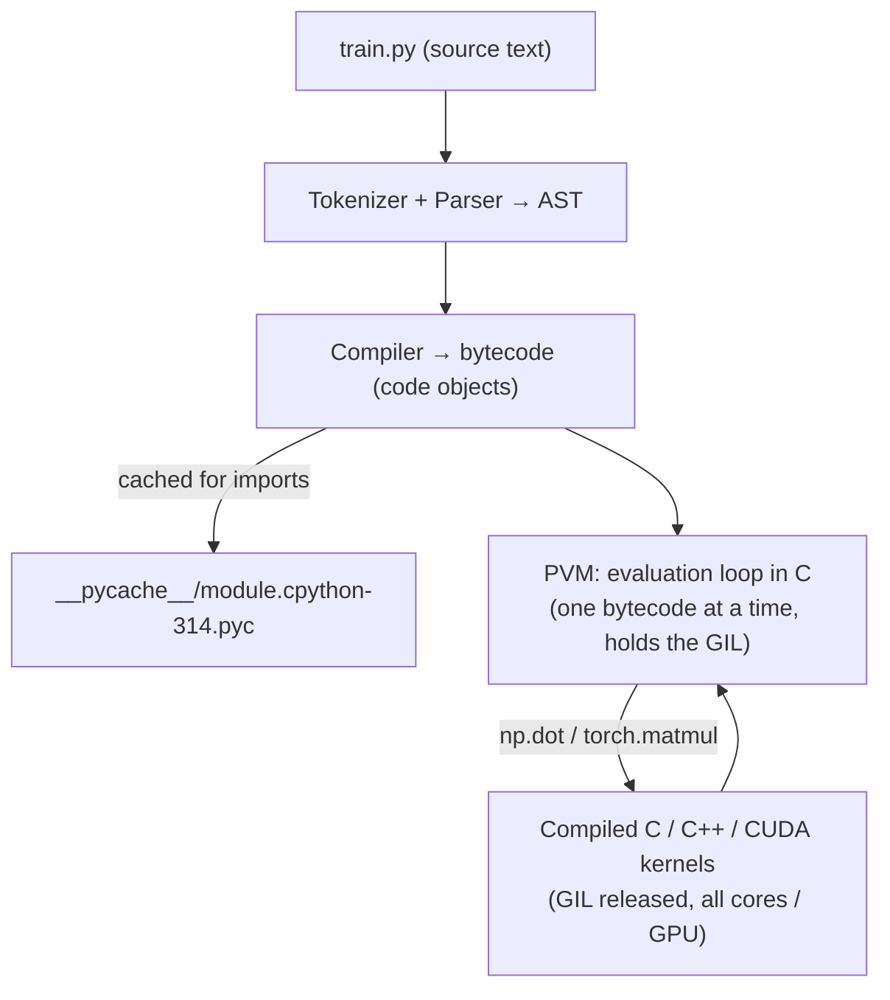
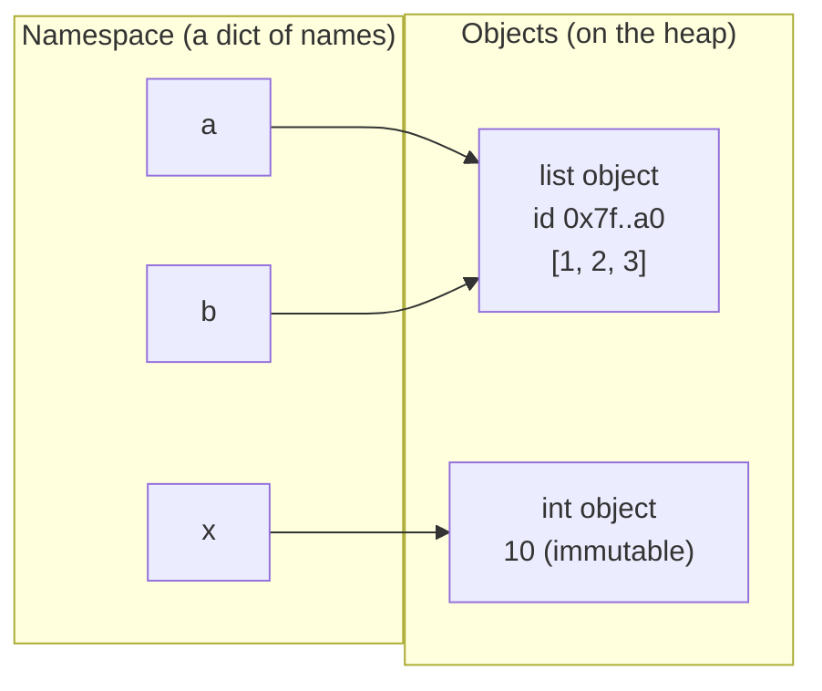

:::tip[TL;DR (30-Second Interview Pitch)]
Python is a **dynamically typed** (types live on objects, not on names) and **strongly typed** (no silent `"5" + 5`) language. CPython **compiles** your `.py` file to **bytecode** and then **interprets** that bytecode in a loop, which is why pure-Python loops are slow and why AI code pushes the heavy maths into **C/C++/CUDA libraries** (NumPy, PyTorch). Every value is an **object** with an identity, a type and a value; a variable is just a **name bound to an object**, so assignment never copies. Knowing which types are **mutable** and which are **hashable** explains half of all Python interview bugs.
:::

<PriorityKey lang="Python" v="3.10" />

## ⚡ Essential Interview Recall

- 🔴 **Python is compiled *and* interpreted**: source → **bytecode** (cached as `.pyc` in `__pycache__`) → executed by the **Python Virtual Machine (PVM)**, an evaluation loop in C. "Interpreted" means *no ahead-of-time machine code*, not *line-by-line source reading*.
- 🔴 **CPython** is the reference implementation (written in C). Others: **PyPy** (JIT, fast pure-Python loops), **MicroPython** (microcontrollers), **GraalPy** (JVM/GraalVM), **Jython** (JVM, but stuck on **Python 2.7**).
- 🔴 Python is **slow per operation** (every `a + b` is a type check + function lookup + object allocation) but **dominates AI** because it's the **glue**: NumPy/PyTorch run the maths in compiled C/C++/CUDA and **release the GIL** while they do.
- 🔴 **GIL** (Global Interpreter Lock): in standard CPython only **one thread runs Python bytecode at a time** → threads don't speed up CPU-bound Python; use **multiprocessing** or native code. A **free-threaded** (no-GIL) build exists since 3.13 and is officially supported in 3.14, but isn't the default. Details on the [Concurrency, Memory & Performance](./09-concurrency-memory-performance.md) page.
- 🔴 **Everything is an object** (ints, functions, classes, modules). Each has **identity** (`id()`), **type** (`type()`) and **value**.
- 🔴 **Variables are names (labels), not boxes.** `b = a` makes both names point to **the same object**; nothing is copied.
- 🔴 **Dynamic + strong typing**: a name can be rebound to any type, but `"5" + 5` raises `TypeError` (no implicit coercion between unrelated types).
- 🔴 **Immutable**: `int`, `float`, `complex`, `bool`, `str`, `bytes`, `tuple`, `frozenset`, `None`. **Mutable**: `list`, `dict`, `set`, `bytearray`, most user-defined objects.
- 🔴 **`==` compares values** (calls `__eq__`); **`is` compares identity** (same object). Use `is` only for singletons: `None`, `True`, `False`, sentinels.
- 🟠 **`int` has arbitrary precision** (`2**100` just works). **`float` is a 64-bit IEEE-754 double** → `0.1 + 0.2 != 0.3`; use `math.isclose` or `Decimal`.
- 🟠 **`bool` is a subclass of `int`**: `True + True == 2`, and `1`, `1.0`, `True` are the **same dict key**.
- 🟠 **Small-int cache**: CPython pre-creates ints **-5 to 256**, so `is` "works" for them and fails for 257 created at runtime. Never rely on it.
- 🟠 **Casting**: `int(3.99) == 3` (truncates toward zero), `int("3.5")` raises `ValueError`, **`bool("False")` is `True`** (any non-empty string is truthy). `round()` uses **banker's rounding**: `round(2.5) == 2`.
- 🟠 **Falsy values**: `0`, `0.0`, `0j`, `""`, `[]`, `()`, `{}`, `set()`, `range(0)`, `None`, `False`. Everything else is truthy (including `"0"`, `" "`, `[0]` and NaN).
- 🟠 **`input()` always returns `str`**; production code uses **`argparse`**, environment variables or config files instead.
- 🟡 Since 3.11 the interpreter is **specializing/adaptive** (PEP 659: hot bytecodes are rewritten to type-specific versions, ~25% faster); 3.13+ ships an **experimental JIT** (off by default).
- 🟡 **f-strings**: `{x:.4f}`, `{x:.2%}`, `{n:,}`, and **`{x=}`** for debugging <Since v="3.8" lang="Python" />. Since 3.12 you can reuse the same quote type inside `{}`.

:::speak[Is Python compiled or interpreted, and why is it fast enough for AI?]
"Both. When I run `python train.py`, CPython parses the source into an AST and **compiles it to bytecode**, which it caches as `.pyc` files. The **Python Virtual Machine** then executes that bytecode instruction by instruction in a C loop. There's no ahead-of-time machine code, so every `a + b` involves a type check, a method lookup and often a new object. That's why a pure-Python loop over a million numbers is slow. AI code is fast anyway because Python is only the **orchestration layer**: `torch.matmul` or `np.dot` call into compiled C, C++ or CUDA kernels that process whole arrays at once and **release the GIL** while they run. So the rule I follow is: **keep the hot loop out of Python** by vectorizing with NumPy or PyTorch, and use Python for control flow, data plumbing and APIs. Since 3.11 CPython also specializes hot bytecodes, and 3.13 added an experimental JIT, but vectorization still wins by orders of magnitude."
:::

## The Mental Model

### 1. From `train.py` to running code



:::analogy[Bytecode is sheet music, NumPy is a recording]
Compiling to bytecode is like transcribing a song into sheet music once. The PVM is a musician who reads that sheet and plays it note by note, every single time: flexible, but slow for a long piece. Calling NumPy or PyTorch is like pressing play on a studio recording: one instruction, and the whole piece comes out at full speed.
:::

### 2. Names point at objects



<Animation src="python/names-objects" caption="b = a binds a second name to the same list, so b.append(3) is visible through a. b = b + [4] builds a NEW list and rebinds only b; a keeps pointing at the old one." />

:::analogy[Variables are luggage tags, not suitcases]
In Java you can picture an `int` variable as a box holding a number. In Python every name is a luggage tag tied to a suitcase (the object). `b = a` ties a second tag to the same suitcase: open it through either tag and you see the same contents. Reassigning a name just moves that one tag to a different suitcase.
:::

## The Paradigm / Core Concepts

### 🔴 Python implementations

| Implementation | Written in / runs on | Why you'd use it | Catch |
|---|---|---|---|
| **CPython** | C | The default; every AI library (NumPy, PyTorch, TensorFlow) targets its C API | GIL; slow pure-Python loops |
| **PyPy** | RPython, with a **JIT** | 4–10× faster pure-Python loops | C-extension support (NumPy, PyTorch) is partial and slower |
| **MicroPython** | C, for microcontrollers | IoT, embedded boards | A subset of the language and standard library |
| **GraalPy** | GraalVM (JVM) | Calling Python from Java and vice versa | Smaller ecosystem compatibility |
| **Jython** | JVM | Legacy Java integration | **Python 2.7 only**: not an option for new code |

**History in one line:** created by **Guido van Rossum** (started 1989, first release **1991**); Python 3.0 in 2008 broke compatibility (`print()` became a function, `str` became Unicode); **Python 2 reached end of life in January 2020**.

**Where it's used:** web backends (Django, FastAPI), data science, machine learning and deep learning, LLM applications and agents, automation and scripting, DevOps tooling, cybersecurity, game scripting.

### 🔴 Built-in data types

| Category | Type | Example | Mutable? | Hashable? | Notes |
|---|---|---|:---:|:---:|---|
| Numeric | `int` | `42`, `2**100` | ❌ | ✅ | **Arbitrary precision**: never overflows |
| Numeric | `float` | `3.14`, `1e-4` | ❌ | ✅ | 64-bit IEEE-754 double, ~15–17 significant digits |
| Numeric | `complex` | `2 + 3j` | ❌ | ✅ | `.real`, `.imag`; `abs(3+4j) == 5.0` |
| Boolean | `bool` | `True`, `False` | ❌ | ✅ | **Subclass of `int`** |
| Text | `str` | `"Alex"` | ❌ | ✅ | Sequence of Unicode code points |
| Binary | `bytes` / `bytearray` | `b"\x00\xff"` | ❌ / ✅ | ✅ / ❌ | Raw bytes: files, network, tokenizer vocab files |
| Sequence | `list` | `[1, "a", 0.7]` | ✅ | ❌ | Ordered, duplicates allowed, dynamic array |
| Sequence | `tuple` | `(10, 20)` | ❌ | ✅ (if elements are) | Ordered; tensor shapes are tuples |
| Sequence | `range` | `range(0, 10, 2)` | ❌ | ✅ | Lazy: stores only start/stop/step |
| Set | `set` / `frozenset` | `{1, 2, 3}` | ✅ / ❌ | ❌ / ✅ | Unique, unordered, O(1) membership |
| Mapping | `dict` | `{"name": "Alex"}` | ✅ | ❌ | Insertion-ordered (guaranteed since 3.7) |
| Null | `NoneType` | `None` | ❌ | ✅ | A **singleton**: always test with `is None` |

<RuleCard name="Mutability decides everything" tag="Data model" why="Shared references are harmless when nobody can change the object, and dangerous when someone can." remember="Mutable plus shared equals surprise.">

An object is **mutable** if it can change **in place** (same `id`, new contents). Immutable objects can only be **replaced** (a new object with a new `id`). Only immutable objects (with immutable contents) are **hashable**, so only they can be **dict keys** and **set members**.

</RuleCard>

:::analogy[Immutable is a printed book, mutable is a whiteboard]
Everyone can safely share a printed book (an `int`, a `str`, a `tuple`): nobody can change the words, so lending it out is harmless. A whiteboard (a `list` or `dict`) can be wiped and rewritten by anyone standing in front of it, so if two teams share one, each sees the other's scribbles. That's why only "printed" objects are allowed as dictionary keys.
:::

### 🔴 Type conversion (casting)

| Function | Converts to | Examples | Result / trap |
|---|---|---|---|
| `int()` | Whole number | `int("42")`, `int(3.99)`, `int(-3.99)` | `42`, `3`, **`-3`** (truncates **toward zero**) |
| `int(s, base)` | Whole number from text in a base | `int("ff", 16)`, `int("0b101", 0)` | `255`, `5` (`base=0` reads the prefix) |
| `float()` | Decimal number | `float("3.14")`, `float(5)`, `float("nan")` | `3.14`, `5.0`, `nan` |
| `str()` | Text | `str(100)` | `"100"` |
| `bool()` | `True` / `False` | `bool(1)`, `bool(0)`, `bool("")`, **`bool("False")`** | `True`, `False`, `False`, **`True`** |
| `list()` / `tuple()` / `set()` | Collections from any iterable | `list((1, 2, 3))`, `tuple("Alex")` | `[1, 2, 3]`, `('A', 'l', 'e', 'x')` |
| `dict()` | Mapping from key-value pairs | `dict([("a", 1), ("b", 2)])` | `{'a': 1, 'b': 2}` |

- **Implicit conversion** happens only along the numeric tower: `int` → `float` → `complex` (`3 + 2.0 == 5.0`). `/` always returns a `float` (`7 / 7 == 1.0`).
- **Strong typing**: `"5" + 5` → `TypeError: can only concatenate str (not "int") to str`. Convert explicitly.
- `int()` accepts surrounding whitespace and underscores (`int(" 42 ")`, `int("1_000")`), but not a decimal point: `int("3.5")` raises `ValueError`. Use `int(float("3.5"))` if you really mean it.

### 🟠 Truthy and falsy

| Falsy (`bool(x) is False`) | Surprisingly truthy |
|---|---|
| `0`, `0.0`, `0j`, `False`, `None` | `"0"`, `"False"`, `" "` (a space) |
| `""`, `[]`, `()`, `{}`, `set()`, `range(0)` | `[0]`, `[[]]`, `(None,)` (non-empty containers) |
| Any object whose `__bool__` returns `False` or `__len__` returns 0 | `float("nan")` |

:::info[AI Engineering: precision is a memory budget]
Python's own `float` is always **64-bit**. Deep-learning frameworks store weights in smaller types to fit models in GPU memory:

| dtype | Bits | Exponent / mantissa bits | Typical use |
|---|---|---|---|
| `float64` | 64 | 11 / 52 | NumPy default; scientific computing |
| `float32` (FP32) | 32 | 8 / 23 | PyTorch default for training |
| `float16` (FP16) | 16 | 5 / 10 | Mixed-precision training; overflows above 65,504, so it needs loss scaling |
| `bfloat16` (BF16) | 16 | **8** / 7 | LLM training: same **range** as FP32, less precision, no loss scaling needed |
| `int8` / `int4` | 8 / 4 | — | **Quantized** inference (GPTQ, AWQ, bitsandbytes) |

A 7-billion-parameter model needs about **28 GB in FP32, 14 GB in BF16 and 3.5 GB in 4-bit**: bytes per parameter × parameter count.
:::

## ⚙️ Under the Hood (CPython Internals)

- **Every object starts with a header**: a **reference count** and a **pointer to its type**. That's why even a small `int` takes **28 bytes** (`sys.getsizeof(1)`) where Java's `int` takes 4. A `float` is 24 bytes, an empty `list` 56, an empty `dict` 64.
- **`int` is arbitrary precision**: stored as an array of 30-bit "digits". `sys.getsizeof(2**30)` is 32 and `sys.getsizeof(2**100)` is 40: the object grows instead of overflowing.
- **Bytecode is visible** with the `dis` module. `z = x + 1` becomes `LOAD_NAME x`, `LOAD_SMALL_INT 1`, `BINARY_OP +`, `STORE_NAME z` (3.14 output). `BINARY_OP` must look up the types of both operands at run time: that dynamic dispatch is the per-operation cost.
- **Specializing adaptive interpreter** (3.11+, PEP 659): after a few executions, `BINARY_OP` on two ints is rewritten in place to `BINARY_OP_ADD_INT`, skipping the generic lookup. A **copy-and-patch JIT** (PEP 744) is available as an experimental build option since 3.13.
- **Memory management** = **reference counting** (an object is freed the instant its count reaches 0) **plus** a **cyclic garbage collector** for reference cycles that counting can't free (`a.other = b; b.other = a`).
- **Immortal objects** (3.12+, PEP 683): `None`, `True`, `False`, small ints and some interned strings have a fixed, huge reference count that is never updated. That avoids cache-line contention between threads and helps the free-threaded build.
- **Small-int cache and interning**: ints **-5 to 256** are pre-allocated singletons; identifier-like string literals are **interned** (one shared object). Constants that appear in the same compiled code object can also be shared. All of these are **implementation details**, which is why `is` on numbers and strings gives answers that change between the REPL and a script.
- **Namespaces are dicts**: module globals live in a `dict` (`globals()`), which is why a global variable lookup is a hash-table lookup; function locals use a fast fixed-size array instead, which is why code inside a function runs faster than the same code at module level.

<Animation src="python/refcount" caption="Each new name or container slot that refers to the list adds one to its reference count, and each del or clear removes one. When the count reaches zero CPython frees the object immediately, without waiting for a GC pass." />

:::danger[Interview Trap]
**`a = a + [x]` and `a += [x]` are not the same for lists.** `+` builds a **new** list and rebinds the name; `+=` calls `__iadd__`, which **extends the same list in place**. If another name (or a default argument, or a caller's variable) points at that list, only `+=` changes what they see.
:::

:::danger[Interview Trap]
**Triple-quoted strings are not comments.** A `"""..."""` that is the **first statement** of a module, function or class becomes its **docstring** (stored in `__doc__`). Anywhere else it's a string expression that the compiler evaluates and throws away. Real comments start with `#`, and the interpreter never sees them.
:::

## 💻 Python Implementation

:::tip[Run it yourself]
Every snippet runs as-is in the `python` REPL or a Jupyter cell. Output comments come from a run on **CPython 3.14**.
:::

### 1. `print()`: `sep`, `end`, `flush`

```python showLineNumbers
print("Alex", 24, 3.12, True)                 # Alex 24 3.12 True  (default sep=" ")
print("Alex", 24, "Bachelor", sep="|")        # Alex|24|Bachelor
# highlight-start
print("Alex", end=" ")                        # end replaces the default "\n"
print("Education", end=" ")
print(24)                                     # Alex Education 24
# highlight-end
```

:::info[AI Engineering: a live training-progress line]
`end="\r"` moves the cursor back to the start of the line and `flush=True` forces the output out of the buffer, so each epoch overwrites the previous one instead of flooding the terminal. (Libraries like `tqdm` do exactly this.)

```python showLineNumbers
import time
for epoch in range(1, 4):
    # highlight-next-line
    print(f"Epoch {epoch}/3 - Loss: {0.9 / epoch:.4f}", end="\r", flush=True)
    time.sleep(0.5)
print()                                       # final newline so the prompt starts on a new line
```
:::

### 2. Comments, docstrings and escape sequences

```python showLineNumbers
print("Alex")   # a single-line comment: ignored by the interpreter

def load_dataset(path):
    """Load a CSV file and return a list of rows."""   # docstring: stored, not ignored
    ...

print(load_dataset.__doc__)                   # Load a CSV file and return a list of rows.
```

| Escape | Meaning | Code | Output |
|---|---|---|---|
| `\'` | Single quote | `print('My name is \'Alex\'')` | `My name is 'Alex'` |
| `\"` | Double quote | `print("My name is \"Alex\"")` | `My name is "Alex"` |
| `\\` | Backslash | `print("C:\\Users\\Alex\\data")` | `C:\Users\Alex\data` |
| `\n` | New line | `print("Line 1\nLine 2")` | `Line 1` / `Line 2` on two lines |
| `\t` | Tab | `print("Feature\tValue")` | `Feature` and `Value` separated by a tab |
| `\b` | Backspace character | `print("Hello\bWorld")` | Terminals show `HellWorld`, but the string still has 11 characters: `'Hello\x08World'` |

```python showLineNumbers
# error-next-line
path = "C:\new_data\train.csv"                # ❌ \n and \t become a newline and a tab
# success-next-line
path = r"C:\new_data\train.csv"               # ✅ raw string: backslashes stay literal
print(path)                                   # C:\new_data\train.csv
```

:::info[AI Engineering: docstrings are read by LLM agents]
Agent frameworks (LangChain, LlamaIndex, the OpenAI and Anthropic tool-use SDK helpers) build a tool's description from the function's **name, type hints and docstring**. A vague docstring means the model calls the wrong tool or passes the wrong arguments, so in agent code the docstring is part of the prompt.
:::

### 3. Variables, names and identity

```python showLineNumbers
x = 5                                         # no declaration: the name exists once it is assigned
name = "Alex"
x = "now a string"                            # dynamic typing: the NAME is rebound, any type is fine

a = [1, 2]
# highlight-next-line
b = a                                         # second name, SAME object
b.append(3)
print(a, a is b)                              # [1, 2, 3] True
# highlight-next-line
b = b + [4]                                   # + builds a NEW list; only b is rebound
print(a, b, a is b)                           # [1, 2, 3] [1, 2, 3, 4] False
```

| Variable name | Valid? | Why |
|---|:---:|---|
| `abc`, `_abc`, `abc123`, `first_name` | ✅ | Letters, digits, underscores; not starting with a digit. `snake_case` is the PEP 8 convention |
| `myVar` | ✅ | Legal, but PEP 8 reserves `CamelCase` for **classes** |
| `@bc`, `$bcd` | ❌ | `@` and `$` aren't allowed in identifiers |
| `123`, `123abc` | ❌ | Can't start with a digit |
| `class`, `def`, `lambda` | ❌ | Reserved keywords (35 of them in 3.14) |
| `match`, `case`, `type`, `_` | ✅ | **Soft keywords**: special only in certain positions, so they stay legal names |

```python showLineNumbers
a, b = 1, 2
a, b = b, a                                   # swap without a temp: builds and unpacks a tuple
print(a, b)                                   # 2 1

first, *rest = [1, 2, 3, 4]                   # extended unpacking
print(first, rest)                            # 1 [2, 3, 4]

# error-next-line
p = q = []                                    # ❌ chained assignment: ONE list, two names
p.append(1)
print(q)                                      # [1]
```

### 4. Numbers, precision and `bool`

```python showLineNumbers
print(2 ** 100)                               # 1267650600228229401496703205376: ints never overflow
# error-next-line
print(0.1 + 0.2 == 0.3)                       # False: 0.1 + 0.2 is 0.30000000000000004
# success-start
import math
print(math.isclose(0.1 + 0.2, 0.3))           # True: compare floats with a tolerance
from decimal import Decimal
print(Decimal("0.1") + Decimal("0.2"))        # 0.3: exact decimal arithmetic (build from str!)
# success-end
print(Decimal(0.1))                           # 0.1000000000000000055511151231257827021181583404541015625

print(round(2.5), round(3.5), round(-2.5))    # 2 4 -2: banker's rounding (ties go to EVEN)
print(round(2.675, 2))                        # 2.67: 2.675 is really 2.67499999... in binary

print(True + True + True)                     # 3: bool is a subclass of int
print(c := 2 + 3j, c.real, c.imag)            # (2+3j) 2.0 3.0
```

### 5. Casting and its traps

```python showLineNumbers
print(int("42"), int(3.99), int(-3.99))       # 42 3 -3
print(int("ff", 16), int("0b101", 0))         # 255 5
# error-next-line
int("3.5")                                    # ❌ ValueError: invalid literal for int() with base 10: '3.5'

# error-next-line
print(bool("False"), bool("0"))               # True True: any NON-EMPTY string is truthy
print(bool(""), bool([]), bool(None))         # False False False

# error-next-line
"5" + 5                                       # ❌ TypeError: can only concatenate str (not "int") to str
# success-next-line
print(int("5") + 5, "5" + str(5))             # 10 55
```

### 6. f-strings: formatting metrics

```python showLineNumbers
val_loss, accuracy = 0.0456789, 0.9432
print(f"Loss: {val_loss:.4f} | Accuracy: {accuracy:.2%}")    # Loss: 0.0457 | Accuracy: 94.32%

n = 1234567.891
print(f"{n:,.2f}")                            # 1,234,567.89   thousands separator
print(f"{42:>6}|{42:<6}|{42:^6}|{42:06d}")    #     42|42    |  42  |000042
print(f"{0.000123:.2e} {255:#x} {5:b}")       # 1.23e-04 0xff 101

lr, epoch = 3e-4, 7
# highlight-next-line
print(f"{lr=}, {epoch = }")                   # lr=0.0003, epoch = 7   (3.8+ self-documenting)
```

| Spec | Meaning | Example → output |
|---|---|---|
| `.4f` | Fixed point, 4 decimals | `0.0456789` → `0.0457` |
| `.2%` | Percentage | `0.9432` → `94.32%` |
| `,` / `_` | Thousands separator | `1234567` → `1,234,567` |
| `>6` `<6` `^6` | Right / left / centre align in width 6 | |
| `06d` | Zero-pad an int to width 6 | `42` → `000042` |
| `.2e` | Scientific notation | `0.000123` → `1.23e-04` |
| `=` | Print the expression too | `{lr=}` → `lr=0.0003` |
| `!r` | Use `repr()` | `{name!r}` → `'Alex'` |

### 7. Input: `input()` vs `argparse`

```python showLineNumbers
name = input("Enter name: ")                  # ALWAYS a str
# highlight-next-line
age = int(input("Enter age: "))               # convert explicitly; raises ValueError on "abc"
print(f"My name is {name} and my age is {age}.")
```

```python title="train.py" showLineNumbers
# Run: python train.py --epochs 10 --lr 0.001
import argparse

parser = argparse.ArgumentParser(description="Train a model")
parser.add_argument("--epochs", type=int, default=5)
parser.add_argument("--lr", type=float, default=0.01)
parser.add_argument("--fp16", action="store_true")       # flag: present → True
# highlight-next-line
args = parser.parse_args()                               # also gives you --help for free
print(args.epochs, args.lr, args.fp16)
```

| Source of input | Use it for | Why |
|---|---|---|
| `input()` | Interactive scripts, coding rounds | Blocks waiting for a human; useless on a GPU server or in CI |
| `argparse` / `sys.argv` | Hyperparameters, file paths | Reproducible commands; `--help`; works in schedulers (Slurm, Kubernetes jobs) |
| Environment variables (`os.environ`) | **Secrets** (API keys), deployment settings | Never hard-code an `OPENAI_API_KEY` or `ANTHROPIC_API_KEY` in code |
| Config files (YAML / JSON, Hydra, pydantic-settings) | Large experiment configs | Versioned alongside the code, validated with types |

## 🧪 Predict the Output

<Predict n="1" title="Aliasing vs rebinding" output="[1, 2, 3]">

```python
a = [1, 2]
b = a
b += [3]
b = b + [4]
print(a)
```

`b = a` makes both names point to the same list. `b += [3]` calls `list.__iadd__`, which **extends that list in place**, so `a` sees `3`. `b = b + [4]` creates a **new** list `[1, 2, 3, 4]` and moves only the name `b` to it. `a` still points at the original: `[1, 2, 3]`.

</Predict>

<Predict n="2" title="is on integers" output="True, then False True">

```python
a = int("256"); b = int("256")
print(a is b)
c = int("257"); d = int("257")
print(c is d, c == d)
```

CPython keeps one pre-built object for each int from **-5 to 256**, so every `256` is the same object. `257` is created fresh each time at run time, so `c is d` is `False` even though `c == d`. (Write `x = 257; y = 257` in a script and `is` can print `True`, because the compiler shares equal constants within one code object. That inconsistency is exactly why `is` must never compare values.)

</Predict>

<Predict n="3" title="Three keys or one?" output="{1: 'c'}">

```python
d = {1: "a", True: "b", 1.0: "c"}
print(d)
```

`1 == True == 1.0` and they have the same hash (`hash(True) == hash(1) == hash(1.0)`), so they are the **same key**. The dict keeps the **first key object** (`1`) and the **last value** (`"c"`). It's a direct consequence of `bool` being a subclass of `int`.

</Predict>

<Predict n="4" title="Config flags from strings" output="True True False">

```python
print(bool("False"), bool("0"), bool(""))
```

`bool()` on a string only checks whether it's **empty**. `"False"` and `"0"` are non-empty, so both are truthy. To parse a flag, compare text explicitly: `value.strip().lower() in {"1", "true", "yes"}`.

</Predict>

<Predict n="5" title="Rounding" output="2 4 2.67">

```python
print(round(2.5), round(3.5), round(2.675, 2))
```

Python's `round` uses **round-half-to-even** (banker's rounding) to avoid a systematic upward bias when summing many rounded values: 2.5 → 2, 3.5 → 4. `2.675` can't be stored exactly in binary; the stored double is `2.67499999999999982236431605997495353221893310546875`, so it rounds **down**. For money, use `Decimal` with an explicit rounding mode.

</Predict>

<Predict n="6" title="int() of a negative float" output="-3 -4">

```python
import math
print(int(-3.99), math.floor(-3.99))
```

`int()` **truncates toward zero** (drops the fractional part), while `math.floor` rounds **toward negative infinity**. They only disagree for negative numbers, which is exactly where off-by-one bucketing bugs hide. (`//` also floors: `-7 // 2 == -4`; see the [Operators & Control Flow](./02-operators-and-control-flow.md) page.)

</Predict>

## 🪜 Follow-up Ladder

<Ladder title="From python train.py to the GPU">
<Rung q="What happens when you run python train.py?">

The source is tokenized, parsed into an AST and compiled to **bytecode** (imported modules get cached `.pyc` files). The **PVM** executes that bytecode in a loop; names are resolved in namespaces (dicts for globals, a fast array for function locals).

</Rung>
<Rung q="Then why is a Python for-loop over a million floats slow?">

Each iteration executes several bytecodes, and each one does dynamic work: look up the operand types, dispatch to the right C function, allocate a new `float` object (24 bytes) for the result, update reference counts. A C loop does one machine instruction per element.

</Rung>
<Rung q="How do NumPy and PyTorch avoid that cost?">

**Vectorization**: one Python call (`a @ b`, `x.sum()`) hands a whole contiguous typed buffer to a compiled kernel (BLAS, cuBLAS, custom CUDA). The per-element work happens in C or on the GPU, and the Python overhead is paid once per call, not once per element.

</Rung>
<Rung q="Does the GIL stop PyTorch from using all CPU cores?">

No. Native code **releases the GIL** while it runs, so a matrix multiply uses all cores through its own thread pool, and GPU kernels run asynchronously. The GIL only serializes **Python bytecode**, which is why data **preprocessing written in Python** is the usual bottleneck: that's what `DataLoader(num_workers=...)` (multiple processes) solves.

</Rung>
<Rung q="Would you switch to PyPy or the free-threaded build to speed up a training pipeline?">

Usually not. PyPy's JIT speeds up pure-Python loops but runs C extensions like NumPy and PyTorch slower. The free-threaded build (3.13+, supported in 3.14) helps CPU-bound **Python** code across threads, but single-thread speed is somewhat lower and some extensions aren't ready yet. First I'd profile, vectorize the hot path, move preprocessing into worker processes, and only then consider a different runtime.

</Rung>
</Ladder>

## 🚑 Production Scenarios

:::incident[The GPU flag that could not be turned off]
A training job ran on CPU in production even though `USE_GPU=0` was set "to disable it" for a test, and later ignored `USE_GPU=false` too: every value turned the GPU path **on**.

- **Code:** `use_gpu = bool(os.environ.get("USE_GPU", "1"))`.
- **Why:** environment variables are always **strings**. `bool("0")` and `bool("false")` are `True` because the strings are non-empty. Only an unset variable with an empty default would be `False`.
- **Fix:** parse explicitly: `os.environ.get("USE_GPU", "1").strip().lower() in {"1", "true", "yes", "on"}`. Better still, use **pydantic-settings**, which validates typed config from the environment and rejects unparseable values at startup.
:::

:::incident[User IDs changed after a JSON round trip]
A recommendation service returned the wrong user's results for a few very large IDs.

- **Why:** Python's `int` is arbitrary precision, so the Python side was fine. But the IDs passed through a JavaScript client (and a pandas column with missing values), both of which store numbers as **float64**. Integers above **2⁵³** (9,007,199,254,740,992) can't all be represented exactly, so neighbouring IDs collapsed into the same number.
- **Fix:** send large IDs as **strings** in JSON, and use pandas' nullable `Int64` dtype instead of letting missing values force a `float64` column.
:::

## 🚨 Interview Gotchas & Edge Cases

:::warning[The Most Common Question]
**"What's the difference between `==` and `is`?"** `==` asks "do these have the same **value**?" by calling `__eq__`; `is` asks "are these the **same object**?" by comparing identities, and can't be overridden. Use `is` only for singletons (`if x is None:`). The follow-up is the small-int cache: `is` appears to work for small numbers and short strings only because of CPython caching and interning, which are implementation details.
:::

- **`x == None` vs `x is None`**: `==` can be overridden (NumPy arrays and pandas Series return an **array** of booleans for `== None`), so `if arr == None:` raises `ValueError: The truth value of an array ... is ambiguous`. `is None` is always a single, fast identity check.
- **`type(x) == int` vs `isinstance(x, int)`**: `isinstance` respects inheritance. Watch out: `isinstance(True, int)` is `True`, so validating "is this a number" with `isinstance(v, int)` lets booleans through.
- **`sys.getsizeof` is shallow**: it reports the container's own size, not the objects it references. A list of a million floats is about 8 MB of pointers **plus** 24 MB of float objects (versus 8 MB total for a NumPy `float64` array).
- **Floats have special values**: `float("nan") != float("nan")` (NaN is never equal to anything, itself included; test with `math.isnan`), and `float("inf")` compares larger than any int. A NaN loss poisons every later gradient: check `math.isfinite(loss)` before stepping.
- **`print` is buffered** when output goes to a file or a pipe (Docker logs, `nohup`): lines can appear minutes late or be lost on a crash. Use `flush=True`, run with `python -u`, or set `PYTHONUNBUFFERED=1`, and prefer the `logging` module in services.
- **`__pycache__` and stale `.pyc`**: Python checks the source's timestamp (or hash) before reusing a `.pyc`, so stale bytecode is rarely a problem, but a deleted `.py` with its `.pyc` left behind can still be imported in some setups. Add `__pycache__/` to `.gitignore`.
