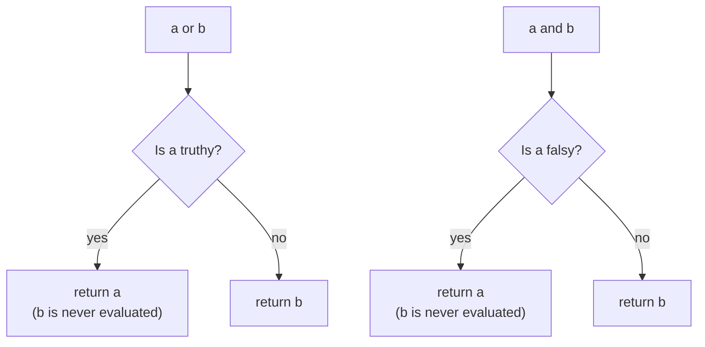
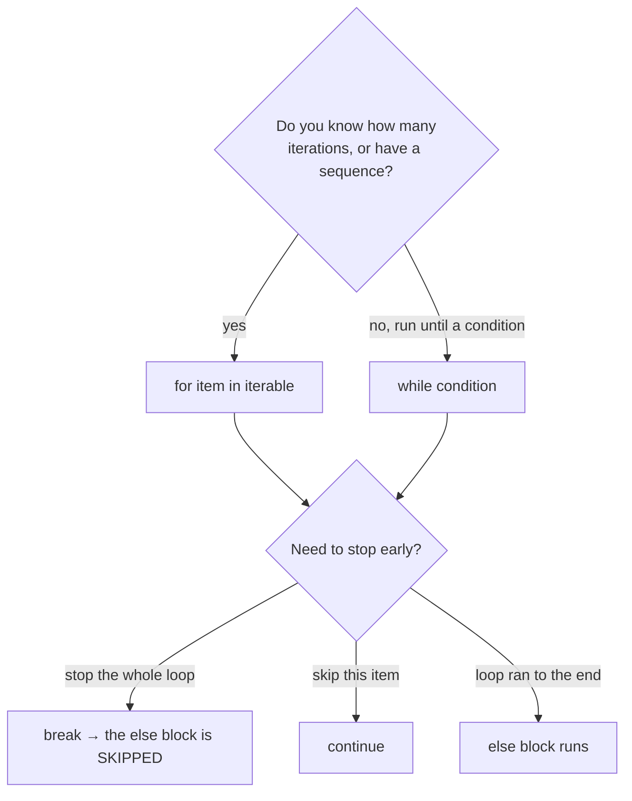

:::tip[TL;DR (30-Second Interview Pitch)]
Python's operators look like Java's but behave differently in exactly the places interviews probe: `/` **always returns a float**, `//` and `%` **floor toward negative infinity** (so `-7 % 3 == 2`), there is **no `++`**, comparisons **chain** (`1 < x < 10`), and `and`/`or` **return one of their operands**, not a `bool`. Control flow adds `elif`, the one-line ternary, structural **`match`** <Since v="3.10" lang="Python" />, and the rarely understood **`for … else`**. In AI code the same constructs drive training loops, early stopping and device selection.
:::

<PriorityKey lang="Python" v="3.10" />

## ⚡ Essential Interview Recall

- 🔴 **7 operator families**: arithmetic, assignment, comparison, logical, identity (`is`), membership (`in`), bitwise. Plus **`@`** (matrix multiply) and **`:=`** (walrus).
- 🔴 **`/` is true division → always `float`** (`10 / 5 == 2.0`). **`//` is floor division** (rounds toward −∞): `-10 // 4 == -3`, `-7 // 2 == -4`.
- 🔴 **`%` takes the sign of the divisor**: `-7 % 3 == 2`, `7 % -2 == -1`. The invariant is `a == (a // b) * b + a % b`. (Java and C truncate: `-7 % 3 == -1` there.)
- 🔴 **Any division by zero raises `ZeroDivisionError`**, floats included: `1.0 / 0` doesn't give `inf` like Java.
- 🔴 **`**` is right-associative and binds tighter than unary minus**: `2 ** 3 ** 2 == 512`, `-2 ** 2 == -4`.
- 🔴 **No `++` / `--`**: `x++` is a `SyntaxError`, and `++x` is just `+(+x)`, which leaves `x` unchanged. Use `x += 1`.
- 🔴 **`and` / `or` short-circuit and return an operand**: `"" or "default"` → `"default"`, `0 and 1/0` → `0` (no error). `not` always returns a `bool`.
- 🔴 **Comparisons chain**: `a < b < c` means `a < b and b < c`, with `b` evaluated **once**. Works for `==`, `in` and `is` too, which is the source of puzzles like `False == False in [False]`.
- 🔴 **`is` = same object, `==` = equal value.** **`in`** is O(n) for `list`/`tuple`/`str`, **O(1) average** for `set`/`dict` (hash lookup) and O(1) for `range`.
- 🔴 `range(start, stop, step)` **excludes `stop`**, is **lazy** (constant memory), and supports negative steps.
- 🔴 `break` exits the **innermost** loop, `continue` skips to the next iteration, `pass` is a do-nothing placeholder.
- 🟠 **`for … else` / `while … else`**: the `else` runs only if the loop finished **without `break`**. Think of it as "no break".
- 🟠 Use **`enumerate`** (index + value) and **`zip`** (parallel iteration) instead of `range(len(x))`; **`zip(strict=True)`** <Since v="3.10" lang="Python" /> raises if lengths differ.
- 🟠 **Never add or remove items in a list while iterating over it**: build a new list (comprehension) or iterate over a copy.
- 🟠 **Walrus `:=`** <Since v="3.8" lang="Python" /> assigns inside an expression: `if (n := len(data)) > 3:`.
- 🟡 **`match`** <Since v="3.10" lang="Python" /> is **structural pattern matching**, not a C-style switch: it destructures dicts, sequences and objects, supports guards (`case x if x > 0`), and a **bare name in a `case` captures** instead of comparing.
- 🟡 `@` calls `__matmul__`: in NumPy/PyTorch `*` is **elementwise** and `@` is **matrix multiplication**.

:::speak[What's the difference between and/or in Python and && / || in Java?]
"Both short-circuit: Python stops evaluating as soon as the result is known. The difference is what they return. In Java `&&` always gives a boolean. In Python `a or b` returns **`a` if `a` is truthy, otherwise `b`**, and `a and b` returns **`a` if `a` is falsy, otherwise `b`**. So `name or "anonymous"` is a common way to supply a default, and `user and user.email` is a null-safe access. The catch is that **falsy isn't the same as missing**: `0`, `0.0`, `""` and empty lists are all falsy. If a user explicitly sets an LLM's `temperature` to `0.0`, then `temperature or 0.7` silently replaces it with 0.7. When zero or empty is a legitimate value I write `x if x is not None else default` instead. And `not` is different from the other two: it always returns a real `True` or `False`."
:::

## The Mental Model

### 1. How `and` / `or` decide what to return



<Animation src="python/short-circuit" caption="Python evaluates an or-chain left to right and stops at the first truthy value, returning that value itself. An and-chain stops at the first falsy value. Operands after the stopping point are never evaluated." />

:::analogy[or is a waiter going down the menu]
`a or b or c` is a waiter checking the dishes in order and serving the first one that's available, without even looking at the rest. `a and b and c` is a safety checklist: the first failed check is what gets reported, and nothing after it is inspected. Either way you get back an actual dish (an operand), not a yes/no.
:::

### 2. Which loop, which exit



:::analogy[for … else is a search party]
A search party combs the woods (the loop). Whoever finds the missing hiker blows a whistle and everyone stops (`break`). The `else` block is the radio call "searched everywhere, nothing found": it only happens if nobody blew the whistle.
:::

## The Paradigm / Core Concepts

### 🔴 Arithmetic operators

| Operator | Name | Example | Result | Java difference |
|---|---|---|---|---|
| `+` `-` `*` | Add, subtract, multiply | `10 * 5` | `50` | Same, but ints never overflow |
| `/` | True division | `10 / 5` | **`2.0`** | Java `10 / 5` is `2` (int division) |
| `//` | Floor division | `10 // 4`, **`-10 // 4`** | `2`, **`-3`** | Java truncates toward zero: `-10 / 4 == -2` |
| `%` | Modulus | `10 % 3`, `5 % 10`, **`-7 % 3`** | `1`, `5`, **`2`** | Java gives `-1` (sign of the dividend) |
| `**` | Power | `5 ** 3`, `2 ** -1` | `125`, `0.5` | Java has only `Math.pow` |
| `divmod(a, b)` | Both at once | `divmod(-7, 2)` | `(-4, 1)` | — |

<RuleCard name="Floor division and modulo agree" tag="Arithmetic" why="Flooring keeps % in the range of the divisor, which is what you want for indexing, bucketing and wrap-around." remember="Floor down, remainder follows the divisor.">

`a // b` rounds **down** (toward −∞), and `a % b` is defined so that `a == (a // b) * b + a % b` always holds. So the remainder has the **sign of `b`**: `-7 // 2 == -4` and `-7 % 2 == 1`. For C/Java-style truncation use `int(a / b)` and `math.fmod(a, b)`.

</RuleCard>

<Animation src="python/floor-division" caption="Floor division rounds -3.5 down to -4 on the number line, while int() and Java truncate toward zero to -3. The remainder then fills the gap from -4 times 2 back up to -7." />

:::analogy[Floor division is taking the stairs down]
Picture the number line as a building where negative numbers are basement levels. `-3.5` is halfway between basement 3 and basement 4. "Floor" always means *the level below where you're standing*, so you end up on basement 4 (`-4`). Truncation (`int()`, Java) instead walks toward the ground floor, which lands on basement 3 (`-3`).
:::

### 🔴 Assignment operators

| Operator | Same as | Example (`x = 5`) |
|---|---|---|
| `=` | Bind a name | `x = 5` |
| `+=` `-=` `*=` | `x = x + 3` … | `x += 5` → `10` |
| `/=` | `x = x / 3` | `x /= 2` → `2.5` (now a float) |
| `//=` `%=` `**=` | `x = x // 3` … | `x //= 2` → `2`, `x %= 3` → `2`, `x **= 2` → `25` |
| `&=` `\|=` `^=` `<<=` `>>=` | Bitwise in place | `flags \|= 4` |
| `:=` | Assign **inside** an expression <Since v="3.8" lang="Python" /> | `if (n := len(data)) > 3:` |

- For **mutable** objects, `+=` mutates in place (`list.__iadd__`); for immutable ones it creates a new object. That's the aliasing trap from [How Python Runs](./01-how-python-runs.md).

### 🔴 Comparison, logical, identity and membership

| Family | Operators | Returns | Notes |
|---|---|---|---|
| Comparison | `>` `<` `>=` `<=` `==` `!=` | `bool` (usually) | **Chain**: `1 < x < 10`. NumPy arrays return an array of bools |
| Logical | `and`, `or`, `not` | An **operand** (`and`/`or`), `bool` (`not`) | Short-circuit |
| Identity | `is`, `is not` | `bool` | Same object (`id(a) == id(b)`); can't be overloaded |
| Membership | `in`, `not in` | `bool` | Calls `__contains__`; for dicts it checks **keys** |

**Truth table** (1 = truthy, 0 = falsy):

| A | B | `A and B` | `A or B` | `not A` |
|:---:|:---:|:---:|:---:|:---:|
| 0 | 0 | **0** (returns A) | **0** (returns B) | 1 |
| 0 | 1 | **0** (returns A) | **1** (returns B) | 1 |
| 1 | 0 | **0** (returns B) | **1** (returns A) | 0 |
| 1 | 1 | **1** (returns B) | **1** (returns A) | 0 |

**Cost of `in`:**

| Container | `x in c` | Why |
|---|---|---|
| `list`, `tuple`, `str` | **O(n)** | Linear scan comparing with `==` |
| `set`, `frozenset`, `dict` (keys) | **O(1)** average | One hash computation + a few probes |
| `range` | **O(1)** | Arithmetic: is it between start and stop, on the step? |

### 🟠 Bitwise and matrix operators

| Operator | Meaning | Example | Result |
|---|---|---|---|
| `&` | AND | `5 & 3` | `1` |
| `\|` | OR | `5 \| 3` | `7` |
| `^` | XOR | `5 ^ 3` | `6` |
| `~` | NOT (`~x == -x - 1`) | `~5` | `-6` |
| `<<` / `>>` | Shift (arithmetic; no `>>>` in Python) | `1 << 4`, `-16 >> 2` | `16`, `-4` |
| `@` | Matrix multiply (`__matmul__`) <Since v="3.5" lang="Python" /> | `X @ W` | Dot products of rows and columns |

- Python ints are arbitrary precision, so `1 << 100` is fine and there is no unsigned shift.
- `n & (n - 1) == 0` tests for a power of two; `n.bit_count()` <Since v="3.10" lang="Python" /> counts set bits.
- In NumPy/pandas, `&`, `|`, `~` are the **elementwise** logical operators for boolean masks: `df[(df.age > 30) & (df.city == "Pune")]`. Using `and`/`or` there raises "truth value of a Series is ambiguous".

### 🟠 Operator precedence (highest → lowest)

| # | Operators | Note |
|---|---|---|
| 1 | `(...)`, `x[i]`, `x.attr`, `f()` | Grouping, indexing, attribute, call |
| 2 | `await` | |
| 3 | `**` | **Right-associative**; binds tighter than a unary minus on its **left** |
| 4 | `+x` `-x` `~x` | Unary |
| 5 | `*` `@` `/` `//` `%` | |
| 6 | `+` `-` | |
| 7 | `<<` `>>` | |
| 8 | `&` | |
| 9 | `^` | |
| 10 | `\|` | |
| 11 | `in` `not in` `is` `is not` `<` `<=` `>` `>=` `!=` `==` | All the same level, and they **chain** |
| 12 | `not` | So `not a == b` means `not (a == b)` |
| 13 | `and` | |
| 14 | `or` | |
| 15 | `x if c else y` | Conditional expression |
| 16 | `lambda` | |
| 17 | `:=` | Walrus (lowest) |

### 🔴 Conditional statements

| Form | Syntax | Use |
|---|---|---|
| `if` / `else` | `if age >= 18: ... else: ...` | Two branches |
| `elif` chain | `if ...: elif ...: else:` | Many exclusive branches (as many `elif`s as needed) |
| Nested `if` | An `if` inside an `if` | Dependent decisions; flatten with `and` or early `return` when possible |
| Ternary expression | `a if cond else b` | Choosing a **value** in one line |
| `match` / `case` | Structural pattern matching <Since v="3.10" lang="Python" /> | Branching on the **shape** of data (dicts, lists, objects) |

### 🔴 Loops

| | `for` loop | `while` loop |
|---|---|---|
| Iterates over | Any **iterable** (list, string, file, generator, `range`) | Runs while a **condition** is truthy |
| Know the iteration count? | Usually yes (a sequence or a fixed number of epochs) | No (until convergence, until the episode ends) |
| Counter management | Automatic | Manual (forgetting `i += 1` = infinite loop) |
| AI examples | Epochs, batches, files in a folder | RL episodes (`while not done:`), gradient-descent convergence, polling a job's status |

## ⚙️ Under the Hood (CPython Internals)

- **`a < b < c` compiles to** "evaluate `b` once, compare, jump out if false, compare again" (`COPY` / `COMPARE_OP` / `POP_JUMP_IF_FALSE` bytecodes), which is cheaper than `a < b and b < c` when `b` is a function call.
- **`and` / `or` compile to jumps, not operators**: `JUMP_IF_FALSE` / `JUMP_IF_TRUE` style bytecodes leave the deciding operand on the stack and skip the rest. That's why they return operands and why the right side may never run.
- **Operators dispatch to dunder methods**: `a + b` tries `type(a).__add__(a, b)`, and if that returns `NotImplemented`, tries `type(b).__radd__(b, a)`. `a @ b` → `__matmul__`, `x in c` → `c.__contains__(x)` (falling back to iterating), `a += b` → `__iadd__` (falling back to `__add__`). That single mechanism is how NumPy and PyTorch overload `+`, `*`, `@` and the comparison operators for whole arrays.
- **`range` objects are lazy**: `range(0, 10**12)` stores three integers, `len()` and `in` are computed arithmetically, and iterating creates one int at a time.
- **A `for` loop is the iterator protocol**: `iter(obj)` once, then `next()` until `StopIteration`. Covered in depth on [Comprehensions, Generators & Decorators](./06-comprehensions-generators-decorators.md).
- **The loop variable is a normal local**: it still exists after the loop with its last value (`for i in range(3): pass` leaves `i == 2`). Comprehension variables, in contrast, don't leak.
- **`match` compiles to a sequence of type and structure checks** (`MATCH_MAPPING`, `MATCH_SEQUENCE`, `MATCH_CLASS`, `MATCH_KEYS`), tried top to bottom. It's not a jump table, so it isn't faster than `if/elif`; its value is readable destructuring.

:::danger[Interview Trap]
**`++x` is legal Python, and does nothing.** It parses as two unary plus operators: `+(+x)`, which equals `x`. `x++` is a `SyntaxError`. A Java developer's muscle memory produces a loop that never advances without any error message.
:::

:::danger[Interview Trap]
**A bare name in a `case` is a capture pattern, not a comparison.** `case RED:` binds whatever value was matched to a new variable called `RED` (overwriting your constant) and matches **everything**. To compare against a constant, use a **dotted name** (`case Color.RED:`), a literal (`case "red":`), or a guard (`case c if c == RED:`).
:::

## 💻 Python Implementation

:::tip[Run it yourself]
Every snippet runs in the `python` REPL or a notebook. Output comments come from a run on **CPython 3.14** (NumPy 2.5 for the `@` example).
:::

### 1. Arithmetic, including the negative-number cases

```python showLineNumbers
print(10 / 5)                                 # 2.0: / always returns a float
print(10 // 4, -10 // 4)                      # 2 -3: floor toward -infinity
print(10 % 3, 5 % 10, 9 % 10)                 # 1 5 9: smaller positive left operand comes back unchanged
# highlight-next-line
print(-7 // 2, -7 % 2, 7 % -2)                # -4 1 -1: remainder has the sign of the DIVISOR
print(divmod(-7, 2))                          # (-4, 1)
print(5 ** 3, 2 ** -1)                        # 125 0.5

# error-next-line
print(-2 ** 2)                                # -4: ** binds tighter than unary minus → -(2 ** 2)
print((-2) ** 2, 2 ** 3 ** 2)                 # 4 512: ** is right-associative → 2 ** 9

# error-next-line
1.0 / 0                                       # ❌ ZeroDivisionError: division by zero (no inf like Java)
```

### 2. Assignment operators and the missing `++`

```python showLineNumbers
x = 5
x += 5;  print(x)                             # 10
x = 5
x /= 2;  print(x)                             # 2.5: the name now points to a float
x = 5
x //= 2; print(x)                             # 2

x = 5
# error-next-line
print(++x)                                    # 5: +(+x), NOT an increment
# success-next-line
x += 1                                        # ✅ the only way to increment
```

### 3. Comparison chaining and logical operators returning operands

```python showLineNumbers
x = 7
print(1 < x < 10)                             # True: 1 < x and x < 10
print(3 == 3.0 == 3 + 0j)                     # True: int, float and complex compare by value

x, y = 10, 20
print(x < 15 and y < 25)                      # True
print(x > 15 or y < 25)                       # True
print(not (x < 15 and y < 25))                # False

# highlight-start
print(0 or "" or [] or "x")                   # x: first TRUTHY operand
print(1 and 2 and 0 and 3)                    # 0: first FALSY operand
print("" and "Reed", "Alex" or "Reed")        # (empty string) Alex
# highlight-end
print([] and 1 / 0)                           # []: right side never runs, so no ZeroDivisionError
```

### 4. Identity and membership

```python showLineNumbers
a = [1, 2, 3]
b = [1, 2, 3]
print(a == b, a is b)                         # True False: equal values, different objects

print(3 in [1, 2, 3])                         # True    O(n) scan
print("Al" in "Alex")                         # True    substring search
print("name" in {"name": 1}, 1 in {"name": 1})   # True False: dicts test KEYS
print(10**9 in range(0, 10**12, 5))           # True    O(1), nothing is materialized
```

### 5. `@` vs `*` on arrays

```python showLineNumbers
import numpy as np
X = np.array([[1, 2], [3, 4]])
W = np.array([[5, 6], [7, 8]])
print((X * W).tolist())                       # [[5, 12], [21, 32]]   elementwise (Hadamard)
# highlight-next-line
print((X @ W).tolist())                       # [[19, 22], [43, 50]]  matrix product: a dense layer is X @ W + b
```

### 6. Conditionals and the ternary expression

```python showLineNumbers
age = 20
if age >= 18:
    print("You can vote")
else:
    print("You can't vote")

num1, num2 = 4, 9
if num1 > num2:
    print("Num 1 is greater")
elif num1 < num2:
    print("Num 2 is greater")                 # Num 2 is greater
else:
    print("Both are equal")

score, has_project = 85, True
if score >= 80:
    if has_project:
        print("Distinction with Practical Credit")
    else:
        print("Distinction (Theory Only)")

# highlight-next-line
device = "cuda" if torch.cuda.is_available() else "cpu"   # needs: import torch (first line of most training scripts)
```

### 7. Structural pattern matching: routing LLM tool calls <Since v="3.10" lang="Python" />

```python showLineNumbers
def route(call):
    match call:
        # highlight-next-line
        case {"tool": "search", "query": str(q)}:          # dict with these keys; query must be a str
            return f"search:{q}"
        case {"tool": "calc", "expr": e} if len(e) < 20:   # guard
            return f"calc:{e}"
        case [x, y]:                                        # exactly two elements
            return f"pair {x},{y}"
        case [x, *rest]:                                    # one or more
            return f"first {x}, {len(rest)} more"
        case "quit" | "exit":                               # OR pattern
            return "bye"
        case _:                                             # wildcard: matches anything
            return "unknown"

print(route({"tool": "search", "query": "gil"}))   # search:gil
print(route({"tool": "search", "query": 5}))       # unknown: str(q) didn't match an int
print(route([1, 2, 3]))                            # first 1, 2 more
```

```python title="❌ A bare name captures" showLineNumbers
RED = "red"

def color(c):
    match c:
        # error-next-line
        case RED:                                   # ❌ capture pattern: matches anything, rebinds RED
            return f"matched RED, RED is now {RED!r}"

print(color("blue"))                          # matched RED, RED is now 'blue'
```

### 8. Loops: `range`, `enumerate`, `zip`

```python showLineNumbers
for i in range(1, 20, 2):                     # odd numbers 1..19 (stop is exclusive)
    pass
for i in range(10, 0, -3):
    print(i, end=" ")                         # 10 7 4 1
print()

features = [[1.2, 0.5], [3.4, 2.1]]
labels = [0, 1]
# highlight-next-line
for idx, (x, y) in enumerate(zip(features, labels), start=1):
    print(f"Sample {idx}: X={x}, y={y}")      # Sample 1: X=[1.2, 0.5], y=0  /  Sample 2: ...

list(zip([1, 2, 3], "ab"))                    # [(1, 'a'), (2, 'b')]: zip silently stops at the shortest
# success-next-line
list(zip([1, 2, 3], [1, 2], strict=True))     # ✅ ValueError: zip() argument 2 is shorter than argument 1

i = 1
while i <= 20:                                # even numbers with a while loop
    if i % 2 == 0:
        print(i, end=" ")                     # 2 4 6 ... 20
    i += 1                                    # forget this line = infinite loop
```

### 9. `break`, `continue`, `pass` and `for … else`

```python showLineNumbers
for i in range(1, 11):
    if i == 5:
        continue                              # skip 5
    print(i, end=" ")                         # 1 2 3 4 6 7 8 9 10

for i in range(1, 4):
    for j in range(1, 4):
        if j == 2:
            break                             # exits only the INNER loop
        print((i, j), end=" ")                # (1, 1) (2, 1) (3, 1)

class CustomDataset:
    pass                                      # placeholder: an empty body is a syntax error

# highlight-start
for n in [3, 5, 7]:
    if n % 2 == 0:
        print("found even")
        break
else:                                         # runs only if the loop did NOT break
    print("no even number")                   # no even number
# highlight-end
```

### 10. Early stopping: all of it together

```python title="early_stopping.py" showLineNumbers
import math

val_losses = [0.90, 0.71, 0.65, 0.66, 0.67, 0.64, 0.68, 0.69, 0.70]
best, patience, wait = float("inf"), 2, 0

for epoch, loss in enumerate(val_losses, start=1):
    if math.isnan(loss):
        break                                 # diverged: stop immediately
    if loss < best - 1e-4:                    # improved by more than a tiny tolerance
        best, wait = loss, 0                  # (save a checkpoint here)
    else:
        wait += 1
        # highlight-next-line
        if wait >= patience:
            print(f"early stop at epoch {epoch}, best={best}")   # early stop at epoch 5, best=0.65
            break
else:
    print("trained all epochs")               # only if we never stopped early
```

### 11. Don't mutate a list while looping over it

```python title="❌ Removing while iterating" showLineNumbers
nums = [2, 4, 6, 8]
for n in nums:
    if n % 2 == 0:
        # error-next-line
        nums.remove(n)                        # ❌ shifts the items; the iterator skips the next one
print(nums)                                   # [4, 8]
```

```python showLineNumbers
nums = [2, 4, 6, 8]
# success-next-line
nums = [n for n in nums if n % 2]             # ✅ build a new list → []
```

## 🧪 Predict the Output

<Predict n="1" title="Negative floor division" output="-4 1 -1 -3">

```python
print(-7 // 2, -7 % 2, 7 % -2, int(-7 / 2))
```

`-7 / 2` is `-3.5`. `//` floors it to **-4**; `int()` truncates it to **-3** (what Java's `/` would give). The remainder is defined by `a == (a // b) * b + a % b`: `-7 == -4 * 2 + 1`, so `-7 % 2 == 1`; and `7 == -4 * -2 + (-1)`, so `7 % -2 == -1`. The remainder always has the sign of the divisor.

</Predict>

<Predict n="2" title="Short-circuit values" output="x 0">

```python
print(0 or "" or [] or "x", 1 and 2 and 0 and 3)
```

`or` returns the **first truthy** operand (or the last one if none is truthy): `0`, `""` and `[]` are falsy, so `"x"`. `and` returns the **first falsy** operand (or the last one if all are truthy): `1` and `2` are truthy, `0` is falsy, so `0`, and `3` is never evaluated.

</Predict>

<Predict n="3" title="The chained comparison puzzle" output="True">

```python
print(False == False in [False])
```

`==` and `in` have the **same precedence and chain**, so this is `(False == False) and (False in [False])` → `True and True` → `True`. It is **not** `(False == False) in [False]`, which would be `True in [False]` → `False`.

</Predict>

<Predict n="4" title="The increment that isn't" output="5 5">

```python
x = 5
y = ++x
print(x, y)
```

Python has no increment operator. `++x` is the unary plus applied twice, which returns `x` unchanged, so `y` is 5 and `x` is still 5. Only `x += 1` changes `x`.

</Predict>

<Predict n="5" title="Precedence of power" output="-4 512">

```python
print(-2 ** 2, 2 ** 3 ** 2)
```

`**` binds tighter than a unary minus on its left, so `-2 ** 2` is `-(2 ** 2)` = `-4`. And `**` groups **right to left**: `2 ** 3 ** 2` is `2 ** (3 ** 2)` = `2 ** 9` = `512`, not `(2 ** 3) ** 2` = 64.

</Predict>

<Predict n="6" title="Removing while iterating" output="[4, 8]">

```python
nums = [2, 4, 6, 8]
for n in nums:
    if n % 2 == 0:
        nums.remove(n)
print(nums)
```

The `for` loop walks by **index**. Removing `2` (index 0) shifts `4` into index 0, and the loop moves on to index 1, which is now `6`, so `4` is skipped. Then `6` is removed and `8` slides into the slot the loop has just passed. Half the items survive by accident. Build a new list instead.

</Predict>

<Predict n="7" title="for … else" output="no even number">

```python
for n in [3, 5, 7]:
    if n % 2 == 0:
        print("found even")
        break
else:
    print("no even number")
```

The loop's `else` runs when the loop ends **without `break`**. No even number is found, `break` never fires, so the `else` prints. Had the list contained a 4, only `found even` would print. It's the idiomatic replacement for a `found = False` flag.

</Predict>

## 🪜 Follow-up Ladder

<Ladder title="From and/or to safe defaults">
<Rung q="What does a or b return?">

`a` if `a` is truthy, otherwise `b`. Evaluation stops at the first truthy operand, so `b` may never be evaluated.

</Rung>
<Rung q="Why is x or default dangerous for configuration?">

It replaces **every falsy value**, not just missing ones: `0`, `0.0`, `False`, `""`, `[]`. A user who deliberately sets `temperature=0` or `retries=0` gets the default instead.

</Rung>
<Rung q="What do you write instead?">

`x if x is not None else default`, or `dict.get(key, default)`, which only falls back when the key is **absent**. For function arguments, use a `None` default and test `is None` inside.

</Rung>
<Rung q="How would you validate a whole config so these bugs can't happen?">

Define it as a typed model (**pydantic** `BaseModel` / `pydantic-settings`, or a `dataclass` plus validation) with explicit defaults and constraints such as `temperature: float = Field(0.7, ge=0, le=2)`. Missing keys get the declared default, explicit zeros are kept, and invalid values fail fast at startup instead of mid-training.

</Rung>
</Ladder>

## 🚑 Production Scenario

:::incident[Users asked for deterministic answers and got creative ones]
An LLM API wrapper let callers pass `temperature`. Customers who sent `temperature: 0` for reproducible output still got varied, creative answers.

- **Code:** `temperature = request.get("temperature") or 0.7`.
- **Why:** `0` is falsy, so `or` replaced the caller's **explicit** zero with the default. The same bug hides in `max_retries or 3`, `top_k or 50` and `timeout or 30`.
- **Fix:** `temperature = request.get("temperature", 0.7)` when absence is the only case to handle, or `t if t is not None else 0.7` when `None` can be sent explicitly. Better: validate the request with a pydantic model.
- **Prevention:** a unit test for every numeric option that sends `0` and asserts it reaches the model unchanged.
:::

## 🚨 Interview Gotchas & Edge Cases

:::warning[The Most Common Question]
**"What does `-7 // 2` give in Python, and why is it different from Java?"** `-4`, because `//` floors toward negative infinity, while Java's integer division truncates toward zero (`-3`). The matching modulo is `-7 % 2 == 1` in Python and `-1` in Java. Python's choice keeps `%` non-negative for a positive divisor, which is what you want for wrapping indices (`(i - 1) % n` for "previous item, wrapping around") and for hashing into buckets.
:::

- **`round` is not floor**: `round(-2.5) == -2` (banker's rounding). For bucketing use `math.floor` or `//`.
- **`is` with literals warns**: `x is 5` produces `SyntaxWarning: "is" with 'int' literal`. Python tells you it's almost certainly a bug.
- **`not` precedence**: `not a == b` is `not (a == b)`, but `a == not b` is a `SyntaxError`; write `a == (not b)`.
- **Mixing `and`/`or` without parentheses**: `and` binds tighter, so `a or b and c` is `a or (b and c)`. Add parentheses for readers.
- **`while True:` needs an exit**: always pair it with a `break` condition and, for anything that waits on the network (polling a fine-tuning job), a maximum number of attempts or a timeout.
- **`range` only takes ints**: `range(0, 1, 0.1)` raises `TypeError`. Use `numpy.arange` or `numpy.linspace` for float steps (prefer `linspace`: float steps accumulate rounding error).
- **`zip` silently truncates** to the shortest input, which can quietly drop the last batch of labels. Use `strict=True` in data pipelines.
- **The loop variable survives the loop**, and in a nested function or lambda defined inside the loop it's looked up **late**: see the late-binding closure trap on [Functions, Scope & Closures](./05-functions-scope-closures.md).
