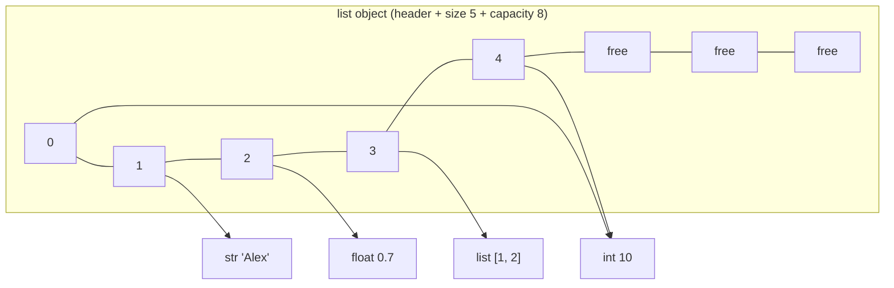
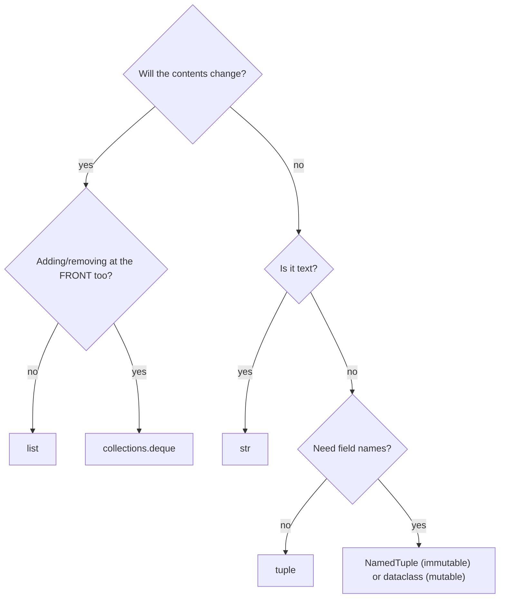

:::tip[TL;DR (30-Second Interview Pitch)]
Python's three core **sequences** share indexing, slicing, `len`, `in` and iteration, and differ in one property: a **`list`** is a **mutable dynamic array** of references (amortized O(1) `append`, O(n) insert at the front), a **`tuple`** is its **immutable**, smaller, **hashable** sibling (tensor shapes, dict keys, function return values), and a **`str`** is an immutable sequence of **Unicode code points**. Interviews test the costs (which operations are O(1) vs O(n)), the **aliasing traps** (`[[0]*3]*3`, shallow copies, mutating while iterating) and string performance (`"".join` instead of `+=` in a loop).
:::

<PriorityKey lang="Python" v="3.10" />

## ⚡ Essential Interview Recall

- 🔴 **`list`** = ordered, **mutable**, duplicates allowed, mixed types allowed. Internally a **dynamic array of pointers** (not a linked list).
- 🔴 **List Big-O**: index/assign `O(1)`, **`append` amortized `O(1)`**, `pop()` from the end `O(1)`; `insert(0, x)`, `pop(0)`, `remove(x)`, `x in list`, `index(x)` are **`O(n)`**; `sort()` is `O(n log n)`. Need fast operations at both ends → **`collections.deque`**.
- 🔴 A list **over-allocates** by about 12.5% when it grows (capacities 4, 8, 16, 24, 32, 40, 52, …), which is what makes `append` amortized O(1).
- 🔴 **Slicing** `seq[start:stop:step]`: `stop` is **exclusive**, out-of-range slices **never raise** (they're just empty), `[::-1]` reverses, and **a slice of a list is a new (shallow) copy**.
- 🔴 **Shallow vs deep copy**: `list.copy()`, `lst[:]`, `list(lst)` copy only the **outer** list; nested lists are **shared**. Use `copy.deepcopy` for nested structures.
- 🔴 **`[[0] * 3] * 3` creates 3 references to the SAME inner list.** Build 2-D lists with a comprehension: `[[0] * 3 for _ in range(3)]`.
- 🔴 **`list.sort()` sorts in place and returns `None`**; `sorted(iterable)` returns a **new list** and works on any iterable. Both are **stable** and take `key=` and `reverse=`.
- 🔴 **`tuple`** = ordered, **immutable**, only 2 methods (`count`, `index`). A one-element tuple needs a comma: **`(1,)`**; `(1)` is just the int `1`.
- 🔴 A tuple is **hashable only if all its elements are** → can be a dict key / set member; a list never can (`TypeError: unhashable type: 'list'`).
- 🔴 **Strings are immutable** sequences of Unicode code points: `s[0] = "C"` raises `TypeError`; every "modifying" method returns a **new** string.
- 🔴 **Build strings with `"".join(parts)`** (O(n)), not `s += part` in a loop (O(n²) in general).
- 🟠 Tuples are **smaller** (no over-allocation, no growth bookkeeping) and slightly **faster to create**; constant tuples are built once at compile time.
- 🟠 A tuple's **immutability is shallow**: `t = (1, [2])` can't be reassigned, but `t[1].append(3)` works.
- 🟠 `str.split()` (no argument) splits on **runs of whitespace** and drops empty strings; `split(" ")` splits on **every single space**.
- 🟠 `find()` returns **-1** when not found; `index()` raises **`ValueError`**.
- 🟡 `len(s)` counts **code points**, not bytes or visible characters: `len("café")` can be 4 or 5 depending on Unicode normalization; LLM **tokens** are a third, different count.
- 🟡 **`namedtuple` / `typing.NamedTuple`** give tuples named fields at no memory cost; `@dataclass` (on the [OOP page](./07-oop-in-python.md)) is the mutable alternative.

:::speak[When would you use a tuple instead of a list?]
"I use a **list** for a **homogeneous, changing collection**: a batch of samples, a list of file paths, the losses I append every epoch. I use a **tuple** for a **fixed record** whose position means something: an `(x, y)` coordinate, a `(batch, channels, height, width)` tensor shape, or several values returned from a function. Three concrete reasons. First, a tuple is **immutable**, so nobody can accidentally change a shape or a config record I've handed them. Second, a tuple of immutable elements is **hashable**, so it can be a **dict key** or set member, for example caching results by `(row, col)` in dynamic programming. A list can't. Third, it's **smaller and slightly faster**: no spare capacity, and constant tuples are built once at compile time. The caveat I'd mention is that immutability is **shallow**: a tuple that contains a list can still have that list mutated."
:::

## The Mental Model

### 1. A list is an array of pointers with spare room



- Each slot holds a **pointer** (8 bytes) to an object stored elsewhere, which is why a list can hold mixed types and why the same object can appear twice (slots 0 and 4 above).

<Animation src="python/list-growth" caption="append writes into a spare slot in O(1). When the array is full, CPython allocates a bigger block, about 12.5 percent larger plus a little, copies the pointers over, and continues. These capacities were measured with sys.getsizeof." />

:::analogy[A list is a train that books extra carriages]
When a train fills up, the railway doesn't add one carriage per new passenger: it swaps in a longer train with a few empty carriages. Most passengers just walk into a free seat (a cheap `append`); occasionally everyone has to move to the new train (the copy). Averaged over all passengers, boarding stays cheap, which is what "amortized O(1)" means.
:::

### 2. Picking a sequence



## The Paradigm / Core Concepts

### 🔴 List vs tuple vs str

| | `list` | `tuple` | `str` |
|---|---|---|---|
| Literal | `[1, 2]`, `[]` | `(1, 2)`, `(1,)`, `()` | `"ab"`, `'ab'`, `"""ab"""` |
| Mutable | ✅ | ❌ | ❌ |
| Hashable (dict key) | ❌ | ✅ if all elements are | ✅ |
| Elements | Any objects | Any objects | Unicode code points |
| Methods | 11 (`append`, `insert`, `extend`, `remove`, `pop`, `index`, `count`, `sort`, `reverse`, `copy`, `clear`) | 2 (`count`, `index`) | ~47 (`split`, `join`, `strip`, …) |
| Memory for 3 ints (3.14) | 88 bytes | 72 bytes | — |
| Typical AI use | Batches, paths, loss history | Tensor shapes, `(x, y)` pairs, return values | Prompts, labels, file names |

### 🔴 List time complexity

| Operation | Example | Cost | Why |
|---|---|---|---|
| Index / assign | `a[i]`, `a[i] = x` | **O(1)** | Pointer arithmetic into the array |
| Append | `a.append(x)` | **O(1)** amortized | Spare capacity; occasional O(n) resize |
| Pop last | `a.pop()` | **O(1)** | Nothing shifts |
| Insert / pop at front or middle | `a.insert(0, x)`, `a.pop(0)` | **O(n)** | Every later pointer shifts |
| Remove by value | `a.remove(x)` | **O(n)** | Search, then shift |
| Membership / search | `x in a`, `a.index(x)`, `a.count(x)` | **O(n)** | Linear scan with `==` |
| Slice | `a[i:j]` | **O(j − i)** | Copies that many pointers |
| Extend | `a.extend(b)` | **O(len(b))** | |
| Sort | `a.sort()`, `sorted(a)` | **O(n log n)**; O(n) if already sorted | Timsort / Powersort finds existing runs |
| `len`, `min`/`max`/`sum` | | O(1), O(n) | Length is stored; the others scan |

### 🔴 List methods

| Method | Does | Returns | Raises |
|---|---|---|---|
| `append(x)` | Add one item at the end | `None` | |
| `insert(i, x)` | Insert before index `i` | `None` | |
| `extend(iterable)` | Append every item | `None` | |
| `remove(x)` | Delete the **first** occurrence | `None` | `ValueError` if absent |
| `pop(i=-1)` | Remove **and return** the item | The item | `IndexError` if empty |
| `index(x)` | Position of the first occurrence | `int` | `ValueError` if absent |
| `count(x)` | Number of occurrences | `int` | |
| `sort(key=None, reverse=False)` | Sort **in place** | **`None`** | `TypeError` for mixed types (`[1, "a"]`) |
| `reverse()` | Reverse **in place** | `None` | |
| `copy()` | Shallow copy | New list | |
| `clear()` | Remove everything | `None` | |

<RuleCard name="Mutating methods return None" tag="API convention" why="Returning None makes it obvious that the object itself changed, so nobody mistakes the call for a copy." remember="In-place means it returns None.">

Methods that change a list **in place** (`append`, `sort`, `reverse`, `insert`, `extend`, `clear`) return **`None`**. So `a = a.sort()` replaces your list with `None`. Use `a.sort()` alone, or `a = sorted(a)` if you want a new list.

</RuleCard>

### 🔴 Slicing

| Slice | Meaning (with `nums = [10, 20, …, 100]`) | Result |
|---|---|---|
| `nums[0:5]` | Index 0 up to (not including) 5 | `[10, 20, 30, 40, 50]` |
| `nums[:4]` / `nums[5:]` | From the start / to the end | `[10, 20, 30, 40]` / `[60, 70, 80, 90, 100]` |
| `nums[::2]` / `nums[1::2]` | Every 2nd, from 0 / from 1 | `[10, 30, 50, 70, 90]` / `[20, 40, 60, 80, 100]` |
| `nums[::-1]` | Reversed copy | `[100, 90, …, 10]` |
| `nums[-3:]` | Last 3 | `[80, 90, 100]` |
| `nums[-5:-2]` | 5th-from-last up to 2nd-from-last (excluded) | `[60, 70, 80]` |
| `nums[100:]` | Out of range | `[]`: slices never raise |
| `nums[:]` | Whole list | A **shallow copy** |

- **Slice assignment** can resize a list: `lst[1:3] = ["a", "b", "c"]` replaces 2 items with 3. `del lst[::2]` deletes every other item.
- **Why slicing matters in AI**: train/validation splits (`data[:split]`, `data[split:]`), the last *k* messages of a chat history (`history[-k:]`), sliding windows over token ids, reversing sequences for bidirectional models.

### 🔴 Shallow vs deep copy

| Operation | New outer object? | Inner objects | Use when |
|---|:---:|---|---|
| `b = a` | ❌ | Same | You want a second name (rarely what you meant) |
| `a.copy()`, `a[:]`, `list(a)`, `copy.copy(a)` | ✅ | **Shared** | Flat lists of immutable items |
| `copy.deepcopy(a)` | ✅ | **Recursively copied** | Nested lists/dicts, configs you'll modify per experiment |

<Animation src="python/shallow-deep-copy" caption="A shallow copy creates a new outer list whose slots still point at the same inner lists, so writing to shallow[0][0] also changes the original. deepcopy copies the inner lists too, so the two structures are fully independent." />

:::analogy[Shallow copy is photocopying a table of contents]
Photocopying a binder's table of contents gives you a new page, but it still points to the same chapters in the same binder: scribble in chapter 1 and everyone sees it. A deep copy photocopies every chapter as well, so you can mark yours up freely.
:::

### 🔴 String essentials

| Task | Code | Result |
|---|---|---|
| Change case | `capitalize()`, `title()`, `upper()`, `lower()`, `swapcase()`, `casefold()` | New strings |
| Search | `find("A")` / `index("A")` | Position, or **-1** / **`ValueError`** |
| Count / test ends | `count("a")`, `startswith("x")`, `endswith("y")` | `int` / `bool` |
| Split / join | `"a/b/c".split("/")`, `"-".join(names)` | `['a', 'b', 'c']`, `'Taylor-Alex-Morgan'` |
| Clean | `strip()`, `lstrip()`, `rstrip()`, `strip("x")` | Whitespace (or the given characters) removed from the ends |
| Replace | `replace("World", "Engineer")` | All occurrences, new string |
| Drop a known prefix/suffix | `removeprefix("##")`, `removesuffix(".pt")` <Since v="3.9" lang="Python" /> | Exactly that text, not a character set |
| Test content | `isdigit()`, `isalpha()`, `isalnum()`, `isspace()` | `bool` |
| Format | f-strings, `str.format`, `%` | f-strings are the modern default |

## ⚙️ Under the Hood (CPython Internals)

- **List layout**: a header (refcount, type, `ob_size` = length, `allocated` = capacity) plus a separate C array of `PyObject*` pointers. Growth uses `new_allocated = (n + (n >> 3) + 6) & ~3`, which gives the measured capacities **4, 8, 16, 24, 32, 40, 52, 64, 76…**: roughly 12.5% headroom, so the copying cost averages out to O(1) per append.
- **Tuple layout**: the pointers are stored **inline** right after the header, with no separate array and no spare capacity, so `(1, 2, 3)` takes 72 bytes against 88 for `[1, 2, 3]`. CPython keeps **free lists** of small tuples for reuse, and tuples of constants (`(1, 2, 3)` in source) are **folded at compile time** into a single constant.
- **Sorting** is **Timsort** (since 2.3), with a better merge strategy (**Powersort**) since 3.11: it detects already-sorted runs, so nearly-sorted data sorts in close to O(n). It's **stable**, which is why multi-key sorts can be done in passes or with a tuple key.
- **`str` storage (PEP 393)**: each string picks the narrowest fixed width that fits its largest character: **1 byte** per character (Latin-1), **2** (UCS-2) or **4** (UCS-4). One emoji in a long ASCII prompt makes the **whole string 4 bytes per character**. Indexing stays O(1) because the width is fixed.
- **String hash caching**: a `str` computes its hash once and stores it, which makes strings very fast dict keys. Hashes are **randomized per process** (`PYTHONHASHSEED`) to resist hash-flooding attacks.
- **The `s += piece` optimization**: CPython can resize a string **in place** when the left operand has **no other references**. That's why a simple `+=` loop is often fast in CPython (0.06 s for 20 × 50,000 pieces in our run) but collapses to O(n²) the moment anything else holds a reference (1.1 s for a single 50,000-piece run when each intermediate string is also kept in a list), and on PyPy. `"".join` is O(n) everywhere.
- **`str.join` is two-pass**: it sums the lengths, allocates the result once, then copies each piece in.

:::danger[Interview Trap]
**`t[1] += [3]` on `t = (1, [2])` both raises *and* succeeds.** `+=` first calls `list.__iadd__`, which **extends the inner list in place**, then tries to store the result back into `t[1]`, which a tuple forbids → `TypeError: 'tuple' object does not support item assignment`. After the exception, `t` is `(1, [2, 3])`.
:::

:::danger[Interview Trap]
**Comparing strings compares code points, not dictionary order.** `"apple" < "Apple"` is `False` because `ord("a") == 97` and `ord("A") == 65`, and `"10" < "9"` is `True` because `"1"` comes before `"9"`. Sort user-facing text with `key=str.lower` (or `str.casefold`), and sort numbers stored as text with `key=int`.
:::

## 💻 Python Implementation

:::tip[Run it yourself]
Every snippet runs in the `python` REPL or a notebook. Output comments come from a run on **CPython 3.14**.
:::

### 1. Creating and accessing lists

```python showLineNumbers
empty_list = []
my_list = [1, 2, 3, "Alex", True, 0.7]       # mixed types are fine
print(my_list)                                # [1, 2, 3, 'Alex', True, 0.7]

x = [45, 21, 2, 8, 1, 6, 3]
print(x[2], len(x), x[-1], type(x[2]))        # 2 7 3 <class 'int'>
# error-next-line
x[100]                                        # ❌ IndexError: list index out of range

a = [1, 2, 4, 55, 6, 6, 6, 6]
print(len(a), sum(a), max(a), min(a))         # 8 86 55 1

for i in range(len(a)):                       # by index (only if you need i)
    a[i]
for value in a:                               # by value: cleaner
    value
```

### 2. List methods, one by one

```python showLineNumbers
my_list = [10, 20, 30, 40]
my_list.append(50)                            # [10, 20, 30, 40, 50]
my_list.insert(2, 25)                         # [10, 20, 25, 30, 40, 50]
my_list.extend([60, 70])                      # [10, 20, 25, 30, 40, 50, 60, 70]
my_list.remove(25)                            # [10, 20, 30, 40, 50, 60, 70]
popped = my_list.pop()                        # 70 → [10, 20, 30, 40, 50, 60]
print(my_list.index(30), my_list.count(10))   # 2 1
# error-next-line
first = my_list.pop(0)                        # 10, but O(n): every other pointer shifts left

nums = [5, 2, 9, 1, 7]
nums.sort()                                   # [1, 2, 5, 7, 9]
nums.reverse()                                # [9, 7, 5, 2, 1]
copied = nums.copy()
copied.clear()                                # copied == [], nums unchanged

# error-next-line
nums = nums.sort()                            # ❌ nums is now None
```

### 3. Slicing

```python showLineNumbers
nums = [10, 20, 30, 40, 50, 60, 70, 80, 90, 100]
print(nums[0:5])                              # [10, 20, 30, 40, 50]
print(nums[::2], nums[1::2])                  # [10, 30, 50, 70, 90] [20, 40, 60, 80, 100]
print(nums[::-1])                             # [100, 90, 80, 70, 60, 50, 40, 30, 20, 10]
print(nums[-3:], nums[-5:-2])                 # [80, 90, 100] [60, 70, 80]
print(nums[100:])                             # []: no IndexError for slices

lst = [0, 1, 2, 3, 4, 5]
# highlight-next-line
lst[1:3] = ["a", "b", "c"]                    # slice assignment can change the length
print(lst)                                    # [0, 'a', 'b', 'c', 3, 4, 5]
del lst[::2]
print(lst)                                    # ['a', 'c', 4]

split = int(0.8 * len(nums))
train, val = nums[:split], nums[split:]       # 80/20 split (shuffle first in real code!)
```

### 4. Copies and the 2-D list trap

```python showLineNumbers
import copy

matrix = [[1, 2], [3, 4]]
shallow = matrix.copy()
deep = copy.deepcopy(matrix)
# error-next-line
shallow[0][0] = 99                            # ❌ the inner list is shared
print(matrix)                                 # [[99, 2], [3, 4]]
print(deep)                                   # [[1, 2], [3, 4]]

# error-next-line
grid = [[0] * 3] * 3                          # ❌ three references to ONE row
grid[0][0] = 99
print(grid)                                   # [[99, 0, 0], [99, 0, 0], [99, 0, 0]]

# success-next-line
grid = [[0] * 3 for _ in range(3)]            # ✅ a new row per iteration
grid[0][0] = 99
print(grid)                                   # [[99, 0, 0], [0, 0, 0], [0, 0, 0]]
```

### 5. Sorting with keys

```python showLineNumbers
people = [("asha", 31), ("ravi", 25), ("meera", 31), ("dev", 25)]

print(sorted(people, key=lambda p: p[1]))
# [('ravi', 25), ('dev', 25), ('asha', 31), ('meera', 31)]   stable: ties keep their input order

# highlight-next-line
print(sorted(people, key=lambda p: (-p[1], p[0])))           # age descending, then name ascending
# [('asha', 31), ('meera', 31), ('dev', 25), ('ravi', 25)]

print(sorted(["banana", "Apple", "cherry"], key=str.lower))  # ['Apple', 'banana', 'cherry']
```

### 6. Tuples

```python showLineNumbers
t = (1, 2, 3, "Alex", True)
single = (1,)                                 # the COMMA makes the tuple
print(type((1)), type(single))                # <class 'int'> <class 'tuple'>
print(tuple("Alex"), tuple([1, 2, 3]))        # ('A', 'l', 'e', 'x') (1, 2, 3)

nested = (1, 2, 3, (4, 5))
print(nested[-1][0])                          # 4
print((1, 2) + (3, 4), (1, 2) * 2)            # (1, 2, 3, 4) (1, 2, 1, 2)
print(1 in (1, 2))                            # True

ft = (1, 2, 2, 4, 54, 65, 6)
print(len(ft), min(ft), max(ft), ft.count(2), ft.index(54))  # 7 1 65 2 4
print(sorted(ft))                             # [1, 2, 2, 4, 6, 54, 65]: sorted() ALWAYS returns a list

# error-next-line
ft[0] = 99                                    # ❌ TypeError: 'tuple' object does not support item assignment

cache = {(0, 1): "visited"}                   # ✅ tuples of immutables are valid dict keys
# error-next-line
bad = {[0, 1]: "visited"}                     # ❌ TypeError: cannot use 'list' as a dict key (unhashable type: 'list')
```

```python showLineNumbers
def train_test_metrics():
    return 0.12, 0.94                         # returns ONE tuple: (0.12, 0.94)

loss, acc = train_test_metrics()              # tuple unpacking
x, (y, z) = 1, (2, 3)                         # nested unpacking

from typing import NamedTuple

class Prediction(NamedTuple):                 # a tuple with named fields and type hints
    label: str
    score: float = 0.0

p = Prediction("cat", 0.93)
print(p, p.label, p[1])                       # Prediction(label='cat', score=0.93) cat 0.93
```

### 7. Strings: indexing, slicing, immutability

```python showLineNumbers
name = "Alex"
print(name[0], name[-1], name[-4])            # A x A
# error-next-line
name[4]                                       # ❌ IndexError: string index out of range

text = "Taylor Alex Morgan Reed"
print(text[0:6], text[0:6:2], text[-6:-1:2]) # Taylor Tyo nRe
print(text[::-1])                             # deeR nagroM xelA rolyaT
print(text[-1:-7:-1])                         # deeR n

# error-next-line
text[0] = "C"                                 # ❌ TypeError: 'str' object does not support item assignment
# success-next-line
text = "C" + text[1:]                         # ✅ build a new string and rebind the name
```

### 8. String operators and comparisons

```python showLineNumbers
print("Alex" + " " + "Reed", "Alex" * 3)      # Alex Reed AlexAlexAlex
print("*" * 40)                               # a divider

print("Tokyo" > "Berlin", ord("T"), ord("B")) # True 84 66: compared code point by code point
# error-next-line
print("apple" < "Apple", "10" < "9")          # False True: code points, not dictionary order

print("Alex" and "Reed", "" or "Reed")        # Reed Reed: and/or return an operand
print("T" in "Taylor", "z" not in "Taylor")   # True True
print(max("Taylor Alex Morgan Reed"))         # y: highest code point
```

### 9. String methods

```python showLineNumbers
ex = "taylor Alex morgan Reed"
print(ex.capitalize())                        # Taylor alex morgan reed
print(ex.title())                             # Taylor Alex Morgan Reed
print(ex.swapcase())                          # TAYLOR aLEX MORGAN rEED
print(ex.count("a"), ex.find("A"), ex.find("Z"))   # 2 7 -1
# error-next-line
ex.index("Z")                                 # ❌ ValueError: substring not found
print(ex.endswith("reed"))                    # False: case-sensitive

print("a  b c".split())                       # ['a', 'b', 'c']       runs of whitespace
# highlight-next-line
print("a  b c".split(" "))                    # ['a', '', 'b', 'c']   every single space
print("k=v=w".split("=", 1))                  # ['k', 'v=w']          maxsplit
print("-".join(["Taylor", "Alex", "Morgan"])) # Taylor-Alex-Morgan

dirty = "   Hello AI World!   "
print(repr(dirty.strip()))                    # 'Hello AI World!'
print(dirty.replace("World", "Engineer"))     #    Hello AI Engineer!
print("model.pt".removesuffix(".pt"))         # model
```

### 10. Building strings: `join` vs `+=`

```python title="❌ Quadratic concatenation" showLineNumbers
prompt = ""
for chunk in retrieved_chunks:
    # error-next-line
    prompt = prompt + chunk + "\n"            # ❌ may copy the whole prompt every iteration: O(n²)
```

```python showLineNumbers
# success-next-line
prompt = "\n".join(retrieved_chunks)          # ✅ one allocation, O(total length)

parts = []
for chunk in retrieved_chunks:
    parts.append(f"[source] {chunk}")         # ✅ collect pieces, join once at the end
prompt = "\n".join(parts)
```

### 11. Unicode: characters, bytes and tokens

```python showLineNumbers
print(len("café"), len("café"))         # 4 5: precomposed é vs e + combining accent
print("café" == "café")                 # False: they LOOK identical
import unicodedata
# success-next-line
print(unicodedata.normalize("NFC", "café") == "café")   # True: normalize before comparing

print("café".encode("utf-8"), len("café".encode("utf-8")))     # b'caf\xc3\xa9' 5: bytes ≠ characters
print(len("😀"), len("😀".encode("utf-8")))  # 1 4
print("ß".upper())                            # SS: case mapping can change the length
```

| Count | `"café 😀"` | Measures |
|---|---|---|
| `len(s)` | 6 | Unicode code points |
| `len(s.encode("utf-8"))` | 10 | Bytes on disk / over the network |
| LLM tokens | Depends on the tokenizer | What the model's **context window** and **pricing** are measured in |

## 🧪 Predict the Output

<Predict n="1" title="The 2-D list" output="[[99, 0, 0], [99, 0, 0], [99, 0, 0]]">

```python
matrix = [[0] * 3] * 3
matrix[0][0] = 99
print(matrix)
```

`[0] * 3` builds one row; `* 3` on the outer list copies the **reference** to that row three times. All three slots point to the same list, so the write appears in every row. `[[0] * 3 for _ in range(3)]` builds a fresh row each iteration. (`[0] * 3` itself is fine: ints are immutable, so sharing them is harmless.)

</Predict>

<Predict n="2" title="The tuple that changes" output="TypeError, then (1, [2, 3])">

```python
t = (1, [2])
try:
    t[1] += [3]
except TypeError as e:
    print("TypeError")
print(t)
```

`t[1] += [3]` runs in two steps: `t[1].__iadd__([3])` extends the inner list **in place** (that succeeds), then Python executes `t[1] = <result>`, which a tuple rejects. The exception is raised **after** the mutation already happened.

</Predict>

<Predict n="3" title="sort() result" output="None [1, 2, 3]">

```python
b = [3, 1, 2]
r = b.sort()
print(r, b)
```

`list.sort()` sorts **in place** and returns `None`, following the convention that mutating methods return `None`. `sorted(b)` would have returned a new sorted list and left `b` alone.

</Predict>

<Predict n="4" title="Slicing a name" output="Tyo nRe deeR n">

```python
text = "Taylor Alex Morgan Reed"
print(text[0:6:2], text[-6:-1:2], text[-1:-7:-1])
```

- `[0:6:2]`: indices 0, 2, 4 → `T`, `y`, `o`.
- `[-6:-1:2]`: the last 6 characters are `"n Reed"`; from index -6 up to (not including) -1 in steps of 2 → `n`, `R`, `e`.
- `[-1:-7:-1]`: walking backwards from the last character for 6 steps → `deeR n`.

</Predict>

<Predict n="5" title="split() vs split(' ')" output="['a', 'b', 'c'] ['a', '', 'b', 'c']">

```python
s = "a  b c"
print(s.split(), s.split(" "))
```

With no argument, `split` treats any **run of whitespace** as one separator and discards empty strings. With `" "` it splits on **every single space**, so the two spaces between `a` and `b` produce an empty string. Naive tokenizers that use `split(" ")` leak these empty tokens into the vocabulary.

</Predict>

<Predict n="6" title="Slice copy of nested data" output="[1, [9, 3]]">

```python
a = [1, [2, 3]]
b = a[:]
b[0] = 100
b[1][0] = 9
print(a)
```

`a[:]` creates a **new outer list** but copies only the **pointers**. Replacing `b[0]` changes only `b`'s slot. `b[1]` and `a[1]` point to the **same** inner list, so `b[1][0] = 9` shows up in `a`.

</Predict>

## 🪜 Follow-up Ladder

<Ladder title="From append to deque">
<Rung q="What is the time complexity of list.append?">

Amortized **O(1)**. Usually it writes into a spare slot; when the array is full it reallocates about 12.5% larger and copies the pointers, an O(n) step that happens rarely enough to average out.

</Rung>
<Rung q="And list.pop(0) or insert(0, x)?">

**O(n)**: every remaining pointer shifts by one position. A loop of `pop(0)` over n items is O(n²).

</Rung>
<Rung q="So how do you implement a BFS queue or a sliding window in Python?">

`collections.deque`: O(1) `append`, `appendleft`, `pop` and `popleft`. `deque(maxlen=k)` automatically drops the oldest item, which is perfect for "the last k rewards", a moving-average loss, or the last k chat turns.

</Rung>
<Rung q="Why not always use a deque, then?">

Indexing into the middle of a deque is **O(n)** (it's a doubly linked list of 64-item blocks), it doesn't support slicing, and it uses more memory per item. Lists win for random access and slicing.

</Rung>
<Rung q="You need to store 10 million float features. List, tuple, deque or something else?">

None of them: each float would be a separate 24-byte object plus an 8-byte pointer, about 320 MB. A **NumPy array** (or `array.array('d')`) stores raw 8-byte doubles contiguously: about 80 MB in float64, 40 MB in float32, and vectorized operations run in C. Python containers are for orchestration; numeric data belongs in arrays and tensors.

</Rung>
</Ladder>

## 🚑 Production Scenarios

:::incident[Every class bucket contained every sample]
A data-preparation script grouped image paths by class label for stratified sampling. Each "class" ended up with the paths of **all** classes, and the balanced dataset came out 10× too large.

- **Code:** `buckets = [[]] * num_classes`, then `buckets[label].append(path)`.
- **Why:** list multiplication repeats the **reference** to one empty list, so all buckets are the same object (`buckets[0] is buckets[1]` is `True`).
- **Fix:** `buckets = [[] for _ in range(num_classes)]`, or better, `collections.defaultdict(list)` keyed by label.
- **Prevention:** add an assertion after grouping: `sum(len(b) for b in buckets) == len(paths)`.
:::

:::incident[Prompt assembly slowed down as documents grew]
A RAG service built its prompt by concatenating retrieved chunks with `+=` inside a loop that also logged every intermediate prompt for tracing. Latency grew quadratically with the number of chunks.

- **Why:** the logging kept an extra reference to each intermediate string, which disabled CPython's in-place `+=` optimization. Every iteration then copied the whole prompt built so far: O(n²) bytes copied.
- **Fix:** collect the chunks in a list and call `"\n\n".join(parts)` once; log the final prompt.
:::

## 🚨 Interview Gotchas & Edge Cases

:::warning[The Most Common Question]
**"What's the difference between a shallow copy and a deep copy?"** A shallow copy (`copy()`, `[:]`, `list()`, `copy.copy`) creates a **new outer container** filled with the **same element references**; a deep copy (`copy.deepcopy`) recursively copies every nested mutable object. For a flat list of numbers or strings they behave the same, because the elements are immutable. For nested lists, dicts of lists, or config objects, a shallow copy lets edits leak back into the original. Follow-up: `deepcopy` handles cycles using a memo dict, and classes can customize it with `__deepcopy__`.
:::

- **`list.sort()` can't compare mixed types**: `[3, "a"].sort()` raises `TypeError: '<' not supported between instances of 'str' and 'int'`. And `None` values in a column you want to sort will break it too; use `key=lambda x: (x is None, x)`.
- **`sorted()` on a dict sorts its keys** and returns a list. Use `sorted(d.items(), key=lambda kv: kv[1])` to sort by value.
- **`x in list` inside a loop** is the most common accidental O(n²) in interview code: convert to a `set` once if you test membership repeatedly.
- **`str.strip("abc")` removes a set of characters**, not a substring: `"xxhixx".strip("x")` is `"hi"`, and `"test.pt".strip(".pt")` is `"es"` (it ate the `t`s from both ends). Use `removesuffix(".pt")` → `"test"`.
- **`len()` of a string isn't the token count**: budget LLM context windows with the model's tokenizer (`tiktoken`, the Hugging Face tokenizer, or the provider's token-counting endpoint), never with `len(text)` or `len(text.split())`.
- **Zero-step slices**: `nums[::0]` raises `ValueError: slice step cannot be zero`.
- **`tuple` creation from one string**: `tuple("Alex")` gives `('A', 'l', 'e', 'x')`, not `('Alex',)`. Same for `list("Alex")` and `set("Alex")`.
