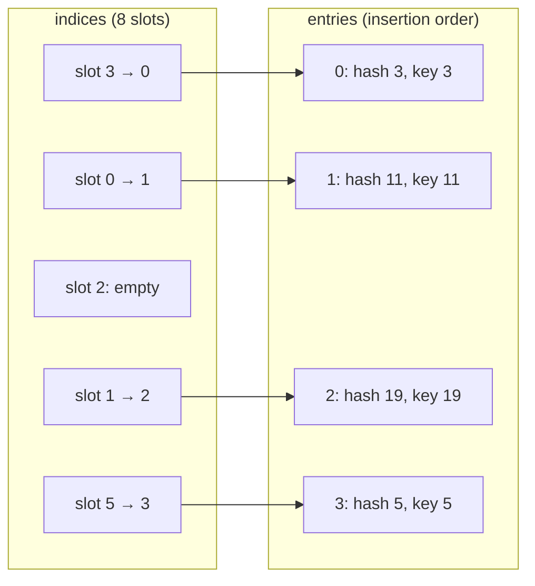
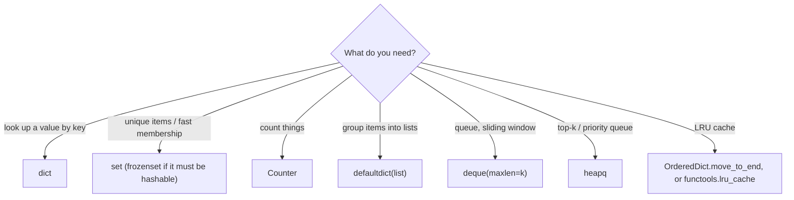

:::tip[TL;DR (30-Second Interview Pitch)]
A **`dict`** maps **hashable keys** to values and a **`set`** stores **unique hashable items**; both are **hash tables**, so lookup, insert, delete and `in` are **O(1) on average**. Since Python 3.7 dicts **preserve insertion order** (a guarantee of the language, thanks to CPython's compact layout). The `collections` module adds the tools interviewers expect you to reach for: **`Counter`** (frequencies), **`defaultdict`** (grouping), **`deque`** (O(1) at both ends), **`OrderedDict`** (LRU caches), plus **`heapq`** for top-k. In AI code these structures are everywhere: vocabularies, configs, `state_dict`s, label counts, deduplication and data-leakage checks.
:::

<PriorityKey lang="Python" v="3.9" />

## ⚡ Essential Interview Recall

- 🔴 **`dict`** = mutable mapping of **key → value**. Keys must be **hashable** (immutable: `str`, `int`, `tuple` of immutables, `frozenset`); values can be anything.
- 🔴 **Average O(1)** for `d[k]`, `d[k] = v`, `del d[k]`, `k in d`. Worst case O(n) when many keys collide.
- 🔴 **Insertion order is guaranteed since 3.7** (implementation detail in 3.6). Updating an existing key keeps its position; deleting and re-adding moves it to the end.
- 🔴 `d[k]` raises **`KeyError`** for a missing key; **`d.get(k, default)`** returns the default; **`d.setdefault(k, default)`** inserts it too.
- 🔴 **Never change a dict's size while iterating** over it → `RuntimeError: dictionary changed size during iteration`. Iterate over `list(d)` or build a new dict.
- 🔴 `keys()`, `values()`, `items()` return **live views**, not copies; `in` on a dict checks **keys**.
- 🔴 **Set** = unordered collection of **unique** hashable items; `{}` is an **empty dict**, use **`set()`**. No indexing or slicing.
- 🔴 Set algebra: union `|`, intersection `&`, difference `-`, symmetric difference `^`; `issubset`, `issuperset`, `isdisjoint`. `remove()` raises `KeyError` for a missing item, **`discard()` doesn't**.
- 🔴 **Hash contract**: if `a == b` then `hash(a) == hash(b)`. That's why `1`, `1.0` and `True` collapse into one key and `{1, 1.0, True} == {1}`.
- 🟠 Merge dicts with **`d1 | d2`** <Since v="3.9" lang="Python" /> (right side wins) or `{**d1, **d2}`; `d1 |= d2` updates in place.
- 🟠 **`Counter`**: counts hashables, `most_common(k)`, supports `+ - & |`; a missing key reads as **0**.
- 🟠 **`defaultdict(factory)`** creates missing values on **read**: `defaultdict(list)` for grouping, `defaultdict(int)` for counting. Even just reading a missing key **inserts** it.
- 🟠 **`deque`**: O(1) `append`/`appendleft`/`pop`/`popleft`; `maxlen` turns it into a sliding window.
- 🟠 **`heapq`** is a **min-heap** on a plain list: `heappush`/`heappop` O(log n), `nlargest`/`nsmallest` for top-k in O(n log k).
- 🟡 **`hash()` of `str` and `bytes` is randomized per process** (`PYTHONHASHSEED`): never use it for sharding, caching keys on disk or reproducible splits. Use `hashlib`.
- 🟡 **`dict.fromkeys(keys, [])` shares ONE list** among all keys; use a dict comprehension.
- 🟡 CPython dicts use a **compact layout**: a small **index array** of slots plus a dense **entries array** in insertion order, resized at 2/3 full.

:::speak[How does a Python dict work, and why is lookup O(1)?]
"A dict is a **hash table**. To store `d[key] = value`, Python calls `hash(key)`, masks it to pick a slot in an **index table**, and if the slot is taken it **probes** other slots using a perturbation formula that mixes in the higher bits of the hash, until it finds a free one. The slot stores an index into a dense **entries array**, which holds the hash, the key and the value **in insertion order**. That's why dicts iterate in insertion order since 3.7. A lookup repeats the same probe sequence and compares the stored hash first, then the key with `==`. On average that's a constant number of probes, so O(1). To keep it that way the table **resizes when it's two-thirds full**. It also explains the rules: keys must be **hashable** and their hash must never change, and two equal objects must have **equal hashes**, otherwise lookups go to the wrong slot."
:::

## The Mental Model

### 1. Inside a dict: index table + entries



<Animation src="python/dict-hash-table" caption="Keys 3, 11 and 19 all hash to slot 3 of an 8-slot table. CPython probes the next slot with i = 5i + perturb + 1, so 11 lands in slot 0 and 19 in slot 1. The entries array keeps insertion order no matter where the slots end up." />

:::analogy[A dict is a cloakroom with numbered tickets]
You hand over your coat (the value) and the attendant computes a hook number from your name (the hash). To get it back you don't search every hook, you go straight to the computed one. If two names land on the same hook, the attendant follows a fixed rule to the next free hook, and follows the same rule when you come back. That's why a coat whose name tag changes (a mutable key) can never be found again.
:::

### 2. Choosing a structure



## The Paradigm / Core Concepts

### 🔴 Dict operations

| Operation | Code | Missing key behaviour | Cost |
|---|---|---|---|
| Read | `d[k]` | **`KeyError`** | O(1) |
| Safe read | `d.get(k)`, `d.get(k, 0)` | `None` / default; **dict unchanged** | O(1) |
| Read or insert | `d.setdefault(k, [])` | Inserts the default and returns it | O(1) |
| Add / update | `d[k] = v`, `d.update(other)` | Adds the key | O(1) per key |
| Delete | `del d[k]` | `KeyError` | O(1) |
| Remove and return | `d.pop(k)`, `d.pop(k, default)` | `KeyError` / default | O(1) |
| Remove last inserted | `d.popitem()` | `KeyError` if empty | O(1) (LIFO) |
| Membership | `k in d` | — | O(1), checks **keys** |
| Merge | `d1 \| d2`, `{**d1, **d2}`, `d1 \|= d2` | Right side wins | O(len(d2)) |
| Iterate | `for k in d`, `.keys()`, `.values()`, `.items()` | — | O(n) |

### 🔴 Dict vs set vs list for lookups

| | `list` | `set` | `dict` |
|---|---|---|---|
| `x in c` | O(n) | **O(1)** | **O(1)** (keys) |
| Order | Insertion order, indexable | **No order** | Insertion order (3.7+), not indexable |
| Duplicates | Allowed | Removed | Keys unique, values can repeat |
| Memory for 1,000,000 ints (container only) | 8 MB | 33.5 MB | 42 MB |
| Use for | Ordered data, batches | Dedup, membership, set algebra | Lookups by key, mappings, counting |

- The ~150,000× gap we measured (`999_999 in list` took 17.8 ms, `in set` took 0.12 µs) is the whole reason to convert a list to a set before testing membership in a loop. The price is **4× the memory**.

<Animation src="python/set-vs-list-lookup" caption="Checking 99 in a list compares item after item until it finds it, so the work grows with the length. A set hashes 99 once and jumps straight to its slot, so the work stays the same however many items are stored." />

:::analogy[A set is the guest list at the door]
A list is a stack of party invitations you have to flip through one by one to find a name. A set is the bouncer's guest list sorted into lettered pages: one glance at the right page answers "is this person invited?". And writing the same name twice on the list doesn't let them in twice.
:::

### 🔴 Set operations

| Operation | Method | Operator | `A = {1, 2, 3}`, `B = {3, 4, 5}` |
|---|---|---|---|
| Union (in A or B) | `A.union(B)` | `A \| B` | `{1, 2, 3, 4, 5}` |
| Intersection (in both) | `A.intersection(B)` | `A & B` | `{3}` |
| Difference (in A, not B) | `A.difference(B)` | `A - B` | `{1, 2}` |
| Symmetric difference (in exactly one) | `A.symmetric_difference(B)` | `A ^ B` | `{1, 2, 4, 5}` |
| Subset / superset | `A.issubset(B)` / `A.issuperset(B)` | `A <= B` / `A >= B` | `False` / `False` |
| Disjoint (nothing shared) | `A.isdisjoint(B)` | — | `False` |

- **Methods accept any iterable** (`A.union([7])`); **operators require sets** (`A | [7]` → `TypeError`).
- **Modify**: `add(x)`, `update(iterable)`, `remove(x)` (raises), **`discard(x)`** (silent), `pop()` (an arbitrary item), `clear()`.
- **`frozenset`** is the immutable, hashable set: usable as a dict key or inside another set.

### 🔴 The hashing rules

<RuleCard name="The hash contract" tag="__hash__ / __eq__" why="A hash table finds the slot with hash() and confirms with ==, so equal objects with different hashes would be stored twice or never found." remember="Equal objects, equal hashes, frozen keys.">

1. If `a == b`, then `hash(a) == hash(b)` (the reverse is not required: collisions are allowed).
2. An object's hash must **never change** while it's in a dict or set, so keys should be **immutable**.
3. If a class overrides `__eq__` without `__hash__`, Python sets `__hash__ = None` and instances become **unhashable**.

</RuleCard>

| Hashable | Not hashable |
|---|---|
| `int`, `float`, `complex`, `bool`, `str`, `bytes`, `None` | `list`, `dict`, `set`, `bytearray` |
| `tuple` / `frozenset` **whose elements are hashable** | `tuple` containing a list: `(1, [2])` |
| Instances of normal classes (hash by identity) | Classes that define `__eq__` but not `__hash__` |
| Frozen dataclasses, `NamedTuple`s, enums | Regular (non-frozen) dataclasses with `eq=True` |

### 🟠 The `collections` toolbox (+ `heapq`, `bisect`)

| Tool | What it is | Signature move | Typical AI / interview use |
|---|---|---|---|
| `Counter` | dict subclass of counts | `most_common(k)`, `c["missing"] == 0`, `+ - & \|` | Word frequencies, class balance, anagram checks |
| `defaultdict` | dict that builds missing values | `defaultdict(list)[k].append(x)` | Grouping, adjacency lists, inverted indexes |
| `OrderedDict` | dict with order operations | `move_to_end(k)`, `popitem(last=False)` | LRU cache (interview classic) |
| `deque` | Double-ended queue | `appendleft`, `popleft`, `maxlen`, `rotate` | BFS, sliding windows, rolling metrics, chat history |
| `ChainMap` | Layered view over several dicts | First dict that has the key wins | CLI args over env vars over defaults |
| `namedtuple` | Tuple with field names | `pt.x`, `_replace`, `_asdict` | Lightweight records |
| `heapq` | Min-heap functions on a list | `heappush`, `heappop`, `nlargest(k, ..., key=)` | Top-k retrieval results, Dijkstra, merging sorted streams |
| `bisect` | Binary search on a sorted list | `bisect(thresholds, x)` | Bucketing scores, inserting into sorted lists |

:::analogy[defaultdict is a filing cabinet that makes its own folders]
With a plain dict you must check whether a folder exists before filing a document in it. A `defaultdict(list)` is a cabinet that creates an empty folder the moment you ask for one, so you can just file. The catch: merely *asking* whether a folder is there also creates it.
:::

## ⚙️ Under the Hood (CPython Internals)

- **Compact dict (3.6+)**: two arrays. A sparse **indices** array (1, 2, 4 or 8 bytes per slot, depending on table size) and a dense **entries** array of `(hash, key, value)` in insertion order. Insertion order falls out of the design for free, and the dict uses 20–25% less memory than the old single-table layout.
- **Probing**: start at `i = hash & mask`; on a collision set `perturb >>= 5` and `i = (5 * i + perturb + 1) & mask`. The perturbation brings the **high bits** of the hash into play, so keys that agree on their low bits still spread out. Verified above: keys 3, 11 and 19 all start at slot 3 of an 8-slot table and land in slots 3, 0 and 1.
- **Resizing**: a dict grows when it's **2/3 full** (usable = 2/3 of the slots). Measured sizes: `{}` is 64 bytes, 1–5 items 224 bytes, 6–10 items 352, 11–21 items 632: the steps are the rebuilds.
- **Lookup compares the stored hash first** and only calls `__eq__` when hashes match, so expensive equality methods rarely run. Strings cache their hash, which is why `str` keys are so fast.
- **`hash(-1) == -2`**: `-1` is reserved as an error signal in CPython's C API, so the hash of `-1` is silently changed to `-2`. Harmless, but a favourite trivia question.
- **Hash randomization**: `str`/`bytes` hashes are salted with a random per-process key (SipHash) to defeat **hash-flooding** denial-of-service attacks (an attacker posting thousands of colliding keys turns O(1) into O(n)). In our runs `hash('cat')` was `4121432124227379905` in one process and `6844761411240695614` in the next. Set `PYTHONHASHSEED=0` only for debugging.
- **Sets** use the same open-addressing idea without the entries array (no values, no order) and grow at **3/5 full**. Their iteration order depends on hashes and insertion history. Small ints hash to themselves, so `{3, 1, 2}` often prints sorted, which is a coincidence, not a feature.
- **Key-sharing dicts** (PEP 412): instances of the same class can share one keys table for their `__dict__`, saving memory per object. Adding attributes outside `__init__`, or in a different order, can break the sharing.

:::danger[Interview Trap]
**Dicts are ordered, sets are not.** Dict iteration order is a **language guarantee** since 3.7. Set iteration order is **arbitrary** and can change between runs for strings (hash randomization). Code that does `list(set(labels))` to build a label→index mapping produces **different class indices on every run**: the model's output layer and the saved label map then disagree. Use `sorted(set(labels))`.
:::

:::danger[Interview Trap]
**Reading a `defaultdict` writes to it.** `dd = defaultdict(int); dd["x"]` returns `0` **and inserts `"x"`**. Checking `if dd[key]:` on a hot path silently grows the dict with every key you check. Use `key in dd` or `dd.get(key)` to test without inserting.
:::

## 💻 Python Implementation

:::tip[Run it yourself]
Every snippet runs in the `python` REPL or a notebook. Output comments come from a run on **CPython 3.14**.
:::

### 1. Creating and reading

```python showLineNumbers
empty = {}
user = {"name": "Alex", "age": 24, "role": "AI Engineer"}
user2 = dict(name="Alex", age=30)
pairs = dict(zip(["a", "b"], [1, 2]))         # {'a': 1, 'b': 2}

print(user["name"])                           # Alex
# error-next-line
user["salary"]                                # ❌ KeyError: 'salary'
# success-start
print(user.get("salary"))                     # None
print(user.get("salary", 0))                  # 0
# success-end
```

### 2. Adding, updating, removing

```python showLineNumbers
user = {"name": "Alex", "age": 24, "role": "AI Engineer"}
user["experience"] = 2                        # add a new key (goes to the end)
user["age"] = 25                              # update: position unchanged
del user["role"]
exp = user.pop("experience")                  # 2
print(user.pop("missing", "n/a"))             # n/a: no KeyError with a default
print(user)                                   # {'name': 'Alex', 'age': 25}

d = {"a": 1, "b": 2, "c": 3}
print(d.popitem())                            # ('c', 3): last inserted (LIFO)

groups = {}
# highlight-next-line
groups.setdefault("b", []).append(5)          # create the list on first use, then append
print(groups)                                 # {'b': [5]}
```

### 3. Merging configs

```python showLineNumbers
defaults = {"lr": 1e-3, "epochs": 10}
overrides = {"epochs": 20, "fp16": True}

# highlight-next-line
config = defaults | overrides                 # 3.9+: right side wins
print(config)                                 # {'lr': 0.001, 'epochs': 20, 'fp16': True}
print({**defaults, **overrides} == config)    # True: the pre-3.9 spelling
print(overrides | defaults)                   # {'epochs': 10, 'fp16': True, 'lr': 0.001}: order matters!
defaults |= overrides                         # in-place update
```

### 4. Iterating (and not breaking it)

```python showLineNumbers
data = {"name": "Alex", "field": "AI", "level": "Advanced"}
for key in data:                              # keys
    print(key)
for value in data.values():                   # values
    print(value)
for key, value in data.items():               # pairs
    print(f"{key} = {value}")

keys = data.keys()
data["new"] = 1
print(keys)                                   # dict_keys(['name', 'field', 'level', 'new']): a LIVE view
```

```python title="❌ Deleting while iterating" showLineNumbers
data = {"a": 1, "b": 2, "c": 3}
for k in data:
    if data[k] % 2:
        # error-next-line
        del data[k]                           # ❌ RuntimeError: dictionary changed size during iteration
```

```python showLineNumbers
data = {"a": 1, "b": 2, "c": 3}
# success-next-line
for k in list(data):                          # ✅ iterate over a snapshot of the keys
    if data[k] % 2:
        del data[k]
print(data)                                   # {'b': 2}
# success-next-line
data = {k: v for k, v in data.items() if v % 2 == 0}   # ✅ or build a new dict
```

### 5. Sorting a dict and the `fromkeys` trap

```python showLineNumbers
scores = {"asha": 91, "ravi": 78, "meera": 85}
print(sorted(scores.items(), key=lambda kv: kv[1], reverse=True))
# [('asha', 91), ('meera', 85), ('ravi', 78)]
print(max(scores, key=scores.get))            # asha: the key with the highest value

# error-next-line
d = dict.fromkeys(["a", "b"], [])             # ❌ ONE list shared by every key
d["a"].append(1)
print(d)                                      # {'a': [1], 'b': [1]}
# success-next-line
d = {k: [] for k in ["a", "b"]}               # ✅ a new list per key
```

### 6. Vocabularies: the NLP use case

```python showLineNumbers
vocab = ["<PAD>", "<UNK>", "transformer", "attention"]
word_to_idx = {word: idx for idx, word in enumerate(vocab)}
idx_to_word = {idx: word for word, idx in word_to_idx.items()}
print(word_to_idx)        # {'<PAD>': 0, '<UNK>': 1, 'transformer': 2, 'attention': 3}

tokens = "the transformer attention".split()
# highlight-next-line
ids = [word_to_idx.get(t, word_to_idx["<UNK>"]) for t in tokens]   # unknown words → <UNK>
print(ids)                                    # [1, 2, 3]
```

:::info[AI Engineering: dicts you'll meet every day]
- **`model.state_dict()`** in PyTorch is an ordered dict from parameter names (`"fc1.weight"`) to tensors; checkpoints are just that dict saved with `torch.save`. Loading fails with "Missing key(s)" / "Unexpected key(s)" when the names don't match (for example the `module.` prefix that `DataParallel` adds).
- **Hugging Face** configs, tokenizer outputs (`{"input_ids": ..., "attention_mask": ...}`) and `datasets` rows are dicts.
- **LLM API messages** are lists of dicts: `[{"role": "user", "content": "..."}]`, and tool calls come back as JSON objects, i.e. dicts.
:::

### 7. Sets: dedup, algebra, leakage checks

```python showLineNumbers
# error-next-line
s = {}                                        # ❌ this is an empty DICT
# success-next-line
s = set()                                     # ✅ empty set

print({1, 2, 2, 3, 3, 3, 4, 4, 5})            # {1, 2, 3, 4, 5}
s = {1, 2, 3}
s.add(4); s.update([5, 6]); s.remove(2); s.discard(10)
print(s)                                      # {1, 3, 4, 5, 6}
# error-next-line
s.remove(10)                                  # ❌ KeyError: 10 (discard would be silent)

A, B = {1, 2, 3}, {3, 4, 5}
print(A | B, A & B, A - B, A ^ B)             # {1, 2, 3, 4, 5} {3} {1, 2} {1, 2, 4, 5}
print({1, 2}.issubset({1, 2, 3, 4, 5}))       # True
print({1, 1.0, True})                         # {1}: equal values, equal hashes

frozen = frozenset([1, 2])
print({frozen: "ok"})                         # {frozenset({1, 2}): 'ok'}
```

```python title="Data-leakage check before training" showLineNumbers
train_ids = [101, 102, 103, 104]
test_ids = [104, 105]
# highlight-next-line
overlap = set(train_ids) & set(test_ids)
print(overlap)                                # {104}
assert not overlap, f"Data leakage! {len(overlap)} ids appear in both splits"
```

```python title="Jaccard similarity" showLineNumbers
a = set("the cat sat".split())
b = set("the cat ran".split())
print(len(a & b) / len(a | b))                # 0.5: 2 shared words out of 4 distinct words
```

### 8. `Counter` and `defaultdict`

```python showLineNumbers
from collections import Counter, defaultdict

c = Counter(["cat", "dog", "cat"])
print(c, c["fish"])                           # Counter({'cat': 2, 'dog': 1}) 0
print(Counter("mississippi").most_common(2))  # [('i', 4), ('s', 4)]: ties keep first-seen order

labels = [0, 1, 1, 1, 0, 2, 1]
counts = Counter(labels)
print({k: round(v / len(labels), 3) for k, v in sorted(counts.items())})
# {0: 0.286, 1: 0.571, 2: 0.143}   class balance → class weights

groups = defaultdict(list)
for word in ["apple", "avocado", "banana", "blueberry", "cherry"]:
    groups[word[0]].append(word)              # no "if key not in" boilerplate
print(dict(groups))
# {'a': ['apple', 'avocado'], 'b': ['banana', 'blueberry'], 'c': ['cherry']}

counter = defaultdict(int)
# error-next-line
print(counter["x"], len(counter))             # 0 1: just READING inserted "x"
```

### 9. `deque`, `OrderedDict` LRU and `heapq` top-k

```python showLineNumbers
from collections import deque, OrderedDict
import heapq

recent = deque(maxlen=3)                      # sliding window
for loss in [0.9, 0.8, 0.7, 0.65, 0.6]:
    recent.append(loss)                       # oldest falls off automatically
print(recent, round(sum(recent) / len(recent), 3))   # deque([0.7, 0.65, 0.6], maxlen=3) 0.65

q = deque([1, 2, 3])
q.appendleft(0)                               # O(1) at the front (list.insert(0) is O(n))
first = q.popleft()                           # 0

class LRUCache:
    def __init__(self, capacity):
        self.capacity, self.data = capacity, OrderedDict()

    def get(self, key):
        if key not in self.data:
            return -1
        # highlight-next-line
        self.data.move_to_end(key)            # mark as most recently used
        return self.data[key]

    def put(self, key, value):
        self.data[key] = value
        self.data.move_to_end(key)
        if len(self.data) > self.capacity:
            # highlight-next-line
            self.data.popitem(last=False)     # evict the least recently used

cache = LRUCache(2)
cache.put("a", 1); cache.put("b", 2); cache.get("a"); cache.put("c", 3)
print(list(cache.data), cache.get("b"))       # ['a', 'c'] -1: "b" was evicted

docs = [("doc1", 0.3), ("doc2", 0.9), ("doc3", 0.75), ("doc4", 0.85)]
# highlight-next-line
print(heapq.nlargest(2, docs, key=lambda d: d[1]))   # [('doc2', 0.9), ('doc4', 0.85)]: top-k retrieval
```

### 10. Stable hashing for sharding and splits

```python showLineNumbers
# error-next-line
bucket = hash("user-42") % 8                  # ❌ different on every process start (hash randomization)

import hashlib
# success-next-line
bucket = int(hashlib.md5(b"user-42").hexdigest(), 16) % 8   # ✅ stable everywhere → 3
```

## 🧪 Predict the Output

<Predict n="1" title="fromkeys with a list" output="{'a': [1], 'b': [1]}">

```python
d = dict.fromkeys(["a", "b"], [])
d["a"].append(1)
print(d)
```

`fromkeys` evaluates the default **once** and stores the **same list object** under every key. Appending through one key is visible through all of them. `{k: [] for k in keys}` evaluates `[]` once per key.

</Predict>

<Predict n="2" title="One key, three spellings" output="{1} 1">

```python
s = {1, 1.0, True}
print(s, len(s))
```

`1 == 1.0 == True` and `hash(1) == hash(1.0) == hash(True)`, so a set sees **one** value. It keeps the first object inserted, `1`.

</Predict>

<Predict n="3" title="Reading a defaultdict" output="0 1">

```python
from collections import defaultdict
dd = defaultdict(int)
value = dd["missing"]
print(value, len(dd))
```

`defaultdict.__missing__` calls the factory (`int()` → `0`) **and stores the result** under the key before returning it. A read created an entry. Use `"missing" in dd` or `dd.get("missing")` to check without inserting.

</Predict>

<Predict n="4" title="Merge order" output="{'lr': 0.001, 'epochs': 20} {'epochs': 10, 'lr': 0.001}">

```python
a = {"lr": 0.001, "epochs": 10}
b = {"epochs": 20}
print(a | b, b | a)
```

With `|`, the **right-hand** dict wins on conflicting keys, and the result keeps the **left** dict's key order, with new keys appended. `a | b` keeps `lr` first and takes `epochs` from `b`; `b | a` starts with `epochs` and then takes both values from `a`.

</Predict>

<Predict n="5" title="Most common with a tie" output="[('i', 4), ('s', 4)]">

```python
from collections import Counter
print(Counter("mississippi").most_common(2))
```

`i` and `s` both appear 4 times. `most_common` sorts by count with a **stable** sort, so ties stay in the order the elements were **first encountered**: `i` (position 1) before `s` (position 2).

</Predict>

<Predict n="6" title="Changing size mid-loop" output="RuntimeError: dictionary changed size during iteration">

```python
d = {"a": 1, "b": 2}
for k in d:
    d[k + "_copy"] = d[k]
```

Adding a key while iterating changes the dict's size; the iterator detects it on the next step and raises. **Updating** an existing key's value during iteration is allowed. Iterate over `list(d.items())` if you need to add keys.

</Predict>

## 🪜 Follow-up Ladder

<Ladder title="From dict lookup to hash flooding">
<Rung q="Why is dict lookup O(1)?">

The key's hash picks a slot directly; collisions are resolved by a short probe sequence, and the table resizes at 2/3 full so probe sequences stay short on average.

</Rung>
<Rung q="Why can't a list be a dict key?">

Lists are mutable, so their hash would have to change when the contents change, and the entry would be stranded in the wrong slot. Python makes mutable built-ins unhashable. Use a tuple (or `frozenset`) of the contents instead.

</Rung>
<Rung q="How do you make your own class usable as a key?">

Define `__eq__` and `__hash__` from the same **immutable** fields, e.g. `hash((self.x, self.y))`. The easy way is `@dataclass(frozen=True)` or a `NamedTuple`, which generate both consistently.

</Rung>
<Rung q="When does dict lookup degrade to O(n)?">

When many keys share hash values: a badly written `__hash__` (say, returning a constant), or an attacker crafting colliding keys. Every lookup then probes through all the colliding entries.

</Rung>
<Rung q="How does Python defend a web API against that attack?">

**Hash randomization**: `str`/`bytes` hashes use SipHash with a secret per-process key, so attackers can't precompute collisions. The side effect for engineers: `hash()` of a string differs between processes, so it must never be used for anything persisted or shared across machines (sharding, cache keys, train/test assignment). Use `hashlib` for those.

</Rung>
</Ladder>

## 🚑 Production Scenarios

:::incident[Train/test split changed on every run]
A team assigned users to train or test with `hash(user_id) % 10 < 8`. Validation metrics jumped around between runs, and some users' data ended up in **both** splits across retraining jobs.

- **Why:** `hash()` of a `str` is randomized per process. Every job assigned users differently, so a user who was in test last week was in training this week: **data leakage** across model versions.
- **Fix:** a stable hash: `int(hashlib.sha256(user_id.encode()).hexdigest(), 16) % 10 < 8`, or store the split assignment once.
- **Prevention:** an automated check that the intersection of train and test IDs is empty, and that the split for a fixed sample of IDs is identical across runs.
:::

:::incident[The model predicted the wrong class names after a restart]
A classifier's predicted class indices mapped to the wrong label names after the service restarted, although the weights hadn't changed.

- **Code:** `classes = list(set(df["label"]))`, then `label_to_idx = {c: i for i, c in enumerate(classes)}`.
- **Why:** sets of strings have **no stable order**: hash randomization changes the iteration order every process, so index 0 meant "cat" during training and "dog" at inference.
- **Fix:** `classes = sorted(set(df["label"]))`, and **save the label map with the model** (Hugging Face stores `id2label` in the config for exactly this reason).
:::

## 🚨 Interview Gotchas & Edge Cases

:::warning[The Most Common Question]
**"How is a Python dict implemented, and what makes a good key?"** A hash table with open addressing: hash the key, probe for a slot, compare the stored hash and then `==`; compact layout with an entries array that gives insertion order; resized at 2/3 full; average O(1). A good key is **immutable and hashable** with `__eq__` and `__hash__` derived from the same fields. Follow-ups: why `1` and `True` collide, why string hashes differ between processes, and how to build an LRU cache (`OrderedDict` or `functools.lru_cache`).
:::

- **`dict.keys()` supports set operations**: `d1.keys() & d2.keys()` gives the common keys, which is handy for diffing two `state_dict`s before loading a checkpoint.
- **JSON turns keys into strings**: `json.loads(json.dumps({1: "a"}))` is `{'1': 'a'}`, and tuples become lists. Configs that round-trip through JSON can silently change key types.
- **`copy()` on a dict is shallow**: nested lists or dicts are shared. Copy experiment configs with `copy.deepcopy` before modifying them per run.
- **NaN as a key** works only by identity: `float("nan") != float("nan")`, so two separate NaNs become two different keys.
- **`set.pop()` isn't random**: it removes an arbitrary element that depends on the table layout. Use `random.choice(list(s))` for sampling.
- **A `Counter` subtraction drops non-positive counts** (`Counter(a=1) - Counter(a=2)` is empty). Use `c.subtract(other)` to keep negative counts.
- **`heapq` is a min-heap only**: for a max-heap push negated priorities, or use `nlargest`. Tuples with equal priorities compare their next element, so add a tie-breaker counter when the payload isn't comparable.
