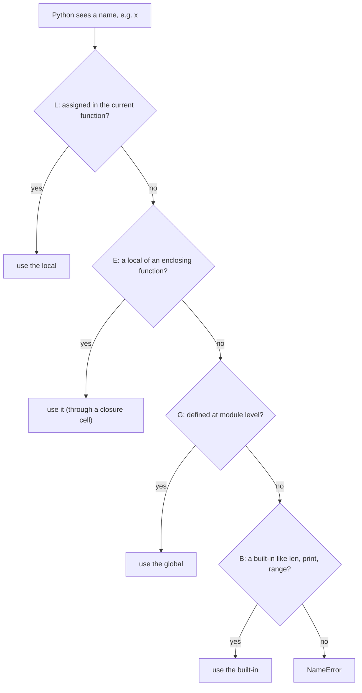
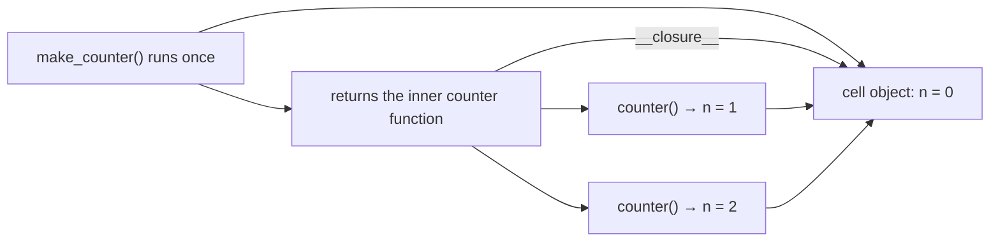

:::tip[TL;DR (30-Second Interview Pitch)]
A Python function is a **first-class object**: you can store it, pass it, return it and attach attributes to it, which is what makes callbacks, decorators and `key=` functions possible. Arguments are passed by **object reference** ("call by sharing"): a function can mutate a list you pass in but can't rebind your variable. Names resolve by **LEGB** (Local → Enclosing → Global → Built-in), and an inner function that remembers enclosing variables is a **closure**. The two classic traps both come from *when* things are evaluated: **default arguments are evaluated once, at definition time**, and **closures look up variables late, at call time**.
:::

<PriorityKey lang="Python" v="3.8" />


:::info[Where this page sits]
**Before:** [Dicts, Sets & Collections](./04-dicts-sets-collections.md): hashability matters again here, because `lru_cache` keys its cache on your arguments.
**This page:** functions as objects, every parameter kind, default values, call by sharing, scope (LEGB, `global`, `nonlocal`), closures and the late-binding trap, `lambda`, `functools`, and type hints.
**Next:** [Comprehensions, Generators & Decorators](./06-comprehensions-generators-decorators.md), which builds decorators directly on closures.
:::

## 🧭 Start Here

Functions are how you package a piece of logic under a name so it can be reused, tested and reasoned about on its own. In Python they are also **first-class objects**: a function is a value like any other, so you can store it in a variable, put it in a dict, pass it as an argument (a `key=` function for `sorted`, a callback) or return it from another function. Those last two abilities are what make closures and decorators possible, and both appear in nearly every Python interview.

A Java developer has to unlearn a few things here. There is no overloading by signature; instead one function can accept positional, keyword, default, variable-length and keyword-only parameters. Default values are computed **once**, when the `def` runs, not on every call, which produces the most famous Python bug of all. Arguments are passed by **sharing**: the function receives a new name for the caller's object, so mutations leak out but reassignments don't. And scope is decided by where a name is **assigned**, which explains the puzzling `UnboundLocalError`.

The chapters build up in this order:

1. **Defining functions and parameter kinds**: parameters vs arguments, `return`, and the legal order of the five kinds.
2. **Defaults and call by sharing**: why `history=[]` leaks state, and what "passing" really means.
3. **Scope**: the LEGB rule, `global` and `nonlocal`, and `UnboundLocalError`.
4. **Closures and late binding**: what a closure carries and why loop lambdas all see the last value.
5. **`lambda` and `functools`**: anonymous functions, `partial`, `lru_cache`, `reduce`, `wraps`, `singledispatch`.
6. **Type hints**: the syntax you'll actually use, and what hints do and don't do at run time.

| New concept | One-line meaning |
|---|---|
| **First-class function** | A function is an object you can assign, pass and return |
| **Parameter / argument** | The name in the `def` / the value passed in the call |
| **`*args` / `**kwargs`** | Collect extra positional arguments (tuple) / extra keyword arguments (dict) |
| **Call by sharing** | The parameter is a new name bound to the caller's object |
| **LEGB** | Name lookup order: Local, Enclosing, Global, Built-in |
| **Closure** | An inner function plus the enclosing variables it remembers |
| **Late binding** | A closure reads a captured variable's value when called, not when created |
| **Type hint** | An annotation that documents types; not enforced at run time |

:::analogy[A function is a recipe card]
A `def` writes a recipe card and files it under a name; nothing is cooked until someone calls it. Parameters are the blanks on the card ("___ grams of flour"), arguments are what you fill in today. Because the card is just an object, you can hand it to someone else (pass it), photocopy it with some blanks pre-filled (`partial`), or clip a note to it that it carries everywhere (a closure).
:::

## 🔴 1. Defining Functions and Parameter Kinds

A function is defined with `def name(parameters):` followed by an indented body. Functions organise code into named blocks, avoid repetition (the **DRY** principle) and make programs modular, readable and testable. The names listed in the `def` are **parameters**; the values supplied when calling are **arguments**. A function hands a result back with `return`; if it never reaches a `return`, it returns `None`. Printing a value is not the same as returning it: `print` only shows the value, while `return` gives it to the caller to use. Writing `return a, b` returns a single tuple, which the caller usually unpacks.

Python lets one function accept arguments in several ways, and each parameter **kind** has a fixed position in the signature. **Positional-only** parameters come before a `/` and can't be passed by name; **standard** parameters can be passed either way; `*args` collects any extra positional arguments into a tuple; parameters after `*` or `*args` are **keyword-only**, so the caller must name them; and `**kwargs` collects any extra keyword arguments into a dict. Any of the positional kinds can have a default value, but parameters with defaults must come after those without.

Each kind exists for a reason. Keyword-only parameters force callers to write `fit(X, y, epochs=10)` rather than an unreadable `fit(X, y, 10, 0.001, True)`. Positional-only parameters let a library rename a parameter without breaking callers. `*args` and `**kwargs` let wrappers and decorators pass arguments through to another function without knowing them in advance. The same `*` and `**` symbols also work at the call site, where they **unpack** a sequence or a dict into arguments.
| Kind | Syntax | Caller can pass | Typical use |
|---|---|---|---|
| Positional-only <Since v="3.8" lang="Python" /> | `def f(a, b, /)` | Position only | APIs where the name may change; built-ins like `len(obj, /)` |
| Standard (positional-or-keyword) | `def f(a, b)` | Either | Most parameters |
| Default | `def f(city="Tokyo")` | Can omit it | Optional settings |
| Variable positional | `def f(*args)` | Any number → **tuple** | Wrappers, `print(*values)` |
| Keyword-only | `def f(*, lr)` or after `*args` | Name only | Flags and hyperparameters that must be explicit: `fit(X, y, *, epochs=10)` |
| Variable keyword | `def f(**kwargs)` | Any number → **dict** | Passing options through to another function |

<RuleCard name="Parameter order" tag="def syntax" why="Python matches arguments to parameters left to right, so each kind must sit where it can be matched unambiguously." remember="Slash, normal, star-args, keyword, double-star.">

`def f(pos_only, /, standard, *args, kw_only, **kwargs)`. Within the positional groups, **parameters with defaults come after those without** (`def bad(a=1, b)` is a `SyntaxError`). At the **call** site, positional arguments come before keyword arguments (`f(a=1, 2)` is a `SyntaxError`).

</RuleCard>

:::tip[🎯 Interview angle]
**"What are `*args` and `**kwargs`, and in what order can parameters appear?"** `*args` collects extra positional arguments into a tuple and `**kwargs` collects extra keyword arguments into a dict. The order is positional-only, `/`, standard, `*args` (or a bare `*`), keyword-only, `**kwargs`, with defaulted parameters after non-defaulted ones. Mention that keyword-only parameters make call sites readable, and that a function without `return` returns `None`.
:::

## 🔴 2. Defaults and Call by Sharing

Default values are evaluated **once**, at the moment the `def` statement runs, and the resulting objects are stored on the function (in `__defaults__`). For an immutable default such as `0` or `"Tokyo"` that is invisible. For a **mutable** default such as `[]` or `{}`, it means every call that relies on the default receives **the same object**. If the function appends to it, the list keeps growing from call to call, and in a server, one request's data can show up in the next. The standard fix is the **`None` sentinel**: default to `None` and create a fresh object inside the function with `if history is None: history = []`. The same "evaluated once" rule freezes defaults such as `datetime.now()` at import time.

The second idea is how arguments are passed. Python is neither classic call-by-value nor call-by-reference; it uses **call by sharing**. When you call `f(lst)`, the parameter becomes a new name bound to the caller's object, with no copy made. So if the function **mutates** that object (`lst.append(1)`), the caller sees the change, because there is only one list. If the function **rebinds** the parameter (`lst = [9]`), only the local name moves; the caller's variable still points at the original object.

Put together, these two rules explain most "my list changed unexpectedly" bugs. A function that should not modify its input can make a copy first; a function that needs to produce a new value should `return` it, because there is no way for a function to rebind the caller's variable.

:::tip[🎯 Interview angle]
**"Why is `def f(history=[])` a bug, and does Python pass by value or by reference?"** Defaults are evaluated once at `def` time, so a mutable default is shared by every call that uses it; default to `None` and create the list inside. Python passes references by value (call by sharing): mutations of the passed object are visible to the caller, rebinding the parameter is not.
:::

## 🔴 3. Scope: LEGB, `global` and `nonlocal`

When Python meets a name, it looks it up in four places in a fixed order, summarised as **LEGB**: the **L**ocal scope of the current function, then the scopes of any **E**nclosing functions, then the **G**lobal (module) scope, and finally the **B**uilt-ins such as `len` and `print`. The first place that defines the name wins, and if none does, Python raises `NameError`.

The subtle part is *how* Python decides that a name is local. It doesn't wait until run time: when compiling a function, it scans the body, and **any assignment to a name anywhere in the function makes that name local for the whole function**. So if a function reads `count` and later does `count += 1`, the read happens before the local has a value and raises `UnboundLocalError`, even though a global `count` exists. Scope is decided at compile time; values are looked up at run time.

To **rebind** an outer name from inside a function you must declare it. `global x` binds to the module-level `x`, and `nonlocal x` binds to the `x` of the nearest enclosing function, which is how closures keep mutable state such as counters. Neither declaration is needed just to **read** an outer name, or to **mutate** an outer list or dict in place, because neither of those is an assignment to the name.


- **Scope is decided at compile time** by looking at assignments; **values are looked up at run time**. That one sentence explains both `UnboundLocalError` and late binding.

:::analogy[LEGB is looking for your keys]
First you check your pockets (local), then the room you're in (enclosing), then the house (global), and finally the lost-and-found at the building entrance (built-ins). You stop at the first place that has keys, even if a better set is waiting in the next place. And if you announce "my keys are in my pocket" (an assignment anywhere in the function), Python only ever checks the pocket.
:::

| | `global x` | `nonlocal x` |
|---|---|---|
| Rebinds | The **module-level** `x` | The `x` of the **nearest enclosing function** |
| Needed when | Assigning to a module variable inside a function | Assigning to an enclosing variable inside a nested function (counters, closures with state) |
| Not needed for | **Reading** a global, or **mutating** it (`config["lr"] = 1`) | Reading, or mutating a list/dict in the enclosing scope |
| Smell? | Usually: prefer passing values or a class | Fine in small closures; use a class when state grows |

:::tip[🎯 Interview angle]
**"Why does this function raise `UnboundLocalError` when the global exists?"** Because the function assigns to that name somewhere, the compiler treats it as local everywhere in the function, so the read happens before the local is bound. Explain LEGB, then the fix: `global` for a module variable or `nonlocal` for an enclosing function's variable, or better, pass the value in and return the result.
:::

## 🔴 4. Closures and Late Binding

A **closure** is an inner function that uses variables from the function that created it, together with those variables. When `make_counter()` defines an inner `counter()` that uses `n`, and then returns `counter`, the outer function has finished but `n` must survive. Python keeps it alive in a **cell object** shared by the outer and inner functions, attached to the returned function as `__closure__`. Each call to `make_counter()` creates a fresh cell, so each counter keeps its own state. Closures are how Python builds function factories, callbacks with configuration, and decorators.

A closure captures the **variable**, not its value at the time of capture. The inner function reads the cell **when it is called**. This is **late binding**, and it causes a classic bug: creating functions in a loop, such as `[lambda x: x + i for i in range(3)]`, gives three functions that all share the one loop variable, so by the time they run, `i` holds its final value and every function uses it.

The fix is to capture the current value at creation time. The common idiom is a default argument, `lambda x, i=i: x + i`, which works precisely because defaults are evaluated once when the function is created (the rule from chapter 2, used deliberately). `functools.partial` achieves the same thing more explicitly.


<Animation src="python/late-binding" caption="All three lambdas share one cell for the loop variable i. They read it only when called, after the loop has finished and i is 2, so every call returns 10 + 2. Binding i as a default argument copies its value at creation time instead." />

:::tip[🎯 Interview angle]
**"What's a closure, and why do lambdas created in a loop all return the same value?"** A closure is an inner function plus the enclosing variables it uses, kept alive in cell objects. Closures read those variables when called (late binding), so loop-created lambdas share the loop variable and see its last value. Fix it by binding the current value with a default argument (`i=i`) or `functools.partial`.
:::

## 🟠 5. `lambda` and `functools`

A **`lambda`** is an anonymous function whose body is a single expression: `lambda row: row["score"]`. It can't contain statements, annotations or a docstring, and it shows up as `<lambda>` in tracebacks. That makes it ideal for short, throwaway functions passed straight into another call, especially `key=` for `sorted`, `min` and `max`. For anything you would name and reuse, write a `def`; style guides discourage assigning a lambda to a variable. The related built-ins `map` and `filter` apply a function lazily and return **single-use iterators**, so they can be consumed only once.

The `functools` module collects tools that operate on functions. `partial` creates a new function with some arguments already filled in. `lru_cache` (and its unbounded sibling `cache`) **memoizes** a function by remembering results keyed on the arguments, which turns naive recursive algorithms into fast ones, provided the arguments are hashable. `reduce` folds a sequence into one value, `wraps` copies a function's name and docstring onto a wrapper (essential for decorators), and `singledispatch` picks an implementation based on the type of the first argument.
| | `lambda` | `def` |
|---|---|---|
| Body | **One expression** (no statements, no annotations) | Any statements |
| Name | `<lambda>` in tracebacks | Its real name |
| Docstring / type hints | ❌ | ✅ |
| Best for | `key=` functions, tiny callbacks | Everything else; PEP 8 discourages `f = lambda x: ...` |

| Tool | Does | Example | Watch out |
|---|---|---|---|
| `partial(fn, **fixed)` | New function with some arguments pre-filled | `fast = partial(train, lr=1e-3, epochs=1)` | |
| `lru_cache(maxsize=128)` / `cache` | Memoizes results by arguments | `fib(100)` instantly | Arguments must be **hashable**; the cache holds **strong references** (memory) |
| `reduce(fn, iterable, init)` | Folds a sequence to one value | Product of a list | Often clearer as a loop, `sum`, or `math.prod` |
| `wraps(fn)` | Copies `__name__`, `__doc__` to a wrapper | Used in every decorator | See [Generators & Decorators](./06-comprehensions-generators-decorators.md) |
| `singledispatch` | Overload a function on the first argument's type | `to_json(x)` for several types | |

:::tip[🎯 Interview angle]
**"When would you use a `lambda`, and what does `lru_cache` require?"** Use a lambda for tiny single-expression functions passed inline, typically `key=` in `sorted`, `min` or `max`; use `def` for anything named, multi-line or documented. `lru_cache` memoizes by arguments, so they must be hashable, and the cache holds strong references, which keeps objects (including `self` on a method) alive.
:::

## 🟡 6. Type Hints

Type hints annotate what a function expects and returns: `def scale(x: float, factor: int = 2) -> float`. They are a form of documentation that tools can read. Crucially, **Python does not enforce them at run time**: calling a function with the wrong types simply runs, and only fails if the operations inside don't work for those types. Static checkers such as mypy and pyright enforce hints before the code runs, and libraries such as pydantic validate data at run time when you ask them to.

In AI engineering, type hints have become more than documentation. LLM tool-calling SDKs and frameworks read a function's signature, hints and docstring to build the JSON schema that tells the model how to call it, so a precise signature directly improves tool calls. The syntax has also become much lighter over recent versions: built-in generics such as `list[int]`, `X | None` for optional values, and dedicated syntax for generic functions and type aliases.
| Hint | Meaning | Since |
|---|---|---|
| `list[float]`, `dict[str, int]`, `tuple[int, ...]` | Built-in generics | 3.9 |
| `int \| None` | Optional value | 3.10 (`Optional[int]` before) |
| `Callable[[float], float]` | A function taking a float, returning a float | |
| `Literal["c", "f"]` | Only these exact values | 3.8 |
| `TypedDict` | A dict with known keys and value types (LLM messages, JSON payloads) | 3.8 |
| `def first[T](xs: list[T]) -> T` | Generic function, new syntax | 3.12 |
| `type Vector = list[float]` | Type alias statement | 3.12 |

- Since **3.14** annotations are **evaluated lazily** (PEP 649): they're computed only when something asks for them (`__annotations__`, `typing.get_type_hints`), which removes most forward-reference headaches and speeds up import.

:::tip[🎯 Interview angle]
**"Are type hints enforced in Python?"** No. They are ignored at run time; static checkers (mypy, pyright) enforce them before running, and pydantic can validate at run time. Mention the modern syntax (`list[int]`, `int | None`) and that LLM tool-calling SDKs build tool schemas from your function's hints, so good hints matter in AI code.
:::

## ⚙️ Going Deeper (CPython Internals)

- **`def` is an executable statement**: it builds a **function object** at run time from a precompiled **code object** (`fn.__code__`), the current globals, the evaluated **defaults** (`fn.__defaults__`, `fn.__kwdefaults__`) and the **closure cells**. That's precisely why defaults are evaluated once.
- **Locals live in a fixed-size array** in the frame, indexed by position (`LOAD_FAST`), which is faster than the dict lookups used for globals (`LOAD_GLOBAL`). The compiler decides which names are local by scanning for assignments, so a single `count += 1` anywhere makes `count` local everywhere in that function.
- **Closures use cell objects**: a variable captured by an inner function is stored in a `cell` instead of the frame's array (`LOAD_DEREF`). The outer and inner functions share that cell, so the inner function sees the **latest** value: that's late binding. `fn.__code__.co_freevars` lists the captured names.
- **A call allocates a frame**; since 3.11 frames are allocated lazily in a per-thread stack area and Python-to-Python calls avoid the C stack, which made calls noticeably cheaper. Still, a Python function call costs tens of nanoseconds, which adds up in per-element loops.
- **No tail-call optimization**: each recursive call keeps its frame. The limit (`sys.getrecursionlimit()` → 1000) protects the C stack; raising it with `sys.setrecursionlimit` can crash the process with a segfault instead of raising `RecursionError`.
- **`lru_cache`** stores results in a dict keyed by the arguments (that's why they must be hashable) plus a doubly linked list for LRU eviction. On a **method** it keys on `self` too, keeping every instance alive as long as the cache lives.

:::danger[Interview Trap]
**"Python passes objects by reference" is only half true.** Python passes **references by value** (call by sharing). Inside the function, `lst.append(1)` changes the caller's list, but `lst = [9]` only rebinds the local name. There is no way for a function to rebind the caller's variable, which is why you `return` new values instead.
:::

:::danger[Interview Trap]
**`map` and `filter` objects can be consumed only once.** `m = map(str.upper, ["a", "b"])`, then `list(m)` gives `['A', 'B']` and a second `list(m)` gives `[]`. Code that checks `len(list(m))` and then loops over `m` silently processes nothing.
:::

## 💻 Python Implementation

:::tip[Run it yourself]
Every snippet runs in the `python` REPL or a notebook. Output comments come from a run on **CPython 3.14**.
:::

### 1. Defining, calling, returning

```python showLineNumbers
def greet():
    """Print a greeting."""
    print("Hello, how are you?")

result = greet()                              # Hello, how are you?
# highlight-next-line
print(result)                                 # None: no return statement

def stats(xs):
    return min(xs), max(xs), sum(xs) / len(xs)   # one tuple

lo, hi, mean = stats([2, 4, 9])               # unpacking
print(lo, hi, mean)                           # 2 9 5.0
```

### 2. Required, default, keyword, `*args`, `**kwargs`

```python showLineNumbers
def required_example(name):
    print(name)

def default_example(city="Tokyo"):
    print(city)

default_example()                             # Tokyo
default_example("Toronto")                    # Toronto

def student_info(name, age):
    print(name, age)

student_info(age=24, name="Alex")             # Alex 24: keywords can be in any order
# error-next-line
student_info("Alex")                          # ❌ TypeError: student_info() missing 1 required positional argument: 'age'

def many_args(*args):
    print(args)
many_args(1, 2, 3, "Python")                  # (1, 2, 3, 'Python'): a TUPLE

def many_kwargs(**kwargs):
    print(kwargs)
many_kwargs(name="Alex", age=24)              # {'name': 'Alex', 'age': 24}: a DICT

def f(a, *args, b=2, **kw):                   # b is keyword-only (it comes after *args)
    print(a, args, b, kw)
f(1, 2, 3, b=4, c=5)                          # 1 (2, 3) 4 {'c': 5}
```

### 3. Positional-only and keyword-only

```python showLineNumbers
def g(pos_only, /, standard, *, kw_only):
    return pos_only, standard, kw_only

print(g(1, 2, kw_only=3))                     # (1, 2, 3)
print(g(1, standard=2, kw_only=3))            # (1, 2, 3)
# error-start
g(pos_only=1, standard=2, kw_only=3)          # ❌ TypeError: ... positional-only arguments passed as keyword arguments: 'pos_only'
g(1, 2, 3)                                    # ❌ TypeError: g() takes 2 positional arguments but 3 were given
# error-end
```

```python title="Why ML APIs use keyword-only arguments" showLineNumbers
def fit(X, y, *, epochs=10, lr=1e-3, batch_size=32):
    ...

fit(X, y, epochs=5)                           # ✅ readable
# error-next-line
fit(X, y, 5, 0.01)                            # ❌ TypeError: is 5 epochs or batch size? The API refuses to guess
```

### 4. Unpacking arguments at the call site

```python showLineNumbers
def add(x, y, z):
    return x + y + z

nums = [1, 2, 3]
cfg = {"x": 1, "y": 2, "z": 3}
print(add(*nums))                             # 6: * spreads a sequence into positionals
print(add(**cfg))                             # 6: ** spreads a dict into keywords

def forward_to_model(*args, **kwargs):        # the "pass everything through" pattern
    return add(*args, **kwargs)
```

### 5. The mutable default argument

```python title="❌ Shared default list" showLineNumbers
def add_metric(val, history=[]):
    history.append(val)
    return history

print(add_metric(0.8))                        # [0.8]
# error-next-line
print(add_metric(0.9))                        # [0.8, 0.9]: the SAME list as last time
print(add_metric.__defaults__)                # ([0.8, 0.9],): it lives on the function object
```

```python showLineNumbers
def add_metric_safe(val, history=None):
    # success-start
    if history is None:
        history = []                          # ✅ a fresh list on every call
    # success-end
    history.append(val)
    return history

print(add_metric_safe(0.8), add_metric_safe(0.9))   # [0.8] [0.9]
```

<Animation src="python/mutable-default" caption="The default list is created once, when def runs, and stored on the function. Every call that omits history appends to that same stored list, so it keeps growing across calls." />

:::analogy[A mutable default is the office's shared notepad]
A default argument is like the notepad that comes with a desk. With `history=[]`, every person who sits at the desk without bringing their own pad writes on the same one, and the next person sees all the earlier notes. `history=None` means "if you didn't bring a pad, take a fresh one from the drawer".
:::

### 6. Scope: LEGB, `global`, `nonlocal`

```python showLineNumbers
x = "global"

def outer():
    x = "enclosing"
    def inner():
        print(x)                              # not local → found in the Enclosing scope
    inner()

outer()                                       # enclosing
```

```python title="❌ UnboundLocalError" showLineNumbers
count = 0

def increment():
    # error-next-line
    count += 1                                # ❌ UnboundLocalError: cannot access local variable 'count' ...

increment()
```

```python showLineNumbers
count = 0

def increment_global():
    # success-next-line
    global count                              # ✅ rebind the module-level name
    count += 1

def make_counter():
    n = 0
    def counter():
        # success-next-line
        nonlocal n                            # ✅ rebind the enclosing function's name
        n += 1
        return n
    return counter

c1 = make_counter()
c1(); c1()
print(c1(), make_counter()())                 # 3 1: each call to make_counter has its own n
print(c1.__closure__[0].cell_contents)        # 3: the captured cell
```

### 7. Closures as factories

```python showLineNumbers
def make_multiplier(k):
    def mult(x):
        return x * k                          # k is captured from the enclosing scope
    return mult

double = make_multiplier(2)
triple = make_multiplier(3)
print(double(5), triple(5))                   # 10 15

def make_lr_schedule(base_lr, decay):
    def lr_at(epoch):
        return base_lr * decay ** epoch       # a closure is a tiny stateful object
    return lr_at
```

### 8. The late-binding closure trap

```python showLineNumbers
# error-next-line
funcs = [lambda x: x + i for i in range(3)]
print([f(10) for f in funcs])                 # [12, 12, 12]: every lambda reads i AFTER the loop

# success-start
funcs = [lambda x, i=i: x + i for i in range(3)]          # default captures the CURRENT i
print([f(10) for f in funcs])                 # [10, 11, 12]

from functools import partial
funcs = [partial(lambda x, i: x + i, i=i) for i in range(3)]
print([f(10) for f in funcs])                 # [10, 11, 12]
# success-end
```

### 9. Call by sharing

```python showLineNumbers
def modify(lst):
    lst.append(1)                             # mutates the caller's list
    # highlight-next-line
    lst = [9]                                 # rebinds the LOCAL name only
    lst.append(2)

nums = [0]
modify(nums)
print(nums)                                   # [0, 1]
```

### 10. `lambda`, `map`, `filter`, `sorted(key=...)`

```python showLineNumbers
square = lambda n: n ** 2
print(square(4))                              # 16

pixels = [0, 64, 128, 255]
print(list(map(lambda p: round(p / 255, 2), pixels)))           # [0.0, 0.25, 0.5, 1.0]
print(list(filter(lambda w: len(w) > 2, ["a", "the", "neural"])))   # ['the', 'neural']

models = ["bert", "gpt", "t5", "llama"]
# highlight-next-line
print(sorted(models, key=len))                # ['t5', 'gpt', 'bert', 'llama']

activations = {"relu": lambda x: max(0.0, x), "identity": lambda x: x}   # dispatch table
print(activations["relu"](-2.5))              # 0.0
```

### 11. Memoization and partial application

```python showLineNumbers
from functools import lru_cache, partial

@lru_cache(maxsize=None)
def fib(n):
    return n if n < 2 else fib(n - 1) + fib(n - 2)

print(fib(100))                               # 354224848179261915075
print(fib.cache_info())                       # CacheInfo(hits=98, misses=101, maxsize=None, currsize=101)
# fib(27) without the cache took 28 ms; with it, 40 µs

@lru_cache
def embed(tokens):
    return len(tokens)

# error-next-line
embed(["a", "b"])                             # ❌ TypeError: unhashable type: 'list'
# success-next-line
embed(("a", "b"))                             # ✅ pass a tuple

def train(model, lr, epochs):
    return f"{model} lr={lr} epochs={epochs}"

smoke_test = partial(train, lr=1e-3, epochs=1)
print(smoke_test("bert"))                     # bert lr=0.001 epochs=1
```

### 12. Type hints and LLM tool schemas

```python showLineNumbers
from typing import Literal, TypedDict

def scale(xs: list[float], factor: float = 2.0) -> list[float]:
    return [x * factor for x in xs]

# error-next-line
print(scale(["ab", "c"], 2))                  # ['abab', 'cc']: hints are NOT checked at run time

class Message(TypedDict):
    role: Literal["system", "user", "assistant"]
    content: str

def first[T](items: list[T]) -> T:            # 3.12 generic syntax
    return items[0]

def get_weather(city: str, unit: Literal["c", "f"] = "c") -> str:
    """Return the current weather for a city."""
    return f"{city}: 31{unit}"
```

:::info[AI Engineering: your signature is the tool schema]
Agent frameworks and the OpenAI / Anthropic SDK helpers turn a function like `get_weather` into a **JSON schema** for the model: the parameter names, the types from the hints (`Literal["c", "f"]` becomes an `enum`), which parameters are required (no default) and the docstring as the description. Precise hints and docstrings directly improve how reliably the model calls your tool. Validate the arguments the model sends back (pydantic does this) because the model can still produce wrong types.
:::

## 🧪 Predict the Output

<Predict n="1" title="Default list" output="[0.8] then [0.8, 0.9]">

```python
def add_metric(val, history=[]):
    history.append(val)
    return history

print(add_metric(0.8))
print(add_metric(0.9))
```

The default list is created once, when `def` runs, and stored in `add_metric.__defaults__`. Both calls append to that single list. The fix is `history=None` plus `if history is None: history = []`.

</Predict>

<Predict n="2" title="Late binding" output="[12, 12, 12]">

```python
funcs = [lambda x: x + i for i in range(3)]
print([f(10) for f in funcs])
```

Each lambda captures the **variable** `i` (one shared cell), not its value at creation time. By the time the lambdas run, the loop has finished and `i` is 2, so each returns `10 + 2`. Bind the current value with a default argument (`lambda x, i=i: x + i`) or `functools.partial`.

</Predict>

<Predict n="3" title="Reading before assigning" output="UnboundLocalError">

```python
count = 0
def increment():
    print(count)
    count = 1
increment()
```

Because `count` is **assigned** somewhere in `increment`, the compiler makes it **local for the whole function**. The `print` runs before the local has a value, so Python raises `UnboundLocalError: cannot access local variable 'count' where it is not associated with a value`, even though a global `count` exists.

</Predict>

<Predict n="4" title="Mutate, then rebind" output="[0, 1]">

```python
def modify(lst):
    lst.append(1)
    lst = [9]
    lst.append(2)

nums = [0]
modify(nums)
print(nums)
```

`lst` starts as a second name for the caller's list, so `append(1)` changes it. `lst = [9]` rebinds only the local name to a new list; `append(2)` changes that new list, which is thrown away when the function returns.

</Predict>

<Predict n="5" title="Where do the arguments go?" output="1 (2, 3) 4 {'c': 5}">

```python
def f(a, *args, b=2, **kw):
    print(a, args, b, kw)

f(1, 2, 3, b=4, c=5)
```

`1` fills `a`; the remaining positionals `2, 3` go into the tuple `args`. `b` comes after `*args`, so it's **keyword-only** and receives `4`. The unknown keyword `c=5` lands in the dict `kw`.

</Predict>

<Predict n="6" title="Using a map twice" output="['A', 'B'] []">

```python
m = map(str.upper, ["a", "b"])
print(list(m), list(m))
```

`map` returns a lazy **iterator**, not a list. The first `list(m)` consumes it; the second finds it exhausted and returns `[]`. Wrap it in `list(...)` once if you need to traverse the results more than once.

</Predict>

<Predict n="7" title="Frozen timestamp" output="True">

```python
import time
def stamp(t=time.time()):
    return t

first = stamp()
time.sleep(0.01)
print(first == stamp())
```

`time.time()` ran once, when the function was defined, and that number became the default. Every later call returns the same timestamp. Use `t=None` and compute `time.time()` inside.

</Predict>

## 🪜 Follow-up Ladder

<Ladder title="From closures to memory leaks">
<Rung q="What is a closure?">

A function that remembers variables from the scope where it was **defined**, even after that scope has finished. Python stores the captured variables in **cell objects** referenced from `fn.__closure__`.

</Rung>
<Rung q="Why do closures created in a loop all see the last value?">

They capture the **variable** (the cell), not its value, and they read it when **called**. After the loop the cell holds the final value. Bind the current value with a default argument or `partial`.

</Rung>
<Rung q="How is a closure different from a class with one method?">

They're interchangeable for small state (a counter, a configured scorer). A closure is lighter; a class is better when you need several methods, inspection, pickling (closures and lambdas can't be pickled, which matters for multiprocessing and `DataLoader` workers) or many fields.

</Rung>
<Rung q="What does functools.lru_cache do, and when is it dangerous?">

It memoizes results in a dict keyed by the (hashable) arguments, evicting the least recently used entries beyond `maxsize`. It's dangerous when the cache keeps **large objects** alive (tensors, DataFrames, model outputs), when it's unbounded (`maxsize=None` on a function called with ever-new inputs), and on **methods**, where it holds a strong reference to every `self` it has seen.

</Rung>
<Rung q="How would you cache expensive LLM embedding calls in a service?">

Key the cache on a **stable hash of the normalized input text plus the model name** (`hashlib.sha256`), store results in a bounded or external cache (Redis, a vector store, `diskcache`) with a TTL, and never use `lru_cache` on raw request objects. Bound the size, monitor the hit rate, and invalidate when the embedding model changes.

</Rung>
</Ladder>

## 🚑 Production Scenarios

:::incident[One customer saw another customer's conversation]
A chatbot API built the prompt from the conversation so far. Under load, users started seeing fragments of other people's messages in their answers.

- **Code:** `def build_prompt(message, history=[]): history.append(message); return "\n".join(history)`, called with no `history` for new conversations.
- **Why:** the default list was created once at import time and shared by every request that omitted `history`, so the "empty" history accumulated messages from all users: a **data leak**, not just a bug.
- **Fix:** `history: list[str] | None = None` with `history = [] if history is None else list(history)`, and keep conversation state in a per-session store, never in module-level objects.
- **Prevention:** enable the linter rule for mutable defaults (Ruff **B006**, from flake8-bugbear) in CI.
:::

:::incident[Memory grew until the inference pod was OOM-killed]
A feature-extraction function was decorated with `@lru_cache(maxsize=None)` to avoid recomputing embeddings for repeated inputs.

- **Why:** every unique input text and its embedding tensor stayed in the cache **forever**. With mostly unique production traffic, the hit rate was near zero and memory grew linearly until Kubernetes killed the pod.
- **Fix:** a bounded cache (`maxsize=10_000`) keyed by a hash of the text, or an external cache with a TTL; monitor `cache_info()` hit rate and drop the cache if it doesn't pay for itself.
:::

## 🚨 Interview Gotchas & Edge Cases

:::warning[The Most Common Question]
**"What are `*args` and `**kwargs`?"** In a definition, `*args` collects extra **positional** arguments into a **tuple** and `**kwargs` collects extra **keyword** arguments into a **dict**; the names are convention, the stars are the syntax. At a call site, `*` and `**` do the reverse: they **unpack** a sequence into positional arguments and a dict into keyword arguments. The usual follow-ups: the parameter order (`/`, normal, `*args`, keyword-only, `**kwargs`), why parameters after `*args` are keyword-only, and how decorators use `*args, **kwargs` to wrap any function.
:::

- **`return` inside `try` with `finally`**: the `finally` block always runs, and a `return` in `finally` overrides the earlier one (3.14 warns about it). See [Exceptions, Files & Context Managers](./08-exceptions-files-context-managers.md).
- **Default arguments are shared across instances too**: `def __init__(self, layers=[])` makes every model instance share one list of layers.
- **`global` doesn't create shared state between processes**: each `multiprocessing` / `DataLoader` worker gets its own copy of module globals.
- **Lambdas can't be pickled**: `multiprocessing.Pool.map(lambda x: ..., data)` fails with a pickling error. Use a module-level `def` (or `partial` of one).
- **Shadowing built-ins**: naming a variable `list`, `dict`, `id`, `input`, `sum` or `max` hides the built-in for the rest of that scope, and the error shows up much later (`TypeError: 'list' object is not callable`).
- **Recursion depth**: a recursive tree or graph walk on real data (deep JSON, long linked chains) can hit the 1000-frame limit. Convert it to an explicit stack (a list) instead of raising the limit.
- **Keyword arguments cost a little more** than positional ones, which only matters in very hot loops; readability wins everywhere else.

## ⚡ Essential Interview Recall

A one-screen revision list. Every point is explained in the chapters above.

- 🔴 Functions help **organize** code into blocks, avoid repetition (**DRY**), and make code **modular, reusable, readable and testable**.
- 🔴 **Parameters** are the names in the `def`; **arguments** are the values passed in the call.
- 🔴 **`print` shows** a value; **`return` hands it back** to the caller. A function without `return` returns **`None`**. `return a, b` returns **one tuple**.
- 🔴 Parameter kinds, in order: **positional-only** (before `/`) → **standard** → **`*args`** (extra positionals as a **tuple**) → **keyword-only** (after `*` or `*args`) → **`**kwargs`** (extra keywords as a **dict**).
- 🔴 **Defaults are evaluated ONCE, when `def` runs.** A mutable default (`history=[]`) is shared across calls. Use `None` and create the object inside.
- 🔴 **LEGB** lookup: Local → Enclosing → Global (module) → Built-in.
- 🔴 **Assigning to a name anywhere in a function makes it local** for the whole function → reading it before the assignment raises **`UnboundLocalError`**. Use `global` (module level) or `nonlocal` (enclosing function) to rebind outer names.
- 🔴 **Call by sharing**: the parameter is a new name for the caller's object. Mutations are visible to the caller; reassignment is not.
- 🔴 **Closure** = inner function + the enclosing variables it uses (stored in **cell objects**, `fn.__closure__`).
- 🔴 **Late binding**: closures read the variable's value **when called**, so `[lambda x: x + i for i in range(3)]` all use the last `i` → fix with `i=i` or `functools.partial`.
- 🟠 **`lambda`** = an anonymous **single-expression** function; ideal for `key=` in `sorted`/`max`/`min`. `map`/`filter` return **lazy, single-use iterators**.
- 🟠 **`functools`**: `partial` (pre-fill arguments), `lru_cache` / `cache` (memoize; arguments must be **hashable**), `reduce`, `wraps` (for decorators).
- 🟠 **No tail-call optimization**; default recursion limit **1000** → `RecursionError`. Prefer iteration for deep recursion.
- 🟡 **Type hints are not enforced at run time**: `scale(["ab"], 2)` happily returns `['abab']`. Checkers (mypy, pyright) enforce them statically; **pydantic** validates at run time; LLM tool-calling SDKs build JSON schemas from them.
- 🟡 Modern hint syntax: `list[int]` <Since v="3.9" lang="Python" />, `int | None` <Since v="3.10" lang="Python" />, generic functions `def first[T](xs: list[T]) -> T` and `type Vector = list[float]` <Since v="3.12" lang="Python" />.

:::speak[Why is a mutable default argument a bug?]
"Because default values are evaluated **once, when the `def` statement runs**, not each time the function is called. The resulting object is stored on the function in `__defaults__`. If the default is a list and the function appends to it, every call that relies on the default appends to **that same list**, so state leaks from one call to the next. With `def add_metric(val, history=[])`, the first call returns `[0.8]` and the second returns `[0.8, 0.9]`. In a web service that's worse than a bug: one user's chat history can show up in another user's request. The fix is the **`None` sentinel**: default to `None` and create a fresh list inside, `if history is None: history = []`. The same 'evaluated once' rule bites with defaults like `datetime.now()`, which is frozen at import time."
:::
