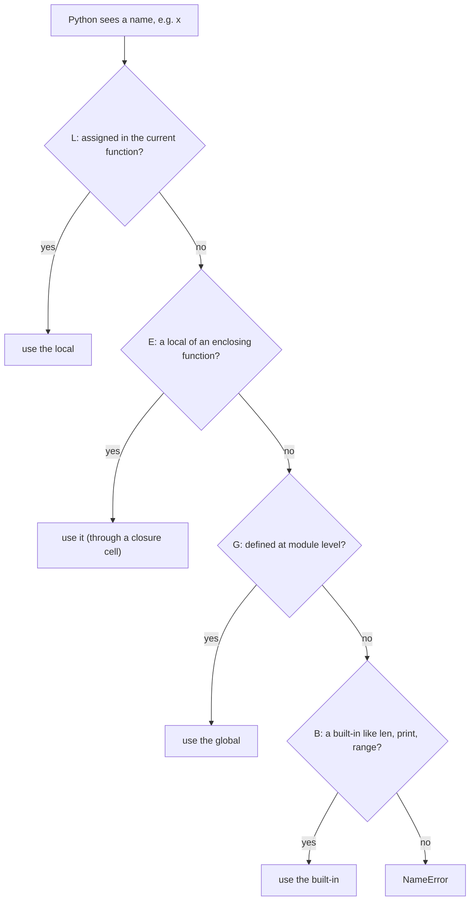
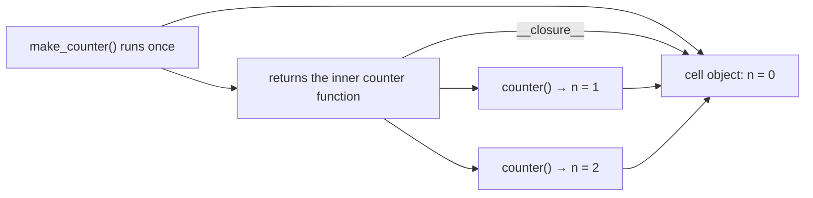

:::tip[TL;DR (30-Second Interview Pitch)]
A Python function is a **first-class object**: you can store it, pass it, return it and attach attributes to it, which is what makes callbacks, decorators and `key=` functions possible. Arguments are passed by **object reference** ("call by sharing"): a function can mutate a list you pass in but can't rebind your variable. Names resolve by **LEGB** (Local → Enclosing → Global → Built-in), and an inner function that remembers enclosing variables is a **closure**. The two classic traps both come from *when* things are evaluated: **default arguments are evaluated once, at definition time**, and **closures look up variables late, at call time**.
:::

<PriorityKey lang="Python" v="3.8" />

## ⚡ Essential Interview Recall

- 🔴 Functions help **organize** code into blocks, avoid repetition (**DRY**), and make code **modular, reusable, readable and testable**.
- 🔴 **Parameters** are the names in the `def`; **arguments** are the values passed in the call.
- 🔴 **`print` shows** a value; **`return` hands it back** to the caller. A function without `return` returns **`None`**. `return a, b` returns **one tuple**.
- 🔴 Parameter kinds, in order: **positional-only** (before `/`) → **standard** → **`*args`** (extra positionals as a **tuple**) → **keyword-only** (after `*` or `*args`) → **`**kwargs`** (extra keywords as a **dict**).
- 🔴 **Defaults are evaluated ONCE, when `def` runs.** A mutable default (`history=[]`) is shared across calls. Use `None` and create the object inside.
- 🔴 **LEGB** lookup: Local → Enclosing → Global (module) → Built-in.
- 🔴 **Assigning to a name anywhere in a function makes it local** for the whole function → reading it before the assignment raises **`UnboundLocalError`**. Use `global` (module level) or `nonlocal` (enclosing function) to rebind outer names.
- 🔴 **Call by sharing**: the parameter is a new name for the caller's object. Mutations are visible to the caller; reassignment is not.
- 🔴 **Closure** = inner function + the enclosing variables it uses (stored in **cell objects**, `fn.__closure__`).
- 🔴 **Late binding**: closures read the variable's value **when called**, so `[lambda x: x + i for i in range(3)]` all use the last `i` → fix with `i=i` or `functools.partial`.
- 🟠 **`lambda`** = an anonymous **single-expression** function; ideal for `key=` in `sorted`/`max`/`min`. `map`/`filter` return **lazy, single-use iterators**.
- 🟠 **`functools`**: `partial` (pre-fill arguments), `lru_cache` / `cache` (memoize; arguments must be **hashable**), `reduce`, `wraps` (for decorators).
- 🟠 **No tail-call optimization**; default recursion limit **1000** → `RecursionError`. Prefer iteration for deep recursion.
- 🟡 **Type hints are not enforced at run time**: `scale(["ab"], 2)` happily returns `['abab']`. Checkers (mypy, pyright) enforce them statically; **pydantic** validates at run time; LLM tool-calling SDKs build JSON schemas from them.
- 🟡 Modern hint syntax: `list[int]` <Since v="3.9" lang="Python" />, `int | None` <Since v="3.10" lang="Python" />, generic functions `def first[T](xs: list[T]) -> T` and `type Vector = list[float]` <Since v="3.12" lang="Python" />.

:::speak[Why is a mutable default argument a bug?]
"Because default values are evaluated **once, when the `def` statement runs**, not each time the function is called. The resulting object is stored on the function in `__defaults__`. If the default is a list and the function appends to it, every call that relies on the default appends to **that same list**, so state leaks from one call to the next. With `def add_metric(val, history=[])`, the first call returns `[0.8]` and the second returns `[0.8, 0.9]`. In a web service that's worse than a bug: one user's chat history can show up in another user's request. The fix is the **`None` sentinel**: default to `None` and create a fresh list inside, `if history is None: history = []`. The same 'evaluated once' rule bites with defaults like `datetime.now()`, which is frozen at import time."
:::

## The Mental Model

### 1. LEGB name resolution



- **Scope is decided at compile time** by looking at assignments; **values are looked up at run time**. That one sentence explains both `UnboundLocalError` and late binding.

:::analogy[LEGB is looking for your keys]
First you check your pockets (local), then the room you're in (enclosing), then the house (global), and finally the lost-and-found at the building entrance (built-ins). You stop at the first place that has keys, even if a better set is waiting in the next place. And if you announce "my keys are in my pocket" (an assignment anywhere in the function), Python only ever checks the pocket.
:::

### 2. What a closure carries



<Animation src="python/late-binding" caption="All three lambdas share one cell for the loop variable i. They read it only when called, after the loop has finished and i is 2, so every call returns 10 + 2. Binding i as a default argument copies its value at creation time instead." />

## The Paradigm / Core Concepts

### 🔴 Parameter kinds

| Kind | Syntax | Caller can pass | Typical use |
|---|---|---|---|
| Positional-only <Since v="3.8" lang="Python" /> | `def f(a, b, /)` | Position only | APIs where the name may change; built-ins like `len(obj, /)` |
| Standard (positional-or-keyword) | `def f(a, b)` | Either | Most parameters |
| Default | `def f(city="Tokyo")` | Can omit it | Optional settings |
| Variable positional | `def f(*args)` | Any number → **tuple** | Wrappers, `print(*values)` |
| Keyword-only | `def f(*, lr)` or after `*args` | Name only | Flags and hyperparameters that must be explicit: `fit(X, y, *, epochs=10)` |
| Variable keyword | `def f(**kwargs)` | Any number → **dict** | Passing options through to another function |

<RuleCard name="Parameter order" tag="def syntax" why="Python matches arguments to parameters left to right, so each kind must sit where it can be matched unambiguously." remember="Slash, normal, star-args, keyword, double-star.">

`def f(pos_only, /, standard, *args, kw_only, **kwargs)`. Within the positional groups, **parameters with defaults come after those without** (`def bad(a=1, b)` is a `SyntaxError`). At the **call** site, positional arguments come before keyword arguments (`f(a=1, 2)` is a `SyntaxError`).

</RuleCard>

### 🔴 `global` vs `nonlocal`

| | `global x` | `nonlocal x` |
|---|---|---|
| Rebinds | The **module-level** `x` | The `x` of the **nearest enclosing function** |
| Needed when | Assigning to a module variable inside a function | Assigning to an enclosing variable inside a nested function (counters, closures with state) |
| Not needed for | **Reading** a global, or **mutating** it (`config["lr"] = 1`) | Reading, or mutating a list/dict in the enclosing scope |
| Smell? | Usually: prefer passing values or a class | Fine in small closures; use a class when state grows |

### 🟠 `lambda` vs `def`

| | `lambda` | `def` |
|---|---|---|
| Body | **One expression** (no statements, no annotations) | Any statements |
| Name | `<lambda>` in tracebacks | Its real name |
| Docstring / type hints | ❌ | ✅ |
| Best for | `key=` functions, tiny callbacks | Everything else; PEP 8 discourages `f = lambda x: ...` |

### 🟠 `functools` essentials

| Tool | Does | Example | Watch out |
|---|---|---|---|
| `partial(fn, **fixed)` | New function with some arguments pre-filled | `fast = partial(train, lr=1e-3, epochs=1)` | |
| `lru_cache(maxsize=128)` / `cache` | Memoizes results by arguments | `fib(100)` instantly | Arguments must be **hashable**; the cache holds **strong references** (memory) |
| `reduce(fn, iterable, init)` | Folds a sequence to one value | Product of a list | Often clearer as a loop, `sum`, or `math.prod` |
| `wraps(fn)` | Copies `__name__`, `__doc__` to a wrapper | Used in every decorator | See [Generators & Decorators](./06-comprehensions-generators-decorators.md) |
| `singledispatch` | Overload a function on the first argument's type | `to_json(x)` for several types | |

### 🟡 Type hints you'll actually use

| Hint | Meaning | Since |
|---|---|---|
| `list[float]`, `dict[str, int]`, `tuple[int, ...]` | Built-in generics | 3.9 |
| `int \| None` | Optional value | 3.10 (`Optional[int]` before) |
| `Callable[[float], float]` | A function taking a float, returning a float | |
| `Literal["c", "f"]` | Only these exact values | 3.8 |
| `TypedDict` | A dict with known keys and value types (LLM messages, JSON payloads) | 3.8 |
| `def first[T](xs: list[T]) -> T` | Generic function, new syntax | 3.12 |
| `type Vector = list[float]` | Type alias statement | 3.12 |

- Since **3.14** annotations are **evaluated lazily** (PEP 649): they're computed only when something asks for them (`__annotations__`, `typing.get_type_hints`), which removes most forward-reference headaches and speeds up import.

## ⚙️ Under the Hood (CPython Internals)

- **`def` is an executable statement**: it builds a **function object** at run time from a precompiled **code object** (`fn.__code__`), the current globals, the evaluated **defaults** (`fn.__defaults__`, `fn.__kwdefaults__`) and the **closure cells**. That's precisely why defaults are evaluated once.
- **Locals live in a fixed-size array** in the frame, indexed by position (`LOAD_FAST`), which is faster than the dict lookups used for globals (`LOAD_GLOBAL`). The compiler decides which names are local by scanning for assignments, so a single `count += 1` anywhere makes `count` local everywhere in that function.
- **Closures use cell objects**: a variable captured by an inner function is stored in a `cell` instead of the frame's array (`LOAD_DEREF`). The outer and inner functions share that cell, so the inner function sees the **latest** value: that's late binding. `fn.__code__.co_freevars` lists the captured names.
- **A call allocates a frame**; since 3.11 frames are allocated lazily in a per-thread stack area and Python-to-Python calls avoid the C stack, which made calls noticeably cheaper. Still, a Python function call costs tens of nanoseconds, which adds up in per-element loops.
- **No tail-call optimization**: each recursive call keeps its frame. The limit (`sys.getrecursionlimit()` → 1000) protects the C stack; raising it with `sys.setrecursionlimit` can crash the process with a segfault instead of raising `RecursionError`.
- **`lru_cache`** stores results in a dict keyed by the arguments (that's why they must be hashable) plus a doubly linked list for LRU eviction. On a **method** it keys on `self` too, keeping every instance alive as long as the cache lives.

:::danger[Interview Trap]
**"Python passes objects by reference" is only half true.** Python passes **references by value** (call by sharing). Inside the function, `lst.append(1)` changes the caller's list, but `lst = [9]` only rebinds the local name. There is no way for a function to rebind the caller's variable, which is why you `return` new values instead.
:::

:::danger[Interview Trap]
**`map` and `filter` objects can be consumed only once.** `m = map(str.upper, ["a", "b"])`, then `list(m)` gives `['A', 'B']` and a second `list(m)` gives `[]`. Code that checks `len(list(m))` and then loops over `m` silently processes nothing.
:::

## 💻 Python Implementation

:::tip[Run it yourself]
Every snippet runs in the `python` REPL or a notebook. Output comments come from a run on **CPython 3.14**.
:::

### 1. Defining, calling, returning

```python showLineNumbers
def greet():
    """Print a greeting."""
    print("Hello, how are you?")

result = greet()                              # Hello, how are you?
# highlight-next-line
print(result)                                 # None: no return statement

def stats(xs):
    return min(xs), max(xs), sum(xs) / len(xs)   # one tuple

lo, hi, mean = stats([2, 4, 9])               # unpacking
print(lo, hi, mean)                           # 2 9 5.0
```

### 2. Required, default, keyword, `*args`, `**kwargs`

```python showLineNumbers
def required_example(name):
    print(name)

def default_example(city="Tokyo"):
    print(city)

default_example()                             # Tokyo
default_example("Toronto")                    # Toronto

def student_info(name, age):
    print(name, age)

student_info(age=24, name="Alex")             # Alex 24: keywords can be in any order
# error-next-line
student_info("Alex")                          # ❌ TypeError: student_info() missing 1 required positional argument: 'age'

def many_args(*args):
    print(args)
many_args(1, 2, 3, "Python")                  # (1, 2, 3, 'Python'): a TUPLE

def many_kwargs(**kwargs):
    print(kwargs)
many_kwargs(name="Alex", age=24)              # {'name': 'Alex', 'age': 24}: a DICT

def f(a, *args, b=2, **kw):                   # b is keyword-only (it comes after *args)
    print(a, args, b, kw)
f(1, 2, 3, b=4, c=5)                          # 1 (2, 3) 4 {'c': 5}
```

### 3. Positional-only and keyword-only

```python showLineNumbers
def g(pos_only, /, standard, *, kw_only):
    return pos_only, standard, kw_only

print(g(1, 2, kw_only=3))                     # (1, 2, 3)
print(g(1, standard=2, kw_only=3))            # (1, 2, 3)
# error-start
g(pos_only=1, standard=2, kw_only=3)          # ❌ TypeError: ... positional-only arguments passed as keyword arguments: 'pos_only'
g(1, 2, 3)                                    # ❌ TypeError: g() takes 2 positional arguments but 3 were given
# error-end
```

```python title="Why ML APIs use keyword-only arguments" showLineNumbers
def fit(X, y, *, epochs=10, lr=1e-3, batch_size=32):
    ...

fit(X, y, epochs=5)                           # ✅ readable
# error-next-line
fit(X, y, 5, 0.01)                            # ❌ TypeError: is 5 epochs or batch size? The API refuses to guess
```

### 4. Unpacking arguments at the call site

```python showLineNumbers
def add(x, y, z):
    return x + y + z

nums = [1, 2, 3]
cfg = {"x": 1, "y": 2, "z": 3}
print(add(*nums))                             # 6: * spreads a sequence into positionals
print(add(**cfg))                             # 6: ** spreads a dict into keywords

def forward_to_model(*args, **kwargs):        # the "pass everything through" pattern
    return add(*args, **kwargs)
```

### 5. The mutable default argument

```python title="❌ Shared default list" showLineNumbers
def add_metric(val, history=[]):
    history.append(val)
    return history

print(add_metric(0.8))                        # [0.8]
# error-next-line
print(add_metric(0.9))                        # [0.8, 0.9]: the SAME list as last time
print(add_metric.__defaults__)                # ([0.8, 0.9],): it lives on the function object
```

```python showLineNumbers
def add_metric_safe(val, history=None):
    # success-start
    if history is None:
        history = []                          # ✅ a fresh list on every call
    # success-end
    history.append(val)
    return history

print(add_metric_safe(0.8), add_metric_safe(0.9))   # [0.8] [0.9]
```

<Animation src="python/mutable-default" caption="The default list is created once, when def runs, and stored on the function. Every call that omits history appends to that same stored list, so it keeps growing across calls." />

:::analogy[A mutable default is the office's shared notepad]
A default argument is like the notepad that comes with a desk. With `history=[]`, every person who sits at the desk without bringing their own pad writes on the same one, and the next person sees all the earlier notes. `history=None` means "if you didn't bring a pad, take a fresh one from the drawer".
:::

### 6. Scope: LEGB, `global`, `nonlocal`

```python showLineNumbers
x = "global"

def outer():
    x = "enclosing"
    def inner():
        print(x)                              # not local → found in the Enclosing scope
    inner()

outer()                                       # enclosing
```

```python title="❌ UnboundLocalError" showLineNumbers
count = 0

def increment():
    # error-next-line
    count += 1                                # ❌ UnboundLocalError: cannot access local variable 'count' ...

increment()
```

```python showLineNumbers
count = 0

def increment_global():
    # success-next-line
    global count                              # ✅ rebind the module-level name
    count += 1

def make_counter():
    n = 0
    def counter():
        # success-next-line
        nonlocal n                            # ✅ rebind the enclosing function's name
        n += 1
        return n
    return counter

c1 = make_counter()
c1(); c1()
print(c1(), make_counter()())                 # 3 1: each call to make_counter has its own n
print(c1.__closure__[0].cell_contents)        # 3: the captured cell
```

### 7. Closures as factories

```python showLineNumbers
def make_multiplier(k):
    def mult(x):
        return x * k                          # k is captured from the enclosing scope
    return mult

double = make_multiplier(2)
triple = make_multiplier(3)
print(double(5), triple(5))                   # 10 15

def make_lr_schedule(base_lr, decay):
    def lr_at(epoch):
        return base_lr * decay ** epoch       # a closure is a tiny stateful object
    return lr_at
```

### 8. The late-binding closure trap

```python showLineNumbers
# error-next-line
funcs = [lambda x: x + i for i in range(3)]
print([f(10) for f in funcs])                 # [12, 12, 12]: every lambda reads i AFTER the loop

# success-start
funcs = [lambda x, i=i: x + i for i in range(3)]          # default captures the CURRENT i
print([f(10) for f in funcs])                 # [10, 11, 12]

from functools import partial
funcs = [partial(lambda x, i: x + i, i=i) for i in range(3)]
print([f(10) for f in funcs])                 # [10, 11, 12]
# success-end
```

### 9. Call by sharing

```python showLineNumbers
def modify(lst):
    lst.append(1)                             # mutates the caller's list
    # highlight-next-line
    lst = [9]                                 # rebinds the LOCAL name only
    lst.append(2)

nums = [0]
modify(nums)
print(nums)                                   # [0, 1]
```

### 10. `lambda`, `map`, `filter`, `sorted(key=...)`

```python showLineNumbers
square = lambda n: n ** 2
print(square(4))                              # 16

pixels = [0, 64, 128, 255]
print(list(map(lambda p: round(p / 255, 2), pixels)))           # [0.0, 0.25, 0.5, 1.0]
print(list(filter(lambda w: len(w) > 2, ["a", "the", "neural"])))   # ['the', 'neural']

models = ["bert", "gpt", "t5", "llama"]
# highlight-next-line
print(sorted(models, key=len))                # ['t5', 'gpt', 'bert', 'llama']

activations = {"relu": lambda x: max(0.0, x), "identity": lambda x: x}   # dispatch table
print(activations["relu"](-2.5))              # 0.0
```

### 11. Memoization and partial application

```python showLineNumbers
from functools import lru_cache, partial

@lru_cache(maxsize=None)
def fib(n):
    return n if n < 2 else fib(n - 1) + fib(n - 2)

print(fib(100))                               # 354224848179261915075
print(fib.cache_info())                       # CacheInfo(hits=98, misses=101, maxsize=None, currsize=101)
# fib(27) without the cache took 28 ms; with it, 40 µs

@lru_cache
def embed(tokens):
    return len(tokens)

# error-next-line
embed(["a", "b"])                             # ❌ TypeError: unhashable type: 'list'
# success-next-line
embed(("a", "b"))                             # ✅ pass a tuple

def train(model, lr, epochs):
    return f"{model} lr={lr} epochs={epochs}"

smoke_test = partial(train, lr=1e-3, epochs=1)
print(smoke_test("bert"))                     # bert lr=0.001 epochs=1
```

### 12. Type hints and LLM tool schemas

```python showLineNumbers
from typing import Literal, TypedDict

def scale(xs: list[float], factor: float = 2.0) -> list[float]:
    return [x * factor for x in xs]

# error-next-line
print(scale(["ab", "c"], 2))                  # ['abab', 'cc']: hints are NOT checked at run time

class Message(TypedDict):
    role: Literal["system", "user", "assistant"]
    content: str

def first[T](items: list[T]) -> T:            # 3.12 generic syntax
    return items[0]

def get_weather(city: str, unit: Literal["c", "f"] = "c") -> str:
    """Return the current weather for a city."""
    return f"{city}: 31{unit}"
```

:::info[AI Engineering: your signature is the tool schema]
Agent frameworks and the OpenAI / Anthropic SDK helpers turn a function like `get_weather` into a **JSON schema** for the model: the parameter names, the types from the hints (`Literal["c", "f"]` becomes an `enum`), which parameters are required (no default) and the docstring as the description. Precise hints and docstrings directly improve how reliably the model calls your tool. Validate the arguments the model sends back (pydantic does this) because the model can still produce wrong types.
:::

## 🧪 Predict the Output

<Predict n="1" title="Default list" output="[0.8] then [0.8, 0.9]">

```python
def add_metric(val, history=[]):
    history.append(val)
    return history

print(add_metric(0.8))
print(add_metric(0.9))
```

The default list is created once, when `def` runs, and stored in `add_metric.__defaults__`. Both calls append to that single list. The fix is `history=None` plus `if history is None: history = []`.

</Predict>

<Predict n="2" title="Late binding" output="[12, 12, 12]">

```python
funcs = [lambda x: x + i for i in range(3)]
print([f(10) for f in funcs])
```

Each lambda captures the **variable** `i` (one shared cell), not its value at creation time. By the time the lambdas run, the loop has finished and `i` is 2, so each returns `10 + 2`. Bind the current value with a default argument (`lambda x, i=i: x + i`) or `functools.partial`.

</Predict>

<Predict n="3" title="Reading before assigning" output="UnboundLocalError">

```python
count = 0
def increment():
    print(count)
    count = 1
increment()
```

Because `count` is **assigned** somewhere in `increment`, the compiler makes it **local for the whole function**. The `print` runs before the local has a value, so Python raises `UnboundLocalError: cannot access local variable 'count' where it is not associated with a value`, even though a global `count` exists.

</Predict>

<Predict n="4" title="Mutate, then rebind" output="[0, 1]">

```python
def modify(lst):
    lst.append(1)
    lst = [9]
    lst.append(2)

nums = [0]
modify(nums)
print(nums)
```

`lst` starts as a second name for the caller's list, so `append(1)` changes it. `lst = [9]` rebinds only the local name to a new list; `append(2)` changes that new list, which is thrown away when the function returns.

</Predict>

<Predict n="5" title="Where do the arguments go?" output="1 (2, 3) 4 {'c': 5}">

```python
def f(a, *args, b=2, **kw):
    print(a, args, b, kw)

f(1, 2, 3, b=4, c=5)
```

`1` fills `a`; the remaining positionals `2, 3` go into the tuple `args`. `b` comes after `*args`, so it's **keyword-only** and receives `4`. The unknown keyword `c=5` lands in the dict `kw`.

</Predict>

<Predict n="6" title="Using a map twice" output="['A', 'B'] []">

```python
m = map(str.upper, ["a", "b"])
print(list(m), list(m))
```

`map` returns a lazy **iterator**, not a list. The first `list(m)` consumes it; the second finds it exhausted and returns `[]`. Wrap it in `list(...)` once if you need to traverse the results more than once.

</Predict>

<Predict n="7" title="Frozen timestamp" output="True">

```python
import time
def stamp(t=time.time()):
    return t

first = stamp()
time.sleep(0.01)
print(first == stamp())
```

`time.time()` ran once, when the function was defined, and that number became the default. Every later call returns the same timestamp. Use `t=None` and compute `time.time()` inside.

</Predict>

## 🪜 Follow-up Ladder

<Ladder title="From closures to memory leaks">
<Rung q="What is a closure?">

A function that remembers variables from the scope where it was **defined**, even after that scope has finished. Python stores the captured variables in **cell objects** referenced from `fn.__closure__`.

</Rung>
<Rung q="Why do closures created in a loop all see the last value?">

They capture the **variable** (the cell), not its value, and they read it when **called**. After the loop the cell holds the final value. Bind the current value with a default argument or `partial`.

</Rung>
<Rung q="How is a closure different from a class with one method?">

They're interchangeable for small state (a counter, a configured scorer). A closure is lighter; a class is better when you need several methods, inspection, pickling (closures and lambdas can't be pickled, which matters for multiprocessing and `DataLoader` workers) or many fields.

</Rung>
<Rung q="What does functools.lru_cache do, and when is it dangerous?">

It memoizes results in a dict keyed by the (hashable) arguments, evicting the least recently used entries beyond `maxsize`. It's dangerous when the cache keeps **large objects** alive (tensors, DataFrames, model outputs), when it's unbounded (`maxsize=None` on a function called with ever-new inputs), and on **methods**, where it holds a strong reference to every `self` it has seen.

</Rung>
<Rung q="How would you cache expensive LLM embedding calls in a service?">

Key the cache on a **stable hash of the normalized input text plus the model name** (`hashlib.sha256`), store results in a bounded or external cache (Redis, a vector store, `diskcache`) with a TTL, and never use `lru_cache` on raw request objects. Bound the size, monitor the hit rate, and invalidate when the embedding model changes.

</Rung>
</Ladder>

## 🚑 Production Scenarios

:::incident[One customer saw another customer's conversation]
A chatbot API built the prompt from the conversation so far. Under load, users started seeing fragments of other people's messages in their answers.

- **Code:** `def build_prompt(message, history=[]): history.append(message); return "\n".join(history)`, called with no `history` for new conversations.
- **Why:** the default list was created once at import time and shared by every request that omitted `history`, so the "empty" history accumulated messages from all users: a **data leak**, not just a bug.
- **Fix:** `history: list[str] | None = None` with `history = [] if history is None else list(history)`, and keep conversation state in a per-session store, never in module-level objects.
- **Prevention:** enable the linter rule for mutable defaults (Ruff **B006**, from flake8-bugbear) in CI.
:::

:::incident[Memory grew until the inference pod was OOM-killed]
A feature-extraction function was decorated with `@lru_cache(maxsize=None)` to avoid recomputing embeddings for repeated inputs.

- **Why:** every unique input text and its embedding tensor stayed in the cache **forever**. With mostly unique production traffic, the hit rate was near zero and memory grew linearly until Kubernetes killed the pod.
- **Fix:** a bounded cache (`maxsize=10_000`) keyed by a hash of the text, or an external cache with a TTL; monitor `cache_info()` hit rate and drop the cache if it doesn't pay for itself.
:::

## 🚨 Interview Gotchas & Edge Cases

:::warning[The Most Common Question]
**"What are `*args` and `**kwargs`?"** In a definition, `*args` collects extra **positional** arguments into a **tuple** and `**kwargs` collects extra **keyword** arguments into a **dict**; the names are convention, the stars are the syntax. At a call site, `*` and `**` do the reverse: they **unpack** a sequence into positional arguments and a dict into keyword arguments. The usual follow-ups: the parameter order (`/`, normal, `*args`, keyword-only, `**kwargs`), why parameters after `*args` are keyword-only, and how decorators use `*args, **kwargs` to wrap any function.
:::

- **`return` inside `try` with `finally`**: the `finally` block always runs, and a `return` in `finally` overrides the earlier one (3.14 warns about it). See [Exceptions, Files & Context Managers](./08-exceptions-files-context-managers.md).
- **Default arguments are shared across instances too**: `def __init__(self, layers=[])` makes every model instance share one list of layers.
- **`global` doesn't create shared state between processes**: each `multiprocessing` / `DataLoader` worker gets its own copy of module globals.
- **Lambdas can't be pickled**: `multiprocessing.Pool.map(lambda x: ..., data)` fails with a pickling error. Use a module-level `def` (or `partial` of one).
- **Shadowing built-ins**: naming a variable `list`, `dict`, `id`, `input`, `sum` or `max` hides the built-in for the rest of that scope, and the error shows up much later (`TypeError: 'list' object is not callable`).
- **Recursion depth**: a recursive tree or graph walk on real data (deep JSON, long linked chains) can hit the 1000-frame limit. Convert it to an explicit stack (a list) instead of raising the limit.
- **Keyword arguments cost a little more** than positional ones, which only matters in very hot loops; readability wins everywhere else.
