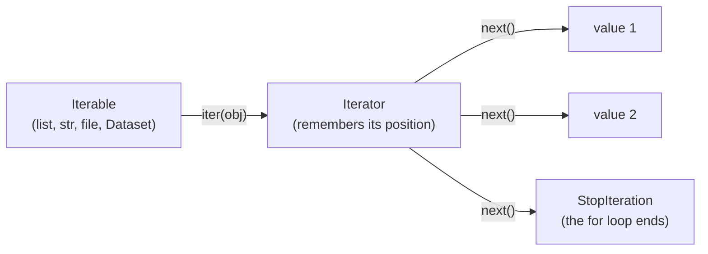
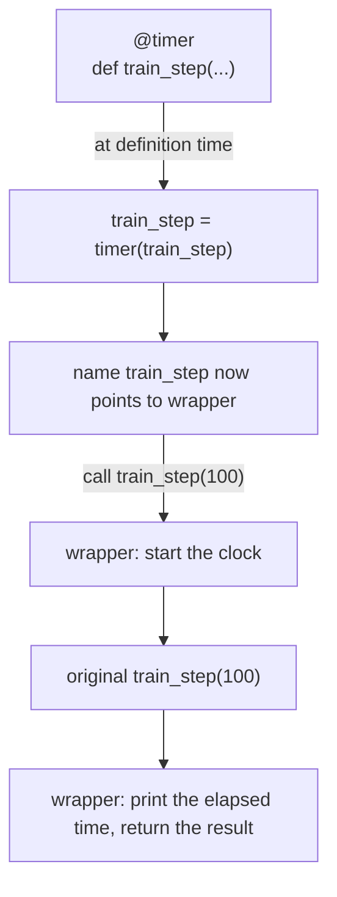

:::tip[TL;DR (30-Second Interview Pitch)]
**Comprehensions** build lists, dicts and sets in one readable, slightly faster expression. Everything you loop over follows the **iterator protocol** (`iter()` then `next()` until `StopIteration`). A **generator** is a function with `yield` that produces values **lazily**, one at a time, with **O(1) memory**, which is how you stream datasets, files and LLM tokens that don't fit in RAM. A **decorator** is a function that takes a function and returns an enhanced one (timing, retries, caching, registration), and `@decorator` is just shorthand for `f = decorator(f)`. Together these are the Python features most used, and most probed, in AI-engineering interviews.
:::

<PriorityKey lang="Python" v="3.10" />

## ⚡ Essential Interview Recall

- 🔴 **List comprehension**: `[expr for item in iterable if condition]`. A **filter** `if` goes at the **end**; an **`if … else`** transformation goes at the **front**: `[a if c else b for x in xs]`.
- 🔴 Nested comprehensions read **left to right like nested `for` loops top to bottom**: `[x for row in matrix for x in row]` flattens.
- 🔴 **Four kinds**: list `[...]`, dict `{k: v ...}`, set `{...}`, and **generator expression `(...)`**, which is lazy (208 bytes vs 800,984 bytes for 100,000 squares).
- 🔴 **Iterable** = has `__iter__` (list, str, dict, file). **Iterator** = has `__iter__` **and** `__next__`, remembers its position, and is **single-use**. A `for` loop calls `iter()` once, then `next()` until `StopIteration`.
- 🔴 **Generator function** = any function containing `yield`. Calling it runs **nothing**; it returns a generator object. Each `next()` resumes until the next `yield`, keeping local state.
- 🔴 **Generators are single-use**: once exhausted, iterating again yields nothing (`sum(gen)` twice → `5` then `0`).
- 🔴 **Decorator** = a callable that takes a function and returns a replacement. `@timer` above `def f` means `f = timer(f)`.
- 🔴 Always use **`@functools.wraps(func)`** in the wrapper, or the decorated function loses its `__name__`, `__doc__` and signature (it becomes `wrapper`).
- 🔴 A decorator **with arguments** needs **three levels**: `retry(max_attempts=3)` returns the actual decorator, which returns the wrapper.
- 🟠 **Stacked decorators** apply **bottom-up** (the one closest to `def` wraps first) and run **top-down** at call time.
- 🟠 Decorators run **at definition (import) time**; the wrapper runs at **call** time.
- 🟠 **`yield from sub`** delegates to a sub-generator; `gen.send(x)` sends a value **into** a paused generator; a generator's `return value` travels inside `StopIteration.value`.
- 🟠 Comprehension variables **don't leak** into the enclosing scope (unlike a `for` loop's variable). Since 3.12 comprehensions are **inlined** (PEP 709), so no hidden function call.
- 🟡 **`itertools`**: `islice`, `chain`, `count`, `cycle`, `product` (grid search), `combinations`, `groupby` (**sort first!**), `accumulate`, `pairwise` <Since v="3.10" lang="Python" />, `batched` <Since v="3.12" lang="Python" />.
- 🟡 Common real decorators: `@property`, `@staticmethod`, `@classmethod`, `@functools.cache`, `@dataclass`, `@torch.no_grad()`, `@app.get(...)` (FastAPI), `@pytest.fixture`, `@tool` (agent frameworks).

:::speak[What is a generator and why would you use one?]
"A generator is a function that uses `yield` instead of `return`. Calling it doesn't run the body; it returns a generator object. Each time I call `next()` on it, or a `for` loop does, it runs until the next `yield`, hands that value back, and **freezes**, keeping its local variables and position. When the function ends it raises `StopIteration`. The benefit is **lazy evaluation**: it produces one item at a time, so memory stays constant no matter how big the data is. I use generators to stream a 50 GB JSONL file line by line, to build preprocessing pipelines where each stage pulls from the previous one, and to stream LLM tokens to a client as they arrive. The trade-offs: a generator is **single-use**, it has no `len()`, and you can't index into it. If I need multiple passes I either recreate it or make a class whose `__iter__` is a generator, which is exactly how a PyTorch `IterableDataset` works."
:::

## The Mental Model

### 1. Iterable → iterator → values



### 2. A generator pauses at every `yield`

<Animation src="python/generator-pause" caption="Creating the generator runs none of its body. Each next call resumes the function from where it paused, runs to the next yield, hands the value out and freezes again with its local variables intact. Falling off the end raises StopIteration." />

:::analogy[A generator is a vending machine, a list is a buffet]
A list is a buffet: every dish is cooked up front and laid out, taking space whether you eat it or not. A generator is a vending machine: it makes one item each time you press the button, remembers where it is in its stock, and takes almost no counter space. Once it's empty it stays empty until someone refills it (creates a new generator).
:::

### 3. A decorator wraps the original



<Animation src="python/decorator-wrap" caption="The decorator receives the original function, builds a wrapper around it and the name is rebound to the wrapper. A call now runs the wrapper's before-code, the original function, then the after-code." />

:::analogy[A decorator is gift wrapping]
The present inside (your function) doesn't change. The wrapping adds something around it: a card that's read before opening (logging), a timer, a "try again if the box is stuck" note (retry). `functools.wraps` is the label on the outside that still says what's inside; without it every present just says "wrapper".
:::

## The Paradigm / Core Concepts

### 🔴 The six comprehension patterns

| # | Pattern | Syntax | Example → result |
|---|---|---|---|
| 1 | Transform (map) | `[f(x) for x in xs]` | Pixel normalization `[p / 255 for p in pixels]` |
| 2 | Filter | `[x for x in xs if cond]` | Stop-word removal |
| 3 | Transform with if-else | `[a if cond else b for x in xs]` | ReLU, thresholding probabilities at 0.5 |
| 4 | Multiple conditions | `[x for x in xs if c1 if c2]` / chained ternaries | Divisible by 2 and 3 → `[6, 12, 18]` |
| 5 | Flatten (nested loops) | `[x for row in m for x in row]` | 2-D → 1-D, tokenized sentences → corpus |
| 6 | Build / transpose 2-D | `[[f(r, c) for c in ...] for r in ...]` | Zero matrix, transpose |

<RuleCard name="Where the if goes" tag="Comprehension syntax" why="A filter decides whether an item is included at all; an if-else expression decides what value an included item becomes." remember="Filter at the end, choose at the front.">

- **Filter** (drop items): `if` **after** the `for`: `[x for x in xs if x > 0]`.
- **Choose a value** (keep every item): `a if cond else b` **before** the `for`: `[x if x > 0 else 0 for x in xs]`.
- `[x for x in xs if x > 0 else 0]` is a `SyntaxError`.

</RuleCard>

### 🔴 Comprehension types

| Type | Syntax | Returns | AI use case |
|---|---|---|---|
| List | `[x for x in it]` | `list` | Transforming batches, features, file paths |
| Dict | `{k: v for k, v in it}` | `dict` | `word_to_idx` / `idx_to_word` vocabularies |
| Set | `{x for x in it}` | `set` | Unique labels, unique tokens |
| Generator expression | `(x for x in it)` | generator | Streaming huge data; feeding `sum`, `any`, `max` without building a list |

### 🔴 Normal function vs generator function

| | Normal function (`return`) | Generator function (`yield`) |
|---|---|---|
| Calling it | Runs the body to completion | Runs **nothing**; returns a generator object |
| Execution | Runs once and exits | **Pauses** at each `yield`, **resumes** on `next()` |
| Memory | O(n): the whole result exists at once | **O(1)**: one item at a time |
| Evaluation | Eager | **Lazy** |
| Reuse | The returned list can be looped many times | **Single-use**; create a new one to iterate again |
| `len()`, indexing | ✅ on the returned list | ❌ |

### 🟠 Decorator shapes

| Shape | Signature | Example |
|---|---|---|
| Simple | `def deco(func) -> wrapper` | `@timer`, `@validate_non_empty` |
| With arguments | `def deco(arg) -> decorator -> wrapper` (3 levels) | `@retry(max_attempts=3)`, `@app.get("/predict")` |
| Class-based | `class Deco: __init__(func)`, `__call__(*a, **k)` | Keeping state like a call counter |
| Registering | Returns the function unchanged after recording it | Tool registries, plugin systems, `@pytest.fixture` |
| Built-in | | `@property`, `@classmethod`, `@staticmethod`, `@functools.cache`, `@dataclass` |

### 🟡 `itertools` cheat sheet

| Function | Does | Example → result |
|---|---|---|
| `islice(it, n)` | First n items of any iterator | `islice(count(10, 5), 4)` → `10, 15, 20, 25` |
| `chain(a, b)` | Concatenate iterables lazily | `[1], [2, 3]` → `1, 2, 3` |
| `product(a, b)` | Cartesian product | Hyperparameter grid: 2 lrs × 2 batch sizes → 4 combos |
| `combinations(it, r)` | Unordered r-subsets | `"abc", 2` → `ab, ac, bc` |
| `groupby(it, key)` | Groups **consecutive** equal keys | Must **sort by the same key first** |
| `accumulate(it)` | Running totals | `1, 2, 3, 4` → `1, 3, 6, 10` |
| `pairwise(it)` | Overlapping pairs | `1, 2, 3, 4` → `(1,2), (2,3), (3,4)` |
| `batched(it, n)` | Fixed-size chunks (last may be short) | `range(7), 3` → `(0,1,2), (3,4,5), (6,)` |
| `cycle`, `count`, `repeat` | Infinite iterators | Always pair with `islice` or a `break` |

## ⚙️ Under the Hood (CPython Internals)

- **Comprehension speed** comes from the dedicated `LIST_APPEND` bytecode instead of looking up and calling `out.append` each iteration. In our 3.14 run a 1,000-item comprehension was **13% faster** than the `for` + `append` loop, and `list(map(lambda ...))` was the **slowest** (a Python function call per item). Speed-ups of 10–30% are typical; readability is the bigger win.
- **PEP 709 (3.12)** inlined list, dict and set comprehensions into the enclosing function, so they no longer create a hidden function object and frame per evaluation. The iteration variable is still isolated: `x = 10; [x for x in range(3)]` leaves `x == 10`.
- **Generator objects own a suspended frame**: the instruction pointer, the local variables and the evaluation stack. `yield` saves that state and returns to the caller; `next()` restores it. That's why a generator is a few hundred bytes regardless of how many values it will produce.
- **`StopIteration` ends the loop**: `for` catches it silently. Inside a generator, an escaping `StopIteration` is converted to `RuntimeError` (PEP 479) so bugs can't silently truncate iteration.
- **Closing a generator** (`gen.close()`, or garbage collection) raises `GeneratorExit` at the paused `yield`, so `finally` blocks and `with` statements inside the generator still clean up.
- **Decorators are plain function calls at definition time**: `@deco` compiles to "evaluate `deco`, define the function, call `deco(fn)`, bind the result to the name". `functools.wraps` copies `__module__`, `__name__`, `__qualname__`, `__doc__`, `__dict__` and sets `__wrapped__`, which is how `inspect.signature` still shows the original parameters.
- **Async generators** (`async def` + `yield`) are the streaming workhorse of LLM services: `async for chunk in client.stream(...)` consumes one; FastAPI's `StreamingResponse` consumes yours. See the [Concurrency page](./09-concurrency-memory-performance.md).

:::danger[Interview Trap]
**An iterator class whose `__iter__` returns `self` can only be looped over once.** The `BatchIterator` pattern (with `self.index` and `__iter__` returning `self`) works for the first epoch and yields **nothing** in the second, because `index` is never reset. A reusable data container should make `__iter__` a **generator method** (a fresh iterator per loop), exactly like `torch.utils.data.Dataset` + `DataLoader` do.
:::

:::danger[Interview Trap]
**`groupby` only groups consecutive items.** `groupby(["apple", "bob", "avocado"], key=first_letter)` produces three groups: `a`, `b`, `a`. Sort by the same key first, or use a `defaultdict(list)`.
:::

## 💻 Python Implementation

:::tip[Run it yourself]
Every snippet runs in the `python` REPL or a notebook. Output comments come from a run on **CPython 3.14**.
:::

### 1. Mapping and filtering

```python showLineNumbers
nums = [1, 2, 3, 4, 5]
squares = []
for n in nums:                                # the long way
    squares.append(n ** 2)
squares = [n ** 2 for n in nums]              # [1, 4, 9, 16, 25]

raw_pixels = [0, 64, 128, 255]
print([round(p / 255.0, 2) for p in raw_pixels])          # [0.0, 0.25, 0.5, 1.0]

tokens = ["the", "neural", "network", "is", "fast", "a", ""]
stop_words = {"the", "is", "a"}                           # a set: O(1) membership
# highlight-next-line
print([w.lower() for w in tokens if w and w not in stop_words])   # ['neural', 'network', 'fast']
```

### 2. Conditional values: ReLU and thresholds

```python showLineNumbers
print(["Even" if n % 2 == 0 else "Odd" for n in [1, 2, 3, 4]])   # ['Odd', 'Even', 'Odd', 'Even']

activations = [-2.5, -0.1, 0.0, 1.5, 4.2]
# highlight-next-line
print([x if x > 0 else 0.0 for x in activations])        # [0.0, 0.0, 0.0, 1.5, 4.2]   ReLU

probabilities = [0.82, 0.15, 0.64, 0.49]
print([1 if p >= 0.5 else 0 for p in probabilities])     # [1, 0, 1, 0]

print([n for n in range(1, 20) if n % 2 == 0 if n % 3 == 0])   # [6, 12, 18]
scores = [-0.8, 0.0, 0.9, -0.2]
print(["Positive" if s > 0 else "Negative" if s < 0 else "Neutral" for s in scores])
# ['Negative', 'Neutral', 'Positive', 'Negative']
```

### 3. Nested comprehensions: flatten, build, transpose

```python showLineNumbers
matrix = [[1, 2, 3], [4, 5, 6], [7, 8, 9]]
print([num for row in matrix for num in row])            # [1, 2, 3, 4, 5, 6, 7, 8, 9]

zero_matrix = [[0 for col in range(4)] for row in range(3)]   # safe: a new row each time

m = [[1, 2, 3], [4, 5, 6]]
print([[row[i] for row in m] for i in range(len(m[0]))])  # [[1, 4], [2, 5], [3, 6]]
# success-next-line
print([list(col) for col in zip(*m)])                     # same result, more idiomatic

Z = [[-1.0, 2.0, -3.0], [4.0, -5.0, 6.0]]
relu_T = [[row[c] if row[c] > 0 else 0.0 for row in Z] for c in range(len(Z[0]))]
print(relu_T)                                             # [[0.0, 4.0], [2.0, 0.0], [0.0, 6.0]]
```

### 4. Dict, set and generator comprehensions

```python showLineNumbers
import sys

vocab = ["<PAD>", "<UNK>", "transformer", "attention"]
word_to_idx = {word: idx for idx, word in enumerate(vocab)}
idx_to_word = {idx: word for word, idx in word_to_idx.items()}

unique_tags = {w.lower() for w in ["AI", "ai", "Ai", "ML", "ml"]}   # {'ai', 'ml'}

list_comp = [x ** 2 for x in range(100_000)]
# highlight-next-line
gen_exp = (x ** 2 for x in range(100_000))                # parentheses → lazy
print(sys.getsizeof(list_comp), sys.getsizeof(gen_exp))   # 800984 208

print(sum(x * x for x in range(10)))                      # 285: no inner brackets needed
print(any(x > 8 for x in range(10)))                      # True: stops at the first match

data = [3, 8, 1, 9]
print([y for v in data if (y := v * 10) > 50])            # [80, 90]: walrus avoids computing twice
```

### 5. The iterator protocol

```python showLineNumbers
it = iter([1, 2, 3])
print(next(it), next(it), next(it))           # 1 2 3
# error-next-line
next(it)                                      # ❌ StopIteration
print(next(iter([]), "default"))              # default: next() with a fallback

nums = [1, 2]
print(iter(nums) is nums)                     # False: a list is an ITERABLE, it hands out new iterators
print(iter(it) is it)                         # True: an ITERATOR returns itself
```

```python title="❌ The one-epoch iterator (from the notes)" showLineNumbers
class BatchIterator:
    def __init__(self, data, batch_size):
        self.data, self.batch_size, self.index = data, batch_size, 0

    def __iter__(self):
        # error-next-line
        return self                           # ❌ the SAME object every time, index never resets

    def __next__(self):
        if self.index >= len(self.data):
            raise StopIteration
        batch = self.data[self.index : self.index + self.batch_size]
        self.index += self.batch_size
        return batch

loader = BatchIterator([1, 2, 3, 4, 5, 6, 7], batch_size=3)
print([b for b in loader])                    # [[1, 2, 3], [4, 5, 6], [7]]
print([b for b in loader])                    # []: epoch 2 trains on nothing
```

```python title="BatchLoader.py: reusable every epoch" showLineNumbers
class BatchLoader:
    def __init__(self, data, batch_size):
        self.data, self.batch_size = data, batch_size

    # success-start
    def __iter__(self):                       # ✅ a generator method: a FRESH iterator per loop
        for i in range(0, len(self.data), self.batch_size):
            yield self.data[i : i + self.batch_size]
    # success-end

    def __len__(self):
        return -(-len(self.data) // self.batch_size)   # ceiling division

bl = BatchLoader([1, 2, 3, 4, 5, 6, 7], 3)
print(list(bl), list(bl), len(bl))            # [[1, 2, 3], [4, 5, 6], [7]] (twice) 3
```

### 6. Generators: pause and resume

```python showLineNumbers
def count_up(n):
    print("  [gen] started")
    i = 1
    while i <= n:
        print(f"  [gen] yielding {i}")
        # highlight-next-line
        yield i                               # hand out i and FREEZE here
        i += 1
    print("  [gen] finished")

g = count_up(2)
print("created")                              # created: nothing in the body has run yet
print("got", next(g))                         #   [gen] started / [gen] yielding 1 / got 1
print("got", next(g))                         #   [gen] yielding 2 / got 2
next(g)                                       #   [gen] finished, then StopIteration
```

```python showLineNumbers
def stream_large_dataset(lines):
    """Stream a huge dataset line by line without loading it all into RAM."""
    for line in lines:                        # works the same for an open file object
        cleaned = line.strip().lower()
        if cleaned:
            yield cleaned

stream = stream_large_dataset(["   Sample 1  ", "", "SAMPLE 2", "  Sample 3 "])
print(next(stream))                           # sample 1
print(list(stream))                           # ['sample 2', 'sample 3']: continues where it paused

gen = (x * x for x in range(3))
# error-next-line
print(sum(gen), sum(gen))                     # 5 0: the second sum gets an exhausted generator
```

### 7. Generator pipelines

```python title="pipeline.py: each stage pulls one item at a time" showLineNumbers
import itertools

def read_lines(lines):
    for line in lines:
        yield line

def parse(rows):
    for row in rows:
        yield row.split(",")

def keep_valid(rows):
    for row in rows:
        if len(row) == 2 and row[1].strip():
            yield row

raw = ["a,1", "b,", "c,3", "bad", "d,4", "e,5"]
# highlight-next-line
batches = itertools.batched(keep_valid(parse(read_lines(raw))), 2)
print(list(batches))   # [(['a', '1'], ['c', '3']), (['d', '4'], ['e', '5'])]
```

| Stage | Input | Output | Memory |
|---|---|---|---|
| 1. `read_lines` | File / list | One raw line | O(1) |
| 2. `parse` | Lines | One list of fields | O(1) |
| 3. `keep_valid` | Rows | Only complete rows | O(1) |
| 4. `batched` | Rows | Tuples of 2 rows | O(batch size) |

### 8. `yield from`, `send`, return values and cleanup

```python showLineNumbers
def chain_two(a, b):
    yield from a                              # delegate to another iterable
    yield from b
print(list(chain_two([1, 2], (3,))))          # [1, 2, 3]

def running_avg():
    total, n, avg = 0.0, 0, None
    while True:
        # highlight-next-line
        x = yield avg                         # receives the value passed to send()
        total += x
        n += 1
        avg = total / n

ra = running_avg()
next(ra)                                      # "prime" it: run to the first yield
print(ra.send(10), ra.send(20), ra.send(60))  # 10.0 15.0 30.0

def with_cleanup():
    try:
        yield 1
        yield 2
    finally:
        print("generator cleaned up")         # runs on close() or garbage collection

g = with_cleanup()
next(g)
g.close()                                     # generator cleaned up
```

### 9. Sliding windows for language modelling

```python showLineNumbers
def sliding_window(tokens, window_size, stride=1):
    """Yield (input, target) windows; target is shifted one token to the right."""
    max_start = len(tokens) - window_size
    for i in range(0, max_start, stride):
        x = tokens[i : i + window_size]
        y = tokens[i + 1 : i + window_size + 1]
        yield x, y

for x_batch, y_batch in sliding_window([10, 20, 30, 40, 50, 60], window_size=3, stride=2):
    print(f"Input (X): {x_batch} -> Target (Y): {y_batch}")
# Input (X): [10, 20, 30] -> Target (Y): [20, 30, 40]
# Input (X): [30, 40, 50] -> Target (Y): [40, 50, 60]
```

### 10. A timing decorator

```python showLineNumbers
import time
from functools import wraps

def execution_timer(func):
    # highlight-next-line
    @wraps(func)                              # keep func's name, docstring, signature
    def wrapper(*args, **kwargs):             # *args, **kwargs: wrap ANY signature
        start = time.perf_counter()
        result = func(*args, **kwargs)
        elapsed = time.perf_counter() - start
        print(f"[TIMER] {func.__name__} executed in {elapsed:.6f} seconds")
        return result                         # don't forget to return the result!
    return wrapper

@execution_timer                              # same as: train_step = execution_timer(train_step)
def train_step(batch_size, lr=0.001):
    """Runs a single training step."""
    return sum([i ** 2 for i in range(batch_size * 1000)])

train_step(100, lr=0.01)                      # [TIMER] train_step executed in 0.011524 seconds
print(train_step.__name__, train_step.__doc__)   # train_step Runs a single training step.
```

```python title="❌ Forgetting functools.wraps" showLineNumbers
def no_wraps(func):
    def wrapper(*args, **kwargs):
        return func(*args, **kwargs)
    return wrapper

@no_wraps
def get_weather(city):
    """Return the current weather for a city."""
    return city

# error-next-line
print(get_weather.__name__, get_weather.__doc__)   # wrapper None: the tool schema loses its name and description
```

### 11. A decorator with arguments: retry for LLM APIs

```python title="retry.py" showLineNumbers
import time
from functools import wraps

def retry(max_attempts=3, delay=1.0, exceptions=(Exception,)):   # level 1: configuration
    def decorator(func):                                         # level 2: receives the function
        @wraps(func)
        def wrapper(*args, **kwargs):                            # level 3: runs on every call
            for attempt in range(1, max_attempts + 1):
                try:
                    return func(*args, **kwargs)
                # highlight-next-line
                except exceptions as e:                          # only retry what is retryable
                    print(f"[Attempt {attempt}/{max_attempts} Failed]: {e}")
                    if attempt == max_attempts:
                        raise                                    # re-raise the last error
                    time.sleep(delay)
        return wrapper
    return decorator

calls = 0

@retry(max_attempts=3, delay=0.01, exceptions=(ConnectionError,))
def call_llm():
    global calls
    calls += 1
    if calls < 3:
        raise ConnectionError("rate limited (429)")
    return "ok"

print(call_llm())
# [Attempt 1/3 Failed]: rate limited (429)
# [Attempt 2/3 Failed]: rate limited (429)
# ok
```

| Retry decision | Retry? | Why |
|---|---|---|
| 429 rate limit, 500/502/503/529 overload, timeouts, connection resets | ✅ with **exponential backoff + jitter** | Transient; waiting helps (`delay = min(cap, base * 2 ** attempt)` → 1, 2, 4, 8, 16 s, plus randomness) |
| 400 bad request, 401/403 auth, 404, validation errors | ❌ | Retrying sends the same broken request and costs money |
| Non-idempotent writes (payments, sending email) | ⚠️ Only with an idempotency key | A retry after a timeout may duplicate the action |

In production use a library such as **`tenacity`** (or the SDK's built-in `max_retries`) rather than a hand-rolled loop.

### 12. Stacking, class-based and registering decorators

```python showLineNumbers
def bold(f):
    def w(): return "[b]" + f() + "[/b]"
    return w

def italic(f):
    def w(): return "[i]" + f() + "[/i]"
    return w

@bold                                         # applied SECOND (outermost)
@italic                                       # applied FIRST (closest to def)
def hello():
    return "hi"

print(hello())                                # [b][i]hi[/i][/b]
```

```python showLineNumbers
import functools

class CountCalls:                             # class-based decorator with state
    def __init__(self, func):
        functools.update_wrapper(self, func)
        self.func, self.calls = func, 0

    def __call__(self, *args, **kwargs):
        self.calls += 1
        return self.func(*args, **kwargs)

@CountCalls
def predict(x):
    return x * 2

predict(1); predict(2)
print(predict.calls)                          # 2

TOOLS = {}

def register(fn):                             # registry pattern: record and return unchanged
    TOOLS[fn.__name__] = fn
    return fn

@register
def search(query: str) -> str:
    return query

print(list(TOOLS))                            # ['search']
```

### 13. Input validation decorator

```python showLineNumbers
from functools import wraps

def validate_non_empty(func):
    @wraps(func)
    def wrapper(*args, **kwargs):
        for idx, arg in enumerate(args):
            if hasattr(arg, "__len__") and len(arg) == 0:
                raise ValueError(f"Positional argument at index {idx} cannot be empty!")
        return func(*args, **kwargs)
    return wrapper

@validate_non_empty
def compute_mean(values):
    return sum(values) / len(values)

print(compute_mean([10, 20, 30]))             # 20.0
# error-next-line
compute_mean([])                              # ❌ ValueError: Positional argument at index 0 cannot be empty!
```

## 🧪 Predict the Output

<Predict n="1" title="Summing a generator twice" output="5 0">

```python
gen = (x * x for x in range(3))
print(sum(gen), sum(gen))
```

The first `sum` consumes the generator (0 + 1 + 4 = 5). A generator can't be rewound, so the second `sum` sees an empty iterator and returns 0. If you need two passes, materialize it once (`list(gen)`) or create the generator again.

</Predict>

<Predict n="2" title="When does the body run?" output="created, then started">

```python
def g():
    print("started")
    yield 1

x = g()
print("created")
next(x)
```

Calling a generator function only **creates** the generator object; none of the body runs. The body starts executing on the first `next()`, so `created` prints before `started`. This is why argument validation inside a generator fires late: put it in a normal function that returns the generator.

</Predict>

<Predict n="3" title="Stacked decorators" output="[b][i]hi[/i][/b]">

```python
@bold
@italic
def hello():
    return "hi"
print(hello())
```

Decorators apply **bottom-up**: `hello = bold(italic(hello))`. At call time the outermost wrapper (`bold`) runs first and calls the `italic` wrapper, which calls the original. So italic tags are innermost.

</Predict>

<Predict n="4" title="Lost identity" output="wrapper None">

```python
def deco(func):
    def wrapper(*args, **kwargs):
        return func(*args, **kwargs)
    return wrapper

@deco
def get_weather(city):
    """Weather for a city."""

print(get_weather.__name__, get_weather.__doc__)
```

The name `get_weather` now refers to `wrapper`, which has its own name and no docstring. Logs, tracebacks, `help()`, FastAPI route names and LLM tool schemas all see `wrapper`. `@functools.wraps(func)` on the wrapper copies the original metadata.

</Predict>

<Predict n="5" title="Does the variable leak?" output="10">

```python
x = 10
squares = [x * x for x in range(3)]
print(x)
```

Comprehensions have their own scope for the iteration variable, so the `x` inside doesn't overwrite the outer `x`. A plain `for x in range(3):` loop **would** leave `x == 2`.

</Predict>

<Predict n="6" title="The second epoch" output="[[1, 2, 3], [4, 5, 6], [7]] then []">

```python
loader = BatchIterator([1, 2, 3, 4, 5, 6, 7], batch_size=3)   # __iter__ returns self
print(list(loader))
print(list(loader))
```

`__iter__` returns the same object, whose `index` already points past the end after the first pass, so the second `list()` gets `StopIteration` immediately. Make `__iter__` a generator (or reset `index` inside it) so each loop gets a fresh iterator.

</Predict>

<Predict n="7" title="groupby without sorting" output="[('a', ['apple']), ('b', ['bob']), ('a', ['avocado'])]">

```python
from itertools import groupby
words = ["apple", "bob", "avocado"]
print([(k, list(g)) for k, g in groupby(words, key=lambda w: w[0])])
```

`groupby` starts a new group every time the key **changes**, so the two `a` words are separated by `bob`. Sort by the same key first: `sorted(words, key=lambda w: w[0])`.

</Predict>

## 🪜 Follow-up Ladder

<Ladder title="From yield to streaming LLM responses">
<Rung q="What does yield do?">

It returns a value to the caller and **suspends** the function, keeping its local state; the next `next()` resumes right after the `yield`.

</Rung>
<Rung q="How is a generator different from returning a list?">

It's lazy: values are produced on demand with O(1) memory, it can represent infinite or huge sequences, and it's single-use with no `len()` or indexing.

</Rung>
<Rung q="How would you process a 50 GB JSONL file?">

Iterate over the open file (a lazy line iterator), parse each line with `json.loads` in a generator, filter and transform in further generator stages, and write results in batches with `itertools.batched`. Memory stays at one batch. For parallelism, split the file by byte ranges or shards and process them in separate worker processes.

</Rung>
<Rung q="How does a PyTorch DataLoader relate to this?">

A map-style `Dataset` implements `__len__` and `__getitem__`; the `DataLoader` is an iterable whose `__iter__` creates a fresh iterator each epoch, which samples indices, fetches items (in worker processes when `num_workers > 0`), and collates them into batches. An `IterableDataset` implements `__iter__` as a generator for streaming data that can't be indexed.

</Rung>
<Rung q="How do you stream tokens from an LLM to a browser?">

The SDK's streaming call returns an (async) iterator of chunks. Wrap it in an **async generator** that yields each text delta, and return it as a server-sent-events `StreamingResponse` (FastAPI). Handle client disconnects (the generator gets closed: clean up in `finally`), add timeouts, and accumulate the full text for logging after the stream ends.

</Rung>
</Ladder>

## 🚑 Production Scenarios

:::incident[Validation accuracy was computed on zero samples]
After a refactor, validation ran in a few milliseconds and reported 0 samples (and a division-by-zero guard returned an accuracy of 0.0).

- **Code:** `val_data = (preprocess(x) for x in raw_val)`, then `n = sum(1 for _ in val_data)` to log the count, then `for x in val_data: ...` to evaluate.
- **Why:** the counting line **exhausted the generator**, so the evaluation loop received nothing.
- **Fix:** materialize validation data (`val_data = [preprocess(x) for x in raw_val]`, it's small) or wrap it in a class whose `__iter__` is a generator, so every pass is fresh. Assert the evaluated sample count equals the expected size.
:::

:::incident[The agent kept calling a tool named wrapper]
An LLM agent registered tools by reading each function's `__name__`, docstring and signature. After the team added a `@log_calls` decorator to every tool, the model saw five tools named `wrapper` with no descriptions and `(*args, **kwargs)` parameters, and its tool-selection accuracy collapsed.

- **Why:** the decorator didn't use `functools.wraps`, so all metadata pointed at the inner `wrapper` function.
- **Fix:** add `@wraps(func)` to every decorator (inspection then follows `__wrapped__` back to the real signature), and add a test that checks every registered tool's name and description are non-empty and unique.
:::

## 🚨 Interview Gotchas & Edge Cases

:::warning[The Most Common Question]
**"Write a decorator that times a function (or retries it)."** Interviewers check five things: the wrapper accepts `*args, **kwargs`; it **returns** the wrapped function's result; it uses `@functools.wraps`; for retries, it catches only retryable exceptions, re-raises after the last attempt and uses backoff; and you can explain that `@retry(3)` needs an extra outer level because `retry(3)` must **return** the decorator.
:::

- **Comprehensions in a class body can't see class variables** (except in the first `for` clause): `class A: v = 5; items = [v * i for i in range(3)]` raises `NameError: name 'v' is not defined`.
- **Don't use comprehensions for side effects**: `[print(x) for x in xs]` builds a useless list of `None`. Use a `for` loop.
- **Readability limit**: more than two `for` clauses, or a long chained ternary, belongs in a regular loop or a helper function.
- **A generator expression as the only argument needs no extra parentheses**: `sum(x for x in xs)`; with another argument it does: `sorted((x for x in xs), reverse=True)`.
- **`list(gen)` defeats the purpose** on huge data; consume lazily (`for`, `itertools.islice`, `batched`).
- **Decorators run at import time**: an expensive decorator (loading a model, opening a connection) slows every import of that module. Do heavy setup lazily inside the wrapper.
- **Decorating methods**: the wrapper receives `self` as the first positional argument, which `*args` handles automatically; `@staticmethod` / `@classmethod` should be the **outermost** decorator.
- **Generators and `with`**: a `with open(...)` inside a generator keeps the file open until the generator is exhausted or closed. Abandoned generators hold resources until garbage collection.
