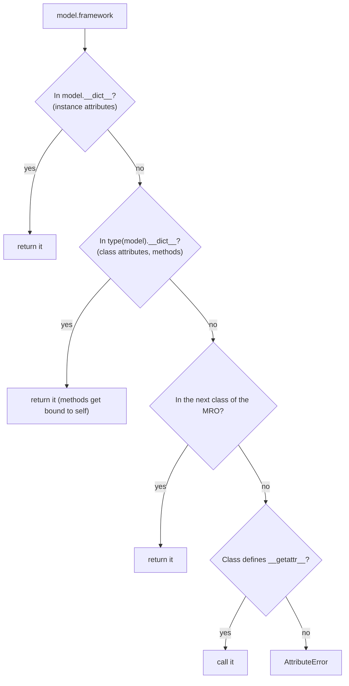
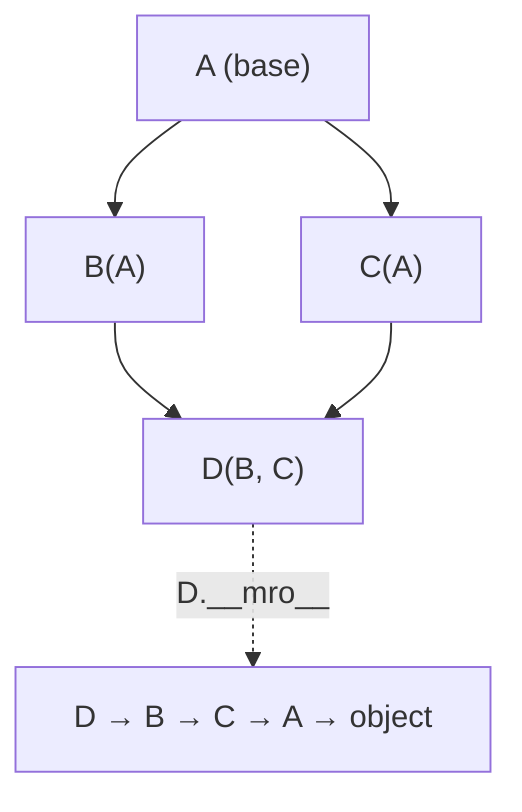

:::tip[TL;DR (30-Second Interview Pitch)]
Every major AI framework is built on Python OOP: PyTorch's `nn.Module` and `Dataset`, scikit-learn's `fit`/`predict` estimators, Hugging Face's `PreTrainedModel` and `TrainingArguments`. Python OOP differs from Java in three ways interviewers love: **privacy is a convention** (`_x`, and name-mangled `__x`), **multiple inheritance** is resolved by the **C3 MRO** (and `super()` follows that order, not "the parent"), and behaviour comes from **dunder methods** (`__init__`, `__call__`, `__len__`, `__getitem__`, `__eq__`/`__hash__`) plus **duck typing** instead of interfaces. Use **`@property`** instead of getters/setters, **`@dataclass`** for data-holding classes, and **ABCs** or **Protocols** to define contracts.
:::

<PriorityKey lang="Python" v="3.10" />

## ⚡ Essential Interview Recall

- 🔴 **Class** = blueprint; **object (instance)** = a concrete thing with its own state. **`__init__`** initializes a new instance (the object is created just before, by `__new__`).
- 🔴 **`self`** is the instance, passed **explicitly**: `model.train(5)` is `MLModel.train(model, 5)`.
- 🔴 **Class attributes** are shared by all instances; **instance attributes** live in each object's `__dict__`. A **mutable class attribute** (`layers = []`) is shared state: a classic bug.
- 🔴 **Attribute lookup**: instance `__dict__` → class → base classes in **MRO** order. Assigning through an instance (`self.count += 1`) creates an **instance** attribute that shadows the class one.
- 🔴 **Instance method** (`self`), **`@classmethod`** (`cls`: alternative constructors like `from_pretrained`), **`@staticmethod`** (no implicit argument: a utility grouped with the class).
- 🔴 **Encapsulation by convention**: `name` public, `_name` "internal", `__name` **name-mangled** to `_ClassName__name` (to avoid clashes in subclasses, not for security).
- 🔴 **`@property`** turns a method into an attribute with optional validation in the setter; no Java-style `getX()`/`setX()`.
- 🔴 **`super().__init__()`** must be called in subclasses that define `__init__`, or the parent's setup never runs (in PyTorch: `cannot assign module before Module.__init__() call`).
- 🔴 **Polymorphism through duck typing**: anything with a `predict()` method can be used where a predictor is expected; no shared interface needed.
- 🔴 **Abstraction**: `abc.ABC` + `@abstractmethod` → instantiating a class with unimplemented abstract methods raises `TypeError`.
- 🔴 **Dunder methods** hook into syntax: `__repr__`/`__str__` (printing), `__len__`/`__getitem__` (`len`, indexing, PyTorch `Dataset`), `__call__` (`model(x)`), `__eq__`/`__hash__`, `__add__` (operators), `__enter__`/`__exit__` (`with`).
- 🟠 **MRO (C3 linearization)**: `D(B, C)` with both inheriting `A` gives `D → B → C → A → object`. `super()` means "**next in the MRO**", which is how cooperative multiple inheritance and mixins work.
- 🟠 Defining **`__eq__` without `__hash__`** makes instances **unhashable** (`__hash__` is set to `None`).
- 🟠 **`@dataclass`** generates `__init__`, `__repr__`, `__eq__`; `frozen=True` makes it immutable and hashable; mutable defaults need **`field(default_factory=list)`**.
- 🟡 **`__slots__`** removes the per-instance `__dict__`: about 96 → 56 bytes per small object in our measurement, and no new attributes can be added.
- 🟡 **`typing.Protocol`** <Since v="3.8" lang="Python" /> = **structural** typing (duck typing that type checkers understand), versus nominal ABCs.
- 🟡 Classes are objects too: `type(MLModel) is type`. Methods are **descriptors** that bind `self` on attribute access; `property` is a descriptor as well.

:::speak[Why do we call model(x) instead of model.forward(x) in PyTorch?]
"Because `nn.Module` implements the **`__call__`** dunder method, and calling an instance like a function goes through it. `__call__` does more than run `forward`: it runs any registered **forward pre-hooks**, then calls `forward`, then runs **forward hooks**, and it plays well with things like `torch.compile`, mixed precision and tools that rely on hooks, such as feature extractors and some profilers. If I call `forward` directly I skip all of that, so hooks silently don't fire. The same design shows up in the rest of `nn.Module`: it overrides **`__setattr__`**, so when I write `self.fc1 = nn.Linear(4, 8)` inside `__init__`, the layer is **registered** in an internal dictionary. That's how `model.parameters()`, `model.to('cuda')` and `state_dict()` find every weight, and it's why I must call `super().__init__()` first, and why a plain Python list of layers isn't registered: I need `nn.ModuleList`."
:::

## The Mental Model

### 1. Where an attribute is found



<Animation src="python/attribute-lookup" caption="Reading c.count finds nothing on the instance and falls through to the class value 0. The augmented assignment c.count += 1 then writes a NEW count into the instance dict, which shadows the class attribute from then on, while Counter.count stays 0." />

:::analogy[Attribute lookup is checking your desk, then the team shelf]
When you need a stapler you first look on your own desk (the instance), then on the team's shared shelf (the class), then in the department cupboard (the base classes). Putting your own stapler on your desk doesn't remove the shared one; it just means you'll always find yours first. That's exactly what `self.count += 1` does to a class attribute.
:::

### 2. Multiple inheritance and the MRO



<Animation src="python/mro-c3" caption="C3 linearization merges the MROs of the bases left to right, taking a class only when it doesn't appear later in another list. The result for D(B, C) is D, B, C, A, object, so A comes after both of its subclasses and super calls visit each class exactly once." />

:::analogy[The MRO is a relay race order]
Every class in the hierarchy gets one turn to run its part of `__init__`, in a fixed order decided before the race starts. `super()` just means "hand the baton to the next runner in the line-up", which may be a teammate you've never met (`B` hands to `C`). The shared parent `A` always runs after all of its children, and nobody runs twice.
:::

## The Paradigm / Core Concepts

### 🔴 Three kinds of methods

| | Instance method | `@classmethod` | `@staticmethod` |
|---|---|---|---|
| First parameter | `self` (the instance) | `cls` (the class) | None |
| Can read/modify | Instance and class state | Class state only | Neither |
| Called as | `obj.m()` | `Cls.m()` or `obj.m()` | `Cls.m()` or `obj.m()` |
| Typical use | `.forward()`, `.fit()`, `.predict()` | **Alternative constructors**: `AutoModel.from_pretrained("bert-base-uncased")`, `dict.fromkeys`, `ModelConfig.from_preset("small")` | Helper maths: `estimate_vram_mb(num_params)` |
| Inheritance | Polymorphic | `cls` is the **subclass** when called on one, so factories return the right type | Plain function |

### 🔴 The four pillars, Python style

| Pillar | Python mechanism | Java equivalent | AI example |
|---|---|---|---|
| **Encapsulation** | `_protected`, `__private` (name mangling), `@property` | `private` + getters/setters (enforced) | `Optimizer.lr` property that rejects negative learning rates |
| **Inheritance** | `class Child(Parent)`, `super()`, **multiple** inheritance with C3 MRO | Single class inheritance + interfaces | `class Net(nn.Module)` |
| **Polymorphism** | **Duck typing**, method overriding, operator overloading via dunders | Interfaces, overriding, overloading by signature | Any object with `fit`/`predict` works in a scikit-learn `Pipeline` |
| **Abstraction** | `abc.ABC` + `@abstractmethod`, or `typing.Protocol` | `abstract class`, `interface` | `BaseLLMProvider.generate()` contract for OpenAI / Anthropic / local models |

### 🔴 Access levels

| Name | Meaning | Enforced? | Accessible as |
|---|---|---|---|
| `self.name` | Public API | — | `obj.name` |
| `self._name` | "Internal: don't touch from outside" | ❌ convention only (also skipped by `from m import *`) | `obj._name` still works |
| `self.__name` | Avoid clashes with subclass attributes | Partly: **renamed** to `_ClassName__name` | `obj._ClassName__name` |
| `self.__name__` | Reserved for Python's special names | — | Don't invent your own dunders |

### 🔴 The dunder methods that matter

| Method | Triggered by | Why it matters in AI code |
|---|---|---|
| `__init__(self, ...)` | `Cls(...)` | Create layers, load paths, set hyperparameters |
| `__repr__` / `__str__` | `repr(obj)`, debugger, containers / `print(obj)`, f-strings | `print(model)` shows the architecture |
| `__len__` | `len(obj)` | Required by a map-style PyTorch `Dataset` |
| `__getitem__` | `obj[i]` (and iteration, as a fallback) | Required by `Dataset`: `dataset[i] → (x, y)` |
| `__iter__` / `__next__` | `for x in obj` | `IterableDataset`, `DataLoader` |
| `__contains__` | `x in obj` | Vocabularies, membership |
| `__call__` | `obj(x)` | `model(x)`, loss functions, transforms |
| `__eq__` / `__hash__` | `==`, dict keys, sets | Value objects, caching |
| `__add__`, `__mul__`, `__matmul__`, `__radd__` | `+`, `*`, `@`, `1 + obj` | How tensors overload arithmetic |
| `__enter__` / `__exit__` | `with obj:` | `torch.no_grad()`, `autocast`, files, locks |
| `__getattr__` / `__setattr__` | Missing attribute / any assignment | `nn.Module` registers parameters in `__setattr__` |

:::analogy[Dunder methods are standard sockets]
Python's built-in operations are wall sockets with a fixed shape: `len()`, `for`, `[]`, `+`, `with`. Implementing `__len__`, `__iter__`, `__getitem__`, `__add__` or `__enter__` gives your object the matching plug, and suddenly every appliance that uses that socket (a `DataLoader`, `sum()`, a `with` statement) works with it, without any shared base class.
:::

<RuleCard name="The equality and hash contract" tag="Data model" why="Dicts and sets locate objects by hash and confirm by equality, so objects that are equal but hash differently get lost or duplicated." remember="Override eq, decide about hash.">

If you define `__eq__`, Python sets `__hash__ = None` (instances become unhashable) unless you also define `__hash__`. Define `__hash__` from the **same immutable fields** that `__eq__` compares, or use `@dataclass(frozen=True)`, which does it for you.

</RuleCard>

### 🟠 Data-holding classes compared

| | Plain class | `@dataclass` | `typing.NamedTuple` | pydantic `BaseModel` |
|---|---|---|---|---|
| Boilerplate | Write `__init__`, `__repr__`, `__eq__` yourself | Generated | Generated | Generated |
| Mutable | ✅ | ✅ (or `frozen=True`) | ❌ | ✅ (or frozen config) |
| Type checking at run time | ❌ | ❌ (hints only) | ❌ | ✅ **validates and coerces** |
| Hashable | By identity | Only if `frozen=True` (or `eq=False`) | ✅ | If frozen |
| Typical use | Behaviour-heavy objects | Configs, records (`TrainingArguments`) | Small immutable records | API request/response bodies, LLM structured output |

### 🟡 ABC vs Protocol

| | `abc.ABC` | `typing.Protocol` |
|---|---|---|
| Typing style | **Nominal**: must inherit from it | **Structural**: anything with the right methods matches |
| Enforced when | **At instantiation** (missing abstract methods → `TypeError`) | By the **type checker** (and `isinstance` with `@runtime_checkable`, which only checks that the methods exist) |
| Can provide shared code | ✅ concrete methods | Rarely |
| Use when | You own the hierarchy (`BaseLLMProvider` and your providers) | You accept third-party objects ("anything with `predict`") |

## ⚙️ Under the Hood (CPython Internals)

- **Object creation**: `MLModel("bert")` calls `type.__call__`, which calls `MLModel.__new__(cls)` (allocates the object) and then `__init__(self, "bert")` (fills it in). Override `__new__` only for immutables or singletons.
- **Every instance has a `__dict__`** (unless `__slots__` is used): an attribute dict, often **key-sharing** across instances of the same class. That flexibility costs memory: about **96 bytes per small object** with two attributes in our measurement versus **56 with `__slots__`**.
- **Methods are descriptors**: a function stored on a class has a `__get__` method, so `obj.train` returns a **bound method** that remembers `obj` as `self` (`obj.train.__self__ is obj`). `@staticmethod` and `@classmethod` are descriptors that bind differently; `@property` is a descriptor whose `__get__` calls your getter.
- **Name mangling** happens at **compile time**: inside `class Optimizer`, the token `__step_count` is rewritten to `_Optimizer__step_count`. It prevents a subclass that also uses `__step_count` from clobbering the parent's value; it is not a security boundary.
- **C3 linearization** builds the MRO by merging the parents' MROs while preserving (1) each class's local order of bases and (2) "a child before its parents". If no such order exists, class creation fails: `TypeError: Cannot create a consistent method resolution order (MRO) for bases X, Y`.
- **`super()` with no arguments** uses the `__class__` cell the compiler adds to methods, then finds the **next class after it in `type(self).__mro__`**. In the diamond, `B`'s `super()` call goes to `C`, a class `B` doesn't even know about.
- **Classes are objects** created by the metaclass `type`: `type("Dyn", (), {"x": 1})` builds a class at run time. Metaclasses (classes of classes) and `__init_subclass__` let frameworks register subclasses automatically (Django models, plugin registries).
- **Operator dispatch** tries `a.__add__(b)` and, on `NotImplemented`, `b.__radd__(a)`. Returning `NotImplemented` (not raising) is what lets `1 + vec` and `sum(vectors, start)` work.
- **How `nn.Module` tracks parameters**: its `__setattr__` checks whether the value is a `Parameter`, a `Module` or a buffer, and stores it in `_parameters` / `_modules` / `_buffers` dicts created by `Module.__init__`. That's why `super().__init__()` must run first, and why layers inside a plain `list` or `dict` are invisible to `.parameters()`, `.to()` and `state_dict()` (use `nn.ModuleList` / `nn.ModuleDict`).

:::danger[Interview Trap]
**`super()` doesn't mean "my parent class".** It means "the next class in the MRO of the object's actual class". In `class D(B, C)` where both `B` and `C` extend `A`, `B.__init__`'s `super().__init__()` calls **`C.__init__`**, not `A.__init__`. That's what lets every class in a diamond run exactly once, provided **every** class calls `super().__init__()` (cooperative inheritance).
:::

:::danger[Interview Trap]
**Mutable class attributes are shared by every instance.** `class Model: layers = []` followed by `self.layers.append(...)` appends to the **one list on the class**, so every model gets every layer. Initialize per-instance state in `__init__` (`self.layers = []`). The same applies to dataclasses, which refuse `tags: list = []` outright: `ValueError: mutable default <class 'list'> for field tags is not allowed: use default_factory`.
:::

## 💻 Python Implementation

:::tip[Run it yourself]
Every snippet runs in the `python` REPL or a notebook (no PyTorch needed: the `nn.Module` mechanics are re-implemented in plain Python). Output comments come from a run on **CPython 3.14**.
:::

### 1. Classes, objects, `__init__` and `self`

```python title="MLModel.py" showLineNumbers
class MLModel:
    # highlight-next-line
    framework = "PyTorch"                     # CLASS attribute: shared by all instances

    def __init__(self, model_name, learning_rate=0.001):
        # highlight-start
        self.model_name = model_name          # INSTANCE attributes: one set per object
        self.learning_rate = learning_rate
        self.is_trained = False
        # highlight-end

    def train(self, epochs):                  # instance method
        print(f"Training {self.model_name} for {epochs} epochs at lr={self.learning_rate}...")
        self.is_trained = True

model_a = MLModel("ResNet50", learning_rate=0.01)
model_b = MLModel("BERT-Base")
model_a.train(epochs=5)                       # Training ResNet50 for 5 epochs at lr=0.01...
print(model_a.is_trained, model_b.is_trained) # True False: independent state
MLModel.train(model_b, 1)                     # exactly what model_b.train(1) does under the hood
print(model_a.__dict__)                       # {'model_name': 'ResNet50', 'learning_rate': 0.01, 'is_trained': True}
```

### 2. Class attributes vs instance attributes

```python showLineNumbers
MLModel.framework = "JAX"                     # change the class attribute...
print(model_a.framework, model_b.framework)   # JAX JAX: ...every instance sees it
model_a.framework = "TF"                      # creates an INSTANCE attribute on model_a only
print(model_a.framework, model_b.framework)   # TF JAX
```

```python title="❌ A mutable class attribute" showLineNumbers
class Model:
    # error-next-line
    layers = []                               # ❌ one list for the whole class

    def add(self, layer):
        self.layers.append(layer)

m1, m2 = Model(), Model()
m1.add("conv")
print(m2.layers)                              # ['conv']: m2 never added anything
```

```python title="❌ Shadowing with +=" showLineNumbers
class Counter:
    count = 0
    def inc(self):
        # error-next-line
        self.count += 1                       # reads the class 0, WRITES an instance attribute

c = Counter()
c.inc(); c.inc()
print(c.count, Counter.count)                 # 2 0
```

### 3. Instance, class and static methods

```python title="ModelConfig.py" showLineNumbers
class ModelConfig:
    def __init__(self, hidden_size, num_layers):
        self.hidden_size = hidden_size
        self.num_layers = num_layers

    def summary(self):                                        # instance method
        return f"Hidden Size: {self.hidden_size}, Layers: {self.num_layers}"

    # highlight-next-line
    @classmethod
    def from_preset(cls, preset_name):                        # alternative constructor
        presets = {"small": (256, 4), "large": (1024, 24)}
        if preset_name not in presets:
            raise ValueError(f"unknown preset {preset_name!r}")
        return cls(*presets[preset_name])                     # cls, not ModelConfig: subclass-friendly

    @staticmethod
    def estimate_vram_mb(num_params, bytes_per_param=2):      # utility, no self/cls
        return (num_params * bytes_per_param) / (1024 ** 2)

small = ModelConfig.from_preset("small")
print(small.summary())                        # Hidden Size: 256, Layers: 4
print(ModelConfig.estimate_vram_mb(1_000_000))   # 1.9073486328125
# 7B parameters in bf16 → 7e9 × 2 bytes ≈ 13.0 GiB of weights alone

class BigConfig(ModelConfig):
    pass
print(type(BigConfig.from_preset("large")).__name__)   # BigConfig: cls was the subclass
```

### 4. Encapsulation and `@property`

```python title="Optimizer.py" showLineNumbers
class Optimizer:
    def __init__(self, lr):
        self._lr = lr                         # "protected" by convention
        self.__step_count = 0                 # name-mangled to _Optimizer__step_count

    # highlight-next-line
    @property
    def lr(self):                             # read like an attribute: opt.lr
        return self._lr

    @lr.setter
    def lr(self, new_lr):                     # validation on assignment
        if new_lr <= 0:
            raise ValueError("Learning rate must be strictly positive!")
        self._lr = new_lr

    def step(self):
        self.__step_count += 1

opt = Optimizer(0.001)
opt.lr = 0.0005                               # calls the setter
# error-start
opt.lr = -1                                   # ❌ ValueError: Learning rate must be strictly positive!
opt.__step_count                              # ❌ AttributeError: 'Optimizer' object has no attribute '__step_count'
# error-end
opt.step()
print(opt._Optimizer__step_count)             # 1: mangled, not hidden
```

### 5. Inheritance and `super()`

```python showLineNumbers
class BaseNeuralNet:
    def __init__(self):
        self.parameters = []
        print("BaseNeuralNet initialized.")

    def save_weights(self, path):
        print(f"Saving weights to {path}")

class ImageClassifier(BaseNeuralNet):
    def __init__(self, num_classes):
        # highlight-next-line
        super().__init__()                    # run the parent's setup FIRST
        self.num_classes = num_classes

model = ImageClassifier(num_classes=10)       # BaseNeuralNet initialized.
model.save_weights("checkpoint.pt")           # Saving weights to checkpoint.pt  (inherited)
print(isinstance(model, BaseNeuralNet))       # True
```

```python title="❌ Forgetting super().__init__()" showLineNumbers
class NoSuper(BaseNeuralNet):
    def __init__(self):
        self.num_classes = 3                  # parent __init__ never runs

# error-next-line
NoSuper().parameters                          # ❌ AttributeError: 'NoSuper' object has no attribute 'parameters'
```

### 6. Multiple inheritance and the MRO

```python showLineNumbers
class A:
    def __init__(self): print("A"); super().__init__()
class B(A):
    def __init__(self): print("B"); super().__init__()
class C(A):
    def __init__(self): print("C"); super().__init__()
class D(B, C):
    def __init__(self): print("D"); super().__init__()

D()                                           # D B C A: each class exactly once
print([k.__name__ for k in D.__mro__])        # ['D', 'B', 'C', 'A', 'object']
```

| Step | Class | `super()` goes to | Why |
|---|---|---|---|
| 1 | `D` | `B` | First base listed |
| 2 | `B` | **`C`** | Next in **D's** MRO, not B's parent |
| 3 | `C` | `A` | Both B and C must come before their shared parent |
| 4 | `A` | `object` | The root of every class |

### 7. Polymorphism (duck typing) and abstraction

```python showLineNumbers
class LinearRegressionModel:
    def predict(self, x):
        return f"Linear prediction for {x}"

class DecisionTreeModel:
    def predict(self, x):
        return f"Tree split prediction for {x}"

for m in [LinearRegressionModel(), DecisionTreeModel()]:   # no common base class needed
    print(m.predict([1.5, 2.0]))
```

```python title="BaseLLMProvider.py" showLineNumbers
from abc import ABC, abstractmethod

class BaseLLMProvider(ABC):
    # highlight-next-line
    @abstractmethod
    def generate(self, prompt: str) -> str:
        """Every subclass MUST implement this."""

    def chat(self, messages):                 # shared concrete code
        return self.generate(messages[-1])

class LocalLlamaModel(BaseLLMProvider):
    def generate(self, prompt):
        return f"[Llama Response to]: {prompt}"

print(LocalLlamaModel().generate("Explain backpropagation."))
# error-next-line
BaseLLMProvider()   # ❌ TypeError: Can't instantiate abstract class BaseLLMProvider without an implementation for abstract method 'generate'
```

```python showLineNumbers
from typing import Protocol, runtime_checkable

@runtime_checkable
class SupportsPredict(Protocol):              # structural: no inheritance required
    def predict(self, x): ...

print(isinstance(DecisionTreeModel(), SupportsPredict), isinstance(42, SupportsPredict))   # True False
```

### 8. `__call__`: why `model(x)` and not `model.forward(x)`

```python showLineNumbers
class MiniPyTorchModule:
    # highlight-next-line
    def __call__(self, x):                    # makes instances callable like functions
        print("1. [__call__]: Running pre-forward hooks...")
        output = self.forward(x)
        print("3. [__call__]: Running post-forward hooks...")
        return output

    def forward(self, x):
        raise NotImplementedError("Subclasses must implement forward()")

class DenseLayer(MiniPyTorchModule):
    def __init__(self, weight, bias):
        self.weight, self.bias = weight, bias

    def forward(self, x):
        print("2. [forward]: Computing w * x + b...")
        return self.weight * x + self.bias

    def __repr__(self):
        return f"DenseLayer(weight={self.weight}, bias={self.bias})"

layer = DenseLayer(weight=2.0, bias=0.5)
print(layer)                                  # DenseLayer(weight=2.0, bias=0.5)
result = layer(10.0)                          # prints steps 1, 2, 3
print("Result:", result)                      # Result: 20.5
```

### 9. How `nn.Module` registers layers (plain-Python re-implementation)

```python title="mini_module.py" showLineNumbers
class Parameter:
    def __init__(self, value): self.value = value
    def __repr__(self): return f"Parameter({self.value})"

class Module:
    def __init__(self):
        object.__setattr__(self, "_params", {})       # registries created by the base __init__
        object.__setattr__(self, "_modules", {})

    # highlight-next-line
    def __setattr__(self, name, value):               # intercepts EVERY self.x = ...
        if isinstance(value, Parameter):
            self._params[name] = value
        elif isinstance(value, Module):
            self._modules[name] = value
        object.__setattr__(self, name, value)

    def parameters(self):                             # recursive walk, like nn.Module.parameters()
        yield from self._params.values()
        for m in self._modules.values():
            yield from m.parameters()

class Linear(Module):
    def __init__(self, n_in, n_out):
        super().__init__()
        self.weight = Parameter(f"{n_out}x{n_in}")
        self.bias = Parameter(f"{n_out}")

class MLP(Module):
    def __init__(self):
        super().__init__()
        self.fc1 = Linear(4, 8)
        self.fc2 = Linear(8, 2)
        # error-next-line
        self.extra = [Linear(2, 2)]                   # ❌ a plain list: NOT registered

print(list(MLP().parameters()))
# [Parameter(8x4), Parameter(8), Parameter(2x8), Parameter(2)]   ← the layer in the list is missing
```

| What you write in `__init__` | Registered? | Consequence in real PyTorch |
|---|:---:|---|
| `self.fc = nn.Linear(4, 8)` | ✅ | Trained, moved by `.to()`, saved in `state_dict()` |
| `self.blocks = nn.ModuleList([...])` | ✅ | Same |
| `self.blocks = [nn.Linear(...)]` | ❌ | **Not trained**, stays on CPU → device-mismatch error, missing from checkpoints |
| `self.scale = nn.Parameter(torch.ones(1))` | ✅ | Learnable |
| `self.register_buffer("mean", t)` | ✅ (buffer) | Saved and moved, but not trained |

### 10. Making your class behave like a built-in

```python title="Vec.py" showLineNumbers
class Vec:
    def __init__(self, *xs):
        self.xs = list(xs)

    def __add__(self, other):
        if isinstance(other, Vec):
            return Vec(*[a + b for a, b in zip(self.xs, other.xs)])
        if isinstance(other, (int, float)):
            return Vec(*[a + other for a in self.xs])
        # highlight-next-line
        return NotImplemented                 # let Python try other.__radd__, then raise TypeError

    def __radd__(self, other):                # enables 1 + v and sum([...], start)
        return self + other

    def __matmul__(self, other):              # v @ w → dot product
        return sum(a * b for a, b in zip(self.xs, other.xs))

    def __len__(self): return len(self.xs)
    def __getitem__(self, i): return self.xs[i]
    def __eq__(self, other): return isinstance(other, Vec) and self.xs == other.xs
    def __repr__(self): return f"Vec{tuple(self.xs)}"

v, w = Vec(1, 2), Vec(3, 4)
print(v + w, 1 + v, v @ w, len(v), list(v), 2 in v)   # Vec(4, 6) Vec(2, 3) 11 2 [1, 2] True
# error-start
{v}                                           # ❌ TypeError: ... unhashable type: 'Vec' (__eq__ without __hash__)
v + "s"                                       # ❌ TypeError: unsupported operand type(s) for +: 'Vec' and 'str'
# error-end
```

```python title="A map-style dataset is just two dunders" showLineNumbers
class ToyDataset:
    def __init__(self, n):
        self.x = [i * 0.5 for i in range(n)]
        self.y = [i % 2 for i in range(n)]

    def __len__(self):                        # len(ds) → how many samples
        return len(self.x)

    def __getitem__(self, idx):               # ds[i] → one (features, label) sample
        return self.x[idx], self.y[idx]

ds = ToyDataset(5)
print(len(ds), ds[3], ds[-1])                 # 5 (1.5, 1) (2.0, 0)
```

### 11. `@dataclass`

```python showLineNumbers
from dataclasses import dataclass, field, asdict

@dataclass
class TrainingArgs:
    model_name: str
    batch_size: int = 32
    learning_rate: float = 3e-4
    use_fp16: bool = True
    # highlight-next-line
    tags: list[str] = field(default_factory=list)       # a NEW list per instance

    def __post_init__(self):                            # validation after the generated __init__
        if self.batch_size <= 0:
            raise ValueError("batch_size must be positive")

args = TrainingArgs(model_name="Mistral-7B", batch_size=16)
print(args)
# TrainingArgs(model_name='Mistral-7B', batch_size=16, learning_rate=0.0003, use_fp16=True, tags=[])
print(args == TrainingArgs("Mistral-7B", 16))           # True: generated __eq__ compares fields
print(asdict(args)["learning_rate"])                    # 0.0003: easy to dump to JSON/YAML

@dataclass(frozen=True, slots=True)                     # immutable, hashable, no __dict__
class Point:
    x: float
    y: float

p = Point(1.0, 2.0)
print({p: "ok"})                              # {Point(x=1.0, y=2.0): 'ok'}
# error-next-line
p.x = 5                                       # ❌ FrozenInstanceError: cannot assign to field 'x'
```

### 12. `__slots__`

```python showLineNumbers
class PlainPoint:
    def __init__(self, x, y): self.x, self.y = x, y

class SlotPoint:
    # highlight-next-line
    __slots__ = ("x", "y")                    # fixed attributes, no per-instance __dict__
    def __init__(self, x, y): self.x, self.y = x, y

# measured with tracemalloc over 100,000 objects: ~96 B/object vs ~56 B/object
sp = SlotPoint(1, 2)
# error-next-line
sp.z = 3   # ❌ AttributeError: 'SlotPoint' object has no attribute 'z' and no __dict__ for setting new attributes
```

## 🧪 Predict the Output

<Predict n="1" title="Shared class list" output="['conv']">

```python
class Model:
    layers = []
    def add(self, layer):
        self.layers.append(layer)

m1, m2 = Model(), Model()
m1.add("conv")
print(m2.layers)
```

`self.layers` finds no instance attribute, so it resolves to the **class attribute**: one list shared by all instances. `append` mutates it in place, so `m2` sees `'conv'`. Create per-instance lists in `__init__`.

</Predict>

<Predict n="2" title="Counting with +=" output="2 0">

```python
class Counter:
    count = 0
    def inc(self):
        self.count += 1

c = Counter()
c.inc(); c.inc()
print(c.count, Counter.count)
```

`self.count += 1` is `self.count = self.count + 1`. The read finds the class's `0`, but the **write** creates an attribute on the instance. From then on `c.count` shadows the class attribute, which stays `0`. To share a counter, write `Counter.count += 1` (or `type(self).count += 1`).

</Predict>

<Predict n="3" title="Diamond method resolution" output="B">

```python
class A:
    def hi(self): return "A"
class B(A):
    def hi(self): return "B"
class C(A):
    def hi(self): return "C"
class D(B, C):
    pass
print(D().hi())
```

`D.__mro__` is `D, B, C, A, object`. `D` has no `hi`, so lookup continues with `B`, which has one. Swap the bases to `class D(C, B)` and the answer becomes `C`.

</Predict>

<Predict n="4" title="super() in a diamond" output="D B C A">

```python
class A:
    def __init__(self): print("A", end=" ")
class B(A):
    def __init__(self): print("B", end=" "); super().__init__()
class C(A):
    def __init__(self): print("C", end=" "); super().__init__()
class D(B, C):
    def __init__(self): print("D", end=" "); super().__init__()
D()
```

Every `super()` call moves to the **next class in `D`'s MRO** (`D, B, C, A`), so `B`'s `super()` calls `C`, not `A`. `A` runs once, at the end. With hard-coded `A.__init__(self)` calls instead, `A` would run twice.

</Predict>

<Predict n="5" title="Private, but not really" output="AttributeError, then 1">

```python
class Optimizer:
    def __init__(self):
        self.__step_count = 0
    def step(self):
        self.__step_count += 1

opt = Optimizer()
opt.step()
try:
    print(opt.__step_count)
except AttributeError:
    print("AttributeError")
print(opt._Optimizer__step_count)
```

Inside the class body, `__step_count` was renamed at compile time to `_Optimizer__step_count`. Outside the class no renaming happens, so `opt.__step_count` doesn't exist. The mangled name is still fully accessible.

</Predict>

<Predict n="6" title="Equal objects in a set" output="TypeError: cannot use 'Animal' as a set element (unhashable type: 'Animal')">

```python
class Animal:
    def __init__(self, name): self.name = name
    def __eq__(self, other): return isinstance(other, Animal) and self.name == other.name

print({Animal("x")})
```

Defining `__eq__` without `__hash__` sets `Animal.__hash__ = None`, because the default identity hash would break the rule "equal objects have equal hashes". Add `def __hash__(self): return hash(self.name)`, or use `@dataclass(frozen=True)`.

</Predict>

<Predict n="7" title="Iteration without __iter__" output="[0, 10, 20] True">

```python
class Seq:
    def __getitem__(self, i):
        if i >= 3:
            raise IndexError
        return i * 10

print(list(Seq()), 20 in Seq())
```

When a class has no `__iter__`, Python falls back to the **old sequence protocol**: it calls `__getitem__(0)`, `__getitem__(1)`, … until `IndexError`. That makes the object iterable and makes `in` work by scanning. It's why a minimal `Dataset` with `__getitem__` can be looped over directly.

</Predict>

## 🪜 Follow-up Ladder

<Ladder title="From classes to nn.Module internals">
<Rung q="What is self?">

The instance the method was called on. `obj.method(x)` is translated to `Class.method(obj, x)`; Python passes it explicitly rather than having a hidden `this`.

</Rung>
<Rung q="How does Python find obj.method?">

Instance `__dict__`, then the class, then base classes in MRO order. Functions on a class are descriptors, so the lookup returns a **bound method** that already carries `obj` as `self`.

</Rung>
<Rung q="How does multiple inheritance work, and what does super() do?">

The C3 algorithm produces one linear MRO in which every class appears once and children precede parents. `super()` delegates to the next class in **the instance's** MRO, which enables cooperative inheritance and mixins (e.g. `class MyModel(LoggingMixin, nn.Module)`).

</Rung>
<Rung q="Why must custom PyTorch modules call super().__init__() first?">

`nn.Module.__init__` creates the `_parameters`, `_modules` and `_buffers` dicts. `nn.Module.__setattr__` writes layers and parameters into them; if they don't exist yet you get `cannot assign module before Module.__init__() call`.

</Rung>
<Rung q="A model trains but one block's weights never change and it crashes after .to('cuda'). Why?">

Those layers were stored in a plain Python `list` or `dict`, so `__setattr__` never registered them: they're not in `model.parameters()` (the optimizer doesn't update them), `.to()` doesn't move them (CPU tensors meet CUDA tensors → device-mismatch `RuntimeError`), and they're missing from `state_dict()`. Use `nn.ModuleList` / `nn.ModuleDict`.

</Rung>
</Ladder>

## 🚑 Production Scenarios

:::incident[Half the network never learned]
A custom transformer trained without errors, but validation loss plateaued early. Inspecting the checkpoint showed the encoder blocks' weights were identical to their random initialization.

- **Code:** `self.blocks = [TransformerBlock(d) for _ in range(6)]` in `__init__`.
- **Why:** `nn.Module.__setattr__` registers only `Module`/`Parameter` values. A Python list isn't one, so the blocks were invisible to `model.parameters()`: the optimizer never received their weights. (On GPU, the forward pass would also have failed with a device mismatch because `.to("cuda")` skipped them.)
- **Fix:** `self.blocks = nn.ModuleList([TransformerBlock(d) for _ in range(6)])`.
- **Prevention:** a unit test asserting the trainable parameter count, `sum(p.numel() for p in model.parameters() if p.requires_grad)`, equals the expected number.
:::

:::incident[Requests saw each other's retrieved documents]
A RAG service created one `Retriever` object per request. Under concurrency, answers began citing documents retrieved for **other** users.

- **Code:** `class Retriever: last_results = []`, with `self.last_results.append(doc)` during retrieval.
- **Why:** `last_results` was a **class attribute**, one list shared by every `Retriever` instance in the process, across all requests and threads.
- **Fix:** initialize per-request state in `__init__` (`self.last_results = []`), or don't keep request state on objects that outlive the request. If it's a dataclass, use `field(default_factory=list)`.
:::

## 🚨 Interview Gotchas & Edge Cases

:::warning[The Most Common Question]
**"What's the difference between `@classmethod` and `@staticmethod`, and when do you use each?"** A class method receives the **class** (`cls`), so it can construct instances and respects subclassing: the go-to for **alternative constructors** like `from_pretrained`, `from_config`, `from_json`. A static method receives nothing implicit; it's a plain function placed in the class namespace for organization. Follow-ups: why `cls(...)` instead of the hard-coded class name (subclasses get the right type), and how `@property` differs (computed attribute access on an instance).
:::

- **`__repr__` vs `__str__`**: `repr` is for developers (unambiguous, ideally valid Python), `str` for end users; containers always use `repr` of their elements. If you write only one, write `__repr__`: `str()` falls back to it.
- **`isinstance` over `type() ==`**: `isinstance` accepts subclasses and ABC registrations; checking exact types breaks polymorphism.
- **Getters and setters aren't Pythonic**: start with a plain attribute; switch to `@property` later without changing callers.
- **`__del__` is not a destructor you can rely on**: it runs when the reference count hits zero (or later, for cycles), and exceptions in it are ignored. Use context managers for cleanup.
- **Dataclass inheritance order**: fields with defaults can't be followed by fields without defaults across a parent and child class; `@dataclass(kw_only=True)` <Since v="3.10" lang="Python" /> avoids the problem.
- **Pickling**: instances of classes defined inside functions, lambdas stored as attributes, and open file handles can't be pickled, which breaks `multiprocessing`, `DataLoader(num_workers>0)` on macOS/Windows (spawn start method) and model saving with `torch.save(model)`. Prefer saving `state_dict()`.
- **Monkey-patching**: Python lets you replace methods at run time (`obj.method = ...`); handy in tests (`unittest.mock.patch`), dangerous in production code.
