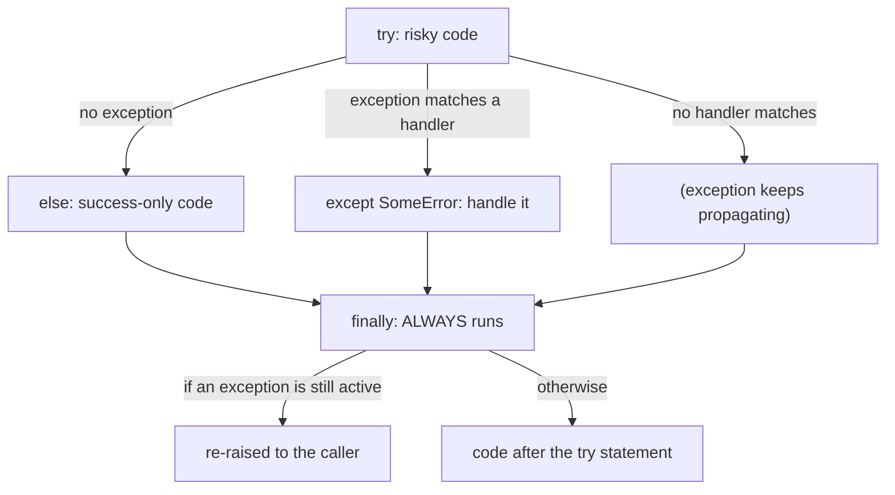
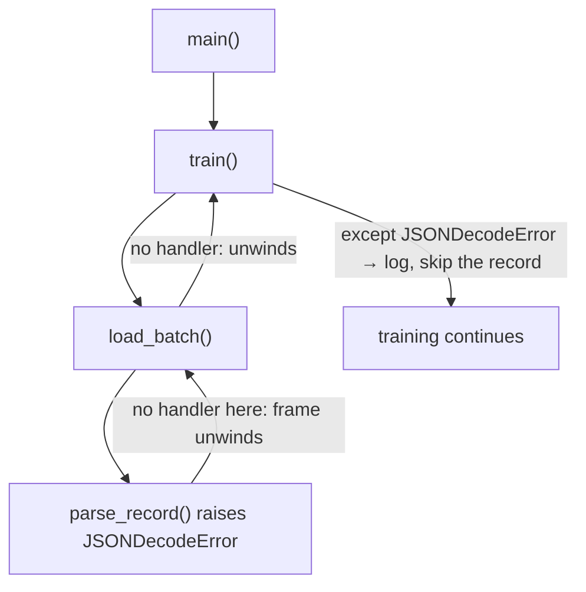
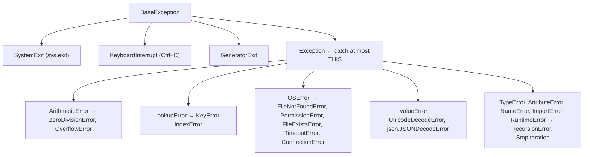

:::tip[TL;DR (30-Second Interview Pitch)]
Python reports errors with **exceptions**: `try` runs risky code, `except` handles **specific** failures, `else` runs only when nothing failed, and `finally` **always** runs. Good code catches narrow exception types, **chains** them with `raise … from e` so the root cause survives, and defines its own exception hierarchy for a pipeline. Files are read and written through `open()` in a mode (`r`, `w`, `a`, `x`, `b`, `+`) with an explicit **`encoding`**, always inside a **`with`** block, a **context manager** that guarantees cleanup (`__enter__` / `__exit__`). The same protocol powers `torch.no_grad()`, locks, database sessions and timers.
:::

<PriorityKey lang="Python" v="3.11" />


:::info[Where this page sits]
**Before:** [OOP in Python](./07-oop-in-python.md): exceptions are classes, and context managers are objects with `__enter__` and `__exit__` dunder methods.
**This page:** the `try`/`except`/`else`/`finally` statement, how exceptions travel up the call stack, raising and chaining, custom exceptions, the exception hierarchy, file modes and reading methods, context managers, and serialization formats.
**Next:** [Concurrency, Memory & Performance](./09-concurrency-memory-performance.md).
:::

## 🧭 Start Here

Real programs meet failure constantly: a file is missing, a record is malformed, a network call times out, an API returns a rate-limit error, the GPU runs out of memory. Python reports these situations with **exceptions**, objects that interrupt normal flow and travel up the call stack until some code handles them. Writing robust code is mostly about deciding **where** each failure should be handled and **how narrowly**, so that expected problems are dealt with and unexpected ones still surface loudly.

Files are the second half of this page because they are the most common source of both failures and resource leaks. Opening a file grabs an operating-system resource that must be released, even when an exception interrupts the code that was using it. Python's answer is the **context manager** and the `with` statement, a pattern that also covers locks, database transactions, temporary directories and PyTorch's `torch.no_grad()`. The page ends with the formats you'll use to save data, and the one you must never load from strangers (pickle).

Coming from Java, the shape is familiar (`try`/`catch`/`finally`, an exception class hierarchy) with three differences: there are no checked exceptions, Python adds an `else` block for success-only code, and the idiomatic style is **EAFP** ("easier to ask forgiveness than permission"): try the operation and handle the exception, rather than checking every precondition first.

The chapters build up in this order:

1. **`try` / `except` / `else` / `finally`**: what each block does and the order they run in.
2. **How exceptions travel, and raising them**: propagation, `raise`, chaining with `from`, custom exceptions.
3. **The exception hierarchy**: what to catch, and why never a bare `except:`.
4. **Files: modes and reading**: the six modes, the reading methods and safe opening.
5. **Context managers**: the `with` protocol and the ones you already use.
6. **Serialization formats**: JSON, JSONL, CSV, YAML, pickle and safetensors.

| New concept | One-line meaning |
|---|---|
| **Exception** | An object that signals an error and unwinds the call stack until handled |
| **Handler** | An `except` clause that matches an exception type and deals with it |
| **Propagation** | An unhandled exception moving up from frame to frame |
| **Exception chaining** | `raise New(...) from e` records the original cause |
| **EAFP** | Try it and handle the exception, instead of checking first (LBYL) |
| **Context manager** | An object with `__enter__`/`__exit__` that guarantees cleanup in a `with` block |
| **Serialization** | Turning objects into bytes or text to store or send, and back |
| **JSONL** | One JSON object per line; streamable dataset format |

:::analogy[Exceptions are a fire alarm system]
When something goes wrong deep inside a building, the alarm doesn't wait for the person who caused it to fix it: it goes up floor by floor until it reaches someone trained for that kind of emergency. Each floor still closes its fire doors on the way (`finally`). A bare `except:` is a security guard who silences every alarm, including the one meaning "evacuate now" (Ctrl+C).
:::

## 🔴 1. `try` / `except` / `else` / `finally`

The `try` statement has up to four blocks, and each has one job. **`try`** holds the code that might fail. Each **`except SomeError`** clause is a handler for one kind of failure; Python checks the handlers from top to bottom and runs the **first** one whose type matches, so more specific exceptions must come first. **`else`** runs only if the `try` block finished **without** an exception; it's the place for code that should happen only on success, kept out of `try` so its own errors aren't caught by the handlers by mistake. **`finally`** runs **no matter what**: after success, after a handled exception, after an unhandled one, and even when the `try` block executes `return` or `break`.

That guarantee makes `finally` the place for cleanup, such as closing a connection or releasing a lock. It also creates a trap: a `return` inside `finally` overrides any value the `try` returned and silently swallows an exception that was in flight. Python 3.14 now warns about it with a `SyntaxWarning`.

Inside a handler, `except ValueError as e` binds the exception object to `e` so you can log it or inspect its attributes. That name is deliberately **deleted** when the handler ends, to avoid reference cycles, so using `e` after the block raises `NameError`. You can catch several types in one clause with a tuple, `except (KeyError, IndexError):`.


<Animation src="python/try-flow" caption="With x = 2 the flow goes try, else, finally. With x = 0 the division raises, so control jumps to the matching except, skips else, and still runs finally before returning. A return inside try or except does not skip finally." />

:::analogy[try/except/else/finally is a restaurant kitchen]
`try` is cooking the dish. `except` is the plan for specific accidents: burnt it, remake it; out of an ingredient, offer a substitute. `else` is plating and garnishing, done only if cooking went fine. `finally` is cleaning the station, which happens whether the dish succeeded or ended in the bin.
:::

:::tip[🎯 Interview angle]
**"When does `else` run, and when does `finally` run?"** `else` runs only if `try` raised no exception; `finally` always runs, even after `return`, `break` or an unhandled exception. Handlers are checked top to bottom, so put specific exceptions first. Warn that a `return` in `finally` overrides the result and swallows any in-flight exception (a `SyntaxWarning` since 3.14).
:::

## 🔴 2. How Exceptions Travel, and Raising Them

When an exception is raised and the current function has no matching handler, the function's frame **unwinds**: it stops executing, runs any `finally` blocks, and the exception is re-raised in the caller. This continues frame by frame up the call stack until some frame handles it. If none does, the program stops and prints a **traceback** listing every frame the exception passed through. This is why you don't need to handle errors where they happen: you handle them at the level that knows what to do, for example skipping one bad record in the training loop rather than inside the JSON parser.

You signal errors yourself with `raise`. `raise ValueError("lr must be positive")` creates and raises a new exception. A bare `raise` inside a handler re-raises the current exception with its original traceback, which is how you log something and let the failure continue. To translate a low-level error into a meaningful one without losing the original, use **chaining**: `raise ConfigError("bad config") from e` stores the original as `__cause__`, and the traceback shows both. `from None` suppresses the original when it's just noise.

For your own code, define **custom exceptions** by subclassing `Exception`, ideally as a small hierarchy (a base `AIPipelineError` with specific children such as `TokenLimitExceededError`). Callers can then catch the whole family or one specific case, and the exception can carry useful data as attributes. Python 3.11 also added `add_note()` to attach context to an exception, and `ExceptionGroup` with `except*` for handling several concurrent failures at once.


<Animation src="python/exception-propagation" caption="An exception raised deep in the call stack unwinds one frame at a time, running each frame's finally blocks on the way, until a frame with a matching except handles it. If no frame does, the program stops and prints the traceback." />

:::tip[🎯 Interview angle]
**"What's the difference between `raise`, `raise e` and `raise New() from e`?"** A bare `raise` re-raises the current exception with its original traceback; `raise New(...) from e` raises a new, more meaningful exception and records the original as `__cause__`, so both appear in the traceback (`from None` hides it). Exceptions propagate up the stack, running `finally` blocks, until a matching handler catches them; define custom exceptions as a small hierarchy under `Exception`.
:::

## 🔴 3. The Exception Hierarchy

All exceptions are classes arranged in a tree, and an `except` clause matches the named class **and all its subclasses**. At the top is `BaseException`. Directly under it sit a few special exceptions that aren't really errors: `SystemExit` (raised by `sys.exit()`), `KeyboardInterrupt` (Ctrl+C) and `GeneratorExit`. Everything that represents an actual error lives under **`Exception`**, grouped into families such as `LookupError` (for `KeyError` and `IndexError`), `ArithmeticError` and `OSError` (for file and network problems).

This structure is why a **bare `except:`** (or `except BaseException`) is a serious bug: it also catches `KeyboardInterrupt` and `SystemExit`, so pressing Ctrl+C can't stop a stuck training job and a deliberate exit is ignored. The widest net you should ever cast is `except Exception`, and usually only at the very top of a program or request handler, to log and report. Everywhere else, catch the **narrowest** type you can actually handle, so unexpected bugs still crash loudly instead of being silently swallowed.


| Exception | Typical cause | Typical fix |
|---|---|---|
| `ValueError` | Right type, bad value: `int("3.5")`, a wrong shape | Validate inputs |
| `TypeError` | Wrong type: `"5" + 5`, calling `None`, unhashable key | Convert or fix the call |
| `KeyError` / `IndexError` | Missing dict key / index out of range | `.get()`, bounds checks |
| `AttributeError` | Attribute doesn't exist (often on `None`) | Check for `None` |
| `FileNotFoundError`, `PermissionError` | Path problems | Check paths; `Path.exists()` |
| `ZeroDivisionError` | Division by zero (ints **and** floats) | Guard the denominator |
| `RuntimeError` | Generic run-time failure: CUDA out of memory and device mismatches surface as `RuntimeError` (`torch.OutOfMemoryError` subclasses it) | Read the message |
| `RecursionError` | Exceeded the recursion limit | Iterate instead |

:::tip[🎯 Interview angle]
**"Why shouldn't you write a bare `except:`?"** It catches everything under `BaseException`, including `KeyboardInterrupt` and `SystemExit`, so Ctrl+C and `sys.exit()` stop working, and it hides real bugs. Catch the narrowest exception you can handle (`json.JSONDecodeError`, `FileNotFoundError`), and use `except Exception` only at a top-level boundary to log and report.
:::

## 🔴 4. Files: Modes and Reading

`open(path, mode)` returns a file object, and the **mode** decides what you can do with it. `"r"` (the default) reads and fails with `FileNotFoundError` if the file is missing. `"w"` writes and, crucially, **truncates** an existing file to empty the moment it's opened, which is the most common way people destroy data by accident. `"a"` appends to the end, `"x"` creates a new file and fails if one already exists (a safe way to avoid overwriting), and `"+"` adds the other direction (`"r+"` reads and writes without truncating). Adding `"b"` switches to **binary** mode, where you read and write `bytes` rather than text; images, audio, model weights and pickles need it.

There are several ways to read. `read()` returns the whole file as one string, `readline()` returns the next line, and `readlines()` returns a list of every line. All three are fine for small files, but for anything large the right tool is to **iterate over the file object** with `for line in f:`, which reads one line at a time and keeps memory constant. That's how you process a large JSONL dataset or a log file.

Two habits prevent most file bugs. Always open files with a `with` statement, so the file is closed even if an exception interrupts your code (chapter 5 explains why that works). And always pass `encoding="utf-8"` in text mode, because otherwise the default encoding depends on the operating system, and the same code can read a file correctly on Linux and garble it on Windows.
| Mode | Meaning | If the file exists | If it doesn't |
|:---:|---|---|---|
| `"r"` | Read text (default) | Read from the start | `FileNotFoundError` |
| `"w"` | Write text | **Truncated to empty** | Created |
| `"a"` | Append text | Writes go to the **end** | Created |
| `"x"` | Exclusive create | `FileExistsError` | Created |
| `"r+"` | Read **and** write, no truncation | Position at the start | `FileNotFoundError` |
| `"b"` (`"rb"`, `"wb"`) | Binary: bytes in, bytes out | Images, audio, model weights, pickles | |

| Method | Returns | Memory | Use for |
|---|---|---|---|
| `f.read()` | One `str` with everything | Whole file | Small files, configs |
| `f.readline()` | The next line (with `\n`), `""` at the end | One line | Headers, manual parsing |
| `f.readlines()` | `list` of all lines | Whole file | Small files |
| `for line in f:` | One line per iteration | **One line** | Large files, JSONL datasets, logs |
| `f.read(n)` | Up to `n` characters/bytes | `n` | Chunked binary processing |

<RuleCard name="Open files the safe way" tag="File I/O" why="Without with, an exception leaves the file open (leaking handles and, for writes, unflushed data); without an explicit encoding the default depends on the OS." remember="With, explicit encoding, relative pathlib.">

`with open(path, mode, encoding="utf-8") as f:` for text; `with open(path, "rb") as f:` for binary. Build paths with `pathlib.Path`, relative to the project or a configured data root, never hard-coded absolute paths. (PEP 686 makes UTF-8 the default text encoding from Python 3.15, but being explicit keeps older interpreters and Windows machines correct.)

</RuleCard>

:::tip[🎯 Interview angle]
**"How would you read a 50 GB text file?"** Iterate over the file object, `for line in f:`, which streams one line at a time in constant memory; `read()` and `readlines()` load everything. Open it with `with open(path, encoding="utf-8") as f:` so it's closed even on errors, and remember that mode `"w"` truncates an existing file immediately while `"x"` refuses to overwrite.
:::

## 🟠 5. Context Managers

A **context manager** is an object that sets something up when a `with` block starts and guarantees to tear it down when the block ends, however it ends. The protocol has two dunder methods. `__enter__` runs at the start, and whatever it returns is bound to the name after `as`. `__exit__(exc_type, exc, tb)` runs at the end, receiving details of any exception that occurred (or three `None`s on success). If `__exit__` returns `True`, the exception is **suppressed**; otherwise it continues propagating after cleanup.

In effect, `with` is a reusable `try`/`finally`. Writing `with open(path) as f:` guarantees `f.close()` runs even if the code inside raises. The same pattern releases locks, commits or rolls back database transactions, deletes temporary directories, and switches PyTorch modes on and off (`torch.no_grad()` and `torch.autocast` restore the previous setting on exit). You can write your own context manager as a class with `__enter__` and `__exit__`, or more simply as a generator function decorated with `@contextlib.contextmanager`: code before the `yield` is setup, and code after it (in a `finally`) is teardown.
| Context manager | `__enter__` does | `__exit__` does |
|---|---|---|
| `open(path)` | Opens the file, returns it | Flushes and closes |
| `threading.Lock()` | Acquires the lock | Releases it |
| `torch.no_grad()` | Disables gradient tracking | Restores the previous setting |
| `torch.autocast("cuda")` | Enables mixed precision | Restores full precision |
| A DB session / transaction | Begins | Commits, or rolls back on an exception |
| `tempfile.TemporaryDirectory()` | Creates a directory | Deletes it |
| `contextlib.suppress(FileNotFoundError)` | — | Swallows that exception type |

:::analogy[A context manager is a hotel key card]
Walking in (`__enter__`) switches the room's power on; walking out (`__exit__`) switches it off, whether you leave calmly, run out during a fire alarm (an exception) or check out early (a `return`). You never have to remember to turn the lights off, and that's exactly the guarantee `with open(...)`, locks and `torch.no_grad()` give you.
:::

:::tip[🎯 Interview angle]
**"What does the `with` statement guarantee, and how would you write your own context manager?"** It guarantees that `__exit__` runs when the block ends, normally or by exception, so resources are always released; it's a reusable `try`/`finally`. Implement `__enter__` and `__exit__` (returning `True` suppresses the exception) or decorate a generator with `@contextlib.contextmanager`, putting the teardown after `yield` in a `finally`.
:::

## 🟠 6. Serialization Formats

**Serialization** turns objects into text or bytes so they can be saved to disk or sent over a network, and **deserialization** turns them back. The right format depends on who will read the data and whether you trust where it came from. **JSON** is the default for configs, API payloads and LLM structured output: human-readable and safe to parse. **JSONL** puts one JSON object per line, so a dataset can be streamed line by line and appended to, which is why fine-tuning datasets and logs use it. **CSV** is the universal tabular format, with one catch: everything comes back as strings unless a library such as pandas converts types. **YAML** is popular for experiment configs, but must be loaded with `yaml.safe_load`.

**Pickle** can serialize almost any Python object, which is exactly what makes it dangerous: unpickling can execute arbitrary code, so you must **never unpickle data you didn't create**. That's why `torch.load` now defaults to `weights_only=True`, and why model weights are increasingly distributed as **safetensors**, a format that stores only tensors and can't run code. When writing checkpoints, write to a temporary file and then `os.replace` it into place, so a crash mid-write never leaves a half-written file.
| Format | Module | Human-readable | Safe with untrusted data | Use for |
|---|---|:---:|:---:|---|
| JSON | `json` | ✅ | ✅ | Configs, API payloads, LLM structured output |
| JSONL | `json` per line | ✅ | ✅ | Datasets, fine-tuning files, logs (streamable) |
| CSV | `csv`, pandas | ✅ | ✅ | Tabular data (everything is read back as **strings**) |
| YAML | `yaml.safe_load` | ✅ | ✅ only with `safe_load` | Experiment configs |
| Pickle | `pickle` | ❌ | ❌ **executes code** | Python objects you created yourself |
| safetensors | `safetensors` | ❌ | ✅ | Model weights (Hugging Face default) |

:::tip[🎯 Interview angle]
**"Why is pickle unsafe, and what would you use instead?"** Unpickling can execute arbitrary code, so loading an untrusted pickle (or an untrusted `torch.load` with `weights_only=False`) can run an attacker's code. Use JSON or JSONL for data and configs, `yaml.safe_load` for YAML, and safetensors for model weights; keep pickle for objects you created yourself.
:::

## ⚙️ Going Deeper (CPython Internals)

- **Zero-cost `try`** (3.11+): entering a `try` block costs nothing; the compiler builds an **exception table** that maps bytecode ranges to handlers, consulted only when something is raised. Raising and catching is relatively expensive, so don't use exceptions for the common path of a hot loop.
- **Raising unwinds frames**: the interpreter walks up the call stack looking for a handler whose type matches (`isinstance(exc, HandlerType)`), running `finally` blocks and `__exit__` methods along the way and building the **traceback** (`exc.__traceback__`).
- **Chaining**: raising inside an `except` block automatically sets `__context__` ("During handling of the above exception, another exception occurred"); `raise X from Y` sets `__cause__` ("The above exception was the direct cause of the following exception"); `from None` sets `__suppress_context__ = True`.
- **`except E as e` ends with an implicit `del e`**, because the traceback references the frame, which references `e`: a cycle that would keep every local variable (tensors included) alive until the cyclic GC runs. Copy it to another name if you need it later.
- **`with` desugars** to: evaluate the manager, call `__enter__`, run the body inside a `try`, and always call `__exit__(type, value, traceback)` (`None, None, None` on success). If `__exit__` returns a truthy value, the exception is **suppressed**.
- **`@contextmanager`** wraps a generator: code before `yield` is `__enter__`, the yielded value is bound by `as`, code after `yield` is `__exit__`. Put it in `try`/`finally` or cleanup won't run when the body raises.
- **File objects are layered**: `open()` in text mode returns a `TextIOWrapper` (decoding, newline translation) over a `BufferedReader/Writer` (8 KB buffer by default) over a `FileIO` (raw OS calls). That's why `write()` may not reach disk until `flush()`/`close()`, and why `os.fsync` is needed for crash-safe checkpoints.
- **Unpickling runs code**: an object's `__reduce__` can return any callable plus arguments, which `pickle.loads` calls. Our demo class printed a message during `loads`; a malicious file could just as easily run a shell command.

:::danger[Interview Trap]
**`finally` beats `return`.** If both `try` and `finally` contain `return`, the function returns the `finally` value, and an exception raised in `try` is silently discarded. Python 3.14 now emits `SyntaxWarning: 'return' in a 'finally' block` for exactly this reason. Use `finally` only for cleanup.
:::

:::danger[Interview Trap]
**`except Exception` doesn't catch everything, and that's deliberate.** `KeyboardInterrupt`, `SystemExit` and `GeneratorExit` inherit from `BaseException` directly, so `sys.exit()` and Ctrl+C get through `except Exception`. A bare `except:` catches them too, which is why it's banned in most style guides.
:::

## 💻 Python Implementation

:::tip[Run it yourself]
Every snippet runs in the `python` REPL or a notebook. Output comments come from a run on **CPython 3.14**.
:::

### 1. The full `try` / `except` / `else` / `finally`

```python showLineNumbers
try:
    with open("nofile.txt", "r", encoding="utf-8") as f:
        content = f.read()
except FileNotFoundError:
    print("File not found")                   # File not found
except PermissionError:
    print("Permission denied")
else:
    print("File read successfully")           # only if NO exception
finally:
    print("Operation completed.")             # Operation completed.  (always)
```

```python showLineNumbers
def flow(x):
    try:
        print("try", end="; ")
        r = 10 / x
    except ZeroDivisionError:
        print("except", end="; ")
        return "from except"
    else:
        print("else", end="; ")
        return "from else"
    finally:
        # highlight-next-line
        print("finally", end="; ")            # runs even though both branches return

print(flow(2))                                # try; else; finally; from else
print(flow(0))                                # try; except; finally; from except
```

### 2. Catching the right things

```python showLineNumbers
try:
    int("x")
except (ValueError, TypeError) as e:          # several types in one handler
    print(type(e).__name__, e)                # ValueError invalid literal for int() with base 10: 'x'
```

```python title="❌ Handlers in the wrong order" showLineNumbers
try:
    int("x")
except Exception:
    print("generic handler")                  # always wins
# error-next-line
except ValueError:                            # ❌ unreachable: ValueError IS an Exception
    print("never runs")
```

```python title="❌ Swallowing everything" showLineNumbers
for record in records:
    try:
        process(record)
    # error-next-line
    except:                                   # ❌ catches KeyboardInterrupt and SystemExit, hides every bug
        pass
```

```python showLineNumbers
import json, logging
log = logging.getLogger("pipeline")
skipped = 0
for line_no, line in enumerate(lines, start=1):
    try:
        record = json.loads(line)
    # success-next-line
    except json.JSONDecodeError:              # ✅ only the failure we expect and can handle
        skipped += 1
        log.warning("bad JSON on line %d", line_no)
        continue
    process(record)
```

### 3. Raising, re-raising and chaining

```python showLineNumbers
import json

class ConfigError(Exception):
    pass

def load_config(path):
    try:
        return json.loads('{"lr": }')         # broken JSON
    except json.JSONDecodeError as e:
        # highlight-next-line
        raise ConfigError(f"invalid config {path}") from e   # keep the root cause

try:
    load_config("cfg.json")
except ConfigError as e:
    print(repr(e), repr(e.__cause__))
# ConfigError('invalid config cfg.json') JSONDecodeError('Expecting value: line 1 column 8 (char 7)')

def train_step():
    try:
        1 / 0
    except ZeroDivisionError:
        print("logging, then re-raising")
        raise                                 # bare raise: same exception, original traceback
```

### 4. Custom exception hierarchy for an AI pipeline

```python title="errors.py" showLineNumbers
class AIPipelineError(Exception):
    """Base class: callers can catch every pipeline error with one handler."""

class TokenLimitExceededError(AIPipelineError):
    """Raised when a prompt exceeds the model's context window."""
    def __init__(self, token_count, max_tokens):
        self.token_count = token_count        # data the caller can use (e.g. to truncate)
        self.max_tokens = max_tokens
        super().__init__(
            f"Prompt has {token_count} tokens, exceeding max context window of {max_tokens}."
        )

def check_prompt_length(tokens, max_context=4096):
    if len(tokens) > max_context:
        raise TokenLimitExceededError(len(tokens), max_context)
    return "Prompt is valid!"

try:
    check_prompt_length(["tok"] * 5000)
except AIPipelineError as e:                  # catches the subclass
    print(e, e.token_count)
# Prompt has 5000 tokens, exceeding max context window of 4096. 5000
```

### 5. The `finally` / `return` trap

```python showLineNumbers
def test_finally():
    try:
        return "From Try"
    finally:
        # error-next-line
        return "From Finally"                 # ❌ overrides the try's return (3.14: SyntaxWarning)

print(test_finally())                         # From Finally
```

### 6. Modern extras: notes and exception groups

```python showLineNumbers
try:
    raise ValueError("shape mismatch")
except ValueError as e:
    # highlight-next-line
    e.add_note("while loading batch 17 from shard-003.jsonl")   # 3.11+: printed under the message
    raise
```

```python showLineNumbers
def run_all(jobs):
    errors = []
    for job in jobs:
        try:
            job()
        except Exception as e:
            errors.append(e)
    if errors:
        raise ExceptionGroup("batch failed", errors)   # 3.11+

try:
    run_all([lambda: 1 / 0, lambda: int("x"), lambda: 5])
# highlight-start
except* ZeroDivisionError as eg:              # each except* handles its matching subset
    print("zero div:", [str(x) for x in eg.exceptions])   # zero div: ['division by zero']
except* ValueError as eg:
    print("value:", [str(x) for x in eg.exceptions])      # value: ["invalid literal for int() with base 10: 'x'"]
# highlight-end
```

### 7. Writing and reading text files

```python showLineNumbers
from pathlib import Path

with open("demo.txt", "w", encoding="utf-8") as f:
    f.write("line 1\nline 2\n")
    f.writelines(["line 3\n", "line 4\n"])    # writelines does NOT add newlines for you

with open("demo.txt", encoding="utf-8") as f:
    print(repr(f.read()))                     # 'line 1\nline 2\nline 3\nline 4\n'

with open("demo.txt", encoding="utf-8") as f:
    print(repr(f.readline()))                 # 'line 1\n'

with open("demo.txt", encoding="utf-8") as f:
    print(f.readlines())                      # ['line 1\n', 'line 2\n', 'line 3\n', 'line 4\n']

# highlight-start
with open("demo.txt", encoding="utf-8") as f:
    for line in f:                            # lazy: one line in memory at a time
        print(line.rstrip("\n"))
# highlight-end

with open("demo.txt", "a", encoding="utf-8") as f:
    f.write("line 5\n")                       # appended at the end

# error-next-line
with open("demo.txt", "w", encoding="utf-8") as f:   # ❌ "w" just emptied the file
    pass
print(repr(Path("demo.txt").read_text()))     # ''
```

### 8. `pathlib`, JSON, JSONL and CSV

```python showLineNumbers
from pathlib import Path
import json, csv

root = Path("project")
raw = root / "data" / "raw"                   # the / operator joins paths on every OS
raw.mkdir(parents=True, exist_ok=True)
csv_files = sorted(p.name for p in root.glob("**/*.csv"))   # recursive search
p = raw / "a.csv"
print(p.suffix, p.stem, p.parent.name)        # .csv a raw

config = {"model_name": "Transformer", "learning_rate": 3e-4, "layers": 12}
with open("config.json", "w", encoding="utf-8") as f:
    json.dump(config, f, indent=4)
with open("config.json", encoding="utf-8") as f:
    print(json.load(f))   # {'model_name': 'Transformer', 'learning_rate': 0.0003, 'layers': 12}
```

```python title="JSONL: the dataset format of fine-tuning APIs" showLineNumbers
rows = [{"text": "good movie", "label": 1}, {"text": "bad plot", "label": 0}]
with open("data.jsonl", "w", encoding="utf-8") as f:
    for r in rows:
        f.write(json.dumps(r) + "\n")         # one JSON object per line

def read_jsonl(path):
    with open(path, encoding="utf-8") as f:
        for line in f:                        # streams: works for 50 GB files
            if line.strip():
                yield json.loads(line)

print(list(read_jsonl("data.jsonl")))
# [{'text': 'good movie', 'label': 1}, {'text': 'bad plot', 'label': 0}]

with open("data.csv", "w", newline="", encoding="utf-8") as f:
    writer = csv.DictWriter(f, fieldnames=["text", "label"])
    writer.writeheader()
    writer.writerows(rows)
with open("data.csv", newline="", encoding="utf-8") as f:
    # error-next-line
    print(list(csv.DictReader(f)))            # labels come back as STRINGS: '1', '0'
```

### 9. Crash-safe checkpoints: atomic writes

```python title="atomic_write.py" showLineNumbers
import json, os
from pathlib import Path

def atomic_write_json(obj, path):
    path = Path(path)
    tmp = path.with_suffix(path.suffix + ".tmp")
    with open(tmp, "w", encoding="utf-8") as f:
        json.dump(obj, f)
        f.flush()
        os.fsync(f.fileno())                  # force the bytes onto disk
    # highlight-next-line
    os.replace(tmp, path)                     # atomic rename: readers see the old file or the new one, never half

atomic_write_json({"step": 100}, "ckpt.json")
```

| Step | Why |
|---|---|
| 1. Write to `ckpt.json.tmp` | A crash here leaves the previous checkpoint untouched |
| 2. `flush()` + `os.fsync()` | Push Python's buffer and the OS cache to disk |
| 3. `os.replace(tmp, path)` | Atomic on POSIX and Windows: no reader ever sees a partial file |

:::analogy[An atomic write is swapping a whole page]
Editing a checkpoint in place is like correcting a contract with an eraser: if you're interrupted halfway, the page is ruined. An atomic write prepares a clean new page on the side and then swaps it into the binder in one motion, so anyone opening the binder sees either the old page or the new one, never a half-erased mess.
:::

### 10. Context managers: class-based and generator-based

```python title="Timer.py" showLineNumbers
import time

class Timer:
    def __enter__(self):
        self.start = time.perf_counter()
        return self                           # bound to the name after "as"

    def __exit__(self, exc_type, exc, tb):    # all None if the body succeeded
        self.elapsed = time.perf_counter() - self.start
        # highlight-next-line
        return False                          # False/None: let any exception propagate

with Timer() as t:
    sum(range(1_000_000))
print(f"{t.elapsed:.4f}s")
```

```python showLineNumbers
import contextlib, os

@contextlib.contextmanager
def no_grad_like():
    print("grad OFF")                         # __enter__ part
    try:
        yield "ctx-value"                     # the value bound by "as"
    finally:
        # highlight-next-line
        print("grad ON (restored)")           # __exit__ part: runs even if the body raises

with no_grad_like() as v:
    print("inside with", v)
# grad OFF / inside with ctx-value / grad ON (restored)

with contextlib.suppress(FileNotFoundError):
    os.remove("does-not-exist.txt")           # silently ignored

with (                                        # 3.10+: parenthesized multiple managers
    open("s1.txt", encoding="utf-8") as fa,
    open("s2.txt", encoding="utf-8") as fb,
):
    ...
```

### 11. Never unpickle untrusted files

```python showLineNumbers
import pickle

class Evil:
    def __reduce__(self):                     # tells pickle how to "rebuild" the object
        return (print, ("!!! arbitrary code ran during pickle.loads !!!",))

payload = pickle.dumps(Evil())
# error-next-line
pickle.loads(payload)                         # ❌ prints the message: it could have been os.system(...)
```

## 🧪 Predict the Output

<Predict n="1" title="Return in finally" output="From Finally">

```python
def test_finally():
    try:
        return "From Try"
    finally:
        return "From Finally"

print(test_finally())
```

The `try`'s `return` value is computed, but before the function exits, `finally` runs, and its own `return` **replaces** the pending one. If the `try` had raised, the `finally` return would have swallowed the exception too. Python 3.14 warns at compile time: `SyntaxWarning: 'return' in a 'finally' block`.

</Predict>

<Predict n="2" title="Which blocks run?" output="try; except; finally; from except">

```python
def flow(x):
    try:
        print("try", end="; ")
        r = 10 / x
    except ZeroDivisionError:
        print("except", end="; ")
        return "from except"
    else:
        print("else", end="; ")
        return "from else"
    finally:
        print("finally", end="; ")

print(flow(0))
```

The division raises, so control jumps to the matching `except`, which prepares to return. `else` is skipped (it only runs when there was **no** exception), but `finally` still runs before the function actually returns. With `flow(2)` the output would be `try; else; finally; from else`.

</Predict>

<Predict n="3" title="Using e after the block" output="NameError: name 'e' is not defined">

```python
try:
    raise ValueError("bad")
except ValueError as e:
    pass
print(e)
```

At the end of an `except … as e` block, Python executes `del e`, because the exception's traceback references the current frame, which references `e`, a reference cycle that would keep every local variable alive. Assign it to another name inside the block if you need it later.

</Predict>

<Predict n="4" title="sys.exit inside except Exception" output="SystemExit escapes (the program exits with code 2)">

```python
import sys
try:
    sys.exit(2)
except Exception:
    print("caught?")
```

`sys.exit()` raises `SystemExit`, which inherits from `BaseException`, **not** `Exception`, so the handler doesn't match and nothing is printed. The same is true for `KeyboardInterrupt`. That's the reason to catch `Exception` and never use a bare `except:`.

</Predict>

<Predict n="5" title="A context manager that returns True" output="after swallowed">

```python
class Swallow:
    def __enter__(self):
        return self
    def __exit__(self, *exc):
        return True

with Swallow():
    1 / 0
print("after swallowed")
```

`__exit__` receives the `ZeroDivisionError`; returning a truthy value tells Python the exception was **handled**, so execution continues after the `with` block. This is how `contextlib.suppress` works, and why an `__exit__` that accidentally returns `True` hides real errors.

</Predict>

<Predict n="6" title="CSV round trip" output="[{'text': 'good movie', 'label': '1'}]">

```python
import csv
with open("d.csv", "w", newline="", encoding="utf-8") as f:
    w = csv.DictWriter(f, fieldnames=["text", "label"])
    w.writeheader()
    w.writerow({"text": "good movie", "label": 1})
with open("d.csv", newline="", encoding="utf-8") as f:
    print(list(csv.DictReader(f)))
```

CSV has no types, so the `csv` module returns **every value as a string**: `'1'`, not `1`. Feeding those labels to a loss function expecting integers fails or, worse, silently treats them as categories. Convert explicitly or use pandas with a declared `dtype`.

</Predict>

## 🪜 Follow-up Ladder

<Ladder title="From try/except to resilient pipelines">
<Rung q="What's the difference between except, else and finally?">

`except` runs when a matching exception occurred; `else` runs only if **no** exception occurred; `finally` always runs, for cleanup.

</Rung>
<Rung q="Why put code in else instead of at the end of try?">

To keep the `try` block minimal: only the code that can raise the exception you're handling. Code in `else` that raises the same exception type won't be mistakenly caught by your handler.

</Rung>
<Rung q="How do you make sure resources are released?">

Context managers (`with`), which call `__exit__` on success, on exceptions and on `return`. For custom resources, write a class with `__enter__`/`__exit__` or a `@contextmanager` generator with `try`/`finally` around the `yield`. `contextlib.ExitStack` handles a dynamic number of resources.

</Rung>
<Rung q="A nightly job processes 10 million records and a few are malformed. What's your error strategy?">

Catch the specific parse/validation errors per record, log them with identifiers, write bad records to a **dead-letter file**, and count them. Fail the whole job if the error rate exceeds a threshold (say 1%), because a silent 30% skip is worse than a crash. Let unexpected exceptions propagate so they're noticed.

</Rung>
<Rung q="And for an LLM-backed API under load?">

Classify errors: retry **transient** ones (429, 5xx, timeouts) with exponential backoff and jitter, within an overall deadline; don't retry 4xx validation errors. Use timeouts on every network call, a circuit breaker or fallback model when the provider is down, validate the model's structured output (pydantic) and retry or repair once on a parse failure, and return clear error types to clients instead of raw stack traces.

</Rung>
</Ladder>

## 🚑 Production Scenarios

:::incident[A model was trained on 70% of the data and nobody knew]
A preprocessing job wrapped each record in `try: ... except: pass`. After an upstream schema change renamed one field, every record from the new source raised `KeyError` and was silently skipped.

- **Why:** the bare `except` swallowed everything, including the `KeyError` that signalled the schema change, and nothing counted the skips. Ctrl+C on the job also didn't work, because `KeyboardInterrupt` was swallowed too.
- **Fix:** catch only the expected exceptions, count skipped records, log a sample of them, and fail the job when the skip rate crosses a threshold. Validate the schema up front with pydantic.
- **Prevention:** a data-quality check before training that compares row counts and class distributions with the previous run.
:::

:::incident[Spot instance preemption corrupted the only checkpoint]
A training job on preemptible GPUs wrote `torch.save(state, "last.pt")` every 30 minutes. One preemption hit in the middle of a save; the resumed job failed with `RuntimeError: PytorchStreamReader failed reading zip archive` and two days of training were lost.

- **Why:** the save overwrote the previous checkpoint **in place**, so a crash mid-write left a truncated file and no older copy.
- **Fix:** save to `last.pt.tmp`, flush and `fsync`, then `os.replace` it over `last.pt` (atomic), and keep the last *k* checkpoints. Upload completed checkpoints to object storage.
- **Prevention:** a resume test in CI that kills the process during a save and checks the job can restart.
:::

## 🚨 Interview Gotchas & Edge Cases

:::warning[The Most Common Question]
**"Why should you use `with open(...)` instead of `open()` and `close()`?"** `with` guarantees the file is closed, and buffered writes flushed, even if an exception is raised inside the block; a manual `close()` is skipped when something fails before it. The deeper follow-up is the context-manager protocol itself: `__enter__`/`__exit__`, what `__exit__` receives, how returning `True` suppresses exceptions, and how `torch.no_grad()` or a database transaction uses the same mechanism.
:::

- **`assert` disappears under `python -O`**: `python -O -c "assert False"` runs without error. Validate inputs with `if …: raise ValueError(...)`.
- **Exceptions in `__exit__` or `finally` replace the original**: the first error ends up only in `__context__`. Keep cleanup code simple.
- **Don't use exceptions for normal control flow in hot loops**: raising is much slower than an `if` (EAFP is idiomatic when failure is rare).
- **`"w"` truncates immediately when the file is opened**, before you write anything: opening the same path for reading and writing at once destroys the input. Write to a different file and rename.
- **Windows paths and encodings**: always pass `encoding="utf-8"` (the Windows default is often `cp1252`, which garbles Hindi, Chinese or emoji text), use `newline=""` with the `csv` module, and build paths with `pathlib`.
- **`json` can't serialize everything**: NumPy floats, `datetime`, sets and tensors raise `TypeError: Object of type ... is not JSON serializable`. Convert with `.item()` / `.tolist()`, or pass `default=str`.
- **`torch.load` and `pickle` on downloaded files**: since PyTorch 2.6 `torch.load` defaults to `weights_only=True`; don't override it for files you didn't create. Prefer `.safetensors`.

## ⚡ Essential Interview Recall

A one-screen revision list. Every point is explained in the chapters above.

- 🔴 **`try`** risky code → **`except`** handle specific errors → **`else`** runs **only if no exception** → **`finally`** runs **no matter what** (even after `return`, `break` or an unhandled exception).
- 🔴 **Catch specific exceptions**, most specific **first**: handlers are checked top to bottom and the first match wins (`except Exception` before `except ValueError` makes the second unreachable).
- 🔴 **Never write a bare `except:`** (or `except BaseException`): it also catches **`KeyboardInterrupt`** and **`SystemExit`**, so Ctrl+C can't stop your training job. Catch `Exception` at most.
- 🔴 **`raise`** alone re-raises the current exception with its traceback; **`raise NewError(...) from e`** chains the cause (`__cause__`); `from None` hides it.
- 🔴 **Custom exceptions** subclass `Exception` (build a small hierarchy: `AIPipelineError` → `TokenLimitExceededError`) and can carry data as attributes.
- 🔴 **A `return` in `finally` overrides** the `try`'s return and swallows any in-flight exception. Since **3.14** it triggers `SyntaxWarning: 'return' in a 'finally' block` (PEP 765).
- 🔴 File modes: **`r`** read (default; `FileNotFoundError`), **`w`** write (**truncates**), **`a`** append, **`x`** create (`FileExistsError` if it exists), **`b`** binary, **`+`** read and write.
- 🔴 **Always use `with open(...)`**: the file is closed even if an exception is raised. Always pass **`encoding="utf-8"`** for text.
- 🔴 `read()` → one string, `readline()` → one line, `readlines()` → list of lines; **iterating over the file object** streams line by line (O(1) memory).
- 🟠 **Context manager protocol**: `__enter__` (its return value is bound by `as`) and `__exit__(exc_type, exc, tb)`; returning `True` from `__exit__` **suppresses** the exception. `@contextlib.contextmanager` builds one from a generator.
- 🟠 The `as e` name is **deleted at the end of the `except` block** (to avoid reference cycles): using `e` afterwards raises `NameError`.
- 🟠 **EAFP** ("easier to ask forgiveness than permission": `try`/`except KeyError`) is idiomatic Python; LBYL (`if key in d`) is fine when failure is common.
- 🟠 Use **`pathlib.Path`** for paths, **`json`** for configs, **JSONL** for datasets (one JSON object per line), and write checkpoints **atomically** (temp file + `os.replace`).
- 🟡 **Never `pickle.load` untrusted data**: unpickling can execute arbitrary code. `torch.load` defaults to `weights_only=True` since PyTorch 2.6 for this reason; prefer **safetensors** for model weights.
- 🟡 **`ExceptionGroup` + `except*`** <Since v="3.11" lang="Python" /> handle several concurrent failures (e.g. from `asyncio.TaskGroup`); **`e.add_note(...)`** <Since v="3.11" lang="Python" /> adds context to an exception.
- 🟡 **`assert` is removed with `python -O`**: never use it for input validation in production code.

:::speak[How do you handle errors in a data pipeline or an LLM service?]
"First, I only catch exceptions I can actually handle, and I catch them **narrowly**: `json.JSONDecodeError` for a bad record, `FileNotFoundError` for a missing shard, the SDK's `RateLimitError` for a 429. I never use a bare `except:` because it also traps `KeyboardInterrupt` and `SystemExit`. For a bad record in a batch job I **log it with context** and **count it**, and if the skip rate crosses a threshold I fail the job instead of silently training on half the data. When I translate a low-level error into a domain error I use **`raise ConfigError(...) from e`** so the original traceback is preserved. Transient failures like timeouts and rate limits get a retry with exponential backoff; permanent ones like a 400 don't. Cleanup always goes in a **context manager** or `finally`: closing files, releasing GPU memory or locks, and writing checkpoints atomically so a crash can't leave a half-written file."
:::
