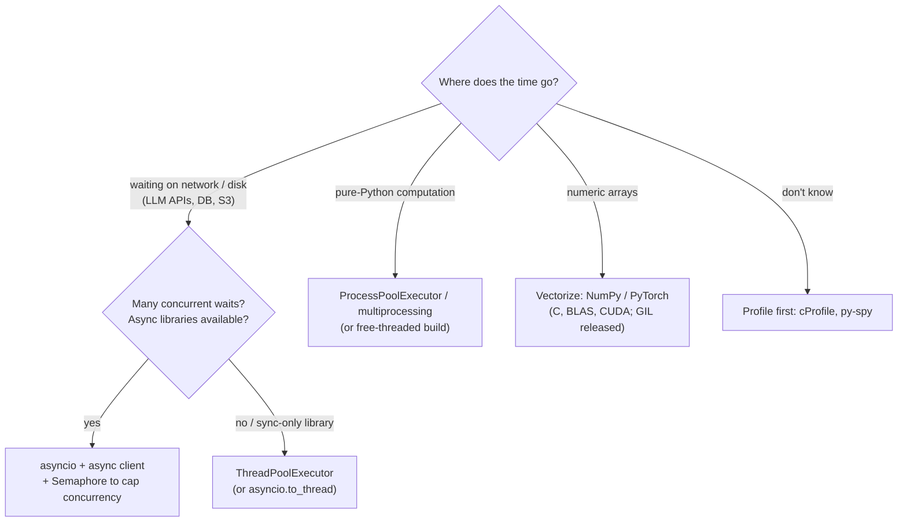

:::tip[TL;DR (30-Second Interview Pitch)]
In standard CPython the **GIL** lets only one thread execute Python bytecode at a time, so the right tool depends on the bottleneck: **`asyncio`** (or threads) for **I/O-bound** work like calling LLM APIs, vector databases and web services; **multiprocessing** (or native libraries that release the GIL) for **CPU-bound** Python work like preprocessing; and **vectorized NumPy/PyTorch** for numeric work, which beats any Python loop by orders of magnitude. Memory is managed by **reference counting plus a cyclic garbage collector**. Python 3.13 introduced an optional **free-threaded (no-GIL)** build, officially supported since 3.14 but not the default. Senior interviews expect you to pick the model, bound the concurrency, and measure before optimizing.
:::

<PriorityKey lang="Python" v="3.11" />

## ⚡ Essential Interview Recall

- 🔴 **Concurrency** = dealing with many tasks at once (interleaving); **parallelism** = doing many at the same instant (multiple cores).
- 🔴 **GIL** = a lock in CPython that allows **one thread at a time** to run Python bytecode. It exists to keep reference counting and the C API simple and fast.
- 🔴 The GIL is **released during blocking I/O** (sockets, files, `time.sleep`) and by well-behaved **C extensions** (NumPy, PyTorch, tokenizers). So threads **do** help I/O-bound work and native code, but **not** pure-Python CPU work.
- 🔴 **Pick the model**: I/O-bound with many waits → **`asyncio`** (or a thread pool); CPU-bound Python → **`multiprocessing` / `ProcessPoolExecutor`**; numeric → **vectorize** (NumPy, PyTorch); GPU work → already parallel and asynchronous.
- 🔴 **`async def`** defines a **coroutine**; **`await`** pauses it and gives control back to the **event loop**; `asyncio.gather` runs coroutines concurrently and returns results **in input order**.
- 🔴 **Never call blocking code inside `async def`** (`time.sleep`, `requests.get`, a sync SDK client): it freezes the whole event loop. Use async libraries (`httpx.AsyncClient`, `AsyncOpenAI`, `AsyncAnthropic`) or `await asyncio.to_thread(fn)`.
- 🔴 **Bound concurrency** with `asyncio.Semaphore(n)` (or a pool's `max_workers`), or 10,000 simultaneous LLM calls become a storm of 429 rate-limit errors.
- 🔴 **Race conditions** still exist with the GIL: `counter += 1` is several bytecodes, so threads can interleave. Protect shared state with `threading.Lock` (or avoid sharing).
- 🔴 **Processes don't share memory**: arguments and results are **pickled** across process boundaries (so lambdas and local functions fail); guard the entry point with `if __name__ == "__main__":`.
- 🟠 Memory = **reference counting** (immediate freeing) + **generational cyclic GC** (for reference cycles). `gc.collect()` forces a pass; `weakref` refers without keeping alive.
- 🟠 Python objects are big: **1M floats in a list ≈ 32 MB** vs **8 MB** as a NumPy `float64` array (4 MB as `float32`).
- 🟠 **Measure first**: `timeit` for snippets, **`cProfile`** for where time goes, `tracemalloc` for memory, py-spy / scalene for production. Then vectorize, cache, or move the hot loop to native code.
- 🟠 PyTorch `DataLoader(num_workers=k)` uses **worker processes** to sidestep the GIL for preprocessing; `pin_memory=True` speeds CPU→GPU copies.
- 🟡 **Free-threaded Python** (`python3.14t`, PEP 703/779): threads run in parallel on all cores, at the cost of slower single-thread code and extensions that must be rebuilt for it. Check with `sys._is_gil_enabled()`.
- 🟡 Since **3.14** the default `multiprocessing` start method on Linux is **`forkserver`** (macOS and Windows use **`spawn`**): child processes no longer inherit the parent's memory by `fork`.
- 🟡 Structured concurrency: **`asyncio.TaskGroup`** and **`asyncio.timeout`** <Since v="3.11" lang="Python" /> cancel sibling tasks on failure and enforce deadlines.

:::speak[What is the GIL and how do you work around it?]
"The GIL is a mutex inside CPython that only lets **one thread execute Python bytecode at a time**. It exists because CPython manages memory with reference counts, and one big lock made that, and C extensions, simple and fast. The consequence is that threads **don't speed up CPU-bound pure-Python code**: in my benchmark two threads running a Python loop were actually slower than running it twice sequentially. But the GIL is **released while waiting on I/O** and inside native code. So for an LLM service that spends its time waiting on HTTP calls I use **asyncio** with an async client and a **semaphore** to cap concurrency. For CPU-heavy preprocessing I use **multiple processes**: `ProcessPoolExecutor` or `DataLoader` workers. And for numeric work I **vectorize** with NumPy or PyTorch, which run in C or on the GPU and release the GIL. Python 3.13 added an optional free-threaded build without the GIL, supported since 3.14, but it isn't the default yet and needs compatible extensions."
:::

## The Mental Model

### 1. Pick the concurrency model by the bottleneck



### 2. Threads vs processes under the GIL

<Animation src="python/gil-threads-vs-processes" caption="With the GIL, two threads take turns holding the lock, so CPU-bound Python work runs one slice at a time and takes as long as running it sequentially, or longer. Two processes each have their own interpreter and GIL, so both cores work at once. Timings are from the benchmark on this page." />

:::analogy[The GIL is a single microphone on a panel]
Several panellists (threads) share one microphone (the GIL). Only the one holding it can speak (run Python code). If they mostly wait for questions from the audience (I/O), sharing the mic costs nothing; they hand it over while waiting. If they all want to give long speeches (CPU work), they just take turns, and the session doesn't get shorter. Separate rooms with their own microphones (processes) are the only way to have several speeches at once.
:::

### 3. The asyncio event loop

<Animation src="python/asyncio-event-loop" caption="One thread runs the event loop. Each coroutine runs until it awaits a network call, then hands control back so the loop can start or resume another one. Eight half-second LLM calls overlap and finish in about half a second instead of four." />

:::analogy[An event loop is one waiter serving many tables]
A waiter (the single thread) takes an order at table 1, hands it to the kitchen (the API call) and, instead of standing there waiting, moves on to table 2, table 3, and so on, coming back to each table when its food is ready (`await` resumes). One waiter serves a whole room, but only if nobody makes them stand still: a blocking call like `time.sleep` is a customer who makes the waiter wait at their table while every other table goes hungry.
:::

## The Paradigm / Core Concepts

### 🔴 Threads vs processes vs asyncio

| | `threading` / `ThreadPoolExecutor` | `multiprocessing` / `ProcessPoolExecutor` | `asyncio` |
|---|---|---|---|
| Unit | OS thread | OS process (own interpreter, own GIL) | Coroutine on **one** thread |
| Parallel Python on many cores | ❌ (GIL), ✅ on the free-threaded build | ✅ | ❌ |
| Best for | Blocking I/O, sync-only libraries, native code that releases the GIL | CPU-bound Python | Many concurrent I/O waits (thousands of sockets) |
| Memory | Shared (needs locks) | **Separate**; data is pickled between processes | Shared, single thread (no locks for plain variables) |
| Switching | Preemptive (OS / interpreter decides) | Preemptive | **Cooperative** (only at `await`) |
| Overhead per task | ~MB of stack per thread | Tens of MB per process, slow start | ~KB per coroutine |
| AI examples | Calling a sync SDK in parallel, image decoding with PIL | Tokenizing a corpus, feature extraction, `DataLoader` workers | LLM fan-out, RAG retrieval from several stores, streaming responses |

### 🔴 Measured on this page (2-core machine, CPython 3.14.6)

| Workload | Sequential | 2 threads | 2 processes | Free-threaded 3.14t, 2 threads |
|---|---|---|---|---|
| Pure-Python loop, run twice | 0.69 s | **0.86 s** (slower: GIL contention) | **0.48 s** | **0.46 s** (but its sequential run took 0.96 s) |

| Workload | Sequential | 8 threads | `asyncio.gather` |
|---|---|---|---|
| 8 × 0.5 s I/O waits (simulated API calls) | 4.00 s | **0.50 s** | **0.50 s** |
| 4 × blocking `time.sleep(0.5)` inside `async def` | — | — | **2.00 s** (the loop was blocked) |
| Same, via `await asyncio.to_thread(time.sleep, 0.5)` | — | — | **0.50 s** |

<RuleCard name="Never block the event loop" tag="asyncio" why="All coroutines share one thread, so any call that doesn't await stops every other request until it returns." remember="Inside async, everything slow is awaited.">

Inside `async def`, every slow operation must be **awaited**: `await asyncio.sleep`, `await client.messages.create(...)` on an async client, `await session.get(...)` with `httpx.AsyncClient`/`aiohttp`. For unavoidable blocking calls (a sync SDK, heavy CPU work) use `await asyncio.to_thread(fn, ...)` or a process pool via `loop.run_in_executor`.

</RuleCard>

### 🟠 Memory management

| Mechanism | What it frees | When | Notes |
|---|---|---|---|
| **Reference counting** | Any object whose count drops to 0 | **Immediately** | Deterministic; most objects die this way |
| **Cyclic garbage collector** | Groups of objects that only reference each other | Periodically, when allocations pass a threshold (`gc.get_threshold()` → `(2000, 10, 10)` on 3.14.6) | Three generations. 3.14.0–3.14.4 tried an incremental collector; 3.14.5 rolled it back after reports of memory pressure in production |
| **`weakref`** | — | — | Refer to an object without keeping it alive (caches, observers) |
| **`__slots__`, generators, arrays** | — | — | Ways to **use less** memory in the first place |

### 🟠 Performance toolbox (in the order to reach for them)

| Step | Tool | What it tells you / does |
|---|---|---|
| 1. Measure | `timeit`, `time.perf_counter` | How long a snippet takes (use `perf_counter`, not `time.time`) |
| 2. Find the hot spot | `cProfile` + `pstats`, **py-spy** (attach to a live process), **scalene** (CPU + memory) | Which functions dominate |
| 3. Better algorithm / data structure | `set`/`dict` lookups, `heapq`, `deque`, `bisect` | Big-O wins beat micro-tuning |
| 4. Vectorize | NumPy, pandas, PyTorch | Moves the loop into C/BLAS/CUDA: we measured **~160×** for a sum of squares |
| 5. Cache | `functools.lru_cache`, Redis | Don't recompute (embeddings, tokenization) |
| 6. Parallelize | Processes, async I/O | Use more cores, overlap waits |
| 7. Compile | Numba, Cython, `torch.compile`, writing a Rust/C++ extension | When the hot loop can't be vectorized |

## ⚙️ Under the Hood (CPython Internals)

- **Why the GIL exists**: every object's reference count is updated constantly; without a global lock each update would need an atomic instruction or a per-object lock. The GIL made single-threaded code fast and C extensions easy to write, at the cost of parallel Python threads.
- **Switching**: a thread holding the GIL is asked to drop it every **switch interval** (`sys.getswitchinterval()` → 5 ms) so other threads get a turn; blocking I/O calls and well-behaved C code release it voluntarily (`Py_BEGIN_ALLOW_THREADS`). Two CPU-bound threads fighting over it add switching overhead, which is why our threaded run was **slower** than sequential.
- **Free-threaded build (PEP 703)**: removes the GIL by using **biased reference counting** (cheap updates from the owning thread), per-object locks inside built-in containers, **immortal objects** and a thread-safe allocator (mimalloc). Single-threaded code runs slower (our loop took 0.96 s vs 0.69 s), and C extensions must declare support or the GIL is re-enabled at import.
- **asyncio**: an **event loop** keeps a queue of ready callbacks and asks the OS (epoll/kqueue/IOCP) which sockets are ready. A coroutine is a generator-like object; `await` suspends it and yields control to the loop, which resumes it when the awaited future completes. Calling `fake_llm(1)` without `await` just creates a coroutine object that never runs (`RuntimeWarning: coroutine 'fake_llm' was never awaited`).
- **multiprocessing start methods**: **`fork`** copies the parent process (fast, but unsafe with threads, CUDA contexts and some locks); **`spawn`** starts a fresh interpreter and re-imports your module (hence the `__main__` guard); **`forkserver`** forks from a clean helper process. Python **3.14** made `forkserver` the default on Linux; macOS and Windows use `spawn`. Arguments travel by **pickling**, so they must be picklable and large ones should be shared via files, shared memory or memory-mapped arrays.
- **CUDA and fork don't mix**: initializing CUDA in the parent and then forking leads to errors in the children; PyTorch's `DataLoader` workers should do CPU work only, and the model lives in the main process.
- **Generational GC**: new container objects start in the young generation; surviving a collection promotes them. Only **containers** (lists, dicts, instances…) are tracked, since only they can form cycles. Large reference cycles involving big tensors can keep GPU memory alive until a GC pass, one reason `del` alone may not free VRAM; `gc.collect()` followed by `torch.cuda.empty_cache()` releases it back to the driver.
- **Memory is rarely returned to the OS**: CPython's small-object allocator (pymalloc) keeps freed blocks in arenas for reuse, so a process's RSS often stays high after a large temporary allocation. Long-running workers that process huge batches are often recycled periodically (`max_tasks_per_child`, Gunicorn `max_requests`).

:::danger[Interview Trap]
**"The GIL makes my code thread-safe" is false.** The GIL protects the interpreter's internals, not your logic. `counter += 1` compiles to load, add, store; a thread switch between the load and the store loses an update. In our demo, four threads doing 1,000 forced read-modify-write increments ended at **1000 instead of 4000**; with a `Lock` the total was exactly 4000. On the free-threaded build races become even more likely.
:::

:::danger[Interview Trap]
**`async` doesn't make code faster by itself.** It lets one thread overlap **waiting**. CPU-bound work inside a coroutine still runs one piece at a time and blocks every other coroutine while it runs. If an async FastAPI endpoint does heavy preprocessing or calls a sync client, throughput can be worse than a plain synchronous endpoint (which FastAPI runs in a thread pool).
:::

## 💻 Python Implementation

:::tip[Run it yourself]
Save the snippets as `.py` files and run them with `python file.py` (process pools need the `__main__` guard). Timings come from a 2-core machine running **CPython 3.14.6**, and the free-threaded **3.14.6t** where noted.
:::

### 1. CPU-bound: threads vs processes

```python title="cpu_bound.py" showLineNumbers
import time
from concurrent.futures import ThreadPoolExecutor, ProcessPoolExecutor

def cpu_task(n=5_000_000):                    # pure-Python arithmetic: holds the GIL
    total = 0
    for i in range(n):
        total += i * i
    return total

# highlight-next-line
if __name__ == "__main__":                    # REQUIRED for process pools (spawn / forkserver re-import this file)
    t = time.perf_counter(); [cpu_task(), cpu_task()]
    print(f"sequential {time.perf_counter() - t:.2f}s")    # 0.69s

    with ThreadPoolExecutor(max_workers=2) as ex:
        t = time.perf_counter(); list(ex.map(cpu_task, [5_000_000] * 2))
        # error-next-line
        print(f"2 threads  {time.perf_counter() - t:.2f}s")  # 0.86s: no speed-up under the GIL

    with ProcessPoolExecutor(max_workers=2) as ex:
        t = time.perf_counter(); list(ex.map(cpu_task, [5_000_000] * 2))
        # success-next-line
        print(f"2 processes {time.perf_counter() - t:.2f}s") # 0.48s: two interpreters, two cores
```

### 2. I/O-bound: threads and asyncio

```python title="io_bound.py" showLineNumbers
import asyncio, time
from concurrent.futures import ThreadPoolExecutor

def call_api_sync(i):
    time.sleep(0.5)                           # stands in for a blocking HTTP call (GIL released while waiting)
    return f"answer {i}"

async def call_api(i):
    # highlight-next-line
    await asyncio.sleep(0.5)                  # stands in for: await client.messages.create(...)
    return f"answer {i}"

async def main():
    return await asyncio.gather(*(call_api(i) for i in range(8)))

t = time.perf_counter(); [call_api_sync(i) for i in range(8)]
print(f"sequential {time.perf_counter() - t:.2f}s")            # 4.00s

with ThreadPoolExecutor(max_workers=8) as ex:
    t = time.perf_counter(); list(ex.map(call_api_sync, range(8)))
    print(f"8 threads  {time.perf_counter() - t:.2f}s")         # 0.50s

t = time.perf_counter(); results = asyncio.run(main())
print(f"asyncio    {time.perf_counter() - t:.2f}s", results[:2])  # 0.50s ['answer 0', 'answer 1']
```

### 3. Blocking the event loop (and the fix)

```python showLineNumbers
import asyncio, time

async def bad_handler(i):
    # error-next-line
    time.sleep(0.5)                           # ❌ blocks the ONE event-loop thread
    return i

async def good_handler(i):
    # success-next-line
    await asyncio.to_thread(time.sleep, 0.5)  # ✅ runs the blocking call in a worker thread
    return i

async def run(handler):
    return await asyncio.gather(*(handler(i) for i in range(4)))

# asyncio.run(run(bad_handler))   → 2.00s: the four "concurrent" calls ran one after another
# asyncio.run(run(good_handler))  → 0.50s
```

### 4. Bounded concurrency, timeouts and task groups for LLM calls

```python title="llm_fanout.py" showLineNumbers
import asyncio

MAX_CONCURRENT = 3

async def call_llm(prompt, sem):
    # highlight-next-line
    async with sem:                           # at most 3 requests in flight
        await asyncio.sleep(0.1)              # stands in for the API call
        return f"answer to {prompt}"

async def main(prompts):
    sem = asyncio.Semaphore(MAX_CONCURRENT)
    # highlight-next-line
    async with asyncio.timeout(30):           # 3.11+: overall deadline for the whole batch
        return await asyncio.gather(*(call_llm(p, sem) for p in prompts))

answers = asyncio.run(main([f"q{i}" for i in range(10)]))   # peak concurrency observed: 3
```

```python showLineNumbers
import asyncio

async def retrieve(store):
    await asyncio.sleep(0.1)
    if store == "bm25":
        raise ValueError("provider 500")
    return f"docs from {store}"

async def main():
    try:
        # highlight-next-line
        async with asyncio.TaskGroup() as tg:  # 3.11+: if one task fails, the others are cancelled
            t1 = tg.create_task(retrieve("vector"))
            t2 = tg.create_task(retrieve("bm25"))
    except* ValueError as eg:
        print("retrieval failed:", eg.exceptions[0])   # retrieval failed: provider 500

asyncio.run(main())
```

### 5. `gather` returns results in input order

```python showLineNumbers
import asyncio

async def work(name, delay):
    await asyncio.sleep(delay)
    print(f"finished {name}")
    return name

async def main():
    return await asyncio.gather(work("slow", 0.3), work("fast", 0.1))

print(asyncio.run(main()))
# finished fast
# finished slow
# ['slow', 'fast']   ← input order, not completion order (use asyncio.as_completed for that)
```

### 6. Race conditions and locks

```python showLineNumbers
import threading, time

counter = 0
lock = threading.Lock()

def unsafe_inc(n):
    global counter
    for _ in range(n):
        v = counter                           # read
        time.sleep(0)                         # give up the GIL: makes the race visible
        # error-next-line
        counter = v + 1                       # write back a stale value

def safe_inc(n):
    global counter
    for _ in range(n):
        # success-next-line
        with lock:                            # read-modify-write as one critical section
            v = counter
            time.sleep(0)
            counter = v + 1

threads = [threading.Thread(target=unsafe_inc, args=(1000,)) for _ in range(4)]
for t in threads: t.start()
for t in threads: t.join()
print(counter)                                # 1000, not 4000: updates were lost
```

### 7. Memory: cycles, `gc` and NumPy vs lists

```python showLineNumbers
import gc, weakref

class Node:
    pass

a, b = Node(), Node()
a.other, b.other = b, a                       # a reference cycle
probe = weakref.ref(a)                        # observe a without keeping it alive
del a, b
print(probe() is not None)                    # True: refcounts never reached 0
gc.collect()
print(probe() is not None)                    # False: the cyclic GC freed both

import numpy as np
xs = [float(i) for i in range(1_000_000)]     # ~32 MB: 1M float objects + 1M pointers
arr = np.arange(1_000_000, dtype=np.float64)  # 8 MB: raw doubles, contiguous
print(arr.nbytes, arr.astype(np.float32).nbytes)   # 8000000 4000000
```

### 8. Measure, then vectorize

```python showLineNumbers
import timeit
import numpy as np

xs = [float(i) for i in range(1_000_000)]
arr = np.arange(1_000_000, dtype=np.float64)

py = timeit.timeit(lambda: sum(x * x for x in xs), number=5) / 5
# highlight-next-line
vec = timeit.timeit(lambda: float(np.dot(arr, arr)), number=5) / 5
print(f"python {py * 1000:.1f} ms, numpy {vec * 1000:.2f} ms")   # python 55.8 ms, numpy 0.34 ms (~160×)
```

```python title="Profiling a slow function" showLineNumbers
import cProfile, pstats

def slow():
    return sorted([str(i) for i in range(200_000)])

cProfile.run("slow()", "out.prof")            # or: python -m cProfile -s cumulative script.py
pstats.Stats("out.prof").sort_stats("cumulative").print_stats(5)   # top 5 functions by total time
```

### 9. Feeding the GPU: `DataLoader` workers

```python title="loader.py (PyTorch)" showLineNumbers
from torch.utils.data import DataLoader

loader = DataLoader(
    dataset,
    batch_size=64,
    shuffle=True,
    # highlight-next-line
    num_workers=8,                            # 8 worker PROCESSES run __getitem__ (decode, augment, tokenize)
    pin_memory=True,                          # page-locked host memory → faster .to("cuda", non_blocking=True)
    persistent_workers=True,                  # don't re-spawn workers every epoch
    prefetch_factor=2,                        # batches prepared ahead per worker
)
```

| Symptom | Likely cause | Fix |
|---|---|---|
| GPU utilization 20–40%, CPU busy | Preprocessing in the main process | `num_workers > 0`, move heavy transforms to the GPU, pre-tokenize |
| Workers crash with pickling errors | Lambdas or local functions in the dataset | Use module-level functions / classes |
| Memory grows with `num_workers` | Each worker holds a copy of Python lists (refcount writes break copy-on-write) | Store data in NumPy arrays or memory-mapped files |
| CUDA errors in workers | CUDA touched before forking | Keep workers CPU-only; use `spawn` / `forkserver` |

## 🧪 Predict the Output

<Predict n="1" title="Threads on a CPU-bound loop" output="About the same or slower than sequential (0.86 s vs 0.69 s)">

```python
# two calls of a pure-Python loop that takes ~0.35 s each
with ThreadPoolExecutor(2) as ex:
    list(ex.map(cpu_task, [5_000_000] * 2))
```

Only the thread holding the GIL runs Python bytecode, so the two threads take turns instead of running in parallel; the forced switching every 5 ms adds overhead. Processes (0.48 s on 2 cores) or the free-threaded build (0.46 s) give real parallelism.

</Predict>

<Predict n="2" title="Blocking inside async" output="About 2.0 s">

```python
async def handler(i):
    time.sleep(0.5)
    return i

async def main():
    await asyncio.gather(*(handler(i) for i in range(4)))

asyncio.run(main())   # how long?
```

`time.sleep` doesn't `await`, so it never returns control to the event loop. Each coroutine runs to completion before the next starts: 4 × 0.5 s = 2 s. With `await asyncio.sleep(0.5)` (or `await asyncio.to_thread(time.sleep, 0.5)`) all four overlap and the total is ~0.5 s.

</Predict>

<Predict n="3" title="The forgotten await" output="returned without awaiting, plus RuntimeWarning: coroutine 'fake_llm' was never awaited">

```python
async def fake_llm(i):
    await asyncio.sleep(0.5)
    return f"answer {i}"

async def main():
    fake_llm(1)
    return "returned without awaiting"

print(asyncio.run(main()))
```

Calling a coroutine function only **creates** a coroutine object; nothing runs until it's awaited or scheduled as a task. The call is silently dropped and Python warns when the unused coroutine is garbage-collected. Classic symptom: "my API call never happens and there's no error".

</Predict>

<Predict n="4" title="gather ordering" output="finished fast, finished slow, ['slow', 'fast']">

```python
async def work(name, delay):
    await asyncio.sleep(delay)
    print(f"finished {name}")
    return name

async def main():
    return await asyncio.gather(work("slow", 0.3), work("fast", 0.1))

print(asyncio.run(main()))
```

The coroutines run concurrently, so `fast` finishes (and prints) first, but `gather` returns results **in the order the awaitables were passed**, which makes it easy to zip results back to their inputs. Use `asyncio.as_completed` to handle results as they arrive.

</Predict>

<Predict n="5" title="Lost updates" output="1000 (not 4000)">

```python
counter = 0
def unsafe_inc(n):
    global counter
    for _ in range(n):
        v = counter
        time.sleep(0)
        counter = v + 1

threads = [threading.Thread(target=unsafe_inc, args=(1000,)) for _ in range(4)]
# start all, join all
print(counter)
```

Each thread reads `counter`, yields (so another thread reads the **same** value), then writes `v + 1`. The four threads keep overwriting each other's increments. The GIL doesn't make a read-modify-write atomic; a `threading.Lock` around the three steps gives 4000. (Without the `sleep(0)` the race is rarer, which makes it worse: it passes tests and fails in production.)

</Predict>

<Predict n="6" title="A cycle after del" output="True, then False">

```python
a, b = Node(), Node()
a.other, b.other = b, a
probe = weakref.ref(a)
del a, b
print(probe() is not None)
gc.collect()
print(probe() is not None)
```

After `del`, each object is still referenced by the other, so neither refcount reaches zero and they stay alive. The **cyclic garbage collector** detects that the group is unreachable from the program and frees it on the next collection, here forced with `gc.collect()`.

</Predict>

## 🪜 Follow-up Ladder

<Ladder title="From the GIL to a production LLM service">
<Rung q="What is the GIL?">

A lock in CPython that allows only one thread to execute Python bytecode at a time, protecting reference counts and interpreter state.

</Rung>
<Rung q="So are Python threads useless?">

No. The GIL is released during blocking I/O and inside native code, so threads give real speed-ups for network/disk-bound work and for libraries like NumPy and PyTorch. They don't parallelize pure-Python CPU work.

</Rung>
<Rung q="How would you call an LLM API for 10,000 documents as fast as possible?">

`asyncio` with the provider's **async** client, an `asyncio.Semaphore` sized to the rate limit, retries with exponential backoff and jitter on 429/5xx, per-request timeouts, and results written incrementally (so a crash doesn't lose everything). For offline jobs, check whether the provider offers a **batch API**, which is usually cheaper.

</Rung>
<Rung q="The service's latency spikes under load even though the API is fast. What do you check?">

Something is **blocking the event loop**: a sync HTTP client or SDK, CPU-heavy work (tokenization, JSON parsing of huge payloads, embedding post-processing) or synchronous logging to a slow sink inside `async def`. Use asyncio debug mode (it logs slow callbacks), py-spy to see where the loop thread spends time, and move blocking work to `asyncio.to_thread` or a process pool.

</Rung>
<Rung q="Would the free-threaded build change your design?">

It makes **threads** viable for CPU-bound Python, which simplifies sharing in-memory state compared with processes. But single-thread performance drops, every C extension in the stack must support it, and shared mutable state needs real locking. I'd benchmark it for the CPU-bound part (preprocessing) and keep asyncio for the I/O-bound part either way.

</Rung>
</Ladder>

## 🚑 Production Scenarios

:::incident[An async RAG endpoint handled one request at a time]
A FastAPI service with `async def` endpoints was load-tested at 50 concurrent users; throughput was the same as with one user, and p99 latency grew linearly with concurrency.

- **Why:** inside the async endpoint the code used the **synchronous** SDK client and `requests` to call the embedding API and the LLM. Each blocking call froze the single event-loop thread, so requests were served strictly one after another.
- **Fix:** switch to the async clients (`AsyncOpenAI` / `AsyncAnthropic`, `httpx.AsyncClient`) and `await` them; wrap the remaining blocking calls with `await asyncio.to_thread(...)`. Alternatively declare the endpoint with plain `def`, which FastAPI runs in a thread pool.
- **Prevention:** a load test in CI that asserts throughput scales with concurrency, and a lint rule that flags blocking calls inside `async def` (Ruff's flake8-async rules).
:::

:::incident[A batch job got the whole team rate-limited]
A nightly enrichment job sent 50,000 prompts with `asyncio.gather(*all_calls)`. Within seconds every call (and every other service sharing the API key) started failing with 429 errors, and naive retries made it worse.

- **Why:** `gather` with no limit started **all** 50,000 requests at once, far beyond the account's requests-per-minute and tokens-per-minute limits; the immediate retries were a second storm.
- **Fix:** an `asyncio.Semaphore` sized from the rate limit, retries with exponential backoff and jitter that respect the `retry-after` header, processing in chunks with checkpointed progress, and a separate API key (or the provider's batch API) for offline jobs.
:::

:::incident[GPUs idled at 30% utilization]
A vision model trained much slower than expected on 8 GPUs; `nvidia-smi` showed utilization swinging between 0% and 100%.

- **Why:** `DataLoader(num_workers=0)`: JPEG decoding and augmentation ran in the main Python process, under the GIL, while the GPUs waited for each batch.
- **Fix:** `num_workers` ≈ CPU cores per GPU, `pin_memory=True`, `persistent_workers=True`, and moving augmentation to the GPU where possible. Utilization went from ~30% to over 90%.
:::

## 🚨 Interview Gotchas & Edge Cases

:::warning[The Most Common Question]
**"Multithreading vs multiprocessing vs asyncio in Python: when do you use each?"** Threads for I/O-bound work, especially with blocking libraries (the GIL is released while waiting). Processes for CPU-bound Python, since each has its own interpreter and GIL, at the cost of pickling data and higher memory. asyncio for large numbers of concurrent I/O operations on one thread with cooperative switching, the default for LLM and web services. Then mention the numbers: a CPU loop gets **no** speed-up from threads, I/O waits overlap almost perfectly, and NumPy-style vectorization beats all three for numeric code.
:::

- **`if __name__ == "__main__":` is mandatory** with `spawn`/`forkserver` (macOS, Windows, and Linux since 3.14): without it each child re-imports the script and tries to start its own pool → `RuntimeError` or a fork bomb.
- **Daemon threads are killed abruptly** at interpreter exit: don't use them for work that must finish (flushing logs, writing checkpoints).
- **`asyncio.run` can't be called from a running loop** (Jupyter already runs one): use `await main()` directly in a notebook cell.
- **`ProcessPoolExecutor` results must be picklable**: returning open files, locks, generators or CUDA tensors fails.
- **`queue.Queue` for threads, `multiprocessing.Queue` for processes, `asyncio.Queue` for coroutines**: they aren't interchangeable.
- **Thread-safety of built-ins**: single operations like `list.append` and `dict[k] = v` are atomic under the GIL in CPython, but compound operations (check-then-set, `+=`) are not, and none of this is guaranteed by the language. Use locks or queues.
- **`del tensor` may not free GPU memory immediately**: other references (the autograd graph, a list of losses holding tensors instead of `.item()` floats, an exception traceback) keep it alive. Store `loss.item()`, not `loss`.
