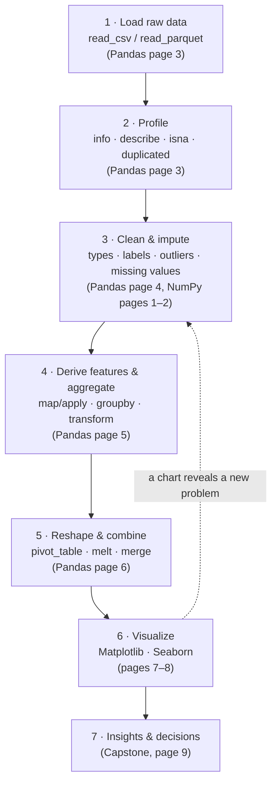
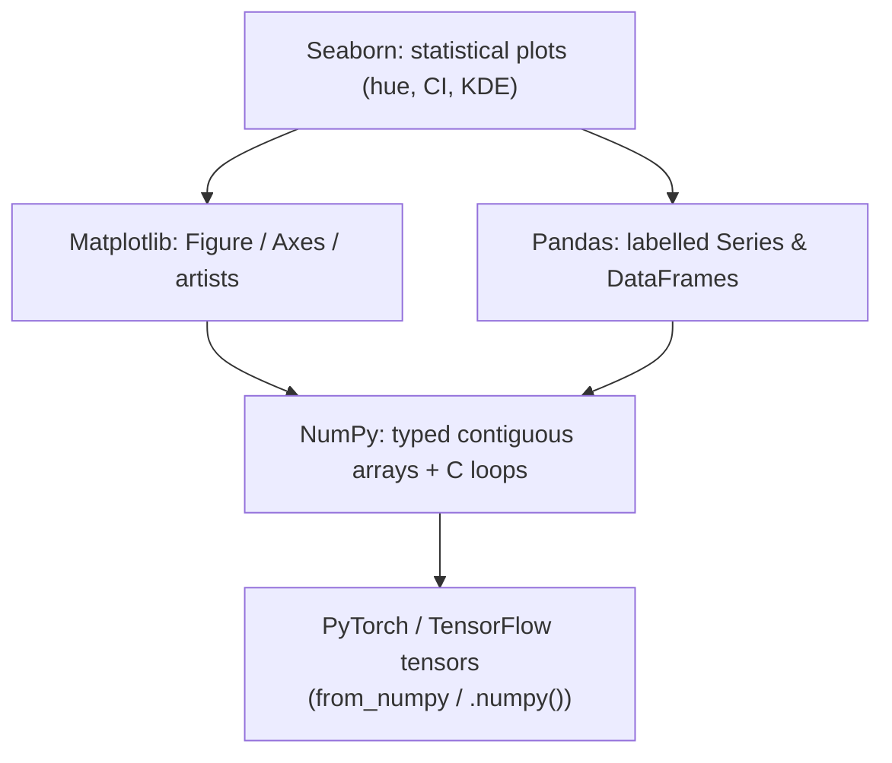

:::tip[TL;DR (30-Second Interview Pitch)]
**Exploratory Data Analysis (EDA)** is the step between "here is a raw dataset" and "here is a model": you load the data, find out what is wrong with it, fix it, summarize it and look at it until you understand its shape, its quirks and its signal. In Python that work runs on four libraries that stack on top of each other: **NumPy** (fast typed arrays, the foundation), **Pandas** (labelled tables built on NumPy), **Matplotlib** (the drawing engine) and **Seaborn** (statistical charts built on Matplotlib and Pandas). Every page in this section works on the same deliberately messy e-commerce dataset, **ShopStream**, so together the pages tell one end-to-end EDA story.
:::

<PriorityKey lang="pandas" v="3.0" />

## 🧭 Start Here: What EDA Is and Why It Decides Your Model

**What it is.** EDA is the investigation you do *before* modelling. You don't yet know what questions to ask, so you ask the data: how many rows? which columns are missing values? are the prices believable? does delivery time relate to ratings? Every answer either reveals a **data-quality problem** to fix or a **pattern** worth modelling.

**Why it matters.** A model can only learn what's in its training data. If 2% of quantities are `-1` or `999`, a revenue model learns nonsense; if a category is spelt five different ways, a classifier sees five categories instead of one; if test customers leak into training, your accuracy is fiction. Most real-world ML failures are data failures, and EDA is where you catch them. Interviewers at AI-first companies routinely hand you a CSV and say "tell me about this data" because it reveals how you think.

**How the four libraries divide the work:**

| Library | What it gives you | Analogy | You reach for it when… |
|---|---|---|---|
| **NumPy** | `ndarray`: a block of same-typed numbers in contiguous memory, with vectorized maths in C | The engine | Numeric computation, maths on whole arrays, feeding tensors to PyTorch |
| **Pandas** | `Series` and `DataFrame`: NumPy arrays with **labels** (an index and column names), plus I/O, cleaning, grouping, joining | The spreadsheet that can code | Loading, cleaning, reshaping and summarizing tabular data |
| **Matplotlib** | Low-level, fully controllable plotting (`Figure`, `Axes`, every line and label) | The canvas and brushes | Exact control over a chart, multi-panel layouts, publication figures |
| **Seaborn** | High-level statistical plots that understand DataFrames (`hue=`, confidence intervals, KDEs) | The chart assistant | Quick, correct statistical views: distributions, categories, correlations |

:::analogy[EDA is a doctor's check-up for data]
Before a doctor prescribes anything, they take your temperature, check your blood pressure and ask about symptoms. EDA is that check-up: `.info()` and `.describe()` are the vital signs, missing-value counts are the symptoms, histograms and box plots are the X-rays. Prescribing a model without them is treating a patient you've never examined.
:::

## ⚡ Essential Interview Recall

- 🔴 **EDA lifecycle**: load → profile (shape, dtypes, missing, duplicates) → clean (types, labels, outliers, missing values) → derive features → aggregate and reshape → visualize → write down insights and decisions.
- 🔴 **NumPy is the foundation**: a Pandas column is (usually) a NumPy array plus an index; Seaborn and Matplotlib draw NumPy/Pandas data; PyTorch tensors convert to and from NumPy (often without copying).
- 🔴 **Vectorize, don't loop**: whole-array operations run in compiled C and are typically 10–100× faster than Python loops.
- 🔴 **Profile before you clean**: `df.shape`, `df.info()`, `df.describe()`, `df.isna().sum()`, `df.duplicated().sum()`, `df[col].value_counts()`.
- 🔴 **Never trust raw categories, dates or numbers**: normalize labels, parse dates explicitly, sanity-check ranges.
- 🟠 **Missing ≠ zero**: decide per column whether to drop, impute (mean / median / mode / group-wise / forward-fill) or keep a missing indicator, and write down why.
- 🟠 **Skewed data**: describe it with the **median and IQR**, not the mean and std; consider a log transform.
- 🟠 **Fit cleaning statistics on training data only** (medians, encoders, scalers), then apply them to validation/test: otherwise you leak information.
- 🟡 **pandas 3.0** (current): **Copy-on-Write** is always on, text columns default to the new `str` dtype, and `applymap` is gone (use `DataFrame.map`). Older tutorials and interview questions still assume pandas 1.x/2.x behaviour, so know both.

:::speak[Walk me through how you would explore a new dataset]
"First I look at it before touching it: `shape`, `info()` for dtypes and non-null counts, `head()`, `describe()` for ranges, and `value_counts()` on the categorical columns. Then I list problems: wrong dtypes, like dates stored as text or numbers as strings; inconsistent labels; impossible values, like negative quantities; outliers; duplicates; and missing values, with the percentage per column. I fix them deliberately: parse types, normalize labels, cap or flag outliers using the IQR rule, drop exact duplicates, and impute missing values with a strategy chosen per column. I record every decision, because each one changes the model. Then I engineer a few features, aggregate with `groupby` and pivot tables to answer concrete questions, and visualize: distributions for each numeric column, box plots across categories, a correlation heatmap and time trends. I finish with a short list of insights and the next modelling steps. Throughout, I compute any cleaning statistic on the training split only, so nothing leaks into evaluation."
:::

## The Mental Model

### 1. The EDA lifecycle (and which page covers each stage)



### 2. How the libraries stack



:::analogy[The stack is a restaurant kitchen]
NumPy is the stove and knives: raw, fast, does exactly what it's told. Pandas is the prep cook who knows every ingredient by name and keeps the labelled containers in order. Matplotlib is the plating station that can arrange anything on a plate, one garnish at a time. Seaborn is the head chef who says "the usual presentation for this dish" and gets a finished plate in one instruction, using the same plating station underneath.
:::

## The Running Dataset: ShopStream

Every page uses the same synthetic e-commerce dataset so you can follow one story from raw CSV to dashboard. It is **seeded** (identical on every run) and **deliberately messy** in the ways real data is.

| File | Rows | Download |
|---|---|---|
| Orders (one row per order) | 5,020 | [shopstream_orders.csv](pathname:///data/shopstream_orders.csv) |
| Customers (one row per customer) | 200 | [shopstream_customers.csv](pathname:///data/shopstream_customers.csv) |

### 🔴 Data dictionary

| Column | Table | Meaning | Raw dtype (pandas 3) |
|---|---|---|---|
| `order_id` | orders | `O00001` … `O05000` | `str` |
| `customer_id` | both | `C0001` … `C0200` (join key) | `str` |
| `order_ts` | orders | Order timestamp, **as text** | `str` |
| `category` | orders | Electronics, Fashion, Home, Books, Beauty | `str` |
| `unit_price` | orders | Price of one unit in ₹ (log-normal, right-skewed) | `float64` |
| `quantity` | orders | Units in the order | `int64` |
| `discount_pct` | orders | 0, 0.05, 0.10, 0.20 or 0.30 | `float64` |
| `payment_method` | orders | UPI, Card, COD, Wallet | `str` |
| `device` | orders | mobile, app, desktop | `str` |
| `delivery_days` | orders | Days from order to delivery | `float64` |
| `rating` | orders | 1–5 stars, if the customer rated | `float64` |
| `name`, `city`, `tier`, `signup_date` | customers | Generic first name (Alex, Jordan, Morgan…), city, Bronze/Silver/Gold, signup date | `str` / `datetime64[us]` |

### 🔴 The messiness, catalogued

| Problem | Count | Where it's fixed |
|---|---|---|
| Category spelt inconsistently (`" Electronics "`, `"FASHION"`, `"home"`) → **20 distinct labels** for 5 categories | 503 rows | Pandas: cleaning |
| Dates in two formats (`2026-03-05 14:22:10` and day-first `05/03/2026 14:22`) | 251 day-first rows | Pandas: cleaning |
| Data-entry price outliers (40× the real price, up to ₹771,750) → skewness 29.7 | 25 rows | NumPy + Pandas: cleaning |
| Impossible quantities: `0`, `-1`, `999` | 20 + 20 + 2 rows | NumPy: boolean masks |
| Missing `discount_pct` / `payment_method` / `delivery_days` | 401 / 150 / 300 | Pandas: missing data |
| Missing `rating` (people often don't rate) | 2,009 rows (40%) | Pandas: missing data |
| Orders whose `customer_id` (`C9999`) has no customer record | 100 rows | Pandas: merging (`indicator=True`) |
| Exact duplicate rows | 20 rows | Pandas: cleaning |

### 🟠 The generator (full source)

Run this once and every page's code works. It's also saved in the site repository as `scripts/data_exploration/shopstream.py`.

```python title="shopstream.py" showLineNumbers
import numpy as np
import pandas as pd


def make_shopstream(n_orders=5_000, n_customers=200, seed=42):
    rng = np.random.default_rng(seed)

    # ---- customers: one row per customer --------------------------------------
    customers = pd.DataFrame({
        "customer_id": [f"C{i:04d}" for i in range(1, n_customers + 1)],
        "name": rng.choice(["Alex", "Jordan", "Morgan", "Taylor", "Riley",
                            "Casey", "Sam", "Jamie", "Avery", "Quinn"], n_customers),
        "city": rng.choice(["Pune", "Mumbai", "Bengaluru", "Delhi", "Hyderabad"],
                           n_customers, p=[0.30, 0.25, 0.20, 0.15, 0.10]),
        "tier": rng.choice(["Bronze", "Silver", "Gold"], n_customers, p=[0.6, 0.3, 0.1]),
        "signup_date": pd.Timestamp("2025-01-01")
                       + pd.to_timedelta(rng.integers(0, 365, n_customers), unit="D"),
    })

    # ---- orders: one row per order --------------------------------------------
    log_mean = {"Electronics": 9.0, "Fashion": 7.2, "Home": 7.6, "Books": 5.8, "Beauty": 6.5}
    category = rng.choice(list(log_mean), n_orders, p=[0.25, 0.25, 0.20, 0.15, 0.15])
    # highlight-next-line
    unit_price = np.exp(rng.normal([log_mean[c] for c in category], 0.5))        # log-normal → right-skewed
    customer_id = rng.choice(customers["customer_id"].to_numpy(), n_orders)
    seconds = rng.integers(0, 181 * 24 * 3600, n_orders)                         # 1 Jan – 30 Jun 2026
    ts = pd.Timestamp("2026-01-01") + pd.to_timedelta(seconds, unit="s")
    payment = rng.choice(["UPI", "Card", "COD", "Wallet"], n_orders, p=[0.45, 0.25, 0.15, 0.15])
    city = customers.set_index("customer_id").loc[customer_id, "city"].to_numpy()
    slow_city = np.isin(city, ["Delhi", "Hyderabad"])
    delivery = np.round(rng.gamma(2.0, 1.5, n_orders) + 1 + 2 * slow_city + 1.5 * (payment == "COD"))
    rating = np.clip(np.round(5.2 - 0.35 * delivery + rng.normal(0, 0.8, n_orders)), 1, 5)

    orders = pd.DataFrame({
        "order_id": [f"O{i:05d}" for i in range(1, n_orders + 1)],
        "customer_id": customer_id,
        "order_ts": ts.strftime("%Y-%m-%d %H:%M:%S"),
        "category": category,
        "unit_price": unit_price.round(2),
        "quantity": rng.poisson(0.8, n_orders) + 1,
        "discount_pct": rng.choice([0.0, 0.05, 0.10, 0.20, 0.30], n_orders, p=[0.5, 0.2, 0.15, 0.1, 0.05]),
        "payment_method": payment,
        "device": rng.choice(["mobile", "app", "desktop"], n_orders, p=[0.5, 0.3, 0.2]),
        "delivery_days": delivery,
        "rating": rating,
    })

    # ---- inject realistic messiness (each step touches a random subset) -------
    def pick(frac):
        return rng.choice(n_orders, int(frac * n_orders), replace=False)

    i = pick(0.10)                                                                 # inconsistent labels
    orders.loc[i, "category"] = [rng.choice([c.lower(), c.upper(), f" {c} "]) for c in orders.loc[i, "category"]]
    i = pick(0.05)                                                                 # day-first date strings
    orders.loc[i, "order_ts"] = ts[i].strftime("%d/%m/%Y %H:%M")
    orders.loc[pick(0.005), "unit_price"] *= 40                                    # data-entry outliers
    orders.loc[pick(0.004), "quantity"] = 0                                        # impossible quantities
    orders.loc[pick(0.004), "quantity"] = -1
    orders.loc[pick(0.0006), "quantity"] = 999
    orders.loc[pick(0.08), "discount_pct"] = np.nan                                # missing values
    orders.loc[pick(0.03), "payment_method"] = None
    orders.loc[pick(0.06), "delivery_days"] = np.nan
    orders.loc[pick(0.40), "rating"] = np.nan                                      # many people never rate
    orders.loc[pick(0.02), "customer_id"] = "C9999"                                # orphan rows (no customer)
    dupes = orders.sample(20, random_state=seed)                                   # exact duplicate rows
    orders = pd.concat([orders, dupes], ignore_index=True)
    return orders, customers


orders, customers = make_shopstream()
print(orders.shape, customers.shape)          # (5020, 11) (200, 5)
```

:::info[AI Engineering: why the data is generated this way]
The generator bakes in real cause and effect so the EDA has something to find: **delivery is slower** in Delhi and Hyderabad and for cash-on-delivery orders, and **ratings fall as delivery slows**. Prices are **log-normal** (most orders cheap, a long tail of expensive electronics), which is how money usually behaves. Those relationships are what the later pages discover with `groupby`, correlation heatmaps and box plots.
:::

## The Paradigm / Core Concepts

### 🔴 Section roadmap

| # | Page | Lifecycle stage | Key interview topics |
|---|---|---|---|
| 1 | [NumPy: Arrays, Memory & Indexing](./01-numpy-arrays-memory-indexing.md) | Foundation | Why lists are slow, strides, dtypes, views vs copies, boolean masks |
| 2 | [NumPy: Broadcasting, Reshaping, Linear Algebra & Aggregations](./02-numpy-broadcasting-linalg-aggregations.md) | Foundation | Broadcasting rules, `axis`, norms, `solve` vs `inv`, NumPy ↔ PyTorch |
| 3 | [Pandas: Series, DataFrames, Loading & Indexing](./03-pandas-structures-loading-indexing.md) | Load, profile | Index alignment, `loc` vs `iloc`, chunked reading, Copy-on-Write |
| 4 | [Pandas: Cleaning, Types & Missing Data](./04-pandas-cleaning-types-missing-data.md) | Clean | Dates, `.str`, `category`, imputation strategies, outliers |
| 5 | [Pandas: map/apply, GroupBy, agg & transform](./05-pandas-groupby-apply-transform.md) | Features, aggregate | Split-apply-combine, `agg` vs `transform`, vectorization |
| 6 | [Pandas: Reshaping & Combining](./06-pandas-reshape-combine.md) | Reshape, combine | Pivot vs melt, join types, `validate`, `indicator` |
| 7 | [Matplotlib: Figures, Axes & Customization](./07-matplotlib-figures-axes.md) | Visualize | OO interface, chart choice, ticks, annotations, export |
| 8 | [Seaborn: Statistical Visualization](./08-seaborn-statistical-plots.md) | Visualize | Figure vs axes level, distributions, heatmaps, pair plots |
| 9 | [Capstone: End-to-End EDA Pipeline](./09-capstone-eda-pipeline.md) | Everything | A full script → `GridSpec` dashboard → findings |

### 🟠 Setting up the environment

```bash title="Terminal"
python -m venv .venv && source .venv/bin/activate      # Windows: .venv\Scripts\activate
pip install numpy pandas pyarrow matplotlib seaborn scipy jupyterlab
python -c "import numpy, pandas, matplotlib, seaborn; print(numpy.__version__, pandas.__version__, matplotlib.__version__, seaborn.__version__)"
# These pages were verified with: Python 3.14.6, NumPy 2.5.4, pandas 3.0.6, Matplotlib 3.11.2, Seaborn 0.13.2, PyArrow 26.0
```

| Version change | Old behaviour (what many tutorials show) | Current behaviour |
|---|---|---|
| NumPy 2.0 (2024) | Python scalars could upcast arrays (`float32 + 1.0` → `float64` in some cases) | **NEP 50**: Python scalars are "weak": `float32_array + 1.0` stays `float32` |
| pandas 2.0 (2023) | Nanosecond-only datetimes, NumPy-only backends | Second/ms/µs datetime units, optional PyArrow-backed dtypes |
| pandas 3.0 (2026) | Chained assignment sometimes worked, `SettingWithCopyWarning` | **Copy-on-Write always on**: chained assignment never modifies the original |
| pandas 3.0 | Text columns had `object` dtype | Default **`str`** dtype (PyArrow-backed when PyArrow is installed) |
| pandas 3.0 | `DataFrame.applymap` | Removed: use **`DataFrame.map`** |

## ⚙️ Under the Hood (How the Stack Fits Together)

- **A DataFrame is a dict of columns**, each column stored as a typed array (a NumPy array, or an Arrow array for the new `str` dtype), sharing one **row index**. Column-wise operations are fast; row-by-row Python loops throw that speed away.
- **Pandas calls NumPy** (or Arrow) for arithmetic, so `df["unit_price"] * df["quantity"]` is one vectorized C loop after the two indexes are aligned.
- **Matplotlib draws, Seaborn decides**: Seaborn computes statistics (bins, KDEs, confidence intervals, group means) from your DataFrame and then calls Matplotlib to draw on an `Axes`. Anything Seaborn returns can be customized with Matplotlib.
- **The bridge to deep learning** is NumPy: `torch.from_numpy(arr)` shares memory with the array (zero-copy on CPU), and `tensor.numpy()` goes back. That's why dtype discipline (`float32` for model inputs) starts at the NumPy stage.

:::danger[Interview Trap]
**Cleaning the whole dataset before splitting it leaks information.** If you fill missing values with the median of *all* rows, then split into train and test, the test rows influenced the value used to fill the training rows. Split first (or use a scikit-learn `Pipeline`), learn every statistic on the training set, and apply it unchanged to validation and test.
:::

## 🪜 Follow-up Ladder

<Ladder title="From describe() to production data quality">
<Rung q="What's the first thing you run on a new DataFrame?">

`df.shape`, `df.info()` (dtypes and non-null counts in one view), `df.head()`, `df.describe(include="all")`, then `df.isna().mean().sort_values()` for missing percentages and `df.duplicated().sum()`.

</Rung>
<Rung q="describe() shows mean price ₹4,234 but median ₹1,520. What does that tell you?">

A **right-skewed** distribution with a long upper tail (and possibly outliers): a few very expensive orders pull the mean up. Use the median and IQR to describe it, look at a histogram on a log scale, and investigate the extreme values (ShopStream has 25 data-entry errors at 40× the real price).

</Rung>
<Rung q="How do you decide between dropping and imputing missing values?">

Look at **how many** are missing, **why** (random, or tied to another variable, as ratings are tied to delivery speed), and **how the column will be used**. Drop rows if very few are missing at random; impute with the median, mode or a group-wise statistic otherwise; add a `was_missing` flag when missingness itself carries signal; drop the column if it's mostly empty and not important.

</Rung>
<Rung q="How would you stop these problems from reaching a model in production?">

Turn the EDA findings into **automated data-validation checks** that run in the pipeline: schema and dtypes, allowed category values, ranges (`quantity` between 1 and 50), maximum null rates, uniqueness of IDs, and referential integrity (every `customer_id` exists). Tools: pandera, Great Expectations, or plain assertions; fail the job or alert on violations.

</Rung>
</Ladder>

## 🚨 Interview Gotchas & Edge Cases

:::warning[The Most Common Question]
**"Here's a CSV. Tell me what you see."** Interviewers watch the order of your moves: inspect before transforming, quantify every problem (counts and percentages, not "some"), explain each cleaning decision and its risk, and connect findings to the modelling goal. Narrate as you go, and end with concrete next steps.
:::

- **`describe()` hides categorical columns** unless you pass `include="all"` (or `include="str"` / `"category"`).
- **A column of numbers stored as text** sorts lexicographically (`"10" < "9"`) and makes `describe()` useless: check dtypes first.
- **The mean of a skewed column misleads**: report the median (and maybe a trimmed mean) for prices, incomes, latencies.
- **Correlation isn't causation**: in ShopStream, slow delivery *causes* lower ratings by construction, but in real data a correlation only tells you where to look.
- **Sampling hides rare problems**: `head()` shows the first 5 rows; outliers and bad labels live elsewhere. Use `value_counts()`, `describe()` and `sample(…, random_state=…)`.
