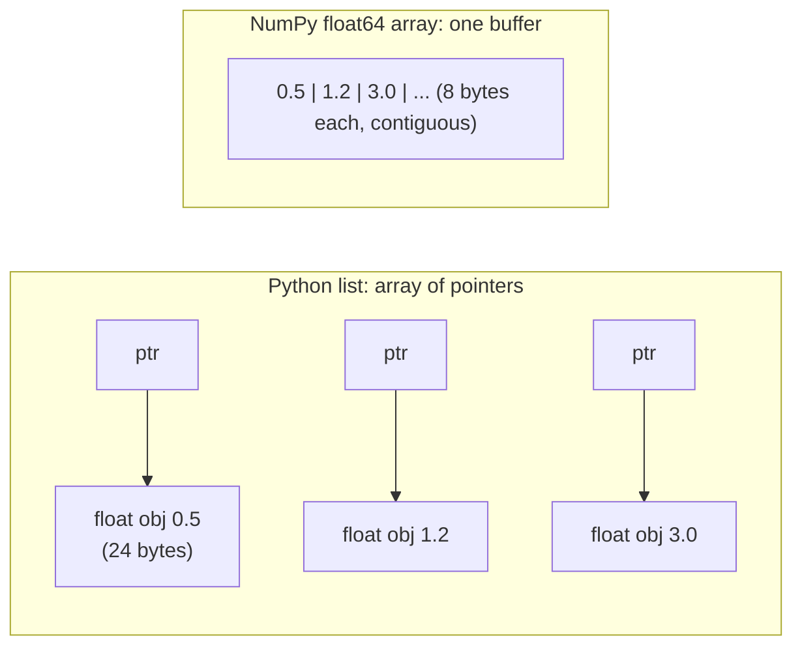
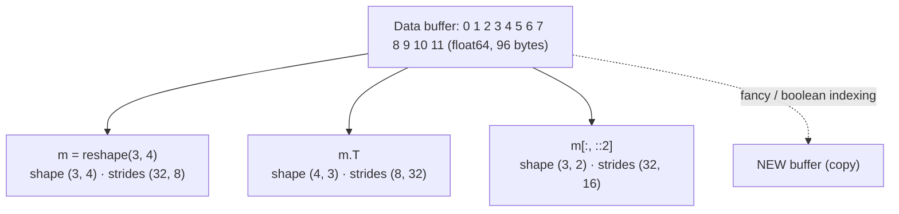

:::tip[TL;DR (30-Second Interview Pitch)]
A NumPy **`ndarray`** is a single block of memory holding numbers of **one dtype**, plus metadata (**shape**, **strides**, **dtype**) that says how to walk through that block. Because the data is contiguous and typed, operations on whole arrays run as tight loops in compiled C (**vectorization**), typically 10–100× faster and 4× smaller than Python lists of floats. Slicing returns **views** that share memory (no copy), while boolean and integer-array ("fancy") indexing return **copies**. Choosing the right **dtype** (`float32` for model inputs, `int8`/`uint8` for compact data) is the first memory and precision decision in every ML pipeline.
:::

<PriorityKey lang="NumPy" v="2.0" />

<FormulaKey />

## 🧭 Start Here: What NumPy Is and Why It Exists

**The problem.** A Python list of numbers is really a list of **pointers**, each pointing to a separate `float` object somewhere in memory (24 bytes each, plus the 8-byte pointer). Adding 1.1 to every element means a Python-level loop that, for every element, follows a pointer, checks the object's type, calls the right addition function and allocates a new object for the result. That's flexible, but slow and memory-hungry.

**NumPy's answer.** Store the numbers themselves, **side by side, all of the same type**, in one contiguous buffer: one million `float64` values take exactly 8,000,000 bytes. Because every element has the same size and type, NumPy can run a single compiled C loop over the buffer (and use the CPU's SIMD instructions to process several numbers per instruction). That's what **vectorization** means: you write `prices * 1.1` and the loop happens in C, not in Python.

**Why an AI engineer cares.** Pandas columns, image batches, embeddings, audio, and every PyTorch tensor you load from data are arrays with exactly this layout. Knowing what a **dtype**, a **stride** and a **view** are explains why some operations are free, why others silently copy gigabytes, and why `torch.from_numpy` can be instant.

| New concept | One-line meaning |
|---|---|
| **ndarray** | N-dimensional array: a data buffer + shape + strides + dtype |
| **dtype** | The type and size of every element (`float64` = 8 bytes, `float32` = 4, `uint8` = 1) |
| **shape** | Number of elements along each axis, e.g. `(3, 4)` = 3 rows, 4 columns |
| **strides** | Bytes to jump to move one step along each axis, e.g. `(32, 8)` |
| **contiguous** | Elements laid out with no gaps in a standard order (C = row-major, Fortran = column-major) |
| **view** | A new array object that **shares** the same buffer (no data copied) |
| **copy** | A new array with its **own** buffer |
| **vectorization** | Expressing work as whole-array operations so the loop runs in compiled code |

:::analogy[A list is a filing cabinet of sticky notes, an array is a ruler]
A Python list is a cabinet of folders, each holding a sticky note with a number written on it: flexible, but to add 1.1 to every number you open every folder, read the note, and write a new one. A NumPy array is a ruler with numbers printed at equal spacing: you can slide a single tool along it and process every mark in one smooth motion.
:::

## ⚡ Essential Interview Recall

- 🔴 **ndarray** = contiguous typed buffer + **shape** + **strides** + **dtype**. All elements share one dtype.
- 🔴 **Vectorization** runs the loop in C (often with SIMD): on 1M floats we measured **25 ms** for a Python generator sum vs **1 ms** with `(arr * 1.1).sum()`.
- 🔴 **Memory**: 1M floats ≈ **32 MB** as a Python list vs **8 MB** as `float64` (4 MB as `float32`).
- 🔴 **C order (row-major)** stores rows contiguously (NumPy's default); **Fortran order (column-major)** stores columns contiguously. `arr.flags` reports which.
- 🔴 **Strides** = bytes per step along each axis. A `(3, 4)` `float64` array in C order has strides `(32, 8)`; its transpose has `(8, 32)`: **transposing only swaps strides**, it copies nothing.
- 🔴 **Basic slicing returns a VIEW** (shares memory: writing to it changes the original). Check with `np.shares_memory(a, b)` or `b.base is a`.
- 🔴 **Fancy indexing (integer arrays) and boolean masks return COPIES**, but **assigning through them writes into the original**: `a[a > 2] = 0` works.
- 🔴 Combine masks with **`&`, `|`, `~`** and **parentheses**: `(a > 4) & (a < 10)`. Python's `and`/`or` raise `ValueError: The truth value of an array ... is ambiguous`.
- 🔴 Default dtypes: integers → **`int64`**, floats → **`float64`**; mixing in a string turns the whole array into **strings** (`<U32`).
- 🟠 **`astype` always copies** (by default); casting floats to ints **truncates** (`1.5 → 1`, `2.7 → 2`).
- 🟠 **Integer overflow wraps silently** in arrays: `uint8` 250 + 10 → **4**; `int8` 127 + 1 → **-128**.
- 🟠 **Precision**: `float16` can't represent 2049 (→ 2048) and overflows above 65,504; `float32` has ~7 significant digits (ε ≈ 1.19e-7); `float64` ~16.
- 🟠 Creation: `np.array`, `np.arange` (step; float steps are unreliable), `np.linspace` (count; includes the end), `zeros`, `ones`, `full`, `eye`, **`empty`** (uninitialized garbage!), `np.random.default_rng(seed)`.
- 🟡 **NumPy 2 / NEP 50**: Python scalars are "weak": `float32_array + 1.0` stays **`float32`**.
- 🟡 `np.sum` uses **pairwise summation** (10M float32 ones sum to exactly 1e7), but a running `cumsum` in `float32` stalls at **16,777,216** (2²⁴): accumulate in `float64`.

## 📐 Formula Sheet

| Concept | Formula | In plain words |
|---|---|---|
| Element address | $\pred{\text{offset}} = \sum_k \data{i_k} \cdot \hyper{s_k}$ | Bytes from the start = each index × that axis's stride |
| C-order strides | $\hyper{s_k} = \text{itemsize} \cdot \prod_{j>k} \data{n_j}$ | Last axis moves 1 element; earlier axes jump over whole rows |
| Buffer size | $\pred{\text{nbytes}} = \text{itemsize} \cdot \prod_k \data{n_k}$ | Element count × bytes per element |
| float precision | $\pred{\varepsilon} = 2^{-\hyper{m}}$ | Gap between 1.0 and the next representable number ($m$ = mantissa bits) |

:::speak[Why is NumPy so much faster than Python lists?]
"Three reasons, all about memory layout. First, a Python list stores **pointers to boxed objects**: each float is a separate 24-byte object scattered around memory, so iterating means chasing pointers and checking types on every element. A NumPy array stores the raw numbers **contiguously with a single dtype**, so 1 million float64s are exactly 8 megabytes in one block. Second, because the type is fixed, NumPy runs the operation as **one compiled C loop** over the buffer, with no per-element interpreter overhead, and the CPU can use **SIMD** instructions and its cache efficiently because the next number is always right next to the current one. Third, many operations, like slicing, transposing and reshaping, just create a **view**: new shape and strides over the same buffer, so they cost almost nothing. In my measurement, multiplying and summing a million floats took about 25 milliseconds in a Python loop and about 1 millisecond vectorized."
:::

## The Mental Model

### 1. List vs array in memory



<Animation src="numpy/list-vs-array" caption="A Python list holds pointers to separate float objects, so a loop must hop from object to object, checking types each time. A NumPy array stores the raw numbers side by side, so one compiled loop sweeps across them. The timings are from the measurement on this page." />

### 2. One buffer, many views



<Animation src="numpy/strides-views" caption="The 12 numbers never move. Reshaping, transposing and slicing only change the shape and strides that tell NumPy how many bytes to jump per step, so all three arrays are views of the same buffer. Fancy indexing is the exception: it gathers the chosen elements into a new buffer." />

:::analogy[Strides are the directions to the next seat]
Imagine a cinema where seats are numbered in one long line. "Shape (3, 4), strides (32, 8)" is an usher's instruction: "to go to the next seat in a row, walk 8 steps; to go to the next row, walk 32". Transposing doesn't move anybody; the usher just swaps the instructions. That's why it's free.
:::

## The Paradigm / Core Concepts

### 🔴 Array creation

| Function | Example | Result | Use it for |
|---|---|---|---|
| `np.array(seq)` | `np.array([1, 2, 3])` | `[1 2 3]`, `int64` | Converting Python data |
| `np.arange(start, stop, step)` | `np.arange(0, 1, 0.25)` | `[0. 0.25 0.5 0.75]` (stop **excluded**) | Integer ranges |
| `np.linspace(start, stop, num)` | `np.linspace(0, 1, 5)` | `[0. 0.25 0.5 0.75 1.]` (stop **included**) | Evenly spaced floats (plots, grids) |
| `np.zeros(shape)` / `np.ones` / `np.full` | `np.full((2, 2), 7.0)` | Filled arrays | Initializing buffers, masks |
| `np.eye(n)` | `np.eye(3)` | 3×3 identity | Linear algebra, one-hot encoding (`np.eye(k)[labels]`) |
| `np.empty(shape)` | `np.empty(3)` | **Uninitialized** memory | Only when you'll overwrite every element |
| `rng = np.random.default_rng(seed)` | `rng.normal(0, 1, 3)` | Reproducible random numbers | Synthetic data, initialization |

<RuleCard name="arange for counts, linspace for floats" tag="Array creation" why="Floating-point steps accumulate rounding error, so the number of elements arange produces with a float step is not guaranteed." remember="Integers arange, floats linspace.">

`np.arange(0, 1, 0.1)` has 10 elements, but `np.arange(1, 2, 0.1)[-1]` is `1.9000000000000008`, and nudging the stop by `1e-7` gives 11 elements. When you want **N evenly spaced floats including the end**, use `np.linspace(start, stop, N)`.

</RuleCard>

### 🔴 dtypes and what they cost

| dtype | Bytes | Range / precision | ML usage |
|---|:---:|---|---|
| `bool` | 1 | True/False | Masks |
| `int8` / `uint8` | 1 | -128..127 / 0..255 | Images (pixels), quantized weights |
| `int32` / `int64` | 4 / 8 | ±2.1e9 / ±9.2e18 | Indices, counts, token IDs (`int64` = PyTorch's `long`) |
| `float16` | 2 | max 65,504; ε ≈ 9.8e-4 (~3 digits) | Mixed-precision storage; overflows easily |
| `float32` | 4 | max 3.4e38; ε ≈ 1.19e-7 (~7 digits) | **Default for model inputs and weights** |
| `float64` | 8 | ~16 digits | NumPy/pandas default; statistics, accumulation |
| `<U32`, `object` | varies | — | Strings / arbitrary Python objects: no vectorized maths |

:::analogy[A dtype is choosing the size of the storage boxes]
A warehouse that stores only rings can use tiny boxes and fit a million on one shelf; a warehouse that might receive a sofa must use huge boxes for everything. `uint8` is the ring box (one byte, values up to 255), `float64` the large box (eight bytes, 16 digits). Pick boxes too small and things get squashed (`uint8` 250 + 10 wraps to 4); pick them too big and you need eight times the shelf space and memory bandwidth.
:::

<Formula name="Machine epsilon" tag="Floating-point precision" words="The smallest gap between 1.0 and the next number the format can store. Relative rounding error is about half of it, so it tells you how many significant digits survive." remember="Fewer mantissa bits, bigger gaps.">

$$
\pred{\varepsilon} = 2^{-\hyper{m}}
$$

- $\hyper{m}$: mantissa (fraction) bits: 10 for `float16`, 23 for `float32`, 52 for `float64`
- $\pred{\varepsilon}$: the spacing of representable numbers just above 1.0

**Example:** `float32` has $m = 23$, so $\varepsilon = 2^{-23} \approx 1.19 \times 10^{-7}$ (`np.finfo(np.float32).eps` prints `1.1920929e-07`). Above $2^{24} = 16{,}777{,}216$ the gap between `float32` numbers is 2, so `float32(16_777_216) + 1` is still `16777216`.

</Formula>

### 🔴 Views vs copies

| Operation | View or copy? | Writing to the result changes the original? |
|---|---|---|
| Basic slice `a[1:4]`, `a[::2]`, `m[:, 0]` | **View** | ✅ yes |
| `reshape` (when possible), `.T`, `ravel` (when contiguous) | **View** | ✅ yes |
| Integer-array ("fancy") indexing `a[[1, 2, 3]]` | **Copy** | ❌ no |
| Boolean mask `a[a > 2]` | **Copy** | ❌ no |
| `a.copy()`, `astype(...)`, `flatten()` | **Copy** | ❌ no |
| **Assignment through** a mask or fancy index: `a[a > 2] = 0` | — | ✅ writes into `a` |

<RuleCard name="Slices share, selections copy" tag="Views vs copies" why="A slice can be described by new strides over the same buffer; an arbitrary selection of positions cannot, so NumPy must gather it into new memory." remember="Slices are windows, selections are photocopies.">

Basic slicing (`start:stop:step`, single integers) → **view**. Indexing with an **array of integers or booleans** → **copy**. When in doubt: `np.shares_memory(a, b)`. When you need independence from the source, call `.copy()` explicitly.

</RuleCard>

### 🔴 Indexing cheat sheet

| Goal | 1-D | 2-D (`M`, shape `(3, 4)`) | 3-D (`sensor`, shape `(3, 7, 24)`) |
|---|---|---|---|
| One element | `a[2]`, `a[-1]` | `M[1, 2]` (not `M[1][2]`, which builds a temporary row) | `sensor[2, -1, 23]` |
| Range | `a[2:7]` | `M[0:2, 1:3]` | `sensor[1, 2:4, 8:10]` |
| Step / reverse | `a[::3]`, `a[::-1]` | `M[:, ::2]` | `sensor[:, :, ::6]` |
| Whole row / column | — | `M[1]`, `M[:, 2]` | `sensor[1]` → `(7, 24)` |
| Ellipsis | — | — | `sensor[..., 0]` → `(3, 7)` (all leading axes) |
| Pick rows | `a[[0, 2]]` | `M[[0, 2]]` | |
| Pick pairs | `M[[0, 2], [1, 3]]` → `[2 12]` (elements (0,1) and (2,3)) | | |
| Pick a sub-grid | `M[np.ix_([0, 2], [1, 3])]` → 2×2 | | |
| Condition | `a[a > 2]` | `M[(M > 4) & (M < 10)]` → 1-D result | `sensor[sensor > 30]` |

## ⚙️ Under the Hood (NumPy Internals)

- **The `ndarray` object** is a small C struct: a pointer to the data buffer, `ndim`, `shape`, `strides`, a `dtype` descriptor, flags (`C_CONTIGUOUS`, `F_CONTIGUOUS`, `WRITEABLE`, `OWNDATA`) and a `base` reference to the object that owns the memory (for views).
- **Address arithmetic**: element `[i, j]` lives at `data + i*strides[0] + j*strides[1]`. For `np.arange(12, dtype=np.float64).reshape(3, 4)` the strides are `(32, 8)`; for an `int32` array of the same shape, `(16, 4)`; for the Fortran-order copy, `(8, 24)`.
- **Contiguity matters for memory access**: reading a row of a C-order array touches consecutive bytes (cache-friendly); reading a column jumps 32 KB per element in a 4000×4000 `float64` matrix. Copying one column took **5.1 µs** vs **1.2 µs** for one row in our run. NumPy's reductions are clever enough to iterate efficiently in either order, so don't assume `sum(axis=1)` is slower on Fortran arrays (it wasn't: 12 ms vs 17 ms here). Measure.
- **Ufuncs** (universal functions: `+`, `*`, `np.exp`, comparisons) are type-specialized C loops chosen by the dtypes of the inputs. Since NumPy 2.0 many use SIMD kernels selected at run time for your CPU (AVX2/AVX-512 on x86, NEON on ARM).
- **Type promotion (NEP 50)**: array dtypes win over Python scalars (`float32 + 1.0` → `float32`); between arrays, the "bigger" type wins (`int32 + int64` → `int64`, `int + float` → `float64`).
- **Pairwise summation**: `np.sum` and `np.mean` on floats add in a tree pattern, which keeps rounding error at O(log n) instead of O(n). Sequential accumulators (`np.cumsum`, Python `sum`) don't, which is why a `float32` cumsum of 20 million ones ends at `16777216`.
- **Copies are explicit memory**: a boolean mask over a 1 GB array creates a new array as big as the selected part. In pipelines, prefer in-place ops (`arr *= 1.1`, `np.multiply(a, b, out=a)`) when the original isn't needed.

:::danger[Interview Trap]
**`np.empty` is not "an array of zeros".** It allocates memory without initializing it, so it contains whatever bytes were there before: sometimes zeros (fresh pages from the OS), sometimes garbage. Code that "works" in testing can produce random values in production. Use `np.zeros` unless you overwrite every element immediately.
:::

:::danger[Interview Trap]
**Array integer overflow is silent.** `np.array([250], dtype=np.uint8) + np.array([10], dtype=np.uint8)` is `[4]`, with no error and no warning. This bites image code (adding brightness to `uint8` pixels) and any counter stored in a small integer type. Convert first (`img.astype(np.int16)`) or clip (`np.clip(img.astype(np.int16) + 10, 0, 255).astype(np.uint8)`).
:::

## 💻 NumPy Implementation on ShopStream

:::tip[Run it yourself]
Every snippet runs in a notebook after `import numpy as np`. Outputs come from **NumPy 2.5.4 on Python 3.14**. The ShopStream generator is on the [Overview](./00-overview.md) page.
:::

### 1. Lists vs arrays: memory and speed

```python showLineNumbers
import numpy as np, timeit

lst = [float(i) for i in range(1_000_000)]           # ~32.4 MB (1M float objects + 1M pointers)
arr = np.arange(1_000_000, dtype=np.float64)         # 8.0 MB in one buffer
print(arr.nbytes, arr.itemsize)                      # 8000000 8

# error-next-line
slow = sum(x * 1.1 for x in lst)                     # ❌ Python loop: ~25 ms
# success-next-line
fast = (arr * 1.1).sum()                             # ✅ one C loop: ~1 ms (25× faster)
```

### 2. Shape, strides and memory order

```python showLineNumbers
m = np.arange(12, dtype=np.float64).reshape(3, 4)
print(m.shape, m.strides)                            # (3, 4) (32, 8): next row = 32 bytes, next column = 8 bytes
print(m.flags["C_CONTIGUOUS"], m.flags["F_CONTIGUOUS"])   # True False

# highlight-next-line
t = m.T                                              # transpose = swap strides, no copy
print(t.strides, t.flags["F_CONTIGUOUS"], t.base is m.base)   # (8, 32) True True

f = np.asfortranarray(m)                             # a real column-major COPY
print(f.strides)                                     # (8, 24)
print(np.arange(12, dtype=np.int32).reshape(3, 4).strides)   # (16, 4): itemsize 4
```

### 3. Creating arrays

```python showLineNumbers
print(np.array([1, 2, 3]).dtype, np.array([1, 2.5]).dtype)   # int64 float64
# error-next-line
print(np.array([1, 2.5, "3"]))                       # ['1' '2.5' '3']: one string makes EVERYTHING a string

print(np.arange(0, 1, 0.25))                         # [0.   0.25 0.5  0.75]
print(np.linspace(0, 1, 5))                          # [0.   0.25 0.5  0.75 1.  ]
print(np.eye(3)[[0, 2, 1]])                          # one-hot rows for labels 0, 2, 1
print(np.full((2, 2), 7.0))                          # [[7. 7.] [7. 7.]]

rng = np.random.default_rng(42)                      # seeded, independent generator (not np.random.seed)
print(rng.integers(0, 10, 5))                        # [0 7 6 4 4]
```

### 4. dtypes, casting and precision

```python showLineNumbers
x = np.array([1.5, 2.7])
y = x.astype(np.int64)
print(y, np.shares_memory(x, y))                     # [1 2] False: truncation, and a copy

# error-start
print(np.array([250], dtype=np.uint8) + np.array([10], dtype=np.uint8))   # [4]: wrapped around
print(np.array([127], dtype=np.int8) + 1)                                 # [-128]
print(np.float16(2049))                                                   # 2048.0: not representable
# error-end

print(np.finfo(np.float32).eps, np.finfo(np.float16).max)   # 1.1920929e-07 6.55e+04 (exactly 65504)

ones = np.ones(20_000_000, dtype=np.float32)
print(ones.sum())                                    # 2e+07: pairwise summation keeps it exact
# error-next-line
print(np.cumsum(ones)[-1])                           # 16777216.0: a float32 running total stalls at 2**24
# success-next-line
print(np.cumsum(ones, dtype=np.float64)[-1])         # 20000000.0: accumulate in float64

print((np.array([1, 2], dtype=np.float32) + 1.0).dtype)   # float32: Python scalars are "weak" (NEP 50)
print(np.zeros((1000, 1000), np.float16).nbytes, np.zeros((1000, 1000)).nbytes)   # 2000000 8000000
```

### 5. Indexing 1-D, 2-D and 3-D arrays

```python showLineNumbers
a = np.arange(10)
print(a[2], a[-1], a[2:7], a[::3], a[::-1])          # 2 9 [2 3 4 5 6] [0 3 6 9] [9 8 ... 0]

M = np.arange(1, 13).reshape(3, 4)
print(M[1, 2], M[1], M[:, 2])                        # 7 [5 6 7 8] [ 3  7 11]
print(M[0:2, 1:3])                                   # [[2 3] [6 7]]

rng = np.random.default_rng(7)
sensor = rng.normal(25, 3, size=(3, 7, 24)).round(1)   # 3 warehouses × 7 days × 24 hours of temperature
print(sensor.shape, sensor.ndim, sensor.size)        # (3, 7, 24) 3 504
print(sensor[0, 0, :4])                              # [25.  25.9 24.2 22.3]: warehouse 0, day 0, hours 0–3
print(sensor[:, :, 12].shape)                        # (3, 7): noon reading for every warehouse and day
# highlight-next-line
print(sensor[..., 0].shape)                          # (3, 7): ... = "all the leading axes"
```

### 6. Views vs copies

```python showLineNumbers
a = np.arange(6)
b = a[1:4]                                           # slice → VIEW
b[0] = 99
# error-next-line
print(a)                                             # [ 0 99  2  3  4  5]: the original changed!
print(b.base is a, np.shares_memory(a, b))           # True True

a = np.arange(6)
c = a[[1, 2, 3]]                                     # fancy index → COPY
c[0] = -1
print(a, np.shares_memory(a, c))                     # [0 1 2 3 4 5] False

a = np.arange(6)
d = a[a > 2]                                         # boolean mask → COPY
d[:] = 0
print(a)                                             # [0 1 2 3 4 5]: unchanged
# success-next-line
a[a > 2] = 0                                         # ✅ assign THROUGH the mask to modify a
print(a)                                             # [0 1 2 0 0 0]
```

### 7. Boolean masks and fancy indexing

```python showLineNumbers
M = np.arange(1, 13).reshape(3, 4)
print(M[M % 2 == 0])                                 # [ 2  4  6  8 10 12]: masks flatten to 1-D
print(M[(M > 4) & (M < 10)])                         # [5 6 7 8 9]
print(M[~(M > 4)])                                   # [1 2 3 4]
# error-next-line
M[M > 4 and M < 10]                                  # ❌ ValueError: The truth value of an array with more than one element is ambiguous...

print(M[[0, 2]])                                     # rows 0 and 2
print(M[[0, 2], [1, 3]])                             # [ 2 12]: elements (0, 1) and (2, 3)
print(M[np.ix_([0, 2], [1, 3])])                     # [[ 2  4] [10 12]]: the sub-grid
print(np.count_nonzero(M > 6), (M > 6).mean())       # 6 0.5: True counts as 1
```

### 8. ShopStream: vectorized cleaning checks

```python showLineNumbers
orders, customers = make_shopstream()
price = orders["unit_price"].to_numpy()              # float64 array, shape (5020,)
qty = orders["quantity"].to_numpy()                  # int64 array
disc = orders["discount_pct"].to_numpy()             # float64 with NaNs

# highlight-next-line
bad_qty = (qty <= 0) | (qty > 50)                    # one vectorized pass over 5,020 rows
print(bad_qty.sum(), np.unique(qty[bad_qty], return_counts=True))
# 42 (array([ -1,   0, 999]), array([20, 20,  2]))

p995 = np.percentile(price, 99.5)
print(round(p995, 2), (price > p995).sum())          # 27551.57 26: the top 0.5% (the 40× data-entry errors live here)

# error-next-line
print(np.isnan(price * qty * (1 - disc)).sum())      # 401: NaN discounts poison the revenue
# success-next-line
net = price * qty * (1 - np.nan_to_num(disc))        # treat a missing discount as 0 (a decision: record it)
valid = ~bad_qty
print(round((price[valid] * qty[valid]).sum(), 2))   # 39180671.68: gross revenue from valid rows only
```

## 🧪 Predict the Output

<Predict n="1" title="Writing through a slice" output="[ 0 99  2  3  4  5]">

```python
a = np.arange(6)
b = a[1:4]
b[0] = 99
print(a)
```

A basic slice is a **view**: `b` is a new array object with its own shape and an offset into `a`'s buffer. Writing `b[0]` writes `a[1]`. Use `a[1:4].copy()` if you need an independent array. (This is the opposite of Python lists, where slicing always copies.)

</Predict>

<Predict n="2" title="Writing through a fancy index" output="[0 1 2 3 4 5]">

```python
a = np.arange(6)
c = a[[1, 2, 3]]
c[0] = -1
print(a)
```

Indexing with a **list of positions** can't be expressed as strides over the same buffer, so NumPy gathers the values into a **new** array. Changing `c` leaves `a` alone. Contrast `a[[1, 2, 3]] = -1`, which **assigns through** the index and does change `a`.

</Predict>

<Predict n="3" title="Mixed types in one array" output="['1' '2.5' '3']">

```python
print(np.array([1, 2.5, "3"]))
```

An array has **one dtype** for all elements. NumPy picks the type that can represent every value, which with a string present is a Unicode string type (`<U32`). Now `arr + 1` fails, and `arr.mean()` is impossible. This is exactly what happens to a CSV column with one stray text value.

</Predict>

<Predict n="4" title="Brightening an image" output="[4]">

```python
pixel = np.array([250], dtype=np.uint8)
print(pixel + np.array([10], dtype=np.uint8))
```

`uint8` holds 0–255; 260 doesn't fit, so it **wraps modulo 256** to 4, silently. A "brighter" pixel became almost black. Cast to a wider type, add, clip to `[0, 255]` and cast back.

</Predict>

<Predict n="5" title="A float32 running total" output="16777216.0">

```python
ones = np.ones(20_000_000, dtype=np.float32)
print(np.cumsum(ones)[-1])
```

`float32` has a 24-bit significand: above $2^{24} = 16{,}777{,}216$, consecutive representable numbers are 2 apart, so adding 1 rounds back to the same value and the running total stops growing. `ones.sum()` is exact (`2e+07`) because NumPy sums pairwise; for running totals pass `dtype=np.float64`.

</Predict>

<Predict n="6" title="Combining conditions" output="ValueError: The truth value of an array with more than one element is ambiguous. Use a.any() or a.all()">

```python
M = np.arange(1, 13).reshape(3, 4)
print(M[M > 4 and M < 10])
```

`and` asks Python for **one** boolean from `M > 4`, but an array of 12 booleans has no single truth value. Element-wise logic uses the bitwise operators with parentheses (they bind tighter than comparisons): `M[(M > 4) & (M < 10)]` → `[5 6 7 8 9]`.

</Predict>

<Predict n="7" title="Transpose contiguity" output="(8, 32) False True">

```python
m = np.arange(12, dtype=np.float64).reshape(3, 4)
t = m.T
print(t.strides, t.flags["C_CONTIGUOUS"], t.flags["F_CONTIGUOUS"])
```

Transposing swaps the strides from `(32, 8)` to `(8, 32)` without moving any data. The same bytes, read with swapped strides, form a valid **column-major** array, so the transpose is F-contiguous but not C-contiguous. Some functions (and `torch.view`) need C-contiguous input; `np.ascontiguousarray(t)` makes a copy.

</Predict>

## 🪜 Follow-up Ladder

<Ladder title="From arrays to GPU tensors">
<Rung q="What is a NumPy array, physically?">

A pointer to a contiguous typed buffer plus metadata: dtype, shape, strides and flags. Views share the buffer and point back to the owner through `base`.

</Rung>
<Rung q="When does NumPy copy data, and how can you tell?">

Basic slices, reshapes (when the layout allows), transposes and `ravel` on contiguous data are views; fancy indexing, boolean masks, `astype`, `flatten` and `copy` allocate new buffers. Check with `np.shares_memory(a, b)` or `b.base`.

</Rung>
<Rung q="Why does memory layout matter for performance?">

CPUs read memory in 64-byte cache lines. Walking contiguous memory uses every byte fetched and lets SIMD process several values per instruction; strided access (a column of a C-order matrix) wastes most of each cache line. Library code (BLAS, convolutions) may silently copy non-contiguous inputs into contiguous ones.

</Rung>
<Rung q="How does a NumPy array become a PyTorch tensor?">

`torch.from_numpy(arr)` creates a CPU tensor that **shares memory** (zero copy; changes show up in both); `torch.tensor(arr)` always copies. Dtypes map directly (`float64` → `torch.float64`, so cast to `float32` first for models). Moving to the GPU (`.to("cuda")`) is always a copy across the PCIe bus. Details on the [next page](./02-numpy-broadcasting-linalg-aggregations.md).

</Rung>
<Rung q="A data loader holding 50 GB of features in float64 runs out of memory. What do you change?">

Store features as `float32` (half the memory, and what the model uses anyway) or `float16`/`int8` for compact storage, memory-map the file (`np.load(..., mmap_mode="r")`) so the OS pages data in on demand, avoid accidental copies (fancy indexing a giant array per batch is fine; boolean-masking the whole array per batch is not), and load in chunks or shards.

</Rung>
</Ladder>

## 🚑 Production Scenarios

:::incident[A model trained on silently corrupted images]
An augmentation step brightened images with `img + 40`, where `img` was a `uint8` array. Validation accuracy dropped on bright photos, with no errors anywhere.

- **Why:** pixels above 215 wrapped around (`230 + 40 = 14`), turning bright skies into dark speckles. NumPy array arithmetic never raises on integer overflow.
- **Fix:** `np.clip(img.astype(np.int16) + 40, 0, 255).astype(np.uint8)`, or convert to `float32` in `[0, 1]` before augmenting (what most pipelines do).
- **Prevention:** assert value ranges after each augmentation in tests, and look at a grid of augmented samples before every training run.
:::

:::incident[A one-line filter doubled memory and killed the job]
A feature-engineering job held a 6 GB `float64` feature matrix and ran `X = X[mask]` inside a loop over 10 different masks to compute statistics. The process was OOM-killed.

- **Why:** boolean indexing **copies**: each iteration allocated a new multi-GB array while the original was still alive, and the temporaries piled up faster than they were freed.
- **Fix:** compute statistics without materializing subsets (`np.where(mask, X, np.nan)` plus `np.nanmean`, or `X[mask].mean()` one at a time with `del` of large temporaries), convert to `float32`, or process in row chunks.
:::

## 🚨 Interview Gotchas & Edge Cases

:::warning[The Most Common Question]
**"What's the difference between a view and a copy in NumPy, and how do you check?"** A view is a new array object that shares the original's buffer (different shape, strides or offset): basic slicing, reshape, transpose. A copy has its own buffer: fancy indexing, boolean masks, `astype`, `copy`. Writing to a view changes the original. Check with `np.shares_memory(a, b)` or `b.base is a`. The senior follow-up is about **why**: a regular slice is describable by strides, an arbitrary selection is not.
:::

- **`M[1][2]` vs `M[1, 2]`**: same value, but the first creates a temporary row view and then indexes it; with fancy indexing (`M[[0, 1]][0] = 5`) the chained form silently writes to a temporary copy.
- **`np.random.seed` is legacy global state**: use `rng = np.random.default_rng(seed)` and pass `rng` around, so different components don't disturb each other's random streams.
- **`dtype=object` arrays** are Python lists in disguise: no vectorization, no SIMD, pointer chasing. They appear when you mix types or have ragged nested lists.
- **NaN propagates and isn't equal to itself**: `np.nan == np.nan` is `False`; use `np.isnan`, and the `nan*` functions (`np.nanmean`, `np.nansum`) to ignore it.
- **`arr.astype(np.int64)` truncates toward zero** (`-2.7 → -2`). Use `np.round` (banker's rounding) or `np.floor` first if you mean something else.
- **Comparing floats**: `np.isclose` / `np.allclose` with a tolerance, never `==` on computed results.
