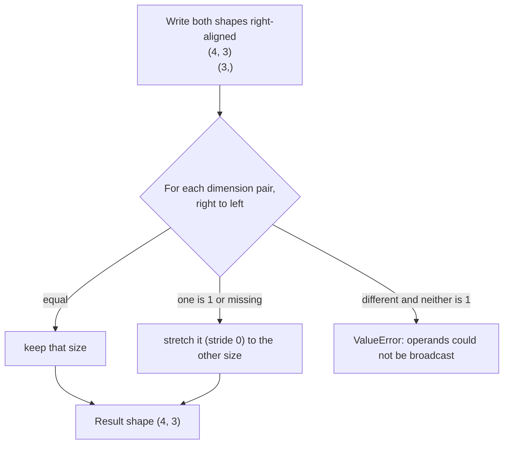
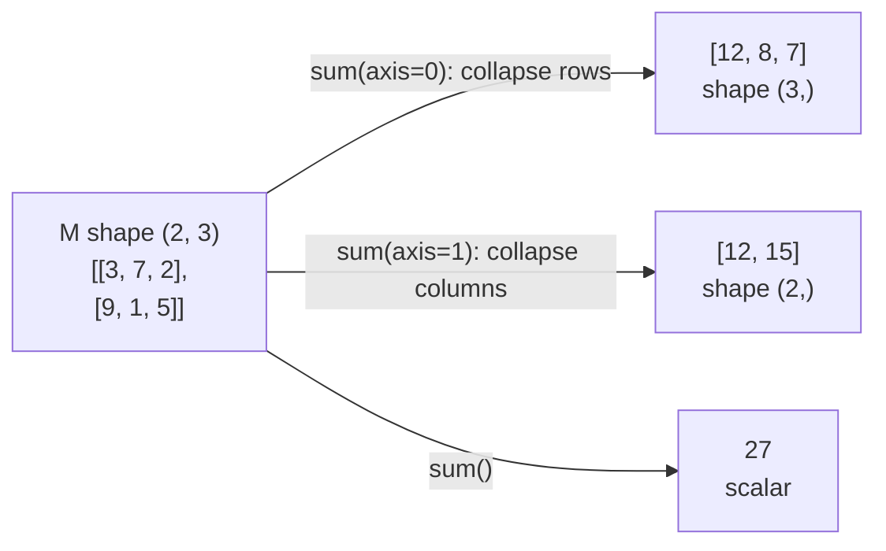

:::tip[TL;DR (30-Second Interview Pitch)]
**Broadcasting** lets NumPy combine arrays of different shapes without copying: shapes are compared **from the right**, and each dimension must be **equal or 1** (or missing). That one rule powers column standardization, pairwise distances and every `X @ W + b`. Reshaping functions (`reshape`, `ravel`, `transpose`, `squeeze`, `stack`) mostly change **metadata**, not data. Aggregations take an **`axis`**: `axis=0` collapses rows (one result per column), `axis=1` collapses columns (one result per row). For linear algebra, `@` is matrix multiplication, `*` is element-wise, and you should **`solve`**, not invert. Finally, `torch.from_numpy` turns an array into a tensor **without copying**, which is where NumPy hands off to deep learning.
:::

<PriorityKey lang="NumPy" v="2.0" />

<FormulaKey />

## 🧭 Start Here: Four Ideas That Make NumPy Click

**1. Broadcasting: "pretend the smaller array is repeated".** To subtract each column's mean from a `(5020, 3)` feature matrix, you subtract a `(3,)` vector. NumPy lines the shapes up from the right (`(5020, 3)` vs `(3,)`), sees the vector is missing the first dimension, and *acts as if* it were repeated 5,020 times, without actually building that copy (it uses a **stride of 0**). Without broadcasting you'd write a loop or tile the vector by hand.

**2. Reshaping: "same numbers, new grid".** A buffer of 12 numbers can be read as `(12,)`, `(3, 4)`, `(2, 6)` or `(2, 2, 3)`. Changing the shape only changes how NumPy walks the buffer (the strides from the [previous page](./01-numpy-arrays-memory-indexing.md)), so it's instant. Deep learning code reshapes constantly: images `(H, W, C)` become `(C, H, W)`, a batch of sequences gets flattened for a linear layer.

**3. Axis: "which direction do I collapse?"** Every aggregation (`sum`, `mean`, `max`, `argmax`, `std`) can work on the whole array or **along one axis**. The axis you name is the one that **disappears**: `M.sum(axis=0)` adds down the rows and leaves one number per column.

**4. Linear algebra: the language of models.** A dense layer is `X @ W + b`; a cosine similarity search is a normalized matrix product; linear regression is a least-squares solve. NumPy's `np.linalg` calls optimized LAPACK/BLAS libraries, so these are some of the fastest operations you can run on a CPU.

| New concept | One-line meaning |
|---|---|
| **Broadcasting** | Combining arrays of different shapes by virtually stretching size-1 or missing dimensions |
| **`np.newaxis` / `None`** | Insert a length-1 axis so shapes line up: `v[:, None]` turns `(3,)` into `(3, 1)` |
| **`keepdims=True`** | Keep the collapsed axis as size 1, so the result still broadcasts against the input |
| **`axis`** | The dimension an aggregation **removes** |
| **`ddof`** | "Delta degrees of freedom": divide variance by `N - ddof` (0 = population, 1 = sample) |
| **Norm** | The length of a vector (L2 = straight-line distance, L1 = sum of absolute values) |
| **Condition number** | How much a matrix amplifies rounding error; huge = numerically dangerous to invert |

## ⚡ Essential Interview Recall

- 🔴 **Broadcasting rule**: align shapes from the **right**; each pair of dimensions must be **equal**, or one of them **1**, or **missing**. Result size = the larger of each pair. Otherwise `ValueError: operands could not be broadcast together with shapes (4,3) (4,)`.
- 🔴 `(3, 1) + (1, 4)` → `(3, 4)`; `(4, 3) + (3,)` → `(4, 3)`; `(4, 3) + (4,)` → **error** (fix with `v[:, None]`).
- 🔴 Broadcasting **doesn't copy**: `np.broadcast_to` gives strides like `(0, 8)`, a read-only view.
- 🔴 **`axis=0`** → one result **per column** (collapse rows); **`axis=1`** → one result **per row**. Use **`keepdims=True`** when you'll divide the original by the result.
- 🔴 **`reshape(-1, k)`**: `-1` means "infer this dimension"; total size must stay the same.
- 🔴 **`ravel()` returns a view when it can, `flatten()` always copies**.
- 🔴 **`*` is element-wise; `@` / `np.matmul` / `np.dot` (2-D) is matrix multiplication**. Inner dimensions must match: `(n, d) @ (d, k)` → `(n, k)`. `@` broadcasts over leading batch dimensions.
- 🔴 **Solve, don't invert**: `np.linalg.solve(A, b)` is faster and more accurate than `np.linalg.inv(A) @ b`.
- 🔴 **`np.std` defaults to `ddof=0` (population), pandas `.std()` defaults to `ddof=1` (sample)**: on `[2, 4, 4, 4, 5, 5, 7, 9]` they give **2.0** vs **2.1381**.
- 🔴 **`argmax`** returns a **flat index** without `axis`; convert with `np.unravel_index(i, M.shape)`.
- 🔴 **`np.where(cond, a, b)`** = vectorized if/else; `np.where(cond)` alone returns the **indices** where it's true. `np.select` handles several conditions.
- 🟠 NaN poisons `mean`/`sum`/`std`; use `np.nanmean`, `np.nansum`, `np.nanmedian`.
- 🟠 **Stacking**: `concatenate` joins along an **existing** axis; `stack` creates a **new** axis; `vstack`/`hstack` are shorthands (rows / columns).
- 🟠 Norms: `np.linalg.norm(v)` (L2), `ord=1` (L1), `ord=np.inf` (max); `axis=1` for row-wise norms → cosine similarity.
- 🟡 **NumPy → PyTorch**: `torch.from_numpy` **shares memory** (zero-copy, same dtype: `float64` stays `float64`); `torch.tensor(arr)` **copies**; negative strides and read-only arrays need `.copy()`; `tensor.numpy()` needs `.detach().cpu()` first.

## 📐 Formula Sheet

| Concept | Formula | In plain words |
|---|---|---|
| Mean | $\pred{\mu} = \frac{1}{\data{N}}\sum_i \data{x_i}$ | Sum divided by count |
| Variance | $\pred{\sigma^2} = \frac{1}{\data{N} - \hyper{\text{ddof}}}\sum_i (\data{x_i} - \pred{\mu})^2$ | Average squared distance from the mean |
| Standard deviation | $\pred{\sigma} = \sqrt{\pred{\sigma^2}}$ | Typical distance from the mean, in the data's units |
| z-score (standardization) | $\pred{z_i} = \dfrac{\data{x_i} - \pred{\mu}}{\pred{\sigma}}$ | How many standard deviations from the mean |
| Matrix product | $\pred{C_{ij}} = \sum_k \data{A_{ik}}\,\data{B_{kj}}$ | Row of A dot column of B |
| Lp norm | $\pred{\lVert x \rVert_p} = \left(\sum_i \lvert \data{x_i}\rvert^{\hyper{p}}\right)^{1/\hyper{p}}$ | p = 2: length; p = 1: total absolute size |
| Cosine similarity | $\pred{\cos\theta} = \dfrac{\data{a}\cdot\data{b}}{\lVert \data{a}\rVert\,\lVert \data{b}\rVert}$ | Angle between vectors, ignoring their lengths |
| Linear system | $\data{A}\pred{x} = \data{b}$, solved as $\pred{x} = \texttt{solve}(\data{A}, \data{b})$ | Find x without forming $A^{-1}$ |

:::speak[Explain NumPy broadcasting]
"Broadcasting is how NumPy applies an operation to arrays of different shapes without copying data. It compares the shapes **from the rightmost dimension** backwards. Two dimensions are compatible if they're **equal**, or **one of them is 1**, or **one is missing**, and the result takes the larger size. So a `(5020, 3)` feature matrix minus a `(3,)` vector of column means works: the vector is treated as `(1, 3)` and stretched across all 5,020 rows. Under the hood the stretched dimension gets a **stride of zero**, so the same three numbers are reused and nothing is materialized. When shapes don't line up, I add an axis explicitly: to subtract per-row means I use `keepdims=True` or `[:, None]` to get `(5020, 1)`. The same mechanism handles adding a bias in `X @ W + b` and computing all pairwise distances with `A[:, None, :] - B[None, :, :]`. The one danger is accidental broadcasting: `(n,)` minus `(n, 1)` silently produces an `(n, n)` matrix."
:::

## The Mental Model

### 1. The broadcasting check



<Animation src="numpy/broadcasting" caption="A (3, 1) column and a (1, 4) row are each stretched along their size-1 axis to (3, 4) and added cell by cell. The stretched copies are virtual: NumPy reuses the same values with a stride of zero, so no memory is allocated for them." />

:::analogy[Broadcasting is one recipe for a whole table]
A wedding caterer doesn't write a separate recipe card for each of the 300 guests; one card says "add 2 spoons of sugar" and the kitchen applies it to every cup. Broadcasting is that single card (the small array) applied to every row of the big one, without photocopying the card 300 times.
:::

### 2. What `axis` removes



<Animation src="numpy/axis-aggregation" caption="With axis=0 the two rows are squashed together, leaving one total per column. With axis=1 each row is squashed across its columns, leaving one total per row. The axis you name is the one that disappears from the shape." />

:::analogy[axis is the direction you fold a paper table]
Fold a printed table top-to-bottom and every column piles onto itself: you get one number per column (`axis=0`). Fold it left-to-right and every row piles up: one number per row (`axis=1`). The axis you name is the direction of the fold, and that dimension is gone afterwards.
:::

## The Paradigm / Core Concepts

### 🔴 Broadcasting examples

| Left shape | Right shape | Result | Typical use |
|---|---|---|---|
| `(n, d)` | `(d,)` | `(n, d)` | Subtract column means, add a bias vector |
| `(n, d)` | `(n, 1)` | `(n, d)` | Divide each row by its total (`keepdims=True`) |
| `(3, 1)` | `(1, 4)` | `(3, 4)` | Outer product / grid of combinations |
| `(n, 1, d)` | `(1, m, d)` | `(n, m, d)` | All pairwise differences → distance matrix |
| `(8, 1, 6, 1)` | `(7, 1, 5)` | `(8, 7, 6, 5)` | `np.broadcast_shapes` checks it for you |
| `(4, 3)` | `(4,)` | ❌ error | Use `v[:, None]` → `(4, 1)` |

<RuleCard name="The broadcasting rule" tag="Shapes" why="Stretching a size-1 axis is unambiguous; matching two different sizes is not, so NumPy refuses rather than guessing." remember="Right-align, equal or one.">

Compare shapes **right to left**. Each pair must be **equal**, or one of them must be **1** (or absent). Size-1 / absent dimensions are stretched to match. If any pair fails, NumPy raises `ValueError: operands could not be broadcast together with shapes ...`.

</RuleCard>

<Formula name="z-score standardization" tag="Feature scaling" words="Shift each column so its mean is 0 and scale it so its standard deviation is 1. Broadcasting applies the column means and stds to every row in one expression." remember="Subtract the mean, divide the spread.">

$$
\pred{z_{ij}} = \frac{\data{x_{ij}} - \pred{\mu_j}}{\pred{\sigma_j}}
$$

- $\data{x_{ij}}$: value in row $i$, column $j$
- $\pred{\mu_j}$, $\pred{\sigma_j}$: mean and standard deviation of column $j$ (`X.mean(axis=0)`, `X.std(axis=0)`)
- $\pred{z_{ij}}$: the standardized value (dimensionless)

**Example:** prices `[1200, 450, 8000, 300]` have $\mu = 2487.5$ and $\sigma = 3200.85$ (`ddof=0`), so 8000 becomes $(8000 - 2487.5)/3200.85 = 1.722$.

</Formula>

### 🔴 Reshaping and combining

| Function | Does | View or copy | Example |
|---|---|---|---|
| `a.reshape(3, 4)` / `reshape(-1, 6)` | New shape, same size | View if possible | `(12,)` → `(3, 4)`, `(2, 6)` |
| `a.ravel()` | Flatten to 1-D | **View** when contiguous, else copy | `m.T.ravel()` must copy |
| `a.flatten()` | Flatten to 1-D | **Always a copy** | |
| `a.T`, `a.transpose(2, 0, 1)`, `np.moveaxis` | Reorder axes | View | Image `(H, W, C)` → `(C, H, W)` |
| `np.squeeze(a)` / `np.expand_dims(a, 0)` / `a[None]` | Remove / add size-1 axes | View | `(1, 3, 1)` → `(3,)` |
| `np.concatenate([A, B], axis=k)` | Join along an **existing** axis | Copy | Two `(2, 2)` → `(4, 2)` or `(2, 4)` |
| `np.vstack` / `np.hstack` / `np.column_stack` | Rows / columns shorthands | Copy | 1-D vectors become columns with `column_stack` |
| `np.stack([A, B], axis=k)` | Join along a **new** axis | Copy | Two `(2, 2)` → `(2, 2, 2)` |
| `np.split(a, 3)` / `np.array_split(a, 3)` | Cut into pieces | Views | `split` needs equal pieces; `array_split` doesn't |

### 🔴 Matrix operations

| Operation | NumPy | Shapes | Note |
|---|---|---|---|
| Element-wise product | `A * B` | Broadcastable | Hadamard product |
| Matrix product | `A @ B`, `np.matmul`, `np.dot` (2-D) | `(n, d) @ (d, k)` → `(n, k)` | `@` broadcasts batch dims: `(10, 2, 3) @ (3, 4)` → `(10, 2, 4)` |
| Dot product of vectors | `a @ b`, `np.dot(a, b)` | `(d,)`, `(d,)` → scalar | `[1, 2, 3] · [4, 5, 6] = 32` |
| Inverse | `np.linalg.inv(A)` | square | Raises `LinAlgError: Singular matrix` if non-invertible |
| Solve `Ax = b` | `np.linalg.solve(A, b)` | square A | **Preferred** over inverting |
| Least squares | `np.linalg.lstsq(X, y, rcond=None)` | any | Linear regression in one call |
| Pseudo-inverse | `np.linalg.pinv(A)` | any | Works for singular / non-square matrices |
| Determinant, eigen | `np.linalg.det`, `np.linalg.eigh` (symmetric) | square | `eigh` for covariance matrices (PCA) |
| Norm | `np.linalg.norm(x, ord, axis)` | any | L2 default; Frobenius for matrices |

:::analogy[Solve, don't invert]
To find how many 25-rupee tickets make 300 rupees you divide 300 by 25. You don't first compute 1/25 = 0.04 on a calculator and then multiply 300 by 0.04: the extra step is more work and every rounding of 0.04 leaks into the answer. `np.linalg.inv(A) @ b` is the calculator detour; `np.linalg.solve(A, b)` is the direct division.
:::

<Formula name="Cosine similarity" tag="Embeddings and retrieval" words="Compare the direction of two vectors and ignore their lengths. Normalize every row to length 1 and a single matrix product gives every pairwise similarity." remember="Normalize, then dot.">

$$
\pred{\cos\theta} = \frac{\data{a}\cdot\data{b}}{\lVert \data{a}\rVert_2\,\lVert \data{b}\rVert_2}
$$

- $\data{a}, \data{b}$: two vectors (embeddings, feature rows)
- $\lVert \cdot \rVert_2$: L2 norm, `np.linalg.norm(v)`
- $\pred{\cos\theta}$: 1 = same direction, 0 = unrelated (orthogonal), -1 = opposite

**Example:** rows `[1, 0, 1]` and `[2, 0, 2]` point the same way, so their cosine is **1.0** even though one is twice as long; `[1, 0, 1]` vs `[0.5, 0.5, 0]` gives **0.5**.

</Formula>

### 🔴 Aggregations

| Function | No `axis` | `axis=0` on `[[3, 7, 2], [9, 1, 5]]` | `axis=1` |
|---|---|---|---|
| `sum` | `27` | `[12  8  7]` | `[12 15]` |
| `mean` | `4.5` | `[6.  4.  3.5]` | `[4. 5.]` |
| `max` / `min` | `9` / `1` | per column | `[7 9]` / `[2 1]` |
| `argmax` / `argmin` | `3` (**flat index**) | `argmin`: `[0 1 0]` | `argmax`: `[1 0]` |
| `median`, `std`, `var`, `percentile` | whole array | per column | per row |
| `cumsum`, `diff`, `sort`, `argsort` | — | along the axis | along the axis |

<RuleCard name="Use keepdims when you divide by an aggregate" tag="axis and broadcasting" why="Collapsing an axis drops it from the shape, and a (n,) result no longer lines up with an (n, d) array from the right." remember="Keep the axis you collapse.">

`F / F.sum(axis=1)` fails (`(4, 3)` vs `(4,)`), while `F / F.sum(axis=1, keepdims=True)` divides each row by its own total (`(4, 3)` vs `(4, 1)`). Column-wise operations (`axis=0`) usually work without it because the result `(d,)` already aligns from the right.

</RuleCard>

<Formula name="Variance and ddof" tag="Spread" words="The average squared distance from the mean. Dividing by N - 1 instead of N corrects the bias when you estimate a population from a sample." remember="NumPy divides by N, pandas by N minus 1.">

$$
\pred{\sigma^2} = \frac{1}{\data{N} - \hyper{\text{ddof}}}\sum_{i=1}^{\data{N}} (\data{x_i} - \pred{\mu})^2
$$

- $\hyper{\text{ddof}}$: 0 in NumPy's default (population variance), 1 in pandas' default (sample variance)
- $\pred{\mu}$: the mean of the $\data{N}$ values

**Example:** `[2, 4, 4, 4, 5, 5, 7, 9]` has $\mu = 5$ and squared deviations summing to 32. `ddof=0`: $32/8 = 4.0$, $\sigma = 2.0$. `ddof=1`: $32/7 = 4.5714$, $\sigma = 2.1381$ (what `pd.Series(d).std()` prints).

</Formula>

## ⚙️ Under the Hood (NumPy Internals)

- **Broadcasting is stride tricks**: a stretched dimension gets stride **0**, so the iterator re-reads the same memory. `np.broadcast_to(np.array([1, 2, 3]), (4, 3)).strides` is `(0, 8)` and the result is **read-only** (writing to it would write the same cell four times).
- **The ufunc iterator (`nditer`)** combines the broadcast shapes, chooses an iteration order that's memory-friendly for all operands, and calls an inner C loop over the longest contiguous run. That's why mixed-layout operations still run fast.
- **`reshape` needs compatible strides**: a C-contiguous array can be reshaped freely as a view; a transposed array often can't, so `reshape` silently **copies** (and `torch.view` raises instead: `view size is not compatible with input tensor's size and stride`).
- **Matrix multiplication goes to BLAS** (OpenBLAS, MKL or Apple Accelerate), which uses cache blocking, SIMD and multiple threads; a 1000×1000 `@` uses all cores and releases the GIL. Element-wise operations are memory-bound; matmul is compute-bound.
- **`inv` vs `solve`**: `solve` does one LU factorization and two triangular solves; `inv` computes the full inverse (more work) and then multiplies, adding rounding error. On a 12×12 Hilbert matrix (condition number **1.6e16**) the worst error was **5.73** via `inv` and **0.28** via `solve` (true answer: all ones). An ill-conditioned matrix means even the best method loses digits: check `np.linalg.cond`.
- **`np.add.at`** does unbuffered scatter-add (`rev[i, j] += x` with repeated indices counted correctly); plain fancy-index `+=` would apply each repeated index only once.
- **Zero-copy to PyTorch**: `torch.from_numpy` wraps the same buffer with the same dtype and strides. It refuses **negative strides** (`arr[::-1]`) and warns on **read-only** arrays, because tensors must be writable with non-negative strides.

:::danger[Interview Trap]
**Accidental broadcasting silently produces a huge matrix.** `y_true` with shape `(n,)` minus `y_pred` with shape `(n, 1)` (a model output column) broadcasts to `(n, n)`: an MSE computed on that is garbage, and for n = 100,000 it allocates 80 GB. Always check shapes (`assert y_pred.shape == y_true.shape`) or flatten with `y_pred.ravel()`.
:::

:::danger[Interview Trap]
**`np.std(x)` and `df["x"].std()` give different answers** because NumPy uses `ddof=0` and pandas uses `ddof=1`. On small samples the difference is large (2.0 vs 2.1381 on 8 values). Say which one you mean, and pass `ddof` explicitly when comparing results across libraries (scikit-learn's `StandardScaler` uses `ddof=0`).
:::

## 💻 NumPy Implementation on ShopStream

:::tip[Run it yourself]
Outputs come from **NumPy 2.5.4, pandas 3.0.6 and PyTorch 2.14 on Python 3.14**. The ShopStream generator is on the [Overview](./00-overview.md) page.
:::

### 1. Broadcasting in action

```python showLineNumbers
import numpy as np

col = np.arange(3).reshape(3, 1)                     # (3, 1)
row = np.arange(4).reshape(1, 4)                     # (1, 4)
print(col + row)                                     # (3, 4): [[0 1 2 3] [1 2 3 4] [2 3 4 5]]

X = np.ones((4, 3))
print((X + np.array([10, 20, 30])).shape)            # (4, 3): (3,) is stretched over 4 rows
# error-next-line
X + np.array([1, 2, 3, 4])                           # ❌ ValueError: operands could not be broadcast together with shapes (4,3) (4,)
# success-next-line
print((X + np.array([1, 2, 3, 4])[:, None])[:, 0])   # ✅ (4, 1) → [2. 3. 4. 5.]

v = np.array([1, 2, 3])
print(v[:, None] * v[None, :])                       # outer product: [[1 2 3] [2 4 6] [3 6 9]]
print(np.broadcast_to(v, (4, 3)).strides)            # (0, 8): stride 0 = no copy
```

### 2. Standardizing features and normalizing rows

```python showLineNumbers
F = np.array([[1200., 2, 3], [450., 1, 5], [8000., 4, 2], [300., 1, 7]])   # price, qty, delivery_days

mu, sd = F.mean(axis=0), F.std(axis=0)               # one value per COLUMN, shape (3,)
# highlight-next-line
Z = (F - mu) / sd                                    # (4, 3) - (3,): broadcast over rows
print(mu)                                            # [2.4875e+03 2.0000e+00 4.2500e+00]
print(Z.round(3)[2])                                 # [ 1.722  1.633 -1.172]
print(Z.mean(axis=0).round(12), Z.std(axis=0))       # [0. 0. 0.] [1. 1. 1.]

# error-next-line
F / F.sum(axis=1)                                    # ❌ ValueError: (4,3) vs (4,)
# success-next-line
shares = F / F.sum(axis=1, keepdims=True)            # ✅ (4,3) / (4,1): each row sums to 1
```

### 3. Pairwise distances without loops

```python showLineNumbers
P = np.array([[0., 0.], [3., 4.], [6., 8.]])         # 3 points
Q = np.array([[0., 0.], [3., 0.]])                   # 2 reference points

# highlight-next-line
diff = P[:, None, :] - Q[None, :, :]                 # (3,1,2) - (1,2,2) → (3,2,2)
D = np.sqrt((diff ** 2).sum(axis=-1))                # (3, 2) distance matrix
print(D)                                             # [[ 0.  3.] [ 5.  4.] [10.  8.54400375]]
```

| Step | Shape | Meaning |
|---|---|---|
| `P[:, None, :]` | `(3, 1, 2)` | Each point, ready to pair with every reference |
| `Q[None, :, :]` | `(1, 2, 2)` | Each reference, ready to pair with every point |
| `diff` | `(3, 2, 2)` | Coordinate differences for all 6 pairs |
| `.sum(axis=-1)` then `sqrt` | `(3, 2)` | Euclidean distance per pair (k-NN, k-means, retrieval) |

### 4. Reshaping, flattening, transposing

```python showLineNumbers
a = np.arange(12)
print(a.reshape(3, 4).shape, a.reshape(-1, 6).shape, a.reshape(2, -1, 3).shape)   # (3, 4) (2, 6) (2, 2, 3)
# error-next-line
a.reshape(5, -1)                                     # ❌ ValueError: cannot reshape array of size 12 into shape (5,newaxis)

m = a.reshape(3, 4)
print(np.shares_memory(m, m.ravel()), np.shares_memory(m, m.flatten()))   # True False
print(m.T.ravel())                                   # [ 0  4  8  1  5  9  2  6 10  3  7 11]: had to COPY

img = np.zeros((32, 64, 3))                          # height, width, channels (PIL / OpenCV layout)
print(img.transpose(2, 0, 1).shape)                  # (3, 32, 64): channels-first for PyTorch
print(np.squeeze(np.zeros((1, 3, 1))).shape, np.zeros(3)[None, :].shape)   # (3,) (1, 3)
```

### 5. Stacking and splitting

```python showLineNumbers
A = np.array([[1, 2], [3, 4]])
B = np.array([[5, 6], [7, 8]])
print(np.concatenate([A, B]).shape, np.concatenate([A, B], axis=1).shape)   # (4, 2) (2, 4)
print(np.vstack([A, B]).shape, np.hstack([A, B]).shape)                     # (4, 2) (2, 4)
# highlight-next-line
print(np.stack([A, B]).shape, np.stack([A, B], axis=-1).shape)              # (2, 2, 2) (2, 2, 2): NEW axis
print(np.column_stack([np.array([1, 2]), np.array([3, 4])]))                # [[1 3] [2 4]]

print(np.split(np.arange(10), [3, 7]))               # cut BEFORE index 3 and 7: [0..2] [3..6] [7..9]
# error-next-line
np.split(np.arange(10), 3)                           # ❌ ValueError: array split does not result in an equal division
print([x.tolist() for x in np.array_split(np.arange(10), 3)])   # [[0, 1, 2, 3], [4, 5, 6], [7, 8, 9]]
```

### 6. Linear algebra

```python showLineNumbers
A = np.array([[1., 2.], [3., 4.]])
B = np.array([[5., 6.], [7., 8.]])
print(A * B)                                         # [[ 5. 12.] [21. 32.]]: element-wise
print(A @ B)                                         # [[19. 22.] [43. 50.]]: matrix product
print((np.ones((10, 2, 3)) @ np.ones((3, 4))).shape) # (10, 2, 4): batched matmul

print(np.linalg.inv(A))                              # [[-2.   1. ] [ 1.5 -0.5]]
# success-next-line
print(np.linalg.solve(A, np.array([5., 11.])))       # [1. 2.]: x + 2y = 5, 3x + 4y = 11
# error-next-line
np.linalg.inv(np.array([[1., 2.], [2., 4.]]))        # ❌ LinAlgError: Singular matrix (row 2 = 2 × row 1)

x = np.array([1., 2., 3., 4.]); y = np.array([2.1, 3.9, 6.2, 7.8])
Xd = np.column_stack([x, np.ones_like(x)])           # design matrix with an intercept column
coef, *_ = np.linalg.lstsq(Xd, y, rcond=None)
print(coef.round(4))                                 # [1.94 0.15]: y ≈ 1.94x + 0.15
```

```python title="inv vs solve on an ill-conditioned matrix" showLineNumbers
n = 12
H = 1.0 / (np.arange(1, n + 1)[:, None] + np.arange(1, n + 1)[None, :] - 1)   # Hilbert matrix
b = H @ np.ones(n)                                   # the true solution is all ones
print(f"{np.linalg.cond(H):.2e}")                    # 1.62e+16: about as bad as float64 gets
# error-next-line
print(np.abs(np.linalg.inv(H) @ b - 1).max())        # 5.73: error bigger than the answer
# success-next-line
print(np.abs(np.linalg.solve(H, b) - 1).max())       # 0.276: still poor (the matrix is awful) but 20× better
```

### 7. Norms and cosine similarity

```python showLineNumbers
v = np.array([3., 4.])
print(np.linalg.norm(v), np.linalg.norm(v, 1), np.linalg.norm(v, np.inf))   # 5.0 7.0 4.0

E = np.array([[1., 0., 1.], [0.5, 0.5, 0.], [2., 0., 2.]])   # three "embeddings"
# highlight-next-line
En = E / np.linalg.norm(E, axis=1, keepdims=True)    # unit-length rows
print((En @ En.T).round(3))                          # all-pairs cosine similarity
# [[1.  0.5 1. ]
#  [0.5 1.  0.5]
#  [1.  0.5 1. ]]   rows 0 and 2 point the same way despite different lengths
```

### 8. Aggregations, `axis`, `argmax`, `np.where`

```python showLineNumbers
M = np.array([[3, 7, 2], [9, 1, 5]])
print(M.sum(), M.sum(axis=0), M.sum(axis=1))         # 27 [12  8  7] [12 15]
# highlight-next-line
i = M.argmax()                                       # 3: a FLAT index into the 6 elements
print(np.unravel_index(i, M.shape), M.argmax(axis=1))   # (1, 0) [1 0]

d = np.array([2., 4., 4., 4., 5., 5., 7., 9.])
print(d.mean(), np.median(d), d.std(), d.std(ddof=1).round(4))   # 5.0 4.5 2.0 2.1381
print(np.percentile(d, [25, 50, 75]))                # [4.  4.5 5.5]

z = np.array([1., np.nan, 3.])
# error-next-line
print(z.mean())                                      # nan
# success-next-line
print(np.nanmean(z), np.nansum(z))                   # 2.0 4.0

p = np.array([50., 120., 3000., 90., 60.])
print(np.where(p > 100, "premium", "standard"))      # ['standard' 'premium' 'premium' 'standard' 'standard']
print(np.where(p > 100))                             # (array([1, 2]),): indices only
print(np.select([p < 80, p < 1000], ["low", "mid"], default="high"))   # ['low' 'mid' 'high' 'mid' 'low']
print(np.argsort(p)[::-1][:2], np.argpartition(p, -2)[-2:])   # [2 1] [1 2]: top-2 indices (partition is O(n))
```

### 9. ShopStream: skew, outliers and a revenue matrix

```python showLineNumbers
import pandas as pd
orders, _ = make_shopstream()
price = orders["unit_price"].to_numpy()
qty = orders["quantity"].to_numpy()
valid = (qty > 0) & (qty <= 50)

print(round(price.mean(), 2), round(np.median(price), 2))   # 4233.98 1519.59: mean ≫ median → right skew
logp = np.log(price)                                 # log-normal prices become roughly normal
z = (logp - logp.mean()) / logp.std()
print((np.abs(z) > 3).sum())                         # 11 extreme prices on the log scale

band = np.where(price >= 5000, "premium", np.where(price >= 1000, "mid", "budget"))
print(dict(zip(*np.unique(band, return_counts=True))))   # budget 1745, mid 2129, premium 1146

ts = pd.to_datetime(orders["order_ts"], format="%Y-%m-%d %H:%M:%S", errors="coerce").fillna(
     pd.to_datetime(orders["order_ts"], format="%d/%m/%Y %H:%M", errors="coerce"))   # see the cleaning page
month = ts.dt.month.to_numpy() - 1                   # 0..5 for Jan..Jun
cats = orders["category"].str.strip().str.title().to_numpy()
names, cat_idx = np.unique(cats, return_inverse=True)

rev = np.zeros((len(names), 6))
# highlight-next-line
np.add.at(rev, (cat_idx[valid], month[valid]), (price * qty)[valid])   # scatter-add revenue into a grid
print(names)                                         # ['Beauty' 'Books' 'Electronics' 'Fashion' 'Home']
print((rev / 1e6).round(2)[2])                       # [3.67 4.33 4.49 5.14 5.98 5.34]: Electronics, ₹M per month
print(names[rev.sum(axis=1).argmax()], rev.argmax(axis=1))   # Electronics [4 0 4 5 4]: best month per category
```

### 10. From NumPy features to a PyTorch tensor

```python showLineNumbers
import torch

feat = np.column_stack([logp, qty.clip(1, 10),
                        np.nan_to_num(orders["delivery_days"].to_numpy(), nan=4.0)]).astype(np.float32)
Zf = (feat - feat.mean(axis=0)) / feat.std(axis=0)
print(feat.shape, Zf.dtype)                          # (5020, 3) float32

# highlight-next-line
X = torch.from_numpy(Zf)                             # zero-copy: shares Zf's memory
print(X.dtype, X.shape)                              # torch.float32 torch.Size([5020, 3])

arr = np.array([1.0, 2.0, 3.0])
t = torch.from_numpy(arr)
arr[0] = 100.0
print(t)                                             # tensor([100., 2., 3.], dtype=torch.float64): shared + float64!

# error-start
torch.from_numpy(np.arange(5)[::-1])                 # ❌ ValueError: At least one stride in the given numpy array is negative...
torch.ones(2, requires_grad=True).numpy()            # ❌ RuntimeError: Can't call numpy() on Tensor that requires grad. Use tensor.detach().numpy() instead.
# error-end
# success-next-line
out = torch.ones(2, requires_grad=True).detach().cpu().numpy()   # ✅ the safe way back
```

| Conversion | Copies? | dtype | Notes |
|---|---|---|---|
| `torch.from_numpy(arr)` | **No** (CPU) | Same as `arr` | Cast to `float32` first for models |
| `torch.tensor(arr)` / `torch.as_tensor(arr, dtype=...)` | `tensor`: always; `as_tensor`: only if needed | As given | Safe default when you'll keep mutating `arr` |
| `tensor.numpy()` | **No** (CPU) | Same | Needs `.detach()` if `requires_grad`, `.cpu()` if on GPU |
| `.to("cuda")` | **Always** | Same | Host → device transfer; use `pin_memory=True` in DataLoaders |

## 🧪 Predict the Output

<Predict n="1" title="Shapes that look compatible" output="(5, 5)">

```python
y_true = np.arange(5.0)                  # shape (5,)
y_pred = np.arange(5.0).reshape(5, 1)    # shape (5, 1), like a model output column
print((y_true - y_pred).shape)
```

Right-aligned, `(5,)` becomes `(1, 5)` and `(5, 1)` stays `(5, 1)`; both size-1 dimensions stretch, giving **`(5, 5)`**: every prediction minus every target. A loss computed on that is meaningless. Flatten first: `y_true - y_pred.ravel()` → `(5,)`.

</Predict>

<Predict n="2" title="axis and keepdims" output="(3,) (2, 1)">

```python
M = np.array([[3, 7, 2], [9, 1, 5]])
print(M.sum(axis=0).shape, M.sum(axis=1, keepdims=True).shape)
```

`axis=0` collapses the 2 rows, leaving one value per column: `(3,)`. `axis=1` with `keepdims=True` collapses the columns but keeps that axis as size 1: `(2, 1)`, which broadcasts cleanly against `M` for `M / M.sum(axis=1, keepdims=True)`.

</Predict>

<Predict n="3" title="ravel vs flatten" output="True False">

```python
m = np.arange(12).reshape(3, 4)
print(np.shares_memory(m, m.ravel()), np.shares_memory(m, m.flatten()))
```

`ravel` returns a **view** whenever the array is contiguous in the requested order, so it shares memory; `flatten` is defined to **always copy**. On a transposed array, `ravel` must copy too, because the elements aren't in row-major order in memory.

</Predict>

<Predict n="4" title="NumPy std vs pandas std" output="2.0 2.1381">

```python
import pandas as pd
d = np.array([2., 4., 4., 4., 5., 5., 7., 9.])
print(np.std(d), round(pd.Series(d).std(), 4))
```

NumPy divides the squared deviations (sum 32) by $N = 8$ (`ddof=0`, population), pandas by $N - 1 = 7$ (`ddof=1`, sample): $\sqrt{4} = 2.0$ vs $\sqrt{4.5714} = 2.1381$.

</Predict>

<Predict n="5" title="argmax without axis" output="3">

```python
M = np.array([[3, 7, 2], [9, 1, 5]])
print(M.argmax())
```

Without `axis`, NumPy searches the **flattened** array `[3, 7, 2, 9, 1, 5]`, where the maximum 9 is at position **3**. `np.unravel_index(3, M.shape)` converts it back to `(1, 0)`.

</Predict>

<Predict n="6" title="Shared memory with PyTorch" output="tensor([100., 2., 3.], dtype=torch.float64)">

```python
import torch
arr = np.array([1.0, 2.0, 3.0])
t = torch.from_numpy(arr)
arr[0] = 100.0
print(t)
```

`from_numpy` wraps the **same buffer**, so the change to `arr` is visible in `t`. Note the dtype too: NumPy's default `float64` becomes `torch.float64`, which mismatches a model's `float32` weights (`RuntimeError: mat1 and mat2 must have the same dtype`). Cast with `arr.astype(np.float32)` before converting.

</Predict>

## 🪜 Follow-up Ladder

<Ladder title="From broadcasting to a vector-search engine">
<Rung q="What is broadcasting?">

Applying element-wise operations to arrays of different shapes by aligning shapes from the right and stretching size-1 or missing dimensions, without copying data (stride 0).

</Rung>
<Rung q="How would you compute the distance from every query to every document embedding?">

Broadcast: `Q[:, None, :] - D[None, :, :]`, square, sum over the last axis, square-root. For large sets use the expansion $\lVert q - d\rVert^2 = \lVert q\rVert^2 + \lVert d\rVert^2 - 2\,q\cdot d$, so the heavy part is one matrix product `Q @ D.T` instead of a giant `(n, m, d)` intermediate.

</Rung>
<Rung q="And cosine similarity for retrieval?">

Normalize rows to unit length once (`E / np.linalg.norm(E, axis=1, keepdims=True)`), then similarity is `q_n @ E_n.T`, and the top-k results come from `np.argpartition` (O(n)) followed by sorting just those k.

</Rung>
<Rung q="What breaks when the corpus has 50 million embeddings?">

Memory (50M × 768 × 4 bytes ≈ 154 GB in `float32`) and O(n) search per query. You'd quantize (`float16`/`int8`), shard, or use an approximate nearest-neighbour index (FAISS, HNSW in a vector database) that trades a little recall for sub-linear search.

</Rung>
</Ladder>

## 🚑 Production Scenarios

:::incident[The loss went down, but the model learned nothing]
A regression model's training loss fell smoothly, yet its predictions were nearly constant.

- **Code:** `loss = ((y_pred - y_true) ** 2).mean()` with `y_pred` of shape `(batch, 1)` (the linear layer's output) and `y_true` of shape `(batch,)`.
- **Why:** broadcasting produced a `(batch, batch)` matrix of every prediction minus every target. Minimizing its mean pushes every prediction toward the **batch mean**, not toward each sample's own target. PyTorch's `MSELoss` warns about exactly this ("Using a target size that is different to the input size"); a hand-written loss doesn't.
- **Fix:** `y_pred.squeeze(-1)` (or reshape the targets to `(batch, 1)`), plus an `assert y_pred.shape == y_true.shape` in the training step.
:::

:::incident[Standardized features differed between training and serving]
A model served in a Java service received features standardized with a different standard deviation than in training: predictions drifted.

- **Why:** training used pandas `.std()` (`ddof=1`); the serving code was ported from NumPy `np.std` (`ddof=0`). On large datasets the gap is tiny, but this feature was computed per merchant, where some groups had 5–10 rows and the difference was over 10%.
- **Fix:** persist the fitted means and standard deviations as artifacts (or use scikit-learn's `StandardScaler`, which stores them) instead of recomputing; specify `ddof` explicitly everywhere.
:::

## 🚨 Interview Gotchas & Edge Cases

:::warning[The Most Common Question]
**"What does `axis=0` mean?"** It's the axis that gets **collapsed**: for a 2-D array `axis=0` aggregates down the rows and returns one value per column; `axis=1` returns one value per row. The follow-ups test whether you can predict output **shapes**, use `keepdims=True` so the result broadcasts back, and explain why `argmax()` without an axis returns a flat index.
:::

- **`np.dot` on 3-D arrays isn't batched matmul** (it does a different sum-product); use `@` / `np.matmul` for batches, or `np.einsum` to spell out exactly what you want (`np.einsum("bij,bjk->bik", A, B)`).
- **`np.where(cond, a, b)` evaluates both `a` and `b` fully**: `np.where(x > 0, np.log(x), 0)` still computes `log` of negatives (warnings, NaN in the unused branch). Use `np.log(x, where=x > 0, out=np.zeros_like(x))`.
- **`np.unique` sorts** its output; the counts follow the sorted values, not first appearance.
- **`argsort` for top-k is O(n log n)**; `argpartition` is O(n) and returns the top k unordered.
- **Integer division results**: `np.array([1, 2]) / 2` is `float64`; `//` keeps integers and floors toward −∞ like Python.
- **Matrix inverse of a near-singular matrix doesn't raise**: it returns huge numbers. Check `np.linalg.cond`, prefer `solve`, `lstsq` or `pinv`.
