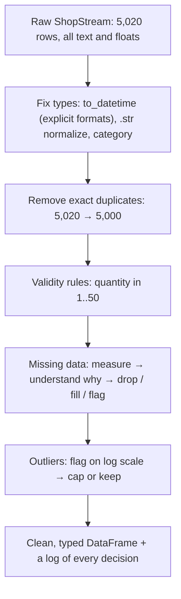
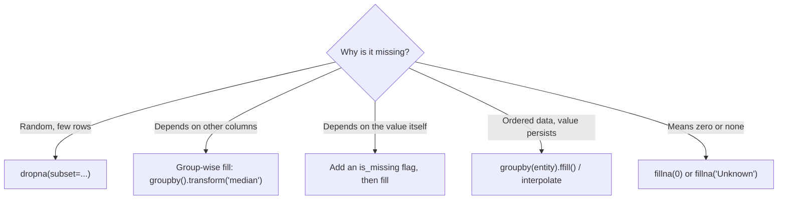

:::tip[TL;DR (30-Second Interview Pitch)]
Cleaning turns what was **recorded** into what is **true**: parse text into real types (`pd.to_datetime` with an **explicit format**, `.str` methods with regex, the memory-saving **`category`** dtype), remove duplicates and impossible values, and handle missing data on purpose. For missing values, first ask **why** they're missing, then choose: drop (`dropna`), fill with a constant, the **median** (robust to skew), the **mode** (categoricals), **ffill/bfill** (ordered data, always **within each group**), or a **group-wise** value with `groupby().transform()`. Every fill shrinks variance and can leak information, so add a **missing-indicator** column and fit fill values on training data only.
:::

<PriorityKey lang="pandas" v="3.0" />

<FormulaKey />

## 🧭 Start Here: Why Cleaning Is Most of the Job

The [previous page](./03-pandas-structures-loading-indexing.md) ended with a list of red flags in ShopStream: 20 spellings of 5 categories, dates stored as text in two formats, prices up to ₹771,750, quantities of -1 and 999, 20 duplicated rows, and thousands of missing values. A model or a chart built on that data is wrong in ways nobody notices. This page fixes each one and explains the decision behind each fix.

There are four kinds of work:

1. **Type rectification**: data arrives as text. Timestamps must become `datetime64` (so you can extract months and subtract dates), labels must be normalized, low-cardinality text should become `category` (much smaller, much faster).
2. **Validity**: remove what can't be true (duplicates, negative quantities) and decide what to do with what's merely unusual (outliers).
3. **Missing data**: detect it, understand **why** it's missing, then drop or impute.
4. **Recording what you did**: imputation changes the data's statistics; a missing-indicator column and a train-only fit keep the model honest.

| New concept | One-line meaning |
|---|---|
| **`datetime64[us]`** | pandas' timestamp dtype (microsecond resolution in pandas 3), with the `.dt` accessor |
| **`.str` accessor** | Vectorized string methods (`strip`, `lower`, `contains`, `extract`, `replace`) that skip missing values |
| **Regex** | A pattern language for text: `r"^C\d{4}$"` = "C followed by exactly 4 digits" |
| **`category` dtype** | Stores each distinct label once plus a small integer **code** per row |
| **Imputation** | Replacing missing values with an estimate |
| **MCAR / MAR / MNAR** | Missing completely at random / at random given other columns / not at random (depends on the missing value itself) |
| **ffill / bfill** | Fill a gap with the previous / next observed value |
| **IQR fence** | Values beyond $Q_3 + 1.5\,\text{IQR}$ or below $Q_1 - 1.5\,\text{IQR}$ are flagged as outliers |

:::analogy[Cleaning is washing vegetables before cooking]
The world's best recipe still tastes of mud if you skip the sink. Cleaning isn't glamorous and nobody photographs it, but it decides whether the dish is edible. In data work it's routinely 60–80% of the time, and interviewers know it.
:::

## ⚡ Essential Interview Recall

- 🔴 **Always pass `format=` to `pd.to_datetime`.** Without it, mixed inputs raise; `format="mixed"` guesses **per row** and silently swaps day and month on ambiguous dates (86 ShopStream rows moved, 49 into months that haven't happened). Parse each known format explicitly and combine with `fillna`.
- 🔴 **`errors="coerce"`** turns unparseable values into `NaT` / `NaN` instead of raising, then **count them**.
- 🔴 **`.dt`** for datetime parts (`.dt.month`, `.dt.day_name()`, `.dt.hour`, `.dt.to_period("M")`, `.dt.floor("D")`); **`.str`** for vectorized text (`strip`, `title`, `contains`, `extract`, `replace(..., regex=True)`).
- 🔴 **`category` dtype** = unique labels stored once + integer codes (`int8` for under 128 labels). ShopStream's category column: **76 KB → 5 KB**; on 2M rows **29 MB (`str`) / 111 MB (`object`) → 2 MB**, `value_counts` 27 ms → 8 ms.
- 🔴 **Detect**: `isna()` = `isnull()` (aliases); `df.isna().sum()` for counts, `.mean()` for fractions. **`NaN != NaN`**, so never test with `==`.
- 🔴 **`dropna()`** drops a row with **any** missing value by default: ShopStream would lose **2,488 of 5,020** rows. Use `subset=`, `how="all"` or `thresh=`.
- 🔴 **Mean vs median imputation**: mean is pulled by outliers and skew; the **median** is robust. **Mode** for categoricals. Every constant fill **shrinks the standard deviation** and creates a spike at the fill value.
- 🔴 **Group-wise imputation**: `df["x"].fillna(df.groupby("g")["x"].transform("median"))`.
- 🔴 **`ffill`/`bfill` must be done per group** on ordered data (`df.groupby("sensor_id")["sensor_val"].ffill()`), or values leak from one entity to the next.
- 🟠 **Missing-indicator feature**: `df["rating_missing"] = df["rating"].isna()` keeps the information "this was missing", which is often predictive (MNAR).
- 🟠 **Fit imputation values on the training split only**, then apply them to validation/test (otherwise you leak test statistics).
- 🟠 **Outliers**: IQR fence (on the **log** scale for skewed data), z-scores, or domain rules; then **drop, cap (`clip`), or keep and transform**. Decide per cause.
- 🟡 **pandas 3 missing markers**: `NaN` for floats and `str`, `NaT` for datetimes, `pd.NA` in nullable dtypes (`Int64`, `boolean`). `pd.isna` understands all of them.

## 📐 Formula Sheet

| Concept | Formula | In plain words |
|---|---|---|
| Interquartile range | $\pred{\text{IQR}} = \data{Q_3} - \data{Q_1}$ | Width of the middle 50% of the data |
| IQR outlier fence | $\data{x} < \data{Q_1} - \hyper{k}\,\pred{\text{IQR}}$ or $\data{x} > \data{Q_3} + \hyper{k}\,\pred{\text{IQR}}$, $\hyper{k} = 1.5$ | Further than 1.5 box-widths outside the box |
| z-score rule | $\lvert \pred{z} \rvert = \left\lvert \dfrac{\data{x} - \pred{\mu}}{\pred{\sigma}} \right\rvert > \hyper{3}$ | More than 3 standard deviations from the mean |
| Missing rate | $\pred{r} = \dfrac{\text{number of NaN}}{\data{N}}$ | `df.isna().mean()` |
| Variance after constant fill | $\pred{\sigma^2_{\text{new}}} \approx \pred{\sigma^2}\,(1 - \pred{r})$ (mean fill) | Filling a fraction r with the mean shrinks variance by about that fraction |

:::speak[How do you handle missing data?]
"First I **measure** it: `df.isna().mean()` per column, and whether missingness is concentrated in particular groups. Then I ask **why** it's missing. If it's completely random and a small fraction, I can drop rows with `dropna(subset=...)`. If it depends on other columns, I impute **within groups**, for example the median delivery time per city with `groupby('city').transform('median')`. If missingness depends on the value itself, like unhappy customers not leaving a rating, imputing hides a signal, so I keep a **missing-indicator** column. For numeric columns I prefer the **median** because it's robust to skew and outliers; for categoricals the mode or an explicit 'Unknown'. For ordered data like sensor readings I forward-fill **per sensor**. Two production rules: compute fill values on the **training set only** and reuse them at inference, and remember that any constant fill shrinks variance and creates a spike, which can mislead both models and charts."
:::

## The Mental Model

### 1. The cleaning pipeline



### 2. Choosing a missing-data strategy



<Animation src="pandas/ffill-bfill" caption="Two sensors share one column. A plain ffill carries sensor S1's last reading into S2's first gap, while groupby sensor_id then ffill stops at the boundary and leaves that gap empty. bfill fills backwards from the next reading." />

:::analogy[ffill is the scoreboard that keeps showing the last score]
Between goals, a football scoreboard keeps showing the last score: that's forward-fill, and it's right because the score really hasn't changed. But you'd never carry one match's final score onto the next match's board. Filling across groups is exactly that mistake.
:::

## The Paradigm / Core Concepts

### 🔴 Dates: parse explicitly

| Call | What happens on ShopStream | Verdict |
|---|---|---|
| `pd.to_datetime(s)` | Infers `%Y-%m-%d %H:%M:%S` from the first value, then raises `ValueError: time data "29/04/2026 04:04" doesn't match format` | Fails loudly (good) |
| `pd.to_datetime(s, format="mixed")` | Guesses each row; `'12/04/2026'` → **4 December** (should be 12 April). 86 rows wrong | ❌ Silent corruption |
| `pd.to_datetime(s, format="mixed", dayfirst=True)` | Fixes those, but now ISO `'2026-06-10'` → **6 October**. 1,728 rows wrong | ❌ Worse |
| One explicit format per known pattern + `errors="coerce"` + `fillna` | 0 rows wrong, 0 unparsed | ✅ |

<RuleCard name="Never let pandas guess a date format" tag="Dates" why="Day-first and month-first strings like 03/01/2026 are both valid dates, so a guess can be wrong without any error." remember="Name every format, count the NaT.">

Parse each known format explicitly with `errors="coerce"`, combine them with `fillna`, then assert nothing is left: `assert ts.isna().sum() == 0`. Also sanity-check the range (`ts.min()`, `ts.max()`): dates in the future or before the business existed mean a parsing bug.

</RuleCard>

| `.dt` accessor | Returns | ShopStream example |
|---|---|---|
| `.dt.year`, `.dt.month`, `.dt.day`, `.dt.hour` | Integers | `.dt.month` → orders per month 830, 798, 820, 850, 848, 874 |
| `.dt.day_name()`, `.dt.dayofweek` | Name / 0 = Monday | `'Wednesday'`, `2` |
| `.dt.to_period("M")` | Calendar month as a Period | `Period('2026-06', 'M')` |
| `.dt.floor("D")` | Truncated timestamp | `2026-06-10 00:00:00` |
| `.dt.strftime("%b %Y")` | Formatted string | `'Jun 2026'` |
| `.dt.tz_localize(...)`, `.dt.tz_convert(...)` | Time-zone aware timestamps | IST 09:09 → UTC 03:39 |
| Subtraction → `Timedelta`, `.dt.days` | Durations | Days since order |

### 🔴 Strings: the `.str` accessor and regex

| Method | Does | Example |
|---|---|---|
| `.str.strip()`, `.str.lower()`, `.str.title()` | Normalize | `' Books '`, `'BOOKS'` → `'Books'` |
| `.str.contains(pat, regex=True)` | Boolean mask | `r"^\d{2}/\d{2}/\d{4}"` finds the 251 day-first dates |
| `.str.match(pat)` | Match at the start | `r"^C\d{4}$"` validates customer IDs |
| `.str.extract(r"O(\d+)")` | Capture groups → columns | Order number from `'O00003'` |
| `.str.replace(pat, repl, regex=True)` | Substitute | `r"[₹,]"` → `''` before `astype(float)` |
| `.str.split(r"\s+", expand=True)` | Split into columns | First/last name |
| `.str.len()`, `.str[1:]` | Length, slicing | Strip the `'O'` prefix |

| Regex piece | Means |
|---|---|
| `^` / `$` | Start / end of the string |
| `\d`, `\s`, `\w` | Digit, whitespace, word character |
| `{4}`, `+`, `*`, `?` | Exactly 4, one or more, zero or more, optional |
| `[₹,]` | Any one of these characters |
| `( ... )` | A capture group (what `extract` returns) |

### 🔴 The `category` dtype

<RuleCard name="Use category for low-cardinality labels" tag="Memory and speed" why="Storing each distinct string once and a small integer per row is far smaller than one string per row, and comparisons become integer comparisons." remember="Few distinct values, use category.">

Convert columns whose number of distinct values is much smaller than the number of rows (city, tier, payment method, device): `df["city"] = df["city"].astype("category")`. Use `pd.CategoricalDtype([...], ordered=True)` when the labels have an order (Bronze < Silver < Gold). Don't use it for high-cardinality columns like IDs.

</RuleCard>

<Animation src="pandas/category-codes" caption="A column of repeated text labels is split into a small lookup table of the five distinct categories and a column of one-byte integer codes. The table is stored once, so memory falls from one string per row to one byte per row." />

:::analogy[Category codes are jersey numbers]
A commentator doesn't spell out "Electronics" every time; the team sheet says Electronics = 2, and from then on the scoreboard just shows 2. The team sheet (the categories) is printed once, the numbers (the codes) are cheap, and comparing two numbers is faster than comparing two names.
:::

| ShopStream `category` column (5,020 rows) | Bytes | 2M-row test | Memory | `value_counts` | `== "Books"` |
|---|---|---|---|---|---|
| `object` (pandas 2 default) | 281,306 | | 111.2 MB | 127.8 ms | — |
| `str` (pandas 3 default, Arrow) | 76,114 | | 29.2 MB | 26.9 ms | 12.9 ms |
| **`category`** | **5,226** | | **2.0 MB** | **8.0 ms** | **1.4 ms** |

### 🔴 Missing data: why it's missing

| Mechanism | Meaning | ShopStream example | Safe approach |
|---|---|---|---|
| **MCAR** (completely at random) | Unrelated to anything | A logging glitch dropped `discount_pct` on random rows | Drop or simple fill; little bias |
| **MAR** (at random given other columns) | Explained by observed columns | `delivery_days` missing more for some cities | **Group-wise** fill using those columns |
| **MNAR** (not at random) | Depends on the missing value itself | Unhappy customers skip the `rating` | Fill + **missing-indicator** column; model the missingness |

| Strategy | Code | Use when | Side effect |
|---|---|---|---|
| Drop rows | `dropna(subset=["payment_method"])` | Few rows, MCAR | Loses data; biased if not MCAR |
| Constant | `fillna({"discount_pct": 0.0, "payment_method": "Unknown"})` | Missing means none / unknown | None, if the meaning is right |
| Mean | `fillna(s.mean())` | Symmetric, no outliers | Pulled by outliers; shrinks variance |
| **Median** | `fillna(s.median())` | Skewed numeric data | Shrinks variance; spike at the median |
| Mode | `fillna(s.mode()[0])` | Categoricals | Over-represents the commonest class |
| ffill / bfill | `groupby(key).ffill()` | Ordered data where values persist | Leaks across groups if not grouped |
| Interpolate | `interpolate()` / `interpolate(method="time")` | Smooth numeric time series | Invents a trend |
| **Group-wise** | `fillna(df.groupby("city")["x"].transform("median"))` | MAR on a known grouping | Groups with no data stay NaN |
| Model-based | scikit-learn `KNNImputer`, `IterativeImputer` | Many correlated features | Slower; must be fit on train |

<Formula name="IQR outlier fence" tag="Outliers" words="Measure the width of the middle half of the data, then flag anything more than one and a half widths beyond the box. Medians and quartiles barely move when outliers are added, so the rule isn't fooled by the outliers it's looking for." remember="One and a half boxes out.">

$$
\pred{\text{IQR}} = \data{Q_3} - \data{Q_1}, \qquad \text{outlier if } \data{x} > \data{Q_3} + \hyper{1.5}\,\pred{\text{IQR}} \;\text{ or }\; \data{x} < \data{Q_1} - \hyper{1.5}\,\pred{\text{IQR}}
$$

- $\data{Q_1}, \data{Q_3}$: 25th and 75th percentiles (`s.quantile([0.25, 0.75])`)
- $\hyper{1.5}$: the conventional multiplier (3 for "extreme" outliers)

**Example:** ShopStream prices have $Q_1 = 699.98$, $Q_3 = 4316.86$, IQR = 3616.88, so the fence is **9,742.19** and **504** orders (10%) are "outliers". That's wrong: prices are log-normal, so every normal Electronics order looks extreme. On the **log** scale the fence is $e^{11.10} =$ ₹66,113.71 and flags **12** orders, close to the 25 injected ×40 errors.

</Formula>

## ⚙️ Under the Hood (pandas Internals)

- **`datetime64[us]`**: pandas 3 stores timestamps as 64-bit integers counting **microseconds** since 1970 (pandas 2 used nanoseconds), so subtraction and comparisons are integer arithmetic. `NaT` is the minimum int64 used as a sentinel.
- **`to_datetime` with a format** uses a fast C parser that applies one format to every row; `format="mixed"` falls back to parsing each string separately (slower **and** ambiguous). Without a format pandas infers one from the **first** non-null value and applies it to all.
- **`.str` on the `str` dtype** runs PyArrow compute kernels (C++) and returns `NaN` for missing entries instead of raising; on `object` columns it loops over Python strings.
- **`Categorical`** = a `categories` Index (the unique labels) + a `codes` array (`int8` when there are at most 127 categories, `int16` up to 32,767). `-1` encodes missing. `groupby`, `value_counts` and `==` work on the codes. Assigning a label that isn't a category raises `TypeError: Cannot setitem on a Categorical with a new category (Toys), set the categories first`.
- **Unused categories persist**: filtering out all Books rows keeps `Books` in `.cat.categories` (and `groupby(..., observed=False)` would show an empty group); `.cat.remove_unused_categories()` drops it.
- **Why `NaN` makes ints float**: NumPy `int64` has no missing marker, so a missing integer forces the column to `float64`. Nullable extension dtypes (`Int64`, `boolean`, `string`) carry a separate validity mask and use `pd.NA`.
- **Reductions skip NaN by default** (`skipna=True`): `pd.Series([1, NaN, 3]).mean()` is **2.0** (NumPy's `mean` would be `nan`), and the sum of an all-NaN Series is **0.0**.
- **`groupby().transform(...)`** returns a result aligned to the **original rows**, which is what makes it usable inside `fillna`.

:::danger[Interview Trap]
**`format="mixed"` is not a fix for mixed formats.** It removes the error and keeps the bug: on ShopStream, `'12/04/2026 15:28'` (12 April) becomes **4 December**, and 49 orders land in July–December 2026 in a dataset that ends in June. Adding `dayfirst=True` fixes those but flips **1,728** ISO dates instead. Always parse known formats explicitly.
:::

:::danger[Interview Trap]
**Imputing the mean on the full dataset before splitting is leakage.** The test rows' values influenced the fill value used in training, so validation scores are optimistic. Compute fill values on the training split (`train["x"].median()`), store them, and apply the same numbers to validation, test and production (scikit-learn's `SimpleImputer` inside a `Pipeline` does this for you).
:::

## 💻 Pandas Implementation on ShopStream

:::tip[Run it yourself]
Outputs come from **pandas 3.0.6** on **Python 3.14**. Start with `raw = pd.read_csv("shopstream_orders.csv")` and `customers = pd.read_csv("shopstream_customers.csv")` ([download](pathname:///data/shopstream_orders.csv)).
:::

### 1. Parsing the two date formats

```python showLineNumbers
s = raw["order_ts"]
print(s[s.str.contains("/")].head(2).tolist())      # ['29/04/2026 04:04', '24/04/2026 04:55']

# error-next-line
pd.to_datetime(s)                                    # ❌ ValueError: time data "29/04/2026 04:04" doesn't match format "%Y-%m-%d %H:%M:%S"
# error-next-line
mixed = pd.to_datetime(s, format="mixed")            # ❌ no error, wrong data
print(mixed.max())                                   # 2026-12-05 17:59:00: an order from the future

# success-start
ts = pd.to_datetime(s, format="%Y-%m-%d %H:%M:%S", errors="coerce")   # 251 NaT: the day-first rows
ts = ts.fillna(pd.to_datetime(s, format="%d/%m/%Y %H:%M", errors="coerce"))
# success-end
assert ts.isna().sum() == 0
print(ts.dtype, ts.min(), ts.max())                  # datetime64[us] 2026-01-01 00:11:11 2026-06-30 23:14:57
print((mixed != ts).sum())                           # 86 rows the "mixed" guess got wrong
```

| Raw string | `format="mixed"` | Explicit formats (correct) |
|---|---|---|
| `12/04/2026 15:28` | 2026-12-04 15:28 | **2026-04-12** 15:28 |
| `03/01/2026 08:30` | 2026-03-01 08:30 | **2026-01-03** 08:30 |
| `29/04/2026 04:04` | 2026-04-29 04:04 (day > 12, no ambiguity) | 2026-04-29 04:04 |

### 2. Datetime features with `.dt`

```python showLineNumbers
orders = raw.assign(order_ts=ts)
print(orders["order_ts"].dt.month.value_counts().sort_index().tolist())   # [830, 798, 820, 850, 848, 874]
print(orders["order_ts"].dt.day_name().head(3).tolist())   # ['Wednesday', 'Friday', 'Tuesday']
print(orders["order_ts"].dt.hour.head(3).tolist())         # [9, 11, 6]
print(orders["order_ts"].dt.to_period("M").iloc[0])        # 2026-06
print(orders["order_ts"].dt.strftime("%b %Y").iloc[0])     # Jun 2026
print((pd.Timestamp("2026-07-01") - orders["order_ts"]).dt.days.head(3).tolist())   # [20, 11, 70]: recency in days
print(orders["order_ts"].dt.tz_localize("Asia/Kolkata").dt.tz_convert("UTC").iloc[0])   # 2026-06-10 03:39:11+00:00
```

### 3. Normalizing labels with `.str` and regex

```python showLineNumbers
print(raw["category"].nunique())                     # 20
print(raw["category"].unique()[:9].tolist())
# ['Fashion', 'Books', 'Beauty', 'Electronics', 'FASHION', 'Home', ' Books ', 'BEAUTY', 'electronics']
# highlight-next-line
clean_cat = raw["category"].str.strip().str.title()
print(clean_cat.value_counts().to_dict())
# {'Electronics': 1295, 'Fashion': 1277, 'Home': 983, 'Beauty': 753, 'Books': 712}

print(raw["customer_id"].str.match(r"^C\d{4}$").all())        # True: format is valid...
print(raw["customer_id"].str.contains("9999").sum())          # 100: ...but C9999 is a placeholder
print(raw["order_id"].str.extract(r"O(\d+)")[0].astype(int).head(3).tolist())   # [1, 2, 3]
print(raw["order_ts"].str.contains(r"^\d{2}/\d{2}/\d{4}").sum())  # 251 day-first timestamps

prices_txt = pd.Series(["₹1,299", "₹45", "₹12,000.50"])
print(prices_txt.str.replace(r"[₹,]", "", regex=True).astype(float).tolist())   # [1299.0, 45.0, 12000.5]
print(pd.Series(["Alex Kumar", "Jordan  Lee", None]).str.split(r"\s+", expand=True).values.tolist())
# [['Alex', 'Kumar'], ['Jordan', 'Lee'], [nan, nan]]: missing stays missing
```

### 4. The `category` dtype

```python showLineNumbers
cat = clean_cat.astype("category")
print(cat.cat.categories.tolist())                   # ['Beauty', 'Books', 'Electronics', 'Fashion', 'Home']
print(cat.cat.codes.head(5).tolist(), cat.cat.codes.dtype)   # [3, 1, 0, 1, 0] int8
print(clean_cat.memory_usage(deep=True), cat.memory_usage(deep=True))   # 76114 5226

# error-next-line
cat.iloc[0] = "Toys"                                 # ❌ TypeError: Cannot setitem on a Categorical with a new category (Toys), set the categories first

tier = customers["tier"].astype(pd.CategoricalDtype(["Bronze", "Silver", "Gold"], ordered=True))
# highlight-next-line
print((tier >= "Silver").sum(), tier.max())          # 85 Gold: comparisons follow the declared order

no_books = cat[cat != "Books"]
print(no_books.cat.categories.tolist())              # still includes 'Books'
print(no_books.cat.remove_unused_categories().cat.categories.tolist())   # ['Beauty', 'Electronics', 'Fashion', 'Home']
```

### 5. Duplicates and validity rules

```python showLineNumbers
print(raw.duplicated().sum(), raw.duplicated(keep=False).sum())   # 20 40: 20 extra copies of 20 rows
orders = raw.assign(order_ts=ts, category=cat).drop_duplicates()
print(orders.shape, orders["order_id"].is_unique)   # (5000, 11) True

bad_qty = (orders["quantity"] <= 0) | (orders["quantity"] > 50)
print(orders.loc[bad_qty, "quantity"].value_counts().to_dict())   # {-1: 20, 0: 20, 999: 2}
orders = orders.loc[~bad_qty]                         # 4,958 rows: these can't be fixed, so drop
```

| Rule | Rows | Decision | Why |
|---|---|---|---|
| Exact duplicate | 20 | Drop | Same order recorded twice would double-count revenue |
| Quantity 0 or -1 | 40 | Drop | Impossible; no way to recover the true value |
| Quantity 999 | 2 | Drop | A test or fat-finger value |
| Customer `C9999` | 100 | Keep, flag | The order is real; only the link is missing (handled when merging) |

### 6. Measuring missing data

```python showLineNumbers
print(raw.isna().sum()[lambda s: s > 0].to_dict())
# {'discount_pct': 401, 'payment_method': 150, 'delivery_days': 300, 'rating': 2009}
print(raw.isna().mean().round(3)[lambda s: s > 0].to_dict())
# {'discount_pct': 0.08, 'payment_method': 0.03, 'delivery_days': 0.06, 'rating': 0.4}
print(raw.isnull().equals(raw.isna()))               # True: isnull is an alias

# error-next-line
print(np.nan == np.nan)                              # False: never test for NaN with ==
print(pd.isna(np.nan), pd.isna(None), pd.isna(pd.NA), pd.isna(pd.NaT))   # True True True True

print(len(raw.dropna()))                             # 2532: ANY missing value drops the row (almost half!)
print(len(raw.dropna(subset=["payment_method"])))    # 4870
print(len(raw.dropna(thresh=10)))                    # 4673: keep rows with at least 10 non-null values
print(raw.dropna(axis=1).columns.tolist()[-2:])      # ['quantity', 'device']: drop COLUMNS with any NaN
```

### 7. Imputation: constant, mean, median, mode

```python showLineNumbers
d = raw["delivery_days"]
print(round(d.mean(), 4), d.median(), d.mode().tolist())   # 4.7646 4.0 [4.0]
print(round(d.std(), 4))                             # 2.3866 before filling

print(round(d.fillna(d.mean()).std(), 4))            # 2.3142: variance shrinks
print(round(d.fillna(d.median()).std(), 4))          # 2.3213

# highlight-next-line
filled = raw.fillna({"discount_pct": 0.0, "payment_method": raw["payment_method"].mode()[0]})
print(filled[["discount_pct", "payment_method"]].isna().sum().tolist())   # [0, 0]

r = raw["rating"].fillna(raw["rating"].mean())
# error-next-line
print(r.round(4).value_counts().head(2).to_dict())   # {3.5184: 2009, 4.0: 1015}: 40% of rows now share one fake value
```

### 8. Group-wise and conditional imputation

```python showLineNumbers
city = raw["customer_id"].map(customers.set_index("customer_id")["city"])   # lookup, see the next page
print(city.isna().sum())                             # 100: the C9999 orphans have no city

print(raw.groupby(city)["delivery_days"].median().to_dict())
# {'Bengaluru': 4.0, 'Delhi': 6.0, 'Hyderabad': 6.0, 'Mumbai': 4.0, 'Pune': 4.0}

# highlight-next-line
by_city = raw["delivery_days"].fillna(raw.groupby(city)["delivery_days"].transform("median"))
print(by_city.isna().sum())                          # 11: orphans have no group to borrow from
by_city = by_city.fillna(raw["delivery_days"].median())   # fallback to the global median
print(by_city.isna().sum())                          # 0

flagged = raw.assign(rating_missing=raw["rating"].isna(),            # keep the signal
                     rating=raw["rating"].fillna(raw["rating"].median()))
print(np.where(raw["delivery_days"].isna(), "missing", "ok")[:3])   # ['missing' 'ok' 'ok']
```

### 9. ffill, bfill and interpolation on sensor data

```python showLineNumbers
sens = pd.DataFrame({"sensor_id": ["S1"] * 4 + ["S2"] * 4,
                     "sensor_val": [20.1, np.nan, np.nan, 23.0, np.nan, 31.0, np.nan, 33.0]})

# error-next-line
print(sens["sensor_val"].ffill().tolist())           # [20.1, 20.1, 20.1, 23.0, 23.0, 31.0, 31.0, 33.0]: S1's 23.0 leaked into S2
# success-next-line
print(sens.groupby("sensor_id")["sensor_val"].ffill().tolist())   # [20.1, 20.1, 20.1, 23.0, nan, 31.0, 31.0, 33.0]
print(sens["sensor_val"].bfill().tolist())           # [20.1, 23.0, 23.0, 23.0, 31.0, 31.0, 33.0, 33.0]
print(sens["sensor_val"].ffill(limit=1).tolist())    # [20.1, 20.1, nan, 23.0, 23.0, 31.0, 31.0, 33.0]: at most 1 step
print(sens.groupby("sensor_id")["sensor_val"]
          .transform(lambda x: x.interpolate()).round(2).tolist())   # [20.1, 21.07, 22.03, 23.0, nan, 31.0, 32.0, 33.0]
```

:::warning[bfill and leakage in time series]
`bfill` copies a value from the **future** into the past. In a forecasting feature pipeline that's leakage: at prediction time the next reading doesn't exist yet. Prefer `ffill` (past only) for features, and use `bfill` only for display or for gaps at the very start of a series.
:::

### 10. Outliers: IQR on raw vs log scale

```python showLineNumbers
p = raw["unit_price"]
q1, q3 = p.quantile([0.25, 0.75])
fence = q3 + 1.5 * (q3 - q1)
print(round(fence, 2), (p > fence).sum())            # 9742.19 504: flags 10% of orders, mostly normal Electronics
print(round(p.skew(), 2), round(np.log(p).skew(), 2))   # 29.72 0.29: log makes it nearly symmetric

lp = np.log(p)
lq1, lq3 = lp.quantile([0.25, 0.75])
# highlight-next-line
log_fence = lq3 + 1.5 * (lq3 - lq1)
print(round(np.exp(log_fence), 2), (lp > log_fence).sum())   # 66113.71 12: the real data-entry errors

cap = p.quantile(0.99)
print(round(cap, 2), round(p.clip(upper=cap).mean(), 2))   # 22100.98 3470.26: winsorized mean (was 4233.98)
```

| Option | Code | When |
|---|---|---|
| Drop | `df = df[~is_outlier]` | Clear data errors (×40 prices) |
| Cap (winsorize) | `s.clip(lower, upper)` | Real but extreme values that would dominate a model |
| Transform | `np.log1p(s)` | Skewed but valid data |
| Keep + flag | `df["is_outlier"] = is_outlier` | Fraud, anomalies: the outliers are the point |
| Group-wise | IQR per category on log price (44 flagged) | When "normal" differs by group (Books vs Electronics) |

:::info[AI Engineering: cleaning is part of the model]
Every decision on this page (format strings, the label map, the median per city, the log-IQR fence) must run identically at training and inference time. Put them in one function or a scikit-learn `Pipeline`/`ColumnTransformer`, version the fitted values with the model, and test it. A cleaning step that exists only in a notebook is the most common cause of training-serving skew.
:::

## 🧪 Predict the Output

<Predict n="1" title="Mixed date formats" output="2026-12-04 15:28:00">

```python
print(pd.to_datetime(pd.Series(["2026-01-05 10:00:00", "12/04/2026 15:28"]), format="mixed")[1])
```

`format="mixed"` parses each string on its own and, by default, reads `xx/yy/zzzz` as **month/day**. `12/04` becomes 4 December, not 12 April. No warning, no error.

</Predict>

<Predict n="2" title="NaN equality" output="False 2">

```python
s = pd.Series([1.0, np.nan, np.nan])
print((s == np.nan).any(), s.isna().sum())
```

`NaN` is not equal to anything, including itself (IEEE 754), so `s == np.nan` is all `False`. `isna()` is the correct test and finds **2**.

</Predict>

<Predict n="3" title="dropna default" output="2532">

```python
raw = pd.read_csv("shopstream_orders.csv")
print(len(raw.dropna()))
```

`dropna()` uses `how="any"` across **all** columns, and 40% of rows lack a `rating` alone. Half the dataset (2,488 rows) disappears. Always pass `subset=` or `thresh=`.

</Predict>

<Predict n="4" title="Missing ints" output="float64 [1, <NA>]">

```python
print(pd.Series([1, None]).dtype, pd.Series([1, None], dtype="Int64").tolist())
```

NumPy integers can't hold a missing value, so pandas upcasts to `float64` (`[1.0, nan]`). The nullable `Int64` dtype (capital I) keeps integers and uses `pd.NA`.

</Predict>

<Predict n="5" title="ffill across groups" output="[1.0, 1.0, 1.0]">

```python
df = pd.DataFrame({"g": ["a", "a", "b"], "v": [1.0, np.nan, np.nan]})
print(df["v"].ffill().tolist())
```

A plain `ffill` ignores the group column, so group `b` inherits `a`'s value. `df.groupby("g")["v"].ffill()` gives `[1.0, 1.0, nan]`.

</Predict>

<Predict n="6" title="Sum of nothing" output="2.0 0.0">

```python
print(pd.Series([1, np.nan, 3]).mean(), pd.Series([np.nan]).sum())
```

pandas reductions skip `NaN` (`skipna=True`): mean of 1 and 3 is **2.0**. The sum of no valid values is the empty sum, **0.0** (use `min_count=1` to get `NaN` instead).

</Predict>

## 🪜 Follow-up Ladder

<Ladder title="From fillna to a production imputation strategy">
<Rung q="How do you fill missing numeric values?">

`fillna` with a constant, the median (robust) or mean, or `ffill`/`bfill` for ordered data. Measure first with `isna().mean()`.

</Rung>
<Rung q="Why median and not mean for prices?">

Prices are right-skewed with outliers: ShopStream's mean is ₹4,234 but the median ₹1,520. The mean is dragged toward a few huge values, so it's not a typical price; the median is.

</Rung>
<Rung q="40% of ratings are missing. Would you impute them?">

Check whether missingness is informative (MNAR): compare outcomes for rated vs unrated orders. Then fill (median or model-based) **and** add `rating_missing` as a feature, or treat it as its own category. Filling with the mean alone puts 40% of rows on one value and hides the signal.

</Rung>
<Rung q="How do you keep imputation consistent between training and production?">

Fit fill values on the training split only, inside a scikit-learn `Pipeline` (`SimpleImputer`, `ColumnTransformer`), serialize it with the model, and apply it unchanged at inference. Monitor the missing rate in production; a sudden jump usually means an upstream bug, not a change in the world.

</Rung>
</Ladder>

## 🚑 Production Scenarios

:::incident[Revenue appeared in December, in June]
A dashboard showed a small amount of revenue for July–December 2026, while the data only went up to June.

- **Why:** a teammate replaced an explicit date format with `format="mixed"` to silence a `ValueError` after a partner started sending `dd/mm/yyyy` timestamps. Every ambiguous date (day ≤ 12) was parsed month-first; 49 orders moved into the future and 37 others moved within the half-year without anyone noticing.
- **Fix:** parse each known format explicitly with `errors="coerce"` and combine; fail the job if any value is unparsed or out of range.
- **Prevention:** assert `ts.between(start, today).all()`, and agree an ISO 8601 contract with data providers.
:::

:::incident[The model loved customers with no rating]
A churn model ranked "rating = 3.52" as a strong signal of staying. 3.52 wasn't a real rating; it was the mean used to fill 40% of the column.

- **Why:** customers who didn't rate behaved differently (MNAR), and the mean fill turned "didn't rate" into a single, very recognizable value the model latched onto. At serving time a different team filled missing ratings with 0.
- **Fix:** an explicit `rating_missing` flag, median fill computed on training data, the same fitted imputer shipped with the model.
:::

## 🚨 Interview Gotchas & Edge Cases

:::warning[The Most Common Question]
**"How would you handle missing values in this dataset?"** Measure (`isna().mean()`), diagnose (MCAR / MAR / MNAR: does missingness correlate with other columns or the outcome?), then choose per column: drop, constant, median, mode, group-wise `transform`, `ffill` per entity, or a model-based imputer, plus a missing-indicator for informative gaps. Close with: fit on train only, and check the effect on distributions.
:::

- **`fillna(method="ffill")` is removed in pandas 3** (`TypeError: NDFrame.fillna() got an unexpected keyword argument 'method'`); use `.ffill()` / `.bfill()`.
- **`inplace=True` on a column** (`df["x"].fillna(0, inplace=True)`) is chained assignment under Copy-on-Write: it emits `ChainedAssignmentError` and does **not** update `df`. Write `df["x"] = df["x"].fillna(0)`.
- **`read_csv` silently converts `"NA"`, `"N/A"`, `"null"`, `""` to NaN**; a real value like the city `"NA"` disappears. Use `keep_default_na=False, na_values=[...]`.
- **`astype(int)` on a column with NaN raises** (`IntCastingNaNError`); fill first or use `"Int64"`.
- **Categoricals and `groupby`**: pandas 3 defaults to `observed=True`, so empty categories don't appear as groups; pass `observed=False` to see them.
- **Concatenating two categoricals with different categories** gives `object`/`str` back; use `union_categoricals` or a shared `CategoricalDtype`.
- **`str.contains` with special characters** (`.`, `+`, `(`) treats them as regex; pass `regex=False` for literal text.
