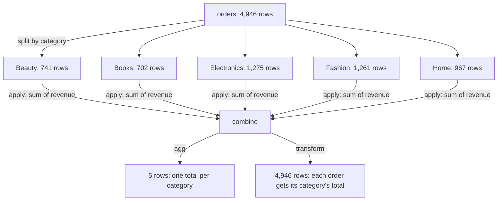

:::tip[TL;DR (30-Second Interview Pitch)]
**`Series.map`** looks values up (a dict, a Series or a function), **`apply`** runs a Python function per element, per column or per row, and **`DataFrame.map`** (the replacement for the removed `applymap`) runs one per cell. They're convenient but run at Python speed, so prefer **vectorized** column arithmetic, `np.select` or `pd.cut`. **`groupby`** is **split → apply → combine**: `agg` reduces each group to **one row**, `transform` returns a value **for every original row** (perfect for "price vs category average", group-wise imputation and normalization), and `filter` keeps or drops whole groups. Built-in aggregations (`"sum"`, `"mean"`) run in Cython; lambdas run per group in Python.
:::

<PriorityKey lang="pandas" v="3.0" />

<FormulaKey />

## 🧭 Start Here: From Rows to Answers

The cleaned ShopStream table has one row per order. Business questions are almost never about one order: "Which category earns the most?", "Is this order expensive **for its category**?", "How many times has each customer bought?" Answering them needs two kinds of tool:

1. **Element-wise transformations** turn each value into another value: map a tier name to a discount rate, bucket a price into budget/mid/premium. Pandas offers `map`, `apply` and `DataFrame.map` for this, but the fast path is almost always a **vectorized** expression.
2. **Group operations** split rows into groups by a key, compute something per group, and put the results back together. This is the **split-apply-combine** pattern (the same idea as SQL `GROUP BY` and window functions), and it's the most-used part of pandas in analytics and feature engineering.

| New concept | One-line meaning |
|---|---|
| **`Series.map`** | Replace each value via a dict / Series lookup or a function |
| **`apply`** | Call a Python function per element (Series), per column (`axis=0`) or per row (`axis=1`) |
| **`DataFrame.map`** | Call a function on **every cell** (was `applymap`, removed in pandas 3) |
| **GroupBy object** | A lazy description of how rows are split; nothing is computed until you aggregate |
| **`agg`** | Reduce each group to one value per column: SQL `GROUP BY` |
| **`transform`** | Compute per group, then **broadcast back** to every original row: SQL window function `OVER (PARTITION BY ...)` |
| **Named aggregation** | `agg(revenue=("revenue", "sum"))`: choose the output column names yourself |
| **`filter`** | Keep or drop **entire groups** based on a condition |

:::analogy[Split-apply-combine is sorting the laundry]
You tip the basket onto the floor and **split** it into piles by colour, **apply** the right wash to each pile, then **combine** everything back into one folded stack. `agg` is weighing each pile and writing one number per colour; `transform` is pinning a tag with "this pile weighs 3 kg" onto every single shirt in it.
:::

## ⚡ Essential Interview Recall

- 🔴 **`Series.map(dict)`** returns **NaN for keys not in the dict**; `Series.replace(dict)` leaves them unchanged.
- 🔴 **`apply(axis=1)` is a Python loop over rows**: on ShopStream it was **85× slower** than the vectorized expression (29.2 ms vs 0.35 ms). Use column arithmetic, `np.where`/`np.select`, `pd.cut`.
- 🔴 **`DataFrame.applymap` is removed in pandas 3** (`AttributeError: 'DataFrame' object has no attribute 'applymap'`); use **`DataFrame.map`**.
- 🔴 **`groupby` = split → apply → combine**, and it's lazy: `df.groupby("category")` computes nothing until you call `sum`, `agg`, `transform`...
- 🔴 **`agg` → one row per group; `transform` → same length as the input** (4,946 rows in, 4,946 out), aligned to the original index.
- 🔴 **Named aggregation**: `df.groupby("category").agg(orders=("order_id", "count"), revenue=("revenue", "sum"))`: flat, readable column names.
- 🔴 **`size()` counts rows, `count()` counts non-null values**: Beauty has 741 orders but only 428 ratings.
- 🔴 **Group-wise normalization**: `(x - g.transform("mean")) / g.transform("std")`; share of group: `x / g.transform("sum")`.
- 🟠 **Multi-key grouping** gives a **MultiIndex**; `as_index=False` or `.reset_index()` flattens it back to columns.
- 🟠 **Use built-in names** (`"mean"`, `"sum"`, `"median"`): Cython speed. Lambdas run per group in Python (2.7× slower for `agg`, 5.8× for `transform` on 2M rows).
- 🟠 Per-entity sequences: `groupby("customer_id").cumcount()`, `.cumsum()`, `.diff()`, `.shift()`, `.rank()`; **sort by time first**.
- 🟡 pandas 3 defaults: `observed=True` for categorical keys (empty categories don't appear), `dropna=True` (NaN keys are dropped unless `dropna=False`), `sort=True`.

## 📐 Formula Sheet

| Concept | Formula | In plain words |
|---|---|---|
| Group mean | $\pred{\bar x_g} = \frac{1}{\data{n_g}}\sum_{i \in g} \data{x_i}$ | `groupby(g)[x].mean()` |
| Within-group z-score | $\pred{z_i} = \dfrac{\data{x_i} - \pred{\bar x_{g(i)}}}{\pred{s_{g(i)}}}$ | How unusual a row is **for its own group** |
| Share of group total | $\pred{w_i} = \dfrac{\data{x_i}}{\sum_{j \in g(i)} \data{x_j}}$ | `x / groupby(g)[x].transform("sum")` |
| Ratio to group mean | $\pred{r_i} = \data{x_i} / \pred{\bar x_{g(i)}}$ | 1.24 = 24% above the category average |
| Recency | $\pred{\text{recency}} = \data{t_{\text{snapshot}}} - \max_{i \in c} \data{t_i}$ | Days since the customer's last order |

:::speak[What is the difference between agg and transform in a groupby?]
"Both split the data by a key and compute something per group; the difference is the **shape of the result**. `agg` **reduces** each group to one row, so grouping 4,946 orders by category gives a five-row table: total revenue per category, like SQL `GROUP BY`. `transform` computes the same per-group value but **broadcasts it back to every original row**, so the output has 4,946 rows aligned to the original index, like a SQL window function with `PARTITION BY`. That makes `transform` the tool for row-level features that need group context: an order's price divided by its category's average price, a z-score within each category, each order's share of its customer's spend, or filling missing delivery days with the median of the customer's city. I use built-in string names like `'mean'` because they run in Cython; a lambda runs per group in Python and can be several times slower."
:::

## The Mental Model

### 1. Split, apply, combine



<Animation src="pandas/split-apply-combine" caption="Rows are coloured by category, pulled apart into one pile per category, each pile is summed, and the five totals are stacked into a small result table. That final table is what agg returns." />

### 2. `agg` vs `transform` vs `filter`

<Animation src="pandas/agg-vs-transform" caption="The same group means, delivered two ways. agg collapses each group to a single row. transform writes the group mean next to every original row, so the result lines up with the input and can be used in arithmetic." />

| | Output shape | Index | SQL equivalent | Typical use |
|---|---|---|---|---|
| `agg` / `sum` / `mean` | One row per group | Group keys | `GROUP BY` | Reports, summary tables |
| `transform` | **Same as input** | Original index | `AVG(x) OVER (PARTITION BY g)` | Row-level features, imputation, normalization |
| `filter` | Subset of input rows | Original index | `HAVING` (keeping rows) | Drop small or irrelevant groups |
| `apply` | Anything | Depends | — | Last resort for complex per-group logic |

:::analogy[agg is the class average on the noticeboard, transform is the average on every report card]
The school can pin one sheet on the noticeboard listing each class's average mark (agg: one line per class). Or it can print each class's average **on every student's report card**, next to their own mark, so each student sees how they compare (transform: one line per student).
:::

## The Paradigm / Core Concepts

### 🔴 `map` vs `apply` vs `DataFrame.map` vs vectorized

| Tool | Works on | Calls your function | Speed | Use for |
|---|---|---|---|---|
| Vectorized ops (`+`, `np.where`, `pd.cut`, `.str`, `.dt`) | Whole columns | Never (C loops) | ⚡ Fastest | Almost everything |
| `Series.map(dict / Series)` | One column | No (hash lookup) | ⚡ Fast | Code → label, ID → attribute |
| `Series.map(func)` / `Series.apply(func)` | One column | Once per element | 🐢 Python speed | Logic with no vectorized form |
| `DataFrame.apply(func)` (default `axis=0`) | Each **column** | Once per column | OK (few calls) | Column-wise stats, `np.log1p` on several columns |
| `DataFrame.apply(func, axis=1)` | Each **row** | Once per row, builds a Series each time | 🐌 Slowest | Avoid; rewrite as column operations |
| `DataFrame.map(func)` | Every cell | Once per cell | 🐢 | Formatting for display |

<RuleCard name="Vectorize before you apply" tag="Performance" why="apply hands each value or row to the Python interpreter, while column operations run one C loop over the whole array." remember="Columns, not rows.">

Before writing `apply`, ask whether the logic is arithmetic (`df.a * df.b`), a condition (`np.where`, `np.select`), bucketing (`pd.cut`, `pd.qcut`), a lookup (`Series.map(dict)`), text (`.str`) or dates (`.dt`). Only reach for `apply` when none of these fits, and never use `axis=1` for something a column expression can do.

</RuleCard>

:::analogy[apply is a cashier, vectorization is a weighing scale]
A cashier scanning 5,000 apples one by one does 5,000 separate actions, each with its own beep and pause: that's `apply`, a Python call per value. Tipping the whole crate on a weighing scale gives the answer in one action: that's a vectorized column operation. Same result, very different queue.
:::

### 🔴 Aggregation functions

| Spec | Example | Result columns |
|---|---|---|
| Method | `g["revenue"].sum()` | One Series |
| List | `g["revenue"].agg(["count", "mean", "median", "sum"])` | One column per function |
| Dict | `g.agg({"revenue": "sum", "quantity": ["mean", "max"]})` | MultiIndex columns |
| **Named** | `g.agg(orders=("order_id", "count"), revenue=("revenue", "sum"))` | **Your names, flat** |
| Custom function | `g["unit_price"].agg(p90)` with `def p90(s): return s.quantile(0.9)` | Named after the function (`<lambda_0>` for lambdas) |

| Built-in name | Meaning | Note |
|---|---|---|
| `count` | Non-null values | Use `size()` for rows including NaN |
| `nunique` | Distinct values | Distinct customers per category |
| `sum`, `mean`, `median`, `min`, `max` | Usual statistics | Skip NaN |
| `std`, `var` | Spread | **`ddof=1`** |
| `first`, `last` | First / last non-null in group order | Sort first |
| `quantile` | e.g. `g["x"].quantile(0.9)` | |

<Formula name="Within-group z-score" tag="Group normalization" words="Measure how unusual a value is compared with its own group rather than the whole dataset. A ₹9,000 order is ordinary for Electronics but extreme for Books." remember="Compare to your own crowd.">

$$
\pred{z_i} = \frac{\data{x_i} - \pred{\bar x_{g(i)}}}{\pred{s_{g(i)}}}
$$

- $\data{x_i}$: the value in row $i$ (here the log of the unit price)
- $g(i)$: the group row $i$ belongs to (its category)
- $\pred{\bar x_{g(i)}}$, $\pred{s_{g(i)}}$: that group's mean and standard deviation, broadcast with `transform("mean")` / `transform("std")`

**Example:** after the transform, every category's z-scores have mean **0** and standard deviation **1** (verified per category).

</Formula>

## ⚙️ Under the Hood (pandas Internals)

- **The GroupBy object is lazy**: `df.groupby("category")` stores the key and the data. On the first computation pandas **factorizes** the key (turns each label into an integer group code, via a hash table: O(n)) and works out which rows belong to which group (a stable sort of the codes or a counting pass).
- **Built-in aggregations** (`sum`, `mean`, `std`, `min`, `max`, `first`, `count`, `cumsum`, `rank`...) are Cython loops that walk the codes once and accumulate per group: O(n) overall, no Python per group.
- **Lambdas and custom functions** make pandas build a sub-Series per group and call your Python function on it: for many small groups the per-call overhead dominates (on 2M rows and 1,000 groups: `agg("mean")` 30.6 ms vs `agg(lambda s: s.mean())` 83.8 ms; `transform("mean")` 40.9 ms vs lambda 235.3 ms).
- **`transform`** computes one value per group then **reindexes** it to the original row order (or returns a same-length result per group), which is why it can go straight into `df["new_col"] = ...` or `fillna(...)`.
- **Categorical keys**: grouping by a `category` column uses its existing integer codes (no factorizing step). With `observed=True` (the pandas 3 default) only categories present in the data become groups.
- **`apply(axis=1)`** builds a new Series for every row (with the row's values cast to a common dtype) and calls your function: 4,946 Series objects for ShopStream, millions for real data.
- **Grouping sorts the keys** by default (`sort=True`); `sort=False` keeps first-appearance order and can be faster for many groups.

:::danger[Interview Trap]
**`map` with a dict silently creates NaN.** `customers["tier"].map({"Bronze": 0})` turns every Silver and Gold into `NaN`, with no warning. If you want unmapped values to stay as they are, use `replace`; if every value must be mapped, check afterwards: `assert not result.isna().any()`.
:::

:::danger[Interview Trap]
**Sequence features need sorting first.** `groupby("customer_id").cumcount()`, `cumsum()`, `diff()` and `shift()` follow the **current row order**, not time order. On an unsorted DataFrame, "order number 1" isn't the first order and "days since previous order" can be negative. Always `sort_values("order_ts")` first.
:::

## 💻 Pandas Implementation on ShopStream

:::tip[Run it yourself]
From this page on, examples start from **cleaned** ShopStream (4,946 orders, 15 columns). The cleaning function below collects the steps from the [Cleaning page](./04-pandas-cleaning-types-missing-data.md). Outputs come from **pandas 3.0.6** on **Python 3.14**.
:::

```python title="clean.py" showLineNumbers
import numpy as np
import pandas as pd


def clean_orders(raw, customers):
    o = raw.drop_duplicates()                                                     # 20 exact duplicates

    # dates: one explicit format per known pattern, never format="mixed"
    ts = pd.to_datetime(o["order_ts"], format="%Y-%m-%d %H:%M:%S", errors="coerce")
    ts = ts.fillna(pd.to_datetime(o["order_ts"], format="%d/%m/%Y %H:%M", errors="coerce"))
    assert ts.notna().all()

    o = o.assign(
        order_ts=ts,
        category=o["category"].str.strip().str.title().astype("category"),
        payment_method=o["payment_method"].fillna("Unknown").astype("category"),
        device=o["device"].astype("category"),
        discount_pct=o["discount_pct"].fillna(0.0),                               # missing = no discount
    )

    # validity: impossible quantities and x40 data-entry prices (log-scale IQR fence)
    log_p = np.log(o["unit_price"])
    q1, q3 = log_p.quantile([0.25, 0.75])
    o = o[o["quantity"].between(1, 50) & (log_p <= q3 + 1.5 * (q3 - q1))]

    # delivery_days: median per customer city, then the global median; keep a flag
    city = o["customer_id"].map(customers.set_index("customer_id")["city"])
    city_median = o.groupby(city)["delivery_days"].transform("median")
    o = o.assign(
        delivery_missing=o["delivery_days"].isna(),
        delivery_days=o["delivery_days"].fillna(city_median).fillna(o["delivery_days"].median()),
        rated=o["rating"].notna(),                                                # rating stays NaN (MNAR)
        revenue=(o["unit_price"] * o["quantity"] * (1 - o["discount_pct"])).round(2),
        order_month=ts.dt.to_period("M").dt.to_timestamp(),
    )
    return o.reset_index(drop=True)
```

```python showLineNumbers
raw, customers = make_shopstream()
orders = clean_orders(raw, customers)
print(orders.shape)                                  # (4946, 15)
print(orders.isna().sum()[lambda s: s > 0].to_dict())   # {'rating': 1985}: kept missing on purpose
```

### 1. `map`: lookups and simple functions

```python showLineNumbers
tier_discount = {"Bronze": 0.0, "Silver": 0.05, "Gold": 0.10}
print(customers["tier"].map(tier_discount).head(3).tolist())   # [0.05, 0.0, 0.0]
# error-next-line
print(customers["tier"].map({"Bronze": 0}).head(3).tolist())   # [nan, 0.0, 0.0]: Silver wasn't in the dict

# highlight-next-line
city = orders["customer_id"].map(customers.set_index("customer_id")["city"])   # Series as a lookup table
print(city.head(3).tolist(), city.isna().sum())     # [nan, 'Hyderabad', 'Bengaluru'] 100: C9999 has no city
print(orders["device"].map(str.upper).head(2).tolist())   # ['MOBILE', 'DESKTOP']
```

### 2. `apply` vs vectorized alternatives

```python showLineNumbers
def price_band(p):
    if p >= 5000:
        return "premium"
    if p >= 1000:
        return "mid"
    return "budget"

band_apply = orders["unit_price"].apply(price_band)  # Python call per element
# success-start
band_cut = pd.cut(orders["unit_price"], bins=[0, 1000, 5000, np.inf],
                  labels=["budget", "mid", "premium"], right=False)   # vectorized, returns category
band_np = np.select([orders["unit_price"] >= 5000, orders["unit_price"] >= 1000],
                    ["premium", "mid"], default="budget")
# success-end
print((band_apply == band_cut.astype(str)).all(), (band_apply == band_np).all())   # True True
print(band_cut.value_counts().to_dict())             # {'mid': 2108, 'budget': 1716, 'premium': 1122}

# error-next-line
rev_slow = orders.apply(lambda r: r["unit_price"] * r["quantity"] * (1 - r["discount_pct"]), axis=1)   # 29.2 ms
# success-next-line
rev_fast = orders["unit_price"] * orders["quantity"] * (1 - orders["discount_pct"])                     # 0.35 ms: 85x faster
print(np.allclose(rev_slow, rev_fast))               # True

print(orders[["unit_price", "delivery_days"]].apply(lambda col: col.max() - col.min()).round(2).to_dict())
# {'unit_price': 64910.36, 'delivery_days': 16.0}: axis=0 calls the function once per COLUMN (cheap)
```

### 3. `DataFrame.map` (formerly `applymap`)

```python showLineNumbers
small = orders[["unit_price", "revenue"]].head(2)
# error-next-line
small.applymap(str)                                  # ❌ AttributeError: 'DataFrame' object has no attribute 'applymap'
# success-next-line
print(small.map(lambda v: f"₹{v:,.0f}"))             # ✅ every cell
#   unit_price revenue
# 0     ₹1,613  ₹4,839
# 1       ₹524  ₹1,573
```

### 4. Basic `groupby` and multiple aggregations

```python showLineNumbers
g = orders.groupby("category")
print(type(g).__name__, g.ngroups)                   # DataFrameGroupBy 5: nothing computed yet

print(g["revenue"].sum().sort_values(ascending=False).round(0).to_dict())
# {'Electronics': 20975327.0, 'Home': 3995980.0, 'Fashion': 3621980.0, 'Beauty': 1027135.0, 'Books': 486683.0}
print(g.size()["Beauty"], g["rating"].count()["Beauty"])   # 741 428: rows vs non-null ratings

print(g["revenue"].agg(["count", "mean", "median", "sum"]).round(1))
#              count     mean   median         sum
# category
# Beauty         741   1386.1   1003.4   1027134.8
# Books          702    693.3    496.1    486683.3
# Electronics   1275  16451.2  12762.2  20975327.1
# Fashion       1261   2872.3   2011.6   3621980.1
# Home           967   4132.3   3032.5   3995980.3
```

### 5. Named aggregation: the report table

```python showLineNumbers
# highlight-start
summary = (orders.groupby("category")
           .agg(orders=("order_id", "count"),
                revenue=("revenue", "sum"),
                avg_price=("unit_price", "mean"),
                median_price=("unit_price", "median"),
                avg_rating=("rating", "mean"),
                pct_rated=("rated", "mean"))
           .round(2)
           .sort_values("revenue", ascending=False))
# highlight-end
print(summary)
#              orders      revenue  avg_price  median_price  avg_rating  pct_rated
# category
# Electronics    1275  20975327.06    9353.18       8133.06        3.48       0.60
# Home            967   3995980.28    2413.63       2003.69        3.55       0.60
# Fashion        1261   3621980.13    1695.54       1321.95        3.51       0.59
# Beauty          741   1027134.75     803.07        635.66        3.53       0.58
# Books           702    486683.33     421.95        320.78        3.53       0.63

def p90(s):
    return s.quantile(0.9)
print(g["unit_price"].agg(["median", p90]).round(2).loc["Electronics"].to_dict())   # {'median': 8133.06, 'p90': 16202.81}
```

**What it says:** Electronics is a quarter of the orders but **70%** of revenue (₹20.98M of ₹30.11M); every category's mean price sits well above its median (right skew within each category too).

### 6. Grouping by several keys

```python showLineNumbers
by_cat_pay = orders.groupby(["category", "payment_method"])["revenue"].sum().round(0)
print(by_cat_pay.index.nlevels, len(by_cat_pay))     # 2 25: a MultiIndex, 5 categories x 5 methods
print(by_cat_pay.loc["Beauty"].to_dict())
# {'COD': 151904.0, 'Card': 216474.0, 'UPI': 452982.0, 'Unknown': 19845.0, 'Wallet': 185930.0}

# highlight-next-line
flat = orders.groupby(["category", "payment_method"], as_index=False)["revenue"].sum()
print(flat.head(2))                                  # keys as normal columns
#   category payment_method    revenue
# 0   Beauty            COD  151903.50
# 1   Beauty           Card  216474.01

print(orders.groupby(orders["order_ts"].dt.month)["revenue"].sum().round(0).to_dict())
# {1: 4880225.0, 2: 4966708.0, 3: 4730454.0, 4: 5075923.0, 5: 4995965.0, 6: 5457831.0}: group by a derived key
```

### 7. `transform`: group context on every row

```python showLineNumbers
# highlight-next-line
orders["cat_avg_price"] = orders.groupby("category")["unit_price"].transform("mean")   # 4,946 values
orders["price_vs_cat"] = (orders["unit_price"] / orders["cat_avg_price"]).round(3)
print(orders[["category", "unit_price", "cat_avg_price", "price_vs_cat"]].head(3).round(2))
#   category  unit_price  cat_avg_price  price_vs_cat
# 0  Fashion     1613.05        1695.54          0.95
# 1    Books      524.42         421.95          1.24
# 2   Beauty      573.31         803.07          0.71

log_p = np.log(orders["unit_price"])
gl = log_p.groupby(orders["category"])
orders["price_z_in_cat"] = (log_p - gl.transform("mean")) / gl.transform("std")
print(orders.groupby("category")["price_z_in_cat"].std().round(6).unique())   # [1.]: unit spread in every category

share = orders["revenue"] / orders.groupby("category")["revenue"].transform("sum")
print(share.groupby(orders["category"]).sum().round(6).unique())   # [1.]: shares add to 1 within each category
print(len(orders.groupby("category")["revenue"].sum()),
      len(orders.groupby("category")["revenue"].transform("sum")))   # 5 4946
```

### 8. Per-customer sequences: `cumcount`, `cumsum`, `diff`

```python showLineNumbers
# highlight-next-line
seq = orders.sort_values("order_ts")                 # time order first!
seq = seq.assign(order_n=seq.groupby("customer_id").cumcount() + 1,
                 cum_spend=seq.groupby("customer_id")["revenue"].cumsum(),
                 days_since_prev=seq.groupby("customer_id")["order_ts"].diff().dt.days)
print(seq.loc[seq["customer_id"] == "C0001", ["order_ts", "revenue", "order_n", "cum_spend", "days_since_prev"]].head(4))
#                 order_ts   revenue  order_n  cum_spend  days_since_prev
# 2360 2026-01-01 05:43:21   6672.58        1    6672.58              NaN
# 4917 2026-01-13 23:46:26  12869.20        2   19541.78             12.0
# 3510 2026-02-08 00:58:45   2637.71        3   22179.49             25.0
# 4646 2026-02-15 09:55:57  14566.90        4   36746.39              7.0
```

### 9. `filter` and customer-level features

```python showLineNumbers
heavy = orders.groupby("customer_id").filter(lambda d: len(d) >= 35)   # keep whole groups
print(heavy["customer_id"].nunique(), len(heavy))   # 5 247
print(orders.groupby("customer_id").size().max())   # 100: that's C9999, the placeholder, not a real customer

snapshot = pd.Timestamp("2026-07-01")
customer_features = (
    orders[orders["customer_id"] != "C9999"]
    .groupby("customer_id")
    .agg(n_orders=("order_id", "count"),
         total_spend=("revenue", "sum"),
         avg_order=("revenue", "mean"),
         last_order=("order_ts", "max"),
         fav_category=("category", lambda s: s.mode().iloc[0]))
    # highlight-next-line
    .assign(recency_days=lambda d: (snapshot - d["last_order"]).dt.days)
)
print(customer_features.shape)                       # (200, 6): one row per real customer
print(customer_features.head(3).round(2))
#              n_orders  total_spend  avg_order          last_order fav_category  recency_days
# customer_id
# C0001              30    171902.50    5730.08 2026-06-28 13:25:00  Electronics             2
# C0002              20    111100.59    5555.03 2026-06-29 05:16:12        Books             1
# C0003              22    109442.57    4974.66 2026-06-22 15:56:12      Fashion             8
```

| Feature | Built with | Model use |
|---|---|---|
| `n_orders` (frequency) | `count` | Churn, lifetime value |
| `total_spend`, `avg_order` (monetary) | `sum`, `mean` | Segmentation |
| `recency_days` | `max` of date, then subtraction | The strongest churn signal in most retail data |
| `fav_category` | `mode` via lambda | Recommendations |
| `price_vs_cat`, `price_z_in_cat` | `transform` | Anomaly and fraud features |

### 10. `apply` on groups: top-N per group

```python showLineNumbers
top2 = (orders.groupby("category", group_keys=False)[["order_id", "category", "revenue"]]
              .apply(lambda d: d.nlargest(2, "revenue")))
print(top2.head(4))
#      order_id  category   revenue
# 1443   O01457    Beauty  52414.40
# 4775   O04829    Beauty  21958.40
# 1126   O01133     Books  20548.80
# 808    O00813     Books  17510.80
```

A ₹20,549 **Books** order passed the global price fence (it's cheap next to Electronics) but is 64 times the Books median. That's why the Cleaning page checks outliers **within** each category too.

:::info[AI Engineering: groupby features without leakage]
`transform` features (category average price, customer's average spend) are computed over all rows, including **future** ones and the row's own target. For a model that predicts at order time, compute them only from **past** data: sort by time and use `groupby(...).shift()` / `expanding().mean()` / `rolling()`, and compute aggregates on the training window only. Leaky group features are the classic reason a model scores 0.95 offline and 0.6 in production.
:::

## 🧪 Predict the Output

<Predict n="1" title="map with a partial dict" output="[nan, 0.0, 0.0]">

```python
print(customers["tier"].head(3).map({"Bronze": 0}).tolist())   # tiers: Silver, Bronze, Bronze
```

`map` with a dict looks every value up; values with no key become `NaN`. Silver isn't a key. `replace({"Bronze": 0})` would have left `'Silver'` unchanged.

</Predict>

<Predict n="2" title="agg vs transform length" output="5 4946">

```python
print(len(orders.groupby("category")["revenue"].sum()),
      len(orders.groupby("category")["revenue"].transform("sum")))
```

`sum` (an aggregation) returns one value per group: **5**. `transform("sum")` returns the group's sum for **every row**: **4,946**, aligned to `orders.index`.

</Predict>

<Predict n="3" title="size vs count" output="741 428">

```python
g = orders.groupby("category")
print(g.size()["Beauty"], g["rating"].count()["Beauty"])
```

`size()` counts rows in each group, including those with missing values; `count()` counts **non-null** values of the selected column. 313 Beauty orders have no rating.

</Predict>

<Predict n="4" title="applymap in pandas 3" output="AttributeError: 'DataFrame' object has no attribute 'applymap'">

```python
orders[["unit_price"]].applymap(round)
```

`applymap` was deprecated in pandas 2.1 and **removed** in 3.0. `DataFrame.map` does the same thing (a function on every cell).

</Predict>

<Predict n="5" title="Group shares" output="[1.]">

```python
share = orders["revenue"] / orders.groupby("category")["revenue"].transform("sum")
print(share.groupby(orders["category"]).sum().round(6).unique())
```

Each order's revenue divided by its category total; within a category these shares add up to exactly 1, so all five sums round to **1.0**.

</Predict>

<Predict n="6" title="MultiIndex result" output="2 25">

```python
r = orders.groupby(["category", "payment_method"])["revenue"].sum()
print(r.index.nlevels, len(r))
```

Two keys give a two-level **MultiIndex**: 5 categories × 5 payment methods (including `Unknown`) = **25** groups, all of which occur.

</Predict>

## 🪜 Follow-up Ladder

<Ladder title="From groupby to feature engineering at scale">
<Rung q="How do you compute total revenue per category?">

`df.groupby("category")["revenue"].sum()`, or `agg` with named aggregations for several statistics at once.

</Rung>
<Rung q="Now add a column with each order's share of its category's revenue.">

`df["revenue"] / df.groupby("category")["revenue"].transform("sum")`. `transform` keeps the original length and index, so the division aligns row by row.

</Rung>
<Rung q="Your groupby with a lambda takes 10 minutes. How do you speed it up?">

Replace the lambda with built-in names (`"mean"`, `"sum"`, `"nunique"`) or build the result from several built-in aggregations; convert keys to `category`; use `sort=False`; select only the needed columns before grouping. If it's still slow, move to Polars or DuckDB, which run group-bys in parallel.

</Rung>
<Rung q="How would you compute a customer's average order value as a feature without leakage?">

Sort by time, then `groupby("customer_id")["revenue"].transform(lambda s: s.shift().expanding().mean())` (or `cumsum().shift() / cumcount()`), so each order only sees that customer's **earlier** orders. In production the same logic lives in a feature store with point-in-time-correct joins.

</Rung>
</Ladder>

## 🚑 Production Scenarios

:::incident[A feature job that took six hours]
A nightly job computing per-user features grew from 5 minutes to 6 hours as the user base grew.

- **Why:** `df.groupby("user_id").apply(make_features)` with a Python function building a dict per user: 20 million tiny groups, each paying Python call and Series-construction overhead. Inside, `df.apply(..., axis=1)` added a row-level Python loop.
- **Fix:** rewrote with one named `agg` of built-in functions plus vectorized column arithmetic afterwards; runtime fell to minutes. **Prevention:** profile with a 1% sample and treat any `apply` in a hot path as a code-review flag.
:::

:::incident[The top customer didn't exist]
A "top 10 customers" report led with customer `C9999`, 100 orders, and marketing sent it a voucher.

- **Why:** `C9999` is a placeholder written by checkout when the customer lookup fails; grouping treated it as a real customer.
- **Fix:** exclude known placeholders before aggregating, and investigate why 2% of orders have no customer. **Prevention:** a data-quality check that alerts when a single key holds an implausible share of rows.
:::

## 🚨 Interview Gotchas & Edge Cases

:::warning[The Most Common Question]
**"What's the difference between `apply`, `map`, `transform` and `agg`?"** `map` = element-wise on a Series (lookup or function); `apply` = a function per element, column or row (flexible, slow); `agg` = reduce each group to one value; `transform` = per-group value broadcast back to every row. Expect a follow-up on performance (vectorize, built-in names) and on `axis=1`.
:::

- **`groupby` drops NaN keys by default**: 150 orders with missing payment method would vanish from a raw-data groupby; pass `dropna=False` (here they were filled with `"Unknown"` during cleaning).
- **`groupby(...).mean()` on a whole DataFrame** fails or warns on non-numeric columns; select columns first or pass `numeric_only=True`.
- **`agg` with a lambda names the column `<lambda_0>`**; use a named function or named aggregation.
- **`apply` on a group can return different shapes per group** and pandas guesses how to combine them; `group_keys=False` stops the group key being added as an extra index level.
- **`transform` must return a scalar or a same-length result per group**; returning a different length raises.
- **`first()` skips NaN**, `nth(0)` doesn't.
- **Large numbers of small groups** (millions of user IDs) are where pandas group-by overhead shows; consider Polars or a SQL engine.
