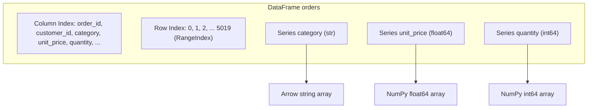
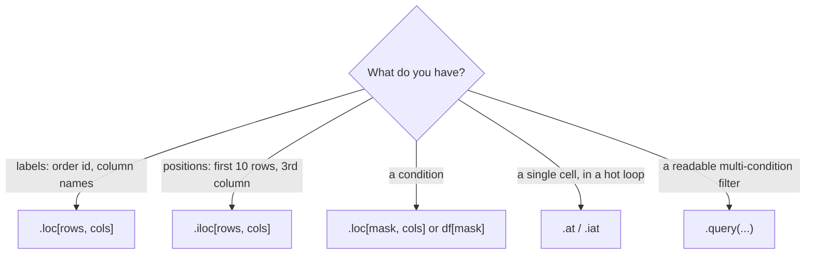

:::tip[TL;DR (30-Second Interview Pitch)]
A pandas **Series** is a NumPy-style array plus a **labelled Index**; a **DataFrame** is a dict of Series that share one row Index. Because every operation **aligns on labels first**, `a + b` matches rows by name, not by position, and missing labels become `NaN`. You load data with `read_csv` / `read_parquet` / `read_json` (pick dtypes and columns up front, stream with `chunksize`), profile it with `info`, `describe` and `memory_usage(deep=True)`, and select with **`.loc` (labels)** or **`.iloc` (positions)**, combining conditions with `&`, `|`, `~`. Since pandas 3.0, **Copy-on-Write** is always on: chained assignment like `df[mask]["col"] = x` never changes `df`, so write `df.loc[mask, "col"] = x`.
:::

<PriorityKey lang="pandas" v="3.0" />

## 🧭 Start Here: What Pandas Adds on Top of NumPy

NumPy gives you fast arrays of **one dtype**, addressed by **position**. Real data isn't like that: the ShopStream orders table has text IDs, timestamps, prices and ratings side by side, missing values everywhere, and you want to ask for "the price of order `O00003`", not "row 2, column 4". Pandas solves both problems:

1. **Columns can have different types.** A DataFrame stores each column as its own array (`str` IDs, `float64` prices, `int64` quantities), so each column still gets NumPy speed.
2. **Rows and columns have names.** Every Series and DataFrame carries an **Index**, a fast lookup table from label to position (backed by a hash table, like a Python `dict`). You select by label, join by label, and arithmetic **lines rows up by label**.
3. **Missing data is first-class.** `NaN` / `None` / `NA` are understood by every method: `mean()` skips them, `info()` counts them, `fillna()` replaces them.
4. **It reads everything.** CSV, Parquet, JSON, Excel, SQL, all into the same DataFrame.

| New concept | One-line meaning |
|---|---|
| **Series** | One labelled column: values (an array) + an Index + a name |
| **DataFrame** | A table: several Series sharing one row Index, plus a column Index |
| **Index** | The row (or column) labels; a hash-based lookup from label to position |
| **Alignment** | Before combining two objects, pandas matches their labels; unmatched labels give `NaN` |
| **`.loc` / `.iloc`** | Select by **label** / by **integer position** |
| **Boolean mask** | A True/False Series used to filter rows: `df[df["unit_price"] > 5000]` |
| **Copy-on-Write (CoW)** | Any derived object behaves as an independent copy; data is copied only when one side is modified |
| **`str` dtype** | pandas 3's default dtype for text columns (Arrow-backed when PyArrow is installed), replacing `object` |

:::analogy[A DataFrame is a spreadsheet with a filing system]
A NumPy array is a block of numbered pigeonholes: you can only say "box 2, row 4". A DataFrame is the same block with a **labelled drawer front** on every row and a **header** on every column, and a receptionist (the Index) who knows instantly which drawer holds order `O00003`. When you combine two cabinets, the receptionist pairs drawers by label, not by where they happen to sit.
:::

## ⚡ Essential Interview Recall

- 🔴 **Series = values + Index + name; DataFrame = dict of Series sharing a row Index.** `df["col"]` → Series, `df[["col"]]` → DataFrame.
- 🔴 **Arithmetic aligns on labels**: `a + b` gives the **union** of labels, `NaN` where one side is missing. Use `a.add(b, fill_value=0)` to treat missing as 0, or `.to_numpy()` to go positional.
- 🔴 **`.loc` = labels, end-inclusive slices; `.iloc` = positions, end-exclusive slices.** `df.loc[0:2]` returns **3** rows, `df.iloc[0:2]` returns **2**.
- 🔴 `s[0]` on a Series with an **integer index** means **label 0**, not position 0. Always use `.loc` / `.iloc` to be explicit.
- 🔴 **Filters use `&`, `|`, `~` with parentheses**: `(df.a > 1) & (df.b == "COD")`. `and`/`or` raise `ValueError: The truth value of a Series is ambiguous`, and missing parentheses fail because `&` binds tighter than `>`.
- 🔴 **pandas 3: Copy-on-Write is always on.** `df[mask]["col"] = v` **never** updates `df` and emits `ChainedAssignmentError`; use `df.loc[mask, "col"] = v`. `SettingWithCopyWarning` is gone.
- 🔴 **`info()`** = dtypes + non-null counts; **`describe()`** = count, mean, std (**`ddof=1`**), min, quartiles, max; **`memory_usage(deep=True)`** counts the real bytes of strings.
- 🟠 **Load lean**: `usecols=`, `dtype={"category": "category", "quantity": "int32"}`, `parse_dates=`. On ShopStream this cut memory from **0.673 MB to 0.347 MB**.
- 🟠 **`chunksize=`** turns `read_csv` into an iterator of DataFrames: process files larger than RAM chunk by chunk and aggregate.
- 🟠 **Parquet** is columnar, compressed and typed: ShopStream is **362 KB** as CSV vs **151 KB** as Parquet, and Parquet keeps dtypes and can read just the columns you ask for.
- 🟠 **`query("unit_price > @limit and payment_method == 'COD'")`** = readable filters; `@` references Python variables.
- 🟡 **pandas 3 text columns are `str`** (`StringDtype(na_value=nan)`), not `object`; missing text is `NaN`.
- 🟡 `.at` / `.iat` are the fast scalar versions of `.loc` / `.iloc`.

:::speak[What is the difference between loc and iloc, and what is the chained assignment problem?]
"`.loc` selects by **label** and `.iloc` by **integer position**. With `.loc` I pass index labels, boolean masks or column names, and slices include the end label, so `df.loc[0:2]` gives three rows on a default index. With `.iloc` I pass positions, and slices exclude the end like Python lists. The distinction matters most when the index is made of integers that aren't positions, for example after sorting or filtering, where `s[0]` means label 0. The classic trap is **chained assignment**: `df[df.quantity <= 0]["quantity"] = 1`. The first bracket produces a new object, and the assignment modifies that temporary, not `df`. In old pandas it sometimes worked and raised `SettingWithCopyWarning`; since pandas 3.0, **Copy-on-Write** is always on, so it **never** works and pandas raises a `ChainedAssignmentError` warning. The fix is a single `.loc` call: `df.loc[df.quantity <= 0, 'quantity'] = 1`."
:::

## The Mental Model

### 1. Anatomy of a DataFrame



Each column is a separate typed array, so column operations (`df["unit_price"] * df["quantity"]`) run at NumPy speed, while row-by-row loops (`iterrows`) have to stitch a new mixed-type Series together for every row and are slow.

### 2. Label alignment

<Animation src="pandas/index-alignment" caption="Two Series with different labels are added. Pandas first lines the labels up, adds where both sides have a value, and writes NaN for Alex and Riley because one side is missing. fill_value=0 fills the gaps before adding." />

:::analogy[Alignment is matching name tags, not seats]
Two teachers each hand you a list of exam marks. One list is sorted by roll number, the other alphabetically. Adding them seat by seat would give every student someone else's marks; you match by **name tag** instead, and a student missing from one list gets a blank. That's exactly what `a + b` does with Series.
:::

### 3. Choosing a selector



<Animation src="pandas/loc-vs-iloc" caption="On a DataFrame whose index has been shuffled, loc 2 to 4 walks the labels and includes the end, while iloc 2 to 4 counts positions and stops before the end. Same brackets, different rows." />

## The Paradigm / Core Concepts

### 🔴 Series vs DataFrame vs NumPy array

| | NumPy `ndarray` | pandas `Series` | pandas `DataFrame` |
|---|---|---|---|
| Dimensions | Any | 1-D | 2-D |
| dtypes | **One** for the whole array | One | **One per column** |
| Labels | No (positions only) | Row Index + name | Row Index + column Index |
| Missing values | Only `nan` for floats | `NaN` / `NA` in any dtype | Same, per column |
| Arithmetic | By position (broadcasting) | **By label (alignment)** | By row and column labels |
| Get the raw array | — | `s.to_numpy()` | `df.to_numpy()` (common dtype, may copy) |

<RuleCard name="Alignment before arithmetic" tag="Series and DataFrame" why="Labels carry meaning; positions only reflect how the data happened to be sorted." remember="Labels first, positions never.">

Every binary operation between pandas objects (`+`, `-`, `*`, comparisons, assigning a Series to a column) first **aligns on the index**. The result has the **union** of labels; a label present on only one side gives `NaN`. Use `fill_value=` on the method form (`a.add(b, fill_value=0)`) or `.to_numpy()` to opt out.

</RuleCard>

### 🔴 The Index

- **What it is:** an immutable array of labels plus a hash table from label to position, so `df.loc["O00003"]` is **O(1)** on a unique index (O(n) the first time while the hash table is built). A non-unique or unsorted index falls back to slower searches.
- **Default:** `RangeIndex(0, n)`, which stores only start/stop/step (a few bytes, not n integers).
- **Setting one:** `orders.set_index("order_id")` makes the business key the row label (check `index.is_unique` first: ShopStream's has **20 duplicate rows**, so it's **not** unique yet).
- **Getting it back:** `reset_index()` turns the index into a normal column again (needed after `groupby`, see the GroupBy page).

### 🔴 `.loc` vs `.iloc`

| | `.loc` | `.iloc` |
|---|---|---|
| Selects by | **Labels** (and boolean masks) | **Integer positions** |
| Slice end | **Included**: `loc["O00002":"O00004"]` → 3 rows | **Excluded**: `iloc[1:4]` → 3 rows |
| Columns | Names: `loc[:, ["category", "unit_price"]]` | Positions: `iloc[:, 2:4]` |
| Boolean mask | ✅ `loc[df.quantity > 5, "quantity"]` | Only a NumPy bool array, not a Series |
| Setting values | ✅ `df.loc[mask, "col"] = v` (the CoW-safe way) | ✅ `df.iloc[0, 3] = v` |
| Scalar fast path | `.at["O00003", "unit_price"]` | `.iat[2, 4]` |

<RuleCard name="One indexing call per assignment" tag="Copy-on-Write" why="Each bracket in a chain returns a new object; only a single loc or iloc call writes into the original." remember="One bracket pair, then equals.">

To change values, make **one** `.loc[...]` or `.iloc[...]` call on the object you want to modify: `df.loc[df["quantity"] <= 0, "quantity"] = 1`. Never `df[mask]["col"] = v` or `df["col"][mask] = v`; under pandas 3 these raise `ChainedAssignmentError` (a warning) and change nothing.

</RuleCard>

### 🔴 Loading data

| Reader | Good for | Key arguments |
|---|---|---|
| `pd.read_csv` | Text exports, logs | `usecols`, `dtype`, `parse_dates`, `na_values`, `chunksize`, `nrows`, `engine="pyarrow"` |
| `pd.read_parquet` | Analytics storage, ML pipelines | `columns=` (reads only those), `filters=`, `dtype_backend="pyarrow"` |
| `pd.read_json` | API dumps, event logs | `orient=`, `lines=True` for JSON Lines (one object per line) |
| `pd.read_excel`, `pd.read_sql` | Business files, databases | `sheet_name`, a SQLAlchemy connection + query |

| Format | Layout | Types stored? | Size (ShopStream) | Read only some columns? |
|---|---|---|---|---|
| CSV | Row text | ❌ re-inferred every time | 362 KB | ❌ parses every line |
| Parquet | **Columnar**, compressed | ✅ | **151 KB** | ✅ skips other columns on disk |
| JSON / JSON Lines | Nested text | ❌ | larger | ❌ |

:::analogy[CSV vs Parquet: a novel vs a filing cabinet]
A CSV is a novel: to find every price you read every page, word by word, and you guess which words are numbers. Parquet is a filing cabinet with one labelled drawer per column, already sorted by type and vacuum-packed: you open just the "unit_price" drawer and take it out whole.
:::

### 🔴 First look at a dataset

| Method | Tells you | ShopStream finding |
|---|---|---|
| `df.shape` | Rows, columns | `(5020, 11)` |
| `df.head()` / `tail()` / `sample()` | Real rows | Category values like `' Electronics '` with spaces |
| `df.info()` | dtypes, **non-null counts**, memory | `rating` has only 3,011 non-null of 5,020 |
| `df.describe()` | count, mean, std, min, quartiles, max | `unit_price` mean 4,234 vs median 1,520: **skewed**; `quantity` min **-1**, max **999** |
| `df.describe(include="str")` | count, unique, top, freq for text | `category` has **20** unique values (should be 5) |
| `df.nunique()`, `value_counts()` | Cardinality, frequencies | `customer_id` has 201 values: the extra one is `C9999` |
| `df.duplicated().sum()` | Exact duplicate rows | **20** |
| `df.memory_usage(deep=True)` | Bytes per column, strings included | 0.673 MB total |

## ⚙️ Under the Hood (pandas Internals)

- **Columnar storage**: a DataFrame is a set of column arrays (internally grouped into "blocks" of the same dtype by the `BlockManager`). Selecting a column is cheap; selecting a row has to collect one value from every block.
- **`str` dtype** (pandas 3 default for text): when PyArrow is installed, text lives in an Arrow string array: one contiguous byte buffer plus an offsets array, instead of a NumPy array of pointers to separate Python `str` objects (`object` dtype). It's more compact and its `.str` methods run in C++. Missing values are `NaN`.
- **`memory_usage()` without `deep=True`** counts only the array of pointers / offsets for text columns, not the characters. `deep=True` measures the actual strings. Always use `deep=True` when sizing data.
- **Copy-on-Write (always on in pandas 3)**: `df["a"]`, `df[mask]`, `df.reset_index()` and similar return objects that **share** data with the parent until one side is written to; at that moment the writer gets its own copy. Results: no defensive `.copy()` calls are needed, no `SettingWithCopyWarning`, and modifying a derived object never changes the parent (verified: `col = df["a"]; col.iloc[0] = 99` leaves `df` unchanged).
- **Alignment cost**: if two Series have identical indexes, pandas skips alignment (fast path). Otherwise it computes a union of the indexes and reindexes both sides, which is O(n) with hashing and allocates new arrays. Repeated arithmetic on misaligned objects inside a loop is a hidden cost.
- **`read_csv`** uses a C tokenizer by default; `engine="pyarrow"` parses in parallel threads. It reads the whole file into memory unless you pass `chunksize`/`iterator=True`.
- **Parquet** stores each column in compressed pages with min/max statistics, so `read_parquet(columns=..., filters=...)` can skip columns and whole row groups without reading them.

:::danger[Interview Trap]
**`s[0]` doesn't always mean "the first element".** On `pd.Series([10, 20, 30], index=[2, 1, 0])`, `s[0]` returns **30** (the value with **label** 0) while `s.iloc[0]` returns **10**. After sorting or filtering, integer labels stop matching positions. Use `.iloc` for positions and `.loc` for labels, always.
:::

:::danger[Interview Trap]
**Combining Series with different orders doesn't do what NumPy would.** `pd.Series([10, 20, 30]) + pd.Series([10, 20, 30], index=[2, 1, 0])` gives **`[40, 40, 40]`**, not `[20, 40, 60]`: label 0 (10) is added to label 0 (30). That's usually what you want, and a nasty surprise when you expected positions.
:::

## 💻 Pandas Implementation on ShopStream

:::tip[Run it yourself]
Outputs come from **pandas 3.0.6** (with PyArrow 26) on **Python 3.14**. Download [shopstream_orders.csv](pathname:///data/shopstream_orders.csv) and [shopstream_customers.csv](pathname:///data/shopstream_customers.csv), or regenerate them with the generator on the [Overview](./00-overview.md).
:::

### 1. Series and alignment

```python showLineNumbers
import numpy as np
import pandas as pd

spend = pd.Series([120.0, 80.0, 45.5], index=["Alex", "Jordan", "Morgan"], name="spend")
print(spend.index)                                   # Index(['Alex', 'Jordan', 'Morgan'], dtype='str')
print(spend["Jordan"], spend.iloc[0])                # 80.0 120.0

a = pd.Series([10, 20, 30], index=["Alex", "Jordan", "Morgan"])
b = pd.Series([1, 2, 3], index=["Jordan", "Morgan", "Riley"])
# highlight-next-line
print(a + b)                                         # Alex NaN, Jordan 21.0, Morgan 32.0, Riley NaN
print(a.add(b, fill_value=0))                        # Alex 10.0, Jordan 21.0, Morgan 32.0, Riley 3.0
print(a.to_numpy() + b.to_numpy())                   # [11 22 33]: positional, ignores labels

t = pd.Series([10, 20, 30], index=[2, 1, 0])
# error-next-line
print(t[0])                                          # 30: LABEL 0, not the first element
# success-next-line
print(t.iloc[0], t.loc[0])                           # 10 30
```

### 2. DataFrame anatomy

```python showLineNumbers
df = pd.DataFrame({"customer_id": ["C0001", "C0002", "C0003"],
                   "name": ["Alex", "Jordan", "Morgan"],
                   "spend": [120.0, 80.0, 45.5]})
print(df.dtypes.to_dict())                           # customer_id: str, name: str, spend: float64
print(type(df["spend"]).__name__, type(df[["spend"]]).__name__)   # Series DataFrame
print(df.index, df.columns.tolist())                 # RangeIndex(start=0, stop=3, step=1) ['customer_id', 'name', 'spend']
print(df.shape, df.ndim, df.size)                    # (3, 3) 2 9
```

### 3. Loading and profiling ShopStream

```python showLineNumbers
raw = pd.read_csv("shopstream_orders.csv")
print(raw.shape)                                     # (5020, 11)
raw.info()
# Data columns (total 11 columns):
#  #   Column          Non-Null Count  Dtype
#  0   order_id        5020 non-null   str
#  ...
#  6   discount_pct    4619 non-null   float64
#  7   payment_method  4870 non-null   str
#  9   delivery_days   4720 non-null   float64
#  10  rating          3011 non-null   float64
# dtypes: float64(4), int64(1), str(6)
# memory usage: 656.9 KB

print(raw.describe().round(2).loc[["mean", "50%", "min", "max"]])
#       unit_price  quantity  discount_pct  delivery_days  rating
# mean     4233.98      2.21          0.06           4.76    3.52
# 50%      1519.59      2.00          0.05           4.00    4.00
# min        66.84     -1.00          0.00           1.00    1.00
# max    771750.40    999.00          0.30          17.00    5.00

print(raw.describe(include="str").loc[["unique", "top", "freq"], ["category", "payment_method"]])
#           category  payment_method
# unique          20               4
# top    Electronics             UPI
# freq          1161            2126

print(raw["category"].value_counts().head(7).to_dict())
# {'Electronics': 1161, 'Fashion': 1146, 'Home': 881, 'Beauty': 677, 'Books': 652, ' Electronics ': 49, ' Fashion ': 47}
print(raw.duplicated().sum(), raw["order_id"].is_unique)   # 20 False
```

| Red flag spotted | Where | Fixed on |
|---|---|---|
| 20 category labels instead of 5 | `describe(include="str")`, `value_counts` | [Cleaning page](./04-pandas-cleaning-types-missing-data.md) (`.str.strip().str.title()`) |
| `order_ts` is `str`, mixed formats | `info()` dtype | Cleaning page (`to_datetime`) |
| Missing `rating`, `delivery_days`, `discount_pct`, `payment_method` | `info()` non-null counts | Cleaning page (imputation) |
| Quantity -1, 0 and 999 | `describe()` min/max | Cleaning page (validity rules) |
| Mean price ≫ median, max 771,750 | `describe()` | Cleaning page (outliers), Seaborn page (log scale) |
| 20 duplicate rows | `duplicated()` | Cleaning page (`drop_duplicates`) |
| Customer `C9999` not in customers table | `nunique()` = 201 | [Combining page](./06-pandas-reshape-combine.md) (`merge(indicator=True)`) |

### 4. Memory: measuring and shrinking

```python showLineNumbers
print(round(raw.memory_usage(deep=True).sum() / 1e6, 3))   # 0.673 MB
print(raw.memory_usage(deep=True)[["order_ts", "unit_price"]].to_dict())   # {'order_ts': 134787, 'unit_price': 40160}

# highlight-start
lean = pd.read_csv("shopstream_orders.csv",
                   usecols=["order_id", "customer_id", "order_ts", "category",
                            "unit_price", "quantity", "payment_method", "device"],
                   dtype={"category": "category", "payment_method": "category",
                          "device": "category", "quantity": "int32"})
# highlight-end
print(lean.dtypes["category"], lean.dtypes["quantity"])     # category int32
print(round(lean.memory_usage(deep=True).sum() / 1e6, 3))  # 0.347 MB: about half
```

### 5. Streaming a big file in chunks

```python showLineNumbers
total, n_chunks = 0.0, 0
# highlight-next-line
for chunk in pd.read_csv("shopstream_orders.csv", chunksize=1000):   # an iterator of DataFrames
    n_chunks += 1
    total += (chunk["unit_price"] * chunk["quantity"]).sum()         # aggregate, then discard the chunk
print(n_chunks, round(total, 2))                     # 6 53111057.14 (raw, before removing bad rows)
```

| Step | Memory held | Rule |
|---|---|---|
| Read 1,000 rows | One chunk | Choose `chunksize` so a chunk fits comfortably in RAM |
| Compute partial result | Chunk + small result | Only **combinable** aggregates: sums, counts, min/max (a mean = total sum / total count) |
| Drop the chunk | Small result | Medians and exact distinct counts can't be combined from per-chunk values; use a tool like DuckDB or Polars instead |

### 6. Parquet and JSON

```python showLineNumbers
raw.to_parquet("orders.parquet", index=False)        # needs pyarrow
# highlight-next-line
prices = pd.read_parquet("orders.parquet", columns=["order_id", "unit_price"])   # reads 2 of 11 columns from disk
print(prices.shape)                                  # (5020, 2)
# CSV 362,249 bytes vs Parquet 150,681 bytes; read time 10.4 ms vs 4.7 ms on this machine

customers = pd.read_csv("shopstream_customers.csv", parse_dates=["signup_date"])
# error-next-line
customers.head(3).to_json("c.json", orient="records")    # ❌ Pandas4Warning: the default 'epoch' date format is deprecated
# success-next-line
customers.head(3).to_json("c.json", orient="records", date_format="iso")   # ✅ "2025-10-23T00:00:00.000"

import io
events = '{"customer_id":"C0001","event":"view","sensor_val":0.4}\n{"customer_id":"C0002","event":"cart","sensor_val":1.2}\n'
print(pd.read_json(io.StringIO(events), lines=True))   # JSON Lines: one record per line
#   customer_id event  sensor_val
# 0       C0001  view         0.4
# 1       C0002  cart         1.2
```

### 7. Selecting with `.loc`, `.iloc`, `.at`

```python showLineNumbers
o = raw.set_index("order_id")
print(o.loc["O00003", "unit_price"], o.iloc[2, 3], o.at["O00003", "unit_price"])   # 573.31 573.31 573.31
print(o.loc["O00002":"O00004", ["category", "unit_price"]])   # 3 rows: END INCLUDED
#          category  unit_price
# order_id
# O00002      Books      524.42
# O00003     Beauty      573.31
# O00004      Books      260.05
print(o.iloc[1:4, 2:4].shape)                        # (3, 2): positions 1, 2, 3 (end excluded)
# highlight-next-line
print(raw.loc[0:2].shape, raw.iloc[0:2].shape)      # (3, 11) (2, 11)
```

### 8. Filtering rows

```python showLineNumbers
cod_big = raw[(raw["unit_price"] > 5000) & (raw["payment_method"] == "COD")]
print(len(cod_big))                                  # 164
print(((raw["unit_price"] > 5000) | (raw["quantity"] >= 5)).sum())   # 1184
print((~raw["payment_method"].isin(["UPI", "Card"])).sum())         # 1677 (includes the 150 missing)
print(raw["unit_price"].between(1000, 5000).sum())   # 2129 (both ends inclusive)

# error-start
raw[raw["unit_price"] > 5000 & raw["quantity"] > 2]              # ❌ & runs first: 5000 & quantity
raw[(raw["unit_price"] > 5000) and (raw["quantity"] > 2)]        # ❌ and calls bool() on a Series
# error-end
# ValueError: The truth value of a Series is ambiguous. Use a.empty, a.bool(), a.item(), a.any() or a.all().

limit = 5000
# success-next-line
print(len(raw.query("unit_price > @limit and payment_method == 'COD'")))   # 164: same as cod_big
print(len(raw.query("category in ['Books', 'Beauty'] and quantity >= 3")))  # 268
```

### 9. Modifying data under Copy-on-Write

```python showLineNumbers
d = raw.copy()
# error-next-line
d[d["quantity"] <= 0]["quantity"] = 1                # ❌ ChainedAssignmentError: changes nothing
print((d["quantity"] <= 0).sum())                    # 40: still there
# error-next-line
d["quantity"][d["quantity"] <= 0] = 1                # ❌ same warning, same result
# success-next-line
d.loc[d["quantity"] <= 0, "quantity"] = 1            # ✅ one .loc call on d
print((d["quantity"] <= 0).sum())                    # 0

big = d[d["unit_price"] > 50000]                     # a derived DataFrame
big["flag"] = True                                   # fine in pandas 3: no SettingWithCopyWarning
print("flag" in d.columns)                           # False: big behaves as its own copy

col = d["unit_price"]
col.iloc[0] = -1.0                                   # writing triggers the copy
print(d["unit_price"].iloc[0])                       # 1613.05: parent untouched
```

The full pandas 3.0.6 warning text:

```text
ChainedAssignmentError: A value is being set on a copy of a DataFrame or Series through chained assignment.
Such chained assignment never works to update the original DataFrame or Series, because the intermediate
object on which we are setting values always behaves as a copy (due to Copy-on-Write).

Try using '.loc[row_indexer, col_indexer] = value' instead, to perform the assignment in a single step.
```

| pandas version | `df[mask]["col"] = v` | Derived object modified later |
|---|---|---|
| 1.x / 2.x (CoW off) | Sometimes worked, sometimes not; `SettingWithCopyWarning` | Might silently change the parent |
| **3.0+ (CoW always on)** | **Never works**; `ChainedAssignmentError` warning | **Never** changes the parent |

:::info[AI Engineering: profile before you train]
The red-flag table above is the checklist that stops bad data reaching a model: string IDs mis-read as numbers, 20 spellings of 5 categories (a one-hot encoder would create 20 features), quantity 999 dominating a regression. Wire `info()`, `describe()`, `duplicated()` and a few assertions into the data-loading step of every training pipeline, or use a schema validator like `pandera`.
:::

## 🧪 Predict the Output

<Predict n="1" title="Label alignment" output="[40, 40, 40]">

```python
x = pd.Series([10, 20, 30])
y = pd.Series([10, 20, 30], index=[2, 1, 0])
print((x + y).tolist())
```

`x` has labels 0, 1, 2 → 10, 20, 30; `y` has labels 2, 1, 0 → 10, 20, 30, so label 0 is 30 in `y`. Adding by label: 10 + 30, 20 + 20, 30 + 10 = **40, 40, 40**.

</Predict>

<Predict n="2" title="loc vs iloc slice" output="(3, 11) (2, 11)">

```python
raw = pd.read_csv("shopstream_orders.csv")
print(raw.loc[0:2].shape, raw.iloc[0:2].shape)
```

`.loc` slices by label and **includes** the end label (0, 1, 2 → 3 rows); `.iloc` slices by position and **excludes** the end (0, 1 → 2 rows).

</Predict>

<Predict n="3" title="Missing labels" output="[nan, 21.0, 32.0, nan]">

```python
a = pd.Series([10, 20, 30], index=["Alex", "Jordan", "Morgan"])
b = pd.Series([1, 2, 3], index=["Jordan", "Morgan", "Riley"])
print((a + b).tolist())
```

The result's index is the **sorted union** of labels: Alex, Jordan, Morgan, Riley. Alex exists only in `a` and Riley only in `b`, so both are `NaN`. The `NaN` also forces the dtype from `int64` to `float64`.

</Predict>

<Predict n="4" title="Chained assignment in pandas 3" output="40">

```python
d = pd.read_csv("shopstream_orders.csv")
d[d["quantity"] <= 0]["quantity"] = 1
print((d["quantity"] <= 0).sum())
```

`d[mask]` builds a new DataFrame; `["quantity"] = 1` modifies that temporary object, which is thrown away. Under Copy-on-Write this **never** reaches `d`, so all **40** bad quantities remain (and pandas emits a `ChainedAssignmentError` warning).

</Predict>

<Predict n="5" title="Operator precedence in filters" output="ValueError: The truth value of a Series is ambiguous...">

```python
raw[raw["unit_price"] > 5000 & raw["quantity"] > 2]
```

`&` binds tighter than `>`, so Python evaluates `5000 & raw["quantity"]` first and builds the chained comparison `price > (5000 & qty) > 2`, which needs `bool()` of a Series and raises. Wrap each condition in parentheses.

</Predict>

<Predict n="6" title="info vs describe count" output="3011 3011.0">

```python
print(raw["rating"].count(), raw["rating"].describe()["count"])
```

Both count **non-missing** values: 5,020 rows minus 2,009 missing ratings = **3,011**. `describe` returns floats, hence `3011.0`. `len(raw)` would give 5,020; `size` counts NaN too, `count()` doesn't.

</Predict>

## 🪜 Follow-up Ladder

<Ladder title="From loading a CSV to a production data loader">
<Rung q="How do you load a CSV and check its quality?">

`read_csv`, then `shape`, `head`, `info()` (dtypes, non-null counts), `describe()` and `describe(include="str")`, `value_counts()` on categoricals, `duplicated().sum()`, and `memory_usage(deep=True)`.

</Rung>
<Rung q="The file is 20 GB and your laptop has 16 GB of RAM. What now?">

Read only the needed columns with compact dtypes (`usecols`, `dtype`, `category`), and process with `chunksize` aggregating as you go. Or convert once to Parquet and read column subsets with filters.

</Rung>
<Rung q="Why is Parquet better than CSV for ML pipelines?">

It's columnar (read only the features you need), compressed (often 3–10× smaller), typed (no re-inference, dates stay dates), and carries row-group statistics so filters can skip data. It's also what Spark, DuckDB, Polars and cloud warehouses use.

</Rung>
<Rung q="When does pandas stop being the right tool?">

When data doesn't fit in one machine's memory, when you need multi-core speed on large group-bys, or when you need lazy query optimization. Then Polars (multi-threaded, lazy), DuckDB (SQL on Parquet out of core) or Spark (distributed). Pandas 3's Arrow-backed strings narrow the gap but don't remove single-threaded execution.

</Rung>
</Ladder>

## 🚑 Production Scenarios

:::incident[The fix that never got applied]
A cleaning job set negative quantities to 1 before training. The model still saw -1s.

- **Code:** `df[df["quantity"] < 0]["quantity"] = 1`, written years ago; on pandas 1.x it printed a `SettingWithCopyWarning` that everyone ignored.
- **Why:** chained assignment modifies a temporary copy. After upgrading to pandas 3 it's guaranteed to do nothing, and the warning became a `ChainedAssignmentError`.
- **Fix:** `df.loc[df["quantity"] < 0, "quantity"] = 1`. **Prevention:** run tests with `-W error::Warning` (or `-W error::pandas.errors.ChainedAssignmentError`) so the warning fails CI, and assert the invariant afterwards (`assert (df["quantity"] > 0).all()`).
:::

:::incident[IDs that lost their leading zeros]
A join between orders and a partner's CSV matched only 60% of rows.

- **Why:** the partner file had `pincode` and `customer_ref` columns like `000417`; `read_csv` inferred them as integers and turned them into `417`.
- **Fix:** `pd.read_csv(path, dtype={"customer_ref": "str", "pincode": "str"})`. **Prevention:** always pass explicit dtypes for ID-like columns, or store data as Parquet where types are preserved.
:::

## 🚨 Interview Gotchas & Edge Cases

:::warning[The Most Common Question]
**"Explain `loc` vs `iloc`, and why does `df[df.x > 0]['y'] = 0` not work?"** Labels vs positions (end-inclusive vs end-exclusive slices), then chained assignment: the first selection creates a new object, so the assignment lands on a temporary. In pandas 3 Copy-on-Write makes this always a no-op (with a `ChainedAssignmentError` warning); the single-step `df.loc[df.x > 0, 'y'] = 0` is the fix.
:::

- **`df.col` attribute access** fails for names with spaces or that clash with methods (`df.count`, `df.size`), and can't create columns. Prefer `df["col"]`.
- **`inplace=True` doesn't save memory** and is discouraged; it blocks method chaining. Reassign instead: `df = df.dropna()`.
- **`iterrows()` is slow** (it builds a Series per row and casts mixed types to a common one); use vectorized columns, or `itertuples()` if you truly must loop.
- **`df.to_numpy()` on mixed dtypes** gives an `object` array (slow, and a copy). Select numeric columns first: `df.select_dtypes("number").to_numpy()`.
- **`len(df)` vs `df.size` vs `df.count()`**: rows, cells, and non-null values per column.
- **`read_csv` treats `"NA"`, `"null"`, `""` and more as missing by default**: a customer genuinely named `NA` becomes NaN unless you pass `keep_default_na=False`.
- **`describe()` std is the sample std (`ddof=1`)**, unlike `np.std`.
