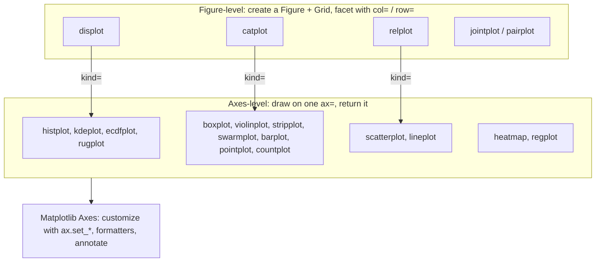

:::tip[TL;DR (30-Second Interview Pitch)]
Seaborn is a statistical layer on top of Matplotlib: you pass a **long-format DataFrame** and map **column names** to `x`, `y`, `hue`, `size`, `col`, and it does the grouping, aggregation (means with **bootstrapped confidence intervals**), colours and legends. **Axes-level** functions (`histplot`, `kdeplot`, `ecdfplot`, `boxplot`, `violinplot`, `stripplot`, `barplot`, `countplot`, `scatterplot`, `lineplot`, `heatmap`) draw on one Matplotlib `ax`; **figure-level** functions (`displot`, `catplot`, `relplot`, `jointplot`, `pairplot`) build a whole grid (`FacetGrid` / `JointGrid` / `PairGrid`) and **don't accept `ax=`**. For EDA: distributions first, then group comparisons, then relationships and a masked correlation heatmap.
:::

<PriorityKey lang="Seaborn" v="0.13" />

<FormulaKey />

## 🧭 Start Here: Why Seaborn on Top of Matplotlib

On the [Matplotlib page](./07-matplotlib-figures-axes.md), a scatter coloured by tier needed a loop over tiers, one `scatter` call per group and manual legend labels; the error-bar chart needed a `groupby`, a standard-error formula and `errorbar`. Seaborn turns each of those into **one call**, because it understands DataFrames:

```python
sns.scatterplot(data=cust, x="avg_delivery", y="total_spend", hue="tier", size="n_orders")
sns.lineplot(data=orders, x="delivery_days", y="rating")          # mean + 95% CI band, computed for you
```

You describe **what** to show (which column goes on which visual channel), and Seaborn works out **how**: it groups by `hue`, picks colours from the palette, aggregates, computes confidence intervals and builds the legend. Underneath, it still produces normal Matplotlib Axes, so everything from the previous page (formatters, annotations, `savefig`) still applies.

| New concept | One-line meaning |
|---|---|
| **Semantic mapping** | Mapping a column to a visual channel: `hue` (colour), `size`, `style` (marker), `col`/`row` (panels) |
| **Axes-level function** | Draws on one Axes (`ax=`), returns that Axes: `histplot`, `boxplot`, `scatterplot`... |
| **Figure-level function** | Creates its own Figure and grid, returns a Grid object: `displot`, `catplot`, `relplot` |
| **KDE** | Kernel density estimate: a smooth curve made by adding a small bump at every data point |
| **ECDF** | Empirical cumulative distribution: the share of values at or below each x |
| **Bootstrap CI** | Confidence interval from resampling the data many times and recomputing the statistic |
| **FacetGrid / PairGrid** | Grids of small plots: one panel per subset / per pair of variables |

:::analogy[Seaborn is ordering from a menu, Matplotlib is cooking]
With Matplotlib you buy the ingredients, chop, season and plate every dish yourself. Seaborn is a restaurant menu: you say "the price distribution, split by category, on a log scale", and the kitchen (which is still Matplotlib) produces it. When the dish needs one extra garnish, you can still reach into the kitchen with the returned `ax`.
:::

## ⚡ Essential Interview Recall

- 🔴 **Figure-level vs axes-level**: `displot` ↔ `histplot`/`kdeplot`/`ecdfplot`; `catplot` ↔ `boxplot`/`violinplot`/`stripplot`/`barplot`/`countplot`; `relplot` ↔ `scatterplot`/`lineplot`. Figure-level returns a **`FacetGrid`**, takes `col=`/`row=`, `height=`, `aspect=`, and **ignores `ax=`** (with a warning).
- 🔴 **Data in long format**, columns mapped by name: `x`, `y`, `hue`, `size`, `style`, `col`, `row`.
- 🔴 **`histplot`**: `bins`, `log_scale=True`, `stat="count"/"density"/"probability"`, `common_norm=False` to normalize each `hue` group separately, `element="step"`, `discrete=True` for integers.
- 🔴 **`kdeplot`**: a smoothed histogram; **`bw_adjust`** controls smoothness (too small = spiky, too big = blurred); misleading near hard limits and on discrete data (use `cut=0`).
- 🔴 **`ecdfplot`**: no bins, no bandwidth, every point shown; read medians and percentiles directly off the y-axis.
- 🔴 **`boxplot`**: box = Q1 to Q3 (IQR), line = median, whiskers = last points within **1.5 × IQR**, dots = points beyond (outlier candidates).
- 🔴 **`barplot` shows a mean and a 95% CI** (`errorbar=("ci", 95)`, bootstrapped), **not counts**; `countplot` counts rows.
- 🔴 **`lineplot` aggregates repeated x values** into a mean and a CI band; `errorbar=None` to turn it off (much faster on big data).
- 🔴 **Correlation heatmap**: `sns.heatmap(df.corr(), annot=True, fmt=".2f", cmap=diverging, vmin=-1, vmax=1, center=0, mask=np.triu(np.ones_like(corr, dtype=bool)))`.
- 🟠 **`pairplot(df, hue=...)`** = scatter for every pair + distributions on the diagonal; `corner=True` drops the redundant upper half. O(k²) panels.
- 🟠 **`FacetGrid(df, col=...).map_dataframe(sns.histplot, x=...)`**, **`PairGrid.map_upper/map_lower/map_diag`** for custom grids.
- 🟠 **`sns.set_theme(style=..., palette=..., context=..., rc={...})`** sets global rcParams; `context` scales fonts for `paper`/`notebook`/`talk`/`poster`.
- 🟡 Seaborn **0.13** syntax: `errorbar=` replaced `ci=`; `fill=False` for outline boxes and violins; `native_scale`, `log_scale` on categorical plots.

## 📐 Formula Sheet

| Concept | Formula | In plain words |
|---|---|---|
| Kernel density estimate | $\pred{\hat f(x)} = \dfrac{1}{\data{n}\hyper{h}}\sum_i K\!\left(\dfrac{x - \data{x_i}}{\hyper{h}}\right)$ | Add one bump of width h at every data point |
| ECDF | $\pred{\hat F(x)} = \dfrac{1}{\data{n}}\,\#\{i : \data{x_i} \le x\}$ | Share of values at or below x |
| Box-plot whiskers | $[\data{Q_1} - 1.5\,\pred{\text{IQR}},\; \data{Q_3} + 1.5\,\pred{\text{IQR}}]$, clipped to the data | Points outside are drawn individually |
| Pearson correlation | $\pred{r} = \dfrac{\sum (\data{x_i} - \bar x)(\data{y_i} - \bar y)}{\sqrt{\sum (\data{x_i} - \bar x)^2 \sum (\data{y_i} - \bar y)^2}}$ | Strength of a **linear** relationship, −1 to 1 |
| Spearman correlation | Pearson $\pred{r}$ computed on the **ranks** of x and y | Strength of a **monotonic** relationship; robust to outliers and skew |
| Bootstrap CI | Resample $\data{n}$ rows with replacement $\hyper{B}$ times; take the 2.5th and 97.5th percentiles of the statistic | Uncertainty without a formula |

:::speak[How would you explore a new dataset visually?]
"I go from one variable to many. First **distributions** of each numeric column: a histogram with a sensible bin count, on a log scale if it's skewed, plus an ECDF when I need exact percentiles, and count plots for categoricals to spot rare or misspelled labels. Then **comparisons across groups**: box plots or violins of the key metric by category, which immediately show medians, spread and outliers, and bar plots of means with confidence intervals so I don't over-read small differences. Then **relationships**: a correlation heatmap, usually Spearman because business data is skewed, with the upper triangle masked, a pair plot of the most important features coloured by a segment, and scatter or line plots for the pairs that look interesting. In Seaborn I keep the data in long format and map columns to hue, size and col, using axes-level functions when I'm composing a dashboard and figure-level ones like `displot` or `catplot` when I want automatic faceting. On ShopStream this process surfaced the strongest finding in a few minutes: delivery time drives ratings, with a Spearman correlation of minus 0.65."
:::

## The Mental Model

### 1. Two levels of function



| | Axes-level | Figure-level |
|---|---|---|
| Examples | `histplot`, `boxplot`, `scatterplot` | `displot`, `catplot`, `relplot` |
| Returns | `matplotlib.axes.Axes` | `FacetGrid` (`g.figure`, `g.axes`) |
| Placement | Anywhere: `ax=axes[0, 1]` in your own layout | Owns its figure; `ax=` is ignored with a warning |
| Faceting | Manual (loop over subplots) | Built in: `col=`, `row=`, `col_wrap=` |
| Size | Set by the Figure you made | `height=` (per panel, inches) and `aspect=` |
| Use for | Dashboards, combining with Matplotlib | Quick small multiples |

<RuleCard name="Axes-level for layouts, figure-level for facets" tag="Seaborn API" why="Figure-level functions create their own figure, so they can't be placed inside a grid you built." remember="Your grid, axes-level; its grid, figure-level.">

When you're composing a dashboard with `plt.subplots` or `GridSpec`, call **axes-level** functions with `ax=...`. When you want one plot repeated per category with shared axes, call a **figure-level** function with `col=`/`row=` and style it through the returned grid (`g.set_axis_labels`, `g.set_titles`, `g.figure.suptitle`).

</RuleCard>

### 2. How a KDE is built

<Animation src="seaborn/kde-bumps" caption="Each data point on the axis gets its own small bell-shaped bump. Adding the bumps together gives the smooth density curve. A narrow bandwidth leaves a spike at every point, a wide one blurs real peaks away." />

<Formula name="Kernel density estimate" tag="kdeplot" words="Place a small smooth bump, usually a bell curve, on every observation and add them all up; then scale so the total area is 1. The bump width is the bandwidth h." remember="A bump per point, summed.">

$$
\pred{\hat f(x)} = \frac{1}{\data{n}\,\hyper{h}} \sum_{i=1}^{\data{n}} K\!\left(\frac{x - \data{x_i}}{\hyper{h}}\right)
$$

- $\data{x_i}$: the $\data{n}$ observations
- $K$: the kernel, a Gaussian bell curve in Seaborn
- $\hyper{h}$: bandwidth, picked by Scott's rule and multiplied by `bw_adjust`

**Example:** on integer delivery days, `bw_adjust=0.2` draws a separate spike on every whole number (the KDE is "seeing" the discreteness), `bw_adjust=1` gives a smooth hump peaking at 4 days, and `bw_adjust=3` washes out the long right tail.

</Formula>

:::analogy[A KDE is sand poured over each data point]
Pour a small cup of sand on the floor at the position of every order. Where orders cluster, the piles merge into a hill; isolated orders leave small mounds. The skyline of the sand is the KDE. A tiny cup (small bandwidth) leaves a separate cone per order; a huge bucket (large bandwidth) flattens everything into one gentle dune.
:::

### 3. Reading a box plot

<Animation src="seaborn/boxplot-quartiles" caption="Sorted values are split at the quartiles. The box covers the middle half from Q1 to Q3 with a line at the median, the whiskers reach the furthest points within one and a half box lengths, and anything beyond is drawn as a separate dot." />

| Part | Meaning | ShopStream Electronics price |
|---|---|---|
| Box bottom / top | $Q_1$ / $Q_3$ | ₹6,022 / ₹11,530 |
| Line in the box | Median | ₹8,133 |
| Whiskers | Furthest data points within $1.5 \times \text{IQR}$ of the box | (computed on the log scale when `log_scale=True`) |
| Dots | Points beyond the whiskers | Candidates to investigate, not automatically errors |

:::analogy[A box plot is a class photo arranged by height]
Line the class up from shortest to tallest. The box is the middle half of the line, the bar inside it is the student exactly in the middle, the whiskers reach out to the shortest and tallest students who still look "typical", and the dots are the few who stand out, like the basketball captain. Nobody is thrown out of the photo for being tall.
:::

## The Paradigm / Core Concepts

### 🔴 Choosing the plot

| Question | Axes-level | Figure-level | Watch out for |
|---|---|---|---|
| Shape of one numeric variable | `histplot`, `kdeplot` | `displot(kind="hist"/"kde")` | Bin count, bandwidth, log scale |
| Exact percentiles, comparing distributions | `ecdfplot` | `displot(kind="ecdf")` | Harder for non-technical readers |
| Numeric by category | `boxplot`, `violinplot`, `stripplot`, `swarmplot` | `catplot(kind=...)` | Violins invent density between points; show n |
| Mean by category with uncertainty | `barplot`, `pointplot` | `catplot(kind="bar")` | A bar of a **mean** hides the distribution |
| Frequency of categories | `countplot` | `catplot(kind="count")` | Sort by frequency (`order=`) |
| Two numeric variables | `scatterplot`, `regplot` | `relplot`, `jointplot`, `lmplot` | Overplotting: `alpha`, `hexbin`, sampling |
| Trend over an ordered variable | `lineplot` | `relplot(kind="line")` | CI bands are slow on huge data |
| All pairwise relationships | — | `pairplot`, `PairGrid` | k² panels: pick 3–6 columns |
| Correlation overview | `heatmap(df.corr())` | `clustermap` | Pearson vs Spearman; correlation ≠ causation |

### 🔴 Common parameters

| Parameter | Does | Example |
|---|---|---|
| `data=`, `x=`, `y=` | DataFrame and column names | `data=orders, x="category", y="unit_price"` |
| `hue=` / `hue_order=` / `palette=` | Colour by a column, in a fixed order | `hue="tier", hue_order=["Bronze", "Silver", "Gold"]` |
| `order=` | Category order on the axis | Sort by median or by business order |
| `log_scale=True` | Log axis (and log-space binning in `histplot`) | Prices |
| `stat=`, `common_norm=` | Count vs density vs probability; per-group normalization | Compare groups of different size |
| `errorbar=` | `("ci", 95)`, `"sd"`, `"se"`, `("pi", 50)`, `None` | Uncertainty shown on bars and lines |
| `col=`, `row=`, `col_wrap=` | Small multiples (figure-level) | One panel per city |
| `ax=` | Draw on this Matplotlib Axes (axes-level) | Dashboards |

<Formula name="Spearman rank correlation" tag="heatmap" words="Replace each value by its rank, then compute the ordinary Pearson correlation of the ranks. It measures whether y tends to go up or down as x goes up, without assuming a straight line, and one extreme value can't dominate it." remember="Correlate the ranks, not the values.">

$$
\pred{\rho_s} = \text{Pearson}\big(\text{rank}(\data{x}),\, \text{rank}(\data{y})\big)
$$

- $\text{rank}(\data{x})$: position of each value in sorted order (ties share the average rank)
- $\pred{\rho_s}$: −1 (perfectly decreasing) to +1 (perfectly increasing)

**Example:** unit price vs revenue on ShopStream: Pearson **0.852**, Spearman **0.929**. A few huge orders weaken the linear fit, but the ordering is very consistent. Delivery days vs rating: Pearson −0.685, Spearman −0.652.

</Formula>

## ⚙️ Under the Hood (Seaborn Internals)

- **Seaborn computes, then calls Matplotlib**: `histplot` bins with NumPy (`np.histogram_bin_edges`), `kdeplot` evaluates a Gaussian KDE on a grid, `barplot`/`lineplot` group with pandas and **bootstrap** the estimator (1,000 resamples by default, `n_boot=`), then draw with `ax.bar`, `ax.fill_between` and friends.
- **Bootstrapping cost**: `lineplot` with `errorbar=("ci", 95)` resamples every x group 1,000 times. On millions of rows this dominates runtime; use `errorbar="se"` (analytic) or `None`, or aggregate first.
- **Semantic mapping**: for each `hue`/`size`/`style` column, Seaborn builds a lookup from level to colour/size/marker (categorical → palette in `hue_order`; numeric → a continuous colormap or size range) and generates the legend from it.
- **Figure-level functions** create a `FacetGrid` (`relplot`, `displot`, `catplot`), which makes a Figure with one Axes per `col`×`row` combination, splits the data by facet, and calls the axes-level function on each subset. `jointplot` uses a `JointGrid`, `pairplot` a `PairGrid`.
- **`set_theme`** is a wrapper around `matplotlib.rcParams`: it sets a style (`whitegrid`, `ticks`...), a context (font scaling), a palette (the colour cycle) and any `rc` overrides. It affects every later plot, including pure Matplotlib ones.
- **Categorical axes** place categories at integer positions 0, 1, 2... unless `native_scale=True`, which matters when you overlay a Matplotlib line on a box plot.
- **pandas 3 compatibility**: Seaborn 0.13.2 accepts pandas 3 DataFrames, `category` and `str` columns; with `category` columns, unused categories still appear on the axis unless removed (`.cat.remove_unused_categories()`).

:::danger[Interview Trap]
**A bar plot of means hides the data.** `sns.barplot(x="payment_method", y="rating")` shows COD at 3.08 vs 3.62 for UPI, and it's tempting to say "COD customers are grumpier". The bars show **means with 95% CIs**; the distribution, the sample size and the **cause** are invisible. COD orders take 6.09 days to deliver on average vs 4.45 for UPI, and delivery time drives rating. Show a box or strip plot alongside, report n, and check confounders before naming a cause.
:::

:::danger[Interview Trap]
**Pearson correlation near zero doesn't mean "no relationship".** Pearson measures **linear** association and is dominated by outliers. A U-shaped relationship can have r ≈ 0, and one extreme point can create a large r. Use Spearman on skewed business data, and always look at the scatter (or pair plot) before quoting a coefficient.
:::

## 💻 Seaborn Implementation on ShopStream

:::tip[Run it yourself]
Images rendered with **Seaborn 0.13.2** and Matplotlib 3.11.2. Setup: cleaned `orders`, `enriched` (orders merged with customers) and a per-customer table `cust`, built below. Full script: `scripts/data_exploration/figures_seaborn.py`.
:::

### 1. Theme and setup

```python showLineNumbers
import numpy as np
import pandas as pd
import matplotlib.pyplot as plt
import seaborn as sns

PALETTE = ["#2a78d6", "#eb6834", "#1baf7a", "#eda100", "#e87ba4", "#008300", "#6250d6", "#e34948"]
# highlight-next-line
sns.set_theme(context="notebook", style="whitegrid", palette=PALETTE,
              rc={"axes.spines.top": False, "axes.spines.right": False,
                  "axes.titleweight": "bold", "savefig.dpi": 150, "legend.frameon": False})

CAT_ORDER = ["Books", "Beauty", "Fashion", "Home", "Electronics"]   # cheapest → most expensive
cust = (enriched.dropna(subset=["tier"])                             # 200 real customers
        .groupby(["customer_id", "tier", "city"], observed=True)
        .agg(n_orders=("order_id", "count"), total_spend=("revenue", "sum"),
             avg_order=("revenue", "mean"), avg_delivery=("delivery_days", "mean"),
             avg_rating=("rating", "mean"))
        .reset_index())
```

| `set_theme` argument | Options | Effect |
|---|---|---|
| `style` | `darkgrid`, `whitegrid`, `dark`, `white`, `ticks` | Background, grid, spines |
| `context` | `paper`, `notebook`, `talk`, `poster` | Scales fonts and line widths |
| `palette` | A name (`"deep"`, `"colorblind"`) or a list of colours | The colour cycle for `hue` |
| `rc` | Any Matplotlib rcParam | Final overrides |

### 2. Figure-level: `displot` with facets

```python showLineNumbers
# highlight-next-line
g = sns.displot(data=orders, x="unit_price", col="device", log_scale=True, bins=30, height=3, aspect=1.2)
g.set_axis_labels("Unit price (₹, log scale)", "Orders")
g.set_titles("device = {col_name}")
print(type(g).__name__, g.axes.shape)                # FacetGrid (1, 3)
g.figure.savefig("sns-figure-level.png")

fig, ax = plt.subplots()
# error-next-line
sns.displot(data=orders, x="unit_price", ax=ax)      # ❌ UserWarning: `displot` is a figure-level function and does not accept the ax= parameter. You may wish to try histplot.
# success-next-line
sns.histplot(data=orders, x="unit_price", ax=ax)     # ✅ axes-level: returns ax
```


### 3. Distributions: hist, KDE, ECDF

```python showLineNumbers
fig, axes = plt.subplots(2, 2, figsize=(12, 7.5))

sns.histplot(data=orders, x="unit_price", hue="category", hue_order=CAT_ORDER, log_scale=True,
             element="step", fill=False, bins=40, ax=axes[0, 0])

for bw in [0.2, 1, 3]:
    # highlight-next-line
    sns.kdeplot(data=orders, x="delivery_days", bw_adjust=bw, cut=0, label=f"bw_adjust={bw}", ax=axes[0, 1])
axes[0, 1].legend()

sns.ecdfplot(data=orders, x="unit_price", hue="category", hue_order=CAT_ORDER, log_scale=True, ax=axes[1, 0])

sns.histplot(data=enriched.dropna(subset=["city"]), x="delivery_days", hue="city", discrete=True,
             stat="density", common_norm=False,       # each city's bars sum to 1, so shapes compare fairly
             element="step", fill=False, ax=axes[1, 1])
fig.tight_layout()
```


| Panel | What it shows |
|---|---|
| Histogram by category | The "two humps" of the overall price distribution are really **five** separate log-normal categories, Electronics far to the right |
| KDE bandwidths | `0.2` spikes on every integer (delivery days are discrete), `3` hides the right tail; the default is a sensible middle |
| ECDF | Read medians where each curve crosses 0.5: Books ₹321, Beauty ₹636, Fashion ₹1,322, Home ₹2,004, Electronics ₹8,133 |
| Density per city | Delhi and Hyderabad are shifted about 2 days right; `common_norm=False` makes the smaller cities comparable |

### 4. `jointplot`: one relationship plus both marginals

```python showLineNumbers
# highlight-next-line
g = sns.jointplot(data=cust, x="avg_delivery", y="avg_rating", kind="reg", height=5, marginal_kws=dict(bins=20))
g.set_axis_labels("Average delivery days (per customer)", "Average rating (per customer)")
print(round(cust[["avg_delivery", "avg_rating"]].corr().iloc[0, 1], 3))   # -0.811
```


**What it says:** per customer, average delivery time and average rating correlate at **−0.81**; the regression slope is about **−0.34 stars per extra day**. Averaging per customer removes noise, so this is stronger than the order-level −0.69.

### 5. Categorical comparisons

```python showLineNumbers
fig, axes = plt.subplots(2, 2, figsize=(12, 8))
cities = ["Pune", "Mumbai", "Bengaluru", "Delhi", "Hyderabad"]
pay = ["UPI", "Card", "Wallet", "COD", "Unknown"]

sns.boxplot(data=orders, x="category", y="unit_price", order=CAT_ORDER, log_scale=True,
            fill=False, width=0.5, ax=axes[0, 0])

with_city = enriched.dropna(subset=["city"])
sns.violinplot(data=with_city, x="city", y="delivery_days", order=cities, inner="quart",
               fill=False, cut=0, ax=axes[0, 1])
# highlight-next-line
sns.stripplot(data=with_city.sample(600, random_state=0), x="city", y="delivery_days", order=cities,
              jitter=0.25, size=2.5, alpha=0.5, color="#eb6834", ax=axes[0, 1])   # raw points on top

sns.barplot(data=orders, x="payment_method", y="rating", order=pay, errorbar=("ci", 95), width=0.6, ax=axes[1, 0])
axes[1, 0].set_ylim(1, 5)
sns.countplot(data=orders, x="payment_method", hue="device", order=pay,
              hue_order=["mobile", "app", "desktop"], ax=axes[1, 1])
fig.tight_layout()

print(orders.groupby("payment_method", observed=True).agg(rating=("rating", "mean"), days=("delivery_days", "mean")).round(2).loc[["UPI", "COD"]])
#                 rating  days
# payment_method
# UPI               3.62  4.45
# COD               3.08  6.09
```


| Plot | Shows | Hides |
|---|---|---|
| `boxplot` | Median, IQR, whiskers, outliers; robust | Multi-modality (two humps look like one box) |
| `violinplot` | Full shape (a mirrored KDE) | Sample size; invents smooth density on discrete data |
| `stripplot` / `swarmplot` | Every point | Becomes a blob beyond a few thousand points (sample) |
| `barplot` | Mean ± CI | The distribution entirely |
| `countplot` | Number of rows per category | Anything numeric |

**What it says:** the box plots still show dots above ₹10,000 in **Books** and **Beauty**: ×40 data-entry prices that the **global** log fence missed because they're cheap next to Electronics, which is exactly why the capstone uses a **per-category** fence. COD's lower rating lines up with its 1.6-day-longer delivery.

### 6. Relational plots: `scatterplot` and `lineplot`

```python showLineNumbers
fig, axes = plt.subplots(1, 2, figsize=(12, 4.3))
sns.scatterplot(data=cust, x="avg_delivery", y="total_spend", hue="tier", hue_order=["Bronze", "Silver", "Gold"],
                size="n_orders", sizes=(15, 120), alpha=0.8, ax=axes[0])     # two semantic mappings at once

rated = enriched[enriched["rated"]].dropna(subset=["city"])
rated = rated.assign(days=rated["delivery_days"].clip(upper=10))
# highlight-next-line
sns.lineplot(data=rated, x="days", y="rating", hue="city", hue_order=cities,
             errorbar=("ci", 95), marker="o", ax=axes[1])                    # mean + bootstrapped CI band per city
fig.tight_layout()
```


**What it says:** spend doesn't depend on delivery speed (left), and the rating-vs-delivery curve is **the same in every city** (right): Delhi and Hyderabad have lower ratings only because they have slower deliveries, not because their customers rate differently.

### 7. Correlation heatmap with a masked upper triangle

```python showLineNumbers
cols = ["unit_price", "quantity", "discount_pct", "revenue", "delivery_days", "rating"]
corr = orders[cols].corr(method="spearman")          # rank-based: robust to skew and outliers
# highlight-next-line
mask = np.triu(np.ones_like(corr, dtype=bool))       # True on and above the diagonal = hidden

fig, ax = plt.subplots(figsize=(7, 5.5))
sns.heatmap(corr, mask=mask, annot=True, fmt=".2f", cmap="RdBu", vmin=-1, vmax=1, center=0,
            square=True, linewidths=1, cbar_kws={"shrink": 0.75, "label": "Spearman correlation"}, ax=ax)
print(corr.loc["rating", "delivery_days"].round(2), corr.loc["revenue", "unit_price"].round(2))   # -0.65 0.93
```


| Heatmap setting | Why |
|---|---|
| `vmin=-1, vmax=1, center=0` | The colour scale means the same thing on every chart; 0 is neutral |
| Diverging colormap (`RdBu`, or the site's blue↔red) | Sign is encoded by hue, strength by darkness |
| `mask=np.triu(...)` | A correlation matrix is symmetric; the upper half and the diagonal of 1s add nothing |
| `annot=True, fmt=".2f"` | Exact values; colour alone is hard to read precisely |

### 8. `pairplot` with `hue`

```python showLineNumbers
# highlight-next-line
g = sns.pairplot(cust, vars=["n_orders", "avg_order", "avg_delivery", "avg_rating"], hue="tier",
                 hue_order=["Bronze", "Silver", "Gold"], corner=True, height=2.2,
                 plot_kws=dict(s=18, alpha=0.7), diag_kind="kde", diag_kws=dict(common_norm=False))
```


**What it says:** 4 variables give 6 scatter panels and 4 diagonal densities. Only one pair has a strong pattern (delivery vs rating), and the three tiers overlap in every panel: **tier doesn't separate customers** on these features.

### 9. `FacetGrid` and `PairGrid`

```python showLineNumbers
# highlight-next-line
g = sns.FacetGrid(enriched.dropna(subset=["city"]), col="city", col_order=cities, height=2.6, aspect=0.9)
g.map_dataframe(sns.histplot, x="delivery_days", discrete=True)       # same plot on every subset
g.map(plt.axvline, x=orders["delivery_days"].median(), color="#eb6834", linestyle="--")   # reference line on each
g.set_titles("{col_name}")
g.set_axis_labels("Delivery days", "Orders")
```


```python showLineNumbers
pg = sns.PairGrid(cust, vars=["avg_order", "avg_delivery", "avg_rating"], height=2.4)
pg.map_upper(sns.scatterplot, s=15)                  # a different plot type in each region
pg.map_lower(sns.kdeplot, fill=True, levels=5)
pg.map_diag(sns.histplot, bins=20)
```


| Grid | Built by | Customize with |
|---|---|---|
| `FacetGrid` | `relplot`, `displot`, `catplot` | `map` (plain functions with positional args), `map_dataframe` (functions taking `data=` and column names), `set_titles`, `set_axis_labels`, `add_legend` |
| `JointGrid` | `jointplot` | `plot_joint`, `plot_marginals` |
| `PairGrid` | `pairplot` | `map_upper`, `map_lower`, `map_diag`, `map_offdiag` |

:::info[AI Engineering: EDA plots that matter for models]
Before training: per-class feature distributions (`displot(hue=label, common_norm=False)`) to spot leaky or useless features; a Spearman heatmap to find **multicollinear** features (|ρ| > 0.9, like revenue and unit price here); count plots of the target to check **class imbalance**. After training: residual plots (`scatterplot` of predictions vs errors), calibration curves (`lineplot`) and error rates per segment (`barplot` with CIs) to find where the model fails.
:::

## 🧪 Predict the Output

<Predict n="1" title="Figure-level return type" output="FacetGrid">

```python
g = sns.displot(data=orders, x="unit_price")
print(type(g).__name__)
```

`displot` is **figure-level**: it creates its own Figure and returns a `FacetGrid` (even with a single panel). The Matplotlib Figure is `g.figure`, the Axes `g.ax` / `g.axes`.

</Predict>

<Predict n="2" title="What does barplot draw?" output="The mean rating per payment method with a 95% CI">

```python
sns.barplot(data=orders, x="payment_method", y="rating")
```

`barplot` aggregates with `estimator="mean"` by default and draws a bootstrapped 95% confidence interval as the error bar. It's not a count (that's `countplot`) and not a sum (pass `estimator="sum"`).

</Predict>

<Predict n="3" title="Masking with triu" output="21">

```python
mask = np.triu(np.ones((6, 6), dtype=bool))
print(mask.sum())
```

`np.triu` keeps the diagonal and everything above it: 6 + 5 + 4 + 3 + 2 + 1 = **21** True cells are hidden, leaving the 15 unique off-diagonal correlations visible.

</Predict>

<Predict n="4" title="Pair plot panels" output="16 (10 with corner=True)">

```python
sns.pairplot(cust, vars=["n_orders", "avg_order", "avg_delivery", "avg_rating"])
```

k variables give a k × k grid: **16** panels (4 diagonal distributions + 12 scatters, each pair twice). `corner=True` removes the upper triangle, leaving **10**. The count grows as k², which is why pair plots are limited to a handful of columns.

</Predict>

<Predict n="5" title="ax= on a figure-level function" output="UserWarning, and a new figure">

```python
fig, ax = plt.subplots()
sns.catplot(data=orders, x="category", y="unit_price", ax=ax)
```

Figure-level functions create their own figure; `ax=` is ignored with a `UserWarning` and your `ax` stays empty. Use the axes-level `sns.stripplot(..., ax=ax)` (the default `kind` of `catplot`).

</Predict>

## 🪜 Follow-up Ladder

<Ladder title="From a histogram to a feature-analysis toolkit">
<Rung q="How do you plot the distribution of a numeric column?">

`sns.histplot(data=df, x="col")`, with `log_scale=True` if it's skewed; `kdeplot` for a smooth version; `ecdfplot` when you need exact percentiles.

</Rung>
<Rung q="How do you compare that distribution across five groups of very different sizes?">

`hue="group"` with `stat="density", common_norm=False` (each group normalized on its own), or `ecdfplot(hue=...)`, or small multiples with `displot(col="group")`. Box plots for a compact summary.

</Rung>
<Rung q="A heatmap shows two features with correlation 0.95. What do you do?">

Check whether one is derived from the other (revenue = price × quantity here). For linear models they're **multicollinear**: coefficients become unstable, so drop or combine one. Tree models cope, but feature importance gets split between them.

</Rung>
<Rung q="The dataset has 50 million rows. Your Seaborn plots take minutes. How do you scale?">

Aggregate or sample before plotting (a 100k-row random sample shows the same distribution shape), disable bootstrapping (`errorbar=None` or `"se"`), use `histplot`/`hexbin` instead of scatter, or move to Datashader / Plotly with server-side aggregation. Compute the statistics in SQL or Polars and plot the small result.

</Rung>
</Ladder>

## 🚑 Production Scenarios

:::incident[The weekly report that took 20 minutes]
A notebook-based weekly report started timing out after the dataset grew to 30 million rows.

- **Why:** three `sns.lineplot(data=events, x="day", y="latency", hue="region")` calls on raw rows; each bootstrapped a 95% CI with 1,000 resamples per day per region.
- **Fix:** aggregate first (`events.groupby(["day", "region"]).latency.agg(["mean", "sem"])`), plot the small table with `errorbar=None` plus a manual band, or pass `errorbar="se"`. Runtime dropped from 20 minutes to seconds.
:::

:::incident[A violin plot that invented negative delivery times]
A stakeholder asked why the delivery-time violin plot extended below zero days.

- **Why:** violins are mirrored KDEs, and a Gaussian kernel spreads density past the data's limits (Seaborn's default `cut=2` extends the curve two bandwidths beyond the min and max).
- **Fix:** `cut=0` to stop at the observed range, overlay the raw points with `stripplot`, or use a box plot or histogram for bounded, discrete data.
:::

## 🚨 Interview Gotchas & Edge Cases

:::warning[The Most Common Question]
**"What's the difference between `displot` and `histplot` (or `catplot` and `boxplot`)?"** Figure-level vs axes-level: the figure-level one creates its own Figure and a `FacetGrid`, supports `col=`/`row=` faceting and is sized with `height`/`aspect`; the axes-level one draws on a given `ax` and returns it, so it fits into Matplotlib layouts. Follow-up: why `ax=` doesn't work on `displot`.
:::

- **Wide vs long data**: Seaborn can plot a wide DataFrame (each column becomes a group), but `hue`, `col` and most features need long format: `melt` first.
- **Category order**: categorical axes follow the data's order (or the categorical dtype's categories); pass `order=` / `hue_order=` for a meaningful sort.
- **Numeric `hue`** gets a continuous colormap and a binned legend; convert to `str` or `category` for discrete colours.
- **`kdeplot` on bounded data** (ratings 1–5, percentages) leaks density outside the limits; use `cut=0`, `clip=`, or a histogram.
- **`heatmap` without `vmin`/`vmax`** rescales the colours to each matrix's own range, so a 0.2 correlation can look as dark as 0.9 on another chart.
- **`sns.set_theme()` changes global rcParams** for the whole session, including plain Matplotlib plots made later; use `with sns.axes_style("white"):` for a temporary style.
- **Overplotting**: 5,000+ points in a scatter hide density; use `alpha`, smaller markers, `histplot(x, y)` (2-D histogram) or `kdeplot(x, y)`.
