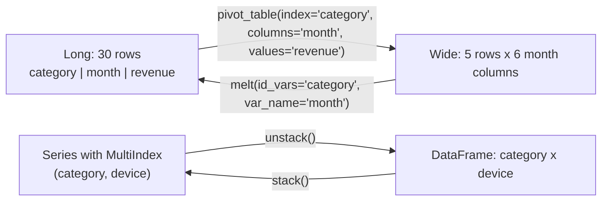
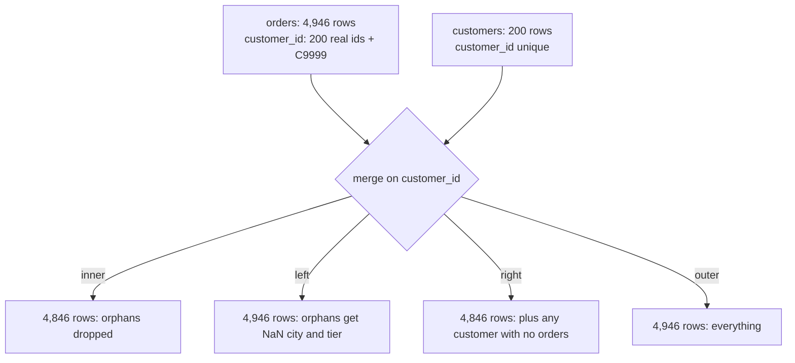

:::tip[TL;DR (30-Second Interview Pitch)]
Data comes in two shapes. **Long** (one row per observation: category, month, revenue) is what you store, group and plot with Seaborn; **wide** (one row per category, one column per month) is what people read. **`pivot_table`** goes long → wide while **aggregating** duplicates, **`melt`** goes wide → long, **`stack`/`unstack`** move a level between the row index and the columns, and **`crosstab`** counts combinations of two categoricals. To combine tables, **`concat`** glues them along an axis (same columns, more rows), and **`merge`** joins on keys like SQL (`inner`, `left`, `right`, `outer`). Always pass **`validate="m:1"`** so a duplicate key raises instead of silently multiplying rows, and use **`indicator=True`** to see which rows didn't match.
:::

<PriorityKey lang="pandas" v="3.0" />

## 🧭 Start Here: Shapes and Joins

**Reshaping.** The same numbers can be laid out in different ways. ShopStream's monthly revenue per category is 30 numbers (5 categories × 6 months):

- **Long / tidy**: 30 rows with columns `category`, `month`, `revenue`. Every column is a variable, every row an observation. `groupby`, Seaborn and databases want this.
- **Wide**: 5 rows (categories) × 6 columns (months). Humans, heatmaps and spreadsheets want this.

Moving between them is a daily task, and interviewers like it because it tests whether you understand what an index is.

**Combining.** Real data lives in several tables. ShopStream has `orders` (one row per order) and `customers` (one row per customer). To ask "do Gold customers spend more?" you must bring `tier` onto each order: a **join** on `customer_id`. Joins go wrong in two classic ways: keys that **don't match** (rows disappear or get NaN) and keys that **repeat** (rows multiply). pandas has a switch for each.

| New concept | One-line meaning |
|---|---|
| **Long (tidy) format** | One row per observation, one column per variable |
| **Wide format** | One row per entity, one column per value of some variable (e.g. per month) |
| **`pivot_table`** | Long → wide, aggregating duplicate cells (`aggfunc`) |
| **`pivot`** | Long → wide **without** aggregation (fails on duplicates) |
| **`melt`** | Wide → long (the inverse of pivot) |
| **`stack` / `unstack`** | Move the innermost column level into the row index / a row-index level into the columns |
| **`crosstab`** | A frequency table of two (or more) categorical columns |
| **Join cardinality** | 1:1, 1:m, m:1, m:m: how many rows on each side share a key |

:::analogy[Long vs wide is a receipt vs a summary]
A shop's till roll is long format: one line per item sold, with the date, product and price. The owner's monthly summary sheet is wide: one row per product, one column per month. `pivot_table` is the accountant turning the till roll into the summary; `melt` is tearing the summary back into one line per cell so a machine can process it.
:::

## ⚡ Essential Interview Recall

- 🔴 **`pivot_table(index, columns, values, aggfunc)`** aggregates duplicates (default `aggfunc="mean"`!); **`pivot`** raises `ValueError: Index contains duplicate entries, cannot reshape` if any cell has two values.
- 🔴 **`melt(id_vars, value_vars, var_name, value_name)`** is the inverse: 5 × 6 wide → **30** long rows.
- 🔴 **`unstack()`** moves the **innermost row-index level** to columns; **`stack()`** moves the innermost column level back into the index. `unstack(fill_value=0)` avoids NaN for missing combinations.
- 🔴 **`pd.crosstab(a, b)`** counts; `normalize="index"` gives row proportions; `values=` + `aggfunc=` aggregates a third column; `margins=True` adds totals.
- 🔴 **`concat`** stacks objects along an axis and **aligns the other axis by label** (missing columns → NaN). Use `ignore_index=True` for a fresh 0..n-1 index, `keys=` to label the sources.
- 🔴 **`merge(how=...)`**: `inner` = matching keys only, `left` = all left rows, `right` = all right rows, `outer` = everything.
- 🔴 **`validate="m:1"`** (also `"1:1"`, `"1:m"`) raises `MergeError` when the key isn't unique where it should be. A duplicate customer row would turn 4,946 orders into **4,976**.
- 🔴 **`indicator=True`** adds `_merge` = `both` / `left_only` / `right_only`: on ShopStream, **100** orders are `left_only` (the `C9999` orphans).
- 🟠 Key **dtypes must match**: `int64` vs `str` raises `ValueError: You are trying to merge on int64 and str columns`.
- 🟠 Same column names on both sides get suffixes `_x`, `_y` (set `suffixes=`).
- 🟠 **m:m joins produce the Cartesian product** per key: 3 rows × 4 rows with the same key → **12**.
- 🟡 **pandas matches NaN keys to each other** (SQL never does): drop or fill missing keys before merging.

:::speak[Explain the different types of joins and how you'd catch a bad merge.]
"`merge` joins two DataFrames on key columns, like SQL. An **inner** join keeps only keys present in both tables, a **left** join keeps every row of the left table and fills NaN where the right has no match, **right** is the mirror, and **outer** keeps everything. For enrichment, like adding customer tier to orders, I use a **left** join from the fact table so no orders disappear. Two things go wrong silently. First, **unmatched keys**: I pass `indicator=True` and count `left_only` rows; on our data 100 orders point to a placeholder customer. Second, **duplicate keys** on the side that should be unique: one duplicated customer row multiplies all of that customer's orders and inflates revenue. I pass `validate='m:1'`, which raises a `MergeError` instead. Afterwards I assert the row count is unchanged. I also check that key dtypes match and remember that pandas, unlike SQL, matches NaN keys to each other."
:::

## The Mental Model

### 1. Reshaping between long and wide



<Animation src="pandas/melt-pivot" caption="A wide table of revenue per category and month is melted: each month column is peeled off and stacked underneath, giving one row per category and month. pivot_table runs the same movement in reverse." />

### 2. The four joins



<Animation src="pandas/merge-joins" caption="Order rows and customer rows are matched by customer_id. Matching pairs join up; the C9999 orders have no partner, so an inner join drops them while a left join keeps them with empty customer columns. A duplicated customer row makes its orders appear twice." />

:::analogy[validate is the bouncer checking guest lists]
Joining orders to customers is like seating wedding guests from an RSVP list at tables from a seating chart. If the seating chart accidentally lists one guest at two tables, that guest gets two meals and the bill goes up. `validate="m:1"` is the coordinator checking the seating chart has each name only once **before** dinner is served, instead of discovering it on the invoice.
:::

## The Paradigm / Core Concepts

### 🔴 Reshaping functions

| Function | Direction | Aggregates? | Key arguments | Fails when |
|---|---|---|---|---|
| `df.pivot_table` | Long → wide | ✅ (`aggfunc`, default `mean`) | `index`, `columns`, `values`, `aggfunc`, `fill_value`, `margins` | Never on duplicates |
| `df.pivot` | Long → wide | ❌ | `index`, `columns`, `values` | Duplicate (index, column) pairs |
| `df.melt` | Wide → long | — | `id_vars`, `value_vars`, `var_name`, `value_name` | — |
| `s.unstack(level)` | Index level → columns | — | `level`, `fill_value` | Duplicate index entries |
| `df.stack()` | Columns → index level | — | `level` | — |
| `pd.crosstab` | Two categoricals → table | Counts by default | `normalize`, `values`, `aggfunc`, `margins` | — |
| `groupby([...]).agg().unstack()` | Long → wide | ✅ | — | — |

<RuleCard name="pivot_table defaults to the mean" tag="Reshaping" why="pivot_table has to combine every value that lands in the same cell, and mean is its default way to combine them." remember="Say aggfunc out loud.">

Always pass `aggfunc` explicitly: `df.pivot_table(index="category", columns="month", values="revenue", aggfunc="sum")`. Forgetting it gives the **average order value** per cell when you wanted total revenue, and the table looks perfectly plausible.

</RuleCard>

### 🔴 Combining functions

| | `pd.concat` | `pd.merge` / `df.merge` | `df.join` |
|---|---|---|---|
| Combines by | **Position along an axis**, aligning the other axis by label | **Key columns** (or index) | **Index** (left can use a column via `on=`) |
| Typical use | Monthly files → one table; adding prediction columns | Enrich facts with dimensions | Quick index-on-index joins |
| Mismatch | Missing columns → NaN (`join="inner"` keeps shared only) | Depends on `how` | Default `how="left"` |
| SQL analogue | `UNION ALL` | `JOIN` | `JOIN ... USING` index |

| `how` | Keeps | ShopStream result | Use when |
|---|---|---|---|
| `inner` | Keys in **both** | 4,846 rows (orphans dropped) | Analysis needing both sides |
| `left` | All **left** rows | 4,946 rows, 100 NaN cities | Enriching a fact table (never lose orders) |
| `right` | All **right** rows | 4,846 rows (every customer has orders) | Rarely; swap sides and use left |
| `outer` | All keys | 4,946 rows | Reconciling two sources |

:::analogy[concat staples pages, merge matches receipts]
`concat` is stapling January's report behind December's: same columns, more pages, nobody checks what's on them. `merge` is matching each card payment on a bank statement to the shop receipt with the same transaction ID: it only works if the IDs agree, and a receipt photocopied twice makes the payment look doubled.
:::

<RuleCard name="Validate every merge" tag="Joins" why="A merge never complains about unmatched or duplicated keys; it just returns fewer or more rows than you expected." remember="Validate, indicate, count rows.">

For an enrichment join: `orders.merge(customers, on="customer_id", how="left", validate="m:1", indicator=True)`, then check `_merge` counts and `assert len(result) == len(orders)`. `validate` options: `"1:1"`, `"1:m"`, `"m:1"`, `"m:m"` (no check).

</RuleCard>

## ⚙️ Under the Hood (pandas Internals)

- **`pivot_table`** is a `groupby([index, columns]).agg(aggfunc)` followed by `unstack(columns)`. That's why it can aggregate and why its cost is the cost of the groupby.
- **`unstack`** computes, for each row of the MultiIndex, its target row and column position, then scatters the values into a new 2-D block. Missing combinations become NaN (which turns integer columns into floats unless you pass `fill_value`).
- **`melt`** repeats the `id_vars` columns once per melted column (`np.tile`) and concatenates the melted columns into one (`ravel` in column-major order), so the output has `rows × value_vars` rows.
- **`merge`** is usually a **hash join**: pandas factorizes the keys of both sides into shared integer codes, groups the right side's rows by code, then for each left row emits one output row per matching right row. Average cost O(n + m + output size). For sorted or index keys it can use a faster join path.
- **Output size of a merge** = sum over keys of (left count × right count). For a true m:1 join that's at most the left size; one duplicated right key multiplies its matches; an m:m join can explode quadratically.
- **`validate`** checks key uniqueness on the required side(s) before joining (an O(n) uniqueness check) and raises `MergeError` listing duplicated keys.
- **`concat`** aligns the non-concatenation axis by forming the **union** of labels (or intersection with `join="inner"`) and reindexes each piece; many small concats in a loop are O(n²) copying, so collect pieces in a list and concat once.

:::danger[Interview Trap]
**A duplicate key on the "one" side silently inflates totals.** If the customers table has C0001 twice (a re-imported row), `orders.merge(customers, on="customer_id")` returns **4,976** rows instead of 4,946: all 30 of C0001's orders appear twice, and revenue by tier is overstated. Nothing errors. `validate="m:1"` turns this into `MergeError: Merge keys are not unique in right dataset; not a many-to-one merge`.
:::

:::danger[Interview Trap]
**pandas joins NaN to NaN.** In SQL, `NULL = NULL` is unknown, so rows with null keys never match. In pandas, a NaN key on the left **matches** a NaN key on the right. Rows with a missing `customer_id` would all pair with each other. Drop or fill missing keys first.
:::

## 💻 Pandas Implementation on ShopStream

:::tip[Run it yourself]
Start from `orders = clean_orders(*make_shopstream())`-style setup on the [GroupBy page](./05-pandas-groupby-apply-transform.md) (4,946 cleaned orders) plus the `customers` table. Outputs come from **pandas 3.0.6**.
:::

```python showLineNumbers
raw, customers = make_shopstream()
orders = clean_orders(raw, customers)
orders["month"] = orders["order_ts"].dt.strftime("%m-%b")   # '01-Jan': sorts in calendar order
```

### 1. `pivot_table`: category × month revenue

```python showLineNumbers
# highlight-next-line
monthly = orders.pivot_table(index="category", columns="month", values="revenue", aggfunc="sum", observed=True)
print((monthly / 1e6).round(2))                      # ₹ millions
# month        01-Jan  02-Feb  03-Mar  04-Apr  05-May  06-Jun
# category
# Beauty         0.13    0.14    0.15    0.19    0.23    0.19
# Books          0.10    0.07    0.08    0.07    0.09    0.08
# Electronics    3.43    3.58    3.20    3.58    3.28    3.91
# Fashion        0.54    0.55    0.62    0.58    0.58    0.74
# Home           0.67    0.62    0.69    0.66    0.82    0.54
```

These are lower than the raw matrix on the [NumPy page](./02-numpy-broadcasting-linalg-aggregations.md) (Electronics June: 3.91 vs 5.34) because cleaning removed the ×40 price errors and applied discounts. Same code, different truth.

```python showLineNumbers
by_device = orders.pivot_table(index="category", columns="device", values="revenue", aggfunc="sum",
                               margins=True, margins_name="Total", observed=True)
print((by_device / 1e6).round(2))
# device        app  desktop  mobile  Total
# category
# Beauty       0.33     0.18    0.52   1.03
# Books        0.16     0.10    0.23   0.49
# Electronics  6.13     4.27   10.58  20.98
# Fashion      1.18     0.60    1.83   3.62
# Home         1.10     0.71    2.19   4.00
# Total        8.90     5.86   15.35  30.11

print(orders.pivot_table(index="category", values=["revenue", "rating"],
                         aggfunc={"revenue": "sum", "rating": "mean"}, observed=True).round(2).loc["Electronics"].to_dict())
# {'rating': 3.48, 'revenue': 20975327.06}: a different aggregation per column
```

### 2. `pivot` needs unique cells

```python showLineNumbers
# error-next-line
orders.pivot(index="category", columns="month", values="revenue")   # ❌ ValueError: Index contains duplicate entries, cannot reshape

long = orders.groupby(["category", "month"], observed=True)["revenue"].sum().reset_index()   # 30 unique rows
# success-next-line
wide = long.pivot(index="category", columns="month", values="revenue")   # ✅ one value per cell
print(long.shape, wide.shape)                        # (30, 3) (5, 6)
```

### 3. `melt`: wide back to long

```python showLineNumbers
w = (wide / 1e6).round(2).reset_index()
w.columns.name = None
# highlight-next-line
tidy = w.melt(id_vars="category", var_name="month", value_name="revenue_m")
print(tidy.shape)                                    # (30, 3): 5 categories x 6 months
print(tidy.head(3))
#       category   month  revenue_m
# 0       Beauty  01-Jan       0.13
# 1        Books  01-Jan       0.10
# 2  Electronics  01-Jan       3.43

sensors = pd.DataFrame({"sensor_id": ["S1", "S2"], "temp_c": [21.5, 30.2],
                        "humidity": [40, 55], "pressure": [1012, 1009]})
print(sensors.melt(id_vars="sensor_id", var_name="metric", value_name="sensor_val"))
#   sensor_id    metric  sensor_val
# 0        S1    temp_c        21.5
# 1        S2    temp_c        30.2
# 2        S1  humidity        40.0
# 3        S2  humidity        55.0
# 4        S1  pressure      1012.0
# 5        S2  pressure      1009.0
```

### 4. `stack` and `unstack`

```python showLineNumbers
s = orders.groupby(["category", "device"], observed=True)["revenue"].sum().div(1e6).round(2)
print(s.head(3))                                     # a Series with a 2-level MultiIndex
# category  device
# Beauty    app        0.33
#           desktop    0.18
#           mobile     0.52

# highlight-next-line
table = s.unstack()                                  # innermost level (device) → columns
print(table.shape, table.index.name, table.columns.name)   # (5, 3) category device
print(s.unstack(level=0).shape)                      # (3, 5): category → columns instead
print(table.stack().shape)                           # (15,): back to the long Series

counts = orders.groupby(["category", "payment_method"], observed=True)["order_id"].count().unstack(fill_value=0)
print(counts.loc["Beauty"].to_dict())                # {'COD': 110, 'Card': 180, 'UPI': 320, 'Unknown': 19, 'Wallet': 112}
```

### 5. `crosstab`: counts and proportions

```python showLineNumbers
print(pd.crosstab(orders["category"], orders["device"]))
# device       app  desktop  mobile
# category
# Beauty       237      138     366
# Books        200      148     354
# Electronics  372      251     652
# Fashion      370      238     653
# Home         292      189     486

# highlight-next-line
print(pd.crosstab(orders["payment_method"], orders["rated"], normalize="index").round(3))
# rated           False  True
# payment_method
# COD             0.422  0.578
# Card            0.362  0.638
# UPI             0.410  0.590
# Unknown         0.411  0.589
# Wallet          0.417  0.583

print(pd.crosstab(orders["category"], orders["device"], values=orders["revenue"], aggfunc="mean").round(0).loc["Home"].to_dict())
# {'app': 3779.0, 'desktop': 3737.0, 'mobile': 4498.0}
print(pd.crosstab(orders["category"], orders["device"], margins=True).loc["All"].to_dict())
# {'app': 1471, 'desktop': 964, 'mobile': 2511, 'All': 4946}
```

**What it says:** device mix is almost identical across categories (about 51% mobile everywhere); card payers rate slightly more often (63.8% vs 57.8% for COD).

### 6. `concat`: stacking pieces

```python showLineNumbers
jan = orders[orders["order_ts"].dt.month == 1]
feb = orders[orders["order_ts"].dt.month == 2]
both = pd.concat([jan, feb])
print(len(jan), len(feb), len(both))                 # 815 789 1604
print(pd.concat([jan, feb], ignore_index=True).index[-1])   # 1603: fresh 0..n-1 index
tagged = pd.concat({"jan": jan, "feb": feb}, names=["source"])
print(tagged.index.nlevels, tagged.loc["feb"].shape)   # 2 (789, 16)

a = pd.DataFrame({"customer_id": ["C0001"], "sensor_val": [1.0]})
b = pd.DataFrame({"customer_id": ["C0002"], "device": ["app"]})
print(pd.concat([a, b]))                             # union of columns, NaN where missing
#   customer_id  sensor_val device
# 0       C0001         1.0    NaN
# 0       C0002         NaN    app
print(pd.concat([a, b], join="inner").columns.tolist())   # ['customer_id']: shared columns only
```

```python title="❌ concat inside a loop is quadratic" showLineNumbers
# error-start
result = pd.DataFrame()
for month in range(1, 7):
    result = pd.concat([result, orders[orders["order_ts"].dt.month == month]])   # copies everything each time
# error-end
# success-next-line
result = pd.concat([orders[orders["order_ts"].dt.month == m] for m in range(1, 7)])   # one copy
```

### 7. `merge`: the four joins

```python showLineNumbers
print(customers.shape, customers["customer_id"].is_unique)   # (200, 5) True

for how in ["inner", "left", "right", "outer"]:
    print(how, orders.merge(customers, on="customer_id", how=how).shape)
# inner (4846, 20)
# left (4946, 20)
# right (4846, 20)
# outer (4946, 20)

# highlight-next-line
enriched = orders.merge(customers, on="customer_id", how="left", validate="m:1", indicator=True)
print(enriched["_merge"].value_counts().to_dict())   # {'both': 4846, 'left_only': 100, 'right_only': 0}
assert len(enriched) == len(orders)
```

### 8. Catching bad merges

```python showLineNumbers
customers_dup = pd.concat([customers, customers.head(1)])   # C0001 imported twice
# error-next-line
print(orders.merge(customers_dup, on="customer_id", how="left").shape)   # (4976, 20): 30 extra rows, no error
# success-next-line
orders.merge(customers_dup, on="customer_id", how="left", validate="m:1")
# MergeError: Merge keys are not unique in right dataset; not a many-to-one merge

x = pd.DataFrame({"k": [1, 2]})
y = pd.DataFrame({"k": ["1", "2"], "v": [10, 20]})
# error-next-line
x.merge(y, on="k")                                   # ❌ ValueError: You are trying to merge on int64 and str columns for key 'k'. If you wish to proceed you should use pd.concat

m3 = pd.DataFrame({"k": ["a"] * 3, "v": [1, 2, 3]})
m4 = pd.DataFrame({"k": ["a"] * 4, "w": [1, 2, 3, 4]})
print(len(m3.merge(m4, on="k")))                     # 12: many-to-many = every pair

p = pd.DataFrame({"k": [np.nan, "a"], "v": [1, 2]})
q = pd.DataFrame({"k": [np.nan, "a"], "w": [3, 4]})
print(p.merge(q, on="k"))                            # NaN matched NaN (SQL would drop it)
#      k  v  w
# 0  NaN  1  3
# 1    a  2  4
```

| Symptom after a merge | Likely cause | Check |
|---|---|---|
| More rows than the left table | Duplicate keys on the right | `validate="m:1"`, `right[key].is_unique` |
| Fewer rows than expected | `inner` join with unmatched keys | `indicator=True`, use `how="left"` |
| Columns full of NaN | Keys don't match (case, spaces, type, leading zeros) | Compare `set(left.key) & set(right.key)` |
| `name_x`, `name_y` columns | Same non-key column on both sides | `suffixes=("_order", "_cust")` or rename first |

### 9. Different key names, `join`, and suffixes

```python showLineNumbers
tickets = pd.DataFrame({"cust": ["C0001", "C0002"], "tickets": [2, 0]})
print(customers.merge(tickets, left_on="customer_id", right_on="cust", how="left").shape)   # (200, 7): both key columns kept
print(customers.set_index("customer_id").join(tickets.set_index("cust"), how="inner").shape)   # (2, 5): index-on-index

web = orders.assign(name="web")                      # a column that clashes with customers.name
print([c for c in web.merge(customers, on="customer_id").columns if "name" in c])   # ['name_x', 'name_y']
print([c for c in web.merge(customers, on="customer_id", suffixes=("_order", "_cust")).columns if "name" in c])
# ['name_order', 'name_cust']
```

### 10. Using the enriched table

```python showLineNumbers
print(enriched.groupby("tier", observed=True)["revenue"].agg(["count", "mean"]).round(0))
#         count    mean
# tier
# Bronze   2792  5962.0
# Gold      470  6425.0
# Silver   1584  6143.0
print(enriched.groupby("city")["delivery_days"].mean().round(2).to_dict())
# {'Bengaluru': 4.23, 'Delhi': 6.18, 'Hyderabad': 6.24, 'Mumbai': 4.2, 'Pune': 4.25}
```

**What it says:** Gold customers spend about 8% more per order than Bronze; Delhi and Hyderabad deliveries take about two days longer. Both questions needed the merge.

:::info[AI Engineering: point-in-time joins]
In feature pipelines, joining "the customer's current tier" onto **past** orders leaks the future: a customer who became Gold in June looks Gold on January orders. Use **as-of joins** (`pd.merge_asof(orders, tier_history, on="ts", by="customer_id")`) so each order sees only what was known at that moment. Feature stores (Feast, Tecton) exist largely to make these point-in-time-correct joins routine.
:::

## 🧪 Predict the Output

<Predict n="1" title="pivot_table default" output="mean">

```python
t = orders.pivot_table(index="category", columns="month", values="revenue")
# Is t the total or the average revenue per cell?
```

`aggfunc` defaults to **`"mean"`**, so each cell is the average order value, not the monthly total. Pass `aggfunc="sum"` for totals.

</Predict>

<Predict n="2" title="melt row count" output="(30, 3)">

```python
print(w.melt(id_vars="category", var_name="month", value_name="revenue_m").shape)   # w: 5 rows, category + 6 month columns
```

Each of the 5 rows produces one row per melted column (6 months): **30** rows, with columns `category`, `month`, `revenue_m`.

</Predict>

<Predict n="3" title="Duplicate key on the one side" output="(4976, 20)">

```python
customers_dup = pd.concat([customers, customers.head(1)])   # C0001 twice; C0001 has 30 orders
print(orders.merge(customers_dup, on="customer_id", how="left").shape)
```

Each of C0001's 30 orders matches **two** customer rows, so 30 extra rows: 4,946 + 30 = **4,976**. No error, no warning.

</Predict>

<Predict n="4" title="Many-to-many" output="12">

```python
a = pd.DataFrame({"k": ["x"] * 3})
b = pd.DataFrame({"k": ["x"] * 4})
print(len(a.merge(b, on="k")))
```

Every left row with key `x` pairs with every right row with key `x`: 3 × 4 = **12**.

</Predict>

<Predict n="5" title="unstack shape" output="(3, 5)">

```python
s = orders.groupby(["category", "device"], observed=True)["revenue"].sum()
print(s.unstack(level=0).shape)
```

`level=0` moves **category** (the outer level) into the columns, leaving device as the row index: 3 devices × 5 categories.

</Predict>

<Predict n="6" title="concat with different columns" output="['customer_id', 'sensor_val', 'device']">

```python
a = pd.DataFrame({"customer_id": ["C0001"], "sensor_val": [1.0]})
b = pd.DataFrame({"customer_id": ["C0002"], "device": ["app"]})
print(pd.concat([a, b]).columns.tolist())
```

`concat` along rows takes the **union** of columns (in first-seen order) and fills NaN where a piece lacks a column; `join="inner"` would keep only `customer_id`.

</Predict>

## 🪜 Follow-up Ladder

<Ladder title="From merge basics to joins at scale">
<Rung q="What's the difference between inner and left join?">

Inner keeps only keys present in both tables; left keeps every row of the left table and fills NaN where the right has no match.

</Rung>
<Rung q="After a left join your row count went up. Why?">

The right table has duplicate keys, so some left rows matched several right rows. Find them with `right[right.duplicated(key, keep=False)]`, and prevent it with `validate="m:1"`.

</Rung>
<Rung q="How do you join each order to the customer's tier as it was at order time?">

Keep a tier history table (customer, tier, valid_from) and use `pd.merge_asof(orders.sort_values("order_ts"), history.sort_values("valid_from"), left_on="order_ts", right_on="valid_from", by="customer_id")`: for each order it takes the latest tier at or before the order time.

</Rung>
<Rung q="The orders table has 2 billion rows. How do you do this join?">

Not in pandas. Push the join into the warehouse (SQL) or use Spark / Polars / DuckDB. If one side is small (customers), it's a **broadcast join**: ship the small table to every worker so the big table never shuffles. If both are big, both are partitioned by key (shuffle hash join or sort-merge join).

</Rung>
</Ladder>

## 🚑 Production Scenarios

:::incident[Revenue jumped 4% overnight, and nobody sold more]
A finance dashboard showed a sudden revenue increase after a nightly refresh.

- **Why:** a CRM re-sync inserted duplicate rows for 300 customers. The pipeline's `orders.merge(customers, on="customer_id")` doubled those customers' orders. No error anywhere.
- **Fix:** deduplicated the customer table on its key; added `validate="m:1"` and a row-count assertion after every enrichment join. **Prevention:** uniqueness constraints on dimension tables, and data-quality alerts on daily totals.
:::

:::incident[A third of predictions were made with empty features]
A recommendation model received NaN for every customer feature on about 30% of requests.

- **Why:** the feature table's `customer_id` was `int64` (`417`) while requests carried zero-padded strings (`'000417'`). After a quick `astype(str)` the merge ran without error but matched nothing for padded IDs.
- **Fix:** normalize keys at ingestion (one canonical string format), and log the `_merge` indicator rate; alert when `left_only` exceeds a threshold.
:::

## 🚨 Interview Gotchas & Edge Cases

:::warning[The Most Common Question]
**"How do you reshape data from wide to long and back?"** `melt` for wide → long (`id_vars` stay, other columns become a `variable`/`value` pair), `pivot_table` for long → wide (with an explicit `aggfunc`), `pivot` only when cells are unique, `stack`/`unstack` when the data already has a MultiIndex. Expect a follow-up on joins: inner vs left, and how you'd detect row explosion (`validate`, `indicator`, row counts).
:::

- **`pivot_table` drops all-NaN columns** by default (`dropna=True`) and sorts row and column labels; month names sort alphabetically (`Apr` before `Jan`) unless you use sortable labels (`01-Jan`) or an ordered categorical.
- **`unstack` on integers with missing combinations** produces floats (NaN); use `fill_value=0`.
- **`melt` loses the index**; `reset_index()` first if the index holds an ID.
- **`merge` resets the index** of the result to 0..n-1; set it again if you need the original labels.
- **`concat(axis=1)` aligns rows by index**: two Series with indexes 0, 1 and 1, 2 give three rows with NaN, not two side-by-side columns.
- **Joining on float keys** is fragile (rounding); join on integers or strings.
- **`merge_asof` requires both sides sorted** by the `on` key.
