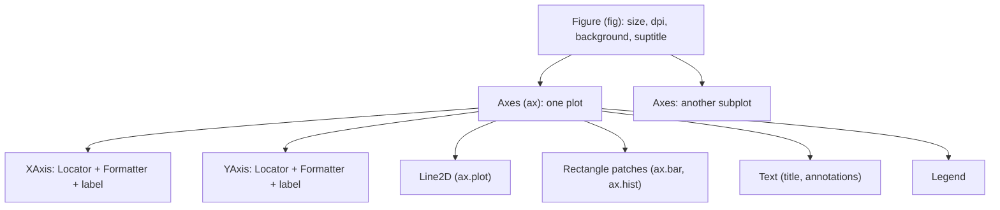

:::tip[TL;DR (30-Second Interview Pitch)]
Matplotlib draws a **Figure** (the canvas) containing one or more **Axes** (individual plots), and everything inside them (lines, bars, text, ticks) is an **Artist** object you can change. Use the **object-oriented** interface, `fig, ax = plt.subplots()`, then `ax.plot`, `ax.bar`, `ax.hist`, `ax.scatter`, `ax.errorbar`, and configure the axes explicitly (`set_title`, `set_xlabel`, `legend`, tick **locators** and **formatters**, `annotate`). The `plt.*` state-machine style is fine for a quick look, but it acts on an invisible "current axes", which breaks in functions, loops and multi-panel figures. Export with `fig.savefig(path, dpi=150)`: pixels = inches × dpi.
:::

<PriorityKey lang="Matplotlib" v="3.8" />

<FormulaKey />

## 🧭 Start Here: How Matplotlib Thinks

Matplotlib is the foundation of Python plotting: pandas' `.plot()` and all of Seaborn call it underneath. It's verbose because it gives you control over **every** mark on the page. Once you understand its object model, that verbosity turns into precision.

1. **A Figure is the sheet of paper.** It has a size in inches, a background, and holds everything else.
2. **An Axes is one chart on that paper**: its own x and y axes, title, data, legend. One Figure can hold a grid of Axes (`plt.subplots(2, 3)`). Careful with the name: an **Axes** (a plot) contains two **Axis** objects (the x and y number lines).
3. **Everything visible is an Artist**: `Line2D` from `ax.plot`, `Rectangle` patches from `ax.bar`, `Text` for titles and labels. Plot functions return these objects, so you can restyle them later.
4. **Ticks are generated by Locators and printed by Formatters.** A `MultipleLocator(5)` puts a tick every 5 units; a `FuncFormatter` turns `21000000` into `₹21.0M`.

The images on this page were rendered by `scripts/data_exploration/figures_matplotlib.py` from cleaned ShopStream data, using the site's **house style** (`site_style.apply()`, which sets `rcParams` such as the colour cycle, light grid and hidden top/right spines). The code blocks show the plotting calls; style comes from the rcParams.

| New concept | One-line meaning |
|---|---|
| **Figure** | The whole canvas; `fig.savefig()` exports it |
| **Axes** | One plot area with its own coordinate system; most methods live here (`ax.plot`) |
| **Artist** | Any drawable object: lines, patches, text, the Axes itself |
| **pyplot (state-based)** | `plt.plot()` acts on the "current" Figure/Axes that pyplot tracks globally |
| **Object-oriented (OO)** | `fig, ax = plt.subplots()`, then call methods on the objects you hold |
| **Locator / Formatter** | Decide **where** ticks go / **how** tick labels are written |
| **rcParams** | Global default style settings (`mpl.rcParams["axes.grid"] = True`) |
| **Backend** | What renders the figure: `Agg` (PNG files, servers), interactive GUIs, inline in notebooks |

:::analogy[Figure, Axes, Artist is a gallery wall]
The **Figure** is a wall. Each **Axes** is a picture frame hung on it, with its own ruler along the bottom and side (the two Axis objects). The **Artists** are the paint strokes inside a frame. pyplot's state machine is like an assistant who always paints in "the frame you touched last"; the OO interface is you pointing at a specific frame and saying "this one".
:::

## ⚡ Essential Interview Recall

- 🔴 **Figure contains Axes; Axes contain Artists.** `fig, ax = plt.subplots()` returns both; `plt.subplots(2, 3)` returns `axes` as a **(2, 3) NumPy array**.
- 🔴 **OO over pyplot**: methods on explicit objects (`ax.set_title`) work in functions, loops and subplots; `plt.title` modifies whatever axes is "current" (`plt.gca()`), which is the **last one created**.
- 🔴 Setter naming: pyplot `plt.title`, `plt.xlabel`, `plt.xlim` → OO `ax.set_title`, `ax.set_xlabel`, `ax.set_xlim`.
- 🔴 Core plots: `ax.plot` (line), `ax.bar` / `ax.barh` (bars; `bottom=` / `left=` to **stack**), `ax.hist` (returns counts, bin edges, patches), `ax.scatter` (`s=` size, `c=` colour), `ax.errorbar(x, y, yerr=...)`.
- 🔴 **Histograms depend on binning**: for skewed data (ShopStream prices), 50 equal bins put **46% of orders in the first bar**; use log-spaced bins with a log axis.
- 🟠 **Ticks**: `ax.xaxis.set_major_locator(MultipleLocator(5))`, `ax.yaxis.set_major_formatter(FuncFormatter(lambda v, pos: f"₹{v/1e6:.1f}M"))`, `PercentFormatter(1.0)`.
- 🟠 **`ax.annotate(text, xy=point, xytext=label_pos, arrowprops=...)`** labels a point; `ax.bar_label(bars)` writes values on bars.
- 🟠 **`ax.twinx()`** adds a second y-axis sharing x. It lets you make **any** two series look correlated by rescaling; prefer **two stacked panels** (`sharex=True`) or an indexed chart.
- 🟠 **`fig.savefig("x.png", dpi=150, bbox_inches="tight")`**: an 8 × 4 inch figure at 150 dpi is **1200 × 600** px; at 300 dpi 2400 × 1200. Vector formats (SVG, PDF) for print.
- 🟡 Close figures in loops (`plt.close(fig)`), or memory grows (Matplotlib warns after 20 open figures). Use the **`Agg`** backend on servers.

## 📐 Formula Sheet

| Concept | Formula | In plain words |
|---|---|---|
| Export size | $\pred{\text{pixels}} = \data{\text{inches}} \times \hyper{\text{dpi}}$ | `figsize=(8, 4)`, `dpi=150` → 1200 × 600 |
| Index to a base period | $\pred{I_t} = 100 \cdot \dfrac{\data{x_t}}{\data{x_0}}$ | Puts series of different sizes on one scale |
| 95% confidence interval of a mean | $\pred{\bar x} \pm \hyper{1.96}\,\dfrac{\pred{s}}{\sqrt{\data{n}}}$ | The error-bar half-width |
| Least-squares line | $\pred{\hat y} = \pred{m}\,\data{x} + \pred{c}$ via `np.polyfit(x, y, 1)` | Trend line on a scatter |
| Log-spaced bins | $\data{b_k} = 10^{\,\log_{10} \min + k\,\Delta}$ via `np.logspace` | Equal-width bins on a log axis |

:::speak[Why use the object-oriented Matplotlib API instead of pyplot?]
"Matplotlib has two interfaces over the same objects. The **pyplot** interface (`plt.plot`, `plt.title`) keeps a hidden global state, the 'current figure' and 'current axes', and every call modifies whatever is current. That's convenient for a one-off plot in a notebook, but it's implicit: inside a function or a loop over subplots you can easily put a title on the wrong chart, because the current axes is simply the last one created. The **object-oriented** interface makes it explicit: `fig, ax = plt.subplots()` gives me the Figure and Axes objects, and I call `ax.plot`, `ax.set_title`, `ax.legend` on exactly the plot I mean. With `plt.subplots(2, 3)` I get a 2-by-3 array of Axes I can index or loop over, and I can pass an `ax` into helper functions or into Seaborn and pandas plotting with `ax=ax`. It also makes saving and closing explicit with `fig.savefig` and `plt.close(fig)`, which matters in long-running services. So: pyplot for quick exploration, OO for anything reusable."
:::

## The Mental Model

### 1. The object tree




<Animation src="matplotlib/anatomy" caption="A Matplotlib chart is built up layer by layer: the empty Figure, then an Axes inside it, then the two Axis rulers with ticks, then the line, title, labels and legend. Each layer is a separate object you can reach and change." />

### 2. pyplot vs object-oriented

| | pyplot (state-based) | Object-oriented |
|---|---|---|
| Create | `plt.figure()`; `plt.subplot(2, 1, 1)` | `fig, axes = plt.subplots(2, 1)` |
| Draw | `plt.plot(x, y)` | `ax.plot(x, y)` |
| Label | `plt.title("...")`, `plt.xlabel` | `ax.set_title("...")`, `ax.set_xlabel` |
| Which plot is changed? | The **current** axes (`plt.gca()`, the last created) | The one you call the method on |
| In functions | Hidden side effects on global state | Pass `ax` in, return `fig` |
| Best for | A quick look in a notebook | Everything else: dashboards, reports, libraries |

<RuleCard name="Hold the objects you draw on" tag="Object-oriented API" why="pyplot functions act on an invisible current axes that changes every time a new plot is created." remember="Get fig, ax; call ax.">

Start every non-trivial plot with `fig, ax = plt.subplots(...)` (or `fig, axes = ...` for a grid), call methods on `ax`, pass `ax=ax` into pandas and Seaborn plotting functions, and finish with `fig.savefig(...)` and `plt.close(fig)`.

</RuleCard>

## The Paradigm / Core Concepts

### 🔴 Which chart for which question

| Question | Chart | Matplotlib call | ShopStream example |
|---|---|---|---|
| How does a value change over time? | Line | `ax.plot(x, y)` | Weekly revenue, indexed monthly revenue |
| How do categories compare? | Bar (horizontal when labels are long) | `ax.bar` / `ax.barh` | Revenue by category |
| What is the composition of each category? | Stacked bar (100% when comparing mixes) | `ax.barh(..., left=cumulative)` | Device mix per category |
| How is one numeric variable distributed? | Histogram | `ax.hist(x, bins=...)` | Unit price (log bins) |
| How do two numeric variables relate? | Scatter | `ax.scatter(x, y)` | Orders vs spend per customer |
| How certain is each estimate? | Error bars | `ax.errorbar(x, y, yerr=ci)` | Mean rating by delivery days |

### 🔴 Customization reference

| Want | OO call |
|---|---|
| Title, axis labels | `ax.set_title`, `ax.set_xlabel`, `ax.set_ylabel`; figure-wide `fig.suptitle` |
| Limits, scale | `ax.set_xlim(0, 10)`, `ax.set_yscale("log")` |
| Legend | Pass `label=` to each plot call, then `ax.legend(loc=..., ncols=..., title=...)` |
| Tick positions | `ax.xaxis.set_major_locator(MultipleLocator(5))`, `ax.set_xticks([...])` |
| Tick labels | `ax.yaxis.set_major_formatter(FuncFormatter(f))`, `PercentFormatter(1.0)`, `DateFormatter("%b")` |
| Rotate labels | `ax.tick_params(axis="x", rotation=30)` |
| Reference lines | `ax.axhline(100)`, `ax.axvline(median)` |
| Point to something | `ax.annotate(text, xy=..., xytext=..., arrowprops=dict(arrowstyle="->"))` |
| Values on bars | `ax.bar_label(bars, labels=[...])` |
| Second y-axis | `ax2 = ax.twinx()` (use sparingly) |
| Layout | `fig.tight_layout()`, `layout="constrained"`, `fig.subplots_adjust(...)` |
| Global style | `mpl.rcParams.update({...})`, `plt.style.use(...)` |

:::analogy[Locators make the ruler, Formatters print the numbers on it]
A ruler factory has two jobs: one machine decides where the marks go (every centimetre, every 5 mm), another prints the labels next to them ("1 cm" or "10 mm"). Matplotlib splits ticks the same way, so you can keep the marks and change only the printing, for example `21000000` becoming `₹21.0M`.
:::

<Formula name="Export resolution" tag="savefig" words="A figure is measured in inches; dpi says how many pixels to draw per inch. The same figure saved at higher dpi has more pixels, so text and lines stay sharp when enlarged." remember="Inches times dpi equals pixels.">

$$
\pred{\text{width}_{px}} = \data{\text{width}_{in}} \times \hyper{\text{dpi}}, \qquad \pred{\text{height}_{px}} = \data{\text{height}_{in}} \times \hyper{\text{dpi}}
$$

- $\data{\text{width}_{in}}$, $\data{\text{height}_{in}}$: `figsize=(8, 4)`
- $\hyper{\text{dpi}}$: dots per inch passed to `savefig` (or `rcParams["savefig.dpi"]`)

**Example:** `figsize=(8, 4)` at dpi 72 → 576 × 288 px (11.5 KB); 150 → 1200 × 600 (28.8 KB); 300 → 2400 × 1200 (65.5 KB). The same figure as SVG is 12.9 KB at any zoom. `bbox_inches="tight"` trims the margins (1200 × 600 → 1000 × 527).

</Formula>

## ⚙️ Under the Hood (Matplotlib Internals)

- **Three layers**: the **backend** layer (a `FigureCanvas` plus a `Renderer`: `Agg` rasterizes to PNG with anti-aliasing, `pdf`/`svg` write vectors, GUI backends draw to windows), the **artist** layer (Figure, Axes, Line2D... the objects you manipulate), and the **scripting** layer (`pyplot`, which manages current figures for you).
- **Drawing is deferred**: plot calls only create and configure Artists. Rendering happens on `savefig`, `plt.show()` or a notebook display, when the Figure walks its Artist tree and each Artist draws itself with the renderer.
- **Coordinate systems (transforms)**: **data** coordinates (your x and y), **axes** fraction (0–1 across the plot area), **figure** fraction (0–1 across the canvas) and **display** pixels. `annotate(xycoords=..., textcoords=...)` and `transform=ax.transAxes` choose among them; the anatomy image above places its callouts in figure fraction and points at Axes fractions.
- **Ticks** are recomputed at draw time: the Locator picks positions from the current view limits, the Formatter turns each into text. That's why setting a formatter once still works after you change limits.
- **Dates** are stored as floats (days since an epoch); pandas datetimes are converted through registered unit converters, and `DateFormatter` / `AutoDateLocator` format them.
- **Memory**: pyplot keeps a reference to every figure it created until `plt.close()`. In a loop that saves 1,000 charts, forgetting to close leaks every one of them (Matplotlib warns: "More than 20 figures have been opened").
- **Performance**: each marker in `scatter` is an individually styled path (slow beyond ~100k points); `ax.plot(x, y, "o")` with one style draws faster; for millions of points use `hexbin`, `hist2d` or Datashader.

:::danger[Interview Trap]
**`plt.title()` in a loop over subplots labels the wrong chart.** After `fig, axes = plt.subplots(1, 3)`, the current axes is the **last** one created (`plt.gca() is axes[-1]` → `True`). A loop calling `plt.plot(...)` then `plt.title(...)` puts every line and title on the third panel. Call `axes[i].plot(...)` and `axes[i].set_title(...)` instead.
:::

:::danger[Interview Trap]
**Twin axes can manufacture a correlation.** Each y-axis is scaled independently, so any two series can be made to overlap or diverge just by choosing limits. In the twinx chart below, average order value moves only **±4%** (₹5,876 to ₹6,324), yet its line swings from the bottom to the top of the plot next to an almost flat order count. Show two panels with a shared x-axis, or index both to a base period.
:::

## 💻 Matplotlib Implementation on ShopStream

:::tip[Run it yourself]
Images rendered with **Matplotlib 3.11.2** on Python 3.14. Setup used by every block: cleaned `orders` from the [GroupBy page](./05-pandas-groupby-apply-transform.md), `enriched = orders.merge(customers, on="customer_id", how="left", validate="m:1")`, and the house style via `site_style.apply()`. Full script: `scripts/data_exploration/figures_matplotlib.py`.
:::

```python showLineNumbers
import numpy as np
import pandas as pd
import matplotlib.pyplot as plt
from matplotlib.ticker import FuncFormatter, MultipleLocator, PercentFormatter

rupees_m = FuncFormatter(lambda v, pos: f"₹{v / 1e6:.1f}M")   # 21000000 → '₹21.0M'
```

### 1. pyplot vs OO: the same chart twice

```python showLineNumbers
weekly = orders.set_index("order_ts")["revenue"].resample("W").sum().iloc[1:-1]   # drop the 2 partial weeks

# quick look (state-based): fine in a notebook cell
plt.plot(weekly.index, weekly.to_numpy())
plt.title("Weekly revenue")
plt.show()

# highlight-next-line
fig, ax = plt.subplots(figsize=(9, 4.2))             # explicit objects
ax.plot(weekly.index, weekly.to_numpy(), label="Weekly revenue")
ax.plot(weekly.index, weekly.rolling(4).mean().to_numpy(), linestyle="--", label="4-week average")
ax.set_title("ShopStream weekly revenue")
ax.set_xlabel("Week")
ax.set_ylabel("Revenue")
ax.yaxis.set_major_formatter(rupees_m)
ax.legend(loc="lower right")
fig.savefig("mpl-anatomy.png", dpi=150)
plt.close(fig)
```

```python title="❌ pyplot in a subplot loop" showLineNumbers
fig, axes = plt.subplots(1, 3)
print(plt.gca() is axes[-1])                         # True: "current" = last created
for i, cat in enumerate(["Books", "Beauty", "Home"]):
    # error-next-line
    plt.title(cat)                                   # ❌ all three titles land on axes[2]
    # success-next-line
    axes[i].set_title(cat)                           # ✅ the panel you mean
```

### 2. Line plot: indexing series of different sizes

Electronics earns 40 times more than Books, so raw lines would flatten every other category. Indexing each to January = 100 compares **growth** on one scale, with no second axis.

```python showLineNumbers
monthly = orders.pivot_table(index="order_month", columns="category", values="revenue",
                             aggfunc="sum", observed=True)
# highlight-next-line
indexed = monthly / monthly.iloc[0] * 100            # broadcasting: divide every row by January
print(indexed.round(1).iloc[-1].to_dict())
# {'Beauty': 140.4, 'Books': 77.7, 'Electronics': 113.9, 'Fashion': 136.3, 'Home': 80.7}

fig, ax = plt.subplots(figsize=(8, 4.2))
for cat in indexed.columns:
    ax.plot(indexed.index, indexed[cat], marker="o", label=cat)
    nudge = {"Home": 5, "Books": -5}.get(cat, 0)     # keep end labels apart
    ax.annotate(cat, xy=(indexed.index[-1], indexed[cat].iloc[-1]), xytext=(8, nudge),
                textcoords="offset points", va="center", fontsize=9)   # direct labels instead of a legend
ax.axhline(100, color="#52514e", linewidth=1, linestyle=":")
ax.set_title("Monthly revenue by category, indexed to January = 100")
ax.set_ylabel("Index (Jan = 100)")
ax.set_xticks(indexed.index)
ax.xaxis.set_major_formatter(plt.matplotlib.dates.DateFormatter("%b"))
```


**What it says:** Beauty grew fastest (+40% by June, peak +71% in May) and Fashion jumped in June; Home and Books ended **below** January. The raw-revenue chart would have shown only Electronics. (Part of Beauty's May spike is two ×40 data-entry prices that slipped past the global outlier fence; the [Capstone](./09-capstone-eda-pipeline.md) removes them with a per-category fence and Beauty's May index drops to 132.)

### 3. Bar charts: vertical, horizontal, stacked

```python showLineNumbers
rev = orders.groupby("category", observed=True)["revenue"].sum().sort_values()
share = pd.crosstab(orders["category"], orders["device"], normalize="index")   # rows sum to 1

fig, axes = plt.subplots(1, 3, figsize=(13, 4))

axes[0].bar(rev.index, rev.to_numpy(), width=0.6)                # vertical
axes[0].yaxis.set_major_formatter(rupees_m)
axes[0].tick_params(axis="x", rotation=30)

# highlight-next-line
bars = axes[1].barh(rev.index, rev.to_numpy(), height=0.6)       # horizontal: labels read naturally
axes[1].bar_label(bars, labels=[f"₹{v / 1e6:.1f}M" for v in rev], padding=3, fontsize=8)
axes[1].xaxis.set_major_formatter(rupees_m)
axes[1].set_xlim(0, rev.max() * 1.25)                            # room for the labels

left = np.zeros(len(share))
for device in share.columns:                                     # stacked: each segment starts where the last ended
    # highlight-next-line
    axes[2].barh(share.index, share[device], left=left, label=device, edgecolor="#fcfcfb", linewidth=1.5, height=0.6)
    left += share[device].to_numpy()
axes[2].xaxis.set_major_formatter(PercentFormatter(1.0))
axes[2].legend(ncols=3, loc="upper center", bbox_to_anchor=(0.5, -0.1))
fig.tight_layout()
```


| Bar variant | Key argument | Note |
|---|---|---|
| Vertical | `ax.bar(x, height)` | Rotate long labels, or switch to horizontal |
| Horizontal | `ax.barh(y, width)` | **Sort** the values; label ends with `bar_label` |
| Stacked | `bottom=` (vertical) / `left=` (horizontal) running total | Only the first segment shares a baseline; use 100% stacks to compare mixes |
| Grouped | Offset positions: `x - w/2`, `x + w/2` | Seaborn's `barplot(hue=...)` does this for you |

**What it says:** device mix barely changes between categories (mobile is about 50% everywhere), so device isn't a reason for the revenue differences.

### 4. Histograms: binning changes the story

```python showLineNumbers
p = orders["unit_price"]
fig, axes = plt.subplots(1, 2, figsize=(11, 3.8))

# error-next-line
counts, edges, patches = axes[0].hist(p, bins=50)    # 50 equal-width bins on skewed data
print(int(counts[0]), round(edges[1], 2), round(counts[0] / counts.sum(), 3))   # 2282 1365.05 0.461

# success-start
log_bins = np.logspace(np.log10(p.min()), np.log10(p.max()), 50)
axes[1].hist(p, bins=log_bins)
axes[1].set_xscale("log")
# success-end
axes[1].axvline(p.median(), color="#eb6834", linestyle="--", label=f"median ₹{p.median():,.0f}")
axes[1].axvline(p.mean(), color="#1baf7a", linestyle="--", label=f"mean ₹{p.mean():,.0f}")
axes[1].legend()
```


<Animation src="matplotlib/histogram-binning" caption="The same ShopStream prices are binned twice. Twelve equal-width bins pile almost everything into the first bar, while twelve log-spaced bins spread the orders out and reveal the shape of the distribution." />

**What it says:** the equal-width version says only "most prices are small". On a log axis the distribution has **two humps**: the everyday categories around ₹1,000 and Electronics around ₹8,000, which is why the mean (₹3,495) is more than double the median (₹1,519).

### 5. Scatter plot with a trend line

```python showLineNumbers
cust = (enriched.dropna(subset=["tier"])
        .groupby(["customer_id", "tier"], observed=True)
        .agg(n_orders=("order_id", "count"), spend=("revenue", "sum"))
        .reset_index())

fig, ax = plt.subplots(figsize=(8, 4.5))
for tier in ["Bronze", "Silver", "Gold"]:                # one call per group → one legend entry each
    d = cust[cust["tier"] == tier]
    ax.scatter(d["n_orders"], d["spend"], s=40, alpha=0.75, edgecolor="#fcfcfb",
               linewidth=0.8, label=f"{tier} ({len(d)})")

# highlight-next-line
slope, intercept = np.polyfit(cust["n_orders"], cust["spend"], 1)   # least-squares line
xs = np.array([cust["n_orders"].min(), cust["n_orders"].max()])
ax.plot(xs, slope * xs + intercept, color="#52514e", linewidth=1.2, linestyle="--",
        label=f"fit: ₹{slope:,.0f} per order")
ax.yaxis.set_major_formatter(FuncFormatter(lambda v, pos: f"₹{v / 1e3:.0f}k"))
ax.xaxis.set_major_locator(MultipleLocator(5))       # a tick every 5 orders
ax.legend(title="Tier")
print(round(slope, 1), round(cust[["n_orders", "spend"]].corr().iloc[0, 1], 3))   # 5242.1 0.481
```


**What it says:** each extra order adds about ₹5,242 of spend, but the correlation is only **0.48**: order **value** varies a lot, and tiers are mixed throughout, so tier isn't a strong predictor of spend.

### 6. Error bars: showing uncertainty

<Formula name="95% confidence interval of a mean" tag="Error bars" words="A range that would contain the true average 95% of the time if you repeated the sampling. It shrinks as the group gets bigger, so small groups get wide bars." remember="Two standard errors either side.">

$$
\pred{\bar x} \pm \hyper{1.96} \cdot \frac{\pred{s}}{\sqrt{\data{n}}}
$$

- $\pred{\bar x}$, $\pred{s}$: the group's mean and sample standard deviation
- $\data{n}$: number of values in the group; $\pred{s}/\sqrt{\data{n}}$ is the **standard error**
- $\hyper{1.96}$: the normal distribution's 97.5th percentile (for 95% coverage)

**Example:** 1-day deliveries have mean rating 4.596, $s = 0.538$, $n = 89$: half-width $1.96 \times 0.538 / \sqrt{89} = 0.112$.

</Formula>

```python showLineNumbers
rated = orders[orders["rated"]]
stats = (rated.assign(days=rated["delivery_days"].clip(upper=10))   # pool the long tail into 10+
         .groupby("days")["rating"].agg(["mean", "std", "count"]))
# highlight-next-line
stats["ci95"] = 1.96 * stats["std"] / np.sqrt(stats["count"])

fig, ax = plt.subplots(figsize=(8, 4))
ax.errorbar(stats.index, stats["mean"], yerr=stats["ci95"], fmt="o-", capsize=4, ecolor="#52514e", elinewidth=1)
ax.xaxis.set_major_locator(MultipleLocator(1))
ax.yaxis.set_major_locator(MultipleLocator(0.5))
ax.set_ylim(1, 5)
print(stats.loc[[1.0, 5.0, 10.0]].round(3))
#        mean    std  count   ci95
# days
# 1.0   4.596  0.538     89  0.112
# 5.0   3.445  0.816    436  0.077
# 10.0  1.491  0.655    114  0.120
```


**What it says:** every extra day of delivery costs about a third of a star, and the intervals are narrow enough that the trend is clearly real. This is the strongest finding so far, and the capstone builds on it.

### 7. `twinx` vs two panels, `annotate`, locators

```python title="❌ twinx: two scales, one misleading picture" showLineNumbers
m = orders.groupby("order_month").agg(orders=("order_id", "count"), avg_order=("revenue", "mean"))
labels = m.index.strftime("%b")

fig, ax = plt.subplots(figsize=(7, 3.6))
ax.bar(labels, m["orders"], width=0.6)
ax.set_ylabel("Orders")
# error-next-line
ax2 = ax.twinx()                                     # second y-axis, independently scaled
ax2.plot(labels, m["avg_order"], color="#eb6834", marker="o")
ax2.set_ylabel("Avg order value (₹)", color="#eb6834")
```

:::analogy[twinx is two thermometers with different scales taped side by side]
Tape a Celsius thermometer and a Fahrenheit one next to each other, then slide one up a few centimetres: the two red lines now "cross" wherever you like, though the temperature never changed. A second y-axis lets the chart maker slide the scales, so the visual relationship between the lines is a choice, not a finding.
:::


```python title="✅ Two panels sharing the x-axis" showLineNumbers
# success-next-line
fig, (top, bottom) = plt.subplots(2, 1, figsize=(7, 4.8), sharex=True)
top.bar(labels, m["orders"], width=0.6)
top.set_title("Orders per month")
top.yaxis.set_major_locator(MultipleLocator(200))
bottom.plot(labels, m["avg_order"], marker="o")
bottom.set_title("Average order value")
bottom.yaxis.set_major_formatter(FuncFormatter(lambda v, pos: f"₹{v:,.0f}"))

i = int(np.argmax(m["avg_order"]))                   # position of the peak month
# highlight-next-line
bottom.annotate(f"Peak: ₹{m['avg_order'].max():,.0f}", xy=(i, m["avg_order"].max()),
                xytext=(i - 2.2, m["avg_order"].max() - 120),
                arrowprops=dict(arrowstyle="->", color="#52514e"))
fig.tight_layout()
```


Each panel has its own honest scale and title, so nobody reads the two lines as related. The bottom panel's y-axis still doesn't start at zero (a line chart may zoom in), but its tick labels make the ±4% range explicit.

### 8. Saving figures

```python showLineNumbers
fig, ax = plt.subplots(figsize=(8, 4))
ax.plot(np.arange(10) ** 2)
fig.savefig("chart_72.png", dpi=72)                  # 576 x 288 px, 11.5 KB: screens only
# highlight-next-line
fig.savefig("chart.png", dpi=150, bbox_inches="tight")   # ~1000 x 527 px: docs, slides
fig.savefig("chart_300.png", dpi=300)                # 2400 x 1200 px, 65.5 KB: print
fig.savefig("chart.svg")                             # vector, 12.9 KB, sharp at any size
fig.savefig("chart.pdf")                             # vector for LaTeX / reports
plt.close(fig)                                       # free memory: essential in loops and servers
```

:::info[AI Engineering: plots in training pipelines]
Training jobs save loss curves, confusion matrices and calibration plots as artifacts (MLflow, Weights & Biases, TensorBoard). Use `matplotlib.use("Agg")` (no display on servers), the OO API inside a function that **returns the Figure**, and `plt.close(fig)` after logging, or a long training run will leak memory one chart per epoch.
:::

## 🧪 Predict the Output

<Predict n="1" title="Which axes is current?" output="True">

```python
fig, axes = plt.subplots(2, 2)
print(plt.gca() is axes[1, 1])
```

`plt.subplots` creates the four Axes in order, and pyplot's "current axes" is the **last created**, the bottom-right one. Any `plt.plot` or `plt.title` would go there.

</Predict>

<Predict n="2" title="subplots return type" output="(2, 3) ndarray">

```python
fig, axes = plt.subplots(2, 3)
print(axes.shape, type(axes).__name__)
```

A grid of Axes comes back as a NumPy **object array** with the grid's shape. Use `axes[r, c]` or `axes.flat` to loop. With `plt.subplots()` (1 × 1) you get a single Axes; pass `squeeze=False` to always get a 2-D array.

</Predict>

<Predict n="3" title="savefig pixels" output="(1200, 600)">

```python
fig, ax = plt.subplots(figsize=(8, 4))
fig.savefig("t.png", dpi=150)
print(PIL.Image.open("t.png").size)
```

Pixels = inches × dpi: 8 × 150 = **1200**, 4 × 150 = **600**. Adding `bbox_inches="tight"` would crop the empty margins and change the size.

</Predict>

<Predict n="4" title="First histogram bar" output="0.461">

```python
counts, edges, _ = ax.hist(orders["unit_price"], bins=50)
print(round(counts[0] / counts.sum(), 3))
```

Equal-width bins split ₹67–₹65,000 into 50 slices about ₹1,300 wide; **46.1%** of orders cost less than ₹1,365 and land in the first bar. The histogram hides most of the structure.

</Predict>

<Predict n="5" title="How many legend entries?" output="3">

```python
for tier in ["Bronze", "Silver", "Gold"]:
    ax.scatter(..., label=tier)
ax.scatter(other_x, other_y)        # no label
ax.legend()
```

`legend()` collects every Artist that has a `label` (labels starting with `_` are ignored). The unlabelled scatter isn't listed, so the legend has **3** entries.

</Predict>

## 🪜 Follow-up Ladder

<Ladder title="From a single plot to a reporting pipeline">
<Rung q="What's the difference between a Figure and an Axes?">

The Figure is the whole canvas; an Axes is one plot inside it, with its own x and y Axis, data and title. One Figure can hold many Axes.

</Rung>
<Rung q="How would you build a 2-by-3 grid of charts, one per category?">

`fig, axes = plt.subplots(2, 3, figsize=..., sharey=True)`, then loop `for ax, (cat, d) in zip(axes.flat, df.groupby("category"))`, drawing with `ax.*` methods; hide unused axes with `ax.set_visible(False)`; `fig.tight_layout()` or `layout="constrained"`. Seaborn's `FacetGrid` automates this.

</Rung>
<Rung q="Two metrics have very different scales. How do you show them together?">

Two panels with `sharex=True`, or index both to a base period, or plot percentage change. A twin axis is legal but lets the axis ranges, not the data, decide how related the lines look.

</Rung>
<Rung q="A nightly job renders 10,000 charts and its memory keeps growing. What's wrong?">

Figures are never closed: pyplot keeps a reference to every one. Use the `Agg` backend, create figures with the OO API inside a function, and `plt.close(fig)` after `savefig` (or create `matplotlib.figure.Figure()` directly, which pyplot never tracks).

</Rung>
</Ladder>

## 🚑 Production Scenarios

:::incident[A report service ran out of memory every afternoon]
A Flask endpoint returned PNG charts. Memory climbed steadily until the container was killed.

- **Why:** each request called `plt.figure()` and `plt.savefig()` but never closed the figure, so pyplot's global registry held every chart ever drawn. pyplot's global state also made concurrent requests draw on each other's figures.
- **Fix:** build each chart with `fig = matplotlib.figure.Figure()` (not registered with pyplot, thread-safe per object) and `FigureCanvasAgg`, or `plt.close(fig)` in a `finally` block; set the `Agg` backend at startup.
:::

:::incident[The chart that said sales doubled]
A board slide showed a bar chart where June's bar was twice the height of January's. Actual growth was 6%.

- **Why:** the y-axis started at 780 instead of 0 (Matplotlib's auto-limits zoom to the data). Bar **length** encodes magnitude, so a truncated baseline exaggerates differences.
- **Fix:** `ax.set_ylim(bottom=0)` for bar charts; if the change itself matters, plot the percentage change or a line chart with clearly labelled ticks.
:::

## 🚨 Interview Gotchas & Edge Cases

:::warning[The Most Common Question]
**"What's the difference between `plt.plot()` and `ax.plot()`?"** The first acts on pyplot's implicit current axes; the second on the specific Axes object you hold. Follow-ups: what `plt.subplots` returns, how to fix a title landing on the wrong subplot, and why the OO interface is preferred in production code.
:::

- **With an interactive backend, `plt.show()` hands the figure to the window and pyplot forgets it**; a `plt.savefig()` after closing the window saves a blank new figure. Call `fig.savefig()` **before** `show()`.
- **Legends need labels**: pass `label=` to plot calls, or `ax.legend()` warns "No artists with labels found to put in legend".
- **`ax.bar` with string x** places categories in first-seen order; sort the data first.
- **Overlapping labels**: `fig.tight_layout()` or `plt.subplots(layout="constrained")`; rotate with `tick_params(rotation=...)`.
- **Log axes can't show zero or negatives** (they're dropped); use `symlog` or `np.log1p` on the data.
- **Colours alone shouldn't carry meaning**: add direct labels or markers so the chart works for colour-blind readers and in greyscale prints.
- **`pandas.DataFrame.plot` returns an Axes**: `ax = df.plot(...)` and continue customizing with the OO API.
