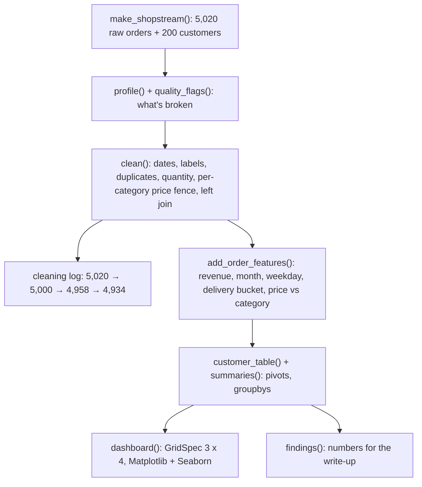
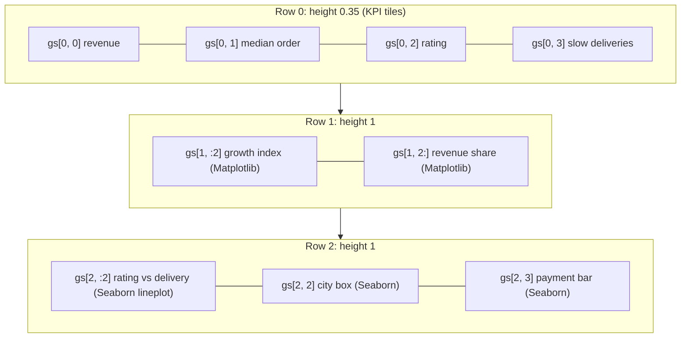

:::tip[TL;DR (30-Second Interview Pitch)]
A complete EDA runs in five stages: **load and profile** (shape, dtypes, missing shares, cardinality, red flags), **clean** (explicit date formats, normalized labels, duplicates, validity rules, outliers judged **within groups**, joins with `validate` and `indicator`), **derive features and aggregate** (revenue, time parts, buckets, `transform` ratios, a customer table), **visualize** on one `GridSpec` dashboard mixing Matplotlib and Seaborn, and **state findings** as numbers with their caveats. On ShopStream the headline is: Electronics is **71%** of revenue, and **every extra delivery day costs about a third of a star** (Spearman −0.65), which explains the low ratings in Delhi, Hyderabad and for COD orders.
:::

<PriorityKey lang="pandas" v="3.0" />

<FormulaKey />

## 🧭 Start Here: Putting the Whole Toolkit Together

Every previous page took one tool and one slice of the problem. Real EDA doesn't come in slices: a parsing bug in step 2 changes a chart in step 4, and an outlier rule decides whether a "trend" exists at all. This page runs the entire workflow in **one script** you can execute top to bottom, and shows how each stage feeds the next:

| Stage | Question it answers | Tools | Page |
|---|---|---|---|
| 1. Load and profile | What do I actually have? What's broken? | `read_csv`, `info`, `nunique`, `isna().mean()` | [Structures & Loading](./02-pandas/03-pandas-structures-loading-indexing.md) |
| 2. Clean | What's true? | `to_datetime`, `.str`, `category`, `drop_duplicates`, IQR fences, `merge(validate=...)` | [Cleaning](./02-pandas/04-pandas-cleaning-types-missing-data.md), [Reshape & Combine](./02-pandas/06-pandas-reshape-combine.md) |
| 3. Features and aggregation | What summarizes the business? | Vectorized columns, `pd.cut`, `groupby` / `agg` / `transform`, `pivot_table` | [GroupBy](./02-pandas/05-pandas-groupby-apply-transform.md) |
| 4. Visualize | Where are the patterns? | `GridSpec`, Matplotlib lines and bars, Seaborn lines, boxes, bars | [Matplotlib](./03-visualization/07-matplotlib-figures-axes.md), [Seaborn](./03-visualization/08-seaborn-statistical-plots.md) |
| 5. Conclude | What should someone do? | Numbers + effect sizes + caveats | This page |

| New concept | One-line meaning |
|---|---|
| **GridSpec** | A layout grid for a Figure; subplots can span several rows or columns (`gs[1, :2]`) |
| **Cleaning log** | A table of row counts after every cleaning step, so data loss is visible and reviewable |
| **Per-group outlier fence** | An IQR fence computed **inside** each category, because "normal" differs by group |
| **Confounder** | A third variable that drives both things you're comparing (delivery time behind "COD customers rate lower") |
| **Effect size** | How big a difference is (a third of a star per day), not just whether it exists |

:::analogy[EDA is a house inspection before you buy]
An inspector doesn't start by admiring the view. They check the paperwork matches the house (profile), find the damp patches and dodgy wiring (cleaning), measure every room (aggregation), photograph the problems side by side (dashboard) and then write a report that says what to fix first and how sure they are (findings). Skipping straight to the view is how people buy a house with a cracked foundation.
:::

## ⚡ Essential Interview Recall

- 🔴 **Profile before cleaning**: one table per column of dtype, missing %, unique count, example; plus explicit **red-flag counts** (duplicates, invalid values, label variants, orphans, skew).
- 🔴 **Log every cleaning step's row count**: ShopStream goes **5,020 → 5,000 → 4,958 → 4,934**. Anything that silently drops rows is a bug waiting to happen.
- 🔴 **Outlier rules must respect groups**: a global fence missed ×40 Books and Beauty prices (they're still cheap next to Electronics); a **per-category log-IQR fence** (k = 3) removed **24** of the 25 injected errors.
- 🔴 **Joins in a pipeline**: `how="left"`, `validate="m:1"`, `indicator=True`, keep an `is_orphan` flag instead of silently dropping 100 orders.
- 🔴 **Report effect sizes with uncertainty**: "−0.32 stars per delivery day, Spearman −0.65, 95% CIs about ±0.1" beats "delivery matters".
- 🔴 **Check confounders before naming causes**: COD orders rate 3.08 vs 3.62 for UPI, but COD orders also take 6.09 vs 4.45 days; within the same delivery bucket, cities rate the same.
- 🟠 **`GridSpec(3, 4, height_ratios=[...])`** + `fig.add_subplot(gs[r, c0:c1])` lays out a dashboard; pass each Axes to Matplotlib methods **or** Seaborn axes-level functions with `ax=`.
- 🟠 Use `layout="constrained"` for automatic spacing; `matplotlib.use("Agg")` in scripts; save, then `plt.close(fig)`.
- 🟠 **Cleaning changes conclusions**: Beauty's "+71% in May" on the Matplotlib page was largely two data-entry errors; after per-category cleaning it's +32%.
- 🟡 Wrap each stage in a **function** (`profile`, `clean`, `add_order_features`, `summaries`, `dashboard`, `findings`) so the same code runs in a notebook, a test and a scheduled job.

## 📐 Formula Sheet

| Concept | Formula | In plain words |
|---|---|---|
| Revenue per order | $\pred{r} = \data{p} \cdot \data{q} \cdot (1 - \data{d})$ | Price × quantity after discount |
| Per-group log-IQR fence | $\log \data{p} > \data{Q_3^{(g)}} + \hyper{k}\,\pred{\text{IQR}^{(g)}}$, $\hyper{k} = 3$ | Extreme for **its own** category |
| Revenue share | $\pred{s_c} = \dfrac{\sum_{i \in c} \data{r_i}}{\sum_i \data{r_i}}$ | `revenue / revenue.sum()` per category |
| Growth index | $\pred{I_t} = 100\,\data{x_t}/\data{x_{\text{Jan}}}$ | Compare growth across categories of different size |
| Rating slope | $\pred{\hat y} = \pred{m}\,\data{\text{days}} + \pred{c}$, $\pred{m} = -0.324$ | Stars gained or lost per delivery day |
| Recency | $\data{t_{\text{snapshot}}} - \max \data{t_{\text{order}}}$ | Days since a customer's last order |

:::speak[Walk me through how you'd run an EDA on a new dataset.]
"I work in five stages. First, **profile**: shape, dtypes, missing share and cardinality per column, and explicit red-flag counts like duplicates, impossible values, label variants and orphan keys. On our e-commerce data that found 20 spellings of five categories, dates in two formats, 40% missing ratings and quantities of minus one and 999. Second, **clean**, with each fix explicit and logged: parse each known date format, normalize labels into a categorical, drop duplicates and impossible rows, detect price errors with a log-scale IQR fence **per category**, and join customers with a left join, `validate='m:1'` and an indicator column. I keep a row-count log so every lost row is accounted for. Third, **features and aggregates**: revenue, month, delivery buckets, ratios to category medians, and a per-customer table. Fourth, a **dashboard** on one GridSpec: KPIs, growth, revenue mix and the key relationships with confidence intervals. Fifth, **findings with effect sizes and caveats**: delivery time drives rating at about a third of a star per day, and it explains the city and payment-method differences, which is a confounder story, not three separate problems."
:::

## The Mental Model

### 1. The pipeline



<Animation src="capstone/cleaning-funnel" caption="The raw order count shrinks step by step as duplicates, impossible quantities and extreme prices are removed, ending at 4,934 clean orders. Each bar shows how many rows a single rule removed, so every lost row has a reason." />

### 2. The dashboard layout



<Animation src="capstone/gridspec-assembly" caption="A blank figure is divided into a 3 by 4 grid. Cells are merged into panels by slicing the grid, gs 1 with columns 0 to 2 becomes one wide panel, and each panel is then filled by a Matplotlib or Seaborn call that receives that Axes." />

:::analogy[GridSpec is a newspaper page layout]
An editor starts with a page divided into columns and rows, then gives the headline story three columns, a photo two columns and a sidebar one. Each block is a slice of the same grid, so everything lines up. `gs[1, :2]` is "row 1, the first two columns": the lead story.
:::

## The Paradigm / Core Concepts

### 🔴 Cleaning decisions and their evidence

| Problem found in profiling | Count | Decision | Why |
|---|---|---|---|
| Exact duplicate rows | 20 | Drop | Double-counted revenue |
| 20 category spellings | 503 rows | `strip().title()` → ordered `Categorical` | Same category, different typing; assert no unknown labels remain |
| Day-first timestamps | 251 | Parse each format explicitly | `format="mixed"` swaps day/month silently |
| Quantity 0, -1, 999 | 42 | Drop | Impossible, can't be recovered |
| ×40 price errors | 25 injected | Drop where log price is beyond **Q3 + 3·IQR of its category** (24 removed) | A global fence misses them in cheap categories |
| Missing `discount_pct` | 401 | Fill 0 | Missing = no discount (confirmed with the business) |
| Missing `payment_method` | 150 | `"Unknown"` category | Keep the rows, keep the fact it was unknown |
| Missing `delivery_days` | 296 after cleaning | City median, then global median, plus `delivery_missing` flag | MAR on city |
| Missing `rating` | 40% | **Leave missing**, `rated` flag | MNAR; averaging rated orders only |
| Customer `C9999` | 100 | Keep with `is_orphan=True`, exclude from customer tables | The orders are real; the link is not |

<RuleCard name="Every dropped row needs a reason and a count" tag="Data cleaning" why="Silent row loss is how pipelines quietly drift away from reality, and nobody notices until a total doesn't reconcile." remember="Log the count after every step.">

Apply cleaning as a sequence of named steps, append `(step, len(df))` after each, and review the log. Prefer **flags** (`is_orphan`, `delivery_missing`, `rated`) over dropping whenever the row is real but incomplete.

</RuleCard>

<Formula name="Per-group log-IQR fence" tag="Outlier detection" words="Take logs so multiplicative errors become additive and skewed prices become symmetric, then compute the quartiles separately inside each category and flag anything far beyond its own box." remember="Log first, then fence each group.">

$$
\text{extreme}_i \iff \log \data{p_i} > \data{Q_3^{(g_i)}} + \hyper{k}\,\big(\data{Q_3^{(g_i)}} - \data{Q_1^{(g_i)}}\big) \;\text{ or }\; \log \data{p_i} < \data{Q_1^{(g_i)}} - \hyper{k}\,\big(\data{Q_3^{(g_i)}} - \data{Q_1^{(g_i)}}\big)
$$

- $\data{p_i}$: unit price of order $i$; $g_i$: its category
- $\data{Q_1^{(g)}}$, $\data{Q_3^{(g)}}$: quartiles of log price within category $g$ (`groupby().transform(lambda x: x.quantile(0.25))`)
- $\hyper{k}$: 1.5 flags "unusual", 3 flags "extreme"; for **deleting** data use the stricter 3

**Example:** a ₹20,549 Books order is 64 times the Books median (₹321); its log is far beyond the Books fence, while the same price is perfectly normal for Electronics. With k = 3, 24 orders are removed, against 25 injected ×40 errors.

</Formula>

## ⚙️ Under the Hood (Pipeline Mechanics)

- **Functions, not cells**: each stage takes DataFrames and returns DataFrames, with no global state. The same `clean()` can be unit-tested on a 10-row fixture, imported by a training pipeline and run by a scheduler.
- **Copy-on-Write keeps stages independent**: `o.assign(...)`, filtering and `drop_duplicates()` return new objects that share memory until modified, so stages don't need defensive `.copy()` calls and can't corrupt their inputs.
- **`groupby().transform(lambda ...)` for quartiles** runs a Python function per category (5 calls here, cheap). With thousands of groups, compute `groupby().quantile([0.25, 0.75]).unstack()` once and `map` it back instead.
- **`pd.Categorical(..., categories=CAT_ORDER)`** both fixes the plotting order and validates labels: any spelling not in the list becomes NaN, which the `assert` catches.
- **GridSpec** divides the figure into a grid; `fig.add_subplot(gs[r, a:b])` creates an Axes spanning those cells. `layout="constrained"` runs a solver at draw time that sizes margins so titles, tick labels and legends don't collide.
- **Mixing libraries is safe** because Seaborn axes-level functions draw onto the `ax` you pass and return it; the KPI tiles are plain Axes with `ax.axis("off")` and `ax.text(...)` in axes coordinates.
- **Determinism**: the generator is seeded (`seed=42`), the bootstrap CIs use Seaborn's own RNG (pass `seed=` for exact reproducibility), and every number on this page comes from one run of the script.

:::danger[Interview Trap]
**Cleaning can create or destroy a trend.** On the [Matplotlib page](./03-visualization/07-matplotlib-figures-axes.md), before per-category outlier removal, Beauty revenue looked up **71%** in May and **40%** by June. Two ×40 Beauty price errors were inflating it; after cleaning, May is +32% and June +24%. Always re-run the charts after changing a cleaning rule, and be suspicious of any spectacular trend driven by a handful of rows (check with `nlargest`).
:::

:::danger[Interview Trap]
**"COD customers are unhappy" is a confounded conclusion.** COD orders average 3.08 stars vs 3.62 for UPI, but they also take 6.09 days vs 4.45. Within the same delivery bucket, ratings barely differ across cities (the 8+ day bucket is 1.91 to 2.08 everywhere). The actionable finding is about **delivery speed**, not payment method or city. Compare within strata (`pivot_table(index="city", columns="delivery_bucket")`) before attributing cause.
:::

## 💻 The Complete Script

:::tip[Run it yourself]
Save as `capstone_eda.py` next to `shopstream.py` (from the [Overview](./00-overview.md)) and run `python capstone_eda.py`. Verified with **Python 3.14, NumPy 2.5.4, pandas 3.0.6, Matplotlib 3.11.2, Seaborn 0.13.2**. It prints the profile, flags, cleaning log, summaries and findings, and writes the dashboard PNG.
:::

```python title="capstone_eda.py" showLineNumbers
"""ShopStream end-to-end EDA: generate -> profile -> clean -> features -> dashboard -> findings.

Run from this folder:  python capstone_eda.py
Needs: numpy, pandas, matplotlib, seaborn (and shopstream.py next to it).
"""
import os

import numpy as np
import pandas as pd
import matplotlib
matplotlib.use("Agg")                                   # render to files, no window
import matplotlib.pyplot as plt
from matplotlib.gridspec import GridSpec
from matplotlib.ticker import FuncFormatter, PercentFormatter
import seaborn as sns

from shopstream import make_shopstream

OUT_DIR = os.path.join(os.path.dirname(__file__), "..", "..", "static", "img", "data-exploration")
PALETTE = ["#2a78d6", "#eb6834", "#1baf7a", "#eda100", "#e87ba4", "#008300", "#6250d6", "#e34948"]
INK, INK_2, SURFACE = "#0b0b0b", "#52514e", "#fcfcfb"
CAT_ORDER = ["Books", "Beauty", "Fashion", "Home", "Electronics"]
CITY_ORDER = ["Pune", "Mumbai", "Bengaluru", "Delhi", "Hyderabad"]
SNAPSHOT = pd.Timestamp("2026-07-01")


# ---------------------------------------------------------------- 1. load + profile
def profile(df):
    """One row per column: dtype, missing share, distinct values, an example."""
    return pd.DataFrame({
        "dtype": df.dtypes.astype(str),
        "missing_pct": (df.isna().mean() * 100).round(1),
        "n_unique": df.nunique(),
        "example": df.iloc[0],
    })


def quality_flags(raw):
    """The red flags worth fixing, as numbers."""
    return {
        "rows": len(raw),
        "exact_duplicates": int(raw.duplicated().sum()),
        "category_labels": raw["category"].nunique(),
        "day_first_dates": int(raw["order_ts"].str.contains("/").sum()),
        "bad_quantity": int((~raw["quantity"].between(1, 50)).sum()),
        "orphan_customer_rows": int((raw["customer_id"] == "C9999").sum()),
        "price_skew": round(float(raw["unit_price"].skew()), 2),
        "price_mean_vs_median": (round(float(raw["unit_price"].mean()), 2), round(float(raw["unit_price"].median()), 2)),
    }


# ---------------------------------------------------------------- 2. clean
def parse_timestamps(s):
    ts = pd.to_datetime(s, format="%Y-%m-%d %H:%M:%S", errors="coerce")
    ts = ts.fillna(pd.to_datetime(s, format="%d/%m/%Y %H:%M", errors="coerce"))
    assert ts.notna().all(), "unparsed timestamps"
    return ts


def group_log_iqr_outlier(price, group, k=1.5):
    """True where log(price) is beyond the IQR fence of its own group."""
    lp = np.log(price)
    g = lp.groupby(group, observed=True)
    q1, q3 = g.transform(lambda x: x.quantile(0.25)), g.transform(lambda x: x.quantile(0.75))
    iqr = q3 - q1
    return (lp > q3 + k * iqr) | (lp < q1 - k * iqr)


def clean(raw, customers):
    log = [("raw rows", len(raw))]
    o = raw.drop_duplicates()
    log.append(("drop exact duplicates", len(o)))

    o = o.assign(
        order_ts=parse_timestamps(o["order_ts"]),
        category=pd.Categorical(o["category"].str.strip().str.title(), categories=CAT_ORDER),
        payment_method=o["payment_method"].fillna("Unknown").astype("category"),
        device=o["device"].astype("category"),
        discount_pct=o["discount_pct"].fillna(0.0),
    )
    assert o["category"].notna().all(), "unknown category label"

    o = o[o["quantity"].between(1, 50)]
    log.append(("drop impossible quantity", len(o)))

    extreme = group_log_iqr_outlier(o["unit_price"], o["category"], k=3.0)   # k=3: 'extreme' fence, per category
    o = o[~extreme]
    log.append(("drop extreme prices (per category)", len(o)))

    o = o.merge(customers, on="customer_id", how="left", validate="m:1", indicator=True)
    city_median = o.groupby("city")["delivery_days"].transform("median")
    o = o.assign(
        is_orphan=o["_merge"].eq("left_only"),
        delivery_missing=o["delivery_days"].isna(),
        delivery_days=o["delivery_days"].fillna(city_median).fillna(o["delivery_days"].median()),
        rated=o["rating"].notna(),
    ).drop(columns="_merge")
    return o.reset_index(drop=True), pd.DataFrame(log, columns=["step", "rows"])


# ---------------------------------------------------------------- 3. features + aggregation
def add_order_features(o):
    return o.assign(
        revenue=(o["unit_price"] * o["quantity"] * (1 - o["discount_pct"])).round(2),
        order_month=o["order_ts"].dt.to_period("M").dt.to_timestamp(),
        weekday=o["order_ts"].dt.day_name(),
        delivery_bucket=pd.cut(o["delivery_days"], bins=[0, 3, 5, 7, np.inf], labels=["1-3", "4-5", "6-7", "8+"]),
        price_vs_category=o["unit_price"] / o.groupby("category", observed=True)["unit_price"].transform("median"),
    )


def customer_table(o):
    real = o[~o["is_orphan"]]
    return (real.groupby(["customer_id", "tier", "city"], observed=True)
            .agg(n_orders=("order_id", "count"), total_spend=("revenue", "sum"),
                 avg_order=("revenue", "mean"), avg_delivery=("delivery_days", "mean"),
                 avg_rating=("rating", "mean"), last_order=("order_ts", "max"))
            .assign(recency_days=lambda d: (SNAPSHOT - d["last_order"]).dt.days)
            .reset_index())


def summaries(o):
    monthly = o.pivot_table(index="order_month", columns="category", values="revenue",
                            aggfunc="sum", observed=True)
    by_category = (o.groupby("category", observed=True)
                   .agg(orders=("order_id", "count"), revenue=("revenue", "sum"),
                        median_price=("unit_price", "median"), avg_rating=("rating", "mean"))
                   .assign(revenue_share=lambda d: d["revenue"] / d["revenue"].sum()))
    rating_by_delivery = (o[o["rated"]].assign(days=o["delivery_days"].clip(upper=10))
                          .groupby("days")["rating"].agg(["mean", "count"]))
    city_bucket = o.pivot_table(index="city", columns="delivery_bucket", values="rating",
                                aggfunc="mean", observed=True)
    return monthly, by_category, rating_by_delivery, city_bucket


# ---------------------------------------------------------------- 4. dashboard
def kpi(ax, value, label, color=INK):
    ax.axis("off")
    ax.text(0.0, 0.62, value, fontsize=24, fontweight="bold", color=color, transform=ax.transAxes)
    ax.text(0.0, 0.22, label, fontsize=10, color=INK_2, transform=ax.transAxes)


def dashboard(o, cust, monthly, by_category, path):
    sns.set_theme(style="whitegrid", palette=PALETTE,
                  rc={"figure.facecolor": SURFACE, "axes.facecolor": SURFACE, "axes.spines.top": False,
                      "axes.spines.right": False, "axes.titleweight": "bold", "axes.titlesize": 11,
                      "axes.titlelocation": "left", "legend.frameon": False})
    fig = plt.figure(figsize=(16, 11), layout="constrained")
    gs = GridSpec(3, 4, figure=fig, height_ratios=[0.35, 1, 1])

    # row 0: KPI tiles
    rated = o[o["rated"]]
    kpi(fig.add_subplot(gs[0, 0]), f"₹{o['revenue'].sum() / 1e6:.1f}M", f"revenue, {len(o):,} orders (Jan to Jun 2026)")
    kpi(fig.add_subplot(gs[0, 1]), f"₹{o['revenue'].median():,.0f}", "median order value (mean is higher: skew)")
    kpi(fig.add_subplot(gs[0, 2]), f"{rated['rating'].mean():.2f} / 5", f"average rating ({o['rated'].mean():.0%} of orders rated)")
    slow = (o["delivery_days"] >= 8).mean()
    kpi(fig.add_subplot(gs[0, 3]), f"{slow:.0%}", "orders delivered in 8+ days", color=PALETTE[7])

    # row 1 left: indexed monthly revenue (Matplotlib)
    ax = fig.add_subplot(gs[1, :2])
    indexed = monthly / monthly.iloc[0] * 100
    for i, cat in enumerate(CAT_ORDER):
        ax.plot(indexed.index, indexed[cat], marker="o", color=PALETTE[i], label=cat)
    ax.axhline(100, color=INK_2, linewidth=1, linestyle=":")
    ax.set_xticks(indexed.index)
    ax.xaxis.set_major_formatter(matplotlib.dates.DateFormatter("%b"))
    ax.set_title("Revenue growth by category (January = 100)")
    ax.set_ylabel("Index")
    ax.legend(ncols=5, loc="upper left", fontsize=8)

    # row 1 right: revenue share by category (Matplotlib barh + labels)
    ax = fig.add_subplot(gs[1, 2:])
    share = by_category["revenue_share"].reindex(CAT_ORDER)
    bars = ax.barh(share.index.astype(str), share.to_numpy(), color=PALETTE[0], height=0.6)
    ax.bar_label(bars, labels=[f"{v:.0%}  (₹{r / 1e6:.1f}M)" for v, r in zip(share, by_category["revenue"].reindex(CAT_ORDER))],
                 padding=4, fontsize=9)
    ax.xaxis.set_major_formatter(PercentFormatter(1.0))
    ax.set_xlim(0, share.max() * 1.3)
    ax.grid(axis="y", visible=False)
    ax.set_title("Share of revenue: Electronics dominates")

    # row 2 left: rating vs delivery days (Seaborn lineplot with CI)
    ax = fig.add_subplot(gs[2, :2])
    r = o[o["rated"]].assign(days=o["delivery_days"].clip(upper=10))
    sns.lineplot(data=r, x="days", y="rating", errorbar=("ci", 95), marker="o", color=PALETTE[0], ax=ax)
    ax.set_title("Every extra delivery day costs about a third of a star")
    ax.set_xlabel("Delivery days (10 = 10 or more)")
    ax.set_ylabel("Mean rating (95% CI)")
    ax.set_ylim(1, 5)

    # row 2 middle: delivery days by city (Seaborn boxplot)
    ax = fig.add_subplot(gs[2, 2])
    sns.boxplot(data=o.dropna(subset=["city"]), x="city", y="delivery_days", order=CITY_ORDER,
                fill=False, width=0.5, color=PALETTE[0], fliersize=2, ax=ax)
    ax.set_title("Delhi and Hyderabad deliver slower")
    ax.set_xlabel("")
    ax.set_ylabel("Delivery days")
    ax.tick_params(axis="x", rotation=30)

    # row 2 right: payment method vs delivery (Seaborn barplot)
    ax = fig.add_subplot(gs[2, 3])
    sns.barplot(data=o, x="payment_method", y="delivery_days", order=["UPI", "Card", "Wallet", "COD", "Unknown"],
                errorbar=("ci", 95), color=PALETTE[0], width=0.6, ax=ax)
    ax.set_title("COD orders arrive later")
    ax.set_xlabel("")
    ax.set_ylabel("Mean delivery days (95% CI)")

    fig.suptitle("ShopStream EDA dashboard, H1 2026", fontsize=16, fontweight="bold", x=0.01, ha="left")
    fig.savefig(path, dpi=130)
    plt.close(fig)


# ---------------------------------------------------------------- 5. findings
def findings(o, cust, by_category, rating_by_delivery):
    rated = o[o["rated"]]
    slope = np.polyfit(rated["delivery_days"], rated["rating"], 1)[0]
    city_days = o.groupby("city")["delivery_days"].mean()
    pay = o.groupby("payment_method", observed=True)[["delivery_days", "rating"]].mean()
    return {
        "revenue_total_m": round(float(o["revenue"].sum()) / 1e6, 2),
        "electronics_share": round(float(by_category.loc["Electronics", "revenue_share"]), 3),
        "rating_per_extra_day": round(float(slope), 3),
        "spearman_delivery_rating": round(float(rated[["delivery_days", "rating"]].corr(method="spearman").iloc[0, 1]), 3),
        "rating_1_day_vs_10_plus": (round(float(rating_by_delivery.loc[1.0, "mean"]), 2), round(float(rating_by_delivery.loc[10.0, "mean"]), 2)),
        "slow_cities_days": city_days[["Delhi", "Hyderabad"]].round(2).to_dict(),
        "fast_cities_days": city_days[["Pune", "Mumbai", "Bengaluru"]].round(2).to_dict(),
        "cod_vs_upi_days": (round(float(pay.loc["COD", "delivery_days"]), 2), round(float(pay.loc["UPI", "delivery_days"]), 2)),
        "cod_vs_upi_rating": (round(float(pay.loc["COD", "rating"]), 2), round(float(pay.loc["UPI", "rating"]), 2)),
        "rated_share": round(float(o["rated"].mean()), 3),
        "orphan_orders": int(o["is_orphan"].sum()),
        "tier_avg_order": cust.groupby("tier", observed=True)["avg_order"].mean().round(0).to_dict(),
        "corr_orders_spend": round(float(cust[["n_orders", "total_spend"]].corr().iloc[0, 1]), 3),
    }


def main():
    raw, customers = make_shopstream()

    print(profile(raw).to_string(), "\n")
    print(quality_flags(raw), "\n")

    orders, cleaning_log = clean(raw, customers)
    print(cleaning_log.to_string(index=False), "\n")

    orders = add_order_features(orders)
    cust = customer_table(orders)
    monthly, by_category, rating_by_delivery, city_bucket = summaries(orders)
    print(by_category.round(3).to_string(), "\n")
    print(city_bucket.round(2).to_string(), "\n")

    dashboard(orders, cust, monthly, by_category, os.path.join(OUT_DIR, "capstone-dashboard.png"))
    for key, value in findings(orders, cust, by_category, rating_by_delivery).items():
        print(f"{key:28s} {value}")


if __name__ == "__main__":
    main()
```

### Stage 1 output: profile and red flags

```text
                  dtype  missing_pct  n_unique              example
order_id            str          0.0      5000               O00001
customer_id         str          0.0       201                C9999
order_ts            str          0.0      5000  2026-06-10 09:09:11
category            str          0.0        20              Fashion
unit_price      float64          0.0      4967              1613.05
quantity          int64          0.0        10                    3
discount_pct    float64          8.0         5                  0.0
payment_method      str          3.0         4               Wallet
device              str          0.0         3               mobile
delivery_days   float64          6.0        17                  NaN
rating          float64         40.0         5                  5.0

{'rows': 5020, 'exact_duplicates': 20, 'category_labels': 20, 'day_first_dates': 251, 'bad_quantity': 42,
 'orphan_customer_rows': 100, 'price_skew': 29.72, 'price_mean_vs_median': (4233.98, 1519.59)}
```

| Clue in the profile | What it means |
|---|---|
| `order_id` has 5,000 unique values in 5,020 rows | 20 duplicates |
| `customer_id` has 201 unique values, 200 customers exist | One placeholder (`C9999`) |
| `order_ts` is `str` | Dates not parsed (two formats) |
| `category` has 20 unique values | Case and whitespace variants |
| `quantity` has 10 unique values | Includes -1, 0 and 999 |
| `rating` 40% missing | Most customers don't rate (MNAR) |
| Skew 29.7, mean 2.8× median | Heavy right tail + data-entry errors |

### Stage 2 output: the cleaning log

```text
                              step  rows
                          raw rows  5020
             drop exact duplicates  5000
          drop impossible quantity  4958
drop extreme prices (per category)  4934
```

### Stage 3 output: category summary and the confounder check

```text
             orders      revenue  median_price  avg_rating  revenue_share
category
Books           700    448623.73       320.540       3.530          0.015
Beauty          739    952761.95       635.230       3.527          0.032
Fashion        1256   3304501.15      1318.540       3.514          0.112
Home            964   3762799.36      2000.775       3.549          0.128
Electronics    1275  20975327.06      8133.060       3.480          0.712

delivery_bucket   1-3   4-5   6-7    8+
city
Bengaluru        4.19  3.66  2.86  1.91
Delhi            4.00  3.60  2.84  2.08
Hyderabad        4.21  3.60  3.06  1.93
Mumbai           4.27  3.62  3.09  1.96
Pune             4.35  3.69  2.92  2.01
```

Read the second table **across** (rating falls by about 2 stars from fast to slow delivery in every city) and **down** (within a bucket, cities differ by at most 0.35). City has little effect once delivery time is held fixed.

### Stage 4 output: the dashboard


| Panel | Built with | Grid slot |
|---|---|---|
| 4 KPI tiles | `ax.axis("off")` + `ax.text` | `gs[0, 0]` … `gs[0, 3]` |
| Growth index | Matplotlib `ax.plot`, `DateFormatter` | `gs[1, :2]` |
| Revenue share | Matplotlib `ax.barh`, `bar_label`, `PercentFormatter` | `gs[1, 2:]` |
| Rating vs delivery | Seaborn `lineplot(errorbar=("ci", 95))` | `gs[2, :2]` |
| Delivery by city | Seaborn `boxplot(fill=False)` | `gs[2, 2]` |
| Delivery by payment | Seaborn `barplot(errorbar=("ci", 95))` | `gs[2, 3]` |

The panel titles state the **finding**, not just the metric ("COD orders arrive later", not "Delivery days by payment method"): a reader who only skims the titles still gets the story.

### Stage 5 output: findings

```text
revenue_total_m              29.44
electronics_share            0.712
rating_per_extra_day         -0.324
spearman_delivery_rating     -0.652
rating_1_day_vs_10_plus      (4.6, 1.49)
slow_cities_days             {'Delhi': 6.18, 'Hyderabad': 6.23}
fast_cities_days             {'Pune': 4.25, 'Mumbai': 4.2, 'Bengaluru': 4.23}
cod_vs_upi_days              (6.09, 4.45)
cod_vs_upi_rating            (3.08, 3.62)
rated_share                  0.599
orphan_orders                100
tier_avg_order               {'Bronze': 5852.0, 'Gold': 6309.0, 'Silver': 6093.0}
corr_orders_spend            0.513
```

## 📝 Summary of Findings

| # | Finding | Evidence | Caveat | Suggested action |
|---|---|---|---|---|
| 1 | **Delivery time drives satisfaction.** Each extra day costs about **0.32 stars**; 1-day deliveries average 4.60, 10+ days 1.49 | Slope −0.324, Spearman −0.65, narrow 95% CIs, same pattern in every city | Ratings exist for 60% of orders; non-raters may differ | Track delivery days as a KPI; target the 12% of orders taking 8+ days |
| 2 | **Delhi and Hyderabad are slow, not unhappy.** About 6.2 vs 4.2 days elsewhere | City × delivery-bucket table: ratings match within buckets | Two cities, one half-year | Investigate logistics partners or warehouses for those cities |
| 3 | **COD orders take 1.6 days longer** (6.09 vs 4.45) and rate lower (3.08 vs 3.62) | Bar plot with CIs; rating gap explained by delivery | Observational, not an experiment | Look at the COD fulfilment process before blaming the payment method |
| 4 | **Electronics is 71% of revenue** from 26% of orders | Revenue share by category | Margins unknown: revenue isn't profit | Protect Electronics availability; analyse margin before shifting focus |
| 5 | **Tiers barely differ** (Gold average order ₹6,309 vs Bronze ₹5,852) | Customer table; pair plot shows overlapping tiers | Tier rules unknown | Revisit what the loyalty tiers reward |
| 6 | **Data quality issues need fixing at source**: two date formats, 20 category spellings, 2% orphan orders, ×40 prices | Profile + cleaning log | — | Schema validation at ingestion; fix the checkout customer lookup |

:::info[AI Engineering: from EDA to a model]
This EDA already decides most of a rating-prediction model: the target is `rating` (only for `rated` rows, or model "will rate" separately); `delivery_days` is the dominant feature but is only known **after** delivery, so a model used at checkout must use a **predicted** delivery time instead (otherwise it's leakage); city and payment method add little once delivery is known; `unit_price` needs a log transform; the cleaning function must be shared between training and serving. Writing these down is the bridge from analysis to ML engineering.
:::

## 🧪 Predict the Output

<Predict n="1" title="Cleaning log" output="5020 → 5000 → 4958 → 4934">

```python
orders, log = clean(raw, customers)
print(" → ".join(log["rows"].astype(str)))
```

20 exact duplicates, then 42 impossible quantities (20 zeros, 20 negatives, 2 × 999), then 24 extreme prices by the per-category k = 3 log fence.

</Predict>

<Predict n="2" title="GridSpec slicing" output="One Axes spanning two columns">

```python
gs = GridSpec(3, 4, figure=fig)
ax = fig.add_subplot(gs[1, :2])
```

GridSpec indexing works like NumPy slicing: row 1, columns 0 and 1. The result is **one** Axes covering both cells, which is how the growth chart gets twice the width of the box plot.

</Predict>

<Predict n="3" title="Unknown category label" output="AssertionError: unknown category label">

```python
raw.loc[0, "category"] = "Toys"
clean(raw, customers)
```

`pd.Categorical(values, categories=CAT_ORDER)` turns any label outside the declared list into NaN, and `assert o["category"].notna().all()` stops the pipeline instead of silently producing a sixth, unplotted category.

</Predict>

<Predict n="4" title="Where did Beauty's boom go?" output="171 before, 132 after (May index)">

```python
# Beauty, May revenue indexed to January = 100
# global log fence (Matplotlib page) vs per-category fence (capstone)
```

Two ×40 Beauty prices (₹26,207 in May, ₹21,958 in June) sat below the **global** fence, so they survived and inflated Beauty's revenue; the **per-category** fence removed them, and the May index fell from 171 to 132. Cleaning rules change conclusions.

</Predict>

<Predict n="5" title="Rated share" output="0.599">

```python
print(round(orders["rated"].mean(), 3))
```

The mean of a boolean column is the share of `True`: about 60% of cleaned orders have a rating. Every rating statistic on the dashboard describes that 60%, which is why the KPI tile states it.

</Predict>

## 🪜 Follow-up Ladder

<Ladder title="From a notebook EDA to a production analytics pipeline">
<Rung q="What are the main steps of EDA?">

Profile → clean → derive and aggregate → visualize → conclude, with each step's decisions written down.

</Rung>
<Rung q="How do you make sure the cleaning didn't throw away too much?">

A row-count log after every step, flags instead of drops where rows are real but incomplete, and reconciliation of key totals against a trusted source (finance revenue).

</Rung>
<Rung q="How would you turn this notebook into something that runs every night?">

Functions per stage (as in the script), tests on small fixtures, schema validation on input (pandera / Great Expectations), parameters for dates and paths, a scheduler (Airflow, Dagster, cron), outputs written to a warehouse and the dashboard rendered from those tables, plus alerts on data-quality checks.

</Rung>
<Rung q="The business wants to know whether faster delivery would actually raise ratings. Is your EDA enough?">

No: it shows a strong, consistent association with plausible confounders removed by stratification, but it's observational. To estimate a causal effect, run an experiment (expedite a random subset of orders) or use causal methods (matching on city, category, payment; difference-in-differences when a warehouse opens).

</Rung>
</Ladder>

## 🚑 Production Scenarios

:::incident[The dashboard that disagreed with finance]
A weekly EDA dashboard reported ₹31M revenue for the half-year; finance reported ₹29.4M.

- **Why:** the dashboard used the global outlier rule, so ×40 data-entry errors in cheap categories stayed in; it also counted 20 duplicated orders. Neither step logged row counts, so nobody noticed.
- **Fix:** per-category extreme fence, `drop_duplicates`, a cleaning log published with the dashboard, and an automated reconciliation check against finance's number (alert when they differ by more than 0.5%).
:::

:::incident[A model trained on a feature it would never have]
A "predict the customer's rating" model reached 0.85 accuracy offline and was useless at checkout.

- **Why:** the EDA (correctly) showed `delivery_days` as the strongest driver, and it went into the model. At checkout, delivery hasn't happened yet: the feature leaks the future.
- **Fix:** replace it with the **promised** delivery time available at checkout, and train with a time-based split. **Prevention:** for every feature, write down **when** it becomes known.
:::

## 🚨 Interview Gotchas & Edge Cases

:::warning[The Most Common Question]
**"Here's a dataset. Walk me through your EDA and tell me what you found."** Structure the answer by stage (profile, clean, features, visuals, findings), quote numbers, give one effect size with its uncertainty, name one confounder you checked, and say what you'd do next. Interviewers listen for whether you **question the data** before trusting it.
:::

- **Don't impute before profiling missingness patterns**: you lose the information that the value was missing.
- **Aggregate means on skewed data need medians alongside**: the median order value (₹2,376) is 40% of the mean (₹5,968).
- **Small groups produce extreme rates**: check `count` next to every `mean` (the 10+ day bucket has 114 ratings, enough; a 9-order group wouldn't be).
- **Time windows matter**: partial first and last weeks look like drops in weekly charts; trim them or label them.
- **A dashboard is not a finding**: write the conclusion as a sentence with a number and a caveat.
- **Keep the raw data**: never overwrite the source file with cleaned data; cleaning rules change.
