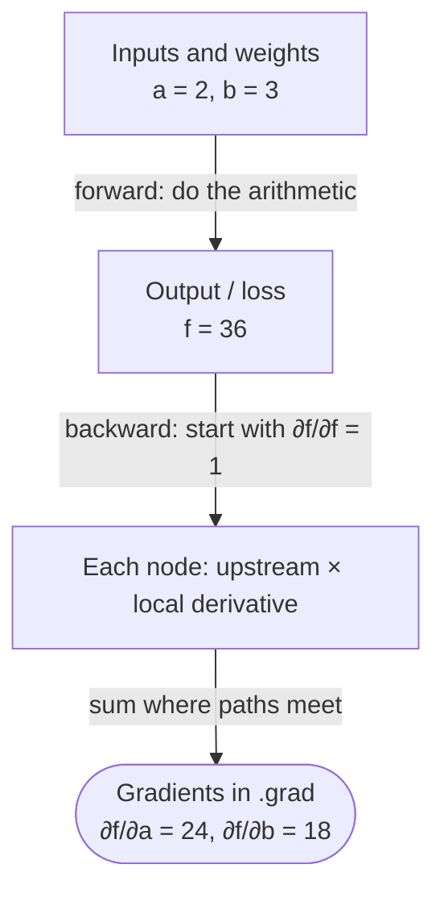
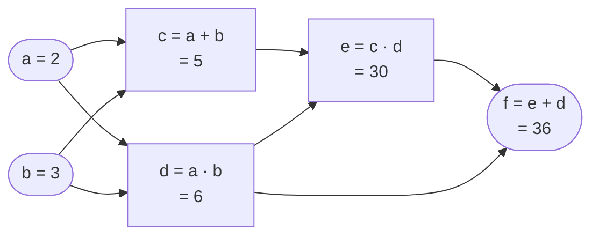
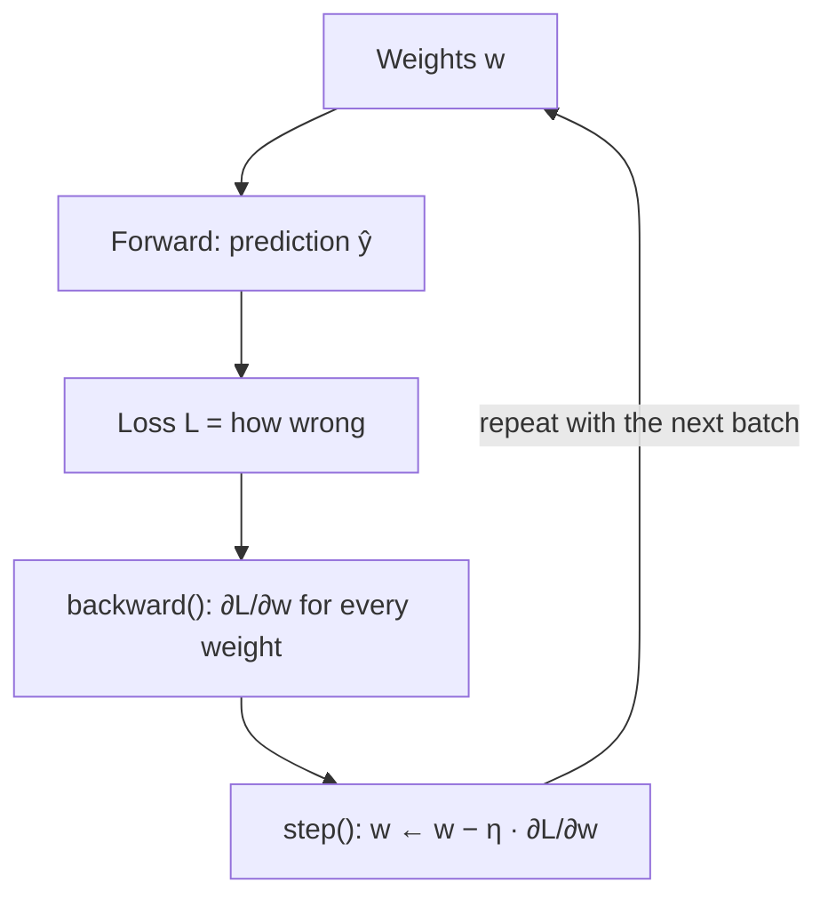

:::tip[TL;DR (30-Second Interview Pitch)]
Everything PyTorch does in training is **high-school calculus applied mechanically**. The forward pass computes numbers; `loss.backward()` computes **derivatives**: how much the loss would change if each input or weight were nudged. It breaks the big function into tiny steps (add, multiply, square…), knows the **local derivative** of each step, and multiplies them backwards with the **chain rule**. When a value feeds into two places, the gradients from both paths are **added**. The optimizer then moves every weight a small step **against** its gradient: $\param{w} \leftarrow \param{w} - \hyper{\eta}\,\loss{\partial L/\partial w}$. If you can differentiate $f = (a+b)\,ab + ab$ by hand, you understand autograd.
:::

<FormulaKey />

:::info[Where this page sits]
**Before:** [PyTorch Fundamentals](./01-pytorch-fundamentals.md) shows *how to use* tensors, autograd and the training loop.
**This page** shows *the mathematics underneath*: a calculus refresher, worked by hand, with every number checked against PyTorch.
**Next:** [Artificial Neural Networks](./02-artificial-neural-networks.md) stacks these ideas into full networks and backpropagation.
:::

## 🧭 Start Here

When you write `loss.backward()`, PyTorch fills every weight's `.grad` with a number. This page is about **what that number is and how it is calculated**, using nothing harder than school calculus.

The story has five steps, and each builds on the one before:

1. **A derivative is a slope.** It tells you how much the output changes when you nudge the input a little. For $f(x) = x^2$ at $x = 3$ the slope is 6: nudge $x$ up by 0.001 and $f$ goes up by about 0.006.
2. **A handful of rules** (power, sum, product, exp, log) let you write down derivatives without computing slopes by trial and error.
3. **Partial derivatives** handle functions of several inputs: change one input, hold the others still, and measure the slope. The list of all of them is the **gradient**.
4. **The chain rule** handles functions built in steps: multiply the slopes of each step. When a value is used in two places, **add** the contributions from both paths. This is the entire trick behind backpropagation.
5. **Gradient descent** uses those slopes to improve the weights: step each weight slightly in the direction that makes the loss smaller.

We'll work through one small example completely by hand: inputs $a = 2, b = 3$ flow through $c, d, e$ to an output $f$. We compute $\partial f/\partial a$ and $\partial f/\partial b$ the way autograd does, then let PyTorch confirm the answers. After that, the same ideas carry us to a linear model, a neuron with an activation function, and a matrix layer.

| New concept | One-line meaning |
|---|---|
| **Derivative** $\frac{df}{dx}$ | Slope: change in output per tiny change in input |
| **Partial derivative** $\frac{\partial f}{\partial a}$ | Slope with respect to one input while all others are held still |
| **Gradient** $\nabla f$ | The list of all partial derivatives, one per input |
| **Chain rule** | For a function made of steps, multiply the slopes of the steps |
| **Computational graph** | The record of every operation, from inputs to output, that autograd builds |
| **Local derivative** | The slope of one single operation (e.g. for $d = ab$: $\partial d/\partial a = b$) |
| **Upstream gradient** | How much the final output cares about this node, passed back from later nodes |
| **Backpropagation** | Applying the chain rule from the output back to every input, node by node |
| **Gradient descent** | Update rule $w \leftarrow w - \eta \cdot$ gradient, a small step downhill |

:::analogy[A derivative is a speedometer]
Your car's position changes over time. The **speedometer** doesn't tell you where you are; it tells you **how fast your position is changing right now**. A derivative is the speedometer of a function: how fast the output changes as you push the input. A gradient is a dashboard with one speedometer per input.
:::

## ⚡ Essential Interview Recall

**Derivatives**
- $\frac{df}{dx}$ = **slope** = rise over run for a tiny run: $\frac{f(x+h) - f(x)}{h}$ as $h \to 0$. For $x^2$ at 3: $h = 1 \to 7$, $0.1 \to 6.1$, $0.001 \to 6.001$, limit **6**.
- Rules: constant → 0; $x^n \to n x^{n-1}$; sum → sum of derivatives; $c \cdot f \to c \cdot f'$; product $(uv)' = u'v + uv'$; $(e^x)' = e^x$; $(\ln x)' = 1/x$.
- **Partial derivative**: differentiate with respect to one variable and treat the others as constants. $f = ab + b^2$ → $\frac{\partial f}{\partial a} = b$, $\frac{\partial f}{\partial b} = a + 2b$.
- **Gradient** $\nabla f$ = vector of partials = direction of **steepest increase**. Gradient descent goes the opposite way.

**Chain rule and backprop**
- One path: $\frac{dz}{dx} = \frac{dz}{dy}\cdot\frac{dy}{dx}$ (**multiply** along the path).
- Several paths: **add** the products of all paths. A value used twice gets gradient contributions from both uses.
- Backward pass: start with $\frac{\partial f}{\partial f} = 1$; at each node, **upstream gradient × local derivative**; sum where branches meet.
- Local derivatives to know: **add** passes the gradient through unchanged (×1); **multiply** sends each input the **other** input; **square** $u^2$ gives $2u$.
- Worked example ($a = 2, b = 3$; $c = a + b$, $d = ab$, $e = cd$, $f = e + d$): $f = 36$, $\frac{\partial f}{\partial a} = 24$, $\frac{\partial f}{\partial b} = 18$.

**Autograd mechanics**
- PyTorch is **reverse-mode automatic differentiation**: one backward pass gives the derivative of **one scalar** with respect to **every** input. That's exactly the shape of training (one loss, millions of weights).
- Each result tensor stores a `grad_fn` (`AddBackward0`, `MulBackward0`…) that knows its local derivative. `backward()` walks this graph in reverse.
- `.grad` is filled only for **leaf** tensors with `requires_grad=True`; use `.retain_grad()` to keep an intermediate's gradient.
- `backward()` **adds** into `.grad` (running the example twice gives 48 and 36) → `zero_grad()` every step.
- The graph is **freed** after `backward()`; a second call raises "Trying to backward through the graph a second time". `backward()` on a non-scalar needs a `gradient=` argument.

**Gradient descent**
- $\param{w} \leftarrow \param{w} - \hyper{\eta}\,\frac{\partial \loss{L}}{\partial \param{w}}$. Negative gradient → $w$ increases; positive → $w$ decreases.
- $L = (w - 3)^2$, $w_0 = 0$: $\eta = 0.1$ gives 0.6, 1.08, 1.464… → 3; $\eta = 1.0$ bounces 0, 6, 0, 6; $\eta = 1.1$ diverges (6.6, −1.32, 8.18…).

**Neural-network derivatives**
- Linear model, one point: $\hat y = wx + b$, $L = (\hat y - y)^2$ → $\frac{\partial L}{\partial w} = 2(\hat y - y)\,x$, $\frac{\partial L}{\partial b} = 2(\hat y - y)$.
- **Sigmoid** $\sigma' = \sigma(1 - \sigma)$, at most **0.25** → stacking 5 sigmoids shrinks gradients to ≤ 0.001 (**vanishing gradient**). **ReLU**' = 1 if $z > 0$ else 0. **tanh**' $= 1 - \tanh^2$.
- Matrix layer $\mathbf{y} = W\mathbf{x}$: $\frac{\partial L}{\partial W_{ij}} = g_i\,x_j$ (upstream × the input it multiplied); $\frac{\partial L}{\partial \mathbf{x}} = W^\top \mathbf{g}$.
- Broadcast/reused values **sum** their gradients (a bias added to 3 outputs gets gradient 3 from `sum()`).
- Softmax + cross-entropy: $\frac{\partial L}{\partial z} = p - y$.

## 📐 Formula Sheet

Every equation on this page in one place. Each one is explained in a card further down.

| Concept | Formula | In plain words |
|---|---|---|
| Derivative | $\frac{df}{dx} = \lim_{h \to 0}\frac{f(x+h) - f(x)}{h}$ | Slope over a vanishingly small step |
| Power rule | $\frac{d}{dx}x^n = n\,x^{n-1}$ | Bring the power down, reduce it by one |
| Sum rule | $(u + v)' = u' + v'$ | Slopes add |
| Product rule | $(uv)' = u'v + uv'$ | Each factor takes a turn changing |
| Exp and log | $(e^x)' = e^x$, $\;(\ln x)' = \frac{1}{x}$ | |
| Partial derivative | $\frac{\partial f}{\partial a}$ with $b$ held fixed | Slope along one input |
| Gradient | $\nabla f = \left[\frac{\partial f}{\partial a},\ \frac{\partial f}{\partial b}\right]$ | All partial slopes together |
| Chain rule | $\frac{dz}{dx} = \frac{dz}{dy}\cdot\frac{dy}{dx}$ | Multiply slopes along the path |
| Multi-path chain rule | $\frac{\partial f}{\partial a} = \sum_{\text{paths}} \prod \text{local slopes}$ | Add up every route from $a$ to $f$ |
| Backprop step | node gradient = upstream gradient × local derivative | What every `grad_fn` does |
| Gradient descent | $\param{w} \leftarrow \param{w} - \hyper{\eta}\,\frac{\partial \loss{L}}{\partial \param{w}}$ | Step downhill |
| Linear model gradients | $\frac{\partial \loss{L}}{\partial \param{w}} = 2(\pred{\hat y} - \data{y})\,\data{x}$, $\;\frac{\partial \loss{L}}{\partial \param{b}} = 2(\pred{\hat y} - \data{y})$ | Error × input, and error |
| Mean over a batch | $\frac{\partial \loss{L}}{\partial \param{w}} = \frac{1}{N}\sum_i \frac{\partial \loss{\ell_i}}{\partial \param{w}}$ | Average the per-sample slopes |
| Sigmoid derivative | $\sigma'(z) = \sigma(z)\,(1 - \sigma(z))$ | Peaks at 0.25 |
| ReLU derivative | $1$ if $z > 0$, else $0$ | On/off switch |
| Matrix layer gradients | $\frac{\partial \loss{L}}{\partial \param{W_{ij}}} = g_i\,\data{x_j}$, $\;\frac{\partial \loss{L}}{\partial \data{\mathbf{x}}} = \param{W}^\top \mathbf{g}$ | Upstream × input; send back through the transpose |
| Softmax + CE | $\frac{\partial \loss{L}}{\partial \pred{z}} = \pred{p} - \data{y}$ | Predicted minus true |

## The Mental Model

### 1. Forward computes values, backward computes slopes



### 2. The worked example as a computational graph



### 3. How gradients turn into learning



## The Paradigm / Core Concepts

### Part A: What a derivative is

#### 📖 Understand it

Take $f(x) = x^2$. At $x = 3$, $f = 9$. Now ask: **if I move $x$ a little, how much does $f$ move?** Move from 3 to 4 and $f$ goes from 9 to 16: it rose by 7 for a run of 1, so the average slope over that stretch is 7. Move only to 3.5 and $f$ goes to 12.25: a rise of 3.25 over a run of 0.5, slope 6.5. Move to 3.1: rise 0.61 over 0.1, slope 6.1. Move to 3.001: slope 6.001.

As the step gets smaller, the slope settles on **6**. That limiting value is the **derivative** of $f$ at $x = 3$. Geometrically, each of those slopes belongs to a straight line through two points on the curve (a **secant**). As the second point slides towards the first, the secant turns into the **tangent**: the line that just touches the curve at $x = 3$. The derivative is the tangent's slope.

The derivative is a **local** fact. It says: near $x = 3$, the function behaves like a straight line with slope 6, so a small nudge $\Delta x$ changes $f$ by about $6\,\Delta x$. (Check: the tangent line $y = 6x - 9$ predicts $f(3.1) \approx 9.6$, and the true value is 9.61.) This "behaves like a straight line up close" idea is everything deep learning needs. A loss function may be complicated, but near the current weights it is almost linear, and the derivative tells us which way is downhill.

You rarely compute derivatives with tiny steps (except to double-check autograd: see `gradcheck` below). Instead you use **rules**, which give exact answers. For $x^2$ the rule says the derivative is $2x$, and at $x = 3$ that's exactly 6.

<Formula name="The derivative" tag="Slope at a point" words="Take a tiny step h, see how much the output changed, divide by the step. As the step shrinks to zero, that ratio settles on the slope of the tangent line." remember="Rise over a vanishing run.">

$$
\frac{df}{dx} \;=\; \lim_{h \to 0} \frac{f(x + h) - f(x)}{h}
$$

- $h$: the size of the nudge; the limit means "as small as you like"
- **Example:** $f(x) = x^2$ at $x = 3$: $h = 1 \to 7$; $h = 0.5 \to 6.5$; $h = 0.1 \to 6.1$; $h = 0.001 \to 6.001$; limit $= 2x = 6$

</Formula>

<Animation src="calculus/secant-to-tangent" caption="The secant through x = 3 and x = 3 + h on y = x squared. As h shrinks from 1 to 0.5 to 0.1, its slope goes 7, 6.5, 6.1 and the line turns into the tangent with slope exactly 6." />

| Step $h$ | $f(3 + h)$ | Rise $f(3+h) - 9$ | Slope = rise / $h$ |
|---|---|---|---|
| 1 | 16 | 7 | **7** |
| 0.5 | 12.25 | 3.25 | **6.5** |
| 0.1 | 9.61 | 0.61 | **6.1** |
| 0.001 | 9.006001 | 0.006001 | **6.001** |
| → 0 | | | **6** (the derivative) |

**Sign tells direction, size tells sensitivity.** A positive derivative means "increase $x$ and $f$ goes up"; negative means "increase $x$ and $f$ goes down"; zero means you're at a flat spot (often a minimum or maximum). A large magnitude means $f$ is very sensitive to $x$ there. Gradient descent uses both facts.

### Part B: The derivative rules you actually need

#### 📖 Understand it

A neural network is built from a small set of operations: adding, multiplying, powers, exponentials, logarithms and a few activation functions. So you only need a small set of rules, and every one has a simple reason.

- **Constant rule:** a constant doesn't change when $x$ changes, so its slope is 0.
- **Power rule:** $\frac{d}{dx}x^n = n\,x^{n-1}$. For $x^2$: think of a square with side $x$. Grow the side by a sliver $h$ and the area grows by two thin strips of area $x \cdot h$ each (plus a negligible corner $h^2$), so the change is about $2x\,h$ and the slope is $2x$. For $x^3$ at 2: $3 \cdot 2^2 = 12$.
- **Constant multiple:** $\frac{d}{dx}(5f) = 5f'$. Scaling the output scales its slope.
- **Sum rule:** $(u + v)' = u' + v'$. If two things change at once, the total change is the sum of the changes.
- **Product rule:** $(uv)' = u'v + uv'$. When two factors both change, the product changes because $u$ changed (times the current $v$) **plus** because $v$ changed (times the current $u$). This is the same "two strips" picture as the square.
- **Exponential:** $(e^x)' = e^x$. The exponential is the function whose rate of growth equals its current size (at $x = 2$, both are 7.389).
- **Logarithm:** $(\ln x)' = 1/x$. The log grows quickly for small $x$ and slowly for large $x$ (at $x = 2$, slope 0.5).

Notice that two of these rules are about *combining* functions (sum and product). The third combining rule, for functions *inside* other functions, is the **chain rule** in Part D. Together, these let you differentiate anything a neural network computes.

<Formula name="The core derivative rules" tag="Building blocks" words="A constant has slope zero. Powers drop by one and multiply by the old power. Slopes of a sum add up. In a product, each factor takes a turn changing while the other is held. Exp is its own slope, and ln x has slope one over x." remember="Power down, sums add, products take turns.">

$$
\begin{aligned}
\frac{d}{dx}\,c &= 0 & \frac{d}{dx}\,x^n &= n\,x^{n-1} & (u + v)' &= u' + v' \\[4pt]
(c \cdot u)' &= c \cdot u' & (u\,v)' &= u'\,v + u\,v' & (e^x)' &= e^x, \quad (\ln x)' = \frac{1}{x}
\end{aligned}
$$

**Examples at $x = 2$:** $(x^3)' = 3x^2 = 12$; $(e^x)' = e^2 = 7.389$; $(\ln x)' = 0.5$; product $x^2 \cdot 3x$: $u'v + uv' = (2x)(3x) + (x^2)(3) = 9x^2 = 36$.

</Formula>

| Rule | Function | Derivative | At $x = 2$ | PyTorch `grad_fn` |
|---|---|---|---|---|
| Power | $x^3$ | $3x^2$ | **12** | `PowBackward0` |
| Exponential | $e^x$ | $e^x$ | **7.389** | `ExpBackward0` |
| Logarithm | $\ln x$ | $1/x$ | **0.5** | `LogBackward0` |
| Sum | $x^3 + e^x$ | $3x^2 + e^x$ | 19.389 | `AddBackward0` |
| Product | $x^2 \cdot 3x$ | $9x^2$ | **36** | `MulBackward0` |

### Part C: Partial derivatives and the gradient

#### 📖 Understand it

A neural network's loss depends on many numbers at once (every weight). So we need slopes for functions of **several** inputs. The idea is simple: **change one input, freeze all the others, and measure the slope**. That slope is the **partial derivative** with respect to that input, written with a curly $\partial$ to remind you the others are being held still.

Take $f(a, b) = ab + b^2$ at $a = 2, b = 3$ (so $f = 6 + 9 = 15$).

- **Partial with respect to $a$:** freeze $b$ at 3. Then $f = 3a + 9$, a straight line in $a$ with slope **3**. In general $\frac{\partial f}{\partial a} = b$ (the $b^2$ term doesn't involve $a$, so it's a constant and vanishes).
- **Partial with respect to $b$:** freeze $a$ at 2. Then $f = 2b + b^2$, whose slope is $2 + 2b$ = **8** at $b = 3$. In general $\frac{\partial f}{\partial b} = a + 2b$.

Put the partials in a list and you have the **gradient**: $\nabla f = [3,\ 8]$. It has a beautiful geometric meaning. Picture $f$ as the height of a landscape over the $(a, b)$ plane. The gradient is an arrow pointing in the direction of **steepest uphill**, and its length is how steep that is. Here, increasing $b$ raises $f$ almost three times faster than increasing $a$. To go **downhill** as fast as possible, walk in the direction **opposite** to the gradient. That single sentence is gradient descent.

In PyTorch, every tensor you create with `requires_grad=True` is one of these inputs, and after `backward()` its `.grad` holds the partial derivative of the output with respect to it.

<Formula name="Partial derivatives and the gradient" tag="Many inputs" words="Differentiate with respect to one input while treating every other input as a fixed number. The vector of all those partial slopes is the gradient, which points uphill." remember="Freeze the rest, slope one at a time.">

$$
f(\data{a}, \data{b}) = \data{a}\,\data{b} + \data{b}^2
\qquad
\frac{\partial f}{\partial \data{a}} = \data{b},
\qquad
\frac{\partial f}{\partial \data{b}} = \data{a} + 2\data{b},
\qquad
\nabla f = \left[\frac{\partial f}{\partial \data{a}},\ \frac{\partial f}{\partial \data{b}}\right]
$$

**Example:** at $(\data{a}, \data{b}) = (2, 3)$: $\frac{\partial f}{\partial a} = 3$, $\frac{\partial f}{\partial b} = 2 + 6 = 8$, so $\nabla f = [3,\ 8]$. PyTorch gives `a.grad = 3.0`, `b.grad = 8.0`.

</Formula>

:::analogy[The gradient is a hillside compass]
You're standing on a hill in thick fog. You can feel the slope under your feet in the east direction (one partial derivative) and in the north direction (another). Together they tell you which way is steepest uphill. A hiker who wants to get down quickly just turns around and walks the opposite way, one careful step at a time. That hiker is gradient descent.
:::

### Part D: The chain rule

#### 📖 Understand it

Real functions are built in **steps**: compute something, feed it into the next thing, and so on. The chain rule tells you the slope of the whole pipeline from the slopes of its steps: **multiply them**.

Take $y = (3x + 1)^2$ at $x = 1$. Split it into two steps: an inner step $u = 3x + 1$ (so $u = 4$) and an outer step $y = u^2$ (so $y = 16$). Each step has a simple local slope:

- Inner: $\frac{du}{dx} = 3$. Nudge $x$ by a little, and $u$ moves **3 times** as much.
- Outer: $\frac{dy}{du} = 2u = 8$. Nudge $u$ by a little, and $y$ moves **8 times** as much.

So a nudge in $x$ is amplified 3× on the way to $u$, then 8× on the way to $y$: in total **24×**. That is the chain rule: $\frac{dy}{dx} = \frac{dy}{du}\cdot\frac{du}{dx} = 8 \cdot 3 = 24$. (Check by expanding: $y = 9x^2 + 6x + 1$, so $y' = 18x + 6 = 24$ at $x = 1$.)

This is exactly what PyTorch does. It never expands formulas. It records each small step, knows each step's local slope, and multiplies them. A deep network is just a very long chain: input → layer 1 → activation → layer 2 → … → loss. The derivative of the loss with respect to an early weight is the **product of every local slope along the way**, which is also why it can get very small (vanishing gradients) or very large (exploding gradients) in deep networks.

<Formula name="The chain rule" tag="Functions inside functions" words="If y depends on u and u depends on x, a small change in x is amplified by du/dx on the way to u, and then by dy/du on the way to y. Multiply the amplifications." remember="Multiply the slopes along the chain.">

$$
\frac{dy}{dx} \;=\; \frac{dy}{du}\cdot\frac{du}{dx}
$$

**Example:** $y = (3x + 1)^2$, $x = 1$: $u = 3x + 1 = 4$, $\frac{du}{dx} = 3$, $\frac{dy}{du} = 2u = 8$ → $\frac{dy}{dx} = 8 \times 3 = 24$. PyTorch: `x.grad = 24.0`.

</Formula>

:::analogy[The chain rule is a set of gears]
Gear A drives gear B, which drives gear C. If B turns 3 times for every turn of A, and C turns 8 times for every turn of B, then C turns 3 × 8 = 24 times for every turn of A. Each local derivative is one gear ratio; the chain rule multiplies them.
:::

### Part E: The full worked example: from $a, b$ to $f$, by hand

#### 📖 Understand it

Now the example this page is built around. Two inputs, $a = 2$ and $b = 3$, go through four small steps:

$$
\pred{c} = \data{a} + \data{b}, \qquad
\pred{d} = \data{a} \cdot \data{b}, \qquad
\pred{e} = \pred{c} \cdot \pred{d}, \qquad
\loss{f} = \pred{e} + \pred{d}
$$

We want $\frac{\partial f}{\partial a}$ and $\frac{\partial f}{\partial b}$: how much $f$ changes per nudge of each input. We'll do it in the same three stages autograd uses.

**Stage 1: the forward pass.** Just compute the values from left to right and remember them, because the backward pass will need them.

| Node | Formula | Value |
|---|---|---|
| $c$ | $a + b$ | 2 + 3 = **5** |
| $d$ | $a \cdot b$ | 2 × 3 = **6** |
| $e$ | $c \cdot d$ | 5 × 6 = **30** |
| $f$ | $e + d$ | 30 + 6 = **36** |

**Stage 2: local derivatives.** Each operation only knows about its own inputs. These are the only derivative facts we need, and they come from Part B:

- An **addition** $u + v$ has slope **1** with respect to each input: whatever you add to $u$ appears in the sum one-for-one.
- A **multiplication** $u \cdot v$ has slope **$v$** with respect to $u$, and **$u$** with respect to $v$: each input's slope is **the other input**.

| Node | Local derivatives | Values |
|---|---|---|
| $f = e + d$ | $\frac{\partial f}{\partial e} = 1$, $\frac{\partial f}{\partial d}\big\vert_{\text{direct}} = 1$ | 1, 1 |
| $e = c \cdot d$ | $\frac{\partial e}{\partial c} = d$, $\frac{\partial e}{\partial d} = c$ | 6, 5 |
| $d = a \cdot b$ | $\frac{\partial d}{\partial a} = b$, $\frac{\partial d}{\partial b} = a$ | 3, 2 |
| $c = a + b$ | $\frac{\partial c}{\partial a} = 1$, $\frac{\partial c}{\partial b} = 1$ | 1, 1 |

**Stage 3: the backward pass.** Start at the output with $\frac{\partial f}{\partial f} = 1$ (a nudge to $f$ changes $f$ by exactly that nudge). Then move right to left. At every node, multiply the **upstream gradient** (how much $f$ cares about this node's output) by the **local derivative** (how much this node's output cares about its input), and pass the result to the input.

The one subtle step is **$d$**. It is used **twice**: directly in $f = e + d$ and inside $e = c \cdot d$. A nudge to $d$ reaches $f$ along **both** routes, so the two contributions **add up**. The same happens for $a$ and $b$, which each feed both $c$ and $d$. This is the **multi-path chain rule**: multiply along each path, add over paths.

| Step | Gradient | Calculation | Value |
|---|---|---|---|
| 1 | $\frac{\partial f}{\partial f}$ | start | **1** |
| 2 | $\frac{\partial f}{\partial e}$ | $1 \times \frac{\partial f}{\partial e} = 1 \times 1$ | **1** |
| 3 | $\frac{\partial f}{\partial c}$ | $\frac{\partial f}{\partial e} \times \frac{\partial e}{\partial c} = 1 \times d = 1 \times 6$ | **6** |
| 4 | $\frac{\partial f}{\partial d}$ | direct path $1 \times 1$ **+** via $e$: $\frac{\partial f}{\partial e} \times \frac{\partial e}{\partial d} = 1 \times c = 5$ | 1 + 5 = **6** |
| 5 | $\frac{\partial f}{\partial a}$ | via $c$: $6 \times 1$ **+** via $d$: $6 \times b = 6 \times 3$ | 6 + 18 = **24** |
| 6 | $\frac{\partial f}{\partial b}$ | via $c$: $6 \times 1$ **+** via $d$: $6 \times a = 6 \times 2$ | 6 + 12 = **18** |

So **$\frac{\partial f}{\partial a} = 24$** and **$\frac{\partial f}{\partial b} = 18$**. In words: nudge $a$ up by 0.001 and $f$ rises by about 0.024; nudge $b$ by 0.001 and $f$ rises by about 0.018.

<Animation src="calculus/graph-backprop" caption="Forward pass, left to right: c = 5, d = 6, e = 30, f = 36. Backward pass, right to left: each node gets upstream gradient times local derivative. d is used twice, so its two contributions add: 1 + 5 = 6. The inputs end with gradients 24 and 18." />

<Formula name="The multi-path chain rule" tag="Backpropagation in one line" words="To get the derivative of the output with respect to an input, follow every route from the input to the output, multiply the local slopes along each route, and add the routes together." remember="Multiply along a path, add across paths.">

$$
\frac{\partial \loss{f}}{\partial \data{a}}
= \underbrace{\frac{\partial f}{\partial c}\,\frac{\partial c}{\partial a}}_{\text{path through } c}
+ \underbrace{\frac{\partial f}{\partial d}\,\frac{\partial d}{\partial a}}_{\text{path through } d}
= 6 \cdot 1 + 6 \cdot 3 = 24
$$

- $\frac{\partial f}{\partial c} = 6$ and $\frac{\partial f}{\partial d} = 6$ are the **upstream gradients** computed earlier in the backward pass
- $\frac{\partial c}{\partial a} = 1$ and $\frac{\partial d}{\partial a} = b = 3$ are the **local derivatives**
- Same for $b$: $6 \cdot 1 + 6 \cdot a = 6 + 12 = 18$

</Formula>

**Double-check by expanding.** Substitute everything into one formula: $f = (a + b)\,ab + ab = a^2 b + a b^2 + ab$. Differentiate directly: $\frac{\partial f}{\partial a} = 2ab + b^2 + b = 12 + 9 + 3 = 24$ ✓ and $\frac{\partial f}{\partial b} = a^2 + 2ab + a = 4 + 12 + 2 = 18$ ✓. And numerically, nudging by $\pm 10^{-4}$ gives 24.00000 and 18.00000 ✓.

Why not always expand? For four nodes it's easy. For a network with millions of weights, the expanded formula would be astronomically long, and many terms would be recomputed over and over. The node-by-node backward pass reuses each upstream gradient (we computed $\frac{\partial f}{\partial c}$ and $\frac{\partial f}{\partial d}$ once and used them for both $a$ and $b$). That reuse is what makes backpropagation fast.

:::analogy[Backprop is splitting a restaurant bill backwards]
The total bill (the loss) arrives at the end. Each person traces back what they ordered, and each dish traces back its ingredients. If one ingredient (like $d$) went into two dishes, it gets charged for **both**. At the end, every original ingredient knows exactly how much of the bill it caused. That's each input's gradient.
:::

### Part F: How autograd does it for you

#### 📖 Understand it

PyTorch automates exactly the three stages above.

**Recording.** When a tensor has `requires_grad=True`, every operation on it produces a result tensor that remembers *how it was made*: its `grad_fn`. In our example `f.grad_fn` is `AddBackward0`, and it links to the `MulBackward0` that made `e` and the one that made `d`. These links form the **computational graph**, recorded on the fly as your Python code runs (which is why it's called **define-by-run**). Each `grad_fn` also saves the values its local derivative needs: `MulBackward0` for $e = c \cdot d$ keeps $c = 5$ and $d = 6$, because $\frac{\partial e}{\partial c} = d$ and $\frac{\partial e}{\partial d} = c$.

**Backward.** `f.backward()` seeds the output with gradient 1, then visits the graph from the output back to the inputs in the right order, calling each `grad_fn` with its upstream gradient. Each one multiplies by its local derivatives and passes the results on. Where two paths meet, the contributions are **added**, exactly the multi-path sum.

**Storing.** The results land in `.grad` of the **leaf** tensors: the ones you created yourself with `requires_grad=True` (inputs and weights). Intermediate results like `c`, `d`, `e` have gradients during the pass, but PyTorch throws them away to save memory unless you ask for them with `.retain_grad()`.

Three behaviours follow directly from this design, and all are frequent interview questions:

- **Gradients accumulate.** `backward()` *adds* into `.grad` instead of overwriting it. Run the example twice without clearing and you get 48 and 36. That's by design: it's how the multi-path sums work, and it lets you accumulate gradients across several small batches. In a normal training loop you call `optimizer.zero_grad()` every step.
- **The graph is single-use.** To save memory, the saved values are freed after `backward()`. Calling it again raises *"Trying to backward through the graph a second time"* unless you passed `retain_graph=True`. Normally you just run a new forward pass, which builds a new graph.
- **You differentiate a scalar.** Reverse mode computes the derivative of **one number** with respect to everything. For a tensor output, PyTorch asks you which combination to differentiate (*"grad can be implicitly created only for scalar outputs"*): pass `gradient=` or reduce to a scalar first (e.g. `.sum()` or `.mean()`). Training always ends in a scalar loss, so this fits perfectly.

**Why reverse mode?** There are two ways to apply the chain rule. *Forward mode* pushes derivatives from one input towards all outputs: one pass per input. *Reverse mode* pulls derivatives from one output back to all inputs: one pass per output. Training has **one** output (the loss) and **millions** of inputs (weights), so reverse mode gets every gradient for the cost of roughly one extra forward pass.

<Formula name="What every grad_fn computes" tag="The backprop step" words="A node receives how much the final output cares about it, multiplies by how much it depends on each of its inputs, and sends each input its share. Shares arriving at the same input are added." remember="Upstream times local, then add.">

$$
\underbrace{\frac{\partial \loss{f}}{\partial \text{input}}}_{\text{sent back}}
\;\mathrel{+}=\;
\underbrace{\frac{\partial \loss{f}}{\partial \text{output}}}_{\text{upstream}}
\times
\underbrace{\frac{\partial\, \text{output}}{\partial\, \text{input}}}_{\text{local}}
$$

| Operation | Local derivative to input $u$ | Effect on the gradient |
|---|---|---|
| $u + v$ | 1 | Passes it through unchanged ("gradient distributor") |
| $u \cdot v$ | $v$ | Scales it by the **other** input ("gradient switcher") |
| $u^2$ | $2u$ | Scales it by twice the input |
| $\max(0, u)$ (ReLU) | 1 if $u > 0$ else 0 | Passes it or blocks it ("gradient gate") |

</Formula>

### Part G: Gradient descent: using the slope to learn

#### 📖 Understand it

Gradients tell us which way is uphill. Training wants to make the loss **smaller**, so it steps the other way. For one weight $w$ and loss $L(w)$, the update is $w \leftarrow w - \eta\,\frac{dL}{dw}$, where $\eta$ (the **learning rate**) is a small number you choose. The minus sign does all the steering. If the slope is negative (the loss falls as $w$ grows), subtracting a negative number **increases** $w$. If the slope is positive, $w$ **decreases**. Either way, $w$ moves downhill. And the step is proportional to the slope: big when the ground is steep (far from the minimum), small when it flattens out (close to it), so the steps naturally shrink as you arrive.

A clean example: $L(w) = (w - 3)^2$, whose minimum is obviously at $w = 3$. Its derivative is $2(w - 3)$. Start at $w = 0$ with $\eta = 0.1$:

- Step 1: slope $2(0 - 3) = -6$, so $w = 0 - 0.1 \times (-6) = 0.6$
- Step 2: slope $2(0.6 - 3) = -4.8$, so $w = 0.6 + 0.48 = 1.08$
- Then 1.464, 1.771, 2.017, 2.214, … closing in on 3, with each step 80% the size of the last.

The **learning rate** is the most important number you pick. Too small and you crawl. Too large and you **overshoot**: with $\eta = 1.0$ this example jumps from 0 to 6 and back to 0 forever; with $\eta = 1.1$ each jump is larger than the last (6.6, −1.32, 8.18, −3.22, …) and the training **diverges**. That is exactly what an exploding loss looks like in a real training run.

In PyTorch, `optimizer.step()` performs this update for every parameter at once, using the `.grad` values that `backward()` just filled in. (Adam and other optimizers use the same gradients, just with smarter step sizes per parameter.)

<Formula name="Gradient descent" tag="The learning step" words="Move each weight a small step in the direction that lowers the loss, which is opposite to its gradient. The learning rate sets the step size." remember="Step against the slope.">

$$
\param{w} \;\leftarrow\; \param{w} - \hyper{\eta}\,\frac{\partial \loss{L}}{\partial \param{w}}
$$

**Example:** $\loss{L} = (\param{w} - 3)^2$, $\frac{dL}{dw} = 2(w - 3)$, $\param{w_0} = 0$, $\hyper{\eta} = 0.1$ → $w$ = 0.6, 1.08, 1.464, 1.771, 2.017, … → 3.

</Formula>

<Animation src="calculus/gradient-descent" caption="Gradient descent on L = (w minus 3) squared with learning rate 0.1. Each step moves w against the slope: 0, 0.6, 1.08, 1.464 and onwards. The steps shrink on their own as the curve flattens near the minimum at 3." />

| Learning rate $\eta$ | $w$ after steps 1, 2, 3… | Behaviour |
|---|---|---|
| 0.1 | 0.6, 1.08, 1.464, 1.771, 2.017, … | Smooth convergence to 3 |
| 0.5 | 3, 3, 3 | Lands exactly on the minimum (lucky: only for this simple parabola) |
| 1.0 | 6, 0, 6, 0, … | Bounces forever between two sides |
| 1.1 | 6.6, −1.32, 8.18, −3.22, 10.47 | **Diverges**: the loss explodes |

:::analogy[Gradient descent is walking downhill in fog]
You can't see the valley floor, only the slope under your feet. So you take a step downhill, feel the slope again, and take another. Steps scaled by the steepness are a natural safety rule: stride when it's steep, shuffle when it's nearly flat. But if your stride (the learning rate) is too long, you leap clean over the valley and land higher up the other side.
:::

### Part H: Putting it together: one linear model, one training step by hand

#### 📖 Understand it

Now combine everything on the simplest real model: **linear regression**, $\hat y = wx + b$, with squared-error loss $L = (\hat y - y)^2$. Take one training point $x = 2$, $y = 7$, and start from $w = 1$, $b = 0$.

**Forward:** $\hat y = 1 \times 2 + 0 = 2$. The error is $\hat y - y = -5$ (we predicted 5 too low), and the loss is $(-5)^2 = 25$.

**Backward:** this is a chain $w, b \to \hat y \to L$.

- $\frac{\partial L}{\partial \hat y} = 2(\hat y - y) = -10$. (Square rule: derivative of $u^2$ is $2u$, with $u = \hat y - y$.)
- $\frac{\partial \hat y}{\partial w} = x = 2$ (multiplication: the other input), and $\frac{\partial \hat y}{\partial b} = 1$ (addition).
- Chain rule: $\frac{\partial L}{\partial w} = -10 \times 2 = -20$, and $\frac{\partial L}{\partial b} = -10 \times 1 = -10$.

Read the result: both gradients are negative, so increasing $w$ and $b$ lowers the loss, which makes sense because the prediction is too low. $w$'s gradient is twice as large because $w$ is multiplied by $x = 2$: changing $w$ moves the prediction twice as much as changing $b$.

**Update** with $\eta = 0.01$: $w = 1 - 0.01 \times (-20) = 1.2$, and $b = 0 - 0.01 \times (-10) = 0.1$. The new prediction is $1.2 \times 2 + 0.1 = 2.5$ and the loss drops from **25 to 20.25**. That's one complete training step, by hand.

**With a batch,** the loss is the **mean** over samples, so the gradient is the **mean of the per-sample gradients** (the sum rule plus the constant-multiple rule). For the three points $x = [1, 2, 3]$, $y = [3, 5, 7]$ at $w = 1$, $b = 0$, the errors are $[-2, -3, -4]$, the loss is $\frac{4 + 9 + 16}{3} = 9.667$, and $\frac{\partial L}{\partial w} = \frac{2}{3}\big((-2)(1) + (-3)(2) + (-4)(3)\big) = -13.33$, $\frac{\partial L}{\partial b} = \frac{2}{3}(-2 - 3 - 4) = -6$.

<Formula name="Gradients of a linear model with squared error" tag="Regression by hand" words="The loss gradient for the weight is twice the prediction error times the input. For the bias it is twice the error. With a batch, average these over the samples." remember="Error times input, error alone.">

$$
\pred{\hat y} = \param{w}\,\data{x} + \param{b},
\quad
\loss{L} = (\pred{\hat y} - \data{y})^2
\;\;\Rightarrow\;\;
\frac{\partial \loss{L}}{\partial \param{w}} = 2(\pred{\hat y} - \data{y})\,\data{x},
\quad
\frac{\partial \loss{L}}{\partial \param{b}} = 2(\pred{\hat y} - \data{y})
$$

- Batch of $N$ with mean loss: $\frac{\partial \loss{L}}{\partial \param{w}} = \frac{2}{N}\sum_i (\pred{\hat y_i} - \data{y_i})\,\data{x_i}$
- **Example:** $x = 2, y = 7, w = 1, b = 0$ → $\hat y = 2$, $L = 25$, $\frac{\partial L}{\partial w} = -20$, $\frac{\partial L}{\partial b} = -10$; after one step with $\eta = 0.01$: $w = 1.2$, $b = 0.1$, $L = 20.25$

</Formula>

### Part I: A neuron with an activation function

#### 📖 Understand it

A neuron adds one more link to the chain: after the weighted sum $z = wx + b$, it applies a non-linear **activation** $a = \sigma(z)$. The backward pass simply gains one more local derivative to multiply by.

Take a single **sigmoid** neuron, $\sigma(z) = \frac{1}{1 + e^{-z}}$, with squared-error loss $L = (a - y)^2$. Let $x = 1$, $y = 1$, $w = 0.5$, $b = 0$.

**Forward:** $z = 0.5 \times 1 + 0 = 0.5$; $a = \sigma(0.5) = 0.6225$; $L = (0.6225 - 1)^2 = 0.1425$.

**Backward**, link by link from the loss:

1. $\frac{\partial L}{\partial a} = 2(a - y) = 2(0.6225 - 1) = -0.7551$
2. $\frac{\partial a}{\partial z} = \sigma(z)(1 - \sigma(z)) = 0.6225 \times 0.3775 = 0.2350$
3. $\frac{\partial L}{\partial z} = -0.7551 \times 0.2350 = -0.1774$
4. $\frac{\partial z}{\partial w} = x = 1$ and $\frac{\partial z}{\partial b} = 1$, so $\frac{\partial L}{\partial w} = \frac{\partial L}{\partial b} = -0.1774$

PyTorch reproduces every one of these numbers.

The sigmoid's derivative has a convenient form, $\sigma(1 - \sigma)$, and an important weakness: it is **at most 0.25** (at $z = 0$) and almost 0 for large $|z|$ (0.0177 at $z = \pm 4$). In a deep network, the chain rule multiplies one such factor per layer. Five sigmoid layers can shrink the gradient by $0.25^5 \approx 0.001$; ten layers by about $10^{-6}$. The early layers then barely learn: the **vanishing gradient problem**. **ReLU**, $\max(0, z)$, has derivative exactly **1** for positive inputs, so it passes gradients through undiminished, which is a big reason it replaced sigmoid in hidden layers. Its weakness is the other side: for negative inputs the derivative is 0, and a neuron stuck there receives no gradient at all ("dead ReLU").

<Formula name="Activation derivatives" tag="Local slopes of non-linearities" words="Sigmoid's slope is sigma times one minus sigma, never more than 0.25. ReLU's slope is 1 for positive inputs and 0 otherwise. Tanh's slope is one minus tanh squared, at most 1." remember="Sigmoid shrinks, ReLU passes or blocks.">

$$
\sigma'(\pred{z}) = \sigma(\pred{z})\big(1 - \sigma(\pred{z})\big),
\qquad
\text{ReLU}'(\pred{z}) = \begin{cases} 1 & \pred{z} > 0 \\ 0 & \pred{z} \le 0 \end{cases},
\qquad
\tanh'(\pred{z}) = 1 - \tanh^2(\pred{z})
$$

**Example:** at $z = 0$: $\sigma' = 0.25$, $\tanh' = 1$, ReLU' $= 0$ (PyTorch's convention at exactly 0); at $z = 2$: $\sigma' = 0.105$, $\tanh' = 0.0707$, ReLU' $= 1$.

</Formula>

<Animation src="calculus/sigmoid-derivative" caption="A point slides along the sigmoid curve while its slope is plotted below. The slope peaks at only 0.25 at z = 0 and fades towards 0 on both sides, so multiplying five of these gives at most 0.001: the vanishing gradient." />

| $z$ | $\sigma(z)$ | $\sigma'(z)$ | $\tanh'(z)$ | ReLU$'(z)$ |
|---|---|---|---|---|
| −4 | 0.018 | 0.0177 | 0.0013 | 0 |
| −2 | 0.119 | 0.1050 | 0.0707 | 0 |
| 0 | 0.5 | **0.2500** | **1.0** | 0 |
| 2 | 0.881 | 0.1050 | 0.0707 | 1 |
| 4 | 0.982 | 0.0177 | 0.0013 | 1 |

:::analogy[Vanishing gradients are a whisper game]
A message passes along a line of people, and each one repeats it at a quarter of the volume (sigmoid's best case). After five people it's a thousandth of the original: the people at the front of the line (the early layers) can't hear what to change. ReLU is a person who repeats the message at full volume, or not at all.
:::

### Part J: Vectors and matrices, gently

#### 📖 Understand it

Real layers don't have one weight; they compute $\mathbf{y} = W\mathbf{x}$ for a whole matrix $W$. That looks harder, but every output is just a **dot product**, a sum of multiplications, so the rules you already have apply to each number individually.

Take $W = \begin{bmatrix} 1 & 2 \\ 3 & 4 \end{bmatrix}$ and $\mathbf{x} = [5,\ 6]$. Then $y_1 = 1 \cdot 5 + 2 \cdot 6 = 17$ and $y_2 = 3 \cdot 5 + 4 \cdot 6 = 39$. Suppose the backward pass arrives with upstream gradients $\mathbf{g} = \left[\frac{\partial L}{\partial y_1}, \frac{\partial L}{\partial y_2}\right] = [1, -1]$.

- **Gradient of a weight.** $W_{12} = 2$ appears in exactly one place: it multiplies $x_2 = 6$ inside $y_1$. By the multiplication rule its local derivative is $x_2$, so $\frac{\partial L}{\partial W_{12}} = g_1 \cdot x_2 = 1 \times 6 = 6$. In general **$\frac{\partial L}{\partial W_{ij}} = g_i\,x_j$**: the upstream gradient of the output it feeds, times the input it multiplied. All four at once: $\begin{bmatrix} 5 & 6 \\ -5 & -6 \end{bmatrix}$ (an "outer product" of $\mathbf{g}$ and $\mathbf{x}$).
- **Gradient of an input.** $x_1 = 5$ is used in **both** outputs (multiplied by $W_{11} = 1$ in $y_1$ and by $W_{21} = 3$ in $y_2$), so its two contributions add: $1 \times 1 + (-1) \times 3 = -2$. Likewise $x_2$: $1 \times 2 + (-1) \times 4 = -2$. In matrix form that is $W^\top \mathbf{g} = [-2, -2]$: the gradient flows backwards through the **transpose** of the weight matrix. That's how a layer passes gradients to the layer before it.

**Broadcasting follows the same "add the paths" rule.** If one bias $b$ is added to three outputs, $b$ has three paths to the loss, so its gradient is the **sum** of the three upstream gradients. With `(x + b).sum()`, each upstream gradient is 1, so `b.grad = 3`. Whenever PyTorch reuses (broadcasts) a value, it sums the gradients back into its original shape.

<Formula name="Gradients of a matrix layer" tag="y = Wx" words="Each weight's gradient is the upstream gradient of the output it feeds times the input it multiplied. Each input collects contributions from every output it fed, which is the transpose of W times the upstream gradients." remember="Weight grad: upstream times input. Input grad: transpose back.">

$$
\pred{\mathbf{y}} = \param{W}\data{\mathbf{x}},
\quad
\mathbf{g} = \frac{\partial \loss{L}}{\partial \pred{\mathbf{y}}}
\;\;\Rightarrow\;\;
\frac{\partial \loss{L}}{\partial \param{W_{ij}}} = g_i\,\data{x_j},
\qquad
\frac{\partial \loss{L}}{\partial \data{\mathbf{x}}} = \param{W}^\top\mathbf{g}
$$

**Example:** $W = \begin{bmatrix}1 & 2\\ 3 & 4\end{bmatrix}$, $\mathbf{x} = [5, 6]$, $\mathbf{g} = [1, -1]$ → $\frac{\partial L}{\partial W} = \begin{bmatrix}5 & 6\\ -5 & -6\end{bmatrix}$, $\frac{\partial L}{\partial \mathbf{x}} = [-2, -2]$.

</Formula>

### Part K: The classification gradient you'll see everywhere

#### 📖 Understand it

For classification, the network outputs **logits** $z$, softmax turns them into probabilities $p$, and cross-entropy compares them with the one-hot target $y$. Differentiating softmax and the log separately is messy, but the combination collapses to one of the cleanest results in deep learning: the gradient with respect to each logit is simply **predicted probability minus target**.

For logits $[2.0, 1.0, 0.1]$ with true class 0: $p = [0.659, 0.242, 0.099]$, so $\frac{\partial L}{\partial z} = [0.659 - 1,\ 0.242,\ 0.099] = [-0.341,\ 0.242,\ 0.099]$. The true class's logit is pushed **up** (negative gradient), the wrong classes **down**, each in proportion to how wrong it is. The full derivation and the softmax trap are on the [CNN Architecture page](./04-cnn-architecture-training-alexnet.md).

<Formula name="Softmax + cross-entropy gradient" tag="Classification" words="For each class, the gradient of the loss with respect to its logit is the predicted probability minus the target, which is 1 for the true class and 0 otherwise." remember="Predicted minus true.">

$$
\frac{\partial \loss{L}}{\partial \pred{z_i}} = \pred{p_i} - \data{y_i}
$$

**Example:** $z = [2.0, 1.0, 0.1]$, true class 0 → $p = [0.659, 0.242, 0.099]$ → gradient $[-0.341,\ 0.242,\ 0.099]$, matching PyTorch.

</Formula>

## ⚙️ Under the Hood (The Math & PyTorch Internals)

**What autograd stores**
- Each operation creates a `Node` (the `grad_fn`) holding pointers to the nodes that produced its inputs (`next_functions`) and the **saved tensors** its local derivative needs. `f.grad_fn` is `AddBackward0` with two `MulBackward0` parents. `MulBackward0` saves both inputs; `ExpBackward0` saves its *output* (since $(e^x)' = e^x$); `SigmoidBackward0` saves $\sigma(z)$ to compute $\sigma(1 - \sigma)$.
- Saved tensors are why training uses far more memory than inference: every activation needed by the backward pass must be kept until `backward()` runs. `torch.no_grad()` skips all this recording.

**Order of the backward pass**
- The engine processes nodes in **reverse topological order**: a node runs only after **all** gradient contributions destined for it have arrived (both paths into $d$ in our example). That's how the "add across paths" rule is guaranteed.

**Cost of reverse mode**
- One backward pass costs roughly **1–3× a forward pass**, whatever the number of parameters. Computing the same gradients by finite differences would need one extra forward pass **per parameter** (11 million for ResNet18), and would also be less accurate.

**Leaf tensors and `.grad`**
- A **leaf** is a tensor not produced by a tracked operation: your inputs and `nn.Parameter`s. Only leaves with `requires_grad=True` get `.grad`. `.retain_grad()` keeps a non-leaf's gradient (useful for checking hand calculations like ours).
- `x.detach()` returns a tensor that shares data but is cut out of the graph: gradients won't flow through it.

**In-place operations**
- If an operation modifies (in place) a tensor that some `grad_fn` saved for later, the saved value would be wrong. PyTorch tracks a version counter and raises *"one of the variables needed for gradient computation has been modified by an inplace operation"*. That's why weight updates are done inside `torch.no_grad()` and why `x += 1` on tracked tensors can break backward.

**Checking gradients numerically**
- `torch.autograd.gradcheck` compares autograd's answer with a **central finite difference**, $\frac{f(x + h) - f(x - h)}{2h}$, which is far more accurate than the one-sided version (error ∝ $h^2$ instead of $h$). Use `float64` inputs: in `float32`, rounding error swamps a tiny $h$.

**Non-differentiable points**
- ReLU has no true derivative at exactly 0, and $|x|$ has none at 0. PyTorch simply picks a value (0 for both). Hitting exactly 0.0 is rare with real-valued data, so this never matters in practice.

:::danger[Interview Trap: "backward() updates the weights"]
`loss.backward()` only **computes** derivatives and **adds** them into `.grad`. Nothing about the weights changes until `optimizer.step()` (or a manual `w -= lr * w.grad` inside `torch.no_grad()`). And because gradients accumulate, forgetting `optimizer.zero_grad()` makes every step use the sum of all previous gradients, as the 24 → 48 example shows.
:::

## 💻 PyTorch Implementation

:::tip[Run it yourself]
Every snippet below was run on PyTorch 2.14; the trailing comments are the real outputs.
:::

### 1. A derivative, three ways: by limit, by rule, by autograd

The slope of $x^2$ at 3, approached numerically and then computed exactly.

```python showLineNumbers
import torch

f = lambda x: x ** 2
for h in [1, 0.5, 0.1, 0.001]:
    print(h, round((f(3 + h) - f(3)) / h, 6)) # 7.0 · 6.5 · 6.1 · 6.001: secant slopes approach 6

print(2 * 3)                                  # 6: the power rule, d/dx x² = 2x

x = torch.tensor(3.0, requires_grad=True)
y = x ** 2
y.backward()
# highlight-next-line
print(x.grad)                                 # tensor(6.): autograd's exact answer
```

### 2. The rules, checked

Each line differentiates one function at $x = 2$.

```python showLineNumbers
import torch

def d(fn, at=2.0):
    x = torch.tensor(at, requires_grad=True)
    fn(x).backward()
    return round(x.grad.item(), 4)

print(d(lambda x: x ** 3))                    # 12.0   = 3x²
print(d(lambda x: torch.exp(x)))              # 7.3891 = eˣ
print(d(lambda x: torch.log(x)))              # 0.5    = 1/x
print(d(lambda x: x ** 2 * (3 * x)))          # 36.0   product rule: (2x)(3x) + x²·3 = 9x²
print(d(lambda x: (3 * x + 1) ** 2, at=1.0))  # 24.0   chain rule: 2(3x+1) · 3
```

### 3. Partial derivatives and the gradient

Two inputs, two partial derivatives.

```python showLineNumbers
import torch

a = torch.tensor(2.0, requires_grad=True)
b = torch.tensor(3.0, requires_grad=True)
f = a * b + b ** 2                            # f = 15

f.backward()
print(a.grad, b.grad)                         # tensor(3.) tensor(8.): ∂f/∂a = b, ∂f/∂b = a + 2b
```

### 4. The worked example: $a, b \to c, d, e, f$

Ask PyTorch to keep the intermediate gradients so you can compare them with the hand-computed table.

```python title="graph_by_hand.py" showLineNumbers
import torch

a = torch.tensor(2.0, requires_grad=True)
b = torch.tensor(3.0, requires_grad=True)

c = a + b                                     # 5
d = a * b                                     # 6
e = c * d                                     # 30
f = e + d                                     # 36: d is used twice

for t in (c, d, e):
    t.retain_grad()                           # keep non-leaf gradients for inspection

f.backward()

print(e.grad, c.grad, d.grad)                 # tensor(1.) tensor(6.) tensor(6.): d = 1 + 5
# highlight-next-line
print(a.grad, b.grad)                         # tensor(24.) tensor(18.)
print(f.grad_fn)                              # <AddBackward0 ...> linked to two MulBackward0 nodes

# Same answer by central finite differences
F = lambda a, b: (a + b) * a * b + a * b
h = 1e-4
print((F(2 + h, 3) - F(2 - h, 3)) / (2 * h))  # 24.00000000001512
print((F(2, 3 + h) - F(2, 3 - h)) / (2 * h))  # 18.000000000029104
```

### 5. Gradients accumulate; the graph is single-use

The two most common autograd surprises, reproduced.

```python showLineNumbers
import torch

a = torch.tensor(2.0, requires_grad=True)
b = torch.tensor(3.0, requires_grad=True)
for _ in range(2):                            # two forward + backward passes, no zeroing
    c, d = a + b, a * b
    (c * d + d).backward()
# error-next-line
print(a.grad, b.grad)                         # ❌ tensor(48.) tensor(36.): 24 + 24, 18 + 18

a.grad = None; b.grad = None                  # what optimizer.zero_grad() does
c, d = a + b, a * b
(c * d + d).backward()
# success-next-line
print(a.grad, b.grad)                         # ✅ tensor(24.) tensor(18.)

x = torch.tensor(2.0, requires_grad=True)
y = x * x
y.backward()
# error-next-line
y.backward()                                  # ❌ RuntimeError: Trying to backward through the graph a second time
```

### 6. Backward needs a scalar

Reduce a vector output to one number, or tell PyTorch how to weight each element.

```python showLineNumbers
import torch

v = torch.tensor([1.0, 2.0], requires_grad=True)
# error-next-line
(v * 2).backward()                            # ❌ RuntimeError: grad can be implicitly created only for scalar outputs
# (run the fix below on its own)

# success-next-line
(v * 2).sum().backward()                      # ✅ scalar: d(2v₁ + 2v₂)/dv = [2, 2]
print(v.grad)                                 # tensor([2., 2.])
```

### 7. Gradient descent by hand, then with an optimizer

The same update rule, written out and then delegated to `torch.optim.SGD`.

```python showLineNumbers
import torch

# By hand: L = (w − 3)², dL/dw = 2(w − 3)
w = 0.0
for _ in range(5):
    # highlight-next-line
    w = w - 0.1 * 2 * (w - 3)
    print(round(w, 4))                        # 0.6 · 1.08 · 1.464 · 1.7712 · 2.017

# With autograd + an optimizer
w = torch.tensor(0.0, requires_grad=True)
opt = torch.optim.SGD([w], lr=0.1)
for _ in range(5):
    loss = (w - 3) ** 2
    opt.zero_grad()
    loss.backward()                           # fills w.grad = 2(w − 3)
    opt.step()                                # w ← w − 0.1 · w.grad
print(round(w.item(), 4))                     # 2.017: identical
```

### 8. One linear-regression step, checked against the hand calculation

Manual gradients and autograd agree.

```python showLineNumbers
import torch

x, y = 2.0, 7.0
w = torch.tensor(1.0, requires_grad=True)
b = torch.tensor(0.0, requires_grad=True)

y_hat = w * x + b                             # 2.0
loss = (y_hat - y) ** 2                       # 25.0
loss.backward()
print(w.grad, b.grad)                         # tensor(-20.) tensor(-10.)
print(2 * (2.0 - y) * x, 2 * (2.0 - y))       # -20.0 -10.0: the formulas 2(ŷ−y)x and 2(ŷ−y)

with torch.no_grad():                         # update without recording it in the graph
    w -= 0.01 * w.grad                        # 1.2
    b -= 0.01 * b.grad                        # 0.1
print(((w * x + b - y) ** 2).item())          # 20.25: the loss went down

# A batch: the mean loss gives the mean gradient
X, Y = torch.tensor([1., 2., 3.]), torch.tensor([3., 5., 7.])
w = torch.tensor(1.0, requires_grad=True); b = torch.tensor(0.0, requires_grad=True)
((w * X + b - Y) ** 2).mean().backward()
print(w.grad, b.grad)                         # tensor(-13.3333) tensor(-6.)
```

### 9. A sigmoid neuron, link by link

Every intermediate gradient matches the hand calculation in Part I.

```python showLineNumbers
import torch

x, y = 1.0, 1.0
w = torch.tensor(0.5, requires_grad=True)
b = torch.tensor(0.0, requires_grad=True)

z = w * x + b                                 # 0.5
a = torch.sigmoid(z)                          # 0.6225
loss = (a - y) ** 2                           # 0.1425
z.retain_grad(); a.retain_grad()
loss.backward()

print(a.grad)                                 # tensor(-0.7551) = 2(a − y)
print(round(a.item() * (1 - a.item()), 4))    # 0.235            = σ(z)(1 − σ(z))
print(z.grad)                                 # tensor(-0.1774) = −0.7551 × 0.2350
print(w.grad, b.grad)                         # tensor(-0.1774) tensor(-0.1774): × x = 1 and × 1
```

### 10. Matrix gradients and broadcasting

Weight gradient = upstream × input; input gradient = transpose; broadcast values sum.

```python showLineNumbers
import torch

W = torch.tensor([[1., 2.], [3., 4.]], requires_grad=True)
x = torch.tensor([5., 6.], requires_grad=True)
y = W @ x                                     # tensor([17., 39.])

g = torch.tensor([1., -1.])                   # pretend upstream gradient ∂L/∂y
y.backward(gradient=g)
print(W.grad)                                 # [[ 5.,  6.], [-5., -6.]] = outer(g, x)
print(x.grad)                                 # tensor([-2., -2.])         = Wᵀ g

bias = torch.tensor(0.5, requires_grad=True)
(torch.tensor([1., 2., 3.]) + bias).sum().backward()
# highlight-next-line
print(bias.grad)                              # tensor(3.): used 3 times → 3 gradients summed
```

### 11. Let PyTorch check your own gradient

`gradcheck` compares autograd with finite differences (use float64).

```python showLineNumbers
import torch
from torch.autograd import gradcheck

def f(a, b):
    c, d = a + b, a * b
    return c * d + d

a = torch.tensor(2.0, dtype=torch.float64, requires_grad=True)
b = torch.tensor(3.0, dtype=torch.float64, requires_grad=True)
print(gradcheck(f, (a, b)))                   # True
```

## 🧪 Practice: Test Your Calculus

Work each one by hand first, then open the answer. Every answer was checked with autograd.

<details>
<summary><strong>1. f(x) = x³ − 2x. What is f′(2)?</strong></summary>

Power rule on each term, then the sum rule: $f'(x) = 3x^2 - 2$, so $f'(2) = 12 - 2 = $ **10**.
</details>

<details>
<summary><strong>2. f(a, b) = a²b at (a, b) = (3, 2). Find ∂f/∂a and ∂f/∂b.</strong></summary>

Hold $b$ fixed: $\frac{\partial f}{\partial a} = 2ab = 12$. Hold $a$ fixed: $\frac{\partial f}{\partial b} = a^2 = 9$. Gradient $[12,\ 9]$.
</details>

<details>
<summary><strong>3. y = (2x − 1)³. What is dy/dx at x = 1?</strong></summary>

Inner $u = 2x - 1 = 1$, $\frac{du}{dx} = 2$. Outer $y = u^3$, $\frac{dy}{du} = 3u^2 = 3$. Chain rule: $3 \times 2 = $ **6**.
</details>

<details>
<summary><strong>4. p = 3, q = 1; r = p·q, s = r + p, t = s². Find ∂t/∂p and ∂t/∂q.</strong></summary>

Forward: $r = 3$, $s = 6$, $t = 36$. Backward: $\frac{\partial t}{\partial s} = 2s = 12$; $\frac{\partial t}{\partial r} = 12 \times 1 = 12$.
$p$ has **two paths**: through $r$ ($12 \times q = 12$) and directly into $s$ ($12 \times 1 = 12$), so $\frac{\partial t}{\partial p} = $ **24**.
$q$ has one path through $r$: $12 \times p = $ **36**.
</details>

<details>
<summary><strong>5. L(w) = (w − 5)², w = 1, η = 0.25. What is w after one gradient-descent step?</strong></summary>

$\frac{dL}{dw} = 2(w - 5) = -8$. Update: $w = 1 - 0.25 \times (-8) = $ **3**. Negative slope, so $w$ increased towards 5.
</details>

<details>
<summary><strong>6. A sigmoid neuron receives z = 0. What is σ(z), and what is its local derivative?</strong></summary>

$\sigma(0) = 0.5$, $\sigma'(0) = 0.5 \times 0.5 = $ **0.25**: the largest slope sigmoid can ever have, which is why deep sigmoid networks suffer from vanishing gradients.
</details>

## 🚨 Interview Gotchas & Edge Cases

:::warning[The Most Common Question]
**"Explain backpropagation."**

1. The forward pass computes the loss as a chain of simple operations and **records** them in a graph, saving the values each local derivative needs.
2. Each operation knows its **local derivative** (add → 1, multiply → the other input, ReLU → 1 or 0, sigmoid → $\sigma(1-\sigma)$).
3. The backward pass starts from $\frac{\partial L}{\partial L} = 1$ and moves backwards; at each node it multiplies the **upstream gradient** by the **local derivative** (the **chain rule**).
4. When a value feeds several later operations, the gradients from all paths are **summed**.
5. The result is $\frac{\partial L}{\partial w}$ for every weight in one pass (reverse-mode differentiation), and gradient descent then updates $w \leftarrow w - \eta\,\frac{\partial L}{\partial w}$.
:::

- **`backward()` computes; `step()` updates.** Neither replaces the other.
- **Gradients accumulate** across `backward()` calls (24 becomes 48). Call `zero_grad()` every iteration unless you're deliberately accumulating over micro-batches.
- **A value used twice gets the sum of both gradients.** Forgetting one path is the classic hand-calculation mistake: following only the path through $c$ gives $\frac{\partial f}{\partial a} = 6$ instead of 24, and ignoring $d$'s direct link to $f$ gives $\frac{\partial f}{\partial d} = 5$ instead of 6.
- **`.grad` is `None` on intermediate tensors** unless you called `.retain_grad()`; it's also `None` on a leaf before the first backward.
- **`backward()` on a non-scalar** fails without a `gradient=` argument. Reduce the loss with `.mean()` or `.sum()` first.
- **Calling `backward()` twice** on the same graph fails because the saved tensors are freed. Recompute the forward pass (or pass `retain_graph=True` if you truly need it).
- **Updating weights without `torch.no_grad()`** records the update in the graph (and on a leaf tensor raises "a leaf Variable that requires grad is being used in an in-place operation").
- **Learning rate too large** overshoots the minimum and diverges, as in the $\eta = 1.1$ row. The loss then grows or becomes `nan`.
- **Sigmoid/tanh in deep stacks** shrink gradients multiplicatively (max slope 0.25 / 1.0 and much smaller away from 0): vanishing gradients. ReLU passes slope 1 for positive inputs.
- **Exactly-zero inputs to ReLU** get gradient 0 in PyTorch (a convention, since the true derivative doesn't exist there).
- **Finite-difference checks in float32** are unreliable; use float64 and central differences (`gradcheck` does both).
