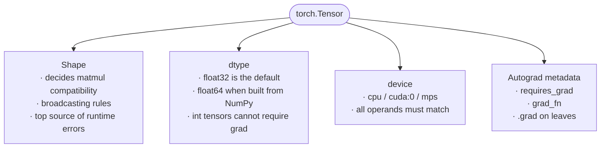
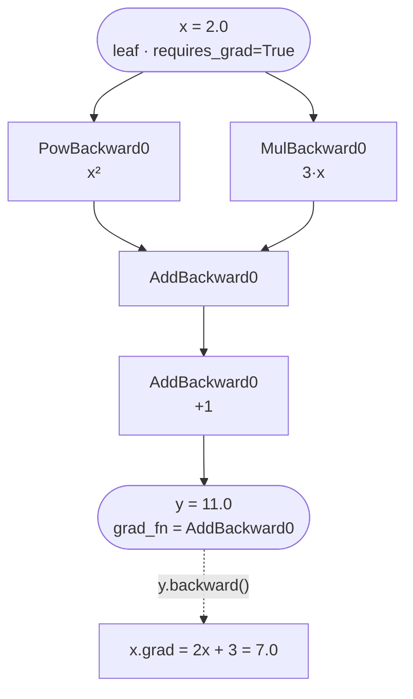
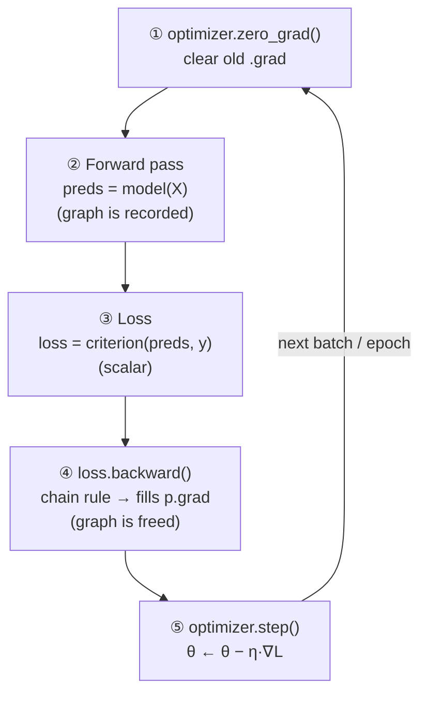

import {BroadcastingChecker, GradientDescentPlayground} from '@site/src/components/Widgets';

:::tip[TL;DR (30-Second Interview Pitch)]
A **PyTorch tensor** is a multi-dimensional array that stores numbers **plus** the history of how it was computed, and it can live on a **CPU or a GPU**. **Autograd** records every operation on tensors with `requires_grad=True` in a **dynamic computational graph** and applies the **chain rule in reverse** (`loss.backward()`) to fill each parameter's `.grad`. Training is always the same five-beat loop: **zero_grad → forward → loss → backward → step**. `backward()` *computes* gradients, the **optimizer** *uses* them, and gradients **accumulate** unless you clear them.
:::

<FormulaKey />

:::info[Where this page sits]
**This page:** the first notebook of the deep-learning course: tensors, autograd and the training loop.
**Want the maths underneath?** [The Calculus Behind PyTorch](./02-calculus-behind-pytorch.md) works through derivatives, the chain rule and backpropagation by hand, then checks every number with autograd.
**Next:** [Artificial Neural Networks](./03-artificial-neural-networks.md) stacks these pieces into full networks.
:::

## 🧭 Start Here

Every deep-learning model, from a two-layer network to a Transformer, is built from the same three ideas, and PyTorch gives you one tool for each:

1. **Tensors** hold the numbers: the inputs, the weights, the outputs and the gradients. They are NumPy-like arrays that can also run on a GPU and remember how they were computed.
2. **Autograd** computes derivatives automatically. You write the forward computation in ordinary Python; PyTorch records it and, on `backward()`, works out how much the loss would change if each weight changed.
3. **The training loop** uses those derivatives to improve the weights a little at a time: predict, measure the error, compute gradients, step downhill, repeat.

This page builds them in that order, then assembles them into `nn.Module`, the class every PyTorch model inherits from. If you remember one sentence, make it this: **autograd computes the gradients, the optimizer updates the weights, and you must clear the gradients between steps.**

| New concept | One-line meaning |
|---|---|
| **Tensor** | An n-dimensional array of numbers with a shape, a dtype and a device |
| **Broadcasting** | Combining tensors of different but compatible shapes without copying data |
| **Device** | Where a tensor lives and is computed: `cpu`, `cuda` (NVIDIA GPU) or `mps` (Apple GPU) |
| **`requires_grad`** | A flag that tells PyTorch to record operations on a tensor so it can be differentiated |
| **Computational graph** | The recorded chain of operations from inputs to the loss |
| **Leaf tensor** | A tensor you created yourself (e.g. a weight); only leaves keep `.grad` |
| **`.grad`** | Where the gradient $\partial L / \partial \theta$ is stored after `backward()` |
| **Loss function** | A single number measuring how wrong the predictions are |
| **Optimizer** | The object that uses `.grad` to update the parameters |
| **`nn.Module`** | The base class for models: it registers parameters and defines `forward()` |

## 1. Tensors: Numbers That Remember

Deep learning is, at its core, a lot of arithmetic on large blocks of numbers: an image is a block of pixel values, a batch of sentences is a block of token embeddings, a layer's weights are a block of learnable parameters. PyTorch represents every one of these blocks as a **tensor**.

The name sounds grander than the idea. A tensor is simply an array of numbers with some number of dimensions. A single number is a **0-D tensor** (scalar), a list of numbers is **1-D** (a vector), a table is **2-D** (a matrix), and a batch of colour images is **4-D**: `(batch, channels, height, width)`. Shape is not what makes tensors special; NumPy arrays have shapes too.

What *is* special is what tensors carry along with the numbers. A NumPy array is just values: once you compute `c = a * b`, NumPy has forgotten how `c` was made. A PyTorch tensor created with `requires_grad=True` remembers its history: `c` knows it came from multiplying `a` and `b`. That memory is what lets PyTorch compute derivatives automatically (Chapter 4). Tensors can also move to a **GPU**, where thousands of cores perform the same arithmetic in parallel, which is what makes training large networks feasible at all.

Every tensor has **three properties** that decide how it behaves, and most PyTorch bugs come from getting one of them wrong:

- **Shape** decides which operations are legal. Matrix multiplication needs the inner dimensions to match; broadcasting needs compatible trailing dimensions. Shape errors are the most common runtime error in deep learning, and the most dangerous shape bugs are the ones that *don't* raise an error but silently broadcast into the wrong shape.
- **dtype** is the number format. PyTorch's default is **`float32`** (4 bytes per number): precise enough for training, half the memory of `float64`, and much faster on GPUs. A trap from day one: `torch.tensor(np.array([1.0]))` inherits NumPy's default **`float64`**, which later clashes with `float32` layer weights. Only floating-point tensors can require gradients, because derivatives need continuous values.
- **Device** is where the tensor lives: `cpu`, `cuda:0` or `mps`. Operations need all their inputs on the same device (Chapter 3).



| Aspect | NumPy `ndarray` | PyTorch `Tensor` |
|---|---|---|
| Focus | Numerical values | Numerical values **+ computation history** |
| Gradient tracking | ❌ None | ✅ Autograd via `requires_grad=True` |
| GPU acceleration | ❌ CPU only | ✅ `cpu`, `cuda`, `mps` via `.to(device)` |
| Default float dtype | `float64` | `float32` (faster, half the memory, GPU-friendly) |
| Interop | `torch.from_numpy(a)` **shares memory** | `t.numpy()` **shares memory** (CPU tensors only) |
| Copying constructor | — | `torch.tensor(a)` **always copies** |
| Role in DL | Data prep, analysis, plotting | Inputs, weights, activations, gradients |

| Property | Why it matters | Inspect | Change |
|---|---|---|---|
| **shape** | Decides how tensors combine in matmul/broadcasting. Most DL errors are shape errors | `t.shape`, `t.size()`, `t.ndim` | `view`, `reshape`, `unsqueeze`, `squeeze`, `permute`, `T` |
| **dtype** | Numerical precision. Gradients need floats | `t.dtype` | `t.float()`, `t.to(torch.float32)` |
| **device** | Where the computation runs | `t.device` | `t.to(device)`, `t.cuda()`, `t.cpu()` |

:::analogy[NumPy array vs tensor = pasted values vs a live spreadsheet]
A NumPy array is like a spreadsheet where someone pasted **values only**: you see the numbers, but not how they were produced. A tensor with `requires_grad=True` is a spreadsheet that **keeps its formulas**, so you can always trace any cell back to the inputs that made it. That trace is exactly what you need for gradients.
:::

:::tip[🎯 Interview angle]
**"How is a tensor different from a NumPy array?"** Same idea (an n-D array), plus two abilities: it can live on a **GPU**, and with `requires_grad=True` it records its **computation history** so autograd can differentiate through it. Then name the three properties (shape, dtype, device) and the classic trap: tensors built from NumPy are `float64`, while PyTorch layers are `float32`.
:::

## 2. The Building-Block Operations and Broadcasting

Strip away the layer names and every neural network is built from a handful of operations. An **elementwise** operation combines two same-shaped tensors position by position (`[1, 2] * [3, 4] = [3, 8]`); activation functions like ReLU are elementwise too. A **dot product** multiplies two vectors position by position and adds the results (`[1, 2] · [3, 4] = 1·3 + 2·4 = 11`): that is exactly what one neuron computes, a weighted sum of its inputs. **Matrix multiplication** is many dot products at once: each row of the first matrix dotted with each column of the second. A linear layer applied to a whole batch is a single matrix multiplication, which is why GPUs, built to do these in parallel, are so effective.

The fourth operation is **broadcasting**, and it deserves care because it fails silently. Suppose you have a batch of 4 samples with 3 features each (shape `(4, 3)`) and want to add a bias of 3 numbers (shape `(3,)`) to every sample. The shapes differ, but the intent is obvious: add the same bias to each row. Broadcasting does exactly that, without a Python loop and without copying the bias four times.

The rule: line the shapes up **from the right**. Each pair of dimensions must be **equal**, or **one of them must be 1**, or **one must be missing** (treated as 1). A size-1 dimension is then virtually stretched to match. `(4, 3) + (3,)` works: 3 matches 3, and the missing dimension becomes 4. `(4, 3) + (4,)` fails: 3 vs 4, and neither is 1. Under the hood the stretched dimension gets a **stride of 0**: the same memory is read again and again, nothing is copied, so broadcasting is both fast and memory-free.

The danger is when broadcasting *succeeds* on shapes you didn't intend. A prediction of shape `(N, 1)` minus a target of shape `(N,)` broadcasts to an `(N, N)` matrix: every prediction compared with every target. The loss is then a meaningless number, and no error is raised (only a warning from `MSELoss`). Always check that predictions and targets have exactly the same shape.

| Operation | API | Shapes | Example |
|---|---|---|---|
| **Elementwise** | `a + b`, `a * b`, `torch.relu(a)` | same shape (or broadcastable) | `[1,2] * [3,4] = [3,8]` |
| **Dot product** | `torch.dot(a, b)` | 1-D · 1-D → scalar | `[1,2]·[3,4] = 11` |
| **Matrix × vector** | `torch.matmul(M, v)` / `M @ v` | `(m,n) @ (n,) → (m,)` | `[[1,2],[3,4]] @ [1,1] = [3,7]` |
| **Matrix × matrix** | `torch.matmul(A, B)` / `A @ B` | `(m,n) @ (n,p) → (m,p)` | batched: `(b,m,n) @ (b,n,p)` |
| **Broadcasting** | implicit | compatible trailing dims | `(4,3) + (3,) → (4,3)` |

```text
A      : 4 x 3
b      :     3   →  treated as 1 x 3  →  stretched to 4 x 3
A + b  : 4 x 3   ✅

A      : 4 x 3
c      :     4   ❌  (3 vs 4 — neither is 1)  → RuntimeError
```

<Animation src="pytorch/broadcasting" caption="Shapes are aligned from the right; the missing dimension of b becomes 1 and is stretched to 4 rows as a stride-0 view (no copy). (4, 3) + (4,) fails because 3 vs 4 and neither is 1." />

:::analogy[Broadcasting is a rubber stamp]
`b = [10, 20, 30]` is a stamp. To add it to each of the 4 rows of `A`, PyTorch doesn't carve 4 stamps (copies). It presses the **same** stamp on every row. That's why it costs no extra memory, and why the stamp must be exactly as wide as the rows (3 vs 4 won't fit).
:::


**Try it yourself.** Type two shapes and see, dimension by dimension, whether they broadcast and what the result shape is.

<BroadcastingChecker />

:::tip[🎯 Interview angle]
**"Explain broadcasting."** Align shapes from the right; dimensions are compatible if equal, 1, or missing; size-1 dimensions are stretched as stride-0 views, so no data is copied. The textbook use is adding a bias to every row of a batch. The interview trap is the silent one: `(N, 1)` vs `(N,)` broadcasts to `(N, N)` and gives a wrong loss with no error.
:::

## 3. Devices: CPU, GPU and Moving Data

Training a network means billions of multiply-adds, and GPUs exist to do exactly that: thousands of simple cores applying the same operation to different numbers at the same time. PyTorch can run on an NVIDIA GPU (`cuda`), an Apple Silicon GPU (`mps`) or the CPU, and the standard idiom picks the best one available: `cuda`, then `mps`, then `cpu`.

PyTorch **never moves tensors between devices for you**. An operation needs all of its inputs on the same device; mix a CPU tensor with a GPU tensor and you get `RuntimeError: Expected all tensors to be on the same device`. This is a deliberate design choice. Copying data between the CPU's memory and the GPU's memory goes over the PCIe bus, which is slow compared with the GPU's own memory. If PyTorch copied silently, a single misplaced tensor could add a hidden copy to every iteration and quietly ruin performance. Making the move explicit forces you to decide where data lives.

Two details trip people up. **`tensor.to(device)` returns a new tensor** and leaves the original where it was, so `x.to(device)` on its own line does nothing useful: you must write `x = x.to(device)`. **`model.to(device)` moves the model's parameters in place**. The usual pattern is to move the model once, then move every batch inside the training loop. And to get results back for plotting or NumPy, use `t.detach().cpu().numpy()`: detach from the graph, copy to the CPU, convert.

:::tip[🎯 Interview angle]
**"Why doesn't PyTorch move tensors to the GPU automatically?"** Host↔device copies are expensive, and implicit copies would hide performance problems; explicit `.to(device)` makes data placement deliberate and lets one `device` variable switch the whole program between CPU and GPU. Mention that `tensor.to()` returns a copy while `module.to()` works in place.
:::

## 4. Autograd: How PyTorch Computes Gradients

Training needs one thing above all: for every weight, the **gradient** of the loss, which says how much the loss would change if that weight changed a little. Computing these by hand for a network with millions of weights is impossible, and estimating them by nudging each weight in turn would take millions of forward passes. **Autograd** computes all of them exactly, in one backward pass.

It works in two phases. During the **forward pass**, every operation on a tensor with `requires_grad=True` is recorded. The result tensor gets a `grad_fn` attribute pointing to a node that knows how to compute that operation's local derivative. Take $y = x^2 + 3x + 1$ at $x = 2$: PyTorch records a `PowBackward0` node for $x^2$, a `MulBackward0` for $3x$, and `AddBackward0` nodes for the sums. Together these nodes form a **directed acyclic graph** from the inputs to the output: the **computational graph**.

During the **backward pass**, `y.backward()` walks that graph in reverse, applying the **chain rule** at every node: the gradient flowing back into a node is multiplied by the node's local derivative and passed on to its inputs. Where a tensor feeds into two operations (here $x$ is used in both $x^2$ and $3x$), the gradients from both paths are **added**: $2x + 3 = 4 + 3 = 7$. The final results are stored in the `.grad` attribute of the **leaf tensors**, the ones you created yourself.

A few rules follow from this design and come up constantly:

- **Gradient tracking is off by default.** You turn it on for the tensors you want gradients for, normally the parameters (`nn.Module` does this for you), not the input data.
- **Only leaves keep `.grad`.** Intermediate results have a `grad_fn` but their `.grad` stays `None`, to save memory, unless you call `.retain_grad()`.
- **`backward()` starts from a scalar.** It computes the derivative of one number with respect to everything. That's why losses are scalars; a vector output needs `.sum()`, `.mean()` or an explicit `gradient=` argument.
- **The graph is dynamic (define-by-run).** It is rebuilt from scratch on every forward pass, so ordinary Python `if` statements and loops inside a model just work. After `backward()` the graph is freed.



<Animation src="pytorch/autograd-backward" caption="Forward: autograd records each op and its value. Backward: each node multiplies the upstream gradient by its local derivative; x feeds two branches, so its gradients add: 4 + 3 = 7." />

<Formula name="Chain rule" tag="Engine of backprop" words="If x changes y, and y changes z, then the effect of x on z is the two effects multiplied together. Autograd applies this one link at a time, starting from the loss." remember="Multiply the slopes along the path.">

$$
\frac{\partial \pred{z}}{\partial \data{x}} \;=\; \frac{\partial \pred{z}}{\partial \pred{y}} \cdot \frac{\partial \pred{y}}{\partial \data{x}}
$$

**Example** ($\data{x} = 3$, $\pred{y} = x^2 = 9$, $\pred{z} = y^2 = 81$):

$$
\frac{\partial z}{\partial y} = 2y = 18
\qquad
\frac{\partial z}{\partial x} = 18 \cdot 2x = 18 \cdot 6 = \loss{108}
$$

`x.grad == 108` (leaf, filled automatically). `y.grad == 18` **only because** `y.retain_grad()` was called.

</Formula>

| Term | Meaning |
|---|---|
| `requires_grad=True` | "Track every op on me, I'm a variable I want gradients for." Set on **parameters**, normally **not** on input data |
| **Leaf tensor** | A tensor created directly by the user (not the result of an op). Model weights are leaves. Only leaves keep `.grad` |
| **Non-leaf tensor** | Result of an op on tracked tensors. Has a `grad_fn` (e.g. `PowBackward0`). `.grad` is `None` unless `.retain_grad()` |
| `grad_fn` | Pointer to the backward function that created the tensor: the graph's edges |
| `.backward()` | Runs reverse-mode autodiff from a **scalar**, writes/accumulates into each leaf's `.grad`, then **frees the graph** |
| `.grad` | Where the gradient $\partial L / \partial \theta$ ends up. Has the same shape as the parameter |
| `.detach()` | Returns a tensor that shares data but is **cut out of the graph** |
| `torch.no_grad()` | Context manager that stops graph recording (inference, manual weight updates) |

:::analogy[Autograd is a shop receipt]
During the forward pass PyTorch writes every operation on a receipt (the graph): "squared x, multiplied x by 3, added them, added 1". `backward()` reads the receipt **from the bottom up** and, for each line, asks "if this input changed a little, how much would the total change?". Multiplying those answers along the way is the chain rule.
:::

:::tip[🎯 Interview angle]
**"How does autograd work?"** Reverse-mode automatic differentiation: the forward pass records a dynamic DAG of operations (each result has a `grad_fn` that saved what its derivative needs); `backward()` from a scalar loss walks it in reverse, multiplying upstream gradients by local derivatives (chain rule), summing where branches meet, and writes the results into leaf tensors' `.grad`. It costs about one extra forward pass, whatever the number of parameters.
:::

## 5. Loss Functions and Gradient Descent

A model makes predictions; to improve it we first need a single number that says how wrong they are. That number is the **loss**, and it is the root of the computational graph: the place `backward()` starts. A loss function must return a **scalar** (one number per batch), be **differentiable** (so gradients exist), and connect the model's output to the target.

For regression, the standard choice is **mean squared error (MSE)**: for each sample take the difference between prediction and target, square it, and average. Squaring makes every miss positive and makes large misses count disproportionately: with predictions `[3, 5]` and targets `[2, 2]`, the misses are 1 and 3, and the bigger miss contributes 9 of the 10. (Classification uses cross-entropy, covered on the CNN pages.)

Once `backward()` has filled every parameter's `.grad`, we know, for each weight, which direction makes the loss *increase* fastest: the gradient points uphill. **Gradient descent** steps the other way: subtract a small multiple of the gradient from every parameter. The small multiple is the **learning rate** $\eta$, the most important number you choose. Too small and training crawls; well chosen and the loss drops steeply and then levels off; too large and each step overshoots the minimum, so the loss zig-zags or explodes to `inf`/`nan`.

It helps to keep the roles straight, because interviewers love to blur them. The **model** produces predictions and, as a side effect, the graph. The **loss** turns predictions into one number. **Autograd** (`loss.backward()`) computes the gradients. The **optimizer** (`optimizer.step()`) reads `.grad` and updates the parameters. The optimizer never computes a gradient, and `backward()` never changes a weight.

<Formula name="Mean Squared Error (MSE)" tag="Regression loss" words="For each sample, take how far the prediction missed, square it so big misses count much more, then average over all samples. The result is one number: smaller is better." remember="Square the miss, then average it.">

$$
\loss{L} \;=\; \frac{1}{\data{n}} \sum_{i=1}^{\data{n}} \big(\pred{\hat y_i} - \data{y_i}\big)^2
$$

- $\pred{\hat y_i}$: the model's prediction for sample $i$
- $\data{y_i}$: the true target for sample $i$
- $\data{n}$: number of samples
- $\loss{L}$: the loss, a single scalar

**Example:** predictions $[3, 5]$, targets $[2, 2]$ → misses $1$ and $3$ → $(1 + 9)/2 = 5$. The bigger miss contributes 9 of the 10.

</Formula>

<Formula name="Gradient descent update" tag="Optimizer step" words="The gradient points uphill (where the loss grows fastest). Subtract a small multiple of it from every parameter to move downhill. The learning rate decides how big that step is." remember="New = old − step size × slope.">

$$
\param{\theta} \;\leftarrow\; \param{\theta} \;-\; \hyper{\eta}\,\loss{\nabla_{\theta} L}
$$

- $\param{\theta}$: any learnable parameter (a weight or a bias)
- $\hyper{\eta}$: learning rate, chosen by you (e.g. 0.02)
- $\loss{\nabla_\theta L}$: the gradient that `loss.backward()` stored in `.grad`

**Example:** $\param{w} = 1.0$, gradient $= 4$, $\hyper{\eta} = 0.1$ → $\param{w} = 1.0 - 0.1 \times 4 = 0.6$.

</Formula>

| Component | Job | Does it compute gradients? | Example |
|---|---|---|---|
| **Model** | Maps inputs → predictions using learnable parameters | No, it produces the graph | `nn.Linear(1, 1)`, `SimpleNN()` |
| **Loss function** | Scalar measure of prediction error. **Start point of backprop** | No, it's the root of the graph | `nn.MSELoss()` |
| **Autograd** | Applies the chain rule through the recorded graph | ✅ **Yes** | `loss.backward()` |
| **Optimizer** | Uses `.grad` to move parameters downhill | ❌ **No**, it only reads `.grad` | `optim.SGD(model.parameters(), lr=0.02)` |


**Try it yourself.** Change the learning rate and watch the steps on the loss curve: a small rate creeps, a good one converges in a few steps, and a rate above 1 overshoots further every step.

<GradientDescentPlayground />

:::tip[🎯 Interview angle]
**"What does each piece do?"** Model → predictions; loss → one scalar error; `loss.backward()` → gradients in `.grad`; `optimizer.step()` → $\theta \leftarrow \theta - \eta\nabla L$. Say it as: *"autograd computes, the optimizer updates."* **"Learning rate too high?"** The loss oscillates or diverges to `inf`/`nan`; too low and it converges slowly.
:::

## 6. The Training Loop

Put the pieces together and every PyTorch training run, however large, is the same five steps repeated for every batch:

1. **`optimizer.zero_grad()`** clears the gradients left over from the previous step.
2. **Forward pass:** `preds = model(X)` computes predictions and records the graph.
3. **Loss:** `loss = criterion(preds, y)` reduces them to one number.
4. **`loss.backward()`** runs the chain rule and fills every parameter's `.grad`, then frees the graph.
5. **`optimizer.step()`** moves every parameter a small step against its gradient.

Step 1 is the one people forget, and the reason it exists is a deliberate PyTorch design choice: **`backward()` adds** its gradients into `.grad` rather than overwriting them. Run three iterations whose true gradients are 4, 3 and 2.5 without clearing, and `.grad` reads 4, 7, 9.5: every step uses the sum of all past gradients, so the updates grow larger and point in stale directions, and the loss oscillates or diverges. Why accumulate at all? Because it's useful on purpose: when a big batch doesn't fit in GPU memory, you can run several small batches, let their gradients add up, and call `step()` once, which is equivalent to one large batch. The default favours that flexibility and leaves clearing to you.

Where exactly `zero_grad()` goes is flexible (at the start of the iteration, or right after `step()`), as long as it runs **exactly once per update** and never between `backward()` and `step()`, which would wipe the gradients before they are used. In the notebook's linear-regression run (true $w = 3$, $b = 2$), the correct loop drives the loss from 351 to about 1.2, the noise level of the data.




*How to read it:* the yellow boxes are the five calls, in order, left to right; the top arrow is the loop back for the next batch. `X` feeds the forward pass and `y` feeds the loss. `loss.backward()` computes $\loss{\nabla L}$ into every `.grad`, and `optimizer.step()` applies $\param{\theta} \leftarrow \param{\theta} - \hyper{\eta}\,\loss{\nabla L}$.

<Animation src="pytorch/zero-grad" caption="Three iterations side by side. With zero_grad() .grad holds only the current gradient (4, 3, 2.5). Without it, backward() keeps ADDING: 4 → 7 → 9.5, so every step() overshoots more." />

<Formula name="Gradient accumulation" tag="Why zero_grad exists" words="Each backward() call adds its gradient on top of whatever is already in .grad. After k calls without clearing, .grad holds the sum of all k gradients." remember="backward() adds, zero_grad() resets.">

$$
\loss{\text{.grad}} \;\leftarrow\; \loss{\text{.grad}} + \loss{\nabla_\theta L_t}
\qquad\Longrightarrow\qquad
\loss{\text{.grad}} = \sum_{t=1}^{k} \loss{\nabla_\theta L_t}
$$

**Example:** per-step gradients $4, 3, 2.5$ → `.grad` reads $4,\ 7,\ 9.5$ without `zero_grad()`, but $4,\ 3,\ 2.5$ with it.

</Formula>

:::analogy[The training loop is free-throw practice]
**zero_grad**: forget the coach's notes from the last throw. **Forward**: take the shot. **Loss**: measure how far you missed. **backward**: the coach works out which part of your technique caused the miss, and by how much. **step**: adjust your technique a little. Repeat thousands of times.

And forgetting `zero_grad()`? It's like a kitchen scale you never press **TARE** on: each new weighing is added on top of the last one, so every reading is wrong.
:::

:::tip[🎯 Interview angle]
**"Walk me through a training step, and why `zero_grad()`?"** zero_grad → forward → loss → backward → step. PyTorch **accumulates** gradients by default; without clearing, each step uses the sum of all past gradients and training oscillates or diverges. Accumulation is intentional, e.g. to simulate a larger batch over several micro-batches.
:::

## 7. From `y = wx + b` to a Neural Network

The simplest model is a straight line, $y = wx + b$: one weight, one bias. Generalize it to many inputs and many outputs at once and you get the **linear layer**, `nn.Linear(in_features, out_features)`. Each output is a weighted sum of all the inputs plus its own bias, and for a whole batch it's a single matrix multiplication: $Y = XW^\top + b$. PyTorch stores the weight as `(out, in)`, which is why the formula has a transpose, and the bias, of shape `(out,)`, is broadcast across every sample in the batch.

Stack two linear layers and you might expect a more powerful model. It isn't. Substitute one into the other and $W_2(W_1x + b_1) + b_2 = (W_2W_1)x + (W_2b_1 + b_2)$: just another linear layer. Any number of stacked linear layers collapses into one, and a linear model can never fit a curve like $y = x^2$. What gives depth its power is a **non-linear activation** between the layers, most often **ReLU**, $\max(0, x)$. With it, the network becomes a flexible piecewise-linear function that can approximate curves. As the notebook puts it, this is not deep-learning magic: it is matrix multiplication plus non-linearity.

In PyTorch you package a model as a subclass of **`nn.Module`**. In `__init__` you declare the layers (after calling `super().__init__()`), and assigning a layer to `self.something` automatically **registers** its parameters, so `model.parameters()` can hand all of them to the optimizer. In `forward(x)` you describe how data flows through them. You then call `model(x)`, never `model.forward(x)` directly, because `__call__` also runs hooks before calling `forward`. The module also gives you `model.to(device)` for all parameters at once, `model.train()` / `model.eval()` to switch layers like dropout, and `state_dict()` for saving.

The notebook's `SimpleNN` is the smallest real network: `Linear(1, 8)` → ReLU → `Linear(8, 1)`, 25 parameters in total, trained on the curve $y = x^2$ that a single linear layer could never fit.


*How to read it:* data flows left to right through `Linear` → ReLU → `Linear`, exactly `SimpleNN`'s layers. Each yellow box is a learned layer ($\param{W}, \param{b}$); ReLU is the bend between them that stops the two linear layers collapsing into one.

<Formula name="Linear layer (nn.Linear)" tag="Building block" words="Every output is a weighted sum of all the inputs, plus its own bias. Doing it as one matrix multiply processes the whole batch at once." remember="Inputs times weights, plus bias.">

$$
\underbrace{\pred{Y}}_{(N,\,k)} \;=\; \underbrace{\data{X}}_{(N,\,d)}\; \underbrace{\param{W}^\top}_{(d,\,k)} \;+\; \underbrace{\param{b}}_{(k)}
$$

- $\data{X}$: a batch of $N$ samples with $d$ features each
- $\param{W}$: weights stored as `(out, in)` = $(k, d)$
- $\param{b}$: one bias per output, broadcast over all $N$ rows
- $\pred{Y}$: $k$ outputs for every sample

**Shape check:** the inner dimensions must match: $(N, d)\,(d, k) \to (N, k)$.

</Formula>

| Model | Equation | Shapes |
|---|---|---|
| Scalar linear regression | $y = wx + b$ | $w, b \in \mathbb{R}$ |
| Batched linear layer `nn.Linear(d, k)` | $Y = XW^\top + b$ | $X: (N, d)$, $W: (k, d)$, $b: (k)$ → $Y: (N, k)$ |
| 1-hidden-layer network | $Y = \text{ReLU}(XW_1^\top + b_1)\,W_2^\top + b_2$ | linear → non-linear → linear |

Worked shapes for the notebook's `SimpleNN` with $X \in \mathbb{R}^{100 \times 1}$:

| Step | Operation | Parameter shape | Output shape |
|---|---|---|---|
| Input | — | — | `(100, 1)` |
| `layer1 = nn.Linear(1, 8)` | $H = XW_1^\top + b_1$ | $W_1$: `(8, 1)`, $b_1$: `(8,)` | `(100, 8)` |
| `relu` | $A = \max(0, H)$ | none | `(100, 8)` |
| `layer2 = nn.Linear(8, 1)` | $Y = AW_2^\top + b_2$ | $W_2$: `(1, 8)`, $b_2$: `(1,)` | `(100, 1)` |

Total learnable parameters: $8 + 8 + 8 + 1 = 25$.

<Formula name="Linear layers collapse" tag="Why activations matter" words="Plugging one linear layer into another gives a single linear layer with a combined weight and bias, so depth without a non-linearity adds nothing." remember="Linear of linear is linear.">

$$
\param{W_2}(\param{W_1}\data{x} + \param{b_1}) + \param{b_2} = (\param{W_2W_1})\data{x} + (\param{W_2b_1} + \param{b_2}) = \param{W'}\data{x} + \param{b'}
$$

</Formula>

:::danger[Interview Trap: "Deeper = more powerful", even without activations?]
No. Any stack of purely linear layers **collapses into one linear layer**. It can never fit $y = x^2$. The **non-linear activation between layers** is what lets the network approximate curves. As the notebook says: *"This is NOT deep learning magic. It is matrix multiplication + non-linearity."*
:::

| Feature | How |
|---|---|
| **Automatic parameter registration** | Assigning an `nn.Linear`/`nn.Parameter` to `self.x` in `__init__` registers it, so `model.parameters()` finds it for the optimizer |
| **Clean forward definition** | You write `forward(x)`; calling `model(x)` runs `__call__`, which fires hooks and then `forward` |
| **Submodule nesting** | Modules contain modules, so deep networks stay manageable |
| **Device / dtype moves** | `model.to(device)` moves **all** parameters and buffers |
| **Train / eval modes** | `model.train()` / `model.eval()` toggle Dropout & BatchNorm |
| **Save / load** | `model.state_dict()` / `model.load_state_dict(...)` |

:::tip[🎯 Interview angle]
**"Why do neural networks need activation functions?"** Without them, stacked linear layers collapse into one linear map; the non-linearity is what lets depth model curves. **"What does `nn.Module` do for you?"** Registers parameters for the optimizer, defines `forward`, moves everything with `.to(device)`, switches train/eval behaviour, and saves/loads with `state_dict()`.
:::

## ⚙️ Going Deeper (PyTorch Internals)

**Memory layout: storage, shape, stride**
- A tensor is a **view** over a flat, contiguous 1-D **storage** buffer, plus metadata: `shape`, `stride`, `storage_offset`, `dtype`, `device`.
- **Stride** = how many elements to skip in storage to move one step along each dimension. A `(2,3)` row-major tensor has stride `(3, 1)`; its transpose has stride `(1, 3)`.
- `view()`, `transpose()`, `t()`, `permute()`, slicing and `expand()` only change **metadata**. They are $O(1)$ and **share storage**, so mutating the view mutates the original.
- `transpose()`/`permute()` produce **non-contiguous** tensors, and `.view()` on them raises *"view size is not compatible with input tensor's size and stride"*. Use `.reshape()` (copies if needed) or `.contiguous().view()`.
- **Broadcasting** works by giving the stretched dimension **stride 0**: `torch.tensor([10., 20., 30.]).expand(4, 3)` has stride `(0, 1)`. The same memory is re-read and never copied.
- `unsqueeze(1)` turns `(100,)` into `(100, 1)`. The notebook uses this because `nn.Linear` expects `(batch, features)`.

**dtype**
- Default float dtype is **`float32`** (4 bytes per value vs 8 for `float64`): a 1-million-parameter model takes 3.8 MiB instead of 7.6 MiB, and GPUs have far more FP32 (and FP16/BF16) throughput than FP64.
- Gradients only make sense on a continuous space, so **integer tensors cannot have `requires_grad=True`** (*"only Tensors of floating point dtype can require gradients"*). Labels for classification stay `int64` (`long`), but inputs and weights are floats.
- Binary ops between different dtypes follow **type promotion** (`float32 + float64 → float64`), but `nn.Linear` weights are `float32`, so feeding it a `float64` tensor raises *"mat1 and mat2 must have the same dtype, but got Double and Float"*.

**Devices**
- `torch.device("cuda" if torch.cuda.is_available() else "cpu")` is the standard idiom. Apple Silicon adds `torch.backends.mps.is_available()`.
- CUDA kernels launch **asynchronously**. `.item()`, `.cpu()`, `print(t)` force a **synchronization**, so calling `.item()` every step has a cost (fine for logging once per epoch).
- `torch.cuda.get_device_name(0)` crashes on machines without CUDA. Guard it with `is_available()`.

**Autograd engine**
- **Reverse-mode AD** costs about one extra forward pass to get the gradient w.r.t. **all** parameters at once. That is why it beats forward-mode when there are millions of inputs (parameters) and **one scalar output** (loss).
- Each op on a tracked tensor creates a **`Node`** (e.g. `PowBackward0`) that **saves the tensors it needs** for its derivative (e.g. `x` for `x**2`). These saved activations are the main **memory cost of training**.
- `backward()` walks the DAG in reverse topological order and multiplies local Jacobians by the upstream gradient (**vector-Jacobian product**).
- After `backward()` the graph's saved buffers are **freed**. A second `backward()` on the same graph raises an error unless you passed `retain_graph=True`.
- Since PyTorch 2.0, `zero_grad()` defaults to **`set_to_none=True`**: `.grad` becomes `None` instead of a zero tensor, which saves memory and a kernel launch.
- `x.grad.zero_()`: the trailing **underscore** marks an **in-place** op. In-place ops on a **leaf that requires grad** are forbidden outside `torch.no_grad()`, which is why optimizers update weights inside a no-grad context.

**Optimizer step**
- `optim.SGD(model.parameters(), lr)` keeps **references** to the parameter tensors. `step()` does `p -= lr * p.grad` for each one under `no_grad`.
- The size of a stable learning rate depends on the **scale of the inputs**. MSE's gradient on a weight is about $\frac{2}{n}\sum x_i(\hat{y}_i - y_i)$, so large $x$ means large gradients. This is why **feature normalization** matters.

:::danger[Interview Trap: "`loss.backward()` trains the model"]
It doesn't. `backward()` only **computes and stores** gradients in `.grad`. Weights change **only** when `optimizer.step()` runs. Likewise, the optimizer **never** computes gradients; it just reads `.grad`. Say it as: *"Autograd computes, the optimizer updates."*
:::

:::danger[Interview Trap: "`model.eval()` turns off gradients"]
It doesn't. `model.eval()` only switches **layer behavior** (Dropout stops dropping, BatchNorm uses running statistics). The graph is still recorded. `torch.no_grad()` (or `torch.inference_mode()`) is what stops tracking and saves memory. At inference time, use **both**.
:::

## 💻 PyTorch Implementation

:::info
The snippets consolidate the notebook's code cells.
:::

### 1. Tensors, operations, broadcasting and devices

```python
import torch
import numpy as np

# --- Creation & the three properties --------------------------------------
x = torch.tensor([1.0, 2.0, 3.0])                 # float32 (PyTorch default)
# highlight-next-line
y = torch.tensor(np.array([4.0, 5.0, 6.0]))       # float64! inherits NumPy's dtype
print(y.shape, y.dtype, y.device)                 # torch.Size([3]) torch.float64 cpu

# --- Core operations ------------------------------------------------------
a = torch.tensor([1.0, 2.0])
b = torch.tensor([3.0, 4.0])
print(torch.dot(a, b))                            # tensor(11.)  -> 1*3 + 2*4

M = torch.tensor([[1.0, 2.0],
                  [3.0, 4.0]])
v = torch.tensor([1.0, 1.0])
print(torch.matmul(M, v))                         # tensor([3., 7.])  (same as M @ v)

# --- Broadcasting: (4,3) + (3,) -> (4,3) ----------------------------------
A = torch.ones(4, 3)
bias = torch.tensor([10.0, 20.0, 30.0])
# highlight-next-line
print(A + bias)                                   # every row becomes [11., 21., 31.]

# --- Device selection: CUDA -> Apple MPS -> CPU --------------------------
if torch.cuda.is_available():
    device = torch.device("cuda")
elif torch.backends.mps.is_available():
    device = torch.device("mps")
else:
    device = torch.device("cpu")

# highlight-next-line
x_dev = x.to(device)          # returns a NEW tensor; x itself stays on CPU
print("Using:", device, "| x_dev on:", x_dev.device)
if device.type == "cuda":     # guard: get_device_name crashes without CUDA
    print(torch.cuda.get_device_name(0))

# --- Safe conversion back to NumPy (plotting, sklearn, etc.) -------------
arr = x_dev.detach().cpu().numpy()
```

### 2. Autograd

```python
import torch

# Scalar: y = x^2 + 3x + 1  ->  dy/dx = 2x + 3
x = torch.tensor(2.0, requires_grad=True)
y = x**2 + 3*x + 1
# highlight-next-line
y.backward()                                      # chain rule, fills x.grad
print(y.item(), x.grad)                           # 11.0  tensor(7.)

x.grad.zero_()                                    # in-place reset; grads ACCUMULATE otherwise

# Vector: z = sum(w^2)  ->  dz/dw = 2w   (sum() makes the output a scalar)
w = torch.tensor([1.0, 2.0, 3.0], requires_grad=True)
z = torch.sum(w**2)
z.backward()
print(w.grad)                                     # tensor([2., 4., 6.])

# Chain rule through an intermediate (non-leaf) tensor
x = torch.tensor(3.0, requires_grad=True)
y = x**2                                          # non-leaf, grad_fn=PowBackward0
# highlight-next-line
y.retain_grad()                                   # otherwise y.grad would be None
z = y**2
z.backward()
print(x.grad, y.grad)                             # tensor(108.) tensor(18.)
```

### 3. Loss, optimizer and the canonical training loop

```python
import torch
import torch.nn as nn
import torch.optim as optim

torch.manual_seed(0)                              # reproducibility (same init + same noise)
X = torch.linspace(0, 10, 100).unsqueeze(1)       # (100,) -> (100, 1): (batch, features)
y = 3 * X + 2 + torch.randn(100, 1)               # true w=3, b=2, plus noise

model = nn.Linear(1, 1)                           # weight (1,1), bias (1,)
criterion = nn.MSELoss()
optimizer = optim.SGD(model.parameters(), lr=0.02)

losses = []
for epoch in range(80):
    # highlight-next-line
    optimizer.zero_grad()                         # ① clear accumulated grads
    preds = model(X)                              # ② forward (builds graph)
    loss = criterion(preds, y)                    # ③ scalar loss
    # highlight-next-line
    loss.backward()                               # ④ compute grads only
    # highlight-next-line
    optimizer.step()                              # ⑤ update params only
    losses.append(loss.item())                    # plain float for logging/plotting

print(f"final loss={losses[-1]:.3f}  w={model.weight.item():.3f}  b={model.bias.item():.3f}")
# loss drops 351 -> ~1.2 within a few epochs; w heads toward 3. b converges much more
# slowly (unscaled X makes the loss surface elongated), so it is still short of 2 at 80 epochs.
```

### 4. A real neural network with `nn.Module`

```python
import torch
import torch.nn as nn
import torch.optim as optim

class SimpleNN(nn.Module):
    def __init__(self):
        super().__init__()                        # REQUIRED: sets up parameter registry
        # highlight-next-line
        self.layer1 = nn.Linear(1, 8)             # W1: (8, 1), b1: (8,)
        self.relu = nn.ReLU()                     # the non-linearity that makes depth matter
        self.layer2 = nn.Linear(8, 1)             # W2: (1, 8), b2: (1,)

    def forward(self, x):                         # how data flows
        x = self.layer1(x)                        # (N,1) -> (N,8)
        x = self.relu(x)
        return self.layer2(x)                     # (N,8) -> (N,1)

torch.manual_seed(0)
model = SimpleNN()
print(model.layer1.weight.shape, model.layer2.weight.shape)   # [8, 1]  [1, 8]
print(sum(p.numel() for p in model.parameters()))             # 25

# Non-linear target: a single nn.Linear can never fit this
X = torch.linspace(-5, 5, 200).unsqueeze(1)
y = X**2 + torch.randn(200, 1) * 2

criterion = nn.MSELoss()
optimizer = optim.SGD(model.parameters(), lr=0.01)

model.train()
for epoch in range(150):
    optimizer.zero_grad()
    loss = criterion(model(X), y)                 # call model(X), never model.forward(X)
    loss.backward()
    optimizer.step()

# Inference: eval() changes layer behavior, no_grad() stops graph building
model.eval()
# highlight-next-line
with torch.no_grad():
    preds = model(X)
```

## 🚨 Interview Gotchas & Edge Cases

:::warning[The Most Common Question]
**"Walk me through a PyTorch training step. What does `backward()` do, and why do we call `zero_grad()`?"**

1. `optimizer.zero_grad()` clears old gradients, **because PyTorch accumulates them by default**.
2. `outputs = model(inputs)`: the forward pass records the dynamic graph.
3. `loss = loss_fn(outputs, targets)`: a scalar, the root of the graph.
4. `loss.backward()`: reverse-mode autodiff (chain rule) writes $\partial L/\partial\theta$ into every parameter's `.grad`. **No weights change here.**
5. `optimizer.step()`: $\theta \leftarrow \theta - \eta\nabla L$, the **only** place weights change.

If you skip `zero_grad()`, each step uses the **sum of all past gradients**. Updates grow larger and stale, so the loss oscillates or diverges. Mnemonic: **zero → forward → loss → backward → step**.
:::

- **Forgetting `zero_grad()`:** gradients pile up ($g_t^{\text{used}} = \sum_{k \le t} g_k$), and the effective step keeps growing → oscillation/divergence. **Intentional** accumulation (calling `step()` + `zero_grad()` every *k* mini-batches) is a legitimate trick to simulate a **larger batch size** on limited GPU memory.
- **`zero_grad()` placement:** at the start of the iteration (canonical) or right after `step()` (as in the notebook). Both are correct **as long as it runs exactly once per update**. Putting it between `backward()` and `step()` wipes the gradients, so the model never learns.
- **Unscaled inputs explode the loss.** One of the notebook cells uses `X = torch.linspace(0, 100, 100)` with the same `lr=0.02` that worked for `0..10`. The gradient scales with $x^2$ (about $100\times$ larger), so SGD **overshoots and the loss goes to `inf`/`nan`**. Fix it by **normalizing features** or lowering the LR by orders of magnitude.
- **Learning rate vs loss curve shape:** too low → slow, nearly linear decline. Good → steep drop then a plateau (the notebook goes 351 → 49 → 7.9 → 2.2 → ~1.2). Too high → zig-zag or explosion. **If training is unstable, check first:** LR, input scaling, missing `zero_grad()`, loss/target shape mismatch, wrong dtype/device.
- **Silent broadcasting bugs:** `preds` of shape `(N, 1)` minus `y` of shape `(N,)` broadcasts to **`(N, N)`**, giving a wrong loss **with no error** (only a `UserWarning` in `MSELoss`). Always keep target and prediction shapes identical. That is why the notebook uses `unsqueeze(1)`.
- **`float64` from NumPy:** `torch.tensor(np_array)` keeps `float64`, which then fails against `float32` layer weights. Use `torch.from_numpy(a).float()`.
- **`.numpy()` failures:** `can't call numpy() on Tensor that requires grad` → `.detach()` first. Tensor on GPU → `.cpu()` first. Safe idiom: **`t.detach().cpu().numpy()`**.
- **`torch.from_numpy` / `.numpy()` share memory:** editing one edits the other. `torch.tensor()` copies.
- **Device mismatch:** `Expected all tensors to be on the same device` → move **both** the model (`model.to(device)`) and **each batch** (`X.to(device)`). Remember `tensor.to()` is not in-place: `x.to(device)` without assigning the result does nothing.
- **`backward()` on a non-scalar** → `grad can be implicitly created only for scalar outputs`. Reduce with `.sum()`/`.mean()` or pass `gradient=`.
- **Second `backward()` on the same graph** → error (buffers freed). Use `retain_graph=True` only if you truly need it, e.g. multiple losses sharing a graph.
- **`.grad` is `None`** on intermediate tensors (use `.retain_grad()`), on tensors created with `requires_grad=False`, and after `zero_grad()` (set-to-none default).
- **Calling `model.forward(x)` directly** skips hooks. Always call `model(x)`.
- **Forgetting `super().__init__()`** in an `nn.Module` subclass → `cannot assign module before Module.__init__() call`.
- **`.item()` in hot loops** forces a GPU↔CPU sync every iteration. Log once per epoch or accumulate on-device.
- **Same random seed** (`torch.manual_seed`) for comparison runs makes sure both experiments start with identical weights and data noise, so any difference in the loss curve is caused *only* by the change you made (e.g. removing `zero_grad()`).

## ⚡ Essential Interview Recall

A one-screen revision list. Every point is explained in the chapters above.

**Tensors and operations**
- **Tensor** = scalar (0-D) → vector (1-D) → matrix (2-D) → n-D. What sets it apart is its **behavior**: **vectorized math + gradient tracking + device mobility**.
- **NumPy array vs tensor:** NumPy = *numbers*. Tensor = *numbers + computation history* + **GPU acceleration**.
- Three properties: **`shape`** (most DL bugs are shape bugs), **`dtype`** (default `float32`), **`device`** (`cpu`, `cuda:0`, `mps`).
- `torch.tensor([1.0, 2.0])` → **`float32`**, but `torch.tensor(np.array([1.0]))` → **`float64`**.
- All of a neural network's math reduces to **elementwise ops, dot products, matrix multiplication and broadcasting**.
- **Broadcasting:** compare shapes **right to left**; compatible if **equal**, **one is 1**, or **one is missing**. `(4,3) + (3,) → (4,3)`. Stride-0, no copy.

**Devices**
- PyTorch **never moves tensors between devices automatically**; mismatches raise `RuntimeError`. Pick order: `cuda` → `mps` → `cpu`.
- `tensor.to(device)` returns a copy; `module.to(device)` moves in place.

**Autograd**
- **Reverse-mode automatic differentiation**: record ops in the **forward pass** → **DAG** → **chain rule** backward from a **scalar** loss.
- **Dynamic (define-by-run)** graph, rebuilt every iteration and freed after `backward()`.
- Tracking is **off by default**; `requires_grad=True` only on **floating-point** tensors.
- **Leaf tensors** get `.grad`; **non-leaf** tensors don't, unless `.retain_grad()`.

**Training**
- **`loss.backward()` computes gradients; `optimizer.step()` updates weights.** The optimizer never computes gradients.
- Gradients **accumulate** into `.grad` → **`optimizer.zero_grad()` once per iteration**. Loop: **zero_grad → forward → loss → backward → step**.
- Loss must be **differentiable**, a **scalar**, and connect output to target. **MSE** $\loss{L} = \frac{1}{n}\sum (\pred{\hat{y}} - \data{y})^2$.
- **SGD:** $\param{\theta} \leftarrow \param{\theta} - \hyper{\eta}\, \loss{\nabla_\theta L}$. LR too high → oscillation/divergence; too low → slow.

**Models**
- `nn.Linear(in, out)`: **`weight` `(out, in)`**, **`bias` `(out,)`**, $\pred{Y} = \data{X}\param{W}^\top + \param{b}$.
- Linear layers **without activations collapse into one**; **ReLU** gives depth its power.
- **`nn.Module`**: `__init__()` = layers (call `super().__init__()`); `forward()` = data flow. Call `model(x)`, never `model.forward(x)`.
- `x.detach().cpu().numpy()`; `.item()` for a Python number.
- **`model.eval()`** changes layer behavior; **`torch.no_grad()`** disables tracking. Inference uses **both**.

## 📐 Formula Sheet

Every equation on this page in one place.

| Concept | Formula | In plain words |
|---|---|---|
| Linear layer | $\pred{Y} = \data{X}\param{W}^\top + \param{b}$ | Weighted sum of the inputs, plus a shift |
| Mean squared error | $\loss{L} = \frac{1}{n}\sum_i (\pred{\hat y_i} - \data{y_i})^2$ | Average of the squared misses |
| Gradient descent step | $\param{\theta} \leftarrow \param{\theta} - \hyper{\eta}\,\loss{\nabla_\theta L}$ | Take a small step downhill |
| Chain rule | $\dfrac{\partial z}{\partial x} = \dfrac{\partial z}{\partial y}\cdot\dfrac{\partial y}{\partial x}$ | Multiply the local slopes along the path |
| Gradient accumulation | $\loss{\text{.grad}} \mathrel{+}= \loss{\nabla_\theta L_t}$ | `backward()` adds; `zero_grad()` resets |
| Linear layers collapse | $\param{W_2}(\param{W_1}\data{x} + \param{b_1}) + \param{b_2} = \param{W'}\data{x} + \param{b'}$ | Without activations, depth adds nothing |
| Broadcasting rule | dims match if **equal**, or one is **1** or **missing** | Compare shapes from the right |

## Concept-Check Answers (from the notebook)

<details>
<summary><strong>Why are floating-point numbers preferred over integers in deep learning?</strong></summary>

Gradient descent needs a **continuous** space: derivatives of integer-valued functions are zero or undefined, and updates like $\theta - 0.02 \cdot g$ produce fractions. PyTorch only allows `requires_grad` on float/complex tensors. Activations (sigmoid, softmax) and losses also produce real values. `float32` is the sweet spot of precision vs memory/speed on GPUs.
</details>

<details>
<summary><strong>What role does a tensor's shape play in neural network computations?</strong></summary>

Shape decides whether matmul is legal (inner dimensions must match: `(N,d) @ (d,k)`), how broadcasting expands operands, and what each axis *means* (e.g. `(batch, seq_len, emb_dim)` in NLP). Most runtime errors in DL are shape errors, and the dangerous ones are the silent wrong-shape broadcasts.
</details>

<details>
<summary><strong>How is a PyTorch tensor fundamentally different from a NumPy array?</strong></summary>

A NumPy array holds **values**. A tensor holds **values + computation history** (`grad_fn`, `requires_grad`, `.grad`) so autograd can differentiate through it, and it can live on a **GPU**. Python lists are neither vectorized nor typed.
</details>

<details>
<summary><strong>Why must tensors and models be explicitly moved to the GPU?</strong></summary>

CPU↔GPU transfers are slow (PCIe), so implicit copies would cause silent performance problems. Making it explicit forces you to place data deliberately, and lets the same code run on any device via a single `device` variable.
</details>

<details>
<summary><strong>What problem does broadcasting solve?</strong></summary>

It applies an operation between compatible but different shapes (e.g. adding a bias vector to every row of a batch) **without Python loops and without copying data** (stride-0 views). That gives computational efficiency, memory efficiency and parallel execution.
</details>

<details>
<summary><strong>Why does the loss decrease in the correct training loop?</strong></summary>

Each step moves the parameters a small amount opposite the gradient of the **current** loss, the direction of steepest local decrease. With a suitable LR, each update lowers the MSE until it plateaus at the noise floor (about 1.0 here, the variance of `torch.randn`).
</details>

<details>
<summary><strong>What pattern appears in the loss curve without <code>zero_grad()</code>?</strong></summary>

The gradient used at step *t* is the running **sum** of all previous gradients, so the effective step size keeps growing and points in stale directions. The loss may fall at first, then **oscillate with increasing amplitude or blow up**, and it does not settle to the minimum the correct run reaches.
</details>

<details>
<summary><strong>What does gradient accumulation mean mathematically?</strong></summary>

`.grad` $\leftarrow$ `.grad` $+ \nabla_\theta L_t$. After *k* backward calls without clearing, `.grad` $= \sum_{t=1}^{k} \nabla_\theta L_t$. Done on purpose over *k* mini-batches (often with the loss divided by *k*), this equals the gradient of a *k*× larger batch.
</details>

<details>
<summary><strong>How would increasing the learning rate affect the loss curve?</strong></summary>

Moderately higher → faster initial drop. Too high → overshooting the minimum: a zig-zag/oscillating curve, and past a threshold (related to the curvature of the loss, $\eta > 2/\lambda_{\max}$ for quadratic losses like MSE) the loss **diverges** to `inf`/`nan`.
</details>
