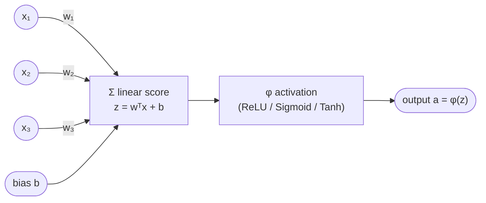
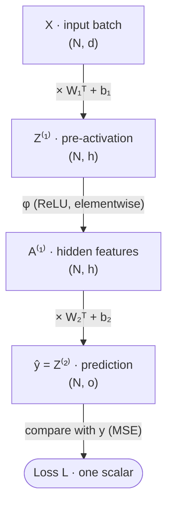
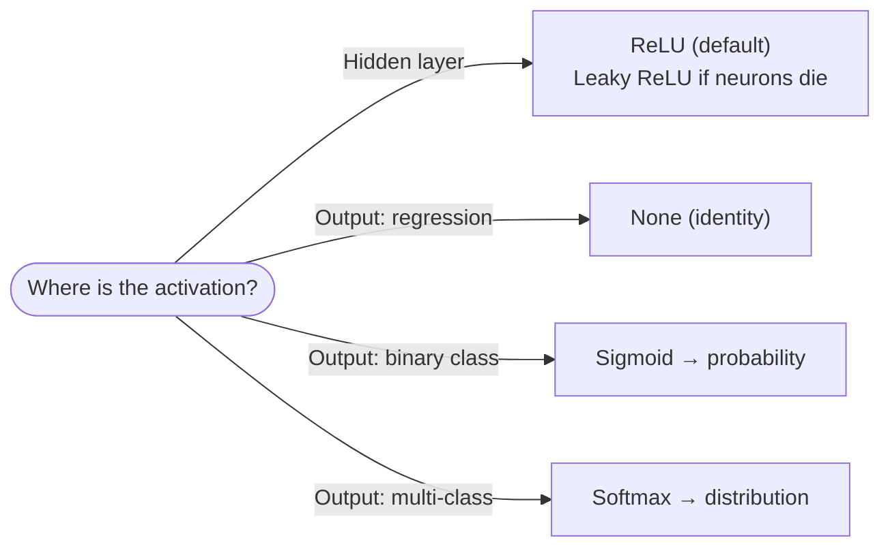
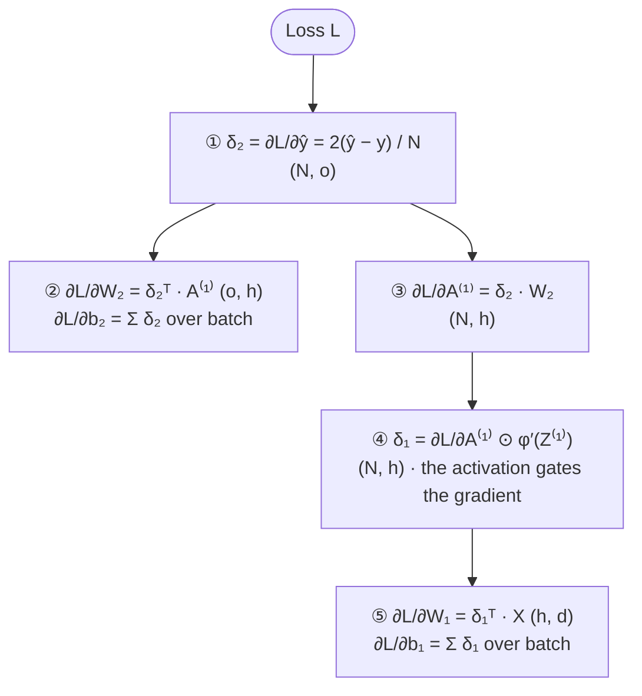
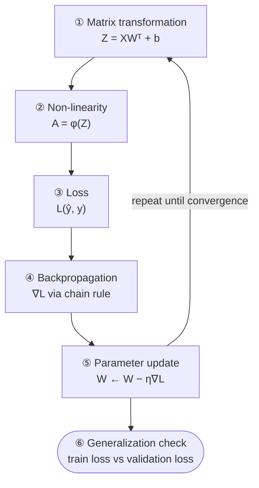

:::tip[TL;DR (30-Second Interview Pitch)]
An **Artificial Neural Network (ANN)** is a stack of layers. Each layer does a **matrix multiplication** ($Z = XW^\top + b$) followed by a **non-linear activation** ($A = \phi(Z)$). Without the activation, any number of layers **collapses into one linear layer**. With it, the network can approximate curved functions like $y = x^2$. Training means **minimizing a loss** $L(W, b)$: **backpropagation** (the chain rule applied layer by layer) computes $\partial L/\partial W$, **gradient descent** moves the weights downhill, and the real goal is low loss on **unseen** data, not just training data.
:::

<FormulaKey />

:::info[Where this page sits]
**Before:** [PyTorch Fundamentals](./01-pytorch-fundamentals.md) (tensors, autograd, the training loop) and [The Calculus Behind PyTorch](./02-calculus-behind-pytorch.md) (derivatives and the chain rule by hand).
**This page:** how neurons combine into networks, why activations matter, how backpropagation works layer by layer, and how to tell whether a network is actually learning.
**Next:** [CNN Fundamentals](../02-cnns/01-cnn-fundamentals.md) replaces the fully connected layer with convolutions for images.
:::

## 🧭 Start Here

The previous pages trained a single straight line. This page answers the next question: **how do you build a model that can learn curves, and how do you train something with many layers?**

The answer has a pleasingly small number of parts. A **neuron** computes a weighted sum of its inputs and bends the result with an **activation function**. Many neurons side by side form a **layer**, and a layer is just one matrix multiplication. Layers stacked one after another form a **network**. To train it you need a **loss** that measures the error, **backpropagation** to work out each weight's share of the blame, and **gradient descent** to adjust the weights. Finally you need to check that the network learned the pattern rather than memorizing the training data: **generalization**.

The chapters follow that order. Two ideas recur throughout and are worth watching for: the **activation function** is what makes depth useful at all, and its **slope** decides whether gradients can flow back through the network.

| New concept | One-line meaning |
|---|---|
| **Neuron** | Weighted sum of inputs plus a bias, passed through an activation |
| **Layer** | Many neurons applied to the same input at once: one matrix multiplication |
| **Hidden layer** | A layer between input and output that creates new features |
| **Activation function** $\phi$ | The non-linear "bend" applied after each linear step (ReLU, sigmoid, tanh) |
| **Pre-activation** $Z$ | The linear score before the activation is applied |
| **Loss function** | One number measuring how wrong the predictions are (MSE, cross-entropy) |
| **Backpropagation** | The chain rule applied layer by layer, from the loss back to every weight |
| **Error signal** $\delta$ | $\partial L / \partial Z$ at a layer: how the loss reacts to that layer's output |
| **Vanishing gradient** | Gradients shrinking towards zero as they pass back through many layers |
| **Overfitting** | Fitting the training data (including its noise) so closely that new data suffers |

## 1. The Neuron: Weigh, Sum, Shift, Bend

The artificial neuron is loosely inspired by a biological one: it receives signals, combines them, and decides how strongly to "fire". Only the mathematical skeleton survives. A neuron takes an input with $d$ features, multiplies each feature by a **weight** that says how much that feature matters, adds the results, and adds a **bias**. That gives a single number, the **pre-activation** $z = w^\top x + b$. Finally an **activation function** $\phi$ turns $z$ into the neuron's output $a = \phi(z)$.

The dot product $w^\top x$ has a useful geometric meaning: it measures how well the input lines up with the weight vector. A large positive $z$ means "this input looks like what I respond to", a negative one means the opposite. The bias shifts that threshold, so the neuron doesn't have to make its decision exactly at the origin. The activation then **bends** the score: ReLU, the most common choice, passes positive scores through unchanged and replaces negative ones with zero, so the neuron is either silent or speaks in proportion to its score.

Each part has a job. The weights and bias are **learned**; the activation is **chosen** by you and stays fixed. Without the activation a neuron is just linear regression; with it, neurons can be combined into something far more expressive (Chapter 3).



| Symbol | Shape | Meaning |
|---|---|---|
| $x$ | $(d)$ | One input sample with $d$ features |
| $w$ | $(d)$ | One weight per feature: how much each feature matters |
| $b$ | scalar | Bias: shifts the decision boundary away from the origin |
| $z = w^\top x + b$ | scalar | **Pre-activation** (linear score) |
| $a = \phi(z)$ | scalar | **Activation** (the neuron's output) |

<Formula name="A single neuron" tag="Atom of every network" words="Multiply each input by how much it matters, add them up, shift by the bias, then pass the result through an activation that bends it." remember="Weigh, sum, shift, bend.">

$$
\pred{z} \;=\; \param{w}^\top \data{x} + \param{b} \;=\; \sum_{j=1}^{d} \param{w_j}\,\data{x_j} + \param{b}
\qquad\qquad
\pred{a} \;=\; \phi(\pred{z})
$$

- $\data{x}$: the input features ($d$ numbers)
- $\param{w}$: one weight per feature (learned)
- $\param{b}$: the bias, a learned shift
- $\pred{z}$: pre-activation (raw score)
- $\phi$: activation function, e.g. ReLU
- $\pred{a}$: the neuron's output

**Example:** $\data{x} = [1, 2]$, $\param{w} = [0.5, -1]$, $\param{b} = 1$ → $\pred{z} = 0.5 - 2 + 1 = -0.5$ → $\text{ReLU}(-0.5) = \pred{0}$. This neuron stays silent for this input.

</Formula>

:::analogy[A neuron is a judge at a cooking contest]
Each input is a criterion (taste, look, smell). The **weights** say how much this judge cares about each one. The **bias** is the judge's baseline mood. The weighted total is the raw score $z$. The **activation** is the judge's rule for speaking up: ReLU means "if the total is negative, say nothing (0); otherwise announce the score".
:::

:::tip[🎯 Interview angle]
**"What does a single neuron compute?"** $a = \phi(w^\top x + b)$: a weighted sum of the inputs, shifted by a bias, passed through a non-linear activation. Weights and bias are learned; the activation is a fixed design choice. Geometrically, $w^\top x + b = 0$ is a hyperplane, and the neuron reports which side of it the input falls on, and how far.
:::

## 2. From Neurons to Layers and Networks

One neuron gives one number. A **layer** is many neurons looking at the same input, each with its own weights. Computing them one by one would be slow, so we stack the $m$ weight vectors as the **rows** of a matrix $W$ of shape $(m, d)$ and process a whole batch $X$ of $N$ samples at once: $Z = XW^\top + b$. The result has shape $(N, m)$, one score per sample per neuron, from a single matrix multiplication. The bias vector $b$ of shape $(m)$ is **broadcast** across all $N$ rows. This is exactly what `nn.Linear(d, m)` does, and it is why its weight is stored as `(out, in)`: row $j$ is neuron $j$.

Stack two such layers and you have the smallest real network. The first (**hidden**) layer maps $d$ input features to $h$ hidden features and applies the activation **elementwise**. The second (**output**) layer combines those $h$ features into $o$ outputs. For regression the output layer has **no activation**, so predictions can be any real number. Tracking shapes through these steps is the single most useful habit when reading or writing network code: $(N, d) \to (N, h) \to (N, o)$.

What does the hidden layer actually contribute? Each hidden neuron defines a **hyperplane** $w_j^\top x + b_j = 0$ (a line in 2-D) that cuts the input space in two, and its activation bends the space along that cut (ReLU zeroes one side). So the hidden layer **creates $h$ new features**, each answering "which side of my hyperplane is this input, and how far?". The output layer then only has to **linearly combine** these features. In short: linear projection → non-linear transformation → feature creation. A network learns its own features rather than relying on ones you engineered by hand.



| Quantity | Formula | Shape |
|---|---|---|
| Input batch | $X$ | $(N, d)$, one row per sample |
| Layer-1 weights / bias | $W_1$, $b_1$ | $(h, d)$, $(h)$ |
| Hidden pre-activation | $Z^{(1)} = XW_1^\top + b_1$ | $(N,d)(d,h) \rightarrow (N, h)$ |
| Hidden activation | $A^{(1)} = \phi(Z^{(1)})$ | $(N, h)$, applied **elementwise** |
| Layer-2 weights / bias | $W_2$, $b_2$ | $(o, h)$, $(o)$ |
| Output | $\hat y = Z^{(2)} = A^{(1)}W_2^\top + b_2$ | $(N,h)(h,o) \rightarrow (N, o)$ |

<Formula name="Forward pass of a 2-layer network" tag="Inference" words="Turn the inputs into hidden features with a linear layer and an activation, then combine those features linearly into the prediction." remember="Linear → bend → linear.">

$$
\begin{aligned}
\pred{Z^{(1)}} &= \data{X}\,\param{W_1}^\top + \param{b_1} && (N, h) \\
\pred{A^{(1)}} &= \phi\big(\pred{Z^{(1)}}\big) && (N, h) \\
\pred{\hat y} &= \pred{A^{(1)}}\,\param{W_2}^\top + \param{b_2} && (N, o)
\end{aligned}
$$

- $\data{X}$: batch of $N$ inputs with $d$ features
- $\param{W_1}, \param{b_1}$: hidden layer, shapes $(h, d)$, $(h)$
- $\pred{A^{(1)}}$: the $h$ new features per sample
- $\param{W_2}, \param{b_2}$: output layer, shapes $(o, h)$, $(o)$

</Formula>

:::info[Shape rule you can use in every interview]
For `nn.Linear(in, out)`: **weight = `(out, in)`**, **bias = `(out,)`**, **input `(N, in)` → output `(N, out)`**. The batch dimension $N$ passes through untouched. To find a weight's shape, ask *"how many neurons (out) × how many inputs each (in)?"*
:::

:::tip[🎯 Interview angle]
**"If X is (N, d) and the hidden layer has h neurons, what are the shapes?"** $W_1$ is $(h, d)$, $b_1$ is $(h)$, $Z^{(1)}$ and $A^{(1)}$ are $(N, h)$. **"What does a hidden layer do?"** It learns new features: each neuron is a hyperplane plus a bend, and the output layer linearly mixes those features.
:::

## 3. Why Non-linearity Is Non-negotiable

It's tempting to think that more layers automatically mean a more powerful model. Without activations, they don't. A linear layer computes $Wx + b$; feed that into a second linear layer and you get $W_2(W_1x + b_1) + b_2$. Multiply it out and it is $(W_2W_1)x + (W_2b_1 + b_2)$: a single weight matrix and a single bias, i.e. **one linear layer**. The same argument works for 3 or 100 layers. The notebook confirms it numerically: a 3-layer network without activations and the equivalent single layer give outputs that differ by 0.00.

That has a hard consequence. A linear function draws a straight line (or a flat plane), so its second derivative is zero everywhere. A curve like $y = x^2$ has a second derivative of 2. No matter how many linear layers you stack, you cannot fit it. Depth without non-linearity adds parameters and compute, but **zero** expressive power.

Put a non-linear activation between the layers and everything changes. With ReLU, each hidden neuron outputs a "hinge": flat, then a straight ramp, with the bend at $x = -b_j / w_j$. The output layer adds these hinges together, producing a **piecewise linear** function with up to $h$ kinks. A few kinks give a rough polygon; dozens give something that looks smooth. This is the intuition behind the **Universal Approximation Theorem**: one hidden layer that is wide enough, with a non-linear activation, can approximate any continuous function on a bounded range. The notebook's 32-neuron ReLU network fits $y = x^2$ with an MSE going from 2.93 to 0.0083 in 300 epochs.

<Formula name="Stacked linear layers collapse" tag="Why activations exist" words="Two linear layers in a row are still one linear layer, just with a combined weight matrix and bias. So depth alone adds nothing unless something non-linear sits between the layers." remember="Linear of linear is linear.">

$$
f_2(f_1(\data{x})) \;=\; \param{W_2}(\param{W_1}\data{x} + \param{b_1}) + \param{b_2} \;=\; \underbrace{(\param{W_2W_1})}_{\param{W'}}\,\data{x} \;+\; \underbrace{(\param{W_2b_1} + \param{b_2})}_{\param{b'}}
$$

- $\param{W'}$: one combined weight matrix
- $\param{b'}$: one combined bias
- Result: a single straight-line (affine) map, whatever the depth

</Formula>

<Animation src="ann/relu-kinks" caption="Best least-squares fit of x² using 0 to 7 ReLU units. Zero units can only give a straight line (MSE 1.44); every unit adds one kink, and 7 kinks reach MSE 0.0004." />

:::analogy[Linear layers stretch paper; ReLU folds it]
A linear layer can only stretch, rotate and shift a sheet of paper: a straight line drawn on it stays straight, however many times you do it. ReLU adds a **fold**. Each fold creates a corner, and enough folds can shape the paper into a curve like $x^2$.
:::

:::danger[Interview Trap: "More layers = more power"]
Only if there are **non-linear activations between them**. Without activations, stacking layers adds parameters and compute but **no** expressive power. Depth + non-linearity is what matters.
:::

:::tip[🎯 Interview angle]
**"Why do we need activation functions?"** Prove it in one line: $W_2(W_1x + b_1) + b_2 = W'x + b'$, so linear layers collapse into one and can never model curvature. Then give the positive side: ReLU networks are piecewise linear with one kink per hidden unit, and enough kinks approximate any continuous function (Universal Approximation Theorem).
:::

## 4. Activation Functions

If non-linearity is essential, which non-linearity? Three functions cover almost every interview question, and the way to compare them is to look not only at their shape but at their **slope**. During backpropagation (Chapter 6) the gradient passing back through each layer is **multiplied by the activation's slope** at that point. An activation with a small slope shrinks the gradient at every layer; stack enough layers and the early ones receive almost nothing.

**Sigmoid**, $\sigma(z) = 1/(1 + e^{-z})$, squashes any number into $(0, 1)$, which makes it a natural probability. Its slope $\sigma(1 - \sigma)$ is largest at $z = 0$, where it is only **0.25**, and it fades towards zero on both sides: the function **saturates**. At $z = 5$ the slope is about 0.0066. Its outputs are also always positive (not zero-centred), which makes the gradients of the next layer's weights all share a sign and slows learning. **Tanh** is a rescaled sigmoid with range $(-1, 1)$: zero-centred and with a maximum slope of **1**, so better, but it still saturates at both ends.

**ReLU**, $\max(0, z)$, is almost too simple: it keeps positive values and zeroes negative ones. Its slope is exactly **1** for every positive input, so gradients pass through active units undiminished, and it costs a single comparison. That combination is why ReLU became the default for hidden layers. Its weakness is the flat negative side: a neuron whose input is negative for every sample outputs zero, receives zero gradient, and never recovers. That is a **dead ReLU**, usually caused by a learning rate that is too large. **Leaky ReLU** gives the negative side a small slope (e.g. 0.01) so the gradient is never exactly zero.

The choice also depends on **where** the activation sits. Hidden layers use ReLU (or a variant). The output layer's activation is chosen to match the task: none for regression, sigmoid for a binary probability, softmax for a distribution over classes.

| | **Sigmoid** | **Tanh** | **ReLU** |
|---|---|---|---|
| Formula | $\sigma(z) = \dfrac{1}{1+e^{-z}}$ | $\tanh(z) = \dfrac{e^z - e^{-z}}{e^z + e^{-z}}$ | $\max(0, z)$ |
| Range | $(0, 1)$ | $(-1, 1)$ | $[0, \infty)$ |
| Derivative | $\sigma(z)\,(1-\sigma(z))$ | $1 - \tanh^2(z)$ | $1$ if $z>0$, $0$ if $z<0$ |
| **Max gradient** | **0.25** (at $z=0$) | **1** (at $z=0$) | **1** (whole positive side) |
| Zero-centered? | ❌ | ✅ | ❌ |
| Saturates? | Both ends | Both ends | Only on the negative side (output 0) |
| Main problem | **Vanishing gradients** | Vanishing gradients (milder) | **Dying ReLU** |
| Cost | `exp` | `exp` | One comparison (cheapest) |
| Typical use today | **Output** for binary classification, gates (LSTM) | RNN hidden states | **Default for hidden layers** |



<Formula name="Activations and their slopes" tag="Gradient flow" words="During backprop every layer multiplies the gradient by the activation's slope. Sigmoid's slope is at most 0.25, tanh's at most 1, and ReLU's is exactly 1 for positive inputs. That one fact explains vanishing gradients and why ReLU won." remember="Sigmoid quarters the signal; ReLU passes it untouched.">

$$
\begin{aligned}
\sigma(z) &= \frac{1}{1 + e^{-z}} &\qquad \sigma'(z) &= \sigma(z)\,\big(1 - \sigma(z)\big) \;\le\; 0.25 \\[4pt]
\tanh(z) &= \frac{e^{z} - e^{-z}}{e^{z} + e^{-z}} &\qquad \tanh'(z) &= 1 - \tanh^2(z) \;\le\; 1 \\[4pt]
\text{ReLU}(z) &= \max(0, z) &\qquad \text{ReLU}'(z) &= \begin{cases} 1 & z > 0 \\ 0 & z < 0 \end{cases}
\end{aligned}
$$

**Example:** at $z = 0$, $\sigma = 0.5$ so $\sigma' = 0.5 \times 0.5 = 0.25$, the largest it ever gets. At $z = 5$, $\sigma' \approx 0.0066$: the neuron is **saturated** and almost no gradient passes.

</Formula>

:::tip[🎯 Interview angle]
**"Compare sigmoid, tanh and ReLU."** Answer through the slope: sigmoid's maximum is 0.25 and it saturates, so deep sigmoid stacks suffer vanishing gradients; tanh is zero-centred with max slope 1 but still saturates; ReLU has slope 1 on the positive side and is cheap, at the risk of dying neurons (fix: Leaky ReLU, smaller LR, He init). Hidden layers → ReLU; output → identity / sigmoid / softmax depending on the task.
:::

## 5. Loss Functions

The loss turns a batch of predictions into one number that training tries to make smaller, so choosing it is choosing what "good" means. Two losses cover most of what you'll meet with plain ANNs.

**Mean squared error (MSE)** is the regression loss: average the squared differences between prediction and target. Squaring makes every miss positive and makes large misses count disproportionately: twice the error costs four times the loss. It fits naturally with an output layer that has no activation, since the prediction can be any real number.

**Binary cross-entropy (BCE)** is the loss for yes/no classification, where the model outputs a probability $\hat y$ for class 1 (after a sigmoid). For each sample it looks only at the probability the model gave to the **correct** answer and takes minus its log. A confident correct prediction (0.9 for a true 1) costs $-\log 0.9 \approx 0.105$; a confident wrong one (0.01 for a true 1) costs $-\log 0.01 \approx 4.6$; as the probability given to the truth approaches zero, the loss heads to infinity. That steep penalty is exactly what classification needs. It also has a gradient advantage over MSE: with sigmoid + BCE, the gradient with respect to the logit simplifies to $\hat y - y$, so a confidently wrong model still gets a strong correction (the full argument is in Going Deeper below).

Pair the output layer with the loss: **identity + MSE** for regression, **sigmoid + BCE** for binary classification, **softmax + cross-entropy** for multi-class. In PyTorch, prefer `nn.BCEWithLogitsLoss` on raw logits over `nn.BCELoss` on probabilities: it fuses the sigmoid and the log for numerical stability.

Finally, a change of viewpoint that the rest of the page relies on. The predictions depend on every weight and bias, so the loss is a **function of all the parameters**: $L(W_1, b_1, W_2, b_2)$. For the notebook's network ($W_1: 16 \times 1$, $b_1: 16$, $W_2: 1 \times 16$, $b_2: 1$) that is a surface over $16 + 16 + 16 + 1 = 49$ dimensions. Training is walking downhill on that surface.

| | **Mean Squared Error (MSE)** | **Binary Cross-Entropy (BCE)** |
|---|---|---|
| Formula | $\dfrac{1}{N}\displaystyle\sum_{i}(\hat y_i - y_i)^2$ | $-\dfrac{1}{N}\displaystyle\sum_i\big[y_i\log\hat y_i + (1-y_i)\log(1-\hat y_i)\big]$ |
| Task | **Regression** (continuous target) | **Binary classification**, $y \in \lbrace 0,1 \rbrace$ |
| $\hat y$ is | Any real number | A **probability** in $(0,1)$ (after sigmoid) |
| Penalty shape | Quadratic: error ×2 → loss ×4 | Logarithmic: confident-and-wrong → loss → ∞ |
| Gradient w.r.t. $\hat y$ | $\frac{2}{N}(\hat y - y)$ | With sigmoid: $\frac{1}{N}(\hat y - y)$ w.r.t. the logit (clean, no saturation) |
| PyTorch | `nn.MSELoss()` | `nn.BCELoss()` on probabilities, **`nn.BCEWithLogitsLoss()` on raw logits (preferred)** |

<Formula name="Binary Cross-Entropy (BCE)" tag="Classification loss" words="Look only at the probability the model gave to the correct answer and take minus its log. Saying 0.9 for the right class costs little; saying 0.01 for the right class costs a lot." remember="Minus log of the probability you gave the truth.">

$$
\loss{L} \;=\; -\frac{1}{N}\sum_{i=1}^{N} \Big[\, \data{y_i}\,\log \pred{\hat y_i} \;+\; (1 - \data{y_i})\,\log\big(1 - \pred{\hat y_i}\big) \Big]
$$

- $\data{y_i} \in \lbrace 0, 1 \rbrace$: the true label
- $\pred{\hat y_i}$: predicted probability of class 1 (after sigmoid)
- When $\data{y}=1$ only the first term counts; when $\data{y}=0$ only the second

**Example** (notebook): $\data{y} = [1, 0, 1]$, $\pred{\hat y} = [0.9, 0.2, 0.6]$

$$
\loss{L} = -\tfrac{1}{3}\big[\log 0.9 + \log(1-0.2) + \log 0.6\big] = \tfrac{1}{3}(0.105 + 0.223 + 0.511) = \loss{0.280}
$$

The least confident correct prediction (0.6) contributes the most loss. A confident wrong one ($0.01$ for a true 1) would cost $-\log 0.01 = 4.6$ on its own.

</Formula>

:::tip[🎯 Interview angle]
**"MSE or cross-entropy for classification?"** Cross-entropy. It punishes confident mistakes heavily, and with sigmoid its gradient w.r.t. the logit is $\hat y - y$, so learning never stalls; MSE + sigmoid multiplies by $\sigma'$, which is near 0 exactly when the model is confidently wrong. Also know the pairings: identity + MSE, sigmoid + BCE, softmax + CE, and that the `WithLogits` versions take raw scores.
:::

## 6. Backpropagation, Layer by Layer

We now have a loss that depends on every weight. To improve the weights we need $\partial L / \partial W$ for each one, and **backpropagation** is the efficient way to get them all: the chain rule applied from the loss back through the network, one layer at a time, reusing each step's result for the next.

The key quantity is the **error signal** of a layer, $\delta = \partial L / \partial Z$: how much the loss would change if that layer's pre-activation output changed. Everything else follows from it in four steps.

1. **Start at the output.** For MSE, $\delta_2 = \partial L / \partial \hat y = \frac{2}{N}(\hat y - y)$: how wrong each prediction is, and in which direction.
2. **Output-layer gradients.** A weight's gradient is the error signal of its layer times **whatever flowed into that weight** during the forward pass: $\partial L/\partial W_2 = \delta_2^\top A^{(1)}$. The bias was broadcast across the batch, so its gradient is the **sum** of $\delta_2$ over the batch.
3. **Send the error back.** To find the hidden layer's error, pass $\delta_2$ back through the weights that connected the layers ($\delta_2 W_2$), then multiply elementwise by the activation's slope $\phi'(Z^{(1)})$. This is the step where activations **gate** the gradient: a dead ReLU (slope 0) or a saturated sigmoid (slope ≈ 0) stops the error right there.
4. **Hidden-layer gradients.** Same rule as step 2: $\partial L/\partial W_1 = \delta_1^\top X$, and the bias gradient is the batch sum of $\delta_1$.

Two habits make this manageable in an interview. First, **every gradient has exactly the shape of its parameter**, so shape-checking catches most mistakes. Second, remember the pattern rather than the formulas: *weight gradient = error × input; previous error = error × weights × slope*. A deeper network just repeats step 3 and step 4 once per layer.

It also explains how responsibility is shared. The output layer sees the error directly; hidden layers are only **indirectly** responsible, and their gradients pass through more factors on the way. In the notebook's 2-layer net, the output-layer gradients (`2.bias` ≈ 1.83) are much larger than the first-layer ones (`0.weight` ≈ 0.04).

Note what backprop is *not*: it is not the optimizer. It only computes the gradients. Gradient descent (Chapter 7) is what uses them.



<Animation src="ann/forward-backward" caption="Forward pass computes ŷ and the loss; the backward pass sends δ from the loss towards the inputs. Unit 3 has z < 0, so ReLU′ = 0 blocks its gradient and its incoming weights do not change." />

<Formula name="Backpropagation: the four equations" tag="The heart of training" words="Start with how wrong the output is. A weight's gradient is that error times whatever flowed into the weight. To go one layer back, send the error backwards through the weights and multiply by the activation's slope." remember="Error × input gives the weight's gradient; error × weights × slope gives the previous layer's error.">

$$
\begin{aligned}
\text{\textcircled{1}}\;\; \loss{\delta_2} &= \frac{\partial \loss{L}}{\partial \pred{\hat y}} = \frac{2}{N}\big(\pred{\hat y} - \data{y}\big) \\[4pt]
\text{\textcircled{2}}\;\; \frac{\partial \loss{L}}{\partial \param{W_2}} &= \loss{\delta_2}^{\top}\,\pred{A^{(1)}}
\qquad\quad \frac{\partial \loss{L}}{\partial \param{b_2}} = \textstyle\sum_i \loss{\delta_{2,i}} \\[4pt]
\text{\textcircled{3}}\;\; \loss{\delta_1} &= \big(\loss{\delta_2}\,\param{W_2}\big) \odot \phi'\big(\pred{Z^{(1)}}\big) \\[4pt]
\text{\textcircled{4}}\;\; \frac{\partial \loss{L}}{\partial \param{W_1}} &= \loss{\delta_1}^{\top}\,\data{X}
\qquad\quad \frac{\partial \loss{L}}{\partial \param{b_1}} = \textstyle\sum_i \loss{\delta_{1,i}}
\end{aligned}
$$

- $\loss{\delta}$: error signal of a layer (same shape as its output)
- $\odot$: element-wise multiply
- $\phi'$: the activation's slope; 0 for a dead ReLU, so the error stops there
- Every gradient has the **same shape as its parameter**

</Formula>

| Step | Gradient | Formula | Shape check |
|---|---|---|---|
| 1 | Output error | $\delta_2 = \dfrac{\partial L}{\partial \hat y} = \dfrac{2}{N}(\hat y - y)$ | $(N, o)$ |
| 2a | Output weights | $\dfrac{\partial L}{\partial W_2} = \delta_2^\top A^{(1)}$ | $(o,N)(N,h) = (o,h)$ ✅ same as $W_2$ |
| 2b | Output bias | $\dfrac{\partial L}{\partial b_2} = \sum_{i=1}^{N}\delta_{2,i}$ | $(o)$ ✅ |
| 3a | Back to hidden activations | $\dfrac{\partial L}{\partial A^{(1)}} = \delta_2 W_2$ | $(N,o)(o,h) = (N,h)$ |
| 3b | Through the activation | $\delta_1 = \dfrac{\partial L}{\partial A^{(1)}} \odot \phi'(Z^{(1)})$ | $(N,h)$, **elementwise** |
| 4a | Hidden weights | $\dfrac{\partial L}{\partial W_1} = \delta_1^\top X$ | $(h,N)(N,d) = (h,d)$ ✅ same as $W_1$ |
| 4b | Hidden bias | $\dfrac{\partial L}{\partial b_1} = \sum_{i=1}^{N}\delta_{1,i}$ | $(h)$ ✅ |

:::analogy[Backprop is a kitchen tracing blame for a bad dish]
A customer sends back a dish (the loss). The head chef (output layer) hears the complaint first and works out how much each line cook's ingredient was to blame (multiply by the weights). Each cook passes their share of the blame to the suppliers who sent their ingredients (the layer's inputs). A cook who didn't touch the dish (a dead ReLU, slope 0) gets **no** blame and changes nothing.
:::

:::tip[🎯 Interview angle]
**"Derive backprop for a 2-layer network."** Write the forward pass with shapes, then: $\delta_2 = \frac{2}{N}(\hat y - y)$; $\nabla W_2 = \delta_2^\top A^{(1)}$; $\delta_1 = (\delta_2 W_2) \odot \phi'(Z^{(1)})$; $\nabla W_1 = \delta_1^\top X$; bias gradients are batch sums. Check that each gradient has its parameter's shape, and point out that $\phi'$ in step 3 is where vanishing gradients and dead ReLUs come from.
:::

## 7. Gradient Descent and Training Dynamics

Backpropagation tells us, for every parameter, which direction is uphill and how steep the slope is. **Gradient descent** steps the other way: $W \leftarrow W - \eta \, \partial L/\partial W$. The gradient supplies the **direction**, the learning rate $\eta$ supplies the **step size**, and their product is the update.

The learning rate is the setting that most often decides whether training works. On the simple bowl $L(w) = (w - 3)^2$, one step multiplies the distance to the minimum by $(1 - 2\eta)$. With $\eta = 0.05$ that factor is 0.9: safe but slow. With $\eta = 0.4$ it is 0.2: a few steps and you're there. With $\eta = 1.05$ it is $-1.1$: every step jumps over the minimum and lands further away, so training **diverges**. A real network behaves the same way, only on a 49-dimensional surface instead of a parabola. The notebook's learning-rate experiment shows all the regimes: too small and the loss is still 0.11 after 500 epochs; a good range (0.05–0.2) reaches 0.0012; around 1.0 the updates are so violent that every hidden ReLU dies and the loss freezes at 33.6; at 2.0 the loss becomes `nan`.

When training misbehaves it usually shows one of three signatures. **Divergence**: the loss explodes to `inf`/`nan` (learning rate too large, unscaled inputs). **Oscillation**: the loss bounces up and down (learning rate slightly too large, an awkwardly shaped surface). **Plateau**: the loss stops improving early (vanishing gradients, dead ReLUs, poor initialization, or a learning rate that is too small). A good diagnostic is the **gradient norm**, the length of the whole gradient vector across every parameter: huge values signal instability, near-zero values early on signal vanishing gradients or dead neurons, and a slowly shrinking norm is what healthy convergence looks like.

<Formula name="Gradient descent" tag="Update rule" words="The gradient says which way is uphill and how steep it is. Step the opposite way, scaled by the learning rate." remember="New = old − step size × slope.">

$$
\param{W} \;\leftarrow\; \param{W} \;-\; \hyper{\eta}\,\frac{\partial \loss{L}}{\partial \param{W}}
\qquad\quad \text{gradient = direction,}\;\; \hyper{\eta} = \text{step size}
$$

**Example** (the animation below): $\loss{L}(w) = (w - 3)^2$, so $\partial L/\partial w = 2(w-3)$. One step multiplies the distance to the minimum by $(1 - 2\hyper{\eta})$: $0.9$ for $\hyper{\eta}=0.05$ (slow), $0.2$ for $\hyper{\eta}=0.4$ (fast), $-1.1$ for $\hyper{\eta}=1.05$ (overshoots and diverges).

</Formula>

<Animation src="ann/learning-rate" caption="Ten gradient-descent steps on L(w) = (w − 3)² from w = 0. Each step multiplies the distance to the minimum by (1 − 2η): 0.9 creeps, 0.2 converges in ~4 steps, −1.1 overshoots further every time." />

:::analogy[Gradient descent is walking downhill in fog]
You can't see the valley, but you can feel the slope under your feet. Take a step downhill, feel again, repeat. The **learning rate is your stride length**: too short and you never arrive, too long and you leap over the valley and land higher up the other side.
:::

| Learning rate $\eta$ | Behaviour | Loss curve |
|---|---|---|
| **Too small** (0.001 here) | Tiny steps, stable but very slow | Slow, almost straight decline. Still 0.11 after 500 epochs |
| **Good** (0.05 – 0.2 here) | Fast and stable | Steep drop, then a smooth plateau (0.2 → 0.0012) |
| **Too large** (≈ 0.5 – 1.0 here) | Overshoots the valley | **Oscillation** (loss jumps 0.18 → 7.6) or **dead ReLUs**: at 1.0 all 16 hidden neurons died and the loss froze at 33.6 |
| **Far too large** (≥ 1.5 here) | Every step overshoots further | **Divergence**: loss → ∞ → `nan` within a few epochs |

The "right" learning rate is problem-specific (it depends on the data scale and network). Numbers above are from the learning-rate experiment in the code section.

| Failure mode | Symptom | Usual causes | First things to try |
|---|---|---|---|
| **Divergence** | Loss explodes, `nan` | LR too large, unscaled inputs | Lower LR, normalize features, gradient clipping |
| **Oscillation** | Loss bounces up and down | LR slightly too large, ill-conditioned surface | Lower LR, momentum/Adam |
| **Plateau** | Loss stops decreasing early | Vanishing gradients, dead ReLUs, poor init, LR too small | ReLU/Leaky ReLU, better init, raise LR |

:::tip[🎯 Interview angle]
**"Your loss is exploding / flat / bouncing. What do you check?"** Exploding → lower the learning rate, normalize inputs, clip gradients. Bouncing → LR slightly too high, try momentum or Adam. Flat early → vanishing gradients or dead ReLUs (check the gradient norm and the fraction of active units), or an LR that is too small. Always mention monitoring the **gradient norm**.
:::

## 8. Generalization: Underfitting vs Overfitting

A network that reaches a low training loss has only shown that it can fit the data it was trained on. What we actually want is good performance on data it has **never seen**: **generalization**. To measure it, hold back a **validation** set the model never trains on, and watch both losses.

Two failure modes sit on either side of a good fit. **Underfitting** means the model is too simple to capture the pattern: both training and validation loss stay high. A linear model on $y = x^2$ is the textbook case. This is **high bias**: error from assumptions that are too restrictive. **Overfitting** means the model is so flexible that it learns the training data's noise as if it were signal: training loss keeps falling towards zero while validation loss stops improving and starts to rise. This is **high variance**: the fitted function depends heavily on exactly which samples happened to be in the training set. The tell-tale sign is the **gap** between the two curves growing over epochs.

The dial between them is **capacity**, how complex a function the model can represent (more layers and more neurons → more capacity). Raising capacity lowers bias but raises variance, and what counts as "too much" depends on the **amount of data**: even a small network can overfit five data points. The fixes follow from the diagnosis: underfitting calls for more capacity, longer training or better features; overfitting calls for more data, regularization (L2 weight decay, dropout), early stopping, or a smaller model.

One practical warning from the notebook: if the data is **sorted** and you split by slicing, the validation set is a different region of the input space, and you end up measuring extrapolation, not overfitting. Shuffle before splitting.

| | **Underfitting** | **Good fit** | **Overfitting** |
|---|---|---|---|
| Training loss | High | Low | **Very low** |
| Validation loss | High | Low (close to train) | **High** (gap grows over epochs) |
| Bias / Variance | **High bias** | Balanced | **High variance** |
| Cause | Model too simple (e.g. linear model for $x^2$) | Capacity matches the problem | Model too complex, it memorizes noise |
| Fix | More layers/neurons, train longer, better features | — | More data, regularization (L2, dropout), early stopping, smaller model |

:::analogy[Overfitting is memorizing last year's exam paper]
An underfit student hasn't studied enough to answer anything. An overfit student memorized last year's paper word for word: perfect on those exact questions (training loss ≈ 0), lost on new ones (validation loss high). A well-fit student understood the method, so they do well on questions they have never seen.
:::

:::tip[🎯 Interview angle]
**"How do you detect and fix overfitting?"** Compare training and validation loss: overfitting is low train, high (rising) validation, a widening gap. Fixes: more data, regularization (weight decay, dropout), early stopping, a smaller model. Underfitting is high on both: add capacity or train longer. Frame it as the bias–variance trade-off controlled by capacity relative to data size.
:::

## 9. The Complete Picture and Where ANNs Are Used

Put the chapters together and every ANN, and every deeper architecture built on the same ideas, runs the same cycle: a linear transformation, a non-linearity, a loss, backpropagation to get the gradients, a parameter update, repeated until the loss stops improving, with a validation check to confirm that the improvement is real. Deep learning is, in the notebook's words, linear algebra (matrix multiplication) plus calculus (the chain rule), repeated.



ANNs earn their place when the relationship between inputs and output is **non-linear**, the data is **high-dimensional**, and **linear models underfit**. The task decides the output layer and the loss:

| Use case | Type | Output layer + loss | Why an ANN |
|---|---|---|---|
| House price, demand, energy forecasting | Regression | Identity + **MSE** | Non-linear interactions between features |
| Fraud vs non-fraud | Binary classification | Sigmoid + **BCE** | Fraud patterns (amount × time × location × behaviour) are rarely **linearly separable** |
| Disease risk, readmission, survival probability | Binary / regression | Sigmoid + BCE or identity + MSE | Complex interactions between lab values, demographics, history |
| Digit recognition (0–9), product category | Multi-class | Softmax + **Cross-Entropy** | One probability per class |
| Images, speech, face detection, self-driving | Specialized (CNN/RNN/Transformer) | Task-specific | Still built on $Z = XW^\top + b$ + non-linearity + loss minimization |

:::tip[🎯 Interview angle]
**"When would you use a neural network instead of a linear model?"** When the relationship is non-linear, the data is high-dimensional, and a linear baseline underfits. Then name the output/loss pairing for the task. For images, sequences and text, specialized architectures (CNNs, RNNs, Transformers) reuse exactly these building blocks.
:::

## ⚙️ Going Deeper (The Math & PyTorch Internals)

**Why weights are stored as `(out, in)`**
- Row $j$ of $W$ **is** neuron $j$'s weight vector $w_j$, so the layer is literally "$m$ neurons stacked as rows". $XW^\top$ computes every neuron's dot product with every sample in one matrix multiplication.
- `nn.Linear` computes it with one fused kernel (`addmm`: bias + $X \cdot W^\top$). The transpose is just a **stride swap** (no data copy).
- Matches the math convention $z = Wx + b$ for a single column-vector sample.

**Broadcast forward ⇒ sum backward**
- In $Z = XW^\top + b$, $b$ of shape $(m)$ is **broadcast** (virtually copied) to all $N$ rows.
- One parameter was used $N$ times, so by the chain rule its gradient is the **sum** of the $N$ per-row gradients. That's why $\partial L/\partial b = \sum_i \delta_i$, and why autograd's backward for a broadcast is a **reduction**.

**Vanishing gradients, quantified**

<Formula name="Vanishing gradient bound" tag="Deep sigmoid nets" words="Backprop multiplies one activation slope per layer. If every slope is at most 0.25, the signal reaching the first layer shrinks geometrically with depth." remember="Each sigmoid layer keeps at most a quarter of the signal.">

$$
\Big|\frac{\partial \loss{L}}{\partial \pred{z^{(1)}}}\Big| \;\propto\; \prod_{\ell=1}^{L} \sigma'\big(\pred{z^{(\ell)}}\big)\,\lVert \param{W_\ell} \rVert \qquad\text{with}\qquad \sigma' \le 0.25 \;\Rightarrow\; \prod_{\ell=1}^{L}\sigma' \le 0.25^{L}
$$

**Example:** 10 sigmoid layers → $0.25^{10} \approx 9.5 \times 10^{-7}$. The first layer receives less than a millionth of the signal.

</Formula>

:::analogy[Vanishing gradients are a game of whispers]
The loss whispers a correction to the last layer, which whispers it to the layer before, and so on. With sigmoid, each person only passes on a quarter of what they heard. After 10 people the first one hears almost nothing, so the early layers barely learn. ReLU passes the message on at full volume.
:::

- Backprop multiplies one $\phi'$ per layer. With sigmoid, each factor is **at most 0.25**, so through $L$ layers the signal shrinks to at most $0.25^L$: **10 layers → below $10^{-6}$**. Early layers barely learn.
- Saturation makes it worse: at $z = 5$, $\sigma'(5) \approx 0.0066$.
- Tanh's max of 1 is better, but it saturates too. **ReLU's derivative is exactly 1 on active units**, so it passes gradients through unchanged. That is the main reason ReLU replaced sigmoid in hidden layers.

**Dying ReLU, mechanically**
- If a neuron's pre-activation $z$ is negative for **every** input, its output is 0 and its gradient is 0, so its weights **never update again**. It is permanently dead.
- Typical triggers: a **too-large learning rate** that kicks the bias very negative, or unlucky initialization.
- Fixes: **Leaky ReLU** ($0.01z$ for $z<0$, so the gradient is never exactly 0), a lower LR, **He/Kaiming initialization**.
- ReLU isn't differentiable at exactly $z = 0$. PyTorch simply uses **$\text{ReLU}'(0) = 0$** (a subgradient), which never matters in practice.

**Initialization & symmetry**
- If every weight started equal, all hidden neurons would compute the same thing, receive the **same gradient** and stay identical forever (**symmetry problem**). Random init breaks the symmetry.
- PyTorch's default for `nn.Linear`: weights and bias ~ $U\big(-\tfrac{1}{\sqrt{\text{in}}}, \tfrac{1}{\sqrt{\text{in}}}\big)$ (Kaiming-uniform with $a=\sqrt5$). Scaling by fan-in keeps $Z$'s variance from growing with layer width.

**Why BCE + sigmoid instead of MSE for classification**
- With sigmoid + MSE, $\partial L/\partial z = (\hat y - y)\cdot\sigma'(z)$. When the model is **confidently wrong**, $\sigma'(z) \approx 0$, so the gradient vanishes exactly when the correction is needed most. MSE + sigmoid is also **non-convex** in $z$.
- With sigmoid + BCE, the $\sigma'$ cancels: $\partial L/\partial z = \hat y - y$. Large error → large gradient, always.
- **Numerical stability:** `nn.BCELoss` takes probabilities and clamps $\log$ at $-100$ to avoid $\log 0$. **`nn.BCEWithLogitsLoss`** takes raw logits and fuses sigmoid + log with the **log-sum-exp trick**, so it is more stable. Prefer it and remove the sigmoid from the model's output layer.

**Full-batch vs mini-batch**
- Every notebook loop feeds **all $N$ samples** per step, which is **full-batch gradient descent**, even though the class is called `optim.SGD`. True SGD/mini-batch uses a random subset per step (via `DataLoader`): noisier, but far cheaper per step and it often generalizes better.

**Returning intermediate tensors** ($Z^{(1)}$, $A^{(1)}$)
- Useful for **learning and debugging** (inspect shapes, check how many ReLUs are active).
- Autograd already **saves** these internally for backward. Returning them costs nothing extra during training.
- In production, `forward()` normally returns only the output. Use **forward hooks** to peek at activations.

:::danger[Interview Trap: "Backpropagation is the optimization algorithm"]
No. **Backpropagation** is an *efficient way to compute gradients* (the chain rule, reusing intermediate results). **Gradient descent** (or Adam, etc.) is the *optimizer* that uses those gradients to update weights. In PyTorch: `loss.backward()` = backprop, `optimizer.step()` = gradient descent.
:::

:::danger[Interview Trap: "Low training loss means a good model"]
Training loss only measures fit to data the model has already seen. A high-capacity network can drive it to ~0 by **memorizing noise**. Only **validation/test loss** measures generalization, and overfitting shows up as the **gap** between the two curves.
:::

## 💻 PyTorch Implementation

### 1. One neuron and one layer: raw tensors

```python showLineNumbers
import torch
torch.manual_seed(0)

# --- single neuron: 4 samples, 3 features ---
N, d = 4, 3
X = torch.randn(N, d)
w = torch.randn(d)                 # one weight per feature
b = torch.randn(1)

# highlight-next-line
z = X @ w + b                      # (4,): one score per sample
a = torch.relu(z)                  # (4,)

# --- full layer: m = 4 neurons ---
N, d, m = 5, 3, 4
X = torch.randn(N, d)
W = torch.randn(m, d)              # (out, in): row j = neuron j
b = torch.randn(m)

# highlight-next-line
Z = X @ W.T + b                    # (5,3) @ (3,4) + (4,) → (5,4); b broadcast over N
A = torch.relu(Z)                  # (5,4), elementwise
```

### 2. Proof: stacked linear layers collapse into one

```python showLineNumbers
import torch
torch.manual_seed(0)
d, h, o = 3, 5, 2
W1, b1 = torch.randn(h, d), torch.randn(h)
W2, b2 = torch.randn(o, h), torch.randn(o)

# highlight-start
W_prime = W2 @ W1                  # (o, d)
b_prime = W2 @ b1 + b2             # (o,)
# highlight-end

X = torch.randn(7, d)
two_layers = (X @ W1.T + b1) @ W2.T + b2       # no activation in between
one_layer  = X @ W_prime.T + b_prime

print((two_layers - one_layer).abs().max())    # ~1e-6: identical up to float rounding
```

### 3. Activations and their gradients (measured with autograd)

```python showLineNumbers
import torch
z = torch.linspace(-6, 6, 13, requires_grad=True)

for name, fn in [("sigmoid", torch.sigmoid), ("tanh", torch.tanh), ("relu", torch.relu)]:
    z.grad = None
    fn(z).sum().backward()         # sum() → scalar, so z.grad = φ'(z) for every point
    print(f"{name:8s} max φ' = {z.grad.max().item():.3f}   φ'(5) = {z.grad[11].item():.4f}")

# sigmoid  max φ' = 0.250   φ'(5) = 0.0066   ← saturated: almost no gradient
# tanh     max φ' = 1.000   φ'(5) = 0.0002   ← saturates even harder
# relu     max φ' = 1.000   φ'(5) = 1.0000   ← no saturation on the positive side
```

### 4. A 2-layer ANN that learns $y = x^2$

```python title="small_ann.py" showLineNumbers
import torch
import torch.nn as nn

class SmallANN(nn.Module):
    def __init__(self, hidden=32):
        super().__init__()
        self.fc1 = nn.Linear(1, hidden)        # W1: (32, 1), b1: (32,)
        self.fc2 = nn.Linear(hidden, 1)        # W2: (1, 32), b2: (1,)

    def forward(self, x):
        z1 = self.fc1(x)                       # (N, 32)
        # highlight-next-line
        a1 = torch.relu(z1)                    # (N, 32): the key non-linearity
        yhat = self.fc2(a1)                    # (N, 1): linear mix of 32 ReLU "ramps"
        return z1, a1, yhat                    # intermediates returned for inspection

torch.manual_seed(0)
x = torch.linspace(-2, 2, 200).unsqueeze(1)    # (200, 1)
y = x ** 2

model = SmallANN(hidden=32)                    # 32 + 32 + 32 + 1 = 97 parameters
criterion = nn.MSELoss()
optimizer = torch.optim.SGD(model.parameters(), lr=0.05)

for epoch in range(301):
    z1, a1, yhat = model(x)
    loss = criterion(yhat, y)
    optimizer.zero_grad()
    loss.backward()
    optimizer.step()

# notebook run: epoch 0 → 2.93, epoch 100 → 0.017, epoch 300 → 0.0083
```

### 5. Loss functions

```python showLineNumbers
import torch
import torch.nn as nn

# --- MSE: manual == built-in ---
y_true, y_pred = torch.randn(5, 1), torch.randn(5, 1)
mse_manual = ((y_pred - y_true) ** 2).mean()
assert torch.isclose(mse_manual, nn.MSELoss()(y_pred, y_true))

# --- Binary cross-entropy ---
y   = torch.tensor([[1.0], [0.0], [1.0]])
p   = torch.tensor([[0.9], [0.2], [0.6]])          # probabilities (already sigmoid-ed)
print(nn.BCELoss()(p, y))                          # 0.2798

logits = torch.log(p / (1 - p))                    # the raw scores that produce p
# error-next-line
loss = nn.BCELoss()(torch.sigmoid(logits), y)      # ❌ less stable: separate sigmoid + log
# success-next-line
loss = nn.BCEWithLogitsLoss()(logits, y)           # ✅ 0.2798, fused & stable
```

### 6. Backpropagation by hand, checked against autograd

The centerpiece: the backprop steps from Chapter 6, written out manually, give **exactly** what `loss.backward()` computes.

```python title="manual_backprop.py" showLineNumbers
import torch
torch.manual_seed(0)

N, d, h, o = 20, 1, 4, 1
X = torch.linspace(-1, 1, N).unsqueeze(1)
y = X ** 2
W1 = torch.randn(h, d, requires_grad=True); b1 = torch.randn(h, requires_grad=True)
W2 = torch.randn(o, h, requires_grad=True); b2 = torch.randn(o, requires_grad=True)

# ---- forward ----
Z1 = X @ W1.T + b1                 # (N, h)
A1 = torch.relu(Z1)                # (N, h)
yhat = A1 @ W2.T + b2              # (N, o)
loss = ((yhat - y) ** 2).mean()

# ---- backward by hand (no autograd) ----
with torch.no_grad():
    d2  = 2 * (yhat - y) / N                   # step 1: δ₂ = ∂L/∂ŷ        (N, o)
    # highlight-next-line
    gW2 = d2.T @ A1                            # step 2a: δ₂ᵀ·A⁽¹⁾          (o, h)
    gb2 = d2.sum(0)                            # step 2b: sum over batch    (o,)
    dA1 = d2 @ W2                              # step 3a: δ₂·W₂             (N, h)
    # highlight-next-line
    d1  = dA1 * (Z1 > 0).float()               # step 3b: ⊙ ReLU'(Z⁽¹⁾)     (N, h)
    gW1 = d1.T @ X                             # step 4a: δ₁ᵀ·X             (h, d)
    gb1 = d1.sum(0)                            # step 4b                    (h,)

# ---- autograd ----
loss.backward()
for manual, auto in [(gW1, W1.grad), (gb1, b1.grad), (gW2, W2.grad), (gb2, b2.grad)]:
    # success-next-line
    assert torch.allclose(manual, auto, atol=1e-6)    # ✅ identical
print("manual backprop == autograd")
```

### 7. The learning-rate experiment

```python showLineNumbers
import torch, torch.nn as nn

x = torch.linspace(-1, 1, 100).unsqueeze(1)
y = x ** 2

def train(lr, epochs=500):
    torch.manual_seed(0)                       # same init per lr → fair test
    model = nn.Sequential(nn.Linear(1, 16), nn.ReLU(), nn.Linear(16, 1))
    opt = torch.optim.SGD(model.parameters(), lr=lr)
    losses = []
    for _ in range(epochs):
        loss = nn.functional.mse_loss(model(x), y)
        opt.zero_grad(); loss.backward(); opt.step()
        losses.append(loss.item())
    return losses

curves = {lr: train(lr) for lr in [0.001, 0.05, 0.2, 1.0, 2.0]}
for lr, losses in curves.items():
    # highlight-next-line
    print(f"lr={lr:<6} final loss = {losses[-1]:.4f}")    # one run, one label

# lr=0.001  final loss = 0.1135   ← too small: still learning
# lr=0.05   final loss = 0.0095
# lr=0.2    final loss = 0.0012   ← best here
# lr=1.0    final loss = 33.5614  ← every ReLU died: constant prediction
# lr=2.0    final loss = nan      ← diverged
```

Detect dead ReLUs: a hidden neuron is dead if it outputs 0 for **every** input.

```python showLineNumbers
a1 = model[1](model[0](x))                         # hidden activations, (N, 16)
# highlight-next-line
alive = (a1 > 0).any(dim=0).sum().item()           # neurons active for at least one input
print(f"{alive}/16 neurons alive")                 # lr=0.2 → 11/16, lr=1.0 → 0/16
```

### 8. Monitoring the gradient norm

```python showLineNumbers
# inside the training loop, after backward() and before step()
loss.backward()

# error-next-line
wrong = sum(p.grad.norm().item() for p in model.parameters())     # ❌ ≠ total norm

# success-start
# ✅ global L2 norm over ALL parameters
total = torch.sqrt(sum((p.grad ** 2).sum() for p in model.parameters()))
# ✅ same value, built in
total = torch.nn.utils.clip_grad_norm_(model.parameters(), max_norm=float("inf"))
# success-end
# A finite max_norm (e.g. 1.0) also CLIPS exploding gradients before step().
```

### 9. A train/validation split that actually measures overfitting

```python showLineNumbers
import torch
torch.manual_seed(0)
x = torch.linspace(-2, 2, 1000).unsqueeze(1)
y = x ** 2 + 0.2 * torch.randn_like(x)        # noisy targets

# x is SORTED, so slicing gives train = [-2, 1) and val = [1, 2]:
# validation then measures EXTRAPOLATION, not overfitting
# error-next-line
train_x, val_x = x[:750], x[750:]             # ❌ unshuffled slice

# success-start
idx = torch.randperm(len(x))                  # ✅ shuffle first, then split
train_idx, val_idx = idx[:750], idx[750:]
train_x, train_y = x[train_idx], y[train_idx]
val_x,   val_y   = x[val_idx],   y[val_idx]
# success-end

# evaluate validation every epoch WITHOUT building a graph:
# with torch.no_grad():
#     val_loss = criterion(model(val_x), val_y)
```

## 🚨 Interview Gotchas & Edge Cases

:::warning[The Most Common Question]
**"Walk me through forward and backward propagation for a 2-layer network, and explain why we need activation functions."**

1. **Forward:** $Z^{(1)} = XW_1^\top + b_1$ → $A^{(1)} = \text{ReLU}(Z^{(1)})$ → $\hat y = A^{(1)}W_2^\top + b_2$ → $L = \text{MSE}(\hat y, y)$. Shapes: $(N,d) \rightarrow (N,h) \rightarrow (N,o)$.
2. **Backward:** $\delta_2 = \frac{2}{N}(\hat y - y)$ → $\nabla W_2 = \delta_2^\top A^{(1)}$ → $\delta_1 = (\delta_2W_2)\odot\text{ReLU}'(Z^{(1)})$ → $\nabla W_1 = \delta_1^\top X$. Bias gradients = sums over the batch.
3. **Update:** $W \leftarrow W - \eta\nabla W$.
4. **Why activations:** without $\phi$, $W_2(W_1x+b_1)+b_2$ collapses to one affine map, which can never fit curves like $x^2$. The activation's derivative also **controls gradient flow** in step 2: sigmoid's max of 0.25 causes vanishing gradients, ReLU's 1 does not.
:::

- **Wrong weight shape:** `nn.Linear(d, h).weight` is `(h, d)`, not `(d, h)`. If the input is `(N, d)` and you want `(N, h)` out, $W_1$ must be `(h, d)`.
- **Sigmoid/tanh in deep hidden stacks** → vanishing gradients → the first layers stop learning (the loss plateaus early, gradient norm ≈ 0). Default to ReLU in hidden layers.
- **Large LR + ReLU** → neurons die. In the learning-rate experiment (code section 7), `lr=1.0` killed **all 16** hidden neurons: the network output the constant −5.45 for every input and the loss froze at 33.6. Check `(a1 > 0).any(dim=0)` to count live neurons.
- **Applying sigmoid and then `BCEWithLogitsLoss`** applies sigmoid **twice**, which silently gives a wrong loss. The model should output **raw logits** for `BCEWithLogitsLoss`/`CrossEntropyLoss`.
- **Using MSE for classification** → slow or stuck learning when confidently wrong. Use cross-entropy.
- **No activation on the regression output** is correct. Adding ReLU there makes negative predictions impossible, and sigmoid squashes predictions into (0,1).
- **Sorted data + slicing** for a train/val split gives a misleading validation curve. **Shuffle before splitting.**
- **Validation without `torch.no_grad()`** builds a graph for nothing (wasted memory). Also call `model.eval()` once the model has dropout/batch-norm.
- **Comparing learning rates without resetting the seed** mixes two effects (different init + different LR). Fix the seed per run.
- **Gradient norm ≈ 0 very early** → vanishing gradients, dead ReLUs, or a saturated output. **Gradient norm spiking** → LR too high, so clip or lower it.
- **A very small network can still overfit** if the dataset is tiny (e.g. 5 points and 97 parameters). Overfitting depends on capacity **relative to data size**, not on absolute size.
- **Identical init for all weights** (e.g. all zeros) → all hidden neurons stay identical (symmetry is never broken). Biases may be zero, weights must not be.

## ⚡ Essential Interview Recall

A one-screen revision list. Every point is explained in the chapters above.
**Architecture**
- **Neuron** = linear score + activation: $\pred{z} = \param{w}^\top \data{x} + \param{b}$, then $\pred{a} = \phi(\pred{z})$. Geometrically: *project the input onto $w$, shift by $b$, bend with $\phi$*.
- **Layer of $m$ neurons**: $\pred{Z} = \data{X}\param{W}^\top + \param{b}$ with $X:(N,d)$, $W:(m,d)$, $b:(m)$ → $Z:(N,m)$. $b$ is **broadcast across the batch dimension $N$**.
- `nn.Linear(in, out)` stores `weight` as **`(out, in)`**: row $j$ is neuron $j$'s weight vector.
- 2-layer flow: $(N,d) \rightarrow (N,h) \rightarrow (N,o)$. **Track shapes at every step.**
- **Hidden layer = feature creator**: each neuron defines a **hyperplane** $w_j^\top x + b_j = 0$, and the activation turns it into a new non-linear feature. The **output layer linearly mixes** those features.

**Non-linearity**
- Two linear layers: $W_2(W_1x + b_1) + b_2 = \underbrace{W_2W_1}_{W'}x + \underbrace{W_2b_1 + b_2}_{b'}$ → **still one affine map**. Depth without activation adds **zero** expressive power.
- A linear model can't fit $y = x^2$: its **second derivative is 0**, while $x^2$ has a second derivative of 2.
- **ReLU networks are piecewise linear**: each hidden neuron adds one **kink** (slope change). More neurons → more kinks → a closer fit to the curve.

**Activations**
- **Sigmoid** $\sigma(z) = \frac{1}{1+e^{-z}}$: range $(0,1)$, $\sigma' = \sigma(1-\sigma)$, **max gradient 0.25**, saturates at both ends, not zero-centered.
- **Tanh**: range $(-1,1)$, derivative $1 - \tanh^2$, **max gradient 1**, **zero-centered**, still saturates.
- **ReLU** $\max(0,z)$: gradient **1 for $z>0$, 0 for $z<0$**. Cheap, **no saturation on the positive side**, but can **die** (stuck at 0 forever).
- **Saturation** = flat region of the curve → gradient ≈ 0 → **vanishing gradients**.

**Loss**
- Loss is a function of **all** parameters: $L = L(W_1, b_1, W_2, b_2)$, a surface in parameter space. **Training = walking downhill on that surface.**
- **MSE** $\loss{L} = \frac{1}{N}\sum(\pred{\hat y} - \data{y})^2$ → **regression**. It squares the error, so **large errors are penalized much more**.
- **Binary Cross-Entropy** $\loss{L} = -\frac{1}{N}\sum[\data{y}\log\pred{\hat y} + (1-\data{y})\log(1-\pred{\hat y})]$ → **classification**. It **punishes confident wrong predictions very heavily** ($-\log$ of a probability near 0 → ∞).
- Output layer ↔ loss pairing: **identity + MSE** (regression), **sigmoid + BCE** (binary), **softmax + Cross-Entropy** (multi-class).

**Backprop & training**
- **Backpropagation** = the chain rule applied from loss → output → hidden → parameters. It **computes** gradients. **Gradient descent** **uses** them: $\param{W} \leftarrow \param{W} - \hyper{\eta}\,\partial \loss{L}/\partial \param{W}$.
- The gradient points to the **steepest increase**, so we step in the **negative** direction.
- Key backprop results: $\frac{\partial \loss{L}}{\partial \param{W_2}} = \loss{\delta_2}^\top \pred{A^{(1)}}$, $\frac{\partial \loss{L}}{\partial \param{W_1}} = \loss{\delta_1}^\top \data{X}$, $\loss{\delta_1} = (\loss{\delta_2} \param{W_2}) \odot \phi'(\pred{Z^{(1)}})$. **The gradient of a weight always involves that layer's input.**
- **Bias gradient = sum over the batch**: the bias was broadcast in the forward pass, so its gradient is summed in the backward pass.
- **Learning rate** = step size, gradient = direction. **Update = gradient × learning rate.** Too small → slow. Too big → oscillation or divergence.
- Failure modes: **divergence** (loss explodes), **oscillation** (loss zig-zags), **plateau** (loss stops falling). Monitor the **gradient norm** $\|\nabla L\|$ to diagnose them.

**Generalization**
- **Underfitting** = high bias = train ↑ and val ↑ (model too simple). **Overfitting** = high variance = train ↓ but val ↑ (model memorizes noise).
- **Capacity** (layers × neurons) ↑ → bias ↓, variance ↑. **Low training loss does not guarantee good generalization.**
- **Deep learning = linear algebra (matrix multiplication) + calculus (chain rule)**, repeated.

## 📐 Formula Sheet

Every equation on this page in one place. Each one is explained in the chapters above.

| Concept | Formula | In plain words |
|---|---|---|
| One neuron | $\pred{z} = \param{w}^\top\data{x} + \param{b}, \quad \pred{a} = \phi(\pred{z})$ | Weighted sum, shift, then bend |
| One layer (batch) | $\pred{Z} = \data{X}\param{W}^\top + \param{b}$ | Every neuron, every sample, one matmul |
| 2-layer forward pass | $\pred{\hat y} = \phi(\data{X}\param{W_1}^\top + \param{b_1})\,\param{W_2}^\top + \param{b_2}$ | Linear → bend → linear |
| Linear layers collapse | $\param{W_2}(\param{W_1}\data{x}+\param{b_1})+\param{b_2} = \param{W'}\data{x} + \param{b'}$ | No activation = still one straight line |
| Sigmoid | $\sigma(z) = \frac{1}{1+e^{-z}}, \quad \sigma' = \sigma(1-\sigma) \le 0.25$ | Squash to (0, 1); slope never above 0.25 |
| Tanh | $\tanh'(z) = 1 - \tanh^2(z) \le 1$ | Squash to (−1, 1), zero-centred |
| ReLU | $\text{ReLU}(z) = \max(0, z), \quad \text{ReLU}' \in \lbrace 0, 1 \rbrace$ | Keep positives, zero the rest |
| MSE | $\loss{L} = \frac{1}{N}\sum(\pred{\hat y} - \data{y})^2$ | Average squared miss (regression) |
| Binary cross-entropy | $\loss{L} = -\frac{1}{N}\sum[\data{y}\log\pred{\hat y} + (1-\data{y})\log(1-\pred{\hat y})]$ | Punish confident wrong answers (classification) |
| Output error | $\loss{\delta_2} = \frac{2}{N}(\pred{\hat y} - \data{y})$ | How wrong, and in which direction |
| Weight gradient | $\partial\loss{L}/\partial\param{W} = \loss{\delta}^\top \cdot (\text{layer input})$ | Error × what came in |
| Pass error back | $\loss{\delta_1} = (\loss{\delta_2}\param{W_2}) \odot \phi'(\pred{Z^{(1)}})$ | Back through weights, gated by the slope |
| Bias gradient | $\partial\loss{L}/\partial\param{b} = \sum_i \loss{\delta_i}$ | Broadcast forward ⇒ sum backward |
| Gradient descent | $\param{W} \leftarrow \param{W} - \hyper{\eta}\,\partial\loss{L}/\partial\param{W}$ | Small step downhill |
| Vanishing gradient bound | $\prod_{\ell=1}^{L} \sigma'(z_\ell) \le 0.25^{L}$ | Sigmoid slopes shrink the signal every layer |
| Gradient norm | $\lVert\loss{\nabla L}\rVert = \sqrt{\sum \lVert\loss{\nabla_\theta L}\rVert^2}$ | One number for training health |

## Concept-Check Answers (from the notebook)

### Architecture

<details>
<summary><strong>If X is (N, d) and the output is (N, h), what must the shape of W₁ be?</strong></summary>

$(h, d)$. $XW_1^\top$ needs $W_1^\top$ to be $(d, h)$, so $W_1$ is $(h, d)$: $h$ neurons, each with $d$ weights.
</details>

<details>
<summary><strong>Why is W stored as (m, d) instead of (d, m)?</strong></summary>

Each **row** is one neuron's weight vector, which matches the textbook $z = Wx + b$ for a column vector $x$ and makes "layer = stack of neurons" literal. PyTorch then computes $XW^\top$; the transpose is a free stride swap.
</details>

<details>
<summary><strong>In Z = XWᵀ + b, which dimension is the bias broadcast across?</strong></summary>

The **batch dimension $N$**. $b$ has shape $(m)$ and is added to every one of the $N$ rows of $Z$ (each sample gets the same per-neuron bias).
</details>

<details>
<summary><strong>If all activations are removed, what kind of function does the network represent?</strong></summary>

A single **affine (linear + bias) function** $W'x + b'$, no matter how many layers.
</details>

<details>
<summary><strong>What changes if we remove ReLU from the forward pass? Why do we say the hidden layer creates "features"?</strong></summary>

Without ReLU, $\hat y = A^{(1)}W_2^\top + b_2$ is linear in $x$, so the model can only draw a straight line (it would fit $x^2$ with a flat line, MSE stuck high). The hidden layer creates features because each neuron turns $x$ into a new quantity, $\text{ReLU}(w_j^\top x + b_j)$, that the output layer can combine. It is a learned change of representation.
</details>

### Activations

<details>
<summary><strong>Which activations saturate, and what happens to gradients there?</strong></summary>

**Sigmoid and tanh** saturate for large $|z|$: the curve goes flat, the derivative → 0, so almost no gradient flows back (vanishing gradients). **ReLU** doesn't saturate for $z > 0$ because its slope there is constantly 1.
</details>

<details>
<summary><strong>Can a 3-layer network without activations represent y = x²?</strong></summary>

No. It collapses to $w'x + b'$, whose second derivative is 0, while $x^2$'s is 2.
</details>

### Function approximation

<details>
<summary><strong>Why does adding hidden units improve approximation?</strong></summary>

Each ReLU unit contributes one kink. More units = more line segments = a finer piecewise-linear approximation of the curve (higher capacity).
</details>

### Loss

<details>
<summary><strong>Why do we need a loss function? What does MSE penalize more?</strong></summary>

A loss turns "how wrong is the model?" into **one differentiable scalar** that gradient descent can minimize; it's the starting point of backprop. MSE penalizes **large errors** much more because the error is squared (error 3 → 9, error 0.1 → 0.01).
</details>

<details>
<summary><strong>Why is cross-entropy preferred for classification, and why is MSE unsuitable there?</strong></summary>

Cross-entropy compares probability distributions, punishes confident mistakes heavily ($-\log p$), and with sigmoid/softmax gives the clean gradient $\hat y - y$. MSE + sigmoid has gradient $(\hat y - y)\sigma'(z)$, which **vanishes when the model is confidently wrong**, and its loss surface is non-convex.
</details>

<details>
<summary><strong>Why is the loss a function of all network parameters?</strong></summary>

$\hat y = f(X; W_1, b_1, W_2, b_2)$, so changing **any** parameter changes $\hat y$ and therefore $L$. The data is fixed during training; the parameters are the variables.
</details>

### Backpropagation

<details>
<summary><strong>Why must gradients flow from the output back to the hidden layer?</strong></summary>

The loss depends on hidden parameters only **through** the output layer. By the chain rule you need $\partial L/\partial \hat y$ first, then multiply by $\partial \hat y/\partial A^{(1)}$, and so on, so the computation naturally starts at the loss and moves backwards.
</details>

<details>
<summary><strong>Why does ∂L/∂W₂ involve A⁽¹⁾, and ∂L/∂W₁ involve X?</strong></summary>

A weight's effect on its output is proportional to the **input it multiplies**: $\partial Z^{(2)}/\partial W_2 = A^{(1)}$, $\partial Z^{(1)}/\partial W_1 = X$. So each weight gradient = (layer's error signal)ᵀ × (layer's input).
</details>

<details>
<summary><strong>What happens if the activation derivative is near zero?</strong></summary>

$\delta_1 = (\delta_2W_2)\odot\phi'(Z^{(1)}) \approx 0$, so the hidden layer's weights barely update: **vanishing gradient**. In deep stacks it compounds layer after layer.
</details>

### Training dynamics

<details>
<summary><strong>Why can a large learning rate diverge? What if it's extremely small?</strong></summary>

Large $\eta$ jumps **past** the minimum to a point that can be higher up the other side; each overshoot can grow, and the loss explodes. Tiny $\eta$ is stable but needs enormous numbers of steps and can look like a plateau.
</details>

<details>
<summary><strong>Why monitor the gradient norm? What if it's tiny early in training?</strong></summary>

It's a cheap health check: huge means unstable or exploding updates, tiny means no learning signal. Tiny **early** (before the loss is low) suggests vanishing gradients, saturated activations, dead ReLUs or bad initialization, not convergence.
</details>

### Generalization

<details>
<summary><strong>Train vs validation error; why does overfitting give low train but high validation loss?</strong></summary>

Training error is measured on the data used for updates; validation error on held-out data. An overfit model has fitted the **noise** specific to the training set, so that fit doesn't transfer, and the validation error rises while the training error keeps falling.
</details>

<details>
<summary><strong>How does capacity affect bias and variance? Can a very small network overfit?</strong></summary>

More capacity → lower bias, higher variance. Yes, a small network can overfit **if the dataset is even smaller or very noisy**. What matters is capacity relative to the amount of data.
</details>

### Use cases & final checks

<details>
<summary><strong>Why are ANNs good for fraud detection and healthcare data? What do regression and classification networks share?</strong></summary>

Both involve many interacting features with **non-linear** relationships (fraud is rarely linearly separable; biological variables interact). Regression and classification networks share the same core: matrix multiplications + non-linear hidden layers + loss minimization via backprop. They differ only in the **output activation and loss**.
</details>

<details>
<summary><strong>What does gradient magnitude tell us? What mathematical tool enables backpropagation?</strong></summary>

The gradient magnitude shows how strongly (and in which direction) each parameter should change to reduce the loss, i.e. its "responsibility" for the error. Backpropagation is enabled by the **chain rule** of calculus, applied over matrix operations.
</details>

<details>
<summary><strong>Why can a model with low training loss still perform poorly?</strong></summary>

It may have **memorized** the training set (overfitting) or been evaluated on data from a different distribution. Low training loss says nothing about **generalization**.
</details>
