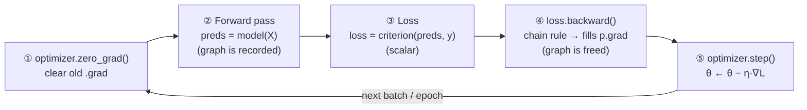
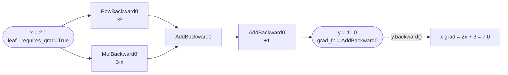
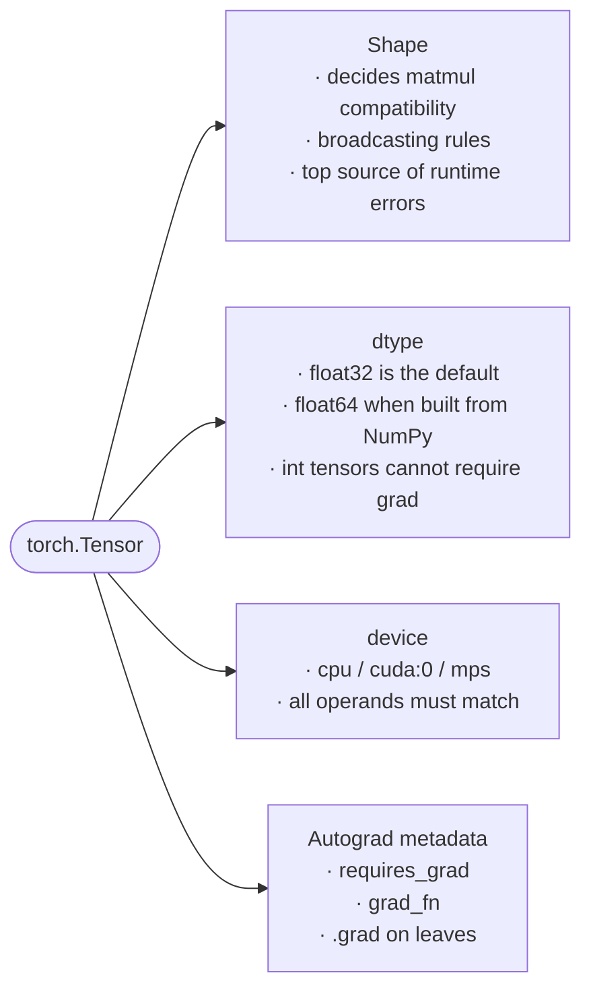

:::tip[TL;DR (30-Second Interview Pitch)]
A **PyTorch tensor** is a multi-dimensional array that stores numbers **plus** the history of how it was computed, and it can live on a **CPU or a GPU**. **Autograd** records every operation on tensors with `requires_grad=True` in a **dynamic computational graph** and applies the **chain rule in reverse** (`loss.backward()`) to fill each parameter's `.grad`. Training is always the same five-beat loop: **zero_grad → forward → loss → backward → step**. `backward()` *computes* gradients, the **optimizer** *uses* them, and gradients **accumulate** unless you clear them.
:::

## ⚡ Essential Interview Recall

- **Tensor** = scalar (0-D) → vector (1-D) → matrix (2-D) → n-D. What sets it apart is its **behavior**, not its shape: **vectorized math + gradient tracking + device mobility**.
- **NumPy array vs tensor:** NumPy = *numbers*. Tensor = *numbers + computation history* + **GPU acceleration**.
- Every tensor has 3 properties that decide behavior: **`shape`** (most DL bugs are shape bugs), **`dtype`** (default `float32`), **`device`** (`cpu`, `cuda:0`, `mps`).
- `torch.tensor([1.0, 2.0])` → **`float32`**, but `torch.tensor(np.array([1.0]))` → **`float64`** (it inherits NumPy's default dtype). Mixing them later causes dtype errors.
- All of a neural network's math reduces to **elementwise ops, dot products, matrix multiplication and broadcasting**.
- **Broadcasting:** shapes are compared **right to left**. Two dimensions are compatible if they are **equal**, **one of them is 1**, or **one is missing**. `(4,3) + (3,) → (4,3)`.
- PyTorch **never moves tensors between devices automatically**. Every operand must be on the **same device**, or you get a `RuntimeError`.
- Device pick order: `cuda` (NVIDIA) → `mps` (Apple Silicon) → `cpu`.
- **Autograd** = **reverse-mode automatic differentiation**: record ops in the **forward pass** → build a **DAG** → **chain rule** backward from a **scalar** loss.
- The graph is **dynamic (define-by-run)**: it is rebuilt every iteration, so normal Python `if`/`for` works inside `forward()`.
- Gradient tracking is **off by default**. Turn it on with `requires_grad=True` (only **floating-point/complex** tensors can require grad).
- **Leaf tensors** (created by you, e.g. weights) get `.grad` filled in. **Intermediate (non-leaf) tensors** don't, unless you call `.retain_grad()`.
- **`loss.backward()` computes gradients. It does NOT update weights.** `optimizer.step()` updates them. The optimizer never computes gradients.
- PyTorch **accumulates (adds) gradients** into `.grad` by default → call **`optimizer.zero_grad()` once per iteration**.
- **Loss function rules:** it must be **differentiable**, return a **scalar**, and connect the model output to the target. **MSE** $= \frac{1}{n}\sum (\hat{y} - y)^2$ for regression.
- **SGD update:** $\theta \leftarrow \theta - \eta \nabla_\theta L$ ($\eta$ = learning rate).
- `nn.Linear(in, out)` stores **`weight` of shape `(out, in)`** and **`bias` of shape `(out,)`**, and computes $Y = XW^\top + b$.
- Stacking linear layers **without activations** collapses into a **single linear layer**. Non-linearity (e.g. **ReLU**) is where the network gets its expressive power.
- **`nn.Module`**: `__init__()` = *what layers exist*; `forward()` = *how data flows*. Call `model(x)`, never `model.forward(x)`.
- Conversion idiom: **`x.detach().cpu().numpy()`**. `.item()` turns a 1-element tensor into a Python number.
- **`model.eval()`** changes layer behavior (Dropout/BatchNorm). **`torch.no_grad()`** disables gradient tracking. At inference you use **both**.

## The Mental Model

### 1. The training loop (memorize this order)



<Animation src="pytorch/zero-grad" caption="Three iterations side by side. With zero_grad() .grad holds only the current gradient (4, 3, 2.5). Without it, backward() keeps ADDING: 4 → 7 → 9.5, so every step() overshoots more." />

### 2. What autograd actually builds

For $y = x^2 + 3x + 1$ with $x = 2$:



<Animation src="pytorch/autograd-backward" caption="Forward: autograd records each op and its value. Backward: each node multiplies the upstream gradient by its local derivative; x feeds two branches, so its gradients add: 4 + 3 = 7." />

### 3. A tensor's three properties



## The Paradigm / Core Concepts

### NumPy array vs PyTorch tensor

| Aspect | NumPy `ndarray` | PyTorch `Tensor` |
|---|---|---|
| Focus | Numerical values | Numerical values **+ computation history** |
| Gradient tracking | ❌ None | ✅ Autograd via `requires_grad=True` |
| GPU acceleration | ❌ CPU only | ✅ `cpu`, `cuda`, `mps` via `.to(device)` |
| Default float dtype | `float64` | `float32` (faster, half the memory, GPU-friendly) |
| Interop | `torch.from_numpy(a)` **shares memory** | `t.numpy()` **shares memory** (CPU tensors only) |
| Copying constructor | — | `torch.tensor(a)` **always copies** |
| Role in DL | Data prep, analysis, plotting | Inputs, weights, activations, gradients |

### The four building-block operations

| Operation | API | Shapes | Example |
|---|---|---|---|
| **Elementwise** | `a + b`, `a * b`, `torch.relu(a)` | same shape (or broadcastable) | `[1,2] * [3,4] = [3,8]` |
| **Dot product** | `torch.dot(a, b)` | 1-D · 1-D → scalar | `[1,2]·[3,4] = 11` |
| **Matrix × vector** | `torch.matmul(M, v)` / `M @ v` | `(m,n) @ (n,) → (m,)` | `[[1,2],[3,4]] @ [1,1] = [3,7]` |
| **Matrix × matrix** | `torch.matmul(A, B)` / `A @ B` | `(m,n) @ (n,p) → (m,p)` | batched: `(b,m,n) @ (b,n,p)` |
| **Broadcasting** | implicit | compatible trailing dims | `(4,3) + (3,) → (4,3)` |

:::info[Broadcasting: the rule, step by step]
Line the shapes up **from the right**. For each dimension pair, they must be **equal**, or **one of them must be 1**, or **one must be missing** (it is treated as 1). The size-1 dimension is *virtually* stretched. No data is copied (stride 0), which is why broadcasting saves **memory** and **time** and runs in **parallel**.

```text
A      : 4 x 3
b      :     3   →  treated as 1 x 3  →  stretched to 4 x 3
A + b  : 4 x 3   ✅

A      : 4 x 3
c      :     4   ❌  (3 vs 4 — neither is 1)  → RuntimeError
```
The textbook example is adding the **bias**: in $Y = XW^\top + b$, `b` of shape `(out,)` is broadcast across every row (sample) of the batch.
:::

<Animation src="pytorch/broadcasting" caption="Shapes are aligned from the right; the missing dimension of b becomes 1 and is stretched to 4 rows as a stride-0 view (no copy). (4, 3) + (4,) fails because 3 vs 4 and neither is 1." />

### Tensor properties at a glance

| Property | Why it matters | Inspect | Change |
|---|---|---|---|
| **shape** | Decides how tensors combine in matmul/broadcasting. Most DL errors are shape errors | `t.shape`, `t.size()`, `t.ndim` | `view`, `reshape`, `unsqueeze`, `squeeze`, `permute`, `T` |
| **dtype** | Numerical precision. Gradients need floats | `t.dtype` | `t.float()`, `t.to(torch.float32)` |
| **device** | Where the computation runs | `t.device` | `t.to(device)`, `t.cuda()`, `t.cpu()` |

### Autograd vocabulary

| Term | Meaning |
|---|---|
| `requires_grad=True` | "Track every op on me, I'm a variable I want gradients for." Set on **parameters**, normally **not** on input data |
| **Leaf tensor** | A tensor created directly by the user (not the result of an op). Model weights are leaves. Only leaves keep `.grad` |
| **Non-leaf tensor** | Result of an op on tracked tensors. Has a `grad_fn` (e.g. `PowBackward0`). `.grad` is `None` unless `.retain_grad()` |
| `grad_fn` | Pointer to the backward function that created the tensor: the graph's edges |
| `.backward()` | Runs reverse-mode autodiff from a **scalar**, writes/accumulates into each leaf's `.grad`, then **frees the graph** |
| `.grad` | Where the gradient $\partial L / \partial \theta$ ends up. Has the same shape as the parameter |
| `.detach()` | Returns a tensor that shares data but is **cut out of the graph** |
| `torch.no_grad()` | Context manager that stops graph recording (inference, manual weight updates) |

### The three training components

| Component | Job | Does it compute gradients? | Example |
|---|---|---|---|
| **Model** | Maps inputs → predictions using learnable parameters | No, it produces the graph | `nn.Linear(1, 1)`, `SimpleNN()` |
| **Loss function** | Scalar measure of prediction error. **Start point of backprop** | No, it's the root of the graph | `nn.MSELoss()` |
| **Autograd** | Applies the chain rule through the recorded graph | ✅ **Yes** | `loss.backward()` |
| **Optimizer** | Uses `.grad` to move parameters downhill | ❌ **No**, it only reads `.grad` | `optim.SGD(model.parameters(), lr=0.02)` |

The update rules you need to know:

$$
\text{MSE} = \frac{1}{n}\sum_{i=1}^{n}\left(\hat{y}_i - y_i\right)^2
\qquad\qquad
\theta \leftarrow \theta - \eta\,\nabla_{\theta} L
$$

### From `y = wx + b` to a neural network

| Model | Equation | Shapes |
|---|---|---|
| Scalar linear regression | $y = wx + b$ | $w, b \in \mathbb{R}$ |
| Batched linear layer `nn.Linear(d, k)` | $Y = XW^\top + b$ | $X: (N, d)$, $W: (k, d)$, $b: (k)$ → $Y: (N, k)$ |
| 1-hidden-layer network | $Y = \text{ReLU}(XW_1^\top + b_1)\,W_2^\top + b_2$ | linear → non-linear → linear |

Worked shapes for the notebook's `SimpleNN` with $X \in \mathbb{R}^{100 \times 1}$:

| Step | Operation | Parameter shape | Output shape |
|---|---|---|---|
| Input | — | — | `(100, 1)` |
| `layer1 = nn.Linear(1, 8)` | $H = XW_1^\top + b_1$ | $W_1$: `(8, 1)`, $b_1$: `(8,)` | `(100, 8)` |
| `relu` | $A = \max(0, H)$ | none | `(100, 8)` |
| `layer2 = nn.Linear(8, 1)` | $Y = AW_2^\top + b_2$ | $W_2$: `(1, 8)`, $b_2$: `(1,)` | `(100, 1)` |

Total learnable parameters: $8 + 8 + 8 + 1 = 25$.

:::danger[Interview Trap: "Deeper = more powerful", even without activations?]
No. $W_2(W_1x + b_1) + b_2 = (W_2W_1)x + (W_2b_1 + b_2) = W'x + b'$. Any stack of purely linear layers **collapses into one linear layer**. It can never fit $y = x^2$. The **non-linear activation between layers** is what lets the network approximate curves. As the notebook says: *"This is NOT deep learning magic. It is matrix multiplication + non-linearity."*
:::

### What `nn.Module` gives you

| Feature | How |
|---|---|
| **Automatic parameter registration** | Assigning an `nn.Linear`/`nn.Parameter` to `self.x` in `__init__` registers it, so `model.parameters()` finds it for the optimizer |
| **Clean forward definition** | You write `forward(x)`; calling `model(x)` runs `__call__`, which fires hooks and then `forward` |
| **Submodule nesting** | Modules contain modules, so deep networks stay manageable |
| **Device / dtype moves** | `model.to(device)` moves **all** parameters and buffers |
| **Train / eval modes** | `model.train()` / `model.eval()` toggle Dropout & BatchNorm |
| **Save / load** | `model.state_dict()` / `model.load_state_dict(...)` |

## ⚙️ Under the Hood (PyTorch Internals)

**Memory layout: storage, shape, stride**
- A tensor is a **view** over a flat, contiguous 1-D **storage** buffer, plus metadata: `shape`, `stride`, `storage_offset`, `dtype`, `device`.
- **Stride** = how many elements to skip in storage to move one step along each dimension. A `(2,3)` row-major tensor has stride `(3, 1)`.
- `view()`, `transpose()`, `t()`, `permute()`, slicing and `expand()` only change **metadata**. They are $O(1)$ and **share storage**, so mutating the view mutates the original.
- `transpose()`/`permute()` produce **non-contiguous** tensors, and `.view()` on them raises an error. Use `.reshape()` (copies if needed) or `.contiguous().view()`.
- **Broadcasting** works by giving the stretched dimension **stride 0**: the same memory is re-read and never copied.
- `unsqueeze(1)` turns `(100,)` into `(100, 1)`. The notebook uses this because `nn.Linear` expects `(batch, features)`.

**dtype**
- Default float dtype is **`float32`**: half the memory of `float64`, and GPUs have far more FP32 (and FP16/BF16) throughput than FP64.
- Gradients only make sense on a continuous space, so **integer tensors cannot have `requires_grad=True`**. Labels for classification stay `int64` (`long`), but inputs and weights are floats.
- Binary ops between different dtypes follow **type promotion** (`float32 + float64 → float64`), but `nn.Linear` weights are `float32`, so feeding it a `float64` tensor raises `expected scalar type Float but found Double`.

**Devices**
- `torch.device("cuda" if torch.cuda.is_available() else "cpu")` is the standard idiom. Apple Silicon adds `torch.backends.mps.is_available()`.
- `tensor.to(device)` **returns a new tensor** (the original stays where it was). `module.to(device)` **moves the module's parameters in place** and returns the same module.
- No automatic device moves is a deliberate design choice: **host↔device copies over PCIe are expensive**, and a hidden copy every iteration would quietly kill performance.
- CUDA kernels launch **asynchronously**. `.item()`, `.cpu()`, `print(t)` force a **synchronization**, so calling `.item()` every step has a cost (fine for logging once per epoch).
- `torch.cuda.get_device_name(0)` crashes on machines without CUDA. Guard it with `is_available()`.

**Autograd engine**
- **Reverse-mode AD** costs about one extra forward pass to get the gradient w.r.t. **all** parameters at once. That is why it beats forward-mode when there are millions of inputs (parameters) and **one scalar output** (loss).
- Each op on a tracked tensor creates a **`Node`** (e.g. `PowBackward0`) that **saves the tensors it needs** for its derivative (e.g. `x` for `x**2`). These saved activations are the main **memory cost of training**.
- `backward()` walks the DAG in reverse topological order and multiplies local Jacobians by the upstream gradient (**vector-Jacobian product**).
- After `backward()` the graph's saved buffers are **freed**. A second `backward()` on the same graph raises an error unless you passed `retain_graph=True`.
- `backward()` only works implicitly on a **scalar**. For a non-scalar `y` you must pass `y.backward(gradient=...)` or reduce first (`y.sum()`, `y.mean()`). That's why losses return scalars.
- Gradients are **added** (`+=`) into `.grad`. That is accumulation. It's useful on purpose for simulating big batches, and a bug when you forget to clear it.
- Since PyTorch 2.0, `zero_grad()` defaults to **`set_to_none=True`**: `.grad` becomes `None` instead of a zero tensor, which saves memory and a kernel launch.
- `x.grad.zero_()`: the trailing **underscore** marks an **in-place** op. In-place ops on a **leaf that requires grad** are forbidden outside `torch.no_grad()`, which is why optimizers update weights inside a no-grad context.

**Worked chain rule (notebook example)**

$x = 3,\; y = x^2 = 9,\; z = y^2 = 81$

$$
\frac{\partial z}{\partial y} = 2y = 18 \qquad
\frac{\partial z}{\partial x} = \frac{\partial z}{\partial y}\cdot\frac{\partial y}{\partial x} = 18 \cdot 2x = 18 \cdot 6 = 108
$$

`x.grad == 108` (leaf, automatic). `y.grad == 18` **only because** `y.retain_grad()` was called.

**Optimizer step**
- `optim.SGD(model.parameters(), lr)` keeps **references** to the parameter tensors. `step()` does `p -= lr * p.grad` for each one under `no_grad`.
- **Learning rate** controls the step size. Too small gives slow, smooth convergence. Too large makes the loss **oscillate or diverge to `inf`/`nan`**.
- The size of a stable learning rate depends on the **scale of the inputs**. MSE's gradient on a weight is about $\frac{2}{n}\sum x_i(\hat{y}_i - y_i)$, so large $x$ means large gradients. This is why **feature normalization** matters.

:::danger[Interview Trap: "`loss.backward()` trains the model"]
It doesn't. `backward()` only **computes and stores** gradients in `.grad`. Weights change **only** when `optimizer.step()` runs. Likewise, the optimizer **never** computes gradients; it just reads `.grad`. Say it as: *"Autograd computes, the optimizer updates."*
:::

:::danger[Interview Trap: "`model.eval()` turns off gradients"]
It doesn't. `model.eval()` only switches **layer behavior** (Dropout stops dropping, BatchNorm uses running statistics). The graph is still recorded. `torch.no_grad()` (or `torch.inference_mode()`) is what stops tracking and saves memory. At inference time, use **both**.
:::

## 💻 PyTorch Implementation

:::info
This is a Python / PyTorch topic, so this section uses PyTorch instead of Java. The snippets consolidate the notebook's code cells.
:::

### 1. Tensors, operations, broadcasting and devices

```python
import torch
import numpy as np

# --- Creation & the three properties --------------------------------------
x = torch.tensor([1.0, 2.0, 3.0])                 # float32 (PyTorch default)
# highlight-next-line
y = torch.tensor(np.array([4.0, 5.0, 6.0]))       # float64! inherits NumPy's dtype
print(y.shape, y.dtype, y.device)                 # torch.Size([3]) torch.float64 cpu

# --- Core operations ------------------------------------------------------
a = torch.tensor([1.0, 2.0])
b = torch.tensor([3.0, 4.0])
print(torch.dot(a, b))                            # tensor(11.)  -> 1*3 + 2*4

M = torch.tensor([[1.0, 2.0],
                  [3.0, 4.0]])
v = torch.tensor([1.0, 1.0])
print(torch.matmul(M, v))                         # tensor([3., 7.])  (same as M @ v)

# --- Broadcasting: (4,3) + (3,) -> (4,3) ----------------------------------
A = torch.ones(4, 3)
bias = torch.tensor([10.0, 20.0, 30.0])
# highlight-next-line
print(A + bias)                                   # every row becomes [11., 21., 31.]

# --- Device selection: CUDA -> Apple MPS -> CPU --------------------------
if torch.cuda.is_available():
    device = torch.device("cuda")
elif torch.backends.mps.is_available():
    device = torch.device("mps")
else:
    device = torch.device("cpu")

# highlight-next-line
x_dev = x.to(device)          # returns a NEW tensor; x itself stays on CPU
print("Using:", device, "| x_dev on:", x_dev.device)
if device.type == "cuda":     # guard: get_device_name crashes without CUDA
    print(torch.cuda.get_device_name(0))

# --- Safe conversion back to NumPy (plotting, sklearn, etc.) -------------
arr = x_dev.detach().cpu().numpy()
```

### 2. Autograd

```python
import torch

# Scalar: y = x^2 + 3x + 1  ->  dy/dx = 2x + 3
x = torch.tensor(2.0, requires_grad=True)
y = x**2 + 3*x + 1
# highlight-next-line
y.backward()                                      # chain rule, fills x.grad
print(y.item(), x.grad)                           # 11.0  tensor(7.)

x.grad.zero_()                                    # in-place reset; grads ACCUMULATE otherwise

# Vector: z = sum(w^2)  ->  dz/dw = 2w   (sum() makes the output a scalar)
w = torch.tensor([1.0, 2.0, 3.0], requires_grad=True)
z = torch.sum(w**2)
z.backward()
print(w.grad)                                     # tensor([2., 4., 6.])

# Chain rule through an intermediate (non-leaf) tensor
x = torch.tensor(3.0, requires_grad=True)
y = x**2                                          # non-leaf, grad_fn=PowBackward0
# highlight-next-line
y.retain_grad()                                   # otherwise y.grad would be None
z = y**2
z.backward()
print(x.grad, y.grad)                             # tensor(108.) tensor(18.)
```

### 3. Loss, optimizer and the canonical training loop

```python
import torch
import torch.nn as nn
import torch.optim as optim

torch.manual_seed(0)                              # reproducibility (same init + same noise)
X = torch.linspace(0, 10, 100).unsqueeze(1)       # (100,) -> (100, 1): (batch, features)
y = 3 * X + 2 + torch.randn(100, 1)               # true w=3, b=2, plus noise

model = nn.Linear(1, 1)                           # weight (1,1), bias (1,)
criterion = nn.MSELoss()
optimizer = optim.SGD(model.parameters(), lr=0.02)

losses = []
for epoch in range(80):
    # highlight-next-line
    optimizer.zero_grad()                         # ① clear accumulated grads
    preds = model(X)                              # ② forward (builds graph)
    loss = criterion(preds, y)                    # ③ scalar loss
    # highlight-next-line
    loss.backward()                               # ④ compute grads only
    # highlight-next-line
    optimizer.step()                              # ⑤ update params only
    losses.append(loss.item())                    # plain float for logging/plotting

print(f"final loss={losses[-1]:.3f}  w={model.weight.item():.3f}  b={model.bias.item():.3f}")
# loss drops 351 -> ~1.2 within a few epochs; w heads toward 3. b converges much more
# slowly (unscaled X makes the loss surface elongated), so it is still short of 2 at 80 epochs.
```

### 4. A real neural network with `nn.Module`

```python
import torch
import torch.nn as nn
import torch.optim as optim

class SimpleNN(nn.Module):
    def __init__(self):
        super().__init__()                        # REQUIRED: sets up parameter registry
        # highlight-next-line
        self.layer1 = nn.Linear(1, 8)             # W1: (8, 1), b1: (8,)
        self.relu = nn.ReLU()                     # the non-linearity that makes depth matter
        self.layer2 = nn.Linear(8, 1)             # W2: (1, 8), b2: (1,)

    def forward(self, x):                         # how data flows
        x = self.layer1(x)                        # (N,1) -> (N,8)
        x = self.relu(x)
        return self.layer2(x)                     # (N,8) -> (N,1)

torch.manual_seed(0)
model = SimpleNN()
print(model.layer1.weight.shape, model.layer2.weight.shape)   # [8, 1]  [1, 8]
print(sum(p.numel() for p in model.parameters()))             # 25

# Non-linear target: a single nn.Linear can never fit this
X = torch.linspace(-5, 5, 200).unsqueeze(1)
y = X**2 + torch.randn(200, 1) * 2

criterion = nn.MSELoss()
optimizer = optim.SGD(model.parameters(), lr=0.01)

model.train()
for epoch in range(150):
    optimizer.zero_grad()
    loss = criterion(model(X), y)                 # call model(X), never model.forward(X)
    loss.backward()
    optimizer.step()

# Inference: eval() changes layer behavior, no_grad() stops graph building
model.eval()
# highlight-next-line
with torch.no_grad():
    preds = model(X)
```

## 🚨 Interview Gotchas & Edge Cases

:::warning[The Most Common Question]
**"Walk me through a PyTorch training step. What does `backward()` do, and why do we call `zero_grad()`?"**

1. `optimizer.zero_grad()` clears old gradients, **because PyTorch accumulates them by default**.
2. `outputs = model(inputs)`: the forward pass records the dynamic graph.
3. `loss = loss_fn(outputs, targets)`: a scalar, the root of the graph.
4. `loss.backward()`: reverse-mode autodiff (chain rule) writes $\partial L/\partial\theta$ into every parameter's `.grad`. **No weights change here.**
5. `optimizer.step()`: $\theta \leftarrow \theta - \eta\nabla L$, the **only** place weights change.

If you skip `zero_grad()`, each step uses the **sum of all past gradients**. Updates grow larger and stale, so the loss oscillates or diverges. Mnemonic: **zero → forward → loss → backward → step**.
:::

- **Forgetting `zero_grad()`:** gradients pile up ($g_t^{\text{used}} = \sum_{k \le t} g_k$), and the effective step keeps growing → oscillation/divergence. **Intentional** accumulation (calling `step()` + `zero_grad()` every *k* mini-batches) is a legitimate trick to simulate a **larger batch size** on limited GPU memory.
- **`zero_grad()` placement:** at the start of the iteration (canonical) or right after `step()` (as in the notebook). Both are correct **as long as it runs exactly once per update**. Putting it between `backward()` and `step()` wipes the gradients, so the model never learns.
- **Unscaled inputs explode the loss.** One of the notebook cells uses `X = torch.linspace(0, 100, 100)` with the same `lr=0.02` that worked for `0..10`. The gradient scales with $x^2$ (about $100\times$ larger), so SGD **overshoots and the loss goes to `inf`/`nan`**. Fix it by **normalizing features** or lowering the LR by orders of magnitude.
- **Learning rate vs loss curve shape:** too low → slow, nearly linear decline. Good → steep drop then a plateau (the notebook goes 351 → 49 → 7.9 → 2.2 → ~1.2). Too high → zig-zag or explosion. **If training is unstable, check first:** LR, input scaling, missing `zero_grad()`, loss/target shape mismatch, wrong dtype/device.
- **Silent broadcasting bugs:** `preds` of shape `(N, 1)` minus `y` of shape `(N,)` broadcasts to **`(N, N)`**, giving a wrong loss **with no error** (only a `UserWarning` in `MSELoss`). Always keep target and prediction shapes identical. That is why the notebook uses `unsqueeze(1)`.
- **`float64` from NumPy:** `torch.tensor(np_array)` keeps `float64`, which then fails against `float32` layer weights. Use `torch.from_numpy(a).float()`.
- **`.numpy()` failures:** `can't call numpy() on Tensor that requires grad` → `.detach()` first. Tensor on GPU → `.cpu()` first. Safe idiom: **`t.detach().cpu().numpy()`**.
- **`torch.from_numpy` / `.numpy()` share memory:** editing one edits the other. `torch.tensor()` copies.
- **Device mismatch:** `Expected all tensors to be on the same device` → move **both** the model (`model.to(device)`) and **each batch** (`X.to(device)`). Remember `tensor.to()` is not in-place: `x.to(device)` without assigning the result does nothing.
- **`backward()` on a non-scalar** → `grad can be implicitly created only for scalar outputs`. Reduce with `.sum()`/`.mean()` or pass `gradient=`.
- **Second `backward()` on the same graph** → error (buffers freed). Use `retain_graph=True` only if you truly need it, e.g. multiple losses sharing a graph.
- **`.grad` is `None`** on intermediate tensors (use `.retain_grad()`), on tensors created with `requires_grad=False`, and after `zero_grad()` (set-to-none default).
- **Calling `model.forward(x)` directly** skips hooks. Always call `model(x)`.
- **Forgetting `super().__init__()`** in an `nn.Module` subclass → `cannot assign module before Module.__init__() call`.
- **`.item()` in hot loops** forces a GPU↔CPU sync every iteration. Log once per epoch or accumulate on-device.
- **Same random seed** (`torch.manual_seed`) for comparison runs makes sure both experiments start with identical weights and data noise, so any difference in the loss curve is caused *only* by the change you made (e.g. removing `zero_grad()`).

### Concept-Check Answers (from the notebook)

<details>
<summary><strong>Why are floating-point numbers preferred over integers in deep learning?</strong></summary>

Gradient descent needs a **continuous** space: derivatives of integer-valued functions are zero or undefined, and updates like $\theta - 0.02 \cdot g$ produce fractions. PyTorch only allows `requires_grad` on float/complex tensors. Activations (sigmoid, softmax) and losses also produce real values. `float32` is the sweet spot of precision vs memory/speed on GPUs.
</details>

<details>
<summary><strong>What role does a tensor's shape play in neural network computations?</strong></summary>

Shape decides whether matmul is legal (inner dimensions must match: `(N,d) @ (d,k)`), how broadcasting expands operands, and what each axis *means* (e.g. `(batch, seq_len, emb_dim)` in NLP). Most runtime errors in DL are shape errors, and the dangerous ones are the silent wrong-shape broadcasts.
</details>

<details>
<summary><strong>How is a PyTorch tensor fundamentally different from a NumPy array?</strong></summary>

A NumPy array holds **values**. A tensor holds **values + computation history** (`grad_fn`, `requires_grad`, `.grad`) so autograd can differentiate through it, and it can live on a **GPU**. Python lists are neither vectorized nor typed.
</details>

<details>
<summary><strong>Why must tensors and models be explicitly moved to the GPU?</strong></summary>

CPU↔GPU transfers are slow (PCIe), so implicit copies would cause silent performance problems. Making it explicit forces you to place data deliberately, and lets the same code run on any device via a single `device` variable.
</details>

<details>
<summary><strong>What problem does broadcasting solve?</strong></summary>

It applies an operation between compatible but different shapes (e.g. adding a bias vector to every row of a batch) **without Python loops and without copying data** (stride-0 views). That gives computational efficiency, memory efficiency and parallel execution.
</details>

<details>
<summary><strong>Why does the loss decrease in the correct training loop?</strong></summary>

Each step moves the parameters a small amount opposite the gradient of the **current** loss, the direction of steepest local decrease. With a suitable LR, each update lowers the MSE until it plateaus at the noise floor (about 1.0 here, the variance of `torch.randn`).
</details>

<details>
<summary><strong>What pattern appears in the loss curve without <code>zero_grad()</code>?</strong></summary>

The gradient used at step *t* is the running **sum** of all previous gradients, so the effective step size keeps growing and points in stale directions. The loss may fall at first, then **oscillate with increasing amplitude or blow up**, and it does not settle to the minimum the correct run reaches.
</details>

<details>
<summary><strong>What does gradient accumulation mean mathematically?</strong></summary>

`.grad` $\leftarrow$ `.grad` $+ \nabla_\theta L_t$. After *k* backward calls without clearing, `.grad` $= \sum_{t=1}^{k} \nabla_\theta L_t$. Done on purpose over *k* mini-batches (often with the loss divided by *k*), this equals the gradient of a *k*× larger batch.
</details>

<details>
<summary><strong>How would increasing the learning rate affect the loss curve?</strong></summary>

Moderately higher → faster initial drop. Too high → overshooting the minimum: a zig-zag/oscillating curve, and past a threshold (related to the curvature of the loss, $\eta > 2/\lambda_{\max}$ for quadratic losses like MSE) the loss **diverges** to `inf`/`nan`.
</details>
