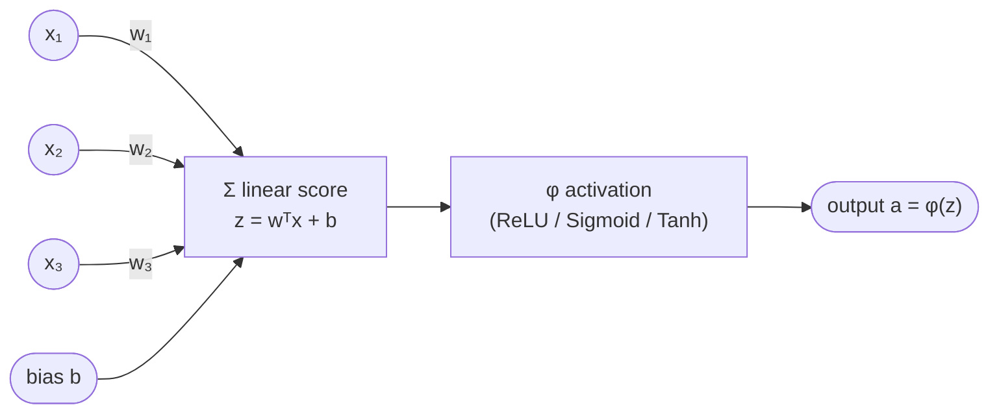
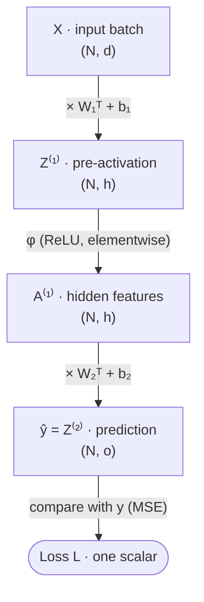
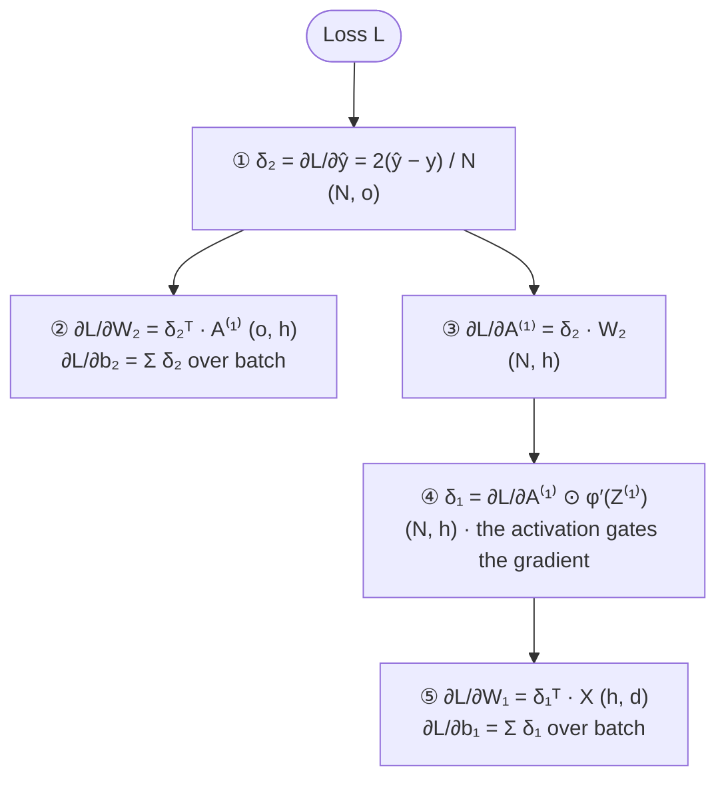
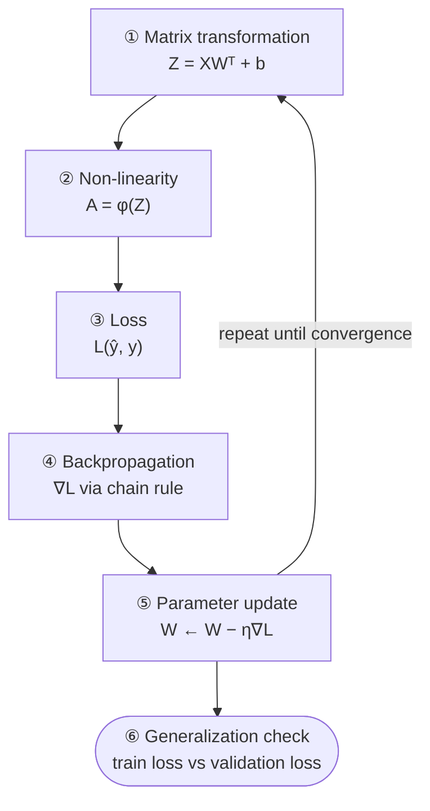
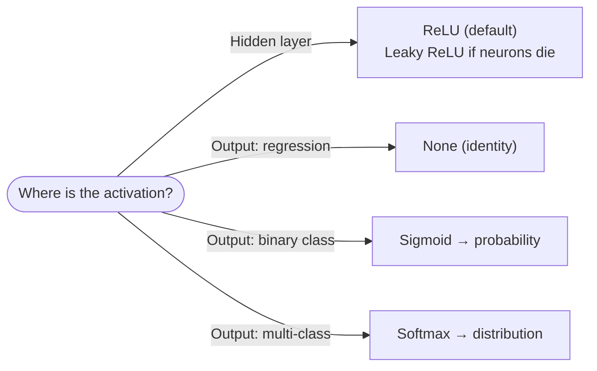

:::tip[TL;DR (30-Second Interview Pitch)]
An **Artificial Neural Network (ANN)** is a stack of layers. Each layer does a **matrix multiplication** ($Z = XW^\top + b$) followed by a **non-linear activation** ($A = \phi(Z)$). Without the activation, any number of layers **collapses into one linear layer**. With it, the network can approximate curved functions like $y = x^2$. Training means **minimizing a loss** $L(W, b)$: **backpropagation** (the chain rule applied layer by layer) computes $\partial L/\partial W$, **gradient descent** moves the weights downhill, and the real goal is low loss on **unseen** data, not just training data.
:::

## ⚡ Essential Interview Recall

**Architecture**
- **Neuron** = linear score + activation: $z = w^\top x + b$, then $a = \phi(z)$. Geometrically: *project the input onto $w$, shift by $b$, bend with $\phi$*.
- **Layer of $m$ neurons**: $Z = XW^\top + b$ with $X:(N,d)$, $W:(m,d)$, $b:(m)$ → $Z:(N,m)$. $b$ is **broadcast across the batch dimension $N$**.
- `nn.Linear(in, out)` stores `weight` as **`(out, in)`**: row $j$ is neuron $j$'s weight vector.
- 2-layer flow: $(N,d) \rightarrow (N,h) \rightarrow (N,o)$. **Track shapes at every step.**
- **Hidden layer = feature creator**: each neuron defines a **hyperplane** $w_j^\top x + b_j = 0$, and the activation turns it into a new non-linear feature. The **output layer linearly mixes** those features.

**Non-linearity**
- Two linear layers: $W_2(W_1x + b_1) + b_2 = \underbrace{W_2W_1}_{W'}x + \underbrace{W_2b_1 + b_2}_{b'}$ → **still one affine map**. Depth without activation adds **zero** expressive power.
- A linear model can't fit $y = x^2$: its **second derivative is 0**, while $x^2$ has a second derivative of 2.
- **ReLU networks are piecewise linear**: each hidden neuron adds one **kink** (slope change). More neurons → more kinks → a closer fit to the curve.

**Activations**
- **Sigmoid** $\sigma(z) = \frac{1}{1+e^{-z}}$: range $(0,1)$, $\sigma' = \sigma(1-\sigma)$, **max gradient 0.25**, saturates at both ends, not zero-centered.
- **Tanh**: range $(-1,1)$, derivative $1 - \tanh^2$, **max gradient 1**, **zero-centered**, still saturates.
- **ReLU** $\max(0,z)$: gradient **1 for $z>0$, 0 for $z<0$**. Cheap, **no saturation on the positive side**, but can **die** (stuck at 0 forever).
- **Saturation** = flat region of the curve → gradient ≈ 0 → **vanishing gradients**.

**Loss**
- Loss is a function of **all** parameters: $L = L(W_1, b_1, W_2, b_2)$, a surface in parameter space. **Training = walking downhill on that surface.**
- **MSE** $= \frac{1}{N}\sum(\hat y - y)^2$ → **regression**. It squares the error, so **large errors are penalized much more**.
- **Binary Cross-Entropy** $= -\frac{1}{N}\sum[y\log\hat y + (1-y)\log(1-\hat y)]$ → **classification**. It **punishes confident wrong predictions very heavily** ($-\log$ of a probability near 0 → ∞).
- Output layer ↔ loss pairing: **identity + MSE** (regression), **sigmoid + BCE** (binary), **softmax + Cross-Entropy** (multi-class).

**Backprop & training**
- **Backpropagation** = the chain rule applied from loss → output → hidden → parameters. It **computes** gradients. **Gradient descent** **uses** them: $W \leftarrow W - \eta\,\partial L/\partial W$.
- The gradient points to the **steepest increase**, so we step in the **negative** direction.
- Key backprop results: $\frac{\partial L}{\partial W_2} = \delta_2^\top A^{(1)}$, $\frac{\partial L}{\partial W_1} = \delta_1^\top X$, $\delta_1 = (\delta_2 W_2) \odot \phi'(Z^{(1)})$. **The gradient of a weight always involves that layer's input.**
- **Bias gradient = sum over the batch**: the bias was broadcast in the forward pass, so its gradient is summed in the backward pass.
- **Learning rate** = step size, gradient = direction. **Update = gradient × learning rate.** Too small → slow. Too big → oscillation or divergence.
- Failure modes: **divergence** (loss explodes), **oscillation** (loss zig-zags), **plateau** (loss stops falling). Monitor the **gradient norm** $\|\nabla L\|$ to diagnose them.

**Generalization**
- **Underfitting** = high bias = train ↑ and val ↑ (model too simple). **Overfitting** = high variance = train ↓ but val ↑ (model memorizes noise).
- **Capacity** (layers × neurons) ↑ → bias ↓, variance ↑. **Low training loss does not guarantee good generalization.**
- **Deep learning = linear algebra (matrix multiplication) + calculus (chain rule)**, repeated.

## The Mental Model

### 1. One neuron



### 2. A 2-layer network: forward pass

Data flows **down**: input → hidden features → prediction → one scalar loss.



### 3. The same network: backward pass

`loss.backward()` sends the error signal **δ** back **up** the network. Each step reuses the result of the one before it. The numbers match the table in Part E.



<Animation src="ann/forward-backward" caption="Forward pass computes ŷ and the loss; the backward pass sends δ from the loss towards the inputs. Unit 3 has z < 0, so ReLU′ = 0 blocks its gradient and its incoming weights do not change." />

### 4. The complete ANN learning pipeline



## The Paradigm / Core Concepts

### Part A: From one neuron to a network

#### The single neuron

| Symbol | Shape | Meaning |
|---|---|---|
| $x$ | $(d)$ | One input sample with $d$ features |
| $w$ | $(d)$ | One weight per feature: how much each feature matters |
| $b$ | scalar | Bias: shifts the decision boundary away from the origin |
| $z = w^\top x + b$ | scalar | **Pre-activation** (linear score) |
| $a = \phi(z)$ | scalar | **Activation** (the neuron's output) |

In plain English: the neuron asks **"how aligned is this input with my weight vector?"** ($w^\top x$), shifts that score ($+b$), then **squashes or bends** it ($\phi$). Biologically: receive signals → combine them → fire. The artificial neuron keeps only this mathematical skeleton.

#### A full layer and a 2-layer network

| Quantity | Formula | Shape |
|---|---|---|
| Input batch | $X$ | $(N, d)$, one row per sample |
| Layer-1 weights / bias | $W_1$, $b_1$ | $(h, d)$, $(h)$ |
| Hidden pre-activation | $Z^{(1)} = XW_1^\top + b_1$ | $(N,d)(d,h) \rightarrow (N, h)$ |
| Hidden activation | $A^{(1)} = \phi(Z^{(1)})$ | $(N, h)$, applied **elementwise** |
| Layer-2 weights / bias | $W_2$, $b_2$ | $(o, h)$, $(o)$ |
| Output | $\hat y = Z^{(2)} = A^{(1)}W_2^\top + b_2$ | $(N,h)(h,o) \rightarrow (N, o)$ |

For **regression** the output layer has **no activation** (identity), so $\hat y = Z^{(2)}$ can be any real number.

:::info[Shape rule you can use in every interview]
For `nn.Linear(in, out)`: **weight = `(out, in)`**, **bias = `(out,)`**, **input `(N, in)` → output `(N, out)`**. The batch dimension $N$ passes through untouched. To find a weight's shape, ask *"how many neurons (out) × how many inputs each (in)?"*
:::

#### What the hidden layer actually does

- Each hidden neuron $j$ computes $z_j = w_j^\top x + b_j$. The set $z_j = 0$ is a **hyperplane** (a line in 2-D) that cuts the input space in two.
- The activation **bends** the space along that hyperplane (ReLU zeroes one side).
- So the hidden layer turns raw inputs into **$h$ new features**, each answering "which side of my hyperplane, and how far?"
- The output layer then **linearly combines** these features. **Linear projection → non-linear transformation → feature creation.**

### Part B: Why non-linearity is non-negotiable

$$
f_2(f_1(x)) = W_2(W_1x + b_1) + b_2 = \underbrace{(W_2W_1)}_{W'}\,x + \underbrace{(W_2b_1 + b_2)}_{b'}
$$

- A composition of affine maps is **affine**. 2, 3 or 100 linear layers equal **one** linear layer (the notebook confirms numerically: max difference **0.00**).
- A linear model has $\frac{d^2}{dx^2}(wx+b) = 0$, so it can never represent curvature. $\frac{d^2}{dx^2}x^2 = 2$.
- A **3-layer network without activations cannot fit $y = x^2$**. It is still just $\hat y = w'x + b'$.

:::danger[Interview Trap: "More layers = more power"]
Only if there are **non-linear activations between them**. Without activations, stacking layers adds parameters and compute but **no** expressive power. Depth + non-linearity is what matters.
:::

### Part C: Activation functions

| | **Sigmoid** | **Tanh** | **ReLU** |
|---|---|---|---|
| Formula | $\sigma(z) = \dfrac{1}{1+e^{-z}}$ | $\tanh(z) = \dfrac{e^z - e^{-z}}{e^z + e^{-z}}$ | $\max(0, z)$ |
| Range | $(0, 1)$ | $(-1, 1)$ | $[0, \infty)$ |
| Derivative | $\sigma(z)\,(1-\sigma(z))$ | $1 - \tanh^2(z)$ | $1$ if $z>0$, $0$ if $z<0$ |
| **Max gradient** | **0.25** (at $z=0$) | **1** (at $z=0$) | **1** (whole positive side) |
| Zero-centered? | ❌ | ✅ | ❌ |
| Saturates? | Both ends | Both ends | Only on the negative side (output 0) |
| Main problem | **Vanishing gradients** | Vanishing gradients (milder) | **Dying ReLU** |
| Cost | `exp` | `exp` | One comparison (cheapest) |
| Typical use today | **Output** for binary classification, gates (LSTM) | RNN hidden states | **Default for hidden layers** |



#### How a ReLU network bends a straight line into a curve

- Each hidden ReLU neuron outputs $\max(0, w_jx + b_j)$: flat, then a straight ramp. The bend is at $x = -b_j/w_j$.
- The output is a **weighted sum of these ramps**, so the result is **piecewise linear** with **up to $h$ kinks**.
- 32 hidden neurons → up to 32 slope changes → a smooth-looking approximation of $x^2$ (notebook: MSE **2.93 → 0.0083** in 300 epochs).
- This is the intuition behind the **Universal Approximation Theorem**: one wide-enough hidden layer with a non-linear activation can approximate any continuous function on a bounded range.

<Animation src="ann/relu-kinks" caption="Best least-squares fit of x² using 0 to 7 ReLU units. Zero units can only give a straight line (MSE 1.44); every unit adds one kink, and 7 kinks reach MSE 0.0004." />

### Part D: Loss functions

| | **Mean Squared Error (MSE)** | **Binary Cross-Entropy (BCE)** |
|---|---|---|
| Formula | $\dfrac{1}{N}\displaystyle\sum_{i}(\hat y_i - y_i)^2$ | $-\dfrac{1}{N}\displaystyle\sum_i\big[y_i\log\hat y_i + (1-y_i)\log(1-\hat y_i)\big]$ |
| Task | **Regression** (continuous target) | **Binary classification**, $y \in \lbrace 0,1 \rbrace$ |
| $\hat y$ is | Any real number | A **probability** in $(0,1)$ (after sigmoid) |
| Penalty shape | Quadratic: error ×2 → loss ×4 | Logarithmic: confident-and-wrong → loss → ∞ |
| Gradient w.r.t. $\hat y$ | $\frac{2}{N}(\hat y - y)$ | With sigmoid: $\frac{1}{N}(\hat y - y)$ w.r.t. the logit (clean, no saturation) |
| PyTorch | `nn.MSELoss()` | `nn.BCELoss()` on probabilities, **`nn.BCEWithLogitsLoss()` on raw logits (preferred)** |

**Worked BCE example** (notebook): $y = [1, 0, 1]$, $\hat y = [0.9, 0.2, 0.6]$

$$
L = -\tfrac{1}{3}\big[\log 0.9 + \log(1-0.2) + \log 0.6\big] = \tfrac{1}{3}(0.105 + 0.223 + 0.511) = 0.280
$$

The least confident correct prediction (0.6) contributes the most loss.

**Loss as a surface.** Because $\hat y = f(X; W_1, b_1, W_2, b_2)$, the loss is a function of **every** parameter. With $W_1: 16 \times 1$, $b_1: 16$, $W_2: 1 \times 16$, $b_2: 1$, that is $16+16+16+1 = $ **49 dimensions**. Training = moving downhill on a 49-D surface.

### Part E: Backpropagation, step by step

**Chain rule:** if $y = f(u)$ and $u = g(x)$, then $\dfrac{dy}{dx} = \dfrac{dy}{du}\cdot\dfrac{du}{dx}$. In a network the dependency chain is **Loss → Output → Hidden → Parameters**, so gradients must flow **backwards** along it.

Notation: $\delta_2 = \partial L/\partial Z^{(2)}$, $\delta_1 = \partial L/\partial Z^{(1)}$ (the "error signal" at each layer).

| Step | Gradient | Formula | Shape check |
|---|---|---|---|
| 1 | Output error | $\delta_2 = \dfrac{\partial L}{\partial \hat y} = \dfrac{2}{N}(\hat y - y)$ | $(N, o)$ |
| 2a | Output weights | $\dfrac{\partial L}{\partial W_2} = \delta_2^\top A^{(1)}$ | $(o,N)(N,h) = (o,h)$ ✅ same as $W_2$ |
| 2b | Output bias | $\dfrac{\partial L}{\partial b_2} = \sum_{i=1}^{N}\delta_{2,i}$ | $(o)$ ✅ |
| 3a | Back to hidden activations | $\dfrac{\partial L}{\partial A^{(1)}} = \delta_2 W_2$ | $(N,o)(o,h) = (N,h)$ |
| 3b | Through the activation | $\delta_1 = \dfrac{\partial L}{\partial A^{(1)}} \odot \phi'(Z^{(1)})$ | $(N,h)$, **elementwise** |
| 4a | Hidden weights | $\dfrac{\partial L}{\partial W_1} = \delta_1^\top X$ | $(h,N)(N,d) = (h,d)$ ✅ same as $W_1$ |
| 4b | Hidden bias | $\dfrac{\partial L}{\partial b_1} = \sum_{i=1}^{N}\delta_{1,i}$ | $(h)$ ✅ |

What to notice:
- **A weight's gradient = (error signal of its layer)ᵀ × (input to its layer).** $W_2$'s gradient uses $A^{(1)}$, and $W_1$'s gradient uses $X$. If an input is 0, the weight attached to it gets **no** update.
- Step 3b is where **activations decide gradient flow**. If $\phi'(Z^{(1)}) \approx 0$ (saturated sigmoid, dead ReLU), $\delta_1 \approx 0$ and the hidden layer **stops learning**.
- Every gradient has **exactly the same shape as its parameter**. Use this to check derivations.
- The whole network is nested functions $\hat y = f_2(f_1(X))$, so $\frac{\partial L}{\partial W_1} = \frac{\partial L}{\partial f_2}\cdot\frac{\partial f_2}{\partial f_1}\cdot\frac{\partial f_1}{\partial W_1}$. **Deep learning is a structured chain rule over matrix operations.**

**How layers share responsibility.** The output layer compares directly with the target. Hidden layers are **indirectly** responsible: they adjust their features so the final prediction improves. The **gradient magnitude** says *how strongly* each parameter should change. In the notebook's 2-layer net, output-layer gradients (`2.bias` ≈ 1.83) are much larger than first-layer ones (`0.weight` ≈ 0.04).

### Part F: Training dynamics

$$
W \leftarrow W - \eta\,\frac{\partial L}{\partial W}
\qquad\text{gradient = direction,}\quad \eta = \text{step size}
$$

| Learning rate $\eta$ | Behaviour | Loss curve |
|---|---|---|
| **Too small** (0.001 here) | Tiny steps, stable but very slow | Slow, almost straight decline. Still 0.11 after 500 epochs |
| **Good** (0.05 – 0.2 here) | Fast and stable | Steep drop, then a smooth plateau (0.2 → 0.0012) |
| **Too large** (≈ 0.5 – 1.0 here) | Overshoots the valley | **Oscillation** (loss jumps 0.18 → 7.6) or **dead ReLUs**: at 1.0 all 16 hidden neurons died and the loss froze at 33.6 |
| **Far too large** (≥ 1.5 here) | Every step overshoots further | **Divergence**: loss → ∞ → `nan` within a few epochs |

The "right" learning rate is problem-specific (it depends on the data scale and network). Numbers above are from the section 7 experiment.

<Animation src="ann/learning-rate" caption="Ten gradient-descent steps on L(w) = (w − 3)² from w = 0. Each step multiplies the distance to the minimum by (1 − 2η): 0.9 creeps, 0.2 converges in ~4 steps, −1.1 overshoots further every time." />

| Failure mode | Symptom | Usual causes | First things to try |
|---|---|---|---|
| **Divergence** | Loss explodes, `nan` | LR too large, unscaled inputs | Lower LR, normalize features, gradient clipping |
| **Oscillation** | Loss bounces up and down | LR slightly too large, ill-conditioned surface | Lower LR, momentum/Adam |
| **Plateau** | Loss stops decreasing early | Vanishing gradients, dead ReLUs, poor init, LR too small | ReLU/Leaky ReLU, better init, raise LR |

**Gradient norm** $\|\nabla L\| = \sqrt{\sum_{\text{all params}} \|\nabla_\theta L\|^2}$ is the training **health monitor**: huge → unstable updates (exploding), tiny early in training → vanishing gradients or dead neurons, slowly shrinking → healthy convergence.

### Part G: Generalization: underfitting vs overfitting

| | **Underfitting** | **Good fit** | **Overfitting** |
|---|---|---|---|
| Training loss | High | Low | **Very low** |
| Validation loss | High | Low (close to train) | **High** (gap grows over epochs) |
| Bias / Variance | **High bias** | Balanced | **High variance** |
| Cause | Model too simple (e.g. linear model for $x^2$) | Capacity matches the problem | Model too complex, it memorizes noise |
| Fix | More layers/neurons, train longer, better features | — | More data, regularization (L2, dropout), early stopping, smaller model |

- **Bias** = error from wrong assumptions (model too simple). **Variance** = error from sensitivity to the particular training sample (model too flexible).
- **Capacity** = how complex a function the model *can* represent. More layers/neurons → capacity ↑ → bias ↓ but variance ↑. The goal is the **balance**: capacity + good optimization + a sensible learning rate + enough data.
- **Generalization** = performance on unseen data, the real objective. Always judge a model by its **validation** loss, never by training loss alone.

### Part H: Where ANNs are used

| Use case | Type | Output layer + loss | Why an ANN |
|---|---|---|---|
| House price, demand, energy forecasting | Regression | Identity + **MSE** | Non-linear interactions between features |
| Fraud vs non-fraud | Binary classification | Sigmoid + **BCE** | Fraud patterns (amount × time × location × behaviour) are rarely **linearly separable** |
| Disease risk, readmission, survival probability | Binary / regression | Sigmoid + BCE or identity + MSE | Complex interactions between lab values, demographics, history |
| Digit recognition (0–9), product category | Multi-class | Softmax + **Cross-Entropy** | One probability per class |
| Images, speech, face detection, self-driving | Specialized (CNN/RNN/Transformer) | Task-specific | Still built on $Z = XW^\top + b$ + non-linearity + loss minimization |

ANNs are worth using when the input→output relationship is **non-linear**, the data is **high-dimensional**, and **linear models underfit**.

## ⚙️ Under the Hood (The Math & PyTorch Internals)

**Why weights are stored as `(out, in)`**
- Row $j$ of $W$ **is** neuron $j$'s weight vector $w_j$, so the layer is literally "$m$ neurons stacked as rows". $XW^\top$ computes every neuron's dot product with every sample in one matrix multiplication.
- `nn.Linear` computes it with one fused kernel (`addmm`: bias + $X \cdot W^\top$). The transpose is just a **stride swap** (no data copy).
- Matches the math convention $z = Wx + b$ for a single column-vector sample.

**Broadcast forward ⇒ sum backward**
- In $Z = XW^\top + b$, $b$ of shape $(m)$ is **broadcast** (virtually copied) to all $N$ rows.
- One parameter was used $N$ times, so by the chain rule its gradient is the **sum** of the $N$ per-row gradients. That's why $\partial L/\partial b = \sum_i \delta_i$, and why autograd's backward for a broadcast is a **reduction**.

**Vanishing gradients, quantified**
- Backprop multiplies one $\phi'$ per layer. With sigmoid, each factor is **at most 0.25**, so through $L$ layers the signal shrinks to at most $0.25^L$: **10 layers → below $10^{-6}$**. Early layers barely learn.
- Saturation makes it worse: at $z = 5$, $\sigma'(5) \approx 0.0066$.
- Tanh's max of 1 is better, but it saturates too. **ReLU's derivative is exactly 1 on active units**, so it passes gradients through unchanged. That is the main reason ReLU replaced sigmoid in hidden layers.

**Dying ReLU, mechanically**
- If a neuron's pre-activation $z$ is negative for **every** input, its output is 0 and its gradient is 0, so its weights **never update again**. It is permanently dead.
- Typical triggers: a **too-large learning rate** that kicks the bias very negative, or unlucky initialization.
- Fixes: **Leaky ReLU** ($0.01z$ for $z<0$, so the gradient is never exactly 0), a lower LR, **He/Kaiming initialization**.
- ReLU isn't differentiable at exactly $z = 0$. PyTorch simply uses **$\text{ReLU}'(0) = 0$** (a subgradient), which never matters in practice.

**Initialization & symmetry**
- If every weight started equal, all hidden neurons would compute the same thing, receive the **same gradient** and stay identical forever (**symmetry problem**). Random init breaks the symmetry.
- PyTorch's default for `nn.Linear`: weights and bias ~ $U\big(-\tfrac{1}{\sqrt{\text{in}}}, \tfrac{1}{\sqrt{\text{in}}}\big)$ (Kaiming-uniform with $a=\sqrt5$). Scaling by fan-in keeps $Z$'s variance from growing with layer width.

**Why BCE + sigmoid instead of MSE for classification**
- With sigmoid + MSE, $\partial L/\partial z = (\hat y - y)\cdot\sigma'(z)$. When the model is **confidently wrong**, $\sigma'(z) \approx 0$, so the gradient vanishes exactly when the correction is needed most. MSE + sigmoid is also **non-convex** in $z$.
- With sigmoid + BCE, the $\sigma'$ cancels: $\partial L/\partial z = \hat y - y$. Large error → large gradient, always.
- **Numerical stability:** `nn.BCELoss` takes probabilities and clamps $\log$ at $-100$ to avoid $\log 0$. **`nn.BCEWithLogitsLoss`** takes raw logits and fuses sigmoid + log with the **log-sum-exp trick**, so it is more stable. Prefer it and remove the sigmoid from the model's output layer.

**Full-batch vs mini-batch**
- Every notebook loop feeds **all $N$ samples** per step, which is **full-batch gradient descent**, even though the class is called `optim.SGD`. True SGD/mini-batch uses a random subset per step (via `DataLoader`): noisier, but far cheaper per step and it often generalizes better.

**Returning intermediate tensors** ($Z^{(1)}$, $A^{(1)}$)
- Useful for **learning and debugging** (inspect shapes, check how many ReLUs are active).
- Autograd already **saves** these internally for backward. Returning them costs nothing extra during training.
- In production, `forward()` normally returns only the output. Use **forward hooks** to peek at activations.

:::danger[Interview Trap: "Backpropagation is the optimization algorithm"]
No. **Backpropagation** is an *efficient way to compute gradients* (the chain rule, reusing intermediate results). **Gradient descent** (or Adam, etc.) is the *optimizer* that uses those gradients to update weights. In PyTorch: `loss.backward()` = backprop, `optimizer.step()` = gradient descent.
:::

:::danger[Interview Trap: "Low training loss means a good model"]
Training loss only measures fit to data the model has already seen. A high-capacity network can drive it to ~0 by **memorizing noise**. Only **validation/test loss** measures generalization, and overfitting shows up as the **gap** between the two curves.
:::

## 💻 PyTorch Implementation

### 1. One neuron and one layer: raw tensors

```python showLineNumbers
import torch
torch.manual_seed(0)

# --- single neuron: 4 samples, 3 features ---
N, d = 4, 3
X = torch.randn(N, d)
w = torch.randn(d)                 # one weight per feature
b = torch.randn(1)

# highlight-next-line
z = X @ w + b                      # (4,): one score per sample
a = torch.relu(z)                  # (4,)

# --- full layer: m = 4 neurons ---
N, d, m = 5, 3, 4
X = torch.randn(N, d)
W = torch.randn(m, d)              # (out, in): row j = neuron j
b = torch.randn(m)

# highlight-next-line
Z = X @ W.T + b                    # (5,3) @ (3,4) + (4,) → (5,4); b broadcast over N
A = torch.relu(Z)                  # (5,4), elementwise
```

### 2. Proof: stacked linear layers collapse into one

```python showLineNumbers
import torch
torch.manual_seed(0)
d, h, o = 3, 5, 2
W1, b1 = torch.randn(h, d), torch.randn(h)
W2, b2 = torch.randn(o, h), torch.randn(o)

# highlight-start
W_prime = W2 @ W1                  # (o, d)
b_prime = W2 @ b1 + b2             # (o,)
# highlight-end

X = torch.randn(7, d)
two_layers = (X @ W1.T + b1) @ W2.T + b2       # no activation in between
one_layer  = X @ W_prime.T + b_prime

print((two_layers - one_layer).abs().max())    # ~1e-6: identical up to float rounding
```

### 3. Activations and their gradients (measured with autograd)

```python showLineNumbers
import torch
z = torch.linspace(-6, 6, 13, requires_grad=True)

for name, fn in [("sigmoid", torch.sigmoid), ("tanh", torch.tanh), ("relu", torch.relu)]:
    z.grad = None
    fn(z).sum().backward()         # sum() → scalar, so z.grad = φ'(z) for every point
    print(f"{name:8s} max φ' = {z.grad.max().item():.3f}   φ'(5) = {z.grad[11].item():.4f}")

# sigmoid  max φ' = 0.250   φ'(5) = 0.0066   ← saturated: almost no gradient
# tanh     max φ' = 1.000   φ'(5) = 0.0002   ← saturates even harder
# relu     max φ' = 1.000   φ'(5) = 1.0000   ← no saturation on the positive side
```

### 4. A 2-layer ANN that learns $y = x^2$

```python title="small_ann.py" showLineNumbers
import torch
import torch.nn as nn

class SmallANN(nn.Module):
    def __init__(self, hidden=32):
        super().__init__()
        self.fc1 = nn.Linear(1, hidden)        # W1: (32, 1), b1: (32,)
        self.fc2 = nn.Linear(hidden, 1)        # W2: (1, 32), b2: (1,)

    def forward(self, x):
        z1 = self.fc1(x)                       # (N, 32)
        # highlight-next-line
        a1 = torch.relu(z1)                    # (N, 32): the key non-linearity
        yhat = self.fc2(a1)                    # (N, 1): linear mix of 32 ReLU "ramps"
        return z1, a1, yhat                    # intermediates returned for inspection

torch.manual_seed(0)
x = torch.linspace(-2, 2, 200).unsqueeze(1)    # (200, 1)
y = x ** 2

model = SmallANN(hidden=32)                    # 32 + 32 + 32 + 1 = 97 parameters
criterion = nn.MSELoss()
optimizer = torch.optim.SGD(model.parameters(), lr=0.05)

for epoch in range(301):
    z1, a1, yhat = model(x)
    loss = criterion(yhat, y)
    optimizer.zero_grad()
    loss.backward()
    optimizer.step()

# notebook run: epoch 0 → 2.93, epoch 100 → 0.017, epoch 300 → 0.0083
```

### 5. Loss functions

```python showLineNumbers
import torch
import torch.nn as nn

# --- MSE: manual == built-in ---
y_true, y_pred = torch.randn(5, 1), torch.randn(5, 1)
mse_manual = ((y_pred - y_true) ** 2).mean()
assert torch.isclose(mse_manual, nn.MSELoss()(y_pred, y_true))

# --- Binary cross-entropy ---
y   = torch.tensor([[1.0], [0.0], [1.0]])
p   = torch.tensor([[0.9], [0.2], [0.6]])          # probabilities (already sigmoid-ed)
print(nn.BCELoss()(p, y))                          # 0.2798

logits = torch.log(p / (1 - p))                    # the raw scores that produce p
# error-next-line
loss = nn.BCELoss()(torch.sigmoid(logits), y)      # ❌ less stable: separate sigmoid + log
# success-next-line
loss = nn.BCEWithLogitsLoss()(logits, y)           # ✅ 0.2798, fused & stable
```

### 6. Backpropagation by hand, checked against autograd

The centerpiece: the backprop steps from Part E, written out manually, give **exactly** what `loss.backward()` computes.

```python title="manual_backprop.py" showLineNumbers
import torch
torch.manual_seed(0)

N, d, h, o = 20, 1, 4, 1
X = torch.linspace(-1, 1, N).unsqueeze(1)
y = X ** 2
W1 = torch.randn(h, d, requires_grad=True); b1 = torch.randn(h, requires_grad=True)
W2 = torch.randn(o, h, requires_grad=True); b2 = torch.randn(o, requires_grad=True)

# ---- forward ----
Z1 = X @ W1.T + b1                 # (N, h)
A1 = torch.relu(Z1)                # (N, h)
yhat = A1 @ W2.T + b2              # (N, o)
loss = ((yhat - y) ** 2).mean()

# ---- backward by hand (no autograd) ----
with torch.no_grad():
    d2  = 2 * (yhat - y) / N                   # step 1: δ₂ = ∂L/∂ŷ        (N, o)
    # highlight-next-line
    gW2 = d2.T @ A1                            # step 2a: δ₂ᵀ·A⁽¹⁾          (o, h)
    gb2 = d2.sum(0)                            # step 2b: sum over batch    (o,)
    dA1 = d2 @ W2                              # step 3a: δ₂·W₂             (N, h)
    # highlight-next-line
    d1  = dA1 * (Z1 > 0).float()               # step 3b: ⊙ ReLU'(Z⁽¹⁾)     (N, h)
    gW1 = d1.T @ X                             # step 4a: δ₁ᵀ·X             (h, d)
    gb1 = d1.sum(0)                            # step 4b                    (h,)

# ---- autograd ----
loss.backward()
for manual, auto in [(gW1, W1.grad), (gb1, b1.grad), (gW2, W2.grad), (gb2, b2.grad)]:
    # success-next-line
    assert torch.allclose(manual, auto, atol=1e-6)    # ✅ identical
print("manual backprop == autograd")
```

### 7. The learning-rate experiment

```python showLineNumbers
import torch, torch.nn as nn

x = torch.linspace(-1, 1, 100).unsqueeze(1)
y = x ** 2

def train(lr, epochs=500):
    torch.manual_seed(0)                       # same init per lr → fair test
    model = nn.Sequential(nn.Linear(1, 16), nn.ReLU(), nn.Linear(16, 1))
    opt = torch.optim.SGD(model.parameters(), lr=lr)
    losses = []
    for _ in range(epochs):
        loss = nn.functional.mse_loss(model(x), y)
        opt.zero_grad(); loss.backward(); opt.step()
        losses.append(loss.item())
    return losses

curves = {lr: train(lr) for lr in [0.001, 0.05, 0.2, 1.0, 2.0]}
for lr, losses in curves.items():
    # highlight-next-line
    print(f"lr={lr:<6} final loss = {losses[-1]:.4f}")    # one run, one label

# lr=0.001  final loss = 0.1135   ← too small: still learning
# lr=0.05   final loss = 0.0095
# lr=0.2    final loss = 0.0012   ← best here
# lr=1.0    final loss = 33.5614  ← every ReLU died: constant prediction
# lr=2.0    final loss = nan      ← diverged
```

Detect dead ReLUs: a hidden neuron is dead if it outputs 0 for **every** input.

```python showLineNumbers
a1 = model[1](model[0](x))                         # hidden activations, (N, 16)
# highlight-next-line
alive = (a1 > 0).any(dim=0).sum().item()           # neurons active for at least one input
print(f"{alive}/16 neurons alive")                 # lr=0.2 → 11/16, lr=1.0 → 0/16
```

### 8. Monitoring the gradient norm

```python showLineNumbers
# inside the training loop, after backward() and before step()
loss.backward()

# error-next-line
wrong = sum(p.grad.norm().item() for p in model.parameters())     # ❌ ≠ total norm

# success-start
# ✅ global L2 norm over ALL parameters
total = torch.sqrt(sum((p.grad ** 2).sum() for p in model.parameters()))
# ✅ same value, built in
total = torch.nn.utils.clip_grad_norm_(model.parameters(), max_norm=float("inf"))
# success-end
# A finite max_norm (e.g. 1.0) also CLIPS exploding gradients before step().
```

### 9. A train/validation split that actually measures overfitting

```python showLineNumbers
import torch
torch.manual_seed(0)
x = torch.linspace(-2, 2, 1000).unsqueeze(1)
y = x ** 2 + 0.2 * torch.randn_like(x)        # noisy targets

# x is SORTED, so slicing gives train = [-2, 1) and val = [1, 2]:
# validation then measures EXTRAPOLATION, not overfitting
# error-next-line
train_x, val_x = x[:750], x[750:]             # ❌ unshuffled slice

# success-start
idx = torch.randperm(len(x))                  # ✅ shuffle first, then split
train_idx, val_idx = idx[:750], idx[750:]
train_x, train_y = x[train_idx], y[train_idx]
val_x,   val_y   = x[val_idx],   y[val_idx]
# success-end

# evaluate validation every epoch WITHOUT building a graph:
# with torch.no_grad():
#     val_loss = criterion(model(val_x), val_y)
```

## 🚨 Interview Gotchas & Edge Cases

:::warning[The Most Common Question]
**"Walk me through forward and backward propagation for a 2-layer network, and explain why we need activation functions."**

1. **Forward:** $Z^{(1)} = XW_1^\top + b_1$ → $A^{(1)} = \text{ReLU}(Z^{(1)})$ → $\hat y = A^{(1)}W_2^\top + b_2$ → $L = \text{MSE}(\hat y, y)$. Shapes: $(N,d) \rightarrow (N,h) \rightarrow (N,o)$.
2. **Backward:** $\delta_2 = \frac{2}{N}(\hat y - y)$ → $\nabla W_2 = \delta_2^\top A^{(1)}$ → $\delta_1 = (\delta_2W_2)\odot\text{ReLU}'(Z^{(1)})$ → $\nabla W_1 = \delta_1^\top X$. Bias gradients = sums over the batch.
3. **Update:** $W \leftarrow W - \eta\nabla W$.
4. **Why activations:** without $\phi$, $W_2(W_1x+b_1)+b_2$ collapses to one affine map, which can never fit curves like $x^2$. The activation's derivative also **controls gradient flow** in step 2: sigmoid's max of 0.25 causes vanishing gradients, ReLU's 1 does not.
:::

- **Wrong weight shape:** `nn.Linear(d, h).weight` is `(h, d)`, not `(d, h)`. If the input is `(N, d)` and you want `(N, h)` out, $W_1$ must be `(h, d)`.
- **Sigmoid/tanh in deep hidden stacks** → vanishing gradients → the first layers stop learning (the loss plateaus early, gradient norm ≈ 0). Default to ReLU in hidden layers.
- **Large LR + ReLU** → neurons die. In the section 7 experiment, `lr=1.0` killed **all 16** hidden neurons: the network output the constant −5.45 for every input and the loss froze at 33.6. Check `(a1 > 0).any(dim=0)` to count live neurons.
- **Applying sigmoid and then `BCEWithLogitsLoss`** applies sigmoid **twice**, which silently gives a wrong loss. The model should output **raw logits** for `BCEWithLogitsLoss`/`CrossEntropyLoss`.
- **Using MSE for classification** → slow or stuck learning when confidently wrong. Use cross-entropy.
- **No activation on the regression output** is correct. Adding ReLU there makes negative predictions impossible, and sigmoid squashes predictions into (0,1).
- **Sorted data + slicing** for a train/val split gives a misleading validation curve. **Shuffle before splitting.**
- **Validation without `torch.no_grad()`** builds a graph for nothing (wasted memory). Also call `model.eval()` once the model has dropout/batch-norm.
- **Comparing learning rates without resetting the seed** mixes two effects (different init + different LR). Fix the seed per run.
- **Gradient norm ≈ 0 very early** → vanishing gradients, dead ReLUs, or a saturated output. **Gradient norm spiking** → LR too high, so clip or lower it.
- **A very small network can still overfit** if the dataset is tiny (e.g. 5 points and 97 parameters). Overfitting depends on capacity **relative to data size**, not on absolute size.
- **Identical init for all weights** (e.g. all zeros) → all hidden neurons stay identical (symmetry is never broken). Biases may be zero, weights must not be.

### Concept-Check Answers (from the notebook)

#### Architecture

<details>
<summary><strong>If X is (N, d) and the output is (N, h), what must the shape of W₁ be?</strong></summary>

$(h, d)$. $XW_1^\top$ needs $W_1^\top$ to be $(d, h)$, so $W_1$ is $(h, d)$: $h$ neurons, each with $d$ weights.
</details>

<details>
<summary><strong>Why is W stored as (m, d) instead of (d, m)?</strong></summary>

Each **row** is one neuron's weight vector, which matches the textbook $z = Wx + b$ for a column vector $x$ and makes "layer = stack of neurons" literal. PyTorch then computes $XW^\top$; the transpose is a free stride swap.
</details>

<details>
<summary><strong>In Z = XWᵀ + b, which dimension is the bias broadcast across?</strong></summary>

The **batch dimension $N$**. $b$ has shape $(m)$ and is added to every one of the $N$ rows of $Z$ (each sample gets the same per-neuron bias).
</details>

<details>
<summary><strong>If all activations are removed, what kind of function does the network represent?</strong></summary>

A single **affine (linear + bias) function** $W'x + b'$, no matter how many layers.
</details>

<details>
<summary><strong>What changes if we remove ReLU from the forward pass? Why do we say the hidden layer creates "features"?</strong></summary>

Without ReLU, $\hat y = A^{(1)}W_2^\top + b_2$ is linear in $x$, so the model can only draw a straight line (it would fit $x^2$ with a flat line, MSE stuck high). The hidden layer creates features because each neuron turns $x$ into a new quantity, $\text{ReLU}(w_j^\top x + b_j)$, that the output layer can combine. It is a learned change of representation.
</details>

#### Activations

<details>
<summary><strong>Which activations saturate, and what happens to gradients there?</strong></summary>

**Sigmoid and tanh** saturate for large $|z|$: the curve goes flat, the derivative → 0, so almost no gradient flows back (vanishing gradients). **ReLU** doesn't saturate for $z > 0$ because its slope there is constantly 1.
</details>

<details>
<summary><strong>Can a 3-layer network without activations represent y = x²?</strong></summary>

No. It collapses to $w'x + b'$, whose second derivative is 0, while $x^2$'s is 2.
</details>

#### Function approximation

<details>
<summary><strong>Why does adding hidden units improve approximation?</strong></summary>

Each ReLU unit contributes one kink. More units = more line segments = a finer piecewise-linear approximation of the curve (higher capacity).
</details>

#### Loss

<details>
<summary><strong>Why do we need a loss function? What does MSE penalize more?</strong></summary>

A loss turns "how wrong is the model?" into **one differentiable scalar** that gradient descent can minimize; it's the starting point of backprop. MSE penalizes **large errors** much more because the error is squared (error 3 → 9, error 0.1 → 0.01).
</details>

<details>
<summary><strong>Why is cross-entropy preferred for classification, and why is MSE unsuitable there?</strong></summary>

Cross-entropy compares probability distributions, punishes confident mistakes heavily ($-\log p$), and with sigmoid/softmax gives the clean gradient $\hat y - y$. MSE + sigmoid has gradient $(\hat y - y)\sigma'(z)$, which **vanishes when the model is confidently wrong**, and its loss surface is non-convex.
</details>

<details>
<summary><strong>Why is the loss a function of all network parameters?</strong></summary>

$\hat y = f(X; W_1, b_1, W_2, b_2)$, so changing **any** parameter changes $\hat y$ and therefore $L$. The data is fixed during training; the parameters are the variables.
</details>

#### Backpropagation

<details>
<summary><strong>Why must gradients flow from the output back to the hidden layer?</strong></summary>

The loss depends on hidden parameters only **through** the output layer. By the chain rule you need $\partial L/\partial \hat y$ first, then multiply by $\partial \hat y/\partial A^{(1)}$, and so on, so the computation naturally starts at the loss and moves backwards.
</details>

<details>
<summary><strong>Why does ∂L/∂W₂ involve A⁽¹⁾, and ∂L/∂W₁ involve X?</strong></summary>

A weight's effect on its output is proportional to the **input it multiplies**: $\partial Z^{(2)}/\partial W_2 = A^{(1)}$, $\partial Z^{(1)}/\partial W_1 = X$. So each weight gradient = (layer's error signal)ᵀ × (layer's input).
</details>

<details>
<summary><strong>What happens if the activation derivative is near zero?</strong></summary>

$\delta_1 = (\delta_2W_2)\odot\phi'(Z^{(1)}) \approx 0$, so the hidden layer's weights barely update: **vanishing gradient**. In deep stacks it compounds layer after layer.
</details>

#### Training dynamics

<details>
<summary><strong>Why can a large learning rate diverge? What if it's extremely small?</strong></summary>

Large $\eta$ jumps **past** the minimum to a point that can be higher up the other side; each overshoot can grow, and the loss explodes. Tiny $\eta$ is stable but needs enormous numbers of steps and can look like a plateau.
</details>

<details>
<summary><strong>Why monitor the gradient norm? What if it's tiny early in training?</strong></summary>

It's a cheap health check: huge means unstable or exploding updates, tiny means no learning signal. Tiny **early** (before the loss is low) suggests vanishing gradients, saturated activations, dead ReLUs or bad initialization, not convergence.
</details>

#### Generalization

<details>
<summary><strong>Train vs validation error; why does overfitting give low train but high validation loss?</strong></summary>

Training error is measured on the data used for updates; validation error on held-out data. An overfit model has fitted the **noise** specific to the training set, so that fit doesn't transfer, and the validation error rises while the training error keeps falling.
</details>

<details>
<summary><strong>How does capacity affect bias and variance? Can a very small network overfit?</strong></summary>

More capacity → lower bias, higher variance. Yes, a small network can overfit **if the dataset is even smaller or very noisy**. What matters is capacity relative to the amount of data.
</details>

#### Use cases & final checks

<details>
<summary><strong>Why are ANNs good for fraud detection and healthcare data? What do regression and classification networks share?</strong></summary>

Both involve many interacting features with **non-linear** relationships (fraud is rarely linearly separable; biological variables interact). Regression and classification networks share the same core: matrix multiplications + non-linear hidden layers + loss minimization via backprop. They differ only in the **output activation and loss**.
</details>

<details>
<summary><strong>What does gradient magnitude tell us? What mathematical tool enables backpropagation?</strong></summary>

The gradient magnitude shows how strongly (and in which direction) each parameter should change to reduce the loss, i.e. its "responsibility" for the error. Backpropagation is enabled by the **chain rule** of calculus, applied over matrix operations.
</details>

<details>
<summary><strong>Why can a model with low training loss still perform poorly?</strong></summary>

It may have **memorized** the training set (overfitting) or been evaluated on data from a different distribution. Low training loss says nothing about **generalization**.
</details>
