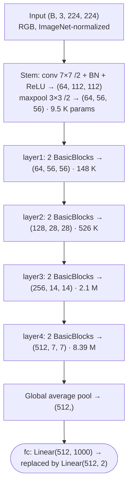
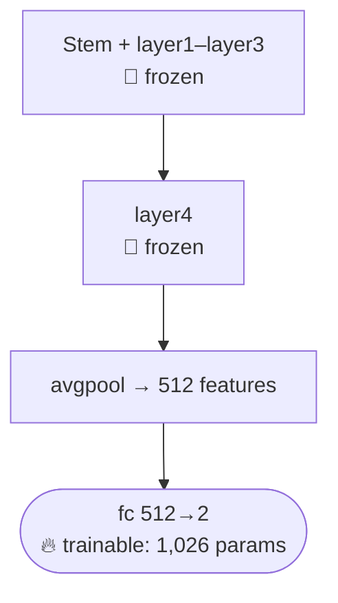
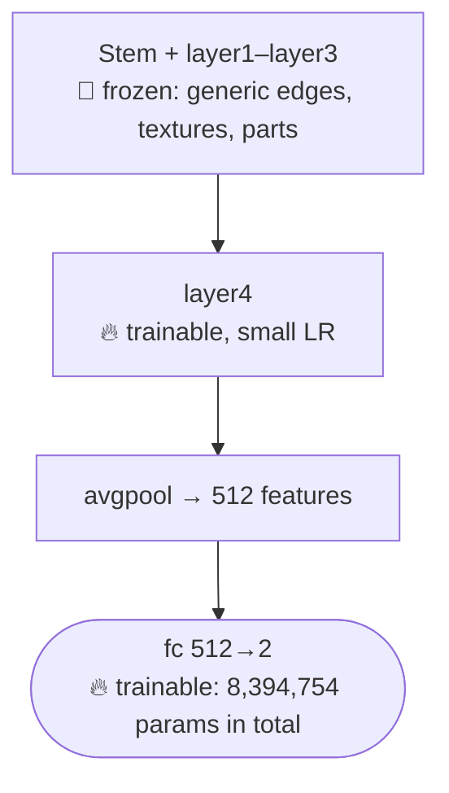
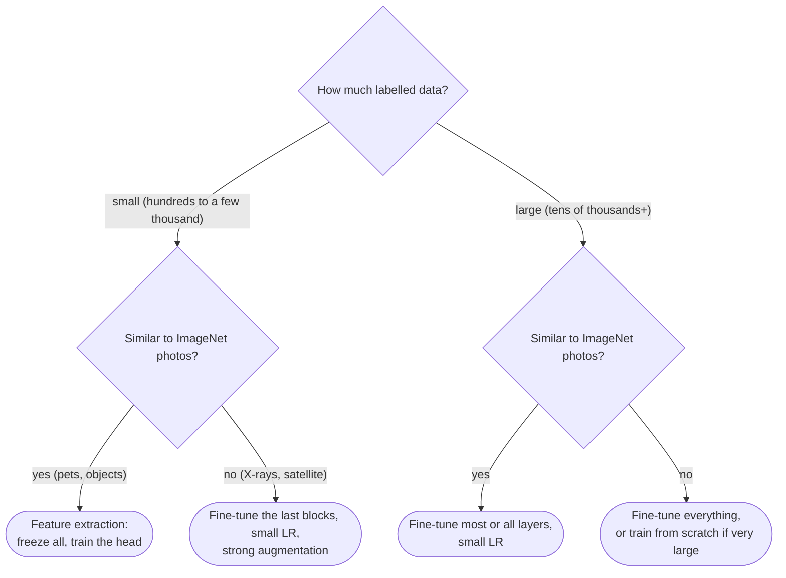

:::tip[TL;DR (30-Second Interview Pitch)]
**Transfer learning** reuses a CNN already trained on a huge dataset (ImageNet: 1.2 M images, 1,000 classes) as a ready-made **feature extractor**, and trains only what is specific to your task. Load **ResNet18**, replace its 1,000-way `fc` with `Linear(512, 2)`, **freeze** everything else (`requires_grad = False`) and you train **1,026** of 11.2 M parameters. On cats vs dogs that jumps validation accuracy from **~81%** (CNN from scratch) to **~98%** in one epoch. **Fine-tuning** additionally unfreezes the deepest block (`layer4`, 8.4 M params) with a **small learning rate** for the last bit (98.7%). Feed the model exactly what it was trained on (**224×224, RGB, ImageNet mean/std**), augment **only** the training set, and control training with a **scheduler**, **early stopping** and **weight decay**.
:::

<FormulaKey />

:::info[Where this page sits]
**Before:** [CNN in Practice: Cats vs Dogs](./03-cnn-practical-cats-vs-dogs.md) builds the data pipeline and a CNN from scratch (~81% validation accuracy).
**This page:** notebooks *CNN Implementation 2* and *Transfer Learning 1*, on the same 8,400 / 1,800 / 1,800 split.
:::

## 🧭 Start Here

The previous page ended with a frustrating result. We built a clean pipeline and a sensible CNN, yet it stalled at about 81% validation accuracy and started memorizing the training set. The reason is not a bug: a network trained from scratch must learn **every** visual concept (what an edge is, what fur looks like, what an eye is) from just 8,400 photos. That is too little data for 4 million parameters.

Now think about how *you* would learn to tell cats from dogs. You would not first learn what edges and textures are; you already know. You would only learn the final distinction. **Transfer learning** gives a neural network that same advantage. Researchers have already trained big CNNs such as **ResNet18** on **ImageNet**, 1.2 million photos across 1,000 categories (including many dog breeds and cats). Along the way those networks learned general-purpose visual features. We download the trained weights, chop off the final 1,000-class layer, attach a fresh 2-class layer, and train only what we must.

There are two main ways to do this:

- **Feature extraction:** freeze the whole pretrained network and train only the new last layer. Fast, cheap, very hard to overfit. Here it reaches **~98%**.
- **Fine-tuning:** also unfreeze the deepest pretrained block so it can adapt slightly to cats and dogs, using a **small learning rate** so the pretrained knowledge isn't wiped out. Here it adds about half a point.

Using a pretrained model brings its own rules. You must feed it inputs that look like its training data (224×224 RGB, normalized with ImageNet statistics). Random **data augmentation** (flips, small rotations) makes the training set effectively larger. Three training-control tools, a **learning-rate scheduler**, **early stopping** and **L1/L2 regularization**, round out a production-grade training loop.

| New concept | One-line meaning |
|---|---|
| **Pretrained model** | A network whose weights were already trained on a large dataset (ImageNet) |
| **Backbone** | The pretrained feature-extractor part (all conv blocks) |
| **Head** | The final task-specific layer(s), here `fc`, replaced for our 2 classes |
| **Freezing** | `requires_grad = False`: the parameter gets no gradient and never changes |
| **Feature extraction** | Freeze the backbone, train only the new head |
| **Fine-tuning** | Also train some pretrained layers, with a small learning rate |
| **ImageNet normalization** | Standardize inputs with mean `[0.485, 0.456, 0.406]`, std `[0.229, 0.224, 0.225]` |
| **Data augmentation** | Random, label-preserving changes (flip, rotate) applied fresh every epoch |
| **Residual connection** | ResNet's shortcut $y = F(x) + x$, which lets very deep nets train |
| **LR scheduler** | Changes the learning rate during training (e.g. halve it when progress stalls) |
| **Early stopping** | Stop when validation loss hasn't improved for `patience` epochs |
| **L2 / L1 regularization** | Penalize large weights (L2: squared; L1: absolute, pushes some to exactly 0) |

:::analogy[An experienced chef learning a new restaurant's menu]
A chef with ten years of experience doesn't relearn how to hold a knife or what "golden brown" means when they join a new restaurant. They keep their skills (the **frozen backbone**) and only learn the new menu (the **new head**). If the new cuisine is a bit different, they might adjust a few advanced techniques, carefully (**fine-tuning with a small learning rate**). Training from scratch is hiring someone who has never cooked and giving them 8,400 recipes.
:::

## ⚡ Essential Interview Recall

**Why not train from scratch?**
- Deep CNNs have **millions of parameters** (SmallCNN 2.1 M, SimpleCNN 4.3 M, ResNet18 **11.7 M**), need **lots of labelled data**, heavy **compute**, careful **tuning**, and they **overfit** small datasets.
- Scratch SimpleCNN on 8,400 images: val accuracy **~0.81** with a growing train/val gap.

**Transfer learning**
- $f_{new}(\data{X}) = g_{\param{\phi}}\big(h_{\param{\theta^*}}(\data{X})\big)$: pretrained feature extractor $h$ + new task head $g$.
- Works because **early layers learn universal features** (edges, textures, colour blobs) and later layers more task-specific ones (parts, objects). Edges learned for cars also help with dogs.
- Pretrained on **ImageNet**: ~1.2 M images, 1,000 classes. `models.resnet18(weights=models.ResNet18_Weights.DEFAULT)` (= `IMAGENET1K_V1`); `pretrained=True` is the deprecated spelling.

**ResNet18**
- Stem (conv 7×7/2 + BN + ReLU + maxpool) → `layer1`…`layer4` (2 BasicBlocks each) → global average pool → `fc`. 224×224 → 112 → 56 → 56 → 28 → 14 → **7×7×512** → `(512,)` → logits.
- **11,689,512** params with the 1,000-class head; **11,177,538** with `Linear(512, 2)`. `layer4` alone = **8,393,728** (72%).
- **Residual connection** $y = F(x) + x$: the identity path gives gradients a shortcut, so 18–152-layer nets train without vanishing gradients.

**Two strategies**
- **Feature extraction:** freeze all, train `fc` only → **1,026** trainable params (0.009%). Optimizer gets `model.fc.parameters()`. Notebook: best val **0.9819** in 5 epochs.
- **Fine-tuning:** unfreeze `layer4` + `fc` → **8,394,754** trainable (75%). Use a **small LR (1e-4)**. Notebook: best val **0.9874**, early-stopped at epoch 8, train acc 0.998 (starting to overfit).
- Choose by **dataset size** and **similarity to ImageNet**: small + similar → extract; large or different → fine-tune more layers; huge and very different → maybe from scratch.
- Freezing ≠ fixing BatchNorm: in `model.train()` mode, frozen BN layers **still update their running mean/var**. Put them in `eval()` if the backbone must stay truly fixed.

**Data pipeline for pretrained models**
- Input must match pretraining: **RGB, 224×224, `ToTensor()` (÷255 and HWC→CHW), `Normalize(ImageNet mean, std)`**.
- **Augment train only** (`RandomHorizontalFlip(0.5)`, `RandomRotation(10)`); val/test get the deterministic transform. Augmentation is re-sampled **every time** an image is loaded, so each epoch sees new variants.
- On-the-fly loading needs a custom `Dataset` (`__len__`, `__getitem__`) or `datasets.ImageFolder` (labels from sub-folder names, `class_to_idx` **alphabetical**).

**Training control**
- `ReduceLROnPlateau(factor, patience)`: multiply LR by `factor` once val loss fails to improve for **more than** `patience` epochs. Notebook fine-tune: **1e-4 → 5e-5 → 2.5e-5**.
- **Early stopping:** count epochs without improvement greater than `min_delta`; stop at `patience`. Restore the **best** weights, saved with `copy.deepcopy(model.state_dict())` (a plain `state_dict()` holds **references** that keep changing).
- **L2:** `weight_decay=λ` adds $\hyper{\lambda}\param{w}$ to every gradient (= penalty $\frac{\hyper{\lambda}}{2}\sum \param{w}^2$). Shrinks all weights smoothly. With **Adam**, prefer **AdamW** (decoupled decay).
- **L1:** add $\hyper{\lambda}\sum|\param{w}|$ to the loss manually; constant-size push towards 0 → **sparse** weights.
- With a frozen backbone, L1/L2/scheduler changes moved val accuracy by **under 0.5 points**: with 1,026 trainable params there is almost nothing to overfit. The big win is **pretrained vs scratch** (~81% → ~98%).

## 📐 Formula Sheet

Every equation on this page in one place. Each one is explained in a card further down.

| Concept | Formula | In plain words |
|---|---|---|
| Transfer learning | $f_{new}(\data{X}) = g_{\param{\phi}}\big(h_{\param{\theta^*}}(\data{X})\big)$ | Pretrained feature extractor + new head |
| Residual block | $\pred{y} = F(\data{x};\param{W}) + \data{x}$ | Learn a correction on top of the identity |
| Residual gradient | $\frac{\partial \pred{y}}{\partial \data{x}} = \frac{\partial F}{\partial \data{x}} + I$ | The "+I" keeps gradients alive |
| Freezing | $\param{\theta_{frozen}} \leftarrow \param{\theta_{frozen}}$, $\;\param{\phi} \leftarrow \param{\phi} - \hyper{\eta}\,\nabla_{\param{\phi}}\loss{L}$ | Only unfrozen parameters move |
| Head parameters | $512 \times 2 + 2 = 1{,}026$ | All you train in feature extraction |
| ImageNet normalization | $\data{x'_c} = (\data{x_c} - \mu_c)/\sigma_c$ | Speak the pretrained model's units |
| Augmentation objective | $\min_{\param{\theta}} \; \mathbb{E}_{t \sim \mathcal{T}}\, \loss{L}\big(f(t(\data{x})), \data{y}\big)$ | Be right for every plausible variant |
| L2 penalty | $\loss{L_{total}} = \loss{L_{CE}} + \frac{\hyper{\lambda}}{2}\sum_i \param{w_i}^2$ | Large weights cost extra |
| Weight-decay step | $\param{w} \leftarrow (1 - \hyper{\eta}\hyper{\lambda})\,\param{w} - \hyper{\eta}\,\nabla \loss{L_{CE}}$ | Shrink a little, then step |
| L1 penalty | $\loss{L_{total}} = \loss{L_{CE}} + \hyper{\lambda}\sum_i \lvert \param{w_i} \rvert$ | Pushes small weights to exactly 0 |
| L1 gradient | $\hyper{\lambda}\,\text{sign}(\param{w_i})$ | Constant-size push towards 0 |
| AdamW step | $\param{w} \leftarrow \param{w} - \hyper{\eta}\,\frac{\hat m}{\sqrt{\hat v} + \epsilon} - \hyper{\eta}\hyper{\lambda}\,\param{w}$ | Decay applied outside Adam's scaling |
| ReduceLROnPlateau | $\hyper{\eta} \leftarrow \hyper{\eta} \cdot \text{factor}$ after $>$ patience bad epochs | Slow down when stuck |
| Early stopping | stop when bad epochs $\ge$ patience; bad means $\loss{L_{val}} \ge \text{best} - \delta$ | Quit when validation stops improving |

## The Mental Model

### 1. ResNet18 anatomy (224×224 input)



### 2. Feature extraction: train the head only



### 3. Fine-tuning: also adapt the deepest block



### 4. Choosing a strategy



## The Paradigm / Core Concepts

### Part A: Why training a CNN from scratch is hard

#### 📖 Understand it

Even "two classes" is not a simple problem for a vision model. Cats and dogs appear in every pose, lighting, background, camera angle and breed, often partly hidden. A model must learn features that survive all that variation. To do so it needs many layers of filters, and each filter weight is one more number to learn from data.

Count them. Notebook 7's `SmallCNN` (16 → 32 → 64 channels on 128×128 input) already has **2,121,122** parameters; the previous page's `SimpleCNN` has **4,287,938**; **ResNet18** has **11,689,512**. Saying a model "has millions of parameters" means it has millions of knobs that gradient descent must set using only the information in the training images. With 8,400 images, there are far more knobs than examples, so the network can find settings that fit the training images perfectly *without* capturing what makes a cat a cat. That is **overfitting**, and it is exactly what the previous page showed: 90% training accuracy, 81% validation.

Compute is the second problem. Every training step is a forward and backward pass through every layer for every image in the batch, repeated for many epochs, and each new hyperparameter setting means training again. Training ResNet18 from scratch on ImageNet took days of multi-GPU time. So the real question is not *can* we train from scratch, but **can we train it well enough, fast enough, with the data we have?** For most real projects (medical images, factory defects, plant diseases) the honest answer is no. That is the problem transfer learning solves.

| Reason | What goes wrong | Transfer learning's answer |
|---|---|---|
| **Many parameters** (2–12 M here) | Huge search space | Most of them arrive already trained |
| **Limited labelled data** | Memorization, poor validation accuracy | Only ~1 K–8 M parameters must learn from your data |
| **Heavy compute** | Days of GPU time, slow iteration | Minutes: one or a few epochs on a small head |
| **Careful tuning** | Unstable training, many restarts | A well-conditioned starting point |
| **Overfitting** | Train ≫ validation | Generic features generalize by construction |

### Part B: What transfer learning is, and why it works

#### 📖 Understand it

**Transfer learning** means reusing knowledge learned on one task to solve a different but related task. In vision, the "knowledge" is the weights of a CNN trained on ImageNet, and the "reuse" is taking that network as the starting point instead of random weights.

It works because of the **feature hierarchy** you met on the CNN pages. The first layers of any image CNN learn very general detectors: edges at different angles, colour contrasts, simple textures. These are useful for *every* natural-image task: the edges that outline a car also outline a dog's ear. The middle layers combine them into shapes, repeated patterns and object parts. Only the deepest layers become specific to the original task's 1,000 categories. So the pretrained network is a **general-purpose visual feature extractor** that happens to have a 1,000-way ImageNet classifier on top.

Transfer learning splits the network in two: the pretrained **backbone** $h$ (kept), which turns an image into a 512-number feature vector describing its content, and a new **head** $g$ (trained), which maps those 512 numbers to *our* classes. If the backbone's features already separate cats from dogs well (and ImageNet contains dozens of dog breeds and several cat classes, so they do), then even a single linear layer on top is enough. That is why one epoch of training 1,026 parameters jumps straight to 97% validation accuracy.

<Formula name="Transfer learning as composition" tag="Backbone + new head" words="The new model is the pretrained feature extractor followed by a freshly initialized classifier. The extractor keeps its learned weights theta-star; only the head phi, and optionally the last blocks, are trained on the new data." remember="Borrow the eyes, train a new brain.">

$$
f_{new}(\data{X}) \;=\; g_{\param{\phi}}\Big(h_{\param{\theta^*}}(\data{X})\Big),
\qquad h_{\param{\theta^*}}: \mathbb{R}^{3 \times 224 \times 224} \to \mathbb{R}^{512},
\qquad g_{\param{\phi}}: \mathbb{R}^{512} \to \mathbb{R}^{2}
$$

- $h_{\param{\theta^*}}$: the pretrained ResNet18 up to global average pooling; $\param{\theta^*}$ are its ImageNet weights
- $g_{\param{\phi}}$: the new head `Linear(512, 2)` with $\param{\phi}$ = 1,024 weights + 2 biases = **1,026** parameters

**Example:** the original head `Linear(512, 1000)` has $512 \cdot 1000 + 1000 = 513{,}000$ parameters; swapping it for `Linear(512, 2)` gives $512 \cdot 2 + 2 = 1{,}026$.

</Formula>

| | Training from scratch | Transfer learning |
|---|---|---|
| Starting weights | Random | Learned on 1.2 M ImageNet images |
| Must learn | Edges → textures → parts → classes | Mostly just the final mapping |
| Data needed | Large | Small to medium |
| Training time | Long (many epochs) | Short (often 1–5 epochs for the head) |
| Overfitting risk | High on small data | Low (feature extraction), moderate (fine-tuning) |
| Cats vs dogs, this dataset | **~0.81** val acc | **~0.98** val acc |

:::analogy[A pretrained backbone is a pair of trained eyes]
A radiology student doesn't learn to see from scratch. They arrive with twenty years of eyesight that already detects edges, shapes and textures, and medical school only teaches them what those shapes *mean* on an X-ray. The pretrained backbone is the eyesight; the new head is the medical training.
:::

### Part C: ResNet18 and residual connections

#### 📖 Understand it

**ResNet** (He et al., 2015) won ImageNet 2015 and solved a problem that had capped network depth: past roughly 20 layers, plain CNNs got *worse*, even on training data. Gradients have to pass backwards through every layer, being multiplied at each step, and over many layers they shrink towards zero (**vanishing gradients**), so the early layers barely learn.

ResNet's fix is the **residual connection** (skip connection). Instead of asking a block of two conv layers to learn the full output $y = F(x)$, it adds the block's input back: $y = F(x) + x$. The block now only has to learn the **residual**: the *correction* to apply to its input. If a block has nothing useful to add, it can simply learn $F(x) \approx 0$ and pass its input through unchanged, so adding layers can no longer make the network worse. And on the backward pass, the "+ x" path carries the gradient straight through: the derivative of $y$ with respect to $x$ is $\partial F/\partial x + I$, so even if $\partial F / \partial x$ is tiny the gradient keeps a healthy identity component.

**ResNet18** has 18 weight layers: a **stem** (one 7×7 stride-2 conv plus a max pool, taking 224×224 down to 56×56), four **stages** (`layer1`…`layer4`) of two **BasicBlocks** each (two 3×3 convs + BatchNorm + ReLU + the skip), and a final `fc`. Each stage after the first halves the spatial size and doubles the channels: 64 → 128 → 256 → 512 channels at 56 → 28 → 14 → 7 pixels. Then **global average pooling** averages each of the 512 final 7×7 maps to a single number, producing the 512-dimensional feature vector the head sees. Thanks to that pooling, the head is tiny and the network is not tied to one input size (unlike the previous page's flatten-based `SimpleCNN`).

<Formula name="Residual connection" tag="Why ResNets train" words="The block outputs its input plus a learned correction. Because the input is added back, the gradient flowing backwards always includes an identity term, so it can't vanish through the block." remember="Learn the change, keep the original.">

$$
\pred{y} = F(\data{x};\,\param{W}) + \data{x}
\qquad\Longrightarrow\qquad
\frac{\partial \pred{y}}{\partial \data{x}} = \frac{\partial F}{\partial \data{x}} + I
$$

- $F(\data{x};\param{W})$: conv → BN → ReLU → conv → BN inside a BasicBlock
- $\data{x}$: the block input (a 1×1 stride-2 conv "projects" it when the shape changes between stages)
- $I$: identity matrix, the gradient's guaranteed shortcut

</Formula>

| Stage | Output (C, H, W) | Parameters | Share of 11.18 M |
|---|---|---|---|
| Stem (conv1 + bn1, maxpool) | (64, 112, 112) → (64, 56, 56) | 9,536 | 0.1% |
| `layer1` | (64, 56, 56) | 147,968 | 1.3% |
| `layer2` | (128, 28, 28) | 525,568 | 4.7% |
| `layer3` | (256, 14, 14) | 2,099,712 | 18.8% |
| `layer4` | (512, 7, 7) | **8,393,728** | **75.1%** |
| `avgpool` | (512, 1, 1) | 0 | 0% |
| `fc` (2-class) | (2,) | 1,026 | 0.009% |
| **Total** | | **11,177,538** | |

Notice where the parameters are: the deep, wide `layer4` holds three quarters of the model. That is why unfreezing just `layer4` (fine-tuning) jumps the trainable count from 1,026 to 8.4 M.

### Part D: Feature extraction vs fine-tuning

#### 📖 Understand it

**Freezing** a parameter means setting `param.requires_grad = False`. Autograd then computes no gradient for it, and since it has no gradient the optimizer can't change it. Two things follow. Training is cheaper: backpropagation can stop as soon as it reaches the first frozen layer, because nothing below it needs a gradient. And the pretrained knowledge is protected: no amount of noisy small-data training can damage it.

In **feature extraction** you freeze the whole backbone and train only the new `fc`. The pretrained network becomes a fixed function that turns each image into 512 numbers, and you fit a linear classifier on those numbers. With only 1,026 trainable parameters it is almost impossible to overfit, it converges in a couple of epochs, and it works best when your images resemble ImageNet photos.

In **fine-tuning** you also unfreeze some of the deepest pretrained layers (here `layer4`). Those layers hold the most task-specific features (ImageNet's object parts), and letting them adjust lets the network specialize to cat/dog details. The danger is **catastrophic forgetting**: the new head starts random, so its early gradients are large and noisy, and with a normal learning rate they would wreck the carefully learned `layer4` weights. Hence two standard precautions. Use a **learning rate about 10× smaller** than for training from scratch (1e-4 instead of 1e-3). And ideally train the head first (feature extraction), *then* unfreeze. Fine-tuning also brings back some overfitting risk: the notebook's fine-tuned model reached **99.8%** training accuracy against **98.6–98.7%** validation.

Which layers to unfreeze follows the hierarchy: early layers are generic and almost never worth retraining; the deepest are the most task-specific. So you unfreeze **from the top down**: `fc`, then `layer4`, then maybe `layer3`, each with a small learning rate. The further your data is from ImageNet (X-rays, satellite images, microscopy), the more layers you unfreeze.

| | **Feature extraction** | **Fine-tuning** (`layer4` + `fc`) |
|---|---|---|
| Frozen | All pretrained layers | Stem + `layer1`–`layer3` |
| Trainable params | **1,026** (0.009%) | **8,394,754** (75.1%) |
| Learning rate | Normal for the head (1e-3) | **Small** (1e-4), maybe lower for older layers |
| Speed per step | Fastest (backward stops at `fc`) | Slower (backward through `layer4`) |
| Overfitting risk | Very low | Moderate: watch val loss, stop early |
| Best when | Small data, similar to ImageNet | More data, or domain differs |
| Notebook best val acc | **0.9819** (5 epochs) | **0.9874** (stopped at epoch 8) |

<Formula name="What freezing does to the update" tag="requires_grad = False" words="Frozen parameters receive no gradient, so the optimizer leaves them exactly as pretrained. Only the trainable parameters take gradient steps." remember="No gradient, no change.">

$$
\param{\theta_{frozen}} \leftarrow \param{\theta_{frozen}}
\qquad\qquad
\param{\phi} \leftarrow \param{\phi} - \hyper{\eta}\,\nabla_{\param{\phi}} \loss{L}
$$

- $\param{\theta_{frozen}}$: backbone weights with `requires_grad = False`; their `.grad` stays `None`
- $\param{\phi}$: trainable weights (the head, plus `layer4` when fine-tuning)

**Example:** after `loss.backward()` on a frozen ResNet18, `model.conv1.weight.grad` is `None` while `model.fc.weight.grad` has shape `(2, 512)`.

</Formula>

<Animation src="transfer/freeze-vs-finetune" caption="Gradients flow backwards from the loss only through trainable layers. In feature extraction they stop at fc, 1,026 parameters. Unfreezing layer4 lets them reach one block deeper, 8,394,754 parameters, while the early layers stay frozen." />

:::danger[Interview Trap: "requires_grad = False freezes the whole layer"]
It freezes the **learnable** parameters only. **BatchNorm** layers also keep **running mean and variance buffers**, and in `model.train()` mode they keep updating those from every batch, even with `requires_grad = False`. With a "frozen" backbone your normalization statistics still drift towards your small dataset (and batches of augmented images). It is usually harmless for similar data with batch size 32, but if you need a truly fixed feature extractor, put the BN layers (or the whole backbone) in `eval()` mode after each `model.train()` call.
:::

:::analogy[Fine-tuning is tailoring an off-the-rack suit]
Feature extraction is buying a good suit and just choosing the right tie (the head). Fine-tuning is taking the suit to a tailor to adjust the sleeves and waist (`layer4`): small, careful changes. Re-cutting the whole suit (a large learning rate on all layers) risks ruining what made it good in the first place.
:::

### Part E: Feeding a pretrained model: transforms, augmentation and datasets

#### 📖 Understand it

A pretrained network has learned its filters on inputs prepared in one specific way. Its first-layer weights expect numbers on a particular scale: ImageNet images resized to 224×224, converted to RGB, scaled to 0–1 and then standardized with ImageNet's per-channel **mean `[0.485, 0.456, 0.406]`** and **std `[0.229, 0.224, 0.225]`**. Feed it raw 0–255 values, or BGR, or un-normalized 0–1 values, and every activation is shifted from what the network was trained on. Nothing crashes, but accuracy drops, sometimes badly. So rule one of transfer learning: **reproduce the pretraining preprocessing exactly**. (`ResNet18_Weights.DEFAULT.transforms()` returns the official recipe: resize to 256, centre-crop 224, normalize. The notebook's direct resize to 224×224 is a common, slightly simpler variant.)

`transforms.Compose` chains the steps. `ToTensor()` does two jobs at once: it converts the PIL image `(H, W, C)` uint8 to a float tensor `(C, H, W)` **and** divides by 255. `Normalize` must come **after** `ToTensor`, because it works on tensors in the 0–1 range.

**Data augmentation** applies small random changes that don't change the label: a horizontal flip (a mirrored dog is still a dog), a rotation of up to ±10°, and so on. Because the transform runs every time `__getitem__` is called, each epoch sees a different version of every image. The dataset is effectively much larger, and the model learns that orientation and exact position don't matter. Augmentation is applied **only to training data**. Validation and test must be **deterministic** and realistic, so their scores are stable from run to run and represent the real images you'll see in production.

Augmentation is also why the previous page's `.pt` approach no longer works: pre-computed tensors are fixed. So the notebook writes a **custom `Dataset`** that stores only file paths and labels, and in `__getitem__` opens the image with PIL, applies the transform and returns `(tensor, label)`. If your data is already arranged in `train/cats/`, `train/dogs/` folders, `torchvision.datasets.ImageFolder` does the same thing with zero code, assigning labels from the **sorted** sub-folder names, so always check `dataset.class_to_idx`.

<Formula name="ImageNet normalization" tag="Match the pretraining input" words="After scaling to 0 to 1, subtract ImageNet's average for each colour channel and divide by its standard deviation, exactly as was done when the network was trained." remember="Same units the model learned in.">

$$
\data{x'_c} = \frac{\data{x_c} - \mu_c}{\sigma_c},
\qquad
\mu = [0.485,\ 0.456,\ 0.406],
\qquad
\sigma = [0.229,\ 0.224,\ 0.225]
$$

**Example:** RGB pixel $(203, 164, 87)$ → `ToTensor` → $(0.796, 0.643, 0.341)$ → `Normalize` → $(1.358,\ 0.835,\ -0.288)$, verified with torchvision. Values typically land between about −2.1 and +2.6.

</Formula>

<Formula name="Augmentation as an expected loss" tag="Why random transforms help" words="Training on randomly transformed copies means minimizing the average loss over all plausible versions of each image, so the model is pushed to give the same answer for a flipped or slightly rotated image." remember="Right for every reasonable variant.">

$$
\min_{\param{\theta}} \;\; \mathbb{E}_{(\data{x}, \data{y})}\; \mathbb{E}_{t \sim \mathcal{T}} \Big[\loss{L}\big(f(t(\data{x});\param{\theta}),\; \data{y}\big)\Big]
$$

- $\mathcal{T}$: the set of random transforms (flip with probability 0.5, rotation in ±10°, …), which must **preserve the label**
- A fresh $t$ is sampled every time an image is loaded, so each epoch sees new variants

</Formula>

| Transform | Train | Val / Test | Why |
|---|---|---|---|
| `Resize((224, 224))` | ✅ | ✅ | The size the network was pretrained on |
| `RandomHorizontalFlip(p=0.5)` | ✅ | ❌ | Left/right orientation doesn't change the class |
| `RandomRotation(10)` | ✅ | ❌ | Tolerance to slight camera tilt |
| `ToTensor()` | ✅ | ✅ | PIL `(H, W, C)` uint8 → float `(C, H, W)` in 0–1 |
| `Normalize(mean, std)` | ✅ | ✅ | ImageNet statistics, **after** `ToTensor` |

:::warning[Augmentations must preserve the label]
Horizontal flips are safe for cats and dogs, but **not** for digits or text (a flipped "2" isn't a "2") or for tasks where left/right matters (road signs, some medical scans). Vertical flips are wrong for most natural photos. Large rotations turn a "6" into a "9". Choose transforms that produce images you could really encounter.
:::

:::analogy[Normalization is speaking the model's units]
A pilot trained on altimeters in **feet** will crash if you quietly swap the instruments for **metres**: same plane, same skills, wrong numbers. A pretrained network was trained on ImageNet-normalized inputs; give it anything else and its "instruments" read wrong. Augmentation, meanwhile, is a pilot practising landings in different crosswinds, so a real gusty day doesn't surprise them.
:::

### Part F: Controlling training: scheduler, early stopping, L2 and L1

#### 📖 Understand it

The basic loop (fixed learning rate, fixed number of epochs) works, but three tools make it more robust, and interviewers like to ask about each.

**Learning-rate scheduling.** Early in training a larger learning rate makes fast progress. Near a minimum, the same step size overshoots back and forth across the valley and validation loss bounces around. `ReduceLROnPlateau` watches a metric (validation loss) and, when it has failed to improve for more than `patience` epochs, multiplies the learning rate by `factor`. In the notebook's fine-tuning run (`factor=0.5, patience=1`) the learning rate went **1e-4 → 5e-5** after epochs 3–4 got worse, and **→ 2.5e-5** after epochs 6–7. Other schedules change the rate on a fixed plan regardless of the metric: `StepLR` (×γ every *k* epochs), `CosineAnnealingLR` (smooth cosine decay), `OneCycleLR` (warm up, then decay).

**Early stopping.** Validation loss usually falls, then flattens, then rises as the model starts memorizing. Early stopping tracks the best validation loss so far and counts epochs that fail to beat it by at least `min_delta`. When the count reaches `patience`, training stops. It saves time and is itself a regularizer, because the model never gets the extra epochs it would have used to overfit. It is useless unless you also **keep the best weights**: the notebook saves `copy.deepcopy(model.state_dict())` whenever validation accuracy improves and restores it at the end. The `deepcopy` is essential: `state_dict()` returns *references* to the live tensors, which keep changing as training continues.

**L2 regularization (weight decay).** Adding $\frac{\lambda}{2}\sum w^2$ to the loss makes large weights expensive. Its gradient is simply $\lambda w$, so every step first shrinks each weight slightly towards zero ("decays" it) and then applies the normal gradient step. Smaller, more spread-out weights give a smoother function that relies less on any single feature, which usually generalizes better. In PyTorch you don't write the penalty yourself: pass `weight_decay=λ` to the optimizer. One subtlety for interviews: in **Adam**, `weight_decay` is added to the gradient *before* Adam's per-parameter rescaling, which partly cancels it. **AdamW** applies the decay separately ("decoupled"), which is the version modern training uses.

**L1 regularization.** Adding $\lambda\sum|w|$ penalizes absolute values instead. Its gradient is $\lambda \cdot \text{sign}(w)$: a **constant-size** push towards zero no matter how small the weight already is. L2's push ($\lambda w$) fades as the weight shrinks, so it rarely reaches exactly zero. L1 keeps pushing until weights hit exactly zero, producing **sparse** models (useful for feature selection or compression). PyTorch has no built-in L1 option on optimizers, so you add it to the loss by hand.

<Formula name="L2 regularization and weight decay" tag="weight_decay in PyTorch" words="Add half of lambda times the sum of squared weights to the loss. Its gradient is lambda times w, so each step first shrinks every weight by a factor of one minus eta times lambda, then takes the usual gradient step." remember="Shrink every weight a little, every step.">

$$
\begin{aligned}
\loss{L_{total}} &= \loss{L_{CE}} + \frac{\hyper{\lambda}}{2}\sum_i \param{w_i}^2 \\[4pt]
\param{w} &\leftarrow \param{w} - \hyper{\eta}\big(\nabla \loss{L_{CE}} + \hyper{\lambda}\,\param{w}\big) \;=\; (1 - \hyper{\eta}\hyper{\lambda})\,\param{w} - \hyper{\eta}\,\nabla \loss{L_{CE}}
\end{aligned}
$$

- PyTorch's `weight_decay=λ` adds exactly $\hyper{\lambda}\param{w}$ to the gradient. (The notebook writes the penalty as $\lambda\sum w^2$, whose gradient is $2\lambda w$: the same idea with $\lambda$ scaled by 2.)
- **Example** (SGD, zero data gradient): $\param{w} = 2.0$, $\hyper{\eta} = 0.1$, $\hyper{\lambda} = 0.01$ → $(1 - 0.001) \cdot 2.0 = 1.998$

</Formula>

<Formula name="L1 regularization" tag="Sparsity" words="Add lambda times the sum of absolute weights. Its gradient has the same size for every non-zero weight, so small weights get pushed all the way to zero instead of just getting smaller." remember="Constant push, weights hit zero.">

$$
\loss{L_{total}} = \loss{L_{CE}} + \hyper{\lambda}\sum_i \lvert \param{w_i} \rvert
\qquad\qquad
\frac{\partial}{\partial \param{w_i}}\Big(\hyper{\lambda}\sum_j \lvert \param{w_j} \rvert\Big) = \hyper{\lambda}\,\text{sign}(\param{w_i})
$$

**Example:** $\hyper{\lambda} = 10^{-5}$, weights $[0.5,\ -0.2,\ 0.0]$ → gradient $[+10^{-5},\ -10^{-5},\ 0]$, the same magnitude for 0.5 and −0.2 (PyTorch defines the gradient of $|0|$ as 0).

</Formula>

<Formula name="AdamW: decoupled weight decay" tag="Adam done right" words="Adam rescales every gradient by its own running size. If the decay term is mixed into the gradient, Adam rescales it too and the decay stops working as intended. AdamW applies the decay directly to the weights, outside the rescaling." remember="Decay the weights, not the gradient.">

$$
\param{w} \leftarrow \param{w} \;-\; \hyper{\eta}\,\frac{\hat m}{\sqrt{\hat v} + \epsilon} \;-\; \hyper{\eta}\hyper{\lambda}\,\param{w}
$$

- $\hat m, \hat v$: Adam's bias-corrected running mean and mean-square of the gradient
- **Example** (zero data gradient, $\param{w} = 2.0$, $\hyper{\eta} = 0.1$, $\hyper{\lambda} = 0.01$): `AdamW` → **1.998** (true 0.1% decay); `Adam(weight_decay=0.01)` → **1.9**, because Adam normalizes the tiny decay gradient into a full-size step

</Formula>

<Formula name="ReduceLROnPlateau and early stopping" tag="Reacting to validation loss" words="If validation loss has not improved for more than patience epochs, multiply the learning rate by factor. Separately, early stopping ends training once the count of non-improving epochs reaches its own patience." remember="Stuck: slow down. Still stuck: stop.">

$$
\begin{aligned}
&\text{bad epoch} \iff \loss{L_{val}} \ge \text{best} - \hyper{\delta} \\[4pt]
&\text{bad epochs} > \hyper{\text{patience}}_{LR} \;\Rightarrow\; \hyper{\eta} \leftarrow \hyper{\eta}\cdot\hyper{\text{factor}} \\[4pt]
&\text{bad epochs} \ge \hyper{\text{patience}}_{ES} \;\Rightarrow\; \text{stop, restore best weights}
\end{aligned}
$$

**Example** (notebook fine-tuning, `factor = 0.5`, LR patience 1, early-stopping patience 3, $\hyper{\delta} = 0.0005$): val losses 0.0415, 0.0382, 0.0549, 0.0793, **0.0341**, 0.0415, 0.0437, 0.0424 → LR 1e-4 → **5e-5** at epoch 4 → **2.5e-5** at epoch 7; three bad epochs after the best (epoch 5) → **stop at epoch 8**.

</Formula>

<Animation src="transfer/early-stopping" caption="The notebook's fine-tuning run, epoch by epoch. Each bad epoch raises the patience counter, two in a row halve the learning rate, and three after the best epoch stop training, so the weights from the best epoch are restored." />

| Tool | Knob(s) | Effect | Notebook setting |
|---|---|---|---|
| `ReduceLROnPlateau` | `factor`, `patience`, `mode="min"` | Lower LR when val loss stalls | factor 0.9 (frozen run), **0.5** (fine-tune), patience 1 |
| Early stopping | `patience`, `min_delta` | Stop when val loss stops improving | patience 2 (frozen), **3** (fine-tune), δ = 0.0005 |
| Best checkpoint | metric to track | Keep the best-validation weights | `deepcopy(state_dict())` on best **val accuracy** |
| L2 / weight decay | `weight_decay=λ` | Shrink all weights each step | 1e-4 |
| L1 | `l1_lambda` × Σ\|w\| added to loss | Push small weights to exactly 0 | 1e-5 |

:::analogy[Scheduler, early stopping and L1/L2 in a car park]
Lowering the learning rate is **slowing down as you approach your parking space**: full speed would overshoot it. Early stopping is **turning the engine off once you're parked**: driving on only scrapes the car (overfits). L2 is a **gentle spring on every steering adjustment**, so no single correction gets extreme. L1 is a **rule that you must stop using any control you barely touch**: you end up driving with fewer controls.
:::

### Part G: The scoreboard: scratch vs transfer

#### 📖 Understand it

The notebooks ran six configurations on the same split. Read the table below for three lessons.

First, **the starting point matters far more than the tuning**. Going from a scratch CNN to a frozen pretrained ResNet18 lifts validation accuracy by about **17 points** (0.81 → 0.98). Every other change (a scheduler, L2, L1, fine-tuning) moves it by **half a point or less**. If you have limited time, use a pretrained model before you tune anything.

Second, **regularization barely matters when there is nothing to overfit**. With a frozen backbone, only 1,026 numbers are learned from 8,400 images, so L1/L2 have almost no work to do; the differences between those runs are within run-to-run noise. Regularization becomes important when many parameters are trainable: the fine-tuned model (8.4 M trainable) reached 99.8% training accuracy and needed early stopping.

Third, in the frozen runs **training accuracy is *lower* than validation accuracy** (e.g. 0.968 vs 0.982). That looks backwards but has a simple explanation: training images are **augmented** (flipped, rotated, so harder) and training accuracy is averaged over an epoch while the weights are still improving, whereas validation uses clean images and end-of-epoch weights. A train < val gap is common with heavy augmentation or dropout and is not a bug.

| Run | Trainable params | Epochs | Best val acc | Final train acc | Notes |
|---|---|---|---|---|---|
| SimpleCNN from scratch (128 px) | 4,287,938 | 6 shown | 0.8109 | 0.9015 | Overfitting, val loss rising |
| ResNet18 frozen, Adam 1e-3 | **1,026** | 5 | **0.9819** | 0.9679 | 0.9731 after epoch 1 |
| + ReduceLROnPlateau + early stopping | 1,026 | 10 | 0.9863 | 0.9688 | LR stayed 1e-3 in the logged run |
| + L2 (`weight_decay=1e-4`) | 1,026 | 5 | 0.9825 | 0.9679 | Within noise of baseline |
| + L1 ($\lambda = 10^{-5}$) | 1,026 | 5 | 0.9819 | 0.9646 | Within noise of baseline |
| Fine-tune `layer4` + `fc`, Adam 1e-4, wd 1e-4 | **8,394,754** | 8 (early stop) | **0.9874** | 0.9981 | Best overall; train ≫ val starting |

**Time per epoch** tells a pipeline story too. The scratch CNN read pre-made tensors from RAM and took **~5–7 s** per epoch. Every ResNet run decoded and transformed JPEGs on the fly in the main process (`num_workers=0` by default) and took **~50–70 s**. The fine-tuned model, with a much bigger backward pass, took about the same time per epoch as the frozen one, which suggests the data loading and the full forward pass, not the backward pass, were the bottleneck. Raising `num_workers` is the first speed fix.

## ⚙️ Under the Hood (The Math & PyTorch Internals)

**How freezing saves compute**
- Autograd only records operations whose inputs require a gradient. With everything frozen except `fc`, the whole backbone runs as a plain forward computation, and `loss.backward()` computes gradients for `fc` alone.
- With `layer4` unfrozen, backward runs through `fc` and `layer4` and **stops at `layer4`'s input**: no gradients are computed for `layer1`–`layer3` because nothing there needs one. The forward pass still runs through every layer, which is why frozen training is cheaper but not free.
- Pass only trainable parameters to the optimizer (`model.fc.parameters()`, or `filter(lambda p: p.requires_grad, model.parameters())`). Passing frozen ones is harmless for SGD/Adam (they have no `.grad`, so they're skipped) but wastes optimizer state if you unfreeze them later.

**BatchNorm in transfer learning**
- BN has learnable `weight`/`bias` (affected by `requires_grad`) **and** buffers `running_mean`/`running_var` (affected only by train/eval mode). Verified: a frozen ResNet18 in `train()` mode changed `bn1.running_mean` after one forward pass; in `eval()` mode it did not.
- Options: keep the backbone in `eval()` while training the head (truly fixed features), or let BN adapt (a mild form of domain adaptation). With very small batches, always keep BN in eval mode, because batch statistics from 2–4 images are too noisy.

**The `weights=` API**
- `models.resnet18(weights=models.ResNet18_Weights.DEFAULT)` downloads `IMAGENET1K_V1` once into `~/.cache/torch/hub/checkpoints/`. `weights=None` gives random initialization (what notebook 7 used to count parameters).
- `weights.transforms()` returns the matching preprocessing: `Resize(256)` → `CenterCrop(224)` → `ToTensor` → `Normalize(ImageNet)`. `weights.meta["categories"]` lists the 1,000 class names.

**Checkpointing correctly**
- `model.state_dict()` is an `OrderedDict` of **references** to the live parameter tensors. Saving `best = model.state_dict()` and training on means `best` silently follows the current weights (verified: after an in-place update the "saved" tensor equalled the new weights). Use `copy.deepcopy(...)` in memory, or `torch.save(model.state_dict(), path)` to disk.

**Why Adam + `weight_decay` isn't true weight decay**
- `Adam(weight_decay=λ)` adds $\lambda w$ to the gradient, then divides by $\sqrt{\hat v}$. Weights with large gradients therefore get **less** decay, and with a zero data gradient a tiny decay term is normalized into a full-size step (2.0 → 1.9 in one step). `AdamW` subtracts $\eta\lambda w$ separately (2.0 → 1.998), which is the "decoupled weight decay" of Loshchilov & Hutter. For SGD the two are identical.

**Feature caching: the fastest feature extraction**
- If the backbone is frozen **and** you don't augment, each image's 512-dimensional feature is the same every epoch. Run the backbone once over the dataset, store an `(N, 512)` matrix, and train the head on that: epochs take milliseconds. With augmentation you can't cache, because features change every epoch.

**Discriminative learning rates**
- When fine-tuning several stages, give older layers smaller learning rates using optimizer **parameter groups**, e.g. `layer3` 1e-5, `layer4` 1e-4, `fc` 1e-3. Generic early features need only tiny adjustments; the new head needs big ones.

:::danger[Interview Trap: "Fine-tune everything with the usual learning rate"]
A freshly initialized head produces large, essentially random gradients at the start. Backpropagated into unfrozen pretrained layers at a from-scratch learning rate (1e-3 with Adam), they can destroy the pretrained features within a few hundred steps (**catastrophic forgetting**), and you end up with a slow, worse version of training from scratch. Train the head first, then unfreeze with a learning rate around **10× smaller** (1e-4 or lower), ideally with lower rates for earlier layers.
:::

## 💻 PyTorch Implementation

:::tip[Run it yourself]
Shapes, parameter counts, scheduler and early-stopping traces below were verified on PyTorch 2.14 / torchvision 0.29. Accuracy numbers are the notebooks' logged runs (RTX 4060 Laptop GPU). The `train_df` / `val_df` / `test_df` split is the one built on the [previous page](./03-cnn-practical-cats-vs-dogs.md).
:::

### 1. Scratch CNN vs ResNet18: how big are they?

Counting parameters makes the "too many knobs for too little data" argument concrete.

```python showLineNumbers
import torch.nn as nn
from torchvision import models

def count_parameters(model):
    total = sum(p.numel() for p in model.parameters())
    trainable = sum(p.numel() for p in model.parameters() if p.requires_grad)
    return total, trainable

small_cnn = nn.Sequential(                                     # notebook 7's SmallCNN
    nn.Conv2d(3, 16, 3, padding=1),  nn.ReLU(), nn.MaxPool2d(2),
    nn.Conv2d(16, 32, 3, padding=1), nn.ReLU(), nn.MaxPool2d(2),
    nn.Conv2d(32, 64, 3, padding=1), nn.ReLU(), nn.MaxPool2d(2),
    nn.Flatten(), nn.Linear(64 * 16 * 16, 128), nn.ReLU(), nn.Linear(128, 2),
)
resnet = models.resnet18(weights=None)                         # architecture only, random weights

print(f"{count_parameters(small_cnn)[0]:,}")                    # 2,121,122
print(f"{count_parameters(resnet)[0]:,}")                       # 11,689,512
print(resnet.fc)                                                # Linear(in_features=512, out_features=1000, bias=True)
```

### 2. Load the pretrained model and replace the head

The new `fc` must output one logit per **our** class.

```python showLineNumbers
import torch
import torch.nn as nn
from torchvision import models

device = torch.device("cuda" if torch.cuda.is_available() else "cpu")

weights = models.ResNet18_Weights.DEFAULT                       # = IMAGENET1K_V1
model = models.resnet18(weights=weights)                        # downloads once, then cached

# highlight-next-line
model.fc = nn.Linear(model.fc.in_features, 2)                  # 512 → 2, freshly initialized
model = model.to(device)

x = torch.randn(4, 3, 224, 224, device=device)
print(model(x).shape)                                           # torch.Size([4, 2])
```

### 3. Feature extraction: freeze the backbone

Freeze everything, then unfreeze only the new head, and give the optimizer only the head's parameters.

```python showLineNumbers
for p in model.parameters():
    p.requires_grad = False                                     # freeze all
# highlight-next-line
for p in model.fc.parameters():
    p.requires_grad = True                                      # train the head only

total = sum(p.numel() for p in model.parameters())
trainable = sum(p.numel() for p in model.parameters() if p.requires_grad)
print(f"{total:,} total, {trainable:,} trainable")              # 11,177,538 total, 1,026 trainable

optimizer = torch.optim.Adam(model.fc.parameters(), lr=1e-3)
criterion = nn.CrossEntropyLoss()

loss = criterion(model(torch.randn(2, 3, 224, 224, device=device)), torch.tensor([0, 1], device=device))
loss.backward()
print(model.conv1.weight.grad)                                  # None: frozen, no gradient computed
print(model.fc.weight.grad.shape)                               # torch.Size([2, 512])
```

### 4. Fine-tuning: unfreeze `layer4`, small learning rates

Use parameter groups so the pretrained block moves more gently than the new head.

```python showLineNumbers
ft = models.resnet18(weights=models.ResNet18_Weights.DEFAULT)
ft.fc = nn.Linear(ft.fc.in_features, 2)
for p in ft.parameters():
    p.requires_grad = False
for p in list(ft.layer4.parameters()) + list(ft.fc.parameters()):
    p.requires_grad = True
ft = ft.to(device)

print(f"{sum(p.numel() for p in ft.parameters() if p.requires_grad):,}")   # 8,394,754 (75.1%)

# What the notebook's logged run used: one small LR for both
optimizer_ft = torch.optim.Adam(
    [p for p in ft.parameters() if p.requires_grad], lr=1e-4, weight_decay=1e-4)

# Common refinement: discriminative learning rates per parameter group
# highlight-start
optimizer_ft = torch.optim.AdamW([
    {"params": ft.layer4.parameters(), "lr": 1e-4},             # pretrained: gentle
    {"params": ft.fc.parameters(),     "lr": 1e-3},             # new head: faster
], weight_decay=1e-4)
# highlight-end
```

### 5. Transforms: augmentation for train, deterministic for eval

`ToTensor` before `Normalize`; random transforms only in the training pipeline.

```python showLineNumbers
from torchvision import transforms

IMAGENET_MEAN, IMAGENET_STD = [0.485, 0.456, 0.406], [0.229, 0.224, 0.225]

train_transform = transforms.Compose([
    transforms.Resize((224, 224)),
    # highlight-start
    transforms.RandomHorizontalFlip(p=0.5),                     # train only
    transforms.RandomRotation(10),                              # train only: ±10°
    # highlight-end
    transforms.ToTensor(),                                      # (H,W,C) uint8 → (C,H,W) float in [0, 1]
    transforms.Normalize(IMAGENET_MEAN, IMAGENET_STD),          # must come after ToTensor
])

eval_transform = transforms.Compose([
    transforms.Resize((224, 224)),
    transforms.ToTensor(),
    transforms.Normalize(IMAGENET_MEAN, IMAGENET_STD),
])

print(models.ResNet18_Weights.DEFAULT.transforms())            # official: Resize 256 → CenterCrop 224 → Normalize
```

### 6. A custom `Dataset` that loads lazily

Store only paths; open and transform each image when it is requested.

```python title="cats_dogs_dataset.py" showLineNumbers
from PIL import Image
from torch.utils.data import Dataset, DataLoader

class CatsDogsDataset(Dataset):
    def __init__(self, dataframe, transform=None):
        self.df = dataframe.reset_index(drop=True)              # rows 0..N-1 for .loc lookups
        self.transform = transform

    def __len__(self):
        return len(self.df)

    def __getitem__(self, idx):
        row = self.df.loc[idx]
        image = Image.open(row["filepath"]).convert("RGB")      # PIL loads RGB: no BGR trap
        if self.transform:
            # highlight-next-line
            image = self.transform(image)                       # new random augmentation on every call
        return image, int(row["label"])

train_ds = CatsDogsDataset(train_df, train_transform)
val_ds   = CatsDogsDataset(val_df,   eval_transform)            # NO augmentation
test_ds  = CatsDogsDataset(test_df,  eval_transform)

train_loader = DataLoader(train_ds, batch_size=32, shuffle=True, num_workers=4, pin_memory=True)
val_loader   = DataLoader(val_ds,   batch_size=32, shuffle=False, num_workers=4, pin_memory=True)
print(len(train_loader), len(val_loader))                       # 263 57
```

### 7. Or let `ImageFolder` read labels from folder names

For a `data/train/cats`, `data/train/dogs` layout, no custom class is needed.

```python showLineNumbers
from torchvision import datasets

train_ds = datasets.ImageFolder("data/train", transform=train_transform)
val_ds   = datasets.ImageFolder("data/val",   transform=eval_transform)

# highlight-next-line
print(train_ds.class_to_idx)                                    # {'cats': 0, 'dogs': 1}: sorted folder names
print(train_ds.samples[0])                                      # ('data/train/cats/...jpg', 0)
```

### 8. Early stopping and a training loop that keeps the best weights

Track validation loss for stopping and the LR scheduler; checkpoint with `deepcopy`.

```python title="train_advanced.py" showLineNumbers
import copy
import torch

class EarlyStopping:
    def __init__(self, patience=3, min_delta=0.0005):
        self.patience, self.min_delta = patience, min_delta
        self.best, self.counter, self.stop = None, 0, False

    def __call__(self, val_loss):
        if self.best is None or val_loss < self.best - self.min_delta:
            self.best, self.counter = val_loss, 0               # real improvement: reset
        else:
            self.counter += 1                                   # a bad epoch
            self.stop = self.counter >= self.patience

def evaluate(model, loader, criterion):
    model.eval()
    total, correct, n = 0.0, 0, 0
    with torch.no_grad():
        for x, y in loader:
            x, y = x.to(device), y.to(device)
            out = model(x)
            total += criterion(out, y).item() * y.size(0)
            correct += (out.argmax(1) == y).sum().item()
            n += y.size(0)
    return total / n, correct / n

def fit(model, train_loader, val_loader, criterion, optimizer, epochs=15,
        scheduler=None, early_stopping=None, l1_lambda=0.0):
    best_acc, best_wts = 0.0, copy.deepcopy(model.state_dict())
    for epoch in range(1, epochs + 1):
        model.train()
        for x, y in train_loader:
            x, y = x.to(device), y.to(device)
            loss = criterion(model(x), y)
            if l1_lambda > 0:                                   # L1: added to the loss by hand
                loss = loss + l1_lambda * sum(p.abs().sum() for p in model.parameters() if p.requires_grad)
            optimizer.zero_grad()
            loss.backward()
            optimizer.step()

        val_loss, val_acc = evaluate(model, val_loader, criterion)
        if scheduler is not None:
            scheduler.step(val_loss)                            # ReduceLROnPlateau needs the metric
        if val_acc > best_acc:
            # highlight-next-line
            best_acc, best_wts = val_acc, copy.deepcopy(model.state_dict())   # deepcopy, not a reference
        print(f"epoch {epoch}: val_loss {val_loss:.4f} val_acc {val_acc:.4f} "
              f"lr {optimizer.param_groups[0]['lr']:.6f}")
        if early_stopping is not None:
            early_stopping(val_loss)
            if early_stopping.stop:
                print("Early stopping triggered.")
                break
    model.load_state_dict(best_wts)                             # restore the best epoch
    return model

scheduler = torch.optim.lr_scheduler.ReduceLROnPlateau(optimizer_ft, mode="min", factor=0.5, patience=1)
ft = fit(ft, train_loader, val_loader, criterion, optimizer_ft,
         scheduler=scheduler, early_stopping=EarlyStopping(patience=3, min_delta=0.0005))
# notebook log: lr 1e-4 → 5e-5 (epoch 4) → 2.5e-5 (epoch 7), best val acc 0.9874, stopped at epoch 8
```

### 9. Why `deepcopy` matters for checkpoints

A plain `state_dict()` keeps pointing at the live weights.

```python showLineNumbers
import copy
import torch
import torch.nn as nn

layer = nn.Linear(2, 1)
# error-next-line
best_ref = layer.state_dict()                                   # ❌ references to the live tensors
# success-next-line
best_copy = copy.deepcopy(layer.state_dict())                   # ✅ an independent snapshot

with torch.no_grad():
    layer.weight.add_(1.0)                                      # training continues…

print(torch.equal(best_ref["weight"], layer.weight))           # True: the "best" weights changed too
print(torch.equal(best_copy["weight"], layer.weight))          # False: snapshot preserved
```

### 10. L2 vs L1, and Adam vs AdamW

Weight decay shrinks proportionally; L1 pushes with a constant force; Adam distorts plain L2.

```python showLineNumbers
import torch
import torch.nn as nn

w = nn.Parameter(torch.tensor([2.0]))
opt = torch.optim.SGD([w], lr=0.1, weight_decay=0.01)
(w * 0).sum().backward(); opt.step()
print(round(w.item(), 6))                                       # 1.998 = (1 − 0.1·0.01) · 2.0

for Opt in (torch.optim.Adam, torch.optim.AdamW):
    w = nn.Parameter(torch.tensor([2.0]))
    opt = Opt([w], lr=0.1, weight_decay=0.01)
    (w * 0).sum().backward(); opt.step()
    print(Opt.__name__, round(w.item(), 6))
# error-next-line
# Adam 1.9      ❌ decay gradient got rescaled into a full lr-sized step
# success-next-line
# AdamW 1.998   ✅ decoupled decay: exactly η·λ·w

w = torch.tensor([0.5, -0.2, 0.0], requires_grad=True)
(1e-5 * w.abs().sum()).backward()
print(w.grad)                                                   # tensor([ 1.0000e-05, -1.0000e-05,  0.0000e+00])
```

### 11. Keep frozen BatchNorm layers truly frozen

`requires_grad = False` doesn't stop running-statistics updates in train mode.

```python showLineNumbers
import torch
import torch.nn as nn

def set_bn_eval(module):
    for m in module.modules():
        if isinstance(m, nn.BatchNorm2d):
            m.eval()                                            # use stored ImageNet statistics

before = model.bn1.running_mean.clone()
model.train()
model(torch.randn(4, 3, 224, 224, device=device))
# error-next-line
print(torch.equal(before, model.bn1.running_mean))             # ❌ False: stats drifted while "frozen"

model.train()
# success-next-line
set_bn_eval(model)                                              # ✅ call after every model.train()
before = model.bn1.running_mean.clone()
model(torch.randn(4, 3, 224, 224, device=device))
print(torch.equal(before, model.bn1.running_mean))             # True
```

### 12. Predict a single new image

Same eval transform, add a batch dimension, softmax for readable probabilities.

```python showLineNumbers
from PIL import Image
import torch
import torch.nn.functional as F

def predict(model, path, class_names=("Cat", "Dog")):
    model.eval()
    x = eval_transform(Image.open(path).convert("RGB"))         # (3, 224, 224)
    # highlight-next-line
    x = x.unsqueeze(0).to(device)                               # (1, 3, 224, 224): models expect a batch
    with torch.no_grad():
        probs = F.softmax(model(x), dim=1)[0]                   # softmax only for reporting
    idx = int(probs.argmax())
    return class_names[idx], float(probs[idx])

# predict(ft, "my_dog.jpg")  → ('Dog', 0.99...)
```

## 🚨 Interview Gotchas & Edge Cases

:::warning[The Most Common Question]
**"You have 5,000 labelled images for a new classification task. How do you approach it?"**

1. **Start pretrained**, not from scratch: e.g. ResNet18/50 or EfficientNet with ImageNet weights; replace the head with `Linear(in_features, num_classes)`.
2. **Match the preprocessing** of the pretrained weights: RGB, 224×224 (resize + centre-crop), ImageNet mean/std. Use `weights.transforms()`.
3. **Feature extraction first:** freeze the backbone, train the head (LR ~1e-3), with augmentation on the training set only. This is a strong baseline in minutes.
4. **Then fine-tune** the last block(s) with a ~10× smaller LR (discriminative LRs per stage), AdamW with weight decay, `ReduceLROnPlateau` or cosine schedule, early stopping, and best-checkpoint restore.
5. **Decide how much to unfreeze** by data size and domain distance from ImageNet; watch the train/val gap.
6. **Evaluate once on the test set** with per-class metrics.
:::

- **Wrong preprocessing for a pretrained model** (no ImageNet normalization, BGR input, 0–255 values) doesn't error; it just quietly costs accuracy.
- **Augmenting validation/test data** makes scores random and pessimistic. Augment the training set only.
- **Label-changing augmentations** (flipping digits/text, vertical flips of natural photos, big rotations) teach the model wrong labels.
- **`Normalize` before `ToTensor`** fails: `Normalize` expects a tensor in 0–1.
- **Forgetting to replace `fc`**: the model still outputs 1,000 logits; `CrossEntropyLoss` with labels 0/1 runs without error and trains a 1,000-way classifier where only two outputs are ever correct.
- **Optimizer created before freezing / with all parameters**: harmless for frozen params (no grad) but confusing; for clarity pass only trainable parameters, and **re-create the optimizer** after unfreezing new layers or they won't be updated with the intended settings.
- **Frozen BatchNorm still updates running stats** in `train()` mode. Use `eval()` on BN layers for a truly fixed backbone.
- **Fine-tuning with a large LR** causes catastrophic forgetting. Use ~1e-4, and train the head first.
- **Saving the "best" model with `state_dict()` without `deepcopy`** saves a reference that keeps changing; you end up restoring the last epoch, not the best.
- **`Adam(weight_decay=…)` ≠ weight decay.** Use `AdamW` for decoupled decay.
- **`ReduceLROnPlateau.step()` needs the metric**: `scheduler.step(val_loss)`. Other schedulers take no argument and are stepped once per epoch (or per batch for `OneCycleLR`).
- **`ImageFolder` labels are alphabetical** by folder name. Check `class_to_idx`, especially when the folder names don't sort in the order you assumed.
- **Train accuracy below validation accuracy** with augmentation is normal, not a bug: training images are harder and averaged over a changing model.
- **Slow ResNet epochs** are usually the data pipeline: raise `num_workers`, use `pin_memory=True`, and cache features when the backbone is frozen and you don't augment.
- **Domain shift:** ImageNet features transfer well to pets and everyday objects, and less well to X-rays, satellite or microscopy images. Fine-tune more layers there, or look for a model pretrained on that domain.

### Concept-Check Answers (from the notebooks)

#### Why training from scratch is hard

<details>
<summary><strong>Why is image classification not truly "simple" even with only two classes?</strong></summary>

The difficulty is in the **inputs**, not the number of labels: cats and dogs vary in pose, lighting, background, camera angle, breed and occlusion. The model must learn features robust to all of that from raw pixels.
</details>

<details>
<summary><strong>What does it mean that a CNN has millions of parameters? Why can it overfit small data?</strong></summary>

It has millions of individual weights (kernel values, biases, FC weights) that training must set. When parameters far outnumber training examples, the network can fit (memorize) the training set without learning general features, so validation accuracy stays low.
</details>

<details>
<summary><strong>Why is training from scratch computationally expensive? What problem does transfer learning solve?</strong></summary>

Every step is a forward + backward pass through all layers for every batch, over many epochs, repeated for every hyperparameter trial. Transfer learning starts from weights that already encode useful features, cutting the data, compute and tuning needed.
</details>

#### What transfer learning is

<details>
<summary><strong>What is the main idea, and why are early CNN layers reusable?</strong></summary>

Reuse knowledge from one task for a related one: start from a pretrained network instead of random weights. Early layers learn universal features (edges, gradients, colour contrasts, simple textures) that appear in virtually all natural images.
</details>

<details>
<summary><strong>What does freezing a layer mean? Feature extraction vs fine-tuning?</strong></summary>

Freezing sets `requires_grad = False`, so the layer gets no gradients and its weights never change. Feature extraction freezes the whole backbone and trains only the new head; fine-tuning also unfreezes some deeper pretrained layers and trains them with a small learning rate.
</details>

<details>
<summary><strong>Why do pretrained models reduce training time?</strong></summary>

Most parameters arrive already trained, so far fewer must be learned (1,026 vs 11 M), backward passes stop early at frozen layers, and convergence takes a few epochs instead of many.
</details>

#### Preparing the image dataset

<details>
<summary><strong>Why resize everything to a fixed size? Why different transforms for train and validation?</strong></summary>

Batches must be rectangular tensors, and the pretrained network expects its training resolution (224×224). Training gets random augmentation for robustness; validation and test get a fixed transform so evaluation is deterministic and represents real inputs.
</details>

<details>
<summary><strong>What does <code>ImageFolder</code> do? Dataset vs DataLoader?</strong></summary>

`ImageFolder` builds a Dataset from a `root/class_name/image.jpg` layout, assigning labels from the sorted sub-folder names. A **Dataset** defines how to get sample *i*; a **DataLoader** batches, shuffles, collates and loads in parallel.
</details>

<details>
<summary><strong>A batch has shape (16, 3, 224, 224). What is each dimension? Why inspect <code>class_to_idx</code>?</strong></summary>

16 images, 3 colour channels (RGB), 224 pixels high, 224 wide. `class_to_idx` shows which integer each class received (alphabetical), which you need to interpret predictions and to make sure labels match any other code or metric.
</details>

<details>
<summary><strong>Why do pretrained ResNets use ImageNet normalization values?</strong></summary>

The network's weights were learned on inputs standardized with ImageNet's per-channel mean and std. Using the same statistics gives activations on the scale the filters expect; different scaling shifts every layer's inputs and degrades accuracy.
</details>

#### ResNet18 training choices

<details>
<summary><strong>Why is augmentation applied only to training data?</strong></summary>

Its purpose is to diversify what the model learns from. Validation and test must stay stable and realistic so that scores are comparable between epochs and runs and reflect real-world inputs.
</details>

<details>
<summary><strong>What is the role of a learning-rate scheduler? What does early stopping do?</strong></summary>

A scheduler changes the learning rate during training, e.g. lowering it when validation loss plateaus so the optimizer can settle into the minimum instead of bouncing. Early stopping ends training once validation loss stops improving for `patience` epochs, saving time and preventing overfitting (with the best weights restored).
</details>

<details>
<summary><strong>How is L2 regularization added in PyTorch? And L1?</strong></summary>

L2: `weight_decay=λ` in the optimizer (prefer `AdamW` with Adam-style optimizers). L1 has no optimizer option: add `λ * sum(p.abs().sum() for p in params)` to the loss before `backward()`.
</details>

<details>
<summary><strong>Why might fine-tuning <code>layer4</code> help?</strong></summary>

`layer4` holds the deepest, most task-specific features (ImageNet object parts). Letting them adapt (with a small learning rate) specializes the representation to cat/dog distinctions. Here it added about half a point (0.982 → 0.987) at the cost of 8.4 M trainable parameters and some overfitting risk.
</details>
