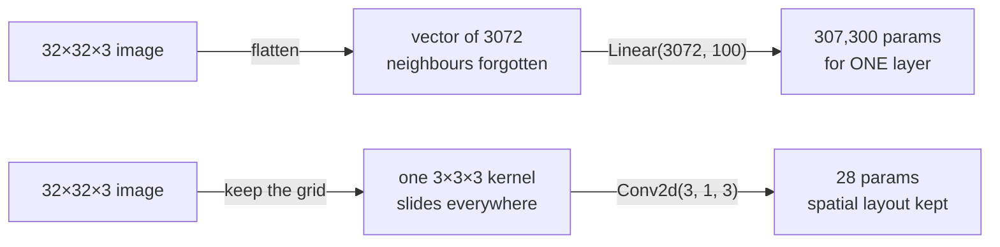
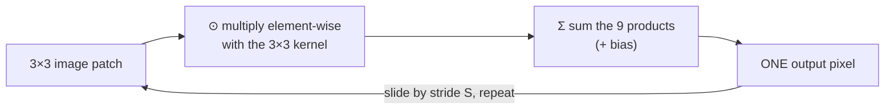
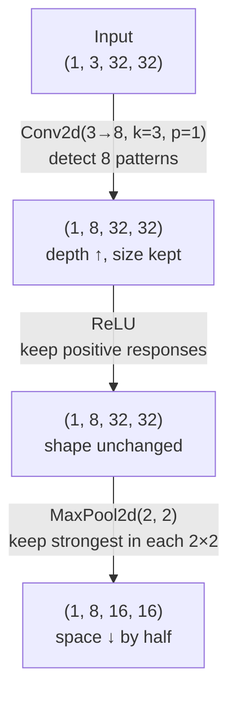

:::tip[TL;DR (30-Second Interview Pitch)]
A **Convolutional Neural Network (CNN)** processes an image **without flattening it**. A small learnable **kernel** (e.g. 3×3) slides over the image and computes a **dot product** at every position, producing a **feature map** that lights up wherever its pattern (an edge, a texture) appears. Because the **same kernel is reused everywhere** (**weight sharing**) and each output only looks at a **small neighbourhood** (**local connectivity**), a conv layer needs a few hundred parameters where a fully connected layer needs hundreds of thousands, and it **keeps the spatial structure** that flattening destroys. Stack **Conv → ReLU → Pool** blocks and the network learns edges → textures → parts → objects.
:::

:::info[This topic spans two pages]
**This page** covers the building blocks: why FC layers fail on images, image tensors, convolution, stride, padding, filters and pooling.
**Next page:** [CNN Architecture, Training, Dropout & AlexNet](./04-cnn-architecture-training-alexnet.md) assembles them into a full classifier, trains it, regularizes it, and walks through AlexNet.
:::

## ⚡ Essential Interview Recall

**Why not a fully connected network?**
- 32×32×3 image → **3,072** inputs. One FC layer to 100 neurons = **307,300** params. At 128×128×3 → **4.9 M** params for **one** layer.
- FC params scale with **H × W**: double the height and width → **4×** the parameters.
- Two problems: **parameter explosion** (memory, compute, overfitting) and **loss of spatial structure** (flattening forgets which pixels were neighbours).

**Images as tensors**
- Grayscale = 1 channel, RGB = 3 channels. Libraries such as PIL and OpenCV store images as **HWC**; **PyTorch expects NCHW**: `(batch, channels, height, width)`.
- 20 RGB images of 64×64 → `(20, 3, 64, 64)`. One grayscale 28×28 image → `(1, 1, 28, 28)`.

**Convolution**
- At each position: **element-wise multiply patch × kernel, then sum** → one output number = a **dot product** $w^\top x$. Then slide.
- Convolution is **linear** (it's a dot product) and **local** (it only sees a small patch).
- Kernel = **pattern detector**. `[[1,0,-1],[1,0,-1],[1,0,-1]]` responds to **vertical edges**.
- **Weight sharing**: the **same kernel at every position**. Built-in assumption: *a pattern is the same pattern wherever it appears*.
- PyTorch's "convolution" is mathematically **cross-correlation** (the kernel is not flipped). It makes no difference for learning.

**Stride, padding, output size**
- $$\text{Out} = \left\lfloor \frac{W - F + 2P}{S} \right\rfloor + 1$$ applied to height and width separately.
- **Stride** $S$ = step size. Larger stride → smaller output, cheaper, acts like **downsampling**. Stride does **not** change the parameter count.
- **Padding** $P$ = zeros around the border. It keeps the size and protects border pixels. **$F=3, P=1, S=1$ → output size = input size** ("same" padding).

**Filters & feature maps**
- Each filter spans **all input channels**: shape $(C_{in}, F, F)$. **One filter → one feature map**. $K$ filters → output depth $K$.
- PyTorch weight shape: **`(out_channels, in_channels, kH, kW)`**.
- **Params = $C_{out}(C_{in}F^2 + 1)$**. It is independent of image size. `Conv2d(3, 5, 3)` = 5 × (27 + 1) = **140**.

**Pooling**
- **Max pool 2×2, stride 2** → H and W halve, **channels unchanged**, **zero parameters**.
- Keeps the strongest activation, which gives **small translation tolerance**. It discards exact position and the non-max values.

**The block & the big picture**
- **Conv → ReLU → Pool**: extract features → add non-linearity → shrink space. Depth goes **up** (3 → 8), space goes **down** (32 → 16).
- What makes a CNN special: **locality**, **weight sharing**, **parameter efficiency**, **hierarchical features**. It's still linear + non-linear layers trained by gradient descent: a **structured ANN**.
- A conv layer is **translation-equivariant** (shift the input → the feature map shifts the same way). **Pooling** adds a little **invariance**.

## The Mental Model

### 1. Fully connected vs convolution on the same image



### 2. What a convolution does at one location



### 3. The minimal CNN block: shape flow



## The Paradigm / Core Concepts

### Part A: Why fully connected networks fail on images

The ANN recipe is **Flatten → Linear → Activation → repeat**. Apply it to images and two things break.

**Problem 1: parameter explosion**

| Image | Input features $H \cdot W \cdot C$ | Params in `Linear(·, 100)` |
|---|---|---|
| 32 × 32 × 3 | 3,072 | 3,072 × 100 + 100 = **307,300** |
| 64 × 64 × 3 | 12,288 | **1,228,900** (4× more) |
| 128 × 128 × 3 | 49,152 | **4,915,300** (≈ 5 M, in one layer) |

Doubling height **and** width multiplies the input size, and therefore the FC parameter count, by **4**. More parameters means:
- **Computational** cost: more memory, slower forward and backward passes.
- **Statistical** cost: more freedom to **memorize** the training set, so a higher **overfitting** risk and a need for far more data.
- So the problem is **both** computational **and** statistical.

**Problem 2: loss of spatial structure**
- Flattening $(H, W, C) \rightarrow (H \cdot W \cdot C)$ turns a grid into a list. Two pixels that are **vertical neighbours** end up **W positions apart** in the vector.
- The FC layer has no idea which pixels were adjacent, so it can't easily learn edges or shapes. It must learn every pattern **separately at every position**.

**Key insight.** Images have **local patterns** (edges, corners), **repeated structures** (the same texture in many places) and a **spatial hierarchy** (edges → shapes → objects). We want a layer that **preserves locality**, **reuses patterns**, and **uses far fewer parameters**. That layer is the convolution.

### Part B: Images as tensors

| | Grayscale | RGB |
|---|---|---|
| Values per pixel | 1 (intensity) | 3 (Red, Green, Blue) |
| As stored by PIL / OpenCV / NumPy | `(H, W)` | `(H, W, 3)`: **HWC** |
| One image in PyTorch | `(1, 1, H, W)` | `(1, 3, H, W)` |
| A batch of $N$ in PyTorch | `(N, 1, H, W)` | `(N, 3, H, W)`: **NCHW** |

**Why channels come before height and width (in PyTorch):**
- A filter covers **all channels at once** (its depth = $C_{in}$) but **slides only over H and W**. Channels are the "depth" of each spatial location.
- Grouping "what" (channels) before "where" (H, W) matches the weight layout `(out, in, kH, kW)`, and NCHW is the layout PyTorch/cuDNN kernels were historically optimized for.
- Library conversion: `torchvision.transforms.ToTensor()` turns an HWC `uint8` image in $[0, 255]$ into a CHW `float32` tensor in $[0, 1]$. Manually: `img.permute(2, 0, 1)`.

**The batch dimension $N$** lets the GPU process many images in parallel and gives a gradient **averaged over many samples** (more stable). `nn.Conv2d` expects a batch: a lone `(3, 32, 32)` image is interpreted as an *unbatched* input in recent PyTorch versions, and other layers and loss functions often break on it, so add the dimension with `img.unsqueeze(0)`.

### Part C: Convolution, intuition first

**The sliding window.** Place a small window (the **kernel** or **filter**, e.g. 3×3) on the image. At each position:
1. Take the 3×3 **patch** under the window.
2. **Multiply** it element-wise with the kernel.
3. **Sum** the 9 products → **one** number = one pixel of the output.
4. **Slide** the window and repeat. The grid of outputs is a new image: a **feature map**.

**Worked example** (notebook): a vertical-edge kernel on a patch with no left/right contrast.

$$
\underbrace{\begin{bmatrix}1&2&1\\0&1&0\\2&1&2\end{bmatrix}}_{\text{patch}} \odot
\underbrace{\begin{bmatrix}1&0&-1\\1&0&-1\\1&0&-1\end{bmatrix}}_{\text{kernel}}
\;\Rightarrow\; \underbrace{(1+0+2)}_{\text{left column}} - \underbrace{(1+0+2)}_{\text{right column}} = 0
$$

**Why that kernel detects vertical edges.** Its left column is $+1$ and its right column is $-1$, so it computes *left brightness − right brightness*:

| Region under the kernel | Output | Meaning |
|---|---|---|
| Flat (all pixels 10) | 30 − 30 = **0** | No edge |
| Bright on the left (10), dark on the right (0) | 30 − 0 = **30** | **Strong vertical edge** |
| Same left and right, any values | **0** | No left/right contrast |

The kernel is a **pattern detector**: a large output means "my pattern is here". In a CNN the kernel values are **not hand-designed**. They are **learned** by backprop, and the network discovers its own edge, colour and texture detectors.

<Animation src="cnn/convolution" caption="The vertical-edge kernel visits all 12 positions of a 5×6 image. Each output is left column minus right column: 0 on flat regions, 30 wherever the window straddles the bright-to-dark edge." />

**Why the output shrinks.** The kernel can't hang over the border, so a $W$-wide input fits only $W - F + 1$ positions: **5×5 input, 3×3 kernel → 3×3 output** (5 − 3 + 1). A **bigger kernel → a smaller output** (4×4 kernel on 5×5 → 2×2).

**Convolution is local, not global**: each output pixel depends only on the $F \times F$ patch under it. Spatial structure survives because the output is still a grid in which **position $(i, j)$ describes the neighbourhood of input position $(i, j)$**.

### Part D: Convolution is a linear operation

Flatten the 3×3 patch into $x \in \mathbb{R}^9$ and the kernel into $w \in \mathbb{R}^9$:

$$
\text{output at one location} = \sum_{i,j} \text{patch}_{ij}\,\text{kernel}_{ij} = w^\top x \;(+\,b)
$$

A dot product is linear, so the whole convolution is linear: $\text{conv}(a x_1 + b x_2) = a\,\text{conv}(x_1) + b\,\text{conv}(x_2)$ (the notebook verifies it numerically: difference ≈ $4 \times 10^{-6}$, just float rounding).

**So how is it different from a fully connected layer?** Both compute $Wx + b$. A convolution is an FC layer whose giant weight matrix is **forced** into a special structure:

| | Fully connected | Convolution |
|---|---|---|
| Each output looks at | **Every** input pixel (global) | Only an $F \times F$ patch (**local connectivity**) |
| Weights per output | Its **own** separate set | The **same** kernel for every position (**weight sharing**) |
| As a matrix | Dense, every entry free | **Sparse** (mostly zeros) with **repeated** values (a Toeplitz-like structure) |
| Params depend on image size? | **Yes**, $\propto H \cdot W$ | **No** |
| Built-in assumption | None | Nearby pixels matter together, and a pattern means the same thing anywhere |

**Parameter comparison** (32×32×3 input):

| Layer | Parameters |
|---|---|
| FC, 3,072 → 100 neurons | **307,300** |
| One 3×3 conv filter on **RGB** (3 × 3 × 3 weights + 1 bias) | **28** |
| 10 such filters | **280** |
| Without weight sharing (a separate 3×3×3 kernel at each of the 30×30 output positions, ×10 filters) | 30 × 30 × 10 × 28 = **252,000**, back to FC scale |

:::danger[Interview Trap: "A 3×3 kernel has 9 parameters"]
Only for a **single-channel** input. A filter always spans **all** input channels, so on an RGB image a 3×3 filter is **3×3×3 = 27 weights + 1 bias = 28**. In general one filter has $C_{in} F^2 + 1$ parameters.
:::

**How weight sharing reduces overfitting:** far fewer free parameters means less capacity to memorize. And since every position trains the same kernel, each kernel effectively learns from **every patch of every image**, which is a lot of data per parameter.

### Part E: Stride and padding

| | **Stride $S$** | **Padding $P$** |
|---|---|---|
| What it is | How many pixels the kernel **moves** per step | Rows/columns of **zeros added around the border** |
| Default | 1 | 0 |
| Increasing it | Fewer positions → **smaller output**, faster, acts like **downsampling** | **Larger output**, border pixels get covered by more positions |
| Changes params? | ❌ No | ❌ No |
| Typical use | `stride=2` to halve resolution instead of pooling | `padding=1` with a 3×3 kernel to keep the size |

$$
\boxed{\;\text{Out} = \left\lfloor \frac{W - F + 2P}{S} \right\rfloor + 1\;}
\qquad W=\text{input size},\; F=\text{kernel},\; P=\text{padding},\; S=\text{stride}
$$

Applied separately to height and width. The **floor** matters: when the stride doesn't divide evenly, the last partial window is **dropped**.

| Input $W$ | $F$ | $P$ | $S$ | Calculation | Output |
|---|---|---|---|---|---|
| 5 | 3 | 0 | 1 | (5 − 3 + 0)/1 + 1 | **3** |
| 10 | 3 | 0 | 1 | (10 − 3)/1 + 1 | **8** |
| 8 | 3 | 0 | 2 | ⌊5/2⌋ + 1 | **3** |
| 8 | 3 | 1 | 2 | ⌊7/2⌋ + 1 | **4** |
| 32 | 3 | 1 | 1 | (32 − 3 + 2)/1 + 1 | **32** ("same") |
| 32 | 3 | 1 | 2 | ⌊31/2⌋ + 1 | **16** (halved) |
| 8 | 3 | 5 | 2 | ⌊15/2⌋ + 1 | **8**: bigger than the no-padding output, built mostly from zeros |

**"Same" padding:** for an odd kernel $F$ with $S = 1$, $P = (F-1)/2$ keeps the output size equal to the input ($F=3 \Rightarrow P=1$, $F=5 \Rightarrow P=2$). PyTorch also accepts `padding="same"` (stride 1 only) and `padding="valid"` (= 0).

**Why pad:** keep spatial size through many layers (otherwise every 3×3 conv eats 2 pixels), and let **border pixels** contribute as much as central ones (without padding, a corner pixel is seen by only one window).

**Too much padding:** the output becomes **larger than the input** and its border is computed mostly from **artificial zeros**. That wastes compute and can create edge artifacts, because the network "sees" a fake dark frame.

<Animation src="cnn/stride-padding" caption="Same 5×5 input and 3×3 kernel. Stride 2 skips positions (3×3 → 2×2 output); padding 1 adds a ring of zeros so the output stays 5×5." />

### Part F: Multiple filters and feature maps

One filter detects **one** pattern. Images contain edges at many angles, corners, textures and colour transitions, so a layer uses **many** filters.

| Quantity | Shape / value |
|---|---|
| Input | $(N, C_{in}, H, W)$ |
| One filter | $(C_{in}, F, F)$, spanning **all** input channels |
| One filter's output | **one feature map** $(H', W')$: per-channel products summed into **one** number per position |
| $K$ filters (`out_channels = K`) | output $(N, K, H', W')$ |
| `conv.weight` | $(K, C_{in}, F, F)$ = `(out_channels, in_channels, kH, kW)` |
| `conv.bias` | $(K)$, one per filter |
| Parameters | $K \cdot (C_{in} F^2 + 1)$ |

**Worked example:** `Conv2d(3, 5, kernel_size=3, padding=1)` on `(2, 3, 32, 32)` → output `(2, 5, 32, 32)`. Params = 5 × (3·3·3 + 1) = **140** (135 weights + 5 biases).

- **Output depth is set by the number of filters**, not by the input. `(10, 3, 64, 64)` through 16 filters → depth **16**.
- **Doubling the filters doubles the parameters** (and the compute).
- The input channels mix inside each filter: an RGB filter can respond to "a red-to-green edge", which no single-channel filter could.

<Animation src="cnn/multichannel-filter" caption="One filter has one 3×3 slice per input channel. At each position the R, G and B dot products plus one bias are summed into a single number, so one filter makes one feature map." />

### Part G: Pooling

After convolutions the depth grows, and if H and W stay large, every later layer is expensive. **Pooling** shrinks H and W while keeping the important signal.

**Max pooling (2×2, stride 2):** split each feature map into 2×2 blocks and keep the **maximum** of each.

$$
\begin{bmatrix}1 & 5\\ 2 & 3\end{bmatrix} \xrightarrow{\text{max}} 5
\qquad\qquad
(N, C, H, W) \xrightarrow{\text{MaxPool2d}(2,2)} (N, C, \tfrac{H}{2}, \tfrac{W}{2})
$$

| | **Max pooling** | **Average pooling** | **Global average pooling** |
|---|---|---|---|
| Keeps | Strongest activation per window | Mean of the window | Mean of the **whole** map → 1 value per channel |
| Intuition | "Was the feature present **anywhere** here?" | "How strong is it **on average**?" | Summary vector for the classifier head |
| Trainable params | **0** | **0** | **0** |
| Typical use | Between conv blocks (classic CNNs, AlexNet, VGG) | Smoother downsampling | Modern nets (ResNet) instead of a big flatten + FC |

- **Pooling never changes the number of channels.** It works on each channel independently. `(8, 16, 64, 64)` → `(8, 16, 32, 32)`.
- **Translation tolerance:** if an edge moves by one pixel but stays inside the same 2×2 window, the max is unchanged. This gives a small degree of invariance.
- **What it discards:** the **exact position** of the feature within the window and the 3 non-max values. For tasks that need precise location (segmentation, keypoints) this is a real loss, which is why such networks pool less or upsample back.
- Odd sizes are **floored**: 7×7 → 3×3 (the last row and column are dropped).

<Animation src="cnn/max-pooling" caption="Each 2×2 block keeps only its maximum: 4×4 → 2×2, channels unchanged, no parameters. Moving the 8 one pixel inside its window leaves the output unchanged (translation tolerance)." />

### Part H: The minimal CNN block

| Component | Role | Shape effect | Params |
|---|---|---|---|
| **Conv** | Linear pattern detection over local patches | Depth → $C_{out}$; H, W kept with "same" padding | $C_{out}(C_{in}F^2+1)$ |
| **ReLU** | Non-linearity, so stacked convs don't collapse into one linear map | None | 0 |
| **Pool** | Spatial reduction, cheaper later layers, small translation tolerance | H, W halved | 0 |

Shape flow for the notebook's `SimpleCNNBlock`: `(1, 3, 32, 32)` → Conv(3→8, p=1) → `(1, 8, 32, 32)` → ReLU → `(1, 8, 32, 32)` → Pool → `(1, 8, 16, 16)`. Two blocks: 32 → 16 → **8**, because each block halves the spatial size.

**Why depth goes up while space goes down:** later layers detect **more kinds** of more complex patterns (more channels), and they need less positional precision (smaller H, W). Halving H and W cuts the positions by 4×, which pays for doubling the channels. The cost per layer stays roughly balanced.

### Conceptual closure: what makes a CNN special

| Property | Mechanism | Benefit |
|---|---|---|
| **Spatial locality** | Small kernels see local patches | Learns edges and textures directly. Structure preserved |
| **Weight sharing** | Same kernel at every position | Huge parameter savings. A pattern is detected anywhere |
| **Parameter efficiency** | Params independent of H, W | Scales to large images, less overfitting |
| **Hierarchical features** | Stacked blocks + growing receptive field | Early layers: edges. Deep layers: parts and objects |

A CNN is still **linear operations + non-linear activations + gradient-based learning**: a **structured ANN** whose weight matrices are constrained to suit images.

## ⚙️ Under the Hood (The Math & PyTorch Internals)

**Convolution vs cross-correlation**
- Mathematical convolution **flips** the kernel before sliding. `nn.Conv2d` / `F.conv2d` **don't flip**: they compute **cross-correlation**. On the same patch, the edge kernel gives −6 unflipped (PyTorch) and +6 flipped.
- It's irrelevant for learning: the network would simply learn the flipped kernel. It matters only when you port **hand-designed** filters (Sobel etc.) or compare against SciPy's `convolve2d`.

**How the GPU actually computes it**
- **im2col + GEMM**: every $C_{in} \times F \times F$ patch is unrolled into a column (`F.unfold`), the $K$ filters become a $K \times (C_{in}F^2)$ matrix, and the whole layer becomes **one big matrix multiplication**. This is literally the "convolution = structured FC" view.
- cuDNN picks among implicit-GEMM, **FFT** and **Winograd** algorithms per layer shape. `torch.backends.cudnn.benchmark = True` lets it time them and choose the fastest when input sizes are fixed.

**Few parameters ≠ little compute**
- Multiply-accumulates (MACs) per conv layer $= H_{out} \cdot W_{out} \cdot C_{out} \cdot C_{in} F^2$.
- Example: `Conv2d(3, 8, 3, padding=1)` on 32×32 has **224 params** but performs 32·32·8·27 ≈ **221 K MACs per image**. CNNs are **compute- and activation-memory-bound**, not parameter-bound.

**Gradients with weight sharing**
- One kernel weight is used at **every** position, so by the chain rule its gradient is the **sum of the gradients from all positions** (verified below: `w.grad` equals the sum of all input patches when the loss is `out.sum()`). Every location "votes" on how the shared kernel should change.
- The gradient w.r.t. the **input** is itself a convolution (a "transposed convolution" with the kernel), so backprop through a conv layer costs about the same as the forward pass.

**Equivariance vs invariance**
- **Convolution is translation-equivariant**: shift the input by $(3, 3)$ and the feature map shifts by exactly $(3, 3)$ (verified below with stride 1 and "same" padding). *Where* the pattern is gets preserved.
- **Pooling (and global pooling) adds invariance**: the output stops caring about small shifts. *Whether* the pattern is present gets preserved.
- Strides, borders and pooling windows make real CNNs only **approximately** shift-invariant: a 1-pixel shift can change the prediction.

**Receptive field: why depth builds a hierarchy**
- The **receptive field** of a neuron is the region of the *input image* that can influence it. One 3×3 conv: **3×3**. Two stacked 3×3 convs: **5×5**. Three: **7×7**.
- General rule: $r_\ell = r_{\ell-1} + (F_\ell - 1)\prod_{i<\ell} S_i$. **Stride and pooling multiply** the growth, so after a 2×2 pool every later 3×3 conv widens the view by 4 input pixels instead of 2.
- Early neurons see tiny patches (they can only encode edges). Deep neurons see most of the image (they can encode object parts). That's the **mechanism** behind hierarchical feature learning.
- Two 3×3 convs (receptive field 5×5) have $2 \cdot 9C^2 = 18C^2$ weights vs $25C^2$ for one 5×5 conv, **plus** an extra ReLU. That's why VGG-style nets stack small kernels.

**Pooling's backward pass**
- **Max pool**: the gradient flows **only to the position that held the max** (PyTorch stores the argmax indices). The other three get zero.
- **Average pool**: the gradient is split **equally** among the window positions.

:::danger[Interview Trap: "Convolution makes CNNs translation-invariant"]
Convolution is translation-**equivariant**: the feature map **moves with** the input. Invariance (the output doesn't change) comes from **pooling**, especially global pooling at the end, and even then only approximately. Weight sharing is what makes the **same detector** work everywhere; pooling is what makes the **final answer** tolerant to where it fired.
:::

## 💻 PyTorch Implementation

### 1. The FC parameter explosion, in numbers

```python showLineNumbers
def fc_params(h, w, c, hidden=100):
    return h * w * c * hidden + hidden          # weights + biases

print(fc_params(32, 32, 3))                     # 307300
print(fc_params(64, 64, 3))                     # 1228900   (2× H and W → 4× params)
print(fc_params(128, 128, 3))                   # 4915300   (~5 M in ONE layer)
```

### 2. Image tensors: HWC vs NCHW

```python showLineNumbers
import torch
import torch.nn as nn

img_hwc = torch.rand(32, 32, 3)                 # how PIL / OpenCV / NumPy store it
conv = nn.Conv2d(in_channels=3, out_channels=8, kernel_size=3)

# error-next-line
conv(img_hwc.unsqueeze(0))                      # ❌ RuntimeError: expects 3 input channels, got 32

# success-next-line
x = img_hwc.permute(2, 0, 1).unsqueeze(0)       # ✅ HWC → CHW → NCHW: (1, 3, 32, 32)
print(conv(x).shape)                            # torch.Size([1, 8, 30, 30])

batch = torch.rand(20, 3, 64, 64)               # 20 RGB images, 64×64
gray  = torch.rand(1, 1, 28, 28)                # one grayscale image
```

### 3. Convolution by hand vs `F.conv2d`

```python showLineNumbers
import torch
import torch.nn.functional as F

kernel = torch.tensor([[1., 0., -1.],
                       [1., 0., -1.],
                       [1., 0., -1.]])           # vertical-edge detector

patch = torch.tensor([[1., 2., 1.],
                      [0., 1., 0.],
                      [2., 1., 2.]])
# highlight-next-line
print((patch * kernel).sum())                   # tensor(0.): multiply element-wise, then sum

# A real vertical edge: bright left half (10), dark right half (0)
img = torch.zeros(1, 1, 5, 6)
img[..., :3] = 10.
out = F.conv2d(img, kernel.view(1, 1, 3, 3))    # weight shape: (out, in, kH, kW)
print(out[0, 0])
# tensor([[ 0., 30., 30.,  0.],
#         [ 0., 30., 30.,  0.],
#         [ 0., 30., 30.,  0.]])  ← fires only where the edge is

print(out.shape)                                # (1, 1, 3, 4): 5−3+1 = 3 rows, 6−3+1 = 4 cols
```

### 4. Convolution is a dot product, and it's linear

```python showLineNumbers
import torch
import torch.nn.functional as F

patch, kernel = torch.randn(3, 3), torch.randn(3, 3)
# highlight-next-line
assert torch.isclose(torch.dot(kernel.view(-1), patch.view(-1)), (patch * kernel).sum())

x1, x2 = torch.randn(1, 1, 5, 5), torch.randn(1, 1, 5, 5)
k = torch.randn(1, 1, 3, 3)
a, b = 2.0, -1.5
left  = F.conv2d(a * x1 + b * x2, k)
right = a * F.conv2d(x1, k) + b * F.conv2d(x2, k)
print((left - right).abs().max())               # ~1e-6: linear up to float rounding
```

### 5. Stride, padding and the output-size formula

```python showLineNumbers
import torch
import torch.nn as nn

def out_size(w, f, p=0, s=1):
    # highlight-next-line
    return (w - f + 2 * p) // s + 1             # // = floor

x = torch.randn(1, 1, 8, 8)
for f, p, s in [(3, 0, 1), (3, 0, 2), (3, 1, 1), (3, 1, 2), (3, 5, 2)]:
    actual = nn.Conv2d(1, 1, kernel_size=f, padding=p, stride=s)(x).shape[-1]
    assert actual == out_size(8, f, p, s)
    print(f"F={f} P={p} S={s} → {actual}")      # 6, 3, 8, 4, 8

print(nn.Conv2d(1, 1, 3, padding="same")(x).shape)   # (1, 1, 8, 8): stride-1 only
```

### 6. Multiple filters, weight shapes and parameter count

```python showLineNumbers
import torch
import torch.nn as nn

conv = nn.Conv2d(in_channels=3, out_channels=5, kernel_size=3, padding=1)
x = torch.randn(2, 3, 32, 32)                   # 2 RGB images

print(conv(x).shape)                            # (2, 5, 32, 32): depth = number of filters
# highlight-next-line
print(conv.weight.shape)                        # (5, 3, 3, 3) = (out, in, kH, kW)
print(conv.bias.shape)                          # (5,)

params = sum(p.numel() for p in conv.parameters())
print(params, 5 * (3 * 3 * 3 + 1))              # 140 140

print(sum(p.numel() for p in nn.Conv2d(3, 5, 3, stride=2).parameters()))   # 140: stride is free
```

### 7. Pooling

```python showLineNumbers
import torch
import torch.nn as nn

pool = nn.MaxPool2d(kernel_size=2, stride=2)

fm = torch.tensor([[[[1., 5.],
                     [2., 3.]]]])
print(pool(fm))                                 # tensor([[[[5.]]]]): strongest activation

print(pool(torch.randn(8, 16, 64, 64)).shape)   # (8, 16, 32, 32): channels unchanged
print(pool(torch.randn(1, 1, 7, 7)).shape)      # (1, 1, 3, 3): odd sizes are floored
# highlight-next-line
print(sum(p.numel() for p in pool.parameters()))    # 0: pooling has nothing to learn
```

### 8. The minimal Conv → ReLU → Pool block

```python title="simple_cnn_block.py" showLineNumbers
import torch
import torch.nn as nn

class SimpleCNNBlock(nn.Module):
    def __init__(self):
        super().__init__()
        # highlight-next-line
        self.conv = nn.Conv2d(3, 8, kernel_size=3, padding=1)   # 8 detectors, "same" size
        self.relu = nn.ReLU()
        self.pool = nn.MaxPool2d(kernel_size=2, stride=2)

    def forward(self, x):
        x = self.conv(x)        # (N, 3, 32, 32) → (N, 8, 32, 32)  depth ↑
        x = self.relu(x)        #                  (N, 8, 32, 32)  shape unchanged
        x = self.pool(x)        #                → (N, 8, 16, 16)  space ↓
        return x

block = SimpleCNNBlock()
print(block(torch.randn(1, 3, 32, 32)).shape)               # torch.Size([1, 8, 16, 16])
print(sum(p.numel() for p in block.parameters()))           # 224 = 8 × (27 + 1)
```

### 9. Under-the-hood checks: equivariance and shared-weight gradients

```python showLineNumbers
import torch
import torch.nn.functional as F

# --- translation equivariance: shift in → same shift out ---
x = torch.zeros(1, 1, 10, 10); x[0, 0, 2, 2] = 1.
x_shift = torch.roll(x, shifts=(3, 3), dims=(2, 3))
k = torch.randn(1, 1, 3, 3)
y, y_shift = F.conv2d(x, k, padding=1), F.conv2d(x_shift, k, padding=1)
# highlight-next-line
print(torch.allclose(torch.roll(y, (3, 3), (2, 3)), y_shift))     # True

# --- weight sharing: the kernel's gradient = SUM over every position it touched ---
x = torch.randn(1, 1, 5, 5)
w = torch.randn(1, 1, 3, 3, requires_grad=True)
F.conv2d(x, w).sum().backward()
manual = sum(x[0, 0, i:i+3, j:j+3] for i in range(3) for j in range(3))
# highlight-next-line
print(torch.allclose(w.grad[0, 0], manual))                       # True
```

## 🚨 Interview Gotchas & Edge Cases

:::warning[The Most Common Question]
**"Why do we use CNNs instead of fully connected networks for images? Given `Conv2d(C_in, C_out, F, stride=S, padding=P)`, what are the output shape and the parameter count?"**

- **Why:** an FC layer on a 32×32×3 image needs **307 K** params for 100 neurons (it scales with $H \cdot W$) and flattening destroys pixel adjacency. A conv layer uses **local connectivity** and **weight sharing**: a few hundred params **independent of image size**, a preserved grid, and a detector that works at **every position** (translation equivariance).
- **Output shape:** $(N,\; C_{out},\; \lfloor (H - F + 2P)/S \rfloor + 1,\; \lfloor (W - F + 2P)/S \rfloor + 1)$.
- **Parameters:** $C_{out}(C_{in}F^2 + 1)$. Stride, padding and image size **don't** appear.
:::

- **Forgetting the channel depth in param counts**: a 3×3 filter on 64 input channels has **577** params (64·9 + 1), not 10.
- **Feeding HWC instead of NCHW** → "expected 3 channels, got 32" errors. `permute(2, 0, 1)` first, and `unsqueeze(0)` for a single image.
- **Off-by-one / floor errors**: (8 − 3)/2 + 1 = 3.5 → the real answer is **3**. Always floor.
- **Pooling changes channels?** Never. Only H and W. And it has **zero** parameters.
- **Stride vs pooling for downsampling**: both halve H and W. A stride-2 conv **learns** how to downsample (it has params); max-pool is fixed. Many modern nets use strided convs.
- **Too much padding** → the output is larger than the input and mostly built from zeros. Use $P = (F-1)/2$ for "same".
- **Even kernel sizes** (2×2, 4×4) have no centre pixel and can't give symmetric "same" padding. That's why kernels are almost always **odd** (1, 3, 5, 7).
- **"Convolution flips the kernel"** in maths, but **not** in PyTorch (cross-correlation). It only matters when importing hand-made filters.
- **Few params ≠ cheap**: conv layers dominate **FLOPs and activation memory** because they run at every position.
- **Removing pooling** keeps H and W large, so compute and memory grow and the receptive field grows slowly. Downsampling is usually still done with strided convs.
- **Convolution alone is linear**: without ReLU between them, stacked convs collapse into a single (bigger) linear filter, exactly like stacked linear layers in an ANN.

### Concept-Check Answers (from the notebook)

#### Section 1: Why FC networks fail

<details>
<summary><strong>If image height and width double, how does an FC layer's parameter count change?</strong></summary>

It grows **4×**: inputs $= H \cdot W \cdot C$, and doubling both H and W multiplies that by 4 (e.g. 307 K → 1.23 M params for 100 neurons).
</details>

<details>
<summary><strong>Does flattening preserve spatial adjacency? Why not?</strong></summary>

No. Flattening lays rows end to end, so vertically adjacent pixels end up $W$ positions apart, and the layer receives no information about which inputs were neighbours.
</details>

<details>
<summary><strong>Why do large parameter counts increase overfitting? Is the problem computational, statistical, or both?</strong></summary>

More parameters means more capacity to memorize noise in a finite dataset, and more data is needed to pin every weight down (statistical). They also cost memory and FLOPs (computational). **Both.**
</details>

<details>
<summary><strong>What structural property of images do FC networks ignore?</strong></summary>

**Spatial structure / locality**: neighbouring pixels are strongly related and patterns repeat across positions.
</details>

#### Section 2: Images as tensors

<details>
<summary><strong>Shape of a grayscale image in PyTorch? 20 RGB images of 64×64?</strong></summary>

Grayscale: `(1, 1, H, W)` for one image (`(N, 1, H, W)` in a batch). 20 RGB 64×64 images: **`(20, 3, 64, 64)`**.
</details>

<details>
<summary><strong>Why does convolution operate across channels but slide only across H and W?</strong></summary>

Channels describe **what** is at a location (colour or feature type), so a filter must combine them all to detect cross-channel patterns. H and W describe **where**, and sliding over them applies the same detector at every location.
</details>

<details>
<summary><strong>What role does the batch dimension play, and what breaks without it?</strong></summary>

It lets the GPU process many images in parallel and gives averaged, less noisy gradients. Without it, layers expecting `(N, C, H, W)` misinterpret the dimensions or error, and you'd have to train one image at a time (slow, noisy). Use `unsqueeze(0)` for single images.
</details>

#### Section 3: Convolution intuition

<details>
<summary><strong>Why does convolution preserve spatial structure? Is it local or global?</strong></summary>

Each output pixel is computed from the neighbourhood at the **same location** in the input, so the output is still a spatially arranged grid. It is a **local** operation.
</details>

<details>
<summary><strong>What is the role of the kernel?</strong></summary>

It's a learnable **pattern detector**: its dot product with a patch is large where the patch looks like the kernel.
</details>

<details>
<summary><strong>Why does the output shrink without padding? What if the kernel grows?</strong></summary>

The kernel can't extend past the border, so only $W - F + 1$ positions fit. A larger kernel → fewer positions → a **smaller output**.
</details>

#### Section 4: Convolution as a linear operation

<details>
<summary><strong>Why is convolution linear?</strong></summary>

Each output is a dot product $w^\top x$, and dot products satisfy $T(ax_1 + bx_2) = aT(x_1) + bT(x_2)$.
</details>

<details>
<summary><strong>What assumption does weight sharing encode, and how does it reduce overfitting?</strong></summary>

That a useful pattern is useful **anywhere** in the image (stationarity / translation equivariance). It drastically cuts free parameters, and every kernel is trained on all positions of all images, so there is less capacity to memorize and more data per weight.
</details>

<details>
<summary><strong>Key mathematical difference between convolution and FC? What if we remove weight sharing?</strong></summary>

Both are $Wx + b$. In conv, $W$ is **sparse** (local) and **tied** (repeated kernel); in FC it's dense and free. Without sharing, every output position needs its own kernel, and the params multiply by the number of positions (e.g. 30×30 = 900×), back to FC scale.
</details>

#### Section 5: Stride & padding

<details>
<summary><strong>Stride ↑ → output? Why pad? Does stride change the parameter count?</strong></summary>

Larger stride → **smaller output** (fewer positions). Padding preserves spatial size and lets border pixels contribute. Stride does **not** affect parameters; only $C_{in}$, $C_{out}$ and $F$ do.
</details>

<details>
<summary><strong>Input 10, kernel 3, stride 1, padding 0: output size?</strong></summary>

$(10 - 3 + 0)/1 + 1 = $ **8**.
</details>

<details>
<summary><strong>What if padding is too large?</strong></summary>

The output becomes **bigger** than the input and its borders are computed mostly from **zeros**: wasted computation, possible edge artifacts, and no extra information.
</details>

#### Section 6: Multiple filters

<details>
<summary><strong>What sets the output depth? Does a filter see one channel or all?</strong></summary>

The **number of filters** (`out_channels`) sets the output depth. Each filter spans **all** input channels.
</details>

<details>
<summary><strong>Input (10, 3, 64, 64) with 16 filters: output depth? Doubling filters → params?</strong></summary>

Depth **16**. Doubling the filters **doubles** the parameter count (and the compute).
</details>

<details>
<summary><strong>Why are multiple filters important?</strong></summary>

One filter detects one pattern. Images need many: edges at several orientations, corners, textures, colour transitions. Each filter adds one feature map that the next layer can combine.
</details>

#### Section 7: Pooling

<details>
<summary><strong>Does pooling change the channels? Does it add parameters?</strong></summary>

No and no. It only reduces H and W, independently per channel, with a fixed operation (max or mean).
</details>

<details>
<summary><strong>Why does max pooling give translation tolerance?</strong></summary>

If a strong activation shifts slightly but stays inside the same window, the window's max (the output) doesn't change.
</details>

<details>
<summary><strong>(8, 16, 64, 64) after 2×2 pooling? What information is discarded?</strong></summary>

**(8, 16, 32, 32)**. Pooling discards the exact location within each window and the non-maximum values (3 out of 4 numbers).
</details>

#### Section 8: The minimal CNN block

<details>
<summary><strong>Why ReLU after convolution? Is convolution alone enough?</strong></summary>

Convolution is linear, and stacked linear layers collapse into one, so ReLU is needed for the network to model complex, non-linear patterns. Convolution alone is **not** enough.
</details>

<details>
<summary><strong>What happens if we remove pooling?</strong></summary>

H and W stay large, so compute and memory grow, the receptive field grows slowly, and a flattened FC head becomes enormous. You lose the small translation tolerance (unless you downsample with strided convs instead).
</details>

<details>
<summary><strong>Two Conv → ReLU → Pool blocks: spatial size? Why increase depth while reducing space?</strong></summary>

Each block halves it: 32 → 16 → **8**. Deeper layers need **more feature types** (more complex patterns) but less positional precision, and shrinking space keeps the compute in check as channels grow.
</details>
