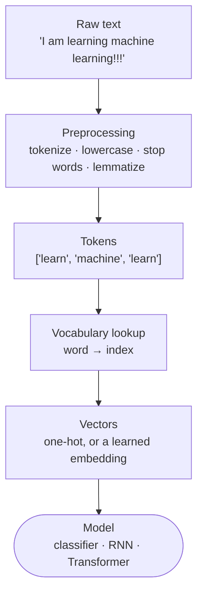

:::tip[TL;DR (30-Second Interview Pitch)]
Neural networks only do arithmetic, so NLP starts by turning text into numbers. First **preprocess** (tokenize, lowercase, drop stop words, reduce words to a root by stemming or lemmatization), then build a **vocabulary** that gives every word an index. Raw indices invent a fake order, and **one-hot vectors** fix that but are huge and make every pair of words equally unrelated (cosine similarity 0). **Word embeddings** solve both problems: short, dense, *learned* vectors in which words used in similar contexts sit close together. **Word2Vec** learns them by predicting neighbouring words (**skip-gram**: word → context; **CBOW**: context → word). The **co-occurrence matrix** (and **GloVe**, built on it) learns from global counts instead. All of this rests on one idea: *a word is known by the company it keeps*.
:::

<FormulaKey />

:::info[Where this page sits]
**Before:** [Transfer Learning with ResNet18](../02-cnns/04-transfer-learning-resnet18.md) closes the computer-vision part of the course.
**This page:** the theory of representing text (notebook *8 NLP*).
**Next:** [NLP in Practice](./02-nlp-in-practice-preprocessing-word2vec-sentiment.md) builds a real preprocessing pipeline, trains Word2Vec, and classifies sentiment with TF-IDF, Naive Bayes and SVM (notebook *9 NLP Text Processing*). After that come RNNs, which read these vectors one word at a time.
:::

## 🧭 Start Here

Every model so far has eaten numbers: pixel intensities for CNNs, columns of a table for classical ML. Text is different. "I love NLP" is a string of symbols, and a neural network cannot multiply a word by a weight. So the first job of NLP is **representation**: deciding which numbers stand for a piece of text.

This page builds that representation in the order the field discovered it. Each step fixes a flaw in the one before:

1. **Clean the text** so that "Learning", "learning!!!" and "learned" don't become three unrelated symbols.
2. **Number the words** with a vocabulary. That turns text into numbers, but invents a fake ordering (is "queen" = 2 bigger than "king" = 1?).
3. **One-hot vectors** remove the fake ordering, but each vector is as long as the vocabulary and every word is equally far from every other.
4. **Embeddings** squeeze each word into a short vector *learned from data*, so similar words get similar vectors.
5. **Word2Vec** and **co-occurrence counts / GloVe** are two ways of learning those vectors from raw text.

| New concept | One-line meaning |
|---|---|
| **Token** | One unit of text after splitting, usually a word (or a piece of a word in modern models) |
| **Corpus** | The whole collection of text you learn from |
| **Vocabulary** $V$ | The set of distinct tokens; $\lvert V \rvert$ is the vocabulary size |
| **Stop words** | Very common words (the, is, and) that often carry little meaning on their own |
| **Stemming / Lemmatization** | Cutting a word to a crude root (*studies → studi*) / mapping it to its dictionary form (*studies → study*) |
| **One-hot vector** | A vector of length $\lvert V \rvert$ with a single 1 marking the word |
| **Embedding** | A short, dense, learned vector for each word (e.g. 100 numbers) |
| **Distributional hypothesis** | Words that appear in similar contexts have similar meanings |
| **Context window** | How many neighbours on each side count as a word's context |
| **Skip-gram / CBOW** | Word2Vec's two training tasks: word → neighbours / neighbours → word |
| **Co-occurrence matrix** | A table counting how often each pair of words appears near each other |
| **Cosine similarity** | How closely two vectors point in the same direction (1 = same, 0 = unrelated) |

:::analogy[Representing words is like giving people seats in a stadium]
Numbering the seats (word indices) tells you nothing about who knows whom. Giving everyone their own private stand (one-hot) is wasteful and still says nothing about friendships. Embeddings are a clever seating plan in which friends end up sitting near each other. Word2Vec builds that plan by watching who keeps turning up together.
:::

## 1. Why Text Is Different from Numerical Data

An image is already numbers: a 128×128 photo is a grid of pixel intensities, and a slightly brighter pixel really is "a bit more" of something. Text has no such built-in arithmetic. The word "cat" isn't bigger or smaller than "dog", and there is no natural number to attach to it. Before any model can learn from text, **we have to invent a numerical representation**, and the quality of that representation limits everything that comes after.

Three properties make text especially awkward.

**It is sequential.** "I love NLP" and "NLP love I" contain exactly the same words, but only one is a sentence. "The dog bit the man" and "The man bit the dog" mean very different things. Order carries meaning, so a good model must see words *in sequence*. That is exactly what RNNs and Transformers (later in the course) are designed for. Simple representations that ignore order (bag-of-words, TF-IDF, averaged embeddings) lose this information.

**The vocabulary is large and open-ended.** Three short sentences ("I love NLP", "I love deep learning", "Deep learning is powerful") already have 7 distinct words. A real corpus has tens of thousands, plus typos, names, slang and new words that appear every year. And whatever vocabulary you build from training data, some test-time words will be missing from it: the **out-of-vocabulary (OOV)** problem.

**Naive representations are extremely high-dimensional.** If each word must be distinguished from 10,000 others, the obvious encoding (one-hot, Section 4) needs 10,000 numbers per word, almost all of them zero. That costs memory and computation, and it makes learning hard: a model has to learn a separate weight for each of those 10,000 dimensions, from data in which most words appear only a handful of times.

So NLP's first job is a pipeline: **text → cleaned tokens → numbers → model**. This page builds the "numbers" part properly. RNNs then consume the result as a sequence of vectors $\data{X} = [\data{x_1}, \data{x_2}, \ldots, \data{x_T}]$, one vector per word.



:::tip[🎯 Interview angle]
**"Why can't a neural network take text directly, and what makes text hard?"** Networks multiply and add numbers, so text must be mapped to vectors first. Text is hard because **order matters** (so we need sequence models or lose meaning), the **vocabulary is huge and open** (out-of-vocabulary words at test time), and naive encodings are **sparse and high-dimensional**. Mention that the representation you choose (one-hot, TF-IDF, embeddings, contextual embeddings) caps what the model can learn.
:::

## 2. The Text Preprocessing Pipeline

To a human, "I love Machine Learning!!!", "I LOVE machine learning" and "i love machine learning" say the same thing. To a computer they are different strings, so a naive vocabulary would hold "Machine", "machine" and "Learning!!!" as separate words. That **inflates the vocabulary**, spreads the evidence for one word across several spellings, and gives the model less data per word. **Preprocessing** standardizes text so that things that mean the same also look the same. The classic pipeline has five steps.

**Step 1: Tokenization** splits text into units called **tokens**. "I love NLP" → `["I", "love", "NLP"]`, and a sentence becomes a list $S = [w_1, w_2, \ldots, w_n]$. Splitting on spaces is the crude version; real tokenizers also separate punctuation and handle contractions (`don't` → `do` + `n't`). Modern Transformer models go further and split rare words into **subword** pieces (*unbelievable → un + believ + able*), which largely solves the out-of-vocabulary problem.

**Step 2: Lowercasing** maps "I", "Love" and "LOVE" onto one form each. It is almost always helpful, but it does destroy some information: "US" (the country) and "us" (the pronoun) merge, and so do "Apple" the company and "apple" the fruit.

**Step 3: Stop-word removal** drops very common function words such as *is, the, and, of, are*. "This is a machine learning model" → `["machine", "learning", "model"]`. They appear in almost every sentence, so they tell a topic classifier little and mostly add noise and length. But "little meaning" depends on the task. NLTK's English stop-word list includes **not, no, nor** and **don't**, so blindly removing stop words turns "this product is **not** good" into "product good", which flips the sentiment. Machine translation, question answering and any sequence model need every word, stop words included.

**Step 4: Stemming** chops words down to a crude root with suffix-stripping rules (the **Porter stemmer** is the classic): *running → run*, *played → play*, *learning → learn*. It is fast and needs no dictionary, but it is blind to meaning, so it both **over-cuts** and **merges unrelated words**: *studies → studi*, *machine → machin*, *university* and *universe* both → *univers*, *organization* and *organ* both → *organ*. It also misses irregular forms (*ran* stays *ran*, *better* stays *better*).

**Step 5: Lemmatization** maps each word to its **lemma**, the real dictionary form: *studies → study*, *running → run*, *better → good*. It uses a dictionary (WordNet in NLTK) and, crucially, needs to know the word's **part of speech (POS)**. "Better" is only lemmatized to "good" when it's treated as an adjective, and "running" only becomes "run" when treated as a verb. NLTK's lemmatizer assumes *noun* by default, which is why `lemmatize("running")` returns `running` unchanged. So production pipelines run a **POS tagger** first and pass each word's tag to the lemmatizer. That is more accurate, but slower.

Put together on the notebook's sentence, "I am learning machine learning and loving it":

| Stage | Output |
|---|---|
| Lowercase + tokenize | `['i', 'am', 'learning', 'machine', 'learning', 'and', 'loving', 'it']` |
| Remove stop words | `['learning', 'machine', 'learning', 'loving']` |
| Porter stemming | `['learn', 'machin', 'learn', 'love']` |
| POS-aware lemmatization | `['learn', 'machine', 'learn', 'love']` |

The payoff: a smaller vocabulary, more examples per word, less noise, less computation. But **every step throws information away**, and the right amount of preprocessing depends on the model. Classical models (TF-IDF + Naive Bayes, Word2Vec on a small corpus) benefit from aggressive normalization. Modern Transformers are trained on raw, cased text with their own subword tokenizer, and you usually feed them text almost untouched.

<Animation src="nlp/preprocessing-pipeline" caption="The notebook sentence passes through each preprocessing stage. Watch stop-word removal drop four words, then compare the stemmer, which produces machin, with the lemmatizer, which keeps machine." />

| | **Stemming** (Porter) | **Lemmatization** (WordNet + POS) |
|---|---|---|
| How | Rule-based suffix stripping | Dictionary lookup using the part of speech |
| Output | A stem, often not a real word (*studi, machin*) | A real dictionary word (*study, machine*) |
| Irregular forms | Misses them (*ran, better* unchanged) | Handles them (*ran → run, better → good*) with the right POS |
| Mistakes | Merges unrelated words (*universe/university → univers*) | Rare, as long as the POS is right |
| Speed | Very fast | Slower (needs POS tagging + dictionary) |
| Use when | Speed matters, search/indexing, rough topic models | Meaning matters, smaller vocabularies with real words |

:::danger[Interview Trap: "Always remove stop words"]
Stop-word lists contain **negations** (*not, no, nor, never*, and contractions like *don't*). Removing them destroys sentiment ("not good" → "good"), questions ("who", "what" are stop words too), and any task that relies on word order. Remove stop words only for bag-of-words style topic/classification models, and even then **keep negations** for sentiment. Never remove them before a Transformer.
:::

:::analogy[Stemming is a cleaver, lemmatization is a dictionary]
A butcher's cleaver (stemming) chops every word at roughly the right place, fast, but sometimes takes too much (*studi*) or makes two different cuts look identical (*univers*). Looking each word up in a dictionary (lemmatization) gives the proper base form every time, but you first have to know whether the word is a noun or a verb, which takes longer.
:::

:::tip[🎯 Interview angle]
**"Stemming vs lemmatization?"** Stemming = fast rule-based suffix chopping, output may not be a word, can merge unrelated words. Lemmatization = dictionary lookup to the real base form, needs the POS tag (*better → good* only as an adjective), slower but more accurate. **"When would you skip preprocessing?"** With Transformers (they use their own subword tokenizer and need the full, cased text), and whenever stop words or punctuation carry meaning (sentiment, questions, named entities).
:::

## 3. Vocabulary and Integer Encoding

Once text is tokenized, the next step is to give every distinct token a number. Collect the unique tokens across the training corpus: that set is the **vocabulary** $V$. Then assign each one an index with a dictionary, usually called `word2index`. For "i love nlp", "i love deep learning" and "deep learning is powerful", the sorted vocabulary is `deep, i, is, learning, love, nlp, powerful`, giving `deep → 0, i → 1, is → 2, …, powerful → 6`. A sentence is now a list of integers: "i love nlp" → `[1, 4, 5]`.

This is a necessary step (every later representation starts by looking words up in this index), but the integers themselves **must not be fed to a model as quantities**. Index numbers are arbitrary labels: "love" = 4 and "nlp" = 5 doesn't mean nlp is "a bit more" than love, and if "king" = 1 and "queen" = 2, a linear model would happily conclude that queen = 2 × king. The numbers impose a **false ordering and false distances**. The fix is to treat each index as a *category*, which is exactly what one-hot vectors and embedding lookups do.

Real vocabularies need three extra details:

- **Reserved tokens.** `<PAD>` (often index 0) fills short sentences so a batch is rectangular, and `<UNK>` stands in for any word not in the vocabulary. Without `<UNK>`, a word unseen in training crashes the lookup with a `KeyError`.
- **Frequency cut-off.** Words seen only once or twice are usually mapped to `<UNK>` (`min_count` in Word2Vec), because there isn't enough data to learn anything about them, and they bloat the vocabulary.
- **Deterministic ordering.** Building the vocabulary with `set()` (as the notebook does) gives a different word order every time Python starts, because string hashing is randomized per process. The same word then gets a different index in each run, and a saved model no longer matches its vocabulary. Always build the vocabulary with `sorted(...)` or by frequency, and save it with the model.

<Formula name="Vocabulary and index mapping" tag="Words to integers" words="Collect the distinct tokens into a vocabulary, give each one a position, and replace every word in a sentence with its position. The resulting integers are labels, not quantities." remember="An index is a name tag, not an amount.">

$$
V = \{\data{w_1}, \data{w_2}, \ldots, \data{w_{|V|}}\},
\qquad
f(\data{w_i}) = i,
\qquad
\data{S} = [\data{w_{a}}, \data{w_{b}}, \data{w_{c}}] \;\mapsto\; [a,\ b,\ c]
$$

**Example:** sorted vocabulary of the three sentences = `[deep, i, is, learning, love, nlp, powerful]` ($\lvert V \rvert = 7$) → "i love nlp" = `[1, 4, 5]`, "deep learning is powerful" = `[0, 3, 2, 6]`.

</Formula>

:::analogy[Word indices are jersey numbers]
A footballer wearing number 10 isn't twice as good as the one wearing 5. Jersey numbers just identify players. Word indices are the same: perfectly good for looking a word up, meaningless if a model tries to do arithmetic with them.
:::

:::tip[🎯 Interview angle]
**"Why not feed word indices straight into a model?"** They impose a fake order and fake distances (queen = 2 × king). Indices are only used to **look up** a vector (one-hot or embedding). Bonus points: mention `<UNK>` for out-of-vocabulary words, `<PAD>` for batching, a `min_count` cut-off, and building the vocabulary deterministically (sorted, saved with the model).
:::

## 4. One-Hot Encoding

One-hot encoding removes the fake ordering by giving every word its **own dimension**. A word becomes a vector of length $\lvert V \rvert$ that is all zeros except a single 1 at the word's index. With the vocabulary \{king, queen, man, woman\}: king = `[1, 0, 0, 0]`, queen = `[0, 1, 0, 0]`, man = `[0, 0, 1, 0]`, woman = `[0, 0, 0, 1]`. A sentence becomes a matrix with one row per word: "I love NLP" over the vocabulary \{I, love, NLP\} is the 3×3 identity matrix.

This fixes the ordering problem completely. No word is "bigger" than another, every word gets a unique code, and nothing is implied that isn't there. One-hot vectors are what classical models and the input of `nn.Embedding` conceptually use.

But it creates two new problems.

**It is wasteful.** The vector is as long as the vocabulary. With 10,000 words, each word is 10,000 numbers (40 KB as float32), all but one of them zero. A 20-word sentence becomes a 20 × 10,000 matrix: 200,000 numbers to say 20 things. And the first layer of a network on top of it needs $10{,}000 \times$ (hidden size) weights.

**It cannot express similarity.** Every pair of one-hot vectors is **orthogonal**: their dot product is 0, so their cosine similarity is 0, and they are all exactly the same distance apart ($\sqrt{2}$). "King" is exactly as unrelated to "queen" as it is to "banana". Whatever a model learns about "king" teaches it nothing about "queen", so every word must be learned from scratch, which is hopeless for rare words.

Cosine similarity is the standard way to measure how alike two word vectors are, so it's worth knowing well. It is the dot product divided by the two lengths: the cosine of the angle between the vectors. It ignores length and only looks at direction, which suits word vectors because a frequent word's vector often grows longer without changing meaning.

<Formula name="One-hot vector" tag="One dimension per word" words="A vector as long as the vocabulary, all zeros except a single 1 at the word's own index. Every word gets a unique direction, and no word is related to any other." remember="One word, one switch turned on.">

$$
\data{x_{w}} \in \{0, 1\}^{|V|},
\qquad
(\data{x_{w}})_j = \begin{cases} 1 & j = f(w) \\ 0 & \text{otherwise} \end{cases}
$$

**Example:** vocabulary \{king, queen, man, woman\}: queen = `[0, 1, 0, 0]`. With $\lvert V \rvert = 10{,}000$, each vector has 10,000 entries, 9,999 of them zero.

</Formula>

<Formula name="Cosine similarity" tag="How alike are two vectors?" words="The dot product of two vectors divided by both of their lengths, which is the cosine of the angle between them. One means same direction, zero means unrelated, minus one means opposite." remember="Compare directions, ignore lengths.">

$$
\text{cos}(\data{a}, \data{b}) = \frac{\data{a} \cdot \data{b}}{\lVert \data{a} \rVert \, \lVert \data{b} \rVert}
= \frac{\sum_i a_i b_i}{\sqrt{\sum_i a_i^2}\,\sqrt{\sum_i b_i^2}}
$$

**Example:** one-hot king `[1,0,0,0]` vs queen `[0,1,0,0]`: dot product 0 → cosine **0**, distance $\sqrt{2} = 1.414$, the same as king vs woman. One-hot cannot tell related from unrelated.

</Formula>

| | Integer index | One-hot |
|---|---|---|
| Size per word | 1 number | $\lvert V \rvert$ numbers (10,000 for a 10K vocabulary) |
| Fake ordering? | **Yes** (queen = 2 > king = 1) | No |
| Similarity between words | Meaningless | Always 0 (all orthogonal) |
| Typical use | Lookup key for an embedding table | Classical ML features, conceptual input to embeddings |

:::analogy[One-hot is a building where every flat has its own staircase]
Every resident (word) gets a private staircase (dimension), so nobody is confused for anyone else. But a 10,000-flat building with 10,000 staircases is absurdly wasteful, and since no two staircases connect, you can't tell which neighbours are friends.
:::

:::tip[🎯 Interview angle]
**"What's wrong with one-hot encoding for words?"** Dimension = vocabulary size (sparse, memory- and compute-hungry), and all vectors are orthogonal, so similarity is always 0 and nothing learned about one word transfers to a related one. **"How does it relate to embeddings?"** Multiplying a one-hot vector by an embedding matrix just picks out one row, which is exactly what an embedding lookup does, only without building the giant sparse vector.
:::

## 5. Word Embeddings

An **embedding** gives each word a short, **dense** vector of real numbers, typically 50 to 300 values instead of 10,000. The key difference from one-hot is that these numbers are **learned from data**, so the geometry carries meaning: words used in similar ways end up with similar vectors. "Coffee" and "tea" point in nearly the same direction; "coffee" and "carburettor" don't.

Why would learning produce meaningful vectors? Because of the **distributional hypothesis**: words that appear in similar contexts tend to have similar meanings ("You shall know a word by the company it keeps", J. R. Firth). "I drink **coffee** every morning" and "I drink **tea** every morning": coffee and tea share neighbours, so any method that builds vectors from neighbours will make them similar. Section 6 (Word2Vec) and Section 7 (co-occurrence and GloVe) are two ways of doing exactly that.

Dense vectors fix both one-hot problems at once.

- **Compact.** 100 numbers per word instead of 10,000. The whole embedding table is $\lvert V \rvert \times d$: 10,000 × 100 = 1 million parameters, stored once and shared by every sentence.
- **Similarity is built in.** Related words have high cosine similarity, so whatever the model learns about "coffee" partly transfers to "tea". That is how models generalize to words that were rare in their training data.

Embeddings also capture **relationships as directions**. The most famous example is $\text{king} - \text{man} + \text{woman} \approx \text{queen}$: the difference king − man is roughly a "royalty" direction, and adding it to woman lands near queen. Similar offsets show up for country → capital (Paris − France + Italy ≈ Rome) and verb tenses (walking − walk + run ≈ running). We verified this on a real corpus: Word2Vec (CBOW) trained on the 1-million-word Brown corpus answers `king − man + woman` with **queen** (similarity 0.83) as its top result.

Two cautions that interviewers like. First, analogy search **excludes the three query words** from the answer. With the notebook's hand-made toy vectors, king − man + woman = `[0.85, 0.25, 0.65]` is actually *slightly closer to king* (cosine 0.9994) than to queen (0.9992), and it only "finds queen" once king, man and woman are ruled out (and by Euclidean distance, where queen wins). Second, these are **static** embeddings: one vector per word, whatever the sentence. "Bank" gets the same vector in "river bank" and "bank account". Contextual models like BERT (later in the course) give a different vector for each occurrence.

In PyTorch an embedding table is `nn.Embedding(num_words, dim)`, a learnable $\lvert V \rvert \times d$ matrix. Looking up word $i$ just returns row $i$, which is mathematically the same as multiplying the one-hot vector by the matrix, without ever building the sparse vector. The table can be **trained from scratch** with the rest of the network, **initialized from pretrained vectors** (Word2Vec, GloVe, FastText), or loaded and **frozen**, exactly like transfer learning with CNNs.

<Formula name="Embedding lookup" tag="One-hot times a matrix = a row" words="The embedding table holds one learned row per word. Looking a word up returns its row, which is what you would get by multiplying its one-hot vector by the table." remember="Lookup is a one-hot multiplication.">

$$
\param{E} \in \mathbb{R}^{|V| \times \hyper{d}},
\qquad
\pred{e_w} = \data{x_w}^{\top}\,\param{E} = \param{E}[\,f(w)\,]
$$

- $\param{E}$: the embedding table, learned (or pretrained)
- $\hyper{d}$: embedding size you choose (50–300 is typical)
- **Example:** $\lvert V \rvert = 10{,}000$, $\hyper{d} = 100$ → $\param{E}$ has **1,000,000** parameters; each word becomes 100 numbers instead of 10,000

</Formula>

<Formula name="Word analogies as vector arithmetic" tag="king − man + woman ≈ queen" words="Subtracting two related word vectors isolates the relationship between them, and adding that difference to a third word moves it to the matching word. Search for the nearest word, excluding the three you started with." remember="Differences are directions of meaning.">

$$
\pred{v_{?}} = \param{v_{\text{king}}} - \param{v_{\text{man}}} + \param{v_{\text{woman}}},
\qquad
\text{answer} = \arg\max_{w \notin \{\text{king, man, woman}\}} \cos(\pred{v_{?}}, \param{v_w})
$$

**Example:** Word2Vec CBOW on the Brown corpus (982K tokens): top answer **queen** (0.83). Notebook toy vectors: result `[0.85, 0.25, 0.65]` vs queen `[0.82, 0.25, 0.58]`.

</Formula>

| | One-hot | Embedding |
|---|---|---|
| Values | 0/1, sparse | Real numbers, dense |
| Size per word | $\lvert V \rvert$ (e.g. 10,000) | $d$ (e.g. 100) |
| Learned? | No, fixed by the vocabulary | **Yes**, from data |
| Similar words | Cosine always 0 | Cosine high for related words |
| Generalizes to related words | No | Yes |
| Captures relations | No | Often, as vector offsets |

:::analogy[Embeddings are GPS coordinates for words]
A one-hot vector is a street address that tells you nothing about where the house is. An embedding is a GPS coordinate: houses on the same street get similar coordinates, and "drive two blocks north" (a vector offset) means the same thing wherever you start, the way the man→woman offset turns king into queen.
:::

:::tip[🎯 Interview angle]
**"Why are embeddings better than one-hot?"** Dense and low-dimensional (100 vs 10,000), learned so that **similar words get similar vectors** (cosine similarity), which lets knowledge transfer between related words, and relations show up as vector offsets. **"Limitation?"** Static: one vector per word regardless of context ("bank"), out-of-vocabulary words get nothing (FastText's character n-grams help), and they inherit biases from the training text.
:::

## 6. Word2Vec: Learning Embeddings from Context

Word2Vec (Mikolov et al., Google, 2013) turns the distributional hypothesis into a training task. The trick is that it **invents a prediction problem whose labels come free with any text**: predict a word from its neighbours, or its neighbours from the word. Nobody has to label anything. The embeddings are a by-product: to predict context well, the network has to give words that share contexts similar vectors.

**Step 1: generate training pairs with a context window.** Slide over each sentence. For every position, the word there is the **centre word**, and the words up to $w$ positions to the left and right are its **context**. With window $w = 1$, "i love deep learning" gives six (centre, context) pairs: (i, love), (love, i), (love, deep), (deep, love), (deep, learning), (learning, deep). With $w = 2$ the same sentence gives ten. A bigger window captures broader, more topical similarity; a smaller one captures more syntactic similarity (words that can replace each other).

**Step 2: train on one of two tasks.**

- **Skip-gram: centre word → context.** Input "love", predict "i" and "deep". Each pair is a separate training example, so every word, even a rare one, gets many updates of its own. Skip-gram works well on **smaller datasets and for rare words**, at the cost of more training time.
- **CBOW (Continuous Bag of Words): context → centre word.** Input \{i, deep\} (their vectors are averaged), predict "love". One example per position makes it faster, and averaging smooths noise, so CBOW does well on **large datasets and frequent words**, but rare words get blurred into the average.

**Step 3: what the network actually computes.** Word2Vec is a tiny network with one hidden layer and no activation function. Each word has two vectors: an *input* vector $v$ (used when it is the centre word) and an *output* vector $u$ (used when it is a context word). To score how likely a context word $o$ is given centre word $c$, take the dot product $u_o \cdot v_c$: a large dot product means "these appear together". A softmax over the whole vocabulary turns the scores into probabilities, and training pushes up the probability of the context words that really occurred. After training you keep the input vectors $v$ as the embeddings.

The softmax over the entire vocabulary is too slow for 100,000+ words, so real Word2Vec uses **negative sampling**: for each real pair, also draw a few random "negative" words and train a simple yes/no classifier ("is this a real neighbour?"). It's the same idea, cheaper.

**Why it works:** "coffee" and "tea" appear with the same neighbours (drink, cup, morning, hot). Their vectors are both pushed towards the same context vectors, so they end up close together, even though they never appear in the same sentence.

**It needs a lot of text.** On the notebook's tiny demo (5 short sentences) or its 54 customer reviews (298 tokens after preprocessing), Word2Vec learns essentially nothing. We checked: after training, the "delivery" vector had moved by 0.0003 from its random starting point (whose length is about 0.087), and its nearest neighbours were *identical* to those of the untrained random vectors. On the 1-million-word Brown corpus the same code produces meaningful neighbours (*week → month, year, season, day*; *coffee → cup*) and solves the king/queen analogy. Real pretrained vectors come from billions of words.

One more classic surprise: **antonyms come out similar**. On Brown, the nearest neighbour of *good* is *bad* (similarity 0.60). "A good movie" and "a bad movie" share contexts, so Word2Vec can't separate them. That matters for sentiment, where good vs bad is the whole point.

<Animation src="nlp/context-window" caption="A window of size 1 slides over i love deep learning. At each centre word it emits one training pair per neighbour, six pairs in total, which skip-gram uses to predict the context from the centre word." />

<Formula name="Number of training pairs" tag="Context window" words="Each word is paired with every neighbour up to w positions away on each side, so a sentence of n words gives roughly 2w pairs per word, fewer at the edges." remember="Two-w neighbours per word, minus the edges.">

$$
\#\text{pairs} = \sum_{i=1}^{n} \Big(\min(i - 1,\ \hyper{w}) + \min(n - i,\ \hyper{w})\Big)
$$

**Example:** "i love deep learning" ($n = 4$): $\hyper{w} = 1$ → $1 + 2 + 2 + 1 = $ **6** pairs; $\hyper{w} = 2$ → $2 + 3 + 3 + 2 = $ **10** pairs.

</Formula>

<Formula name="Skip-gram probability" tag="Score neighbours with a dot product" words="Score every vocabulary word as a possible neighbour of the centre word using a dot product of their vectors, turn the scores into probabilities with softmax, and train to make the real neighbour's probability high." remember="Dot product to score, softmax to compare.">

$$
P(\data{o} \mid \data{c}) = \frac{\exp\big(\param{u_o} \cdot \param{v_c}\big)}{\sum_{w \in V} \exp\big(\param{u_w} \cdot \param{v_c}\big)},
\qquad
\loss{L} = -\log P(\data{o} \mid \data{c})
$$

- $\param{v_c}$: input (centre) vector of word $c$, kept as the embedding after training
- $\param{u_o}$: output (context) vector of word $o$
- **Example:** $\param{v_{love}} = [0.6, 0.4]$; output vectors $u_i = [1.0, 0.5]$, $u_{deep} = [0.8, 0.9]$, $u_{nlp} = [-0.5, 0.2]$ → scores 0.80, 0.84, −0.22 → probabilities **0.416, 0.433, 0.150**; if the real neighbour is "deep", $\loss{L} = -\ln 0.433 = 0.836$

</Formula>

| | **Skip-gram** | **CBOW** |
|---|---|---|
| Task | Centre word → each context word | Context words (averaged) → centre word |
| Example ($w = 1$) | love → i, love → deep | \{i, deep\} → love |
| Training examples | One per (centre, context) pair, so more | One per position, so fewer |
| Speed | Slower | **Faster** |
| Rare words | **Better** (each gets its own updates) | Worse (blurred by averaging) |
| Best for | Smaller data, rare words | Large data, frequent words |

:::analogy[Word2Vec is learning a language by guessing the blanked-out word]
Imagine reading millions of sentences with a word blanked out and guessing what fits: "I drink ___ every morning." You'd soon learn that coffee, tea and juice are interchangeable here, without anyone defining them. CBOW plays exactly this game; skip-gram plays the reverse ("given *coffee*, what words are nearby?"). The embeddings are what your brain stores to get good at the game.
:::

:::tip[🎯 Interview angle]
**"How does Word2Vec work?"** Self-supervised: slide a context window, make (centre, context) pairs, train a shallow network to predict context from centre (skip-gram) or centre from context (CBOW) with dot-product scores and softmax (in practice negative sampling). Words with shared contexts get pushed towards the same context vectors, so they end up similar. **"Skip-gram or CBOW for a small dataset?"** Skip-gram (better for rare words); CBOW is faster and good for big corpora. **"Limitations?"** Static vectors, needs lots of text, out-of-vocabulary words, antonyms look similar.
:::

## 7. The Co-Occurrence Matrix and GloVe

Word2Vec learns from **local** context, one window at a time, through millions of small prediction steps. The **co-occurrence matrix** takes the **global** view instead: go through the entire corpus once and simply **count** how often each pair of words appears within the window. The result is a $\lvert V \rvert \times \lvert V \rvert$ table $X$ where $X_{ij}$ is the number of times word $j$ occurs near word $i$.

For "i love deep learning", "i love machine learning" and "deep learning is powerful" with window 1, *deep–learning* appears together twice, *i–love* twice, and *love–machine* once. Because "near" is symmetric, so is the matrix: $X_{ij} = X_{ji}$.

**Each row is already a word vector.** Row $i$ describes word $i$ by its neighbours. Two words with similar rows keep similar company, so they probably mean similar things. In a tiny corpus where "I drink **coffee** every morning", "I drink **tea** every morning", "hot coffee with milk" and "hot tea with milk" appear, the coffee and tea rows are identical (cosine similarity **1.0**), while coffee vs car (car appears with "his", "to", "near") has cosine similarity **0**. A high count $X_{ij}$ means words $i$ and $j$ are strongly associated.

Raw counts have problems, though. The matrix is $\lvert V \rvert \times \lvert V \rvert$, so 10,000 words means 100 million cells, almost all zero. And frequent words like "the" dominate every row. Classical fixes reweight the counts (e.g. **PMI**, which asks "do these two co-occur more than chance?") and compress the rows with **SVD** to a few hundred dense dimensions.

**GloVe** (Global Vectors, Stanford 2014) is the modern answer and joins the two traditions. It *starts* from the global co-occurrence counts, then *learns* dense vectors whose dot products match the **log** of those counts: words that co-occur often get vectors with a large dot product. It is trained once on the matrix (not by sliding windows), and its pretrained vectors (trained on Wikipedia and web text) are as widely used as Word2Vec's.

<Formula name="Co-occurrence count" tag="Global context" words="For every pair of words, count how many times one appears within the context window of the other across the whole corpus. Each row of the resulting table describes a word by its neighbours." remember="Count who sits next to whom.">

$$
\data{X_{ij}} = \#\{\text{times word } j \text{ appears within the window of word } i\},
\qquad
\data{X_{ij}} = \data{X_{ji}}
$$

**Example:** window 1 over the notebook's three sentences: $X_{\text{deep, learning}} = 2$, $X_{\text{i, love}} = 2$, $X_{\text{love, machine}} = 1$. Toy coffee/tea corpus: cos(coffee row, tea row) = **1.0**, cos(coffee, car) = **0**.

</Formula>

<Formula name="GloVe's idea" tag="Vectors that reproduce the counts" words="GloVe learns one vector per word so that the dot product of two words' vectors, plus two small bias terms, is close to the logarithm of how often they co-occur." remember="Dot product matches log count.">

$$
\param{w_i} \cdot \param{\tilde w_j} + \param{b_i} + \param{\tilde b_j} \;\approx\; \log \data{X_{ij}}
$$

- Frequent pairs (large $\data{X_{ij}}$) → large dot product → similar directions
- Trained by weighted least squares over the non-zero counts; very frequent pairs are down-weighted

</Formula>

<Animation src="nlp/cooccurrence-coffee-tea" caption="A window of size 1 sweeps the six-sentence toy corpus and fills the rows for coffee, tea and car. Coffee and tea collect exactly the same neighbours, so their rows match with cosine similarity 1.0, while car shares none and scores 0." />

| | **Word2Vec** | **Co-occurrence matrix** | **GloVe** |
|---|---|---|---|
| Uses | Local windows, one at a time | Global counts over the whole corpus | Global counts |
| How vectors are made | Predict context (learned) | Rows of counts (counted) | Fit vectors to log counts (learned) |
| Vector size | Dense, $d \approx 100$–300 | Sparse, $\lvert V \rvert$ | Dense, $d \approx 50$–300 |
| Memory | $\lvert V \rvert \times d$ | $\lvert V \rvert \times \lvert V \rvert$ (huge) | Builds the matrix, stores $\lvert V \rvert \times d$ |
| Strength | Scales to huge streams of text | Simple, interpretable | Combines global statistics with dense vectors |

:::analogy[Word2Vec takes notes during the party; the co-occurrence matrix reads the guest list afterwards]
Word2Vec wanders around the party adjusting its opinion of each guest every time it sees who they're chatting with. The co-occurrence approach waits until the end and counts, for every pair of guests, how often they were seen together. GloVe takes those final counts and draws a seating map in which frequent pairs sit close.
:::

:::tip[🎯 Interview angle]
**"Word2Vec vs co-occurrence / GloVe?"** Word2Vec is **predictive** and **local**: it learns from windows by predicting context. Co-occurrence methods are **count-based** and **global**: they count over the whole corpus. Raw co-occurrence rows are huge and sparse; GloVe learns dense vectors whose dot products fit the log counts. Both rest on the distributional hypothesis, and in practice the vectors perform similarly.
:::

## 8. The Big Picture: Choosing a Representation

Each representation in this page fixed one problem and exposed the next, and the story continues past this page.

- **Integer indices** turn words into numbers but invent an ordering. They survive only as lookup keys.
- **One-hot** removes the ordering but is huge and makes every word equally unrelated.
- **Bag-of-words / TF-IDF** (next page) add up one-hot vectors over a document: simple, strong document features for classical models, but word order is lost.
- **Static embeddings** (Word2Vec, GloVe, FastText) are dense and capture similarity, but give one vector per word whatever the context.
- **Contextual embeddings** (ELMo, BERT, GPT, later in the course) compute a different vector for each occurrence of a word from its whole sentence, so "bank" in "river bank" and "bank account" finally differ.

Sequence models sit on top of these. An RNN reads a sentence one embedding at a time, keeping a running memory, so it can use the word order that bag-of-words methods throw away. That's the next section of the course.

| Representation | Dimension per word | Captures similarity | Uses word order | Context-dependent |
|---|---|---|---|---|
| Integer index | 1 | No (fake ordering) | — | No |
| One-hot | $\lvert V \rvert$ | No (all orthogonal) | No | No |
| TF-IDF (per document) | $\lvert V \rvert$ | No | No | No |
| Word2Vec / GloVe / FastText | 50–300 | **Yes** | No (by itself) | No |
| BERT / GPT embeddings | 768+ | **Yes** | **Yes** | **Yes** |

## ⚙️ Going Deeper (Internals)

**Why the skip-gram model's "hidden layer" is the embedding table**
- Input: a one-hot vector of size $\lvert V \rvert$. Hidden layer: $d$ units, no activation. Output: $\lvert V \rvert$ scores → softmax.
- Multiplying the one-hot input by the $\lvert V \rvert \times d$ input weight matrix selects one row: that row **is** the word's embedding. Training the network = training the embedding table. The output weight matrix holds the "context" vectors $u$.

**Negative sampling**
- The full softmax needs a dot product with every vocabulary word for every training pair (100,000+ operations). Negative sampling replaces it with $k$ binary classifications (typically $k$ = 5–20 for small corpora, 2–5 for large): push $\sigma(u_o \cdot v_c)$ towards 1 for the real context word and $\sigma(u_n \cdot v_c)$ towards 0 for $k$ random "negative" words, sampled with probability ∝ frequency$^{3/4}$ so that rare words are picked a little more often than raw frequency would.

**Frequent-word subsampling**
- Words like "the" occur in nearly every window and teach little. Word2Vec randomly drops frequent tokens during training (the `sample` parameter, default 1e-3 in gensim), which speeds training and improves rare-word vectors.

**FastText (Facebook, 2016)**
- Represents each word as the sum of its **character n-grams** (*where* → `<wh, whe, her, ere, re>` + the whole word). Unseen or misspelled words still get a vector from their pieces, which fixes most out-of-vocabulary problems and helps morphologically rich languages.

**Why cosine, not Euclidean, for word similarity**
- Embedding length tends to grow with word frequency, while the *direction* carries the meaning. Cosine similarity ignores length; Euclidean distance doesn't. That's why `most_similar` uses cosine, and why vectors are often L2-normalized before comparison.

**Dimension choice**
- Too small (≤ 25) and the space can't separate meanings; too large (≥ 500) and rare words are under-trained. 100–300 is the usual range for static embeddings.

:::danger[Interview Trap: "Embeddings understand meaning"]
Embeddings capture **co-occurrence patterns**, not meaning. Antonyms that share contexts end up close (*good ≈ bad*), and social biases in the training text end up in the geometry (e.g. occupation words drifting towards one gender). Analogies work only some of the time, and only when the query words are excluded from the answers. And each word gets one vector, so polysemous words like "bank" blend all their senses.
:::

## 💻 Python Implementation

:::tip[Run it yourself]
Verified on Python 3.13 with NLTK 3.10, gensim 4.4, NumPy 2.5 and PyTorch 2.14. NLTK needs its data packages once: `nltk.download("punkt_tab")`, `nltk.download("stopwords")`, `nltk.download("wordnet")`, `nltk.download("averaged_perceptron_tagger_eng")`.
:::

### 1. The preprocessing pipeline, step by step

The notebook's sentence through tokenization, stop-word removal, stemming and POS-aware lemmatization.

```python title="preprocess_demo.py" showLineNumbers
import re
import nltk
from nltk.corpus import stopwords, wordnet
from nltk.stem import PorterStemmer, WordNetLemmatizer

sentence = "I am learning machine learning and loving it"

tokens = nltk.word_tokenize(sentence.lower())
tokens = [re.sub(r"[^\w\s]", "", t) for t in tokens]          # strip punctuation
tokens = [t for t in tokens if t]                               # drop empty strings
stop_words = set(stopwords.words("english"))
tokens = [t for t in tokens if t not in stop_words]
print(tokens)                                                   # ['learning', 'machine', 'learning', 'loving']

stemmer = PorterStemmer()
print([stemmer.stem(t) for t in tokens])                        # ['learn', 'machin', 'learn', 'love']

def to_wordnet_pos(tag):                                        # Penn Treebank tag → WordNet POS
    return {"J": wordnet.ADJ, "V": wordnet.VERB, "R": wordnet.ADV}.get(tag[0], wordnet.NOUN)

lemmatizer = WordNetLemmatizer()
# highlight-next-line
print([lemmatizer.lemmatize(w, to_wordnet_pos(t)) for w, t in nltk.pos_tag(tokens)])   # ['learn', 'machine', 'learn', 'love']
```

### 2. Lemmatization needs the part of speech; stemming over-cuts

The default noun POS leaves *running* and *better* untouched.

```python showLineNumbers
from nltk.stem import PorterStemmer, WordNetLemmatizer

lem, stem = WordNetLemmatizer(), PorterStemmer()

# error-next-line
print([lem.lemmatize(w) for w in ["running", "better", "studies"]])   # ❌ ['running', 'better', 'study']: assumes noun
# success-next-line
print(lem.lemmatize("running", "v"), lem.lemmatize("better", "a"))     # ✅ run good

print([stem.stem(w) for w in ["studies", "university", "universe", "organization", "organ", "ran"]])
# ['studi', 'univers', 'univers', 'organ', 'organ', 'ran']: unrelated words merge, irregulars missed
```

### 3. A deterministic vocabulary with `<PAD>` and `<UNK>`

Sorted, so every run gives the same indices; unknown words don't crash.

```python title="vocab.py" showLineNumbers
sentences = ["i love nlp", "i love deep learning", "deep learning is powerful"]

# error-next-line
unstable = list(set(" ".join(sentences).split()))               # ❌ order changes every Python run (hash randomization)

# success-next-line
words = sorted(set(" ".join(sentences).split()))                # ✅ ['deep', 'i', 'is', 'learning', 'love', 'nlp', 'powerful']
word2index = {"<PAD>": 0, "<UNK>": 1}
word2index.update({w: i + 2 for i, w in enumerate(words)})

def encode(sentence):
    return [word2index.get(w, word2index["<UNK>"]) for w in sentence.split()]

print(encode("i love nlp"))                                     # [3, 6, 7]
print(encode("i love transformers"))                            # [3, 6, 1]: unseen word → <UNK>
```

### 4. One-hot vectors and cosine similarity

Every pair of one-hot vectors is orthogonal.

```python showLineNumbers
import numpy as np

vocab = ["king", "queen", "man", "woman"]
one_hot = np.eye(len(vocab))                                    # row i = one-hot vector of word i

def cosine(a, b):
    return a @ b / (np.linalg.norm(a) * np.linalg.norm(b))

king, queen, woman = one_hot[0], one_hot[1], one_hot[3]
print(cosine(king, queen))                                      # 0.0: "unrelated"
print(np.linalg.norm(king - queen), np.linalg.norm(king - woman))   # 1.414… 1.414…: every pair equally far
```

### 5. An embedding table is a one-hot multiplication

`nn.Embedding` returns exactly the rows a one-hot product would select.

```python showLineNumbers
import torch
import torch.nn as nn
import torch.nn.functional as F

torch.manual_seed(0)
emb = nn.Embedding(num_embeddings=7, embedding_dim=3)           # |V| = 7 words, d = 3
ids = torch.tensor([1, 4, 5])                                   # "i love nlp" with the sorted vocab

one_hot = F.one_hot(ids, num_classes=7).float()                 # (3, 7) sparse
# highlight-next-line
print(torch.allclose(one_hot @ emb.weight, emb(ids)))           # True: lookup = one-hot × table
print(emb(ids.unsqueeze(0)).shape)                              # torch.Size([1, 3, 3]): (batch, words, d)
print(sum(p.numel() for p in nn.Embedding(10_000, 100).parameters()))   # 1000000
```

### 6. Word analogies: exclude the query words

On the notebook's toy vectors, the raw nearest neighbour is king.

```python showLineNumbers
import numpy as np

emb = {"king": np.array([0.80, 0.20, 0.60]), "queen": np.array([0.82, 0.25, 0.58]),
       "man":  np.array([0.70, 0.10, 0.50]), "woman": np.array([0.75, 0.15, 0.55])}
cos = lambda a, b: a @ b / (np.linalg.norm(a) * np.linalg.norm(b))

target = emb["king"] - emb["man"] + emb["woman"]
print(target)                                                   # [0.85 0.25 0.65]

scores = {w: round(cos(target, v), 4) for w, v in emb.items()}
# error-next-line
print(max(scores, key=scores.get), scores)                      # ❌ king {'king': 0.9994, 'queen': 0.9992, …}
candidates = {w: s for w, s in scores.items() if w not in ("king", "man", "woman")}
# success-next-line
print(max(candidates, key=candidates.get))                      # ✅ queen: what gensim's most_similar does
```

### 7. Word2Vec training pairs from a context window

Window 1 gives six (centre, context) pairs; window 2 gives ten.

```python showLineNumbers
def skipgram_pairs(sentence, window):
    words = sentence.split()
    return [(words[i], words[i + j])
            for i in range(len(words))
            for j in range(-window, window + 1)
            if j != 0 and 0 <= i + j < len(words)]

print(skipgram_pairs("i love deep learning", 1))
# [('i', 'love'), ('love', 'i'), ('love', 'deep'), ('deep', 'love'), ('deep', 'learning'), ('learning', 'deep')]
print(len(skipgram_pairs("i love deep learning", 2)))           # 10
print(skipgram_pairs("i love nlp", 1))                          # [('i','love'), ('love','i'), ('love','nlp'), ('nlp','love')]
```

### 8. Word2Vec on a real corpus

One million words of the Brown corpus are enough for meaningful neighbours.

```python title="word2vec_brown.py" showLineNumbers
from gensim.models import Word2Vec
from nltk.corpus import brown                                   # nltk.download("brown")

sentences = [[w.lower() for w in s if w.isalpha()] for s in brown.sents()]   # 57,340 sentences, 981,716 tokens

model = Word2Vec(sentences, vector_size=100, window=5, min_count=5,
                 sg=0,                                          # 0 = CBOW, 1 = skip-gram
                 epochs=10, seed=42, workers=1)                 # workers=1 + seed (+ PYTHONHASHSEED) = reproducible

print(model.wv.most_similar("week", topn=3))                    # [('month', 0.91), ('year', 0.89), ('season', 0.88)]
# highlight-next-line
print(model.wv.most_similar(positive=["king", "woman"], negative=["man"], topn=1))   # [('queen', 0.83)]
print(round(model.wv.similarity("coffee", "tea"), 3))           # 0.719
```

### 9. A co-occurrence matrix, and why its rows are word vectors

Coffee and tea keep identical company.

```python title="cooccurrence.py" showLineNumbers
import numpy as np

corpus = ["i drink coffee every morning", "i drink tea every morning",
          "she likes hot coffee with milk", "she likes hot tea with milk",
          "he drives his car to work", "he parks his car near work"]

vocab = sorted(set(" ".join(corpus).split()))
idx = {w: i for i, w in enumerate(vocab)}
X = np.zeros((len(vocab), len(vocab)))
for sentence in corpus:
    words = sentence.split()
    for i, w in enumerate(words):
        for j in (-1, 1):                                       # window size 1
            if 0 <= i + j < len(words):
                X[idx[w], idx[words[i + j]]] += 1

cos = lambda a, b: a @ b / (np.linalg.norm(a) * np.linalg.norm(b))
print((X == X.T).all())                                         # True: co-occurrence is symmetric
print(cos(X[idx["coffee"]], X[idx["tea"]]))                     # 1.0: same neighbours (drink, every, hot, with)
print(cos(X[idx["coffee"]], X[idx["car"]]))                     # 0.0: no shared neighbours
```

## 🚨 Interview Gotchas & Edge Cases

:::warning[The Most Common Question]
**"How do you turn text into something a neural network can use?"**

1. **Preprocess**: tokenize; lowercase; optionally remove stop words (keep negations) and lemmatize. Do less for Transformers.
2. **Build a vocabulary** (word → index) with `<PAD>`, `<UNK>` and a frequency cut-off.
3. **Don't feed raw indices** (fake ordering). One-hot fixes that, but it is $\lvert V \rvert$-dimensional and every word is equally unrelated.
4. **Use embeddings**: an $\lvert V \rvert \times d$ table of dense learned vectors (`nn.Embedding`), trained from scratch or initialized from Word2Vec/GloVe/FastText.
5. Embeddings work because of the **distributional hypothesis**: similar contexts → similar vectors. Word2Vec learns them by prediction (skip-gram/CBOW), GloVe from global co-occurrence counts.
6. Limits: static vectors (one per word), out-of-vocabulary words, bias. Contextual models (BERT) fix the first.
:::

- **Removing stop words deletes negations** (*not, no, never*) and question words. Keep them for sentiment; skip stop-word removal for Transformers.
- **Lemmatizing without POS tags** treats everything as a noun: *running* and *better* stay unchanged.
- **Stemmers merge unrelated words** (*universe/university → univers*) and produce non-words (*studi*).
- **Lowercasing loses information** (*US* vs *us*, *Apple* vs *apple*). Named-entity tasks often keep case.
- **Building the vocabulary with `set()`** gives different indices on each run (hash randomization). Sort it and save it with the model.
- **No `<UNK>` token** → `KeyError` on the first unseen word in production.
- **Feeding word indices as numbers** to a model invents an ordering (queen = 2 × king).
- **One-hot similarity is always 0**; Euclidean distance is always $\sqrt{2}$.
- **Analogy search must exclude the query words**, or the answer is often the input word itself.
- **Word2Vec needs a large corpus.** On a few hundred tokens the vectors barely move from their random initialization, and "similar words" are noise.
- **Antonyms get similar embeddings** (*good* ≈ *bad*): bad news for sentiment if you rely on embedding similarity alone.
- **Static embeddings conflate word senses** ("bank"); contextual embeddings (BERT) are the fix.
- **gensim results vary between runs** unless you set `seed`, `workers=1` and `PYTHONHASHSEED`.
- **Co-occurrence matrices are $\lvert V \rvert^2$**: 10,000 words → 100 million cells. Store them sparse, reweight (PMI) and compress (SVD/GloVe).

## ⚡ Essential Interview Recall

A one-screen revision list. Every point is explained in the chapters above.

**Why text is hard**
- Networks need numbers; text is symbols. **Order matters** ("I love NLP" ≠ "NLP love I"), vocabularies are **large and open** (out-of-vocabulary words), naive encodings are **sparse and high-dimensional**.

**Preprocessing**
- Pipeline: **tokenize → lowercase → remove stop words → stem or lemmatize**. "I am learning machine learning and loving it" → stems `[learn, machin, learn, love]`, lemmas `[learn, machine, learn, love]`.
- **Stemming**: fast, rule-based suffix chopping; non-words (*studi*), merges unrelated words (*univers*). **Lemmatization**: dictionary form, needs **POS** (*better → good* as adjective); slower, accurate.
- Preprocessing is **task-dependent**: keep negations for sentiment; give Transformers raw text.

**Vocabulary and one-hot**
- Vocabulary = distinct tokens, `word2index` maps word → index. Add `<PAD>`, `<UNK>`, `min_count`; build it sorted.
- Raw indices create a **false ordering**. One-hot: length $\lvert V \rvert$, single 1, all words **orthogonal** (cosine 0, distance $\sqrt{2}$), memory-hungry.

**Embeddings**
- Dense learned vectors (50–300 dims); table $\lvert V \rvert \times d$ (10,000 × 100 = 1 M params). Lookup = one-hot × table.
- **Distributional hypothesis**: similar contexts → similar vectors. Similarity = **cosine**.
- **king − man + woman ≈ queen**, with the query words excluded. Static: one vector per word ("bank" problem); antonyms close; bias.

**Word2Vec**
- Self-supervised: context window → (centre, context) pairs (6 pairs for 4 words, window 1).
- **Skip-gram**: word → context; better for **small data and rare words**. **CBOW**: context → word; **faster**, better for frequent words.
- $P(o \mid c) = \text{softmax}(u_o \cdot v_c)$; in practice **negative sampling**. Needs a lot of text (fails on ~300 tokens, works on ~1 M).

**Co-occurrence and GloVe**
- $X_{ij}$ = how often words $i$ and $j$ appear within the window; symmetric; each row is a word vector. **Global** counts vs Word2Vec's **local** prediction.
- $\lvert V \rvert \times \lvert V \rvert$ and sparse → reweight (PMI), compress (SVD). **GloVe**: dense vectors with $w_i \cdot w_j \approx \log X_{ij}$.

## 📐 Formula Sheet

Every equation on this page in one place.

| Concept | Formula | In plain words |
|---|---|---|
| Sentence as tokens | $\data{S} = [\data{w_1}, \data{w_2}, \ldots, \data{w_n}]$ | A sentence is a list of tokens |
| Vocabulary and index | $V = \{\data{w_1}, \ldots, \data{w_{\lvert V \rvert}}\}$, $\;f(\data{w_i}) = i$ | Every distinct word gets a number |
| One-hot vector | $\data{x_w} \in \{0, 1\}^{\lvert V \rvert}$, single 1 at $f(w)$ | One dimension per word |
| Cosine similarity | $\cos(\data{a}, \data{b}) = \frac{\data{a} \cdot \data{b}}{\lVert \data{a} \rVert \lVert \data{b} \rVert}$ | Compare directions, ignore lengths |
| Embedding lookup | $\pred{e_w} = \data{x_w}^\top \param{E} = \param{E}[f(w)]$, $\;\param{E} \in \mathbb{R}^{\lvert V \rvert \times \hyper{d}}$ | Pick the word's row of the table |
| Analogy | $\arg\max_{w \notin \{a,b,c\}} \cos(\param{v_b} - \param{v_a} + \param{v_c}, \param{v_w})$ | Add the relationship offset |
| Training pairs | $\sum_i \big(\min(i-1, \hyper{w}) + \min(n-i, \hyper{w})\big)$ | About $2w$ neighbours per word |
| Skip-gram probability | $P(\data{o} \mid \data{c}) = \frac{\exp(\param{u_o} \cdot \param{v_c})}{\sum_{w} \exp(\param{u_w} \cdot \param{v_c})}$ | Dot-product score, softmax over the vocabulary |
| Skip-gram loss | $\loss{L} = -\log P(\data{o} \mid \data{c})$ | Surprise at the real neighbour |
| Co-occurrence | $\data{X_{ij}}$ = count of $j$ within the window of $i$; $\data{X_{ij}} = \data{X_{ji}}$ | Count who sits next to whom |
| GloVe | $\param{w_i} \cdot \param{\tilde w_j} + \param{b_i} + \param{\tilde b_j} \approx \log \data{X_{ij}}$ | Dot products match log counts |

## Concept-Check Answers (from the notebook)

### Why NLP is different

<details>
<summary><strong>Q1. Why can't neural networks directly process text data?</strong></summary>

A network computes weighted sums and non-linear functions of **numbers**. A word is a symbol with no numeric value, so text must first be converted into vectors (indices → one-hot or embeddings) before any layer can process it.
</details>

<details>
<summary><strong>Q2. Are "I love NLP" and "NLP love I" the same? Why does word order matter?</strong></summary>

No. They contain the same words but only the first is a meaningful sentence; order carries grammar and meaning ("dog bites man" vs "man bites dog"). Representations that ignore order (bag-of-words, TF-IDF, averaged embeddings) would treat them as identical, which is why sequence models (RNN, LSTM, Transformer) matter.
</details>

<details>
<summary><strong>Q3. What is the vocabulary of "I love NLP" and "I love Deep Learning"?</strong></summary>

The set of distinct tokens: **\{I, love, NLP, Deep, Learning\}**, 5 words (after lowercasing: \{i, love, nlp, deep, learning\}).
</details>

<details>
<summary><strong>Q4. Why does a large vocabulary create problems (memory, computation, learning)?</strong></summary>

**Memory:** one-hot vectors and input/output layers scale with $\lvert V \rvert$ (10,000 numbers per word, 10,000 × hidden-size weights). **Computation:** every forward/backward pass touches those huge layers, and a softmax over the vocabulary is expensive. **Learning:** each extra word needs its own parameters but appears rarely, so most words get too little data to learn from, and rare or unseen words generalize poorly.
</details>

### Vocabulary

<details>
<summary><strong>Q1. Create the vocabulary for "I love AI" and "I love NLP".</strong></summary>

**\{I, love, AI, NLP\}**: 4 distinct words ("I" and "love" appear twice but are counted once).
</details>

<details>
<summary><strong>Q2. With vocabulary \{I, love, AI, NLP\} indexed in that order, convert "I love AI".</strong></summary>

I → 0, love → 1, AI → 2, NLP → 3, so "I love AI" → **[0, 1, 2]**.
</details>

<details>
<summary><strong>Q3. Why is numeric indexing (king → 1, queen → 2) problematic?</strong></summary>

It implies a false **ordering and magnitude**: a model would treat queen as "greater than" king, or as twice king, and words with nearby indices as similar. The indices are arbitrary labels; they should only be used to look up a vector (one-hot or embedding).
</details>

<details>
<summary><strong>Q4. What is the vocabulary size of "I love AI" and "AI is powerful"?</strong></summary>

Distinct words: \{I, love, AI, is, powerful\} → **5**.
</details>

### One-hot encoding

<details>
<summary><strong>Q1. Create one-hot vectors for the vocabulary \{I, love, NLP\}.</strong></summary>

I = **[1, 0, 0]**, love = **[0, 1, 0]**, NLP = **[0, 0, 1]**. The sentence "I love NLP" is the 3 × 3 identity matrix.
</details>

<details>
<summary><strong>Q2. If the vocabulary size is 5, what is the vector dimension?</strong></summary>

**5**: a one-hot vector always has exactly $\lvert V \rvert$ entries.
</details>

<details>
<summary><strong>Q3. Why can't one-hot encoding capture similarity (king vs queen)?</strong></summary>

All one-hot vectors are **orthogonal**: the dot product of any two different ones is 0, so cosine similarity is 0 and every pair is the same distance ($\sqrt{2}$) apart. "King–queen" looks exactly as unrelated as "king–banana", because the encoding is fixed in advance and not learned from how words are used.
</details>

<details>
<summary><strong>Q4. What is the drawback with a vocabulary of 10,000 words?</strong></summary>

Each word becomes a 10,000-dimensional vector with 9,999 zeros (40 KB as float32); a 20-word sentence is a 20 × 10,000 matrix; the first layer needs 10,000 × hidden-size weights; and the representation still carries no similarity. It is sparse, memory-hungry, slow and data-hungry.
</details>

### Word embeddings

<details>
<summary><strong>Q1. Why are embeddings better than one-hot encoding?</strong></summary>

They are **dense and low-dimensional** (e.g. 100 numbers instead of 10,000) and **learned**, so related words get similar vectors (high cosine similarity). Knowledge transfers between related words, relationships appear as vector offsets, and memory/computation drop sharply.
</details>

<details>
<summary><strong>Q2. Vocabulary size 10,000 vs embedding size 100: which is better and why?</strong></summary>

The **100-dimensional embedding**: 100× smaller per word, dense instead of 99.99% zeros, and able to encode similarity and relationships. The embedding table (10,000 × 100 = 1 M parameters) is stored once and shared, whereas one-hot vectors would be 10,000 numbers for every token in every sentence.
</details>

<details>
<summary><strong>Q3. Explain king − man + woman ≈ queen. What does it represent?</strong></summary>

Embeddings encode relationships as **directions**. king − man isolates roughly a "royalty" (male-to-royal) offset; adding it to woman moves to the female-royal region, whose nearest word (excluding king, man and woman) is queen. It shows that the vector space captures relational structure (gender, royalty) learned purely from co-occurrence, e.g. Word2Vec on the Brown corpus returns queen with similarity 0.83.
</details>

<details>
<summary><strong>Q4. Why do words with similar context (coffee vs tea) get similar embeddings?</strong></summary>

The **distributional hypothesis**: embedding methods learn vectors that predict (or reproduce counts of) a word's neighbours. Coffee and tea share neighbours (drink, cup, hot, morning), so training pushes both towards the same context vectors, and they end up close together even if they never appear in the same sentence.
</details>

### Word2Vec

<details>
<summary><strong>Q1. Create training pairs for "I love NLP" with window size 1.</strong></summary>

(I, love), (love, I), (love, NLP), (NLP, love): **4 pairs**. The edge words have one neighbour each and "love" has two.
</details>

<details>
<summary><strong>Q2. What is the difference between skip-gram and CBOW?</strong></summary>

**Skip-gram** takes the centre word and predicts each context word (love → I, love → NLP). **CBOW** takes the (averaged) context words and predicts the centre word (\{I, NLP\} → love). Skip-gram makes more training examples, is slower and handles rare words better; CBOW is faster and smoother, best for large corpora and frequent words.
</details>

<details>
<summary><strong>Q3. Why does Word2Vec learn semantic meaning?</strong></summary>

To predict context well, the model must give words that occur in similar contexts similar vectors (their dot products with the same context vectors must be high). Semantic similarity in language shows up as contextual similarity, so the learned geometry reflects meaning, within the limits of what co-occurrence can reveal (antonyms, for example, stay close).
</details>

<details>
<summary><strong>Q4. Which architecture is better for a small dataset: skip-gram or CBOW?</strong></summary>

**Skip-gram.** Each (centre, context) pair is its own training example, so rare words receive many individual updates, while CBOW averages context vectors and blurs rare words. CBOW is preferred for very large corpora because it trains several times faster. (On truly tiny data, a few hundred tokens, neither learns anything useful; use pretrained vectors.)
</details>

### Co-occurrence matrix

<details>
<summary><strong>Q1. Create co-occurrence pairs for "I love NLP" with window size 1.</strong></summary>

Pairs: (I, love) and (love, NLP), counted in both directions. Matrix over [I, love, NLP]:
`I: [0, 1, 0]`, `love: [1, 0, 1]`, `NLP: [0, 1, 0]`. It is symmetric.
</details>

<details>
<summary><strong>Q2. Why may coffee and tea have similar embeddings?</strong></summary>

They co-occur with the same words (drink, cup, hot, morning, milk), so their rows in the co-occurrence matrix are nearly identical, and so are their learned vectors. In the toy corpus on this page their rows are identical: cosine similarity 1.0, against 0.0 for coffee vs car.
</details>

<details>
<summary><strong>Q3. What does a high co-occurrence value mean?</strong></summary>

The two words frequently appear near each other, so they are strongly **associated** (e.g. *deep–learning* = 2 in the notebook corpus). It suggests a relationship (a common phrase or a shared topic), though raw counts favour frequent words, so they're usually reweighted (PMI) before use.
</details>

<details>
<summary><strong>Q4. What is the difference between Word2Vec and the co-occurrence matrix?</strong></summary>

**Word2Vec** is predictive and local: it slides a window and learns dense vectors by predicting context, one example at a time. The **co-occurrence matrix** is count-based and global: one pass over the corpus counts every pair, producing sparse $\lvert V \rvert \times \lvert V \rvert$ rows. GloVe bridges them by learning dense vectors that fit the global counts.
</details>
