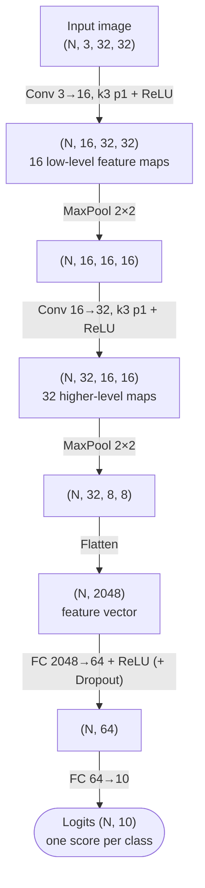
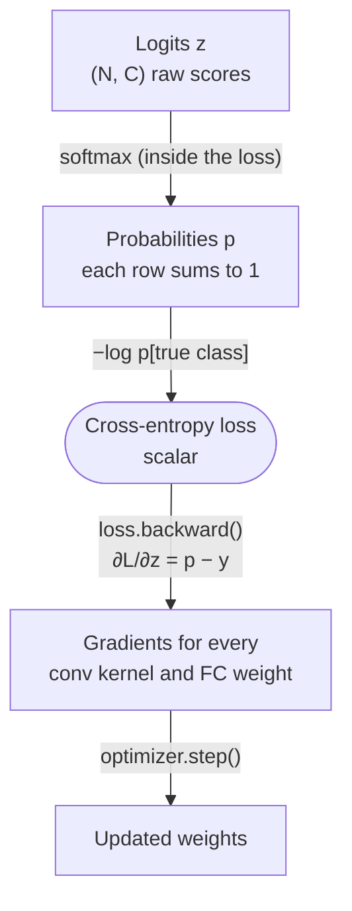
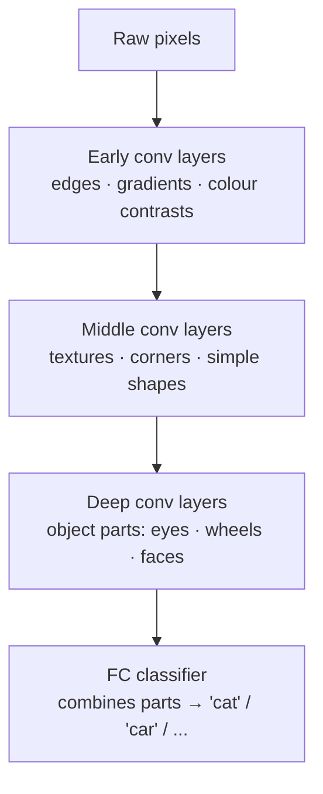

:::tip[TL;DR (30-Second Interview Pitch)]
A CNN classifier stacks **Conv → ReLU → Pool** blocks to turn an image into a small, deep stack of feature maps, then **flattens** them and lets **fully connected layers** output one **logit per class**. It trains exactly like an ANN: **cross-entropy on raw logits** → backprop → optimizer step. The only difference is that each shared kernel **sums its gradient over every position**. It still overfits, so **dropout** randomly zeroes activations during training (and is switched off at test time). **AlexNet (2012)** proved the recipe at scale: deep CNN + **ReLU** + **GPUs** + **data augmentation** + **dropout** cut ImageNet top-5 error from ~26% to ~15% and started the deep-learning era.
:::

<FormulaKey />

:::info[This topic spans two pages]
**Previous page:** [CNN Fundamentals](./03-cnn-fundamentals.md) covers convolution, stride, padding, filters and pooling (the output-size and parameter formulas live there).
**This page** assembles those blocks into a full classifier, trains it, regularizes it, compares it with an ANN, and walks through AlexNet.
**Next:** [CNN in Practice: Cats vs Dogs](./05-cnn-practical-cats-vs-dogs.md) runs the whole pipeline on real images, then [Transfer Learning with ResNet18](./06-transfer-learning-resnet18.md).
:::

## ⚡ Essential Interview Recall

**Full architecture**
- Pipeline: **Conv → ReLU → Pool → Conv → ReLU → Pool → Flatten → FC → ReLU → FC (logits)**. Conv/pool = **feature extractor**, FC = **classifier**.
- Shape flow (32×32 RGB): `(N,3,32,32)` → `(N,16,32,32)` → `(N,16,16,16)` → `(N,32,16,16)` → `(N,32,8,8)` → flatten `(N,2048)` → `(N,64)` → `(N,10)`.
- $H_{out} = \lfloor (H + 2P - K)/S \rfloor + 1$. Conv params $= C_{out}(C_{in}K^2 + 1)$. FC params $= d_{out}(d_{in} + 1)$.
- **Conv params don't depend on H, W; FC params do.** In the notebook's SmallCNN, `fc1` alone holds **131 K of 137 K params (96%)**. Modern nets replace flatten + big FC with **global average pooling**.
- Convolution = **linear transformation with structured sparsity + weight sharing** = a constrained FC layer.

**Training**
- Multi-class loss: **softmax** $\pred{p_i} = e^{\pred{z_i}}/\sum_j e^{\pred{z_j}}$ + **cross-entropy** $\loss{\mathcal{L}} = -\sum_i \data{y_i} \log \pred{p_i} = -\log \pred{p_{\text{true}}}$.
- `nn.CrossEntropyLoss` = **LogSoftmax + NLLLoss**. Feed it **raw logits** `(N, C)` and **integer class indices** `(N,)`. **Never softmax first.**
- The CE gradient w.r.t. the logits is simply **$\pred{p} - \data{y}$** (predicted probabilities − one-hot).
- Starting loss ≈ **$\ln C$** (2.30 for 10 classes) = a uniform guess. If it doesn't fall below that, the model is learning nothing.
- Backprop is identical to an ANN. **Weight sharing ⇒ each kernel's gradient is summed over all spatial positions.**
- Too-high LR blows up: Adam at **lr = 0.1** jumped the loss from 2.3 to **177** (the notebook saw 2333). Adam's sensible default is **1e-3**.

**Dropout**
- Training: each activation is zeroed with probability $\hyper{p}$ and the survivors are scaled by $\frac{1}{1-\hyper{p}}$ (**inverted dropout**). Eval: **identity**.
- Prevents **co-adaptation** (no neuron can rely on a specific partner) ≈ training an **ensemble** of thinned sub-networks.
- Placed mostly **around the FC layers** (where the parameters are). `model.train()` turns it ON, `model.eval()` turns it OFF.
- Higher $p$ → stronger regularization, noisier and slower training, and eventual underfitting. Typical: **0.5 for FC**, 0.1–0.3 for conv.

**CNN vs ANN**
- One FC layer 3,072 → 1,000 = **3.07 M** params. One `Conv2d(3, 32, 3)` = 32 × (27 + 1) = **896**. Full notebook models: ANN **3.08 M** vs CNN **82.8 K**.
- Double the resolution: ANN's first layer ×4. The conv layer is **unchanged**.
- **Inductive biases**: **locality**, **translation equivariance** (via weight sharing), and **pooling** for some invariance. These let a CNN generalize with far fewer parameters.

**AlexNet (Krizhevsky, Sutskever, Hinton, 2012)**
- ImageNet ILSVRC: **~1.2 M** training images, **1,000** classes, metric = **top-5 error**. ~**26% → ~15%**.
- Innovations: **ReLU**, **depth** (5 conv + 3 FC = 8 learnable layers), **2 GPUs**, **data augmentation** (crops, flips, colour), **dropout** (FC layers).
- Input 227×227×3 → conv/pool → **6×6×256 = 9,216** features → FC 4096 → 4096 → 1000. **~60 M** params, **~94% in the FC layers**.
- Hierarchy: **edges → textures → parts → objects**. Successors: **VGG (2014), GoogLeNet (2014), ResNet (2015)**.

## 📐 Formula Sheet

Every equation on this page in one place. Each one is explained in a card further down.

| Concept | Formula | In plain words |
|---|---|---|
| Conv output size | $\left\lfloor \frac{\hyper{H} + 2\hyper{P} - \hyper{K}}{\hyper{S}} \right\rfloor + 1$ | Positions the kernel fits into |
| Conv parameters | $\hyper{C_{out}}(\hyper{C_{in}}\hyper{K}^2 + 1)$ | Independent of image size |
| FC parameters | $d_{out}(d_{in} + 1)$ | Grows with the flattened size |
| Global average pooling | $\pred{g_c} = \frac{1}{HW}\sum_{i,j}\pred{A_{c,i,j}}$ | One average per feature map |
| Softmax | $\pred{p_i} = \dfrac{e^{\pred{z_i}}}{\sum_j e^{\pred{z_j}}}$ | Scores → probabilities that sum to 1 |
| Cross-entropy | $\loss{\mathcal{L}} = -\log \pred{p_{\text{true}}}$ | Surprise at the right answer |
| Starting loss | $\loss{\mathcal{L}_0} \approx \ln C$ | Uniform guessing over $C$ classes |
| CE gradient | $\partial\loss{\mathcal{L}}/\partial\pred{z} = \pred{p} - \data{y}$ | Predicted minus true |
| Shared-kernel gradient | $\dfrac{\partial\loss{\mathcal{L}}}{\partial\param{K}} = \sum_{i,j}\dfrac{\partial\loss{\mathcal{L}}}{\partial\pred{Y_{i,j}}}\,\data{X_{\text{patch}(i,j)}}$ | Every position adds its vote |
| Dropout (train) | $\pred{\tilde h} = \dfrac{\data{m}\odot\pred{h}}{1-\hyper{p}},\; \data{m_i} \sim \text{Bernoulli}(1-\hyper{p})$ | Zero some, boost the rest |
| Dropout expectation | $\mathbb{E}[\pred{\tilde h}] = \pred{h}$ | Same scale in train and eval |

## The Mental Model

### 1. A complete CNN classifier (the notebook's SmallCNN)



### 2. From logits to loss to update



### 3. What the layers learn: the feature hierarchy



## The Paradigm / Core Concepts

### Part A: The full CNN architecture

| Component | Role | What it changes |
|---|---|---|
| **Convolution** | Extracts **local spatial features** with learnable kernels | Depth → $C_{out}$; H, W by the size formula |
| **ReLU** | Adds **non-linearity**, so stacked layers don't collapse into one linear map | Nothing (same shape) |
| **Pooling** | Reduces **spatial resolution**: cheaper later layers, small shift tolerance | H, W halved; channels unchanged |
| **Flatten** | Converts the feature maps `(N, C, H, W)` into vectors `(N, C·H·W)` | Shape only, no params |
| **Fully connected** | **Classifies**: combines all features into one score per class | → `(N, num_classes)` logits |

**Shape flow and parameter budget** of the notebook's `SmallCNN` (input `(4, 3, 32, 32)`):

| Layer | Output shape | Parameters | Formula |
|---|---|---|---|
| Input | `(4, 3, 32, 32)` | — | |
| conv1: 3→16, k3, p1 | `(4, 16, 32, 32)` | **448** | 16 × (3·9 + 1) |
| ReLU + MaxPool | `(4, 16, 16, 16)` | 0 | |
| conv2: 16→32, k3, p1 | `(4, 32, 16, 16)` | **4,640** | 32 × (16·9 + 1) |
| ReLU + MaxPool | `(4, 32, 8, 8)` | 0 | |
| Flatten | `(4, 2048)` | 0 | 32 × 8 × 8 |
| fc1: 2048→64 + ReLU | `(4, 64)` | **131,136** | 64 × (2048 + 1) |
| fc2: 64→10 | `(4, 10)` | **650** | 10 × (64 + 1) |
| **Total** | | **136,874** | **fc1 ≈ 96%** |

<Animation src="cnn/shape-funnel" caption="SmallCNN end to end: conv and pool blocks shrink H and W while channels grow, then flatten gives 2,048 features. Box height is spatial size, width is channels. fc1 alone holds 131 K of the 137 K parameters." />

:::info[Where the parameters really live]
The convolutions (the part that "sees" the image) cost only **5 K** parameters; the **first FC layer** costs **131 K**, because it connects every one of the 2,048 flattened values to every hidden unit. That's why the FC head is where CNNs overfit, why **dropout goes there**, and why modern architectures (ResNet etc.) use **global average pooling**: each of the 32 maps is averaged to one number, and the head becomes `Linear(32, 10)`. The same network then has **5.4 K** params in total and accepts **any** input size.
:::

<Formula name="Global average pooling" tag="Modern classifier head" words="Instead of flattening every pixel of every feature map, average each feature map down to a single number. With 32 maps you get 32 numbers, whatever the image size." remember="One average per channel.">

$$
\pred{g_c} \;=\; \frac{1}{H\,W}\sum_{i=1}^{H}\sum_{j=1}^{W} \pred{A_{c,\,i,\,j}}
\qquad\qquad (N, C, H, W) \;\longrightarrow\; (N, C)
$$

**Example:** SmallCNN's `(N, 32, 8, 8)` becomes `(N, 32)`, so the head is `Linear(32, 10)` = 330 params instead of 131,136.

</Formula>

**Convolution as a structured linear operation.** An ANN layer computes $y = Wx + b$ with a dense $W$. A conv layer is **also linear in its input**, but its $W$ is constrained: weights live in **small kernels** (local connectivity = **structured sparsity**) that are **reused across space** (**weight sharing**). Same mathematics, far fewer free numbers.

<Formula name="Shape and parameter formulas" tag="Recap" words="The first line tells you the size of every feature map. The second and third count parameters: a conv layer's count never depends on the image size, an FC layer's grows with the flattened input." remember="Conv cost is fixed by the kernel; FC cost is fixed by the input size.">

$$
\begin{aligned}
H_{out} &= \left\lfloor \frac{\hyper{H} + 2\hyper{P} - \hyper{K}}{\hyper{S}} \right\rfloor + 1 \\[6pt]
\#\text{params}_{\text{conv}} &= \hyper{C_{out}}\,\big(\hyper{C_{in}}\hyper{K}^2 + 1\big) \\[6pt]
\#\text{params}_{\text{FC}} &= d_{out}\,\big(d_{in} + 1\big)
\end{aligned}
$$

**Example (SmallCNN):** conv1 $= 16(3 \cdot 9 + 1) = 448$; fc1 $= 64(2048 + 1) = 131{,}136$, nearly 300× more. Full derivations are on the [fundamentals page](./03-cnn-fundamentals.md).

</Formula>

A **stride-2 first conv** (K=3, P=1) on 32×32 gives $\lfloor 31/2 \rfloor + 1 = 16$: it **halves** the spatial size, and every later shape (including the flatten size) changes with it.

### Part B: Training a CNN

#### Loss: softmax + cross-entropy

The network outputs **logits** $z \in \mathbb{R}^{N \times C}$: unbounded raw scores, one per class.

<Formula name="Softmax" tag="Logits → probabilities" words="Exponentiate every score so all are positive and bigger scores pull further ahead, then divide by the total so they add up to 1." remember="Exponentiate, then share out of 100%.">

$$
\pred{p_i} \;=\; \frac{e^{\pred{z_i}}}{\displaystyle\sum_{j=1}^{C} e^{\pred{z_j}}}
\qquad\qquad 0 < \pred{p_i} < 1, \quad \sum_i \pred{p_i} = 1
$$

- $\pred{z_i}$: raw score (logit) for class $i$, any real number
- $C$: number of classes
- $\pred{p_i}$: predicted probability of class $i$

</Formula>

<Formula name="Cross-entropy loss" tag="Multi-class loss" words="Look only at the probability the model gave to the correct class and take minus its log. 0.9 costs little (0.105); 0.01 costs a lot (4.6). Its gradient with respect to each logit is simply predicted minus true." remember="Loss = surprise at the right answer; gradient = predicted − true.">

$$
\loss{\mathcal{L}} \;=\; -\sum_{i=1}^{C} \data{y_i}\,\log \pred{p_i} \;=\; -\log \pred{p_{\text{true class}}}
\qquad\qquad
\frac{\partial \loss{\mathcal{L}}}{\partial \pred{z_i}} \;=\; \pred{p_i} - \data{y_i}
$$

- $\data{y}$: one-hot target (1 for the true class, 0 elsewhere)
- Before training, $\pred{p_{\text{true}}} \approx 1/C$, so $\loss{\mathcal{L}} \approx \ln C$ ($2.30$ for 10 classes)

</Formula>

:::analogy[Softmax turns votes into percentages; cross-entropy measures surprise]
The logits are raw vote counts for each class. Softmax converts them into a share of 100%, giving extra weight to the leaders. Cross-entropy then asks: **how surprised was the model by the right answer?** If it gave the true class 90%, it's barely surprised (low loss). If it gave it 1%, it's very surprised (high loss).
:::

**Worked example:** logits $z = [2.0,\ 1.0,\ 0.1]$, true class 0.

| | Class 0 (true) | Class 1 | Class 2 |
|---|---|---|---|
| Logit $z_i$ | 2.0 | 1.0 | 0.1 |
| $e^{z_i}$ | 7.39 | 2.72 | 1.11 |
| Softmax $p_i$ (÷ 11.21) | **0.659** | 0.242 | 0.099 |
| Loss | $-\ln 0.659 = $ **0.417** | | |
| Gradient $\partial\mathcal{L}/\partial z = p - y$ | 0.659 − 1 = **−0.341** | **+0.242** | **+0.099** |

The gradient pushes the true class's logit **up** and the others **down**, in proportion to how wrong they are.

| `nn.CrossEntropyLoss` expects | Shape | dtype | Example |
|---|---|---|---|
| **Input**: raw logits | `(N, C)` | float | `model(x)`, **no softmax** |
| **Target**: class indices | `(N,)` | `long` (int64) | `tensor([3, 0, 7, ...])`, **not** one-hot |

:::danger[Interview Trap: "Apply softmax, then CrossEntropyLoss"]
`nn.CrossEntropyLoss` **already contains** `LogSoftmax` + `NLLLoss`. Adding your own softmax applies it **twice**: the probabilities get squashed towards uniform, the loss is wrong (0.417 becomes **0.802** in the example above), and the gradients shrink, so training slows or stalls. Feed **raw logits**. Apply softmax only **at inference**, when you want human-readable probabilities. (`LogSoftmax` is also numerically safer than `log(softmax(z))`: it uses the log-sum-exp trick, so no overflow and no $\log 0$.)
:::

#### Backpropagation through a CNN

- Forward $x \rightarrow f(x) \rightarrow \mathcal{L}$, backward $\partial\mathcal{L}/\partial W$: **exactly the ANN procedure** (`loss.backward()`, `optimizer.step()`).
- Convolution is linear in both its input and its kernel, so the chain rule passes straight through it.
- **Weight sharing** ⇒ a kernel weight was used at **every** spatial position, so its gradient is the **sum of the contributions from all positions** (proved numerically on the fundamentals page).
- **CNN optimization is not a new algorithm.** The difference is the **structure of the parameters**, not the learning rule.

<Formula name="Gradient of a shared kernel" tag="Weight sharing in backprop" words="The same kernel produced every output pixel. So its gradient collects a contribution from every position: how much that output pixel affected the loss, times the input patch it was computed from." remember="One kernel, many uses, so add up all the votes.">

$$
\frac{\partial \loss{\mathcal{L}}}{\partial \param{K}} \;=\; \sum_{i}\sum_{j} \frac{\partial \loss{\mathcal{L}}}{\partial \pred{Y_{i,j}}} \;\cdot\; \data{X}_{\text{patch}(i,\,j)}
$$

- $\partial\loss{\mathcal{L}}/\partial\pred{Y_{i,j}}$: error signal at output pixel $(i, j)$
- $\data{X}_{\text{patch}(i,j)}$: the input patch the kernel saw there
- The sum over $(i, j)$ is weight sharing showing up in the gradient

</Formula>

#### What a training step shows (notebook, one batch of 8)

| Parameter | Mean \|grad\| | Note |
|---|---|---|
| `conv1.weight` | 0.0070 | Earliest layer, smallest signals |
| `conv2.weight` | 0.0084 | |
| `fc1.weight` | 0.0055 | Many weights share the error |
| `fc2.bias` | **0.1208** | Closest to the loss, largest signal |

- Gradients exist for **every** conv kernel and FC weight.
- Magnitudes differ per layer. Layers far from the loss get smaller signals, and in **deeper** CNNs that becomes **vanishing gradients**.
- The initial loss **2.34 ≈ ln 10 = 2.30** is what a 10-class model guessing uniformly should give: a useful sanity check.

#### Reading a loss curve honestly

| Setup | What happens | Lesson |
|---|---|---|
| Fixed batch, Adam **lr = 1e-3**, 30 steps | 2.30 → **0.013** | The model *can* learn (it memorizes the batch). A classic sanity check |
| Same batch, Adam **lr = 0.1** | 2.30 → **177** → 2.05 | LR far too high: updates overshoot and the loss explodes |
| **Fresh random images + random labels every step** (notebook demo) | stays ≈ **2.30** | There's nothing to learn: random labels give chance-level loss whatever the model |

### Part C: Dropout

#### Why CNNs still overfit

- CNNs have far fewer parameters than an image ANN, **but** the FC head can still have hundreds of thousands, and memorization concentrates there.
- Small datasets, noisy labels and many epochs let features become **over-specialized** to the training images.
- **Signature:** training loss keeps falling while **validation loss stalls or rises**.

#### How dropout works

During training, sample a random mask for each activation and scale the survivors:

<Formula name="Inverted dropout" tag="Regularization" words="For every activation, flip a biased coin: with probability p it is zeroed, otherwise it is kept and scaled up by 1/(1 − p). The scaling makes the average output the same as without dropout, so nothing needs to change at test time." remember="Drop some, boost the rest, the average stays the same.">

$$
\data{m_i} \sim \text{Bernoulli}(1-\hyper{p}),
\qquad
\pred{\tilde h} \;=\; \frac{\data{m} \odot \pred{h}}{1-\hyper{p}}
\qquad\Longrightarrow\qquad
\mathbb{E}\big[\pred{\tilde h_i}\big] = (1-\hyper{p})\cdot\frac{\pred{h_i}}{1-\hyper{p}} = \pred{h_i}
$$

- $\hyper{p}$: drop probability (e.g. 0.5), chosen by you
- $\data{m}$: random 0/1 mask, re-drawn every forward pass
- $\pred{h}$: the activations; $\pred{\tilde h}$: after dropout

**Example:** $\hyper{p} = 0.5$, $\pred{h} = [1, 1, 1, 1]$ → one draw gives $[2, 0, 2, 0]$; average over many draws $= [1, 1, 1, 1]$.

</Formula>

:::analogy[Dropout is team practice with random players sitting out]
If the same star player is always on the field, everyone else learns to just pass to them. Make a random half of the team sit out every drill and each player has to become useful on their own. On match day (eval mode) everyone plays together, and the team is stronger and less fragile.
:::

| | **Training** (`model.train()`) | **Evaluation** (`model.eval()`) |
|---|---|---|
| Each activation | Zeroed with probability $p$; survivors × $\frac{1}{1-p}$ | Passed through unchanged |
| Output for the same input | **Different every call** (random mask) | **Deterministic** |
| Expected activation | $(1-p)\cdot\frac{h}{1-p} = h$ ✅ | $h$ ✅, the same scale, so nothing to fix at test time |
| Example, $p = 0.5$, input of ones | `[2, 0, 2, 2, 0, …]` | `[1, 1, 1, 1, 1, …]` |

<Animation src="cnn/dropout" caption="Training mode: each forward pass draws a new random mask, zeroing half the activations and doubling the survivors. Eval mode: every unit is kept and nothing is scaled, so the output is deterministic." />

**Why it reduces overfitting**
- No neuron can rely on a specific partner being present (**prevents co-adaptation**), so each feature must be **useful on its own**, which builds redundancy and robustness.
- Every step trains a different random "thinned" sub-network. At test time the full network approximates the **average of this huge ensemble** (with $n$ droppable units there are $2^n$ sub-networks).

**Why it must be OFF at test time:** predictions must be **deterministic** and use **all** the learned features. Random zeroing would make the same image get different predictions and degrade accuracy.

**Where to put it in a CNN**

| Placement | Typical $p$ | Notes |
|---|---|---|
| **After flatten / between FC layers** | **0.5** | Strongest effect, since that's where most parameters are (AlexNet, VGG) |
| After conv blocks | 0.1–0.3 | Less common. Neighbouring pixels are correlated, so per-pixel dropout barely regularizes. `nn.Dropout2d` drops **entire feature maps** instead |
| Before the final layer only | 0.2–0.5 | A common minimal choice |

**Raising $p$:** more regularization, but a **noisier training signal**. Training loss falls more slowly and ends higher, and too large a $p$ (e.g. 0.9) makes the network **underfit**.

### Part D: CNN vs ANN: parameter efficiency

| | ANN (flatten → FC) | CNN |
|---|---|---|
| First layer on 32×32×3 | `Linear(3072, 1000)` = **3,073,000** | `Conv2d(3, 32, 3)` = 32(27 + 1) = **896** |
| Notebook full model | **3,083,010** (FC 3072→1000→10) | **82,826** (conv + pool + FC 8192→10) |
| At **64×64×3** | **12,299,010** (×4) | conv still **896**; FC head grows to 327,690 |
| Each pixel treated | Independently (no notion of neighbours) | Through local, shared detectors |

**Spatial inductive bias.** An *inductive bias* is an assumption built into the architecture. CNNs assume:
- **Locality**: nearby pixels are related, so small kernels capture edges, corners and textures.
- **Translation equivariance** (via weight sharing): the same pattern can appear anywhere. A cat's ear top-left or bottom-right is still a cat's ear, and the **same detector** fires and its response **moves with it**.
- **(Approximate) translation invariance**, added by **pooling**: the final answer shouldn't change much if the object shifts.

These assumptions are **true for natural images**, so the CNN doesn't have to learn them from data. It generalizes better with fewer parameters and fewer examples. (The flip side: when the assumptions don't hold, e.g. position matters absolutely, a CNN needs extra machinery such as positional inputs.)

:::analogy[Inductive bias is a sensible starting rulebook]
A new hire who is told "most problems come from nearby components, and the same fault looks the same in every room" learns the job much faster than one who must work all of that out alone. A CNN starts with exactly those two rules (locality and weight sharing), so it needs far fewer examples than an ANN that starts with no assumptions.
:::

### Part E: AlexNet: the breakthrough CNN

#### Before 2012

- Pipeline: **Image → hand-crafted features → classical classifier** (e.g. SVM).
- Features were **manually engineered**: **SIFT**, **HOG**, **SURF**. Progress meant humans designing better features.
- Deep networks existed (LeNet-5, 1998, read digits) but were hard to scale: **saturating sigmoid/tanh** activations (vanishing gradients), **no GPU training**, and **small labeled datasets**.

#### ImageNet / ILSVRC

- **~1.2 million** training images, **1,000** classes.
- Metric: **top-5 error**, where a prediction counts as correct if the true label is among the model's **5 highest-scoring** classes.
- **2011** best ≈ **26%** → **AlexNet 2012** ≈ **15%** (second place was ~26%). A ~10-point jump, unheard of at the time.

#### The five innovations (plus two you may be asked about)

| Innovation | What | Why it mattered |
|---|---|---|
| **ReLU** | $\max(0, x)$ instead of sigmoid/tanh | No saturation for $x > 0$ → **much faster training** (the paper reports ~6× fewer epochs to the same error), fewer vanishing gradients |
| **Depth** | **8 learnable layers**: 5 conv + 3 FC | Enough depth for **hierarchical features** |
| **GPU training** | Split across **2 GPUs** (GTX 580, 3 GB each), ~5–6 days | 60 M params + 1.2 M images were impractical on CPUs; the model didn't fit on one GPU |
| **Data augmentation** | Random **crops**, horizontal **flips**, **colour** (PCA lighting) variation | Effectively enlarged the dataset; fewer memorized pixels |
| **Dropout** ($p = 0.5$) | In the **first two FC layers** | Those layers hold most of the params, and dropout prevented them overfitting |
| *Overlapping max-pool* | 3×3 windows with stride 2 | Slightly lower error, less overfitting |
| *Local Response Normalization* | Normalizes across neighbouring channels | Small gain at the time. Later replaced by **BatchNorm** |

#### Architecture (original paper, 227×227×3 input)

| Stage | Layer | Output | Notes |
|---|---|---|---|
| 1 | Conv 96 × 11×11, stride 4 → ReLU → MaxPool 3×3/2 | 55×55×96 → **27×27×96** | Big kernel, big stride: aggressive early downsampling |
| 2 | Conv 256 × 5×5, pad 2 → ReLU → MaxPool 3×3/2 | 27×27×256 → **13×13×256** | |
| 3 | Conv 384 × 3×3 → ReLU | 13×13×384 | |
| 4 | Conv 384 × 3×3 → ReLU | 13×13×384 | |
| 5 | Conv 256 × 3×3 → ReLU → MaxPool 3×3/2 | 13×13×256 → **6×6×256** | |
| 6 | Flatten → **FC 4096** → ReLU → Dropout | 9,216 → 4,096 | ≈ 37.7 M params in this layer alone |
| 7 | **FC 4096** → ReLU → Dropout | 4,096 | |
| 8 | **FC 1000** → Softmax | 1,000 class probabilities | |

Roughly **60 million** parameters; a plain re-implementation counts 62.4 M, **94% of them in the three FC layers**. The convolutions **progressively extract** edges → textures → object parts → object concepts. (The notebook's `MiniAlexNet` uses torchvision's single-GPU channel widths 64/192/384/256/256.)

#### Why it was revolutionary

**Deep CNN + large labeled dataset + GPU compute** beat decades of hand-engineered vision. Features were **learned**, not designed. The successors kept that recipe and fixed its limits:

| Year | Model | Key idea |
|---|---|---|
| 2012 | **AlexNet** | Deep CNN + ReLU + GPU + dropout |
| 2014 | **VGGNet** | Very deep stacks of small **3×3** convs (same receptive field, fewer params, more non-linearity) |
| 2014 | **GoogLeNet / Inception** | Parallel multi-scale filters, 1×1 "bottleneck" convs, global average pooling instead of big FC layers |
| 2015 | **ResNet** | **Skip (residual) connections**, making 100+ layer nets trainable. Covered with transfer learning later |

### Part F: Conceptual closure

**The core idea:** a CNN is a sequence of **structured linear operations + non-linearities**:

$$
x \rightarrow \text{Conv} \rightarrow \text{ReLU} \rightarrow \text{Pool} \rightarrow \text{Conv} \rightarrow \cdots \rightarrow \text{FC}
$$

It learns its own filters (edges, corners, textures, object parts) instead of relying on hand-crafted features.

**Hierarchical feature learning**

| Depth | Learns | Examples | Why it's possible |
|---|---|---|---|
| Early layers | Simple local patterns | Edges, gradients, colour contrasts | Tiny receptive field (3×3 pixels) |
| Middle layers | Combinations of edges | Textures, corners, simple shapes | Receptive field grows with each conv/pool |
| Deep layers | Semantic parts | Eyes, wheels, faces | Each neuron sees a large part of the image |
| FC head | Whole objects | "cat", "car" | Combines all parts |

:::analogy[The feature hierarchy is learning to read]
You first learn strokes (edges), then letters (textures and corners), then words (object parts), then sentences (whole objects). Each stage only works because the one before it exists, and each layer of a CNN builds on the patterns found by the layer below.
:::

In the notebook's `HierarchyCNN` (conv → pool → conv → pool → conv on 32×32), the shapes go `(16, 32, 32)` → `(16, 16, 16)` → `(32, 16, 16)` → `(32, 8, 8)` → `(64, 8, 8)`, and a single neuron of the third conv layer "sees" an **18×18** pixel region of the input.

**Why spatial resolution decreases and channels increase across layers:** deeper layers need **more kinds** of features (there are many more possible parts than edges) but **less precise location** ("there is an eye roughly here" is enough). Pooling and strides trade **where** for **what**, which keeps compute balanced.

**Why CNNs generalize well:** their **inductive biases** (locality, weight sharing/translation equivariance, pooling invariance) match how natural images work, so fewer parameters and fewer examples suffice.

**Why not use FC layers from the start?** Millions of parameters in the first layer, no notion of neighbouring pixels, every pattern learned separately at every position, and an input size baked into the weights: slow, data-hungry and overfit-prone.

## ⚙️ Under the Hood (The Math & PyTorch Internals)

**`CrossEntropyLoss` internals**
- Computes `nll_loss(log_softmax(z), y)`. `log_softmax` uses $z_i - \log\sum_j e^{z_j}$ with the **max subtracted first** (log-sum-exp trick), so huge logits never overflow and $\log 0$ never happens.
- Its gradient w.r.t. the logits is $\frac{1}{N}(p - y)$: bounded, never saturating, and largest when the model is confidently wrong. That's why softmax + CE is the standard classification pair.
- Accepts `label_smoothing=0.1` (spreads a little probability to the wrong classes, a mild regularizer) and `weight=` (per-class weights for imbalanced datasets).

**Inverted dropout and `train()` / `eval()`**
- PyTorch scales at **training** time ($\times\frac{1}{1-p}$), so inference is a pure identity with no extra cost. (The original paper instead multiplied by $(1-p)$ at test time. Same expectation, more work at inference.)
- `model.train()` / `model.eval()` just flip a `training` flag that `Dropout` and `BatchNorm` read. They **do not** affect gradient tracking; that's `torch.no_grad()`. Forgetting `model.eval()` before validation gives **random, pessimistic** validation metrics.

**Why the FC head dominates parameters but conv dominates compute**
- FC: every input connects to every output, so params $\propto d_{in}\cdot d_{out}$ with $d_{in} = C\cdot H\cdot W$ after flatten.
- Conv: few params, but the kernel runs at **every** output position, so FLOPs $\propto H_{out}W_{out}C_{out}C_{in}K^2$. In AlexNet the conv layers do **~90%+ of the computation** while the FC layers hold ~94% of the parameters.
- **Global average pooling** `nn.AdaptiveAvgPool2d(1)` removes the giant flatten-FC layer, makes the model **input-size agnostic**, and removes the main overfitting hotspot.

**Why deeper CNNs are harder to train**
- Longer chain-rule products → **vanishing/exploding gradients** (early layers learn slowly or erratically).
- More parameters → more overfitting risk and more compute.
- Fixes that came after AlexNet: careful **initialization** (He/Kaiming), **BatchNorm** (stabilizes activation scales), **residual connections** (ResNet gives gradients a shortcut path).

**Why a linear operation still gives non-linear decision boundaries**
- Convolution and FC layers are linear, but the **ReLUs between them** (and max-pooling, which is also non-linear) make the composition piecewise linear with an enormous number of pieces, so the decision boundaries can be arbitrarily complex.

:::danger[Interview Trap: "CNNs can't overfit because they have few parameters"]
The **convolutional** part is parameter-light, but the **flatten → FC head** can hold most of the model (96% in SmallCNN, 94% in AlexNet), and even small models overfit small or noisy datasets. CNNs still need **dropout**, **data augmentation**, **weight decay**, **early stopping**, or a smaller head (global average pooling).
:::

## 💻 PyTorch Implementation

### 1. A complete CNN classifier, with the shape flow

```python title="small_cnn.py" showLineNumbers
import torch
import torch.nn as nn
import torch.nn.functional as F

class SmallCNN(nn.Module):
    def __init__(self, num_classes=10, p_drop=0.5):
        super().__init__()
        self.conv1 = nn.Conv2d(3, 16, kernel_size=3, padding=1)   # keeps H, W
        self.conv2 = nn.Conv2d(16, 32, kernel_size=3, padding=1)
        self.pool  = nn.MaxPool2d(2, 2)                            # halves H, W
        # highlight-next-line
        self.fc1   = nn.Linear(32 * 8 * 8, 64)                     # 2048 in: must match the flatten size
        self.drop  = nn.Dropout(p_drop)                            # regularize the big FC layer
        self.fc2   = nn.Linear(64, num_classes)

    def forward(self, x):                        # (N, 3, 32, 32)
        x = self.pool(F.relu(self.conv1(x)))     # (N, 16, 16, 16)
        x = self.pool(F.relu(self.conv2(x)))     # (N, 32, 8, 8)
        # highlight-next-line
        x = torch.flatten(x, start_dim=1)        # (N, 2048): keep the batch dim!
        x = self.drop(F.relu(self.fc1(x)))       # (N, 64)
        return self.fc2(x)                       # (N, 10) raw logits, NO softmax

model = SmallCNN()
print(model(torch.randn(4, 3, 32, 32)).shape)    # torch.Size([4, 10])
```

### 2. Where the parameters are

```python showLineNumbers
count = lambda m: sum(p.numel() for p in m.parameters())

for name in ["conv1", "conv2", "fc1", "fc2"]:
    print(f"{name:<6}{count(getattr(model, name)):>8,}")
# conv1      448
# conv2    4,640
# fc1    131,136   ← 96% of the model
# fc2        650
print(f"total: {count(model):,}")                # total: 136,874

# Modern alternative: global average pooling head
gap_model = nn.Sequential(
    nn.Conv2d(3, 16, 3, padding=1), nn.ReLU(), nn.MaxPool2d(2),
    nn.Conv2d(16, 32, 3, padding=1), nn.ReLU(), nn.MaxPool2d(2),
    # highlight-next-line
    nn.AdaptiveAvgPool2d(1), nn.Flatten(),       # (N, 32, 8, 8) → (N, 32)
    nn.Linear(32, 10),
)
print(f"{count(gap_model):,}")                   # 5,418 params, and works for ANY input size
```

### 3. Cross-entropy: logits, not probabilities

```python showLineNumbers
import torch
import torch.nn as nn
import torch.nn.functional as F

criterion = nn.CrossEntropyLoss()
logits = torch.tensor([[2.0, 1.0, 0.1]])        # (N=1, C=3) raw scores
target = torch.tensor([0])                      # (N,) class index, dtype long

# success-next-line
print(criterion(logits, target))                # ✅ 0.4170 = −ln(0.659)
# error-next-line
print(criterion(F.softmax(logits, dim=1), target))   # ❌ 0.8021: softmax applied twice

probs = F.softmax(logits, dim=1)                # only for reporting / inference
print(probs)                                    # [[0.659, 0.242, 0.099]]
```

### 4. One training step, with gradient inspection

```python showLineNumbers
import torch

torch.manual_seed(42)
model = SmallCNN(p_drop=0.0)
criterion = torch.nn.CrossEntropyLoss()
optimizer = torch.optim.Adam(model.parameters(), lr=1e-3)

inputs  = torch.randn(8, 3, 32, 32)
targets = torch.randint(0, 10, (8,))

model.train()
loss = criterion(model(inputs), targets)
print(loss.item())                              # ≈ 2.3 ≈ ln(10): uniform guessing at start

optimizer.zero_grad()
loss.backward()
for name, p in model.named_parameters():
    print(f"{name:13s} mean|grad| = {p.grad.abs().mean():.6f}")   # every kernel & weight has a grad
optimizer.step()
```

### 5. Sanity check: can the model overfit one fixed batch?

```python showLineNumbers
import torch
import torch.nn.functional as F

def overfit_one_batch(lr, steps=30):
    torch.manual_seed(0)
    model = SmallCNN(p_drop=0.0)
    opt = torch.optim.Adam(model.parameters(), lr=lr)
    X, y = torch.randn(16, 3, 32, 32), torch.randint(0, 10, (16,))   # SAME batch every step
    losses = []
    for _ in range(steps):
        loss = F.cross_entropy(model(X), y)
        opt.zero_grad(); loss.backward(); opt.step()
        losses.append(loss.item())
    return losses

# success-next-line
print(overfit_one_batch(1e-3)[-1])              # ✅ 0.013: model and loop are wired correctly
# error-next-line
print(max(overfit_one_batch(0.1)))              # ❌ 177: LR far too high, the loss explodes
```

### 6. Dropout in train vs eval mode

```python showLineNumbers
import torch
import torch.nn as nn

drop = nn.Dropout(p=0.5)
h = torch.ones(8)

drop.train()
print(drop(h))                                  # e.g. [2, 0, 2, 2, 0, 0, 2, 0]: survivors ×1/(1−p)
print(drop(h))                                  # a different random mask every call

drop.eval()
# highlight-next-line
print(drop(h))                                  # [1, 1, 1, 1, 1, 1, 1, 1]: identity at test time

model = SmallCNN(p_drop=0.5)
x = torch.randn(1, 3, 32, 32)
model.train(); print(torch.allclose(model(x), model(x)))   # False: dropout is ON
model.eval();  print(torch.allclose(model(x), model(x)))   # True: deterministic
```

### 7. ANN vs CNN parameter count

```python showLineNumbers
import torch.nn as nn

count = lambda m: sum(p.numel() for p in m.parameters())

def ann(h):  return nn.Sequential(nn.Flatten(), nn.Linear(3 * h * h, 1000), nn.ReLU(), nn.Linear(1000, 10))
def cnn(h):  return nn.Sequential(nn.Conv2d(3, 32, 3, padding=1), nn.ReLU(), nn.MaxPool2d(2),
                                  nn.Flatten(), nn.Linear(32 * (h // 2) ** 2, 10))

for h in (32, 64):
    print(f"{h}×{h}: ANN {count(ann(h)):>10,} | CNN {count(cnn(h)):>8,}")
# 32×32: ANN  3,083,010 | CNN   82,826
# 64×64: ANN 12,299,010 | CNN  328,586   ← conv layer still 896; only the FC head grew

# highlight-next-line
print(count(nn.Conv2d(3, 32, 3)))               # 896 = 32 × (3·3·3 + 1), at ANY resolution
```

### 8. AlexNet-style feature extractor: shape trace

```python showLineNumbers
import torch
import torch.nn as nn

features = nn.Sequential(                        # torchvision widths (64/192/384/256/256)
    nn.Conv2d(3, 64, kernel_size=11, stride=4, padding=2), nn.ReLU(), nn.MaxPool2d(3, 2),
    nn.Conv2d(64, 192, kernel_size=5, padding=2),          nn.ReLU(), nn.MaxPool2d(3, 2),
    nn.Conv2d(192, 384, kernel_size=3, padding=1),         nn.ReLU(),
    nn.Conv2d(384, 256, kernel_size=3, padding=1),         nn.ReLU(),
    nn.Conv2d(256, 256, kernel_size=3, padding=1),         nn.ReLU(), nn.MaxPool2d(3, 2),
)

x = torch.randn(1, 3, 224, 224)
for layer in features:
    x = layer(x)
    if not isinstance(layer, nn.ReLU):
        print(f"{type(layer).__name__:10s} → {tuple(x.shape)}")
# Conv2d     → (1, 64, 55, 55)
# MaxPool2d  → (1, 64, 27, 27)
# Conv2d     → (1, 192, 27, 27)
# MaxPool2d  → (1, 192, 13, 13)
# Conv2d     → (1, 384, 13, 13)
# Conv2d     → (1, 256, 13, 13)
# Conv2d     → (1, 256, 13, 13)
# MaxPool2d  → (1, 256, 6, 6)     ← flatten → 9,216 features for the FC head
```

### 9. Watching the hierarchy: capture feature maps with a hook

```python showLineNumbers
import torch

model = SmallCNN().eval()
captured = {}

def save_output(name):
    def hook(module, inputs, output):
        captured[name] = output.detach()
    return hook

# highlight-start
model.conv1.register_forward_hook(save_output("conv1"))
model.conv2.register_forward_hook(save_output("conv2"))
# highlight-end

with torch.no_grad():
    model(torch.randn(1, 3, 32, 32))

for name, fmap in captured.items():
    print(name, tuple(fmap.shape))               # conv1 (1, 16, 32, 32) | conv2 (1, 32, 16, 16)
# plot e.g. captured["conv1"][0, i] with plt.imshow(..., cmap="gray") for each channel i
```

## 🚨 Interview Gotchas & Edge Cases

:::warning[The Most Common Question]
**"Walk me through a CNN classifier end to end: the shapes, the parameters, the loss, and how you'd regularize it."**

1. **Shapes:** `(N,3,32,32)` → conv+pool blocks shrink H, W and grow channels → `(N,32,8,8)` → flatten `(N,2048)` → FC → `(N,10)` logits.
2. **Parameters:** conv $= C_{out}(C_{in}K^2+1)$ (tiny, size-independent). FC $= d_{out}(d_{in}+1)$, so the **first FC layer dominates** (96% here).
3. **Loss:** `CrossEntropyLoss` on **raw logits** with integer targets. It contains log-softmax, and its gradient is $p - y$.
4. **Training:** the same backprop as an ANN. Shared kernels sum gradients over positions.
5. **Regularization:** dropout ($p≈0.5$) around the FC layers, data augmentation, weight decay, early stopping, or global average pooling instead of a big FC head. Remember `model.train()` / `model.eval()`.
:::

- **Flatten size mismatch** (`mat1 and mat2 shapes cannot be multiplied`): the first FC's `in_features` must equal $C \cdot H \cdot W$ after the last pool. Change the input size or a stride and it breaks. Compute it with a dummy forward pass, or use `nn.LazyLinear` / global average pooling.
- **`torch.flatten(x)` without `start_dim=1`** flattens the batch dimension too, giving one huge vector for the whole batch.
- **Softmax before `CrossEntropyLoss`**: a double softmax gives a wrong loss and weak gradients. **One-hot targets** where indices are expected, or `float` targets, cause errors or silently mean something else.
- **Forgetting `model.eval()`** at validation/test: dropout stays on and BatchNorm uses batch statistics, so metrics are noisy and pessimistic. Remember **`model.train()`** again before the next epoch.
- **`model.eval()` ≠ `torch.no_grad()`**: use both for inference.
- **Starting loss far from $\ln C$**: much higher suggests a bug (bad init, wrong labels, softmax applied twice). A loss **stuck** at $\ln C$ means nothing is being learned (random labels, LR too low or too high, dead network).
- **Overfit one small batch first**: if the model can't drive the loss to ~0 on 16 fixed images, the bug is in the model or the loop, not the data.
- **LR too high for Adam** (0.1): the loss explodes. Start at **1e-3**.
- **Dropout on conv feature maps** with plain `nn.Dropout` regularizes weakly (neighbouring pixels carry the same information). Use `nn.Dropout2d` to drop whole channels.
- **"Pooling makes CNNs fully shift-invariant"**: only approximately. Strides and pooling windows can make outputs change under 1-pixel shifts.
- **Top-5 vs top-1 error**: AlexNet's famous ~15% is **top-5** error (true label anywhere in the top 5 guesses). Its **top-1** error was far higher, around 37–40%.

### Concept-Check Answers (from the notebook)

#### Full architecture

<details>
<summary><strong>Input (N, 3, 32, 32), conv1 (out=16, K=3, S=1, P=1): output shape? What does MaxPool2d(2,2) do to H and W?</strong></summary>

$(32 + 2 - 3)/1 + 1 = 32$ → **(N, 16, 32, 32)**. MaxPool(2,2) **halves** H and W: 32 → 16.
</details>

<details>
<summary><strong>Why doesn't the convolution parameter count depend on H and W?</strong></summary>

A kernel's weights are defined per **input channel × kernel position** ($C_{in}K^2$) and **reused at every spatial location**. A bigger image means more positions, not more weights.
</details>

<details>
<summary><strong>Which layer has the highest parameter count? Why?</strong></summary>

**fc1** (131,136 of 136,874), because it connects all 2,048 flattened features to each of 64 units: $64 \times 2049$.
</details>

<details>
<summary><strong>stride=2 in the first conv (K=3, P=1): what happens to the spatial size?</strong></summary>

$\lfloor (32 + 2 - 3)/2 \rfloor + 1 = 16$: it **halves**, and every later shape (and the flatten size feeding fc1) halves accordingly.
</details>

#### Training

<details>
<summary><strong>Why NOT apply softmax before CrossEntropyLoss in PyTorch?</strong></summary>

`CrossEntropyLoss` already applies `LogSoftmax` internally (in a numerically stable way). A second softmax distorts the probabilities, gives a wrong loss value and shrinks the gradients.
</details>

<details>
<summary><strong>If convolution is linear, how can a CNN learn non-linear decision boundaries?</strong></summary>

Through the **non-linear activations** (ReLU) and max-pooling between the linear layers. The composition is highly non-linear even though each conv is linear.
</details>

<details>
<summary><strong>Why does weight sharing mean fewer parameters?</strong></summary>

One small kernel is reused at all positions instead of learning a separate weight set for every location, so the params scale with $C_{in}K^2C_{out}$, not with $H \times W$.
</details>

<details>
<summary><strong>Very small gradients in early layers: what problem? Why are deeper CNNs harder to train?</strong></summary>

**Vanishing gradients**: early layers barely update and learn slowly or not at all. Deeper nets multiply more chain-rule factors (vanishing or exploding), have more parameters to fit and overfit, and need more compute. BatchNorm, good initialization and residual connections address this.
</details>

#### Dropout

<details>
<summary><strong>What exactly does dropout randomize during training?</strong></summary>

Which **activations** (neuron outputs) are set to zero: a fresh Bernoulli mask on every forward pass, with the survivors scaled by $1/(1-p)$. The weights themselves are not changed.
</details>

<details>
<summary><strong>Why does dropout reduce overfitting?</strong></summary>

Neurons can't co-adapt or rely on specific partners, so features must be individually robust and redundant. Training effectively averages an ensemble of thinned sub-networks.
</details>

<details>
<summary><strong>Why must dropout be OFF during evaluation?</strong></summary>

Predictions must be **deterministic** and use the **full** network. Random zeroing would give different answers for the same image and lower accuracy. With inverted dropout, the scales already match, so eval mode is just the identity.
</details>

<details>
<summary><strong>Where is dropout most effective in a CNN? What if p increases?</strong></summary>

**Around the FC layers** (after flatten or after fc1), where most parameters and most memorization live. Higher $p$ → stronger regularization but noisier and slower training, and too high → underfitting.
</details>

#### CNN vs ANN

<details>
<summary><strong>Why does an FC ANN need so many parameters for images?</strong></summary>

Every pixel value (3,072 for 32×32×3) connects to every neuron, so params $= \text{pixels} \times \text{neurons}$, which grows with resolution.
</details>

<details>
<summary><strong>Which CNN property lets the same edge detector work across the whole image?</strong></summary>

**Weight sharing**: the same kernel slides over every position (translation equivariance).
</details>

<details>
<summary><strong>What is "spatial inductive bias"?</strong></summary>

Built-in assumptions about images: **locality** (nearby pixels are related) and **translation equivariance/invariance** (a pattern means the same thing anywhere), encoded by local kernels, weight sharing and pooling.
</details>

<details>
<summary><strong>Double the image resolution: ANN vs CNN parameter change?</strong></summary>

ANN's first layer grows **4×** (3.07 M → 12.3 M). The conv layers' params are **unchanged** (only a flatten-FC head would grow, which global average pooling avoids).
</details>

#### AlexNet

<details>
<summary><strong>What major limitation did pre-2012 vision systems have?</strong></summary>

They relied on **hand-crafted features** (SIFT, HOG, SURF) plus shallow classifiers. Performance was capped by human feature engineering, not learned from data.
</details>

<details>
<summary><strong>Why did ReLU improve training? Why were GPUs essential?</strong></summary>

ReLU doesn't saturate for positive inputs (gradient 1), so it avoids vanishing gradients and converges several times faster than tanh. GPUs: ~60 M parameters × 1.2 M images × many epochs is billions of parallel multiply-adds, and GPUs made it take days instead of months (the model was even split across two GPUs because of memory).
</details>

<details>
<summary><strong>Why did AlexNet use dropout in the FC layers? What is hierarchical feature learning?</strong></summary>

The FC layers hold ~94% of its parameters, the main overfitting risk, so dropout regularized exactly there. Hierarchical feature learning means early layers learn simple features (edges), later layers combine them into textures, parts and finally objects.
</details>

#### Conceptual closure

<details>
<summary><strong>Why do CNNs learn hierarchical features?</strong></summary>

Each layer operates on the previous layer's feature maps, and the **receptive field grows** with depth, so later neurons see larger regions and can combine simpler features into more complex ones.
</details>

<details>
<summary><strong>What does weight sharing achieve?</strong></summary>

Massive parameter reduction, a detector that works at every location (equivariance), and better generalization (each kernel is trained on all positions).
</details>

<details>
<summary><strong>Why does spatial resolution decrease, and channels increase, across layers?</strong></summary>

Pooling and strides downsample to save compute and widen the receptive field, because deep features need less positional precision. Channels increase because higher-level layers must represent many more distinct feature types.
</details>

<details>
<summary><strong>What would go wrong with fully connected layers from the start?</strong></summary>

Millions of parameters in the first layer, adjacency lost by flattening, every pattern learned separately at every position, an input size fixed by the weights, and severe overfitting / data hunger.
</details>
