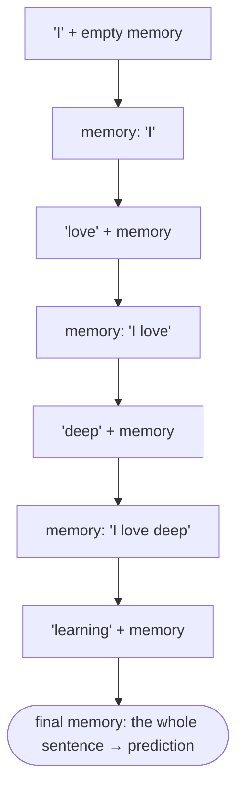
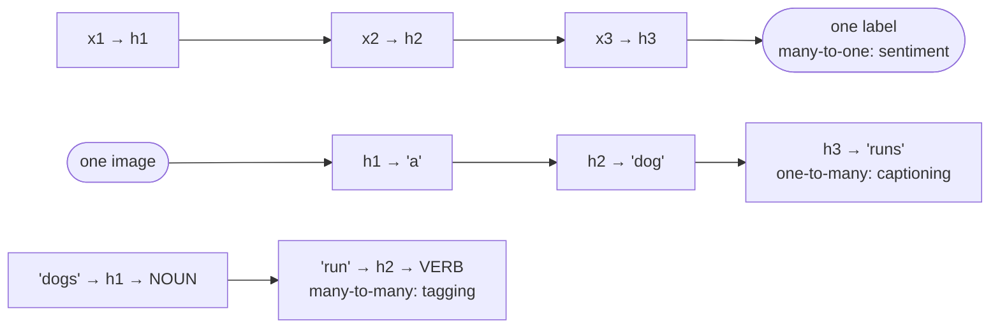

:::tip[TL;DR (30-Second Interview Pitch)]
Images arrive **all at once, at a fixed size**, and their meaning lives in *space*. Text, speech, sensor readings and prices arrive **in order, at any length**, and their meaning lives in *time*: "I love deep learning" and "learning deep love I" share every word but not the meaning. Feedforward networks and CNNs assume a fixed-size input with no memory of earlier inputs, so they fit sequences badly. A **Recurrent Neural Network (RNN)** reads one element at a time and keeps a **hidden state** $\pred{h_t} = \tanh(\param{W_x}\data{x_t} + \param{W_h}\pred{h_{t-1}} + \param{b})$: a running summary of everything seen so far, updated with the **same weights at every step**. That one idea handles order, variable length and memory, and it supports every input/output shape (many-to-one, one-to-many, many-to-many). Its weakness is **long-term memory**: information and gradients fade (or blow up) over many steps, which is what LSTM and GRU fix.
:::

<FormulaKey />

:::info[Where this page sits]
**Before:** [NLP in Practice](../03-nlp-foundations/02-nlp-in-practice-preprocessing-word2vec-sentiment.md) turned text into vectors but treated a review as a bag of words, ignoring order.
**This page:** why sequences need a new kind of network, how text becomes a sequence of token ids, the variable-length problem, the hidden state, the RNN update rule and the RNN task types (notebook *10 RNN 1*).
**Next:** [RNN Architecture, Forward Pass and BPTT](./02-rnn-architecture-forward-pass-bptt.md) opens up the cell: tensor shapes, unrolling, weight sharing and backpropagation through time (notebook *11 RNN 2*).
:::

## 🧭 Start Here

Every network so far has had a fixed-size input. A CNN expects a 224 × 224 × 3 image; an ANN expects a fixed row of features. But a lot of real data is a **sequence**: a sentence, an audio clip, a heartbeat trace, a week of stock prices. Sequences have three properties fixed-size models were never designed for:

1. **Order matters.** Shuffle the words or the time steps and the meaning changes.
2. **Length varies.** One review has 3 words, the next has 300.
3. **The past matters.** Predicting the next word, or tomorrow's temperature, needs what came before, sometimes long before.

This page builds the answer step by step:

1. See **why images and sequences differ**, and what that breaks in CNNs and ANNs.
2. Survey **ordered data** (text, speech, time series) and the **three families of sequence tasks**: classify, predict, generate.
3. Turn text into a **sequence of token ids**, then deal with **different lengths** (padding, truncation, masks).
4. Introduce **memory**: the **hidden state**, updated by the **RNN equation** at each time step.
5. Map the **input/output patterns** an RNN can serve (many-to-one, one-to-many, many-to-many).
6. Preview the **weakness** of simple RNNs (long-term dependencies, vanishing and exploding gradients) that motivates LSTM and GRU.

| New concept | One-line meaning |
|---|---|
| **Sequence / sequential data** | Data whose elements come in a meaningful order: words, audio frames, time-series readings |
| **Time step** $t$ | One position in the sequence; the RNN reads element $\data{x_t}$ at step $t$ |
| **Token** | One unit of text (usually a word) after splitting; its **token id** is its index in the vocabulary |
| **Padding / truncation** | Filling short sequences with a `<PAD>` id / cutting long ones, so a batch is rectangular |
| **Mask** | A 0/1 grid that marks which positions are real tokens and which are padding |
| **Hidden state** $\pred{h_t}$ | A vector that summarizes the sequence up to step $t$: the network's memory |
| **Recurrence** | Feeding the network's own previous state back in: $\pred{h_t}$ depends on $\pred{h_{t-1}}$ |
| **Weight sharing** | The same $\param{W_x}, \param{W_h}, \param{b}$ are used at every time step |
| **Many-to-one / one-to-many / many-to-many** | Sequence in → one output; one input → sequence out; sequence in → sequence out |
| **Long-term dependency** | When the clue needed now appeared many steps earlier |
| **Vanishing / exploding gradient** | Gradients shrinking towards 0, or blowing up, as they travel back through many steps |

:::analogy[An RNN reads like a person with a notepad]
A CNN looks at a whole photo in one glance. Reading a book is different: you read one word at a time and keep a small mental notepad of "what's going on so far". Each new word updates the notepad, and you never re-read the earlier pages. The notepad is the hidden state. It is small, so you can't write down everything, and details from chapter 1 tend to get crossed out by chapter 20. That is exactly the strength and the weakness of a simple RNN.
:::

## 1. Images vs Sequences: Why CNNs Are Not Enough

A CNN is built around the structure of an image. A 224 × 224 RGB photo is a **fixed-size** tensor (224 × 224 × 3), every pixel is available **at once**, and the important relationships are **spatial**: an edge is a few neighbouring pixels, an eye is a few neighbouring edges. Convolution exploits exactly this: small filters slide over local neighbourhoods, sharing weights across *positions in space*.

Sequences have a different structure:

| | **Images** | **Sequences** |
|---|---|---|
| Structure | **Spatial** (2-D grid of neighbours) | **Temporal** (a line of steps in order) |
| Size | **Fixed** (e.g. 224 × 224 × 3) | **Variable** (3 words, 300 words, 10 s of audio) |
| Availability | All information **at once** | Arrives **one step at a time** (streaming speech, live sensor data) |
| Does order matter? | Locally (pixels next to each other) | **Globally**: "dog bites man" ≠ "man bites dog" |
| What the model must remember | Nothing between images | **The past**: earlier words, earlier readings |

Swap two words and the meaning can flip: "I love deep learning" becomes the nonsense "learning deep love I". So a sequence model needs three things a standard CNN or ANN does not give for free:

- **Variable-length input.** A dense layer has a fixed number of input weights; a 7-word sentence and a 30-word sentence can't both plug into it without tricks.
- **Memory of past information.** A feedforward network maps one input to one output and forgets it; nothing carries over to the next input.
- **Context and order.** The same word means different things in different contexts ("not good" vs "very good"), so the model must combine each element with what came before.

A CNN applied to text would also have a **limited window**: a 1-D convolution with kernel size 3 only ever sees 3 neighbouring words, so a dependency between word 2 and word 40 is out of reach unless you stack many layers.

The question this chapter leads to: **how do we design a network that understands order and has memory?** The answer is the **Recurrent Neural Network**.

:::danger[Interview Trap: "CNNs can't be used on sequences at all"]
They can. **1-D convolutions** slide along time and are used for text classification, audio (WaveNet) and time series (**Temporal Convolutional Networks**, which use *dilated, causal* convolutions to widen the window). They are fast because they are parallel. Their limitation is a **fixed receptive field**: they only see as far back as their kernel sizes and depth allow, and they have no running state. RNNs carry state indefinitely (in principle), and Transformers (later in the course) let every position look at every other position directly. Say "CNNs *struggle* with long-range order and variable length", not "CNNs can't do sequences".
:::

:::tip[🎯 Interview angle]
**"Why not use a CNN or a plain feedforward network for text or time series?"** They assume a **fixed-size input**, process it **all at once**, and keep **no memory** between inputs. Sequences are **variable-length**, **ordered**, and need **context from the past**. RNNs add a hidden state that is updated step by step with shared weights. Bonus: mention that 1-D CNNs/TCNs *do* work for sequences with a bounded window, and that Transformers replaced RNNs for most NLP.
:::

## 2. Ordered Data in the Real World

Data is **sequential (ordered)** when each element depends on the ones before it, so you cannot shuffle it without losing information. The three classic families:

**1. Text.** "I am learning Deep Learning" is meaningful; "Learning am I" is not. Each word's role depends on the words before it: grammar ("I *am*" vs "they *are*"), meaning ("not good"), and reference ("the book… *it*").

**2. Speech.** Audio is a **time-dependent signal**: the sound at time $t$ is strongly related to the sound at $t-1$ and $t-2$. Recognizing a word means recognizing a *sequence* of sounds (phonemes); the same sounds in a different order form a different word.

**3. Time series.** Stock prices, weather, sensor readings, ECG heartbeats. A temperature log of 30 °C, 31 °C, 32 °C at 1 PM, 2 PM, 3 PM tells you more about 4 PM than any single reading does: **the future depends on past values**.

Other examples: **video** (a sequence of frames), **DNA** (a sequence of bases), **user click streams**, **music**, **machine logs**.

Three observations hold for all of them:

- **Order matters**: the position of an element changes its meaning.
- **Context matters**: the same element means different things in different surroundings.
- **History matters**: predicting the next element requires remembering earlier ones.

That gives a new requirement: **neural networks must remember past information.** A CNN or ANN assumes inputs are **independent**, of **fixed structure**, with **no temporal dependency**. Sequential data needs **dependency across time**, **memory of previous inputs**, and **variable-length inputs**.

:::analogy[A sequence is a recipe, not a shopping list]
A shopping list (eggs, flour, sugar) means the same in any order: that's a bag of words. A recipe ("whisk the eggs, then fold in the flour, then bake") is a sequence: do the steps in a different order and you get a different result. Models for sequences have to treat their input like a recipe.
:::

:::tip[🎯 Interview angle]
**"What is sequential data? Give examples."** Data where **order carries information** and each element depends on earlier ones: text, speech/audio, time series (stocks, weather, ECG, sensors), video, DNA, click streams. **"What new requirement does it create?"** The model must **remember the past**, handle **variable length**, and use **context**, which motivates recurrence (a hidden state carried across steps).
:::

## 3. Sequence Tasks: Classify, Predict, Generate

Once data is a sequence, three broad families of problems appear.

**1. Sequence classification: sequence in, one label out.** Read the whole sequence, then make one decision.
- "I love this movie" → **Positive** (sentiment analysis).
- An ECG trace → **Normal / Abnormal** (disease detection).
- An email → **spam / not spam**; accelerometer readings → **walking / running**.

This is a **many-to-one** mapping.

**2. Sequence prediction (forecasting): past values in, future value(s) out.**
- Stock prices 10, 12, 13, 15, **?** → predict the next price.
- The last 30 days of temperatures → tomorrow's temperature.

Predicting **one** next value is **many-to-one** (read the window, emit one number). Predicting the next value **at every step** (e.g. next-word prediction while reading, or a 7-day forecast) is **many-to-many**.

**3. Sequence generation: produce a sequence.**
- **Text generation**: start with "Deep learning is" and keep producing the next word ("…transforming artificial intelligence").
- **Translation**: "I love AI" → "J'aime l'IA". An input sequence becomes an output sequence of a *different length*.
- **Image captioning**: one image → a sentence.

Generation is **one-to-many** (one seed → a sequence) or **many-to-many** (a sequence → a sequence, as in translation).

| Task | Input | Output | Example | Shape |
|---|---|---|---|---|
| **Sequence classification** | Sequence | Single label | Sentiment analysis, ECG diagnosis | Many-to-one |
| **Sequence prediction** | Past sequence | Next value(s) | Stock or weather forecasting | Many-to-one (next value) or many-to-many (every step) |
| **Sequence generation** | Seed or sequence | Sequence | Text generation, translation, captioning | One-to-many or many-to-many |

Why a CNN fails here: it **processes a fixed input**, has **no memory**, and has **no built-in sense of order**. Generation is especially awkward: producing word 5 requires remembering words 1–4 that the model itself just produced, and the output length isn't known in advance. A model that produces one element at a time while carrying a state forward handles that naturally.

:::tip[🎯 Interview angle]
**"Classify these tasks by input/output shape."** Sentiment = **many-to-one**. Forecasting the next value = **many-to-one** (or many-to-many if you predict every step). Text generation and captioning = **one-to-many**. Translation = **many-to-many with different lengths** (an encoder-decoder). POS tagging = **many-to-many, aligned** (one tag per word). Be precise: interviewers check whether you distinguish *aligned* from *unaligned* many-to-many.
:::

## 4. From Words to Tokens: Sequences as Numbers

Networks only understand **numbers** (vectors, matrices, tensors), so text has to be converted first, exactly as on the [NLP Foundations](../03-nlp-foundations/01-nlp-foundations-words-to-vectors.md) page.

- The **vocabulary** is the set of all unique words in the dataset. "I love AI" and "I love Deep Learning" give the vocabulary \{I, love, AI, Deep, Learning\}: **vocabulary size 5**.
- **Tokenization** splits text into tokens: "I love deep learning" → `["I", "love", "deep", "learning"]`.
- Each token is replaced by its **token id** (its index in the vocabulary): with I = 0, love = 1, AI = 2, "I love AI" → `[0, 1, 2]`.

<Formula name="Sentence as a sequence of token ids" tag="Text to numbers" words="Split the sentence into tokens, then replace each token with its index in the vocabulary. The result is an ordered list of integers, one per time step, which an embedding layer later turns into vectors." remember="One id per word, order kept.">

$$
\data{S} = [\data{w_1}, \data{w_2}, \ldots, \data{w_T}] \;\longrightarrow\; [\,f(\data{w_1}), f(\data{w_2}), \ldots, f(\data{w_T})\,]
$$

- $\data{w_t}$: the token at time step $t$
- $f$: the vocabulary lookup (word → index)
- $T$: the sequence length, which differs from sentence to sentence

**Example:** with the vocabulary built below, "i love ai" → `[5, 8, 2]` and "deep learning is powerful" → `[4, 7, 6, 11]`.

</Formula>

The sequence is now **sequential numeric data**, one id per time step:

| Time step | $t_1$ | $t_2$ | $t_3$ | $t_4$ |
|---|---|---|---|---|
| Token | i | love | deep | learning |
| Token id | 5 | 8 | 4 | 7 |

Two corrections to the simple version in the notebook:

- **The ids are labels, not quantities.** "love" = 8 is not "more" than "i" = 5. The ids are always passed through an **embedding layer** (`nn.Embedding`) that looks up a learned vector per id, so the RNN's input $\data{x_t}$ is a dense vector, not a raw integer.
- **Reserve ids for special tokens.** The notebook pads with 0 while also using 0 for the word "I", so padding would be read as "I I I". Real vocabularies reserve `<PAD>` = 0 and `<UNK>` = 1 (for words not seen in training), and start real words at 2.

Order still matters after tokenizing: `[5, 8, 2]` ("i love ai") and `[2, 8, 5]` ("ai love i") contain the same ids, but a model that respects order must treat them differently.

:::tip[🎯 Interview angle]
**"How do you feed a sentence to an RNN?"** Tokenize → map tokens to ids with a vocabulary that reserves `<PAD>` and `<UNK>` → look up an **embedding** for each id → feed the embeddings to the RNN one time step at a time (in practice as a `(batch, time, features)` tensor). Never feed raw ids as numeric values: they impose a fake ordering.
:::

## 5. The Sequence-Length Problem: Padding, Truncation and Masks

Sentences come in different lengths: "I love AI" has 3 tokens, "I love deep learning and neural networks" has 7. ANNs and CNNs need a **fixed input size** (a CNN expects exactly 224 × 224 × 3), and even an RNN, which can loop for any number of steps, is trained on **batches**, and a batch is a rectangular tensor. So how do we put short and long sequences into the same model?

**Padding.** Append a special `<PAD>` id to short sequences until every row in the batch has the length of the longest one. `[5, 8, 2]` → `[5, 8, 2, 0, 0, 0, 0]`.

**Truncation.** Cut sequences longer than a chosen maximum length. With a maximum of 5, `[5, 8, 4, 7, 3, 10, 9]` → `[5, 8, 4, 7, 3]`.

Both have costs:

| | **Padding** | **Truncation** |
|---|---|---|
| What it does | Adds `<PAD>` tokens to short sequences | Cuts tokens beyond a maximum length |
| Problem | Adds meaningless input and wasted computation; if the model processes the pads, they **change its hidden state** | **Loses information**; the cut part might hold the key clue ("…but the ending was brilliant") |
| Mitigation | **Mask** the pads, or **pack** the batch so the RNN skips them; bucket sequences of similar length together | Choose the max length from the length distribution (e.g. the 95th percentile); keep the *end* for some tasks (head + tail truncation) |

Padding is still used *with* RNNs; what changes is that we tell the model where the real tokens end. A **mask** marks real tokens with 1 and padding with 0, and passing the **true lengths** lets PyTorch's `pack_padded_sequence` stop each row at its real last token. Without this, a padded row keeps updating its hidden state on `<PAD>` inputs, and its final state no longer matches the sentence (verified in the implementation section: the first unit of the final state moves from 0.742 to 0.687).

<Animation src="rnn/padding-mask" caption="Three sentences of length 3, 7 and 4 become one (3, 7) batch. Watch the PAD zeros fill the short rows, then the mask colour real tokens green and padding red." />

There is a deeper problem than length: **long-term dependencies**. In "I grew up in France… (many words later) …I speak fluent ______", the answer *French* depends on a word far back. Padding and truncation don't solve this; truncation can even cut the clue off. The model needs **memory across time**.

So a sequence model must handle **variable length**, **long sequences** and **memory across time**. That leads to the RNN.

:::analogy[Padding is like airline seats for a group booking]
A tour company books every family into rows of 7 seats so the plane's seating chart is a neat rectangle. A family of 3 gets 4 empty seats. Padding is those empty seats, and the mask is the passenger list saying which seats actually have people in them. If the flight attendant serves meals to empty seats (no mask), the count is wrong; packing is seating families so that nobody walks past empty rows.
:::

:::tip[🎯 Interview angle]
**"How do you batch variable-length sequences for an RNN?"** Pad to the longest in the batch with a reserved `<PAD>` id, keep a **mask** / the **lengths**, and use `pack_padded_sequence` (or masking in the loss and pooling) so pads don't affect the hidden state. Truncate very long sequences to a max length chosen from the data. Sort or **bucket** by length to minimize wasted padding.
:::

## 6. The Need for Memory: The Hidden State

The three challenges so far are **order**, **variable length** and **long-term dependencies**. The requirement underneath all three is that **the network must remember past information**.

Consider again "I grew up in France. I speak fluent ______". The blank depends on *France*, which appeared earlier: a **long-term dependency**. Or weather: predicting Thursday's temperature from Monday (25 °C), Tuesday (27 °C) and Wednesday (29 °C) needs all three, in order (the upward trend is the information).

A traditional ANN processes each input **independently**: Input → Output. Fed "I love deep learning" one word at a time, it sees "I" → process, "love" → process, "deep" → process, "learning" → process, with **no connection between them**. By the time it reads "learning" it has no idea that "deep" came just before.

A sequence model needs **sequential processing with memory**:



So instead of **Input → Output**, the rule becomes **Input + Previous Memory → New Memory → Output**. At each time step the model combines the **current input** with **what it remembers**, and updates its memory:

$$
\text{Memory}(t-1) + \text{Input}(t) \longrightarrow \text{Memory}(t)
$$

and $\text{Memory}(t)$ is passed on to the next step. That memory is called the **hidden state** $\pred{h_t}$, and a network that feeds its own state back into itself is a **Recurrent Neural Network**. "Recurrent" means the same computation recurs at every step, with its output looped back as an input.

The hidden state is:

- a **fixed-size vector** (e.g. 128 numbers), no matter how long the sequence is;
- a **summary** of everything read so far, not a copy of it (the network learns what to keep);
- **initialized** to zeros ($\pred{h_0} = \mathbf{0}$) at the start of each sequence (by default).

:::tip[🎯 Interview angle]
**"What is the hidden state?"** A fixed-size vector that is the RNN's **memory**: a learned summary of the sequence up to step $t$. It is computed from the current input and the previous hidden state, so information flows forward through time. It starts at zeros, and after the last step it represents the whole sequence (which is why many-to-one models classify from the final hidden state).
:::

## 7. The RNN Update Rule (and Why tanh)

At time step $t$ the network receives the current input $\data{x_t}$ and the previous hidden state $\pred{h_{t-1}}$, and computes the new hidden state:

<Formula name="RNN hidden-state update" tag="The recurrence" words="Multiply the current input by one weight matrix and the previous memory by another, add a bias, and squash the sum with tanh. The result is the new memory, which is fed into the next step." remember="New memory = tanh of input plus old memory.">

$$
\pred{h_t} = \tanh\big(\param{W_x}\,\data{x_t} + \param{W_h}\,\pred{h_{t-1}} + \param{b}\big)
$$

- $\data{x_t}$: the current input (e.g. the embedding of word $t$)
- $\pred{h_{t-1}}$: the previous hidden state (memory); $\pred{h_0} = \mathbf{0}$
- $\pred{h_t}$: the new hidden state, every entry between $-1$ and $1$
- $\param{W_x}$: input-to-hidden weights; $\param{W_h}$: hidden-to-hidden (recurrent) weights; $\param{b}$: bias
- The same $\param{W_x}, \param{W_h}, \param{b}$ are used at **every** time step

**Example:** with the notebook-12 toy weights, $\data{x_1} = [1, 0]$ and $\pred{h_0} = \mathbf{0}$ give a pre-activation $[0.5, 0.3, -0.6]$, so $\pred{h_1} = \tanh(\cdot) = [0.462, 0.291, -0.537]$.

</Formula>

The two terms have clear roles: $\param{W_x}\data{x_t}$ is the **influence of the current input**, and $\param{W_h}\pred{h_{t-1}}$ is the **influence of past memory**. The model *learns* how much of each to use.

<Animation src="rnn/hidden-state-flow" caption="Four inputs pass through the same tanh cell. Watch each new hidden vector form from the current input and the previous hidden vector; h4 summarises the whole sequence." />

**Why tanh?** The expression inside the brackets is **linear**. Without a non-linearity, stacking time steps would still be one big linear function, far too limited to learn language or dynamics. tanh is the classic choice for three reasons:

| Property of tanh | Why it matters for an RNN |
|---|---|
| **Non-linear** | Lets the network learn complex relationships between inputs and memory |
| **Bounded to $(-1, 1)$** | The same update is applied again and again; bounding the state stops it from growing without limit over many steps (tanh(5) = 0.9999, tanh(−5) = −0.9999) |
| **Zero-centred** | Positive and negative values carry information symmetrically, which keeps the recurrent signal balanced (sigmoid's 0–1 range would push every state positive) |
| **Gradient up to 1** | tanh′(0) = 1, versus sigmoid′'s maximum of 0.25, so gradients shrink less per step |

ReLU is rarely used in plain RNNs: it is **unbounded**, so repeatedly multiplying by $\param{W_h}$ can make the state explode.

**The main idea** in one line: an RNN repeatedly applies **current input + previous memory → new memory**. This repeated flow of information through time is what makes it **recurrent**.

:::analogy[The hidden state is a running bank balance]
Your balance tonight = (yesterday's balance) adjusted by (today's transactions). You don't keep every receipt, just the running number, and tomorrow's balance builds on it. The RNN does the same with a vector instead of a number. tanh is the bank's rule that the balance must stay between −1 and +1 "units", so it never spirals out of control.
:::

:::tip[🎯 Interview angle]
**"Write the RNN equation and explain each term."** $h_t = \tanh(W_x x_t + W_h h_{t-1} + b)$: $W_x x_t$ brings in the current input, $W_h h_{t-1}$ brings in the memory, $b$ is a bias, tanh adds non-linearity and keeps the state in $(-1, 1)$. **"Why both $x_t$ and $h_{t-1}$?"** $x_t$ alone would forget the past; $h_{t-1}$ alone would ignore the new input. **"Why tanh, not ReLU?"** Bounded and zero-centred, so a state that is updated many times stays stable; ReLU is unbounded and can explode.
:::

## 8. RNN Input–Output Patterns

Because an RNN can read an input and/or emit an output at each step, one architecture covers several problem shapes:



| Pattern | Input → output | How the RNN is used | Examples |
|---|---|---|---|
| **One-to-one** | one → one | No recurrence needed (a plain ANN) | Image classification |
| **Many-to-one** | sequence → one | Read every step, predict from the **final hidden state** | Sentiment, spam detection, activity recognition from sensors, ECG classification |
| **One-to-many** | one → sequence | Feed one input (e.g. image features) as the initial state, then generate step by step, feeding each output back in | Image captioning, music generation, text generation from a seed |
| **Many-to-many, aligned** | sequence → sequence, same length | Emit an output at **every** step | POS tagging, named-entity tagging, frame-level speech labelling, next-word prediction during training |
| **Many-to-many, encoder-decoder** | sequence → sequence, different length | An **encoder** RNN reads the input into a state; a **decoder** RNN generates the output | Translation (English → Hindi), summarization, speech-to-text |

Use cases by domain:

- **Language**: next-word prediction, sentiment analysis, translation, text generation.
- **Speech**: speech-to-text, phoneme recognition, speaker modelling.
- **Time series**: stock trends, weather forecasting, machine sensor analysis, anomaly detection.

**Key insight:** an RNN is not just a text model. It is a general framework for **ordered data**, anywhere the past influences the present.

:::tip[🎯 Interview angle]
**"Why is sentiment many-to-one, captioning one-to-many and translation many-to-many?"** Sentiment reads a whole review and makes **one** decision. Captioning starts from **one** image and generates a **sequence** of words. Translation maps a **sequence** to another **sequence** whose length differs, so it needs an encoder-decoder. Point out the aligned many-to-many case (tagging) as the one that uses the RNN's output at every step directly.
:::

## 9. Why Simple RNNs Struggle (Preview)

So far the RNN looks ideal: it processes ordered data, carries memory through the hidden state, and works on any length. But it has an important weakness: **it struggles to remember useful information over many time steps.**

**The long-term dependency problem.** "The book that I bought in Paris last year was written in French, so I could finally understand the ending because I know ______." The clues (*Paris*, *French*) appear long before the blank. A simple RNN often fails to preserve them, because the hidden state is rewritten at every step by the same equation, and old information is gradually overwritten.

**Why training makes it worse.** To learn a long-term dependency, the gradient of the loss must travel **backward through every time step** between the clue and the blank. Each step multiplies the gradient by a factor that depends on $\param{W_h}$ and on tanh's derivative:

- If those factors are mostly **below 1**, the gradient shrinks exponentially: the **vanishing gradient problem**. Early time steps learn very slowly, and distant information is not learned at all.
- If they are mostly **above 1**, the gradient grows exponentially: the **exploding gradient problem**. Training becomes unstable, with sudden loss spikes or `NaN`s.

Practical consequence: a simple RNN works reasonably for **short** dependencies (a few to a few dozen steps) but becomes weak when sequences are long, the important context is far in the past, or memory must be preserved over many steps.

That motivates **gated** recurrent models, **LSTM** and **GRU**, which learn *what to remember and what to forget*. Pages 2 and 3 of this section measure the problem with real gradients; the LSTM notebook comes next.

:::tip[🎯 Interview angle]
**"What is the main limitation of a vanilla RNN?"** **Long-term dependencies**: because the same recurrent multiplication is applied at every step, gradients **vanish** (or **explode**) as they flow back through time, so the network can't learn links between distant steps. Fixes: **LSTM/GRU** (gates and an additive memory path) for vanishing, **gradient clipping** for exploding, and today **attention/Transformers** that connect distant positions directly.
:::

## ⚙️ Going Deeper (Sequence-Modelling Internals)

**An RNN is a dynamical system.** $\pred{h_t} = f(\pred{h_{t-1}}, \data{x_t})$ is the same form as a physics simulation stepping forward in time. With no input, repeatedly applying $f$ either decays to a fixed point, oscillates, or diverges, depending on $\param{W_h}$. That is the same behaviour that shows up in training as vanishing or exploding gradients.

**Turing-completeness, in theory.** With enough hidden units and infinite precision, an RNN can simulate any computation. In practice, finite precision and gradient-based training limit it to fairly short memories, which is why theoretical power didn't translate into long-range performance.

**Parameter count does not depend on length.** One $\param{W_x}$ ($H \times D$), one $\param{W_h}$ ($H \times H$) and the biases serve every time step. A model trained on 20-word sentences can run on 200-word ones. The cost is time: the steps must run **one after another** (step $t$ needs $\pred{h_{t-1}}$), so an RNN can't be parallelized across time the way a CNN or Transformer can. Time complexity is $O(T \cdot H^2)$ per sequence and it is **sequential in $T$**.

**Bidirectional RNNs.** For tasks where the whole sequence is available (tagging, classification), run one RNN left-to-right and another right-to-left and concatenate their states, so each position sees both past and future context. Not usable for real-time generation, where the future doesn't exist yet.

**Stateless vs stateful.** By default the hidden state is reset to zeros for each new sequence (stateless). For very long streams (a continuous sensor feed) you can carry $\pred{h_T}$ of one chunk into the next chunk (stateful), usually detaching it from the graph so gradients don't flow across chunks (truncated BPTT, next page).

**Packed sequences.** `pack_padded_sequence` stores a padded batch as one flat tensor plus a "batch size per time step" list, so the RNN's inner loop processes only real tokens. The returned $\pred{h_n}$ is the state at each row's **true** last token.

**Where RNNs stand today.** Transformers replaced RNNs for most NLP because attention connects any two positions in one step and trains in parallel. RNN ideas are still alive in streaming/on-device models and in modern **state-space models** (S4, Mamba), which are carefully designed linear recurrences that avoid the vanishing-gradient problem while keeping $O(T)$ inference.

## 💻 Python Implementation

:::tip[Run it yourself]
Verified on Python 3.13 with NumPy 2.5 and PyTorch 2.15 (CPU). Outputs are copied from real runs into the trailing comments.
:::

### 1. A vocabulary with reserved `<PAD>` and `<UNK>` ids

Real words start at 2, so padding (0) can never be confused with a word, and unseen words map to 1 instead of crashing.

```python title="vocab.py" showLineNumbers
sentences = ["i love ai",
             "i love deep learning and neural networks",
             "deep learning is powerful"]

words = sorted({w for s in sentences for w in s.split()})          # sorted: same ids every run
# highlight-next-line
vocab = {"<PAD>": 0, "<UNK>": 1}
vocab.update({w: i + 2 for i, w in enumerate(words)})
print(vocab["i"], vocab["love"], vocab["ai"])                       # 5 8 2

def encode(text):
    return [vocab.get(w, vocab["<UNK>"]) for w in text.split()]

ids = [encode(s) for s in sentences]
print(ids)                                                          # [[5, 8, 2], [5, 8, 4, 7, 3, 10, 9], [4, 7, 6, 11]]
print([len(x) for x in ids])                                        # [3, 7, 4]
print(encode("i love transformers"))                                # [5, 8, 1]  (unseen word → <UNK>)
```

### 2. Padding, masking and truncation

`pad_sequence` makes the batch rectangular; the mask and lengths remember where the real tokens are.

```python title="pad_and_mask.py" showLineNumbers
import torch
from torch.nn.utils.rnn import pad_sequence

ids = [[5, 8, 2], [5, 8, 4, 7, 3, 10, 9], [4, 7, 6, 11]]
seqs = [torch.tensor(x) for x in ids]
lengths = torch.tensor([len(x) for x in ids])

batch = pad_sequence(seqs, batch_first=True, padding_value=0)
print(batch.shape)                     # torch.Size([3, 7])
print(batch)                           # tensor([[ 5,  8,  2,  0,  0,  0,  0],
                                       #         [ 5,  8,  4,  7,  3, 10,  9],
                                       #         [ 4,  7,  6, 11,  0,  0,  0]])
# highlight-next-line
mask = batch != 0
print(mask.int())                      # [[1, 1, 1, 0, 0, 0, 0], [1, 1, 1, 1, 1, 1, 1], [1, 1, 1, 1, 0, 0, 0]]
print(lengths)                         # tensor([3, 7, 4])

trunc = [x[:5] for x in ids]           # max length 5
print(trunc)                           # [[5, 8, 2], [5, 8, 4, 7, 3], [4, 7, 6, 11]]
```

### 3. ❌ Padding changes the hidden state; ✅ packing fixes it

The same sentence, run alone, inside a padded batch, and inside a packed batch. Even with `padding_idx=0` (a zero embedding for `<PAD>`), the bias and $\param{W_h}$ keep updating the state on every pad step.

```python title="padding_vs_packing.py" showLineNumbers
import torch
import torch.nn as nn
from torch.nn.utils.rnn import pad_sequence, pack_padded_sequence

torch.manual_seed(0)
emb = nn.Embedding(12, 4, padding_idx=0)
rnn = nn.RNN(4, 3, batch_first=True)

ids = [[5, 8, 2], [5, 8, 4, 7, 3, 10, 9], [4, 7, 6, 11]]
batch = pad_sequence([torch.tensor(x) for x in ids], batch_first=True)
lengths = torch.tensor([3, 7, 4])

with torch.no_grad():
    alone, h_alone = rnn(emb(torch.tensor([ids[0]])))           # "i love ai" on its own
    # error-next-line
    _, h_padded = rnn(emb(batch))                               # ❌ runs over 4 pads too
    # success-start
    packed = pack_padded_sequence(emb(batch), lengths, batch_first=True, enforce_sorted=False)
    _, h_packed = rnn(packed)                                   # ✅ stops at the real last token
    # success-end

print(h_alone[0, 0])                   # tensor([ 0.7424, -0.0112,  0.6497])
print(h_padded[0, 0])                  # tensor([0.6865, 0.1684, 0.4540])   ❌ different
print(h_packed[0, 0])                  # tensor([ 0.7424, -0.0112,  0.6497]) ✅ identical
```

### 4. The hidden-state loop by hand, and why order matters

The notebook-12 toy weights (input size 2, hidden size 3). Reversing the sequence gives a different final state, even though the *sum* of the inputs (a bag-of-words view) is identical.

```python title="order_matters.py" showLineNumbers
import numpy as np
np.set_printoptions(precision=3, suppress=True)

W_xh = np.array([[0.5, -0.2], [0.3, 0.8], [-0.6, 0.1]])
W_hh = np.array([[0.4, 0.1, -0.2], [0.0, 0.5, 0.3], [0.2, -0.4, 0.6]])
xs = [np.array([[1.0], [0.0]]), np.array([[0.5], [1.0]]),
      np.array([[0.0], [1.0]]), np.array([[1.0], [1.0]])]

def run(seq):
    h = np.zeros((3, 1))                                # h0 = 0
    for x in seq:
        # highlight-next-line
        h = np.tanh(W_xh @ x + W_hh @ h)                # the recurrence (bias = 0 here)
    return h.ravel()

print(run(xs))                                          # [ 0.464  0.878 -0.771]
print(run(xs[::-1]))                                    # [ 0.668  0.485 -0.853]  different order → different memory
print(sum(xs).ravel(), sum(xs[::-1]).ravel())           # [2.5 3. ] [2.5 3. ]   a bag of inputs can't tell them apart
```

### 5. Many-to-one vs many-to-many from the same `nn.RNN`

`output` holds $\pred{h_t}$ for every step (use it for many-to-many); `h_n` holds the last step (use it for many-to-one).

```python title="io_patterns.py" showLineNumbers
import torch
import torch.nn as nn

torch.manual_seed(0)
rnn = nn.RNN(input_size=4, hidden_size=8, batch_first=True)
x = torch.randn(2, 6, 4)                               # (batch, time, features)

output, h_n = rnn(x)
print(output.shape)                                    # torch.Size([2, 6, 8])  one h per time step
print(h_n.shape)                                       # torch.Size([1, 2, 8])  (layers, batch, hidden)

# highlight-start
many_to_one = nn.Linear(8, 2)(h_n[-1])                 # classify from the final state
many_to_many = nn.Linear(8, 5)(output)                 # a prediction at every step
# highlight-end
print(many_to_one.shape)                               # torch.Size([2, 2])
print(many_to_many.shape)                              # torch.Size([2, 6, 5])
print(torch.allclose(output[:, -1], h_n[-1]))          # True
```

## 🚨 Interview Gotchas & Edge Cases

:::warning[The Most Common Question]
**"Why do we need RNNs, and how do they work?"**

1. Sequences are **ordered**, **variable-length**, and need **memory of the past**; CNNs/ANNs assume fixed-size, independent inputs with no memory.
2. An RNN reads one element per step and keeps a **hidden state**: $h_t = \tanh(W_x x_t + W_h h_{t-1} + b)$, starting from $h_0 = 0$.
3. The **same weights** are reused at every step, so it handles any length with a fixed number of parameters.
4. Output patterns: **many-to-one** (final state → label), **one-to-many** (generation), **many-to-many** (aligned tagging, or encoder-decoder translation).
5. Weakness: **vanishing/exploding gradients** over long sequences → LSTM/GRU, gradient clipping, and eventually Transformers.
:::

- **Padding with an id that's also a word.** The notebook pads with 0 while 0 = "I". Reserve `<PAD>` = 0 and `<UNK>` = 1.
- **Forgetting to mask or pack.** Pads keep updating the hidden state; the final state of a short sentence becomes wrong (0.742 → 0.687 above). Pack, or take the state at each row's true last index.
- **Feeding raw token ids as numbers.** Always use an embedding layer.
- **"Sequence prediction is many-to-many."** Predicting *one* next value is many-to-one; predicting at every step is many-to-many.
- **Confusing aligned and encoder-decoder many-to-many.** Tagging has one output per input; translation has a different output length and needs two RNNs (or attention).
- **Truncation can cut the answer off.** Pick the max length from the data, and consider keeping the end of long documents.
- **`h_n` vs `output`.** `output[:, -1]` equals `h_n[-1]` only for a single-direction RNN on unpadded data; with packing or bidirectional RNNs, use `h_n`.
- **ReLU in a vanilla RNN** can explode because the state is unbounded; tanh keeps it in $(-1, 1)$.
- **RNNs are sequential in time.** You can't parallelize across steps; long sequences are slow to train, one reason Transformers took over.
- **"CNNs can't do sequences."** 1-D CNNs/TCNs can, with a bounded receptive field.

## ⚡ Essential Interview Recall

A one-screen revision list. Every point is explained in the chapters above.

**Sequences vs images**
- Images: **spatial, fixed-size, all at once**. Sequences: **temporal, variable-length, ordered, need memory**.
- Examples: text, speech, time series (stocks, weather, ECG, sensors), video, DNA.
- CNN/ANN limits: fixed input size, no memory, no order awareness (1-D CNNs see a bounded window).

**Sequence tasks**
- **Classification** (many-to-one), **prediction/forecasting** (many-to-one for the next value, many-to-many for every step), **generation** (one-to-many, or many-to-many encoder-decoder).

**Text as sequences**
- Vocabulary → token ids → **embeddings**. Reserve `<PAD>` = 0, `<UNK>` = 1.
- **Padding** + **mask/lengths** + `pack_padded_sequence`; **truncation** to a max length. Pads without packing corrupt the hidden state.

**The RNN**
- $\pred{h_t} = \tanh(\param{W_x}\data{x_t} + \param{W_h}\pred{h_{t-1}} + \param{b})$, $\pred{h_0} = \mathbf{0}$. Hidden state = fixed-size **memory**.
- **tanh**: non-linear, bounded $(-1, 1)$, zero-centred, max gradient 1.
- **Same weights at every step** → any length, constant parameter count, but sequential (no parallelism over time).
- Patterns: one-to-one, **many-to-one** (sentiment), **one-to-many** (captioning), **many-to-many** aligned (tagging) or encoder-decoder (translation).

**Limitation**
- **Long-term dependencies** fail: gradients **vanish** (factors < 1) or **explode** (factors > 1) through many steps → **LSTM/GRU**, gradient clipping, attention.

## 📐 Formula Sheet

Every equation on this page in one place.

| Concept | Formula | In plain words |
|---|---|---|
| Sentence as token ids | $\data{S} = [\data{w_1}, \ldots, \data{w_T}] \to [f(\data{w_1}), \ldots, f(\data{w_T})]$ | One vocabulary index per time step |
| Memory update (idea) | $\text{Memory}(t-1) + \text{Input}(t) \to \text{Memory}(t)$ | Combine the old summary with the new input |
| RNN hidden-state update | $\pred{h_t} = \tanh(\param{W_x}\data{x_t} + \param{W_h}\pred{h_{t-1}} + \param{b})$ | New memory = squashed mix of input and old memory |
| Initial state | $\pred{h_0} = \mathbf{0}$ | Start every sequence with an empty memory |
| tanh range | $-1 < \tanh(z) < 1$, $\;\tanh'(0) = 1$ | Bounded, zero-centred, gradient at most 1 |

## Concept-Check Answers (from the notebook)

### Why CNN is not enough

<details>
<summary><strong>Q1. Why are CNNs well suited for image data?</strong></summary>

Images are fixed-size grids where meaning comes from **local spatial patterns** (edges, textures, shapes). Convolution slides small shared filters over neighbourhoods, which captures those patterns with few parameters and works wherever the pattern appears (translation invariance). The whole image is available at once, which matches the CNN's one-shot processing.
</details>

<details>
<summary><strong>Q2. What is the main difference between image data and sequence data?</strong></summary>

Images have **spatial** structure, a **fixed size**, and are available **all at once**. Sequences have **temporal** structure, **variable length**, and their elements arrive **in order**, with each element depending on earlier ones.
</details>

<details>
<summary><strong>Q3. Why does order matter in sequence data?</strong></summary>

Because meaning is carried by the order itself: "I love deep learning" vs "learning deep love I", "dog bites man" vs "man bites dog", a rising vs falling temperature trend. Reordering the same elements produces a different (or meaningless) sequence.
</details>

<details>
<summary><strong>Q4. Give three examples of sequential data.</strong></summary>

Text (sentences, documents), speech/audio signals, and time series (stock prices, weather readings, ECG traces). Also video, DNA, sensor streams, click streams.
</details>

<details>
<summary><strong>Q5. Why might a CNN struggle with sequence data?</strong></summary>

It expects a **fixed-size input**, has **no memory** carried between inputs, and only detects **local patterns** within its receptive field, so it can't naturally handle variable length or long-range dependencies. (1-D CNNs can model sequences within a bounded window, but have no running state.)
</details>

### Ordered data

<details>
<summary><strong>Q1. What is sequential data?</strong></summary>

Data whose elements come in a meaningful **order**, where each element depends on the previous ones: text, speech, time series. It can't be shuffled without losing information.
</details>

<details>
<summary><strong>Q2. Why does order matter in text data?</strong></summary>

Grammar and meaning depend on word order: "I am learning" is a sentence, "Learning am I" is not; "not good" differs from "good, not…". Each word's role depends on the words before it.
</details>

<details>
<summary><strong>Q3. Give two examples of time series data.</strong></summary>

Daily stock prices and hourly temperature readings (also ECG signals, sensor data, website traffic).
</details>

<details>
<summary><strong>Q4. Why can't a CNN naturally handle sequential data?</strong></summary>

A CNN assumes **independent inputs** with a **fixed structure** and **no temporal dependency**. Sequential data needs dependency across time, memory of previous inputs and variable-length input, none of which a standard CNN provides.
</details>

<details>
<summary><strong>Q5. What new requirement arises when working with sequential data?</strong></summary>

The network must **remember past information** (memory across time steps), which leads to the hidden state and recurrent networks.
</details>

### Sequence tasks

<details>
<summary><strong>Q1. What is sequence classification?</strong></summary>

Reading a whole sequence and assigning **one label** to it (many-to-one): e.g. "I love this movie" → Positive, an ECG trace → Normal/Abnormal.
</details>

<details>
<summary><strong>Q2. What is sequence prediction?</strong></summary>

Using past values to predict **future** value(s): e.g. stock prices 10, 12, 13, 15 → next price; last week's temperatures → tomorrow's. One next value is many-to-one; a prediction at every step is many-to-many.
</details>

<details>
<summary><strong>Q3. What is sequence generation?</strong></summary>

Producing a **sequence** as output: continuing text from a prompt ("Deep learning is" → "…transforming AI"), translating a sentence, or captioning an image. It's one-to-many or many-to-many.
</details>

<details>
<summary><strong>Q4. Give one real-world example of each.</strong></summary>

Classification: spam detection or product-review sentiment. Prediction: weather or demand forecasting. Generation: machine translation, chatbot replies, image captioning.
</details>

<details>
<summary><strong>Q5. Why can't a CNN handle sequence generation effectively?</strong></summary>

Generation produces output **one element at a time**, each depending on all previous outputs, and the output length isn't known in advance. A CNN has a fixed output size, no memory of what it already generated, and no notion of step-by-step order. A recurrent model carries its state forward and feeds each output back in.
</details>

### Vocabulary and tokens

<details>
<summary><strong>Q1. What is vocabulary?</strong></summary>

The set of all **unique** tokens in the dataset. For "I love AI" and "I love Deep Learning": \{I, love, AI, Deep, Learning\}, size 5. Real vocabularies also include `<PAD>` and `<UNK>`.
</details>

<details>
<summary><strong>Q2. What is tokenization?</strong></summary>

Splitting text into units (tokens), usually words (or subwords in modern models): "I love deep learning" → ["I", "love", "deep", "learning"]. Each token is then mapped to its integer id.
</details>

<details>
<summary><strong>Q3. Why do we convert words into tokens?</strong></summary>

Neural networks operate on numbers (vectors, matrices, tensors). Token ids give each word a number, which an embedding layer then turns into a learned vector the network can compute with.
</details>

<details>
<summary><strong>Q4. Convert the sentence "Deep learning is powerful" into tokens.</strong></summary>

Tokens: ["Deep", "learning", "is", "powerful"]. With a fresh vocabulary in order of appearance (Deep = 0, learning = 1, is = 2, powerful = 3) the ids are **[0, 1, 2, 3]**. With the sorted vocabulary on this page (with `<PAD>` = 0, `<UNK>` = 1), lowercased, they are **[4, 7, 6, 11]**. The exact numbers depend on the vocabulary; only consistency matters.
</details>

<details>
<summary><strong>Q5. Why does order matter in token sequences?</strong></summary>

The ids keep the original word order, and the meaning depends on it: [5, 8, 2] ("i love ai") and [2, 8, 5] ("ai love i") contain the same ids but mean different things. A sequence model must process them in order.
</details>

### Sequence length problem

<details>
<summary><strong>Q1. What is sequence length?</strong></summary>

The number of time steps (tokens, readings, frames) in a sequence: "I love AI" has length 3; "I love deep learning and neural networks" has length 7.
</details>

<details>
<summary><strong>Q2. Why is variable length a challenge for neural networks?</strong></summary>

ANNs and CNNs have a **fixed input size** (a fixed number of input weights), and training uses rectangular batches. Sequences of different lengths don't fit either without padding or truncation, and those introduce their own problems.
</details>

<details>
<summary><strong>Q3. What is padding?</strong></summary>

Appending a special `<PAD>` id to shorter sequences so all sequences in a batch have the same length: [5, 8, 2] → [5, 8, 2, 0, 0, 0, 0]. It should be combined with a mask or packing so the model ignores the pads.
</details>

<details>
<summary><strong>Q4. What is truncation?</strong></summary>

Cutting sequences longer than a chosen maximum: [5, 8, 4, 7, 3, 10, 9] → [5, 8, 4, 7, 3] with max length 5. It loses whatever was cut.
</details>

<details>
<summary><strong>Q5. Why is long-term dependency difficult for traditional neural networks?</strong></summary>

A feedforward network has **no memory**: it processes each input independently, so it can't connect a word now with a clue many steps earlier ("grew up in France… speak fluent ___"). Even a simple RNN struggles, because the signal (and the gradient) fades over many steps.
</details>

### RNN intuition

<details>
<summary><strong>Q1. What is the role of the hidden state in an RNN?</strong></summary>

It is the network's **memory**: a fixed-size vector summarizing the sequence so far. It carries information from earlier steps forward, and it is combined with each new input to produce the next state.
</details>

<details>
<summary><strong>Q2. Why does an RNN use both $x_t$ and $h_{t-1}$?</strong></summary>

$x_t$ brings in the **new** information at this step; $h_{t-1}$ brings in **everything before**. Using only $x_t$ would make the network memoryless; using only $h_{t-1}$ would ignore the new input. Together they let the state evolve with the sequence.
</details>

<details>
<summary><strong>Q3. Why is tanh used in the RNN update equation?</strong></summary>

It adds **non-linearity** (so the model can learn complex patterns) and keeps the hidden state **bounded in $(-1, 1)$** and zero-centred, so a state updated again and again doesn't grow without limit. Its gradient (at most 1) is also larger than sigmoid's (at most 0.25).
</details>

### RNN task types

<details>
<summary><strong>Q1. Why is sentiment analysis a many-to-one problem?</strong></summary>

The input is a **sequence** of words, and the output is **one** label for the whole review. The RNN reads every word and predicts from its final hidden state.
</details>

<details>
<summary><strong>Q2. Why is image captioning a one-to-many problem?</strong></summary>

The input is **one** image (encoded by a CNN into a feature vector), and the output is a **sequence** of words generated one at a time, each conditioned on the image and the words generated so far.
</details>

<details>
<summary><strong>Q3. Why is language translation a many-to-many problem?</strong></summary>

Both input and output are **sequences** (an English sentence → a Hindi sentence), and their lengths and word orders generally differ. That's handled by an encoder-decoder: one RNN reads the source, another generates the target.
</details>
