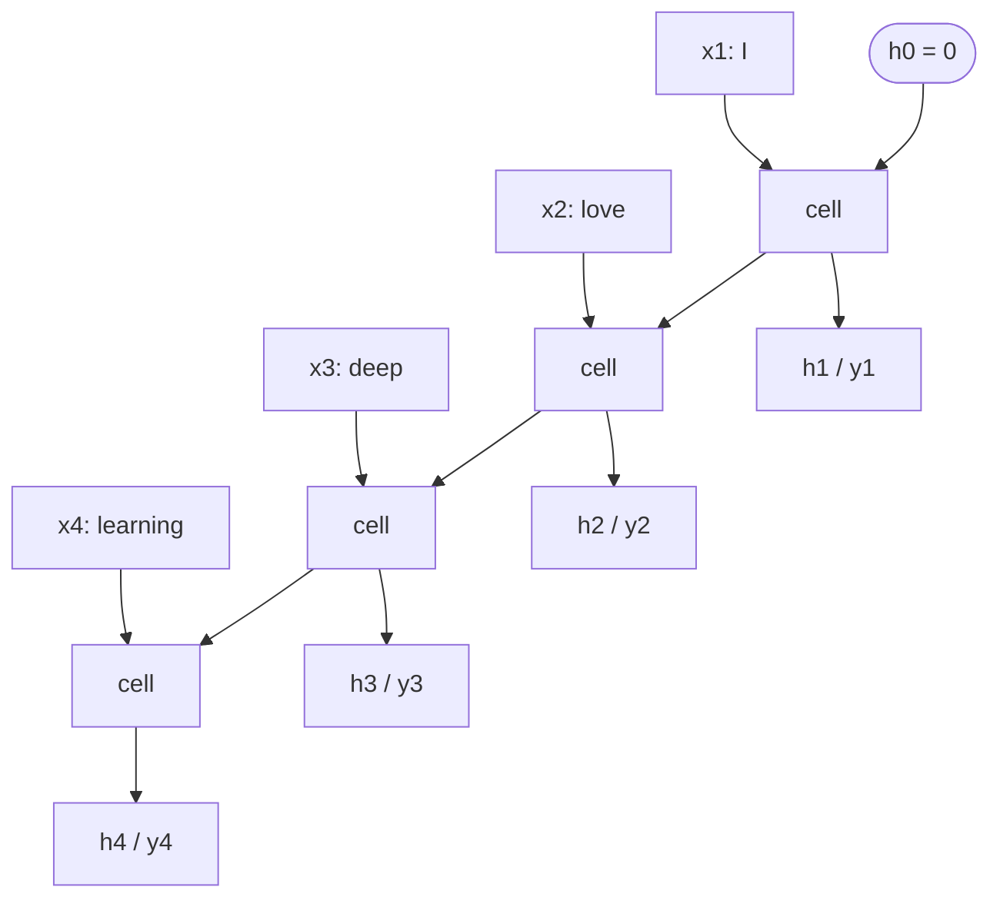

import {GradientDecayExplorer} from '@site/src/components/Widgets';

:::tip[TL;DR (30-Second Interview Pitch)]
An RNN cell does two things at every time step: update the memory, $\pred{h_t} = \tanh(\param{W_x}\data{x_t} + \param{W_h}\pred{h_{t-1}} + \param{b})$, and optionally emit an output, $\pred{y_t} = \param{W_y}\pred{h_t} + \param{b_y}$. **Unrolling** draws the loop as a chain of copies, one per time step, that all use the **same weights** (weight sharing). That keeps the parameter count independent of sequence length (700 vs 7,000 for 10 steps in the notebook example) and lets one model handle any length. Training uses **Backpropagation Through Time (BPTT)**: run backprop on the unrolled chain, so gradients flow from later steps to earlier ones and the gradient of each shared weight is the **sum of its contributions from every step**. Along the way the gradient is multiplied by $\text{diag}(1 - \pred{h_t}^2)\,\param{W_h}$ once per step, which is why it **vanishes** or **explodes** over long sequences.
:::

<FormulaKey />

:::info[Where this page sits]
**Before:** [Sequence Data and the Idea of Recurrence](./01-sequence-data-and-recurrence.md) explained *why* sequences need memory and introduced the hidden state.
**This page:** the RNN cell in detail: the equations, tensor shapes, unrolling, the forward pass, weight sharing and parameter counts, and backpropagation through time with real gradient measurements (notebook *11 RNN 2*).
**Next:** [RNNs in Practice](./03-rnns-in-practice-training-and-limits.md) builds many-to-one and many-to-many RNNs from scratch, trains them, and shows where they break (notebook *12 RNN 3*).
:::

## 🧭 Start Here

The previous page gave the idea: read one element at a time and keep a hidden state. This page opens the box and makes it precise enough to implement, debug and explain in an interview.

1. **One time step**: exactly what goes in ($\data{x_t}$, $\pred{h_{t-1}}$), what comes out ($\pred{h_t}$, $\pred{y_t}$), and every tensor's shape.
2. **Unrolling**: redraw the loop as a chain of identical cells, one per time step.
3. **The forward pass** across a whole sequence, with a hand-computed example.
4. **Weight sharing**: why the same matrices are reused at every step, and how many parameters that saves.
5. **Backpropagation Through Time**: how the loss at the end of the sequence sends gradients back to the beginning, and why the shared weights' gradients add up.
6. **What happens to the gradient over many steps**: measured, not just described. This sets up the vanishing/exploding problem the next page tackles.

| New concept | One-line meaning |
|---|---|
| **RNN cell** | The computation applied at one time step: $(\data{x_t}, \pred{h_{t-1}}) \to (\pred{h_t}, \pred{y_t})$ |
| $B, D, H, O, T$ | Batch size, input size, hidden size, output size, sequence length |
| **Unrolled RNN** | The loop redrawn as $T$ copies of the cell, one per time step |
| **Weight sharing** | Every copy uses the same $\param{W_x}, \param{W_h}, \param{W_y}$ and biases |
| **Temporal dependency** | Each state depends on the previous one, so the future depends on the past |
| **BPTT** | Backpropagation applied to the unrolled network, flowing backwards through time |
| **Gradient accumulation (over time)** | A shared weight's gradient is the sum of its gradients at each step |
| **Jacobian $\partial \pred{h_t} / \partial \pred{h_{t-1}}$** | How much a small change in the previous state changes the current state |
| **Truncated BPTT** | Backpropagating through only the last $k$ steps of a long sequence |
| **Gradient clipping** | Rescaling the gradient when its norm exceeds a threshold, to stop explosions |

:::analogy[The unrolled RNN is a flip book]
Draw the same cartoon character on every page of a flip book, changing it a little from page to page. Each page (time step) is drawn from the previous page plus one new instruction. The artist's style (the weights) is identical on every page: that's weight sharing. Flip quickly and you see a story unfold. Unrolling is laying all the pages side by side so you can see every step at once.
:::

## 1. The RNN Cell at One Time Step

At each time step the RNN performs **Input → Hidden State → Output**. Unlike an ANN, the hidden state is **carried forward in time** to the next step, which is what makes the network **recurrent**.

At time step $t$ the cell receives two things and produces two things:

| In | Out |
|---|---|
| Current input $\data{x_t}$ | New memory $\pred{h_t}$ |
| Previous memory $\pred{h_{t-1}}$ | Output $\pred{y_t}$ (if the task needs one at this step) |

**Step 1: hidden-state update.**

<Formula name="Hidden-state update" tag="Memory at step t" words="Combine the current input and the previous hidden state through two weight matrices, add a bias, and squash with tanh. This is the new memory, which is also passed to the next step." remember="Input plus memory, then tanh.">

$$
\pred{h_t} = \tanh\big(\param{W_x}\,\data{x_t} + \param{W_h}\,\pred{h_{t-1}} + \param{b}\big)
$$

- $\param{W_x}\data{x_t}$: the **current input's** influence
- $\param{W_h}\pred{h_{t-1}}$: the **past memory's** influence
- $\param{b}$: bias; $\tanh$: non-linearity that keeps every entry of $\pred{h_t}$ in $(-1, 1)$

**Example:** notebook-12 toy weights, step 2. $\param{W_x}\data{x_2} = [0.05, 0.95, -0.2]$ and $\param{W_h}\pred{h_1} = [0.321, -0.015, -0.346]$. Sum $= [0.371, 0.935, -0.546]$, so $\pred{h_2} = \tanh(\cdot) = [0.355, 0.733, -0.498]$.

</Formula>


*How to read it:* the merge of $\pred{h_{t-1}}$ (left) and $\data{x_t}$ (bottom) feeding one tanh layer is Step 1, $\pred{h_t} = \tanh(\param{W_x}\data{x_t} + \param{W_h}\pred{h_{t-1}} + \param{b})$. The upward copy of $\pred{h_t}$ is what Step 2 reads with $\param{W_y}$; the rightward copy is the memory passed to step $t + 1$.

**Step 2: output generation.**

<Formula name="Output at step t" tag="Read out the memory" words="A linear layer reads the hidden state and turns it into the output for this step: class scores, the next value of a series, or scores over the vocabulary. Apply softmax or sigmoid afterwards if you need probabilities." remember="Output = linear read of memory.">

$$
\pred{y_t} = \param{W_y}\,\pred{h_t} + \param{b_y}
$$

- $\param{W_y}$: hidden-to-output weights; $\param{b_y}$: output bias
- $\pred{y_t}$: raw scores (logits) or a regression value; softmax/sigmoid turn logits into probabilities

**Example:** a many-to-one sentiment model computes only $\pred{y_T}$ (one score after the last word); a next-character model computes $\pred{y_t}$ at every step and applies softmax to get a probability for each character.

</Formula>

What happens at each step, in order:

| # | Step | Computation |
|---|---|---|
| 1 | Take the new input | $\data{x_t}$ |
| 2 | Combine it with the previous memory | $\param{W_x}\data{x_t} + \param{W_h}\pred{h_{t-1}} + \param{b}$ |
| 3 | Produce the updated memory | $\pred{h_t} = \tanh(\cdot)$ |
| 4 | Generate the output | $\pred{y_t} = \param{W_y}\pred{h_t} + \param{b_y}$ |

This is powerful because **memory flows across time**, the model **learns sequential patterns**, and the **past influences the future**, which is what language, speech, time series and sequential prediction need.

:::tip[🎯 Interview angle]
**"Write the RNN forward equations."** $h_t = \tanh(W_x x_t + W_h h_{t-1} + b)$ and $y_t = W_y h_t + b_y$. **"Why does the RNN need $h_{t-1}$?"** It is the only channel through which the past reaches the present; without it the network is a feedforward model applied independently at each step. **"Why is it better than an ANN for sequences?"** Memory, any length, shared weights, order-awareness.
:::

## 2. Tensor Shapes (the Part Interviewers Probe)

Shape bugs are the most common RNN bugs, so it is worth fixing the conventions. Let $B$ = batch size, $D$ = input size (e.g. embedding dimension), $H$ = hidden size, $O$ = output size, $T$ = sequence length.

| Tensor | Shape | Notes |
|---|---|---|
| $\data{x_t}$ | $(B, D)$ | one time step for the whole batch |
| $\pred{h_{t-1}}$, $\pred{h_t}$ | $(B, H)$ | the hidden size is fixed and doesn't depend on $T$ |
| $\param{W_x}$ | $(H, D)$ | `weight_ih_l0` in PyTorch |
| $\param{W_h}$ | $(H, H)$ | `weight_hh_l0`; **square**, because it maps a state to a state |
| $\param{b}$ | $(H,)$ | PyTorch has **two**: `bias_ih_l0` and `bias_hh_l0` (they just add up) |
| $\param{W_y}$ | $(O, H)$ | usually a separate `nn.Linear(H, O)` |
| $\pred{y_t}$ | $(B, O)$ | |
| Full input | $(T, B, D)$ default, or $(B, T, D)$ with `batch_first=True` | |

**Row vs column convention.** The maths writes column vectors: $\param{W_x}\data{x_t}$ with $\param{W_x}$ of shape $(H, D)$ and $\data{x_t}$ of shape $(D,)$. Code works with a batch of **row** vectors, $\data{x_t}$ of shape $(B, D)$, so it computes `x_t @ W_x.T`, giving $(B, D) \times (D, H) = (B, H)$. Same numbers, transposed layout. This is why the notebook's code has `.T` everywhere, and why PyTorch stores `weight_ih_l0` as $(H, D)$.

**What `nn.RNN` returns.** `output, h_n = rnn(x)`:
- `output`: the hidden state at **every** time step of the **last layer**: $(T, B, H)$, or $(B, T, H)$ with `batch_first=True`. Multiply $H$ by 2 if bidirectional.
- `h_n`: the hidden state at the **last** time step of **every layer** (and direction): $(\text{num\_layers} \times \text{num\_directions}, B, H)$. **`batch_first` does not change `h_n`'s layout**.

:::danger[Interview Trap: "`batch_first=True` applies to everything"]
It only affects `input` and `output`. The hidden state `h_0` / `h_n` is **always** `(num_layers × num_directions, batch, hidden)`. A 2-layer bidirectional RNN with hidden size 8 on a batch of 2 returns `h_n` of shape `(4, 2, 8)` and `output` of shape `(2, T, 16)`. For a many-to-one head, use `h_n[-1]` (last layer, and for a bidirectional RNN, the backward direction; concatenate `h_n[-2]` and `h_n[-1]` to get both directions).
:::

:::tip[🎯 Interview angle]
**"Given batch 32, sequence length 50, embedding 100, hidden 128: what are the shapes?"** Input `(32, 50, 100)` with `batch_first=True`; $W_x$ = `(128, 100)`, $W_h$ = `(128, 128)`; `output` = `(32, 50, 128)`; `h_n` = `(1, 32, 128)`. Parameters of `nn.RNN(100, 128)`: $128 \cdot 100 + 128 \cdot 128 + 2 \cdot 128 = 29{,}440$, independent of the 50.
:::

## 3. Unrolling the RNN Through Time

A single RNN cell handles one time step, but sequences have many. "I love deep learning" becomes four inputs: $\data{x_1}$ = "I", $\data{x_2}$ = "love", $\data{x_3}$ = "deep", $\data{x_4}$ = "learning". Instead of a different network for each step, we **repeat the same cell across time**. Drawing those repetitions side by side is called **unrolling** (or unfolding) the RNN:




*How to read it:* left, the folded cell with its loop; right, the same cell copied once per word. Every copy uses the same $\param{W_x}$, $\param{W_h}$ and $\param{b}$, and each arrow between copies is $\pred{h_t}$ passed forward.

Writing the cell as a function $f$, the unrolled computation is a chain:

<Formula name="Unrolled recurrence" tag="One function, applied T times" words="The hidden state at each step is the same function of the current input and the previous state. Unrolling just writes out every application of that function, from the empty start state to the last step." remember="Same f, every step.">

$$
\pred{h_1} = f(\data{x_1}, \pred{h_0}),\quad \pred{h_2} = f(\data{x_2}, \pred{h_1}),\quad \ldots,\quad \pred{h_t} = f(\data{x_t}, \pred{h_{t-1}})
$$

- $f(\data{x}, \pred{h}) = \tanh(\param{W_x}\data{x} + \param{W_h}\pred{h} + \param{b})$, identical at every step
- $\pred{h_0}$: initial state, zeros by default

**Example:** expanding three steps gives $\pred{h_3} = f(\data{x_3}, f(\data{x_2}, f(\data{x_1}, \pred{h_0})))$: the last state is a nested function of every input, in order.

</Formula>

<Animation src="rnn/unroll-shared-weights" caption="The folded cell with its loop is copied once per time step. Watch the Wh and Wx labels light up together at the end: every copy uses the same matrices." />

Two observations:

- **Temporal dependency.** Each step takes a new input, uses the previous memory and produces new memory, so the **future depends on the past**. $\pred{h_4}$ depends on all four inputs; $\pred{h_2}$ depends only on the first two.
- **The unrolled graph is just a deep feedforward network** with $T$ layers that share their weights. That is the key to training it (Chapter 6): ordinary backpropagation works on it. The difference from a normal deep network is that the "depth" equals the sequence length, so a 100-word sentence is a 100-layer network.

Weight sharing across the unrolled copies matters for language: whether "good" follows "not" or "very" changes the meaning, and the same rule ("negation flips sentiment") should apply wherever in the sentence it occurs. Shared weights learn that rule once.

:::tip[🎯 Interview angle]
**"What does unrolling an RNN mean?"** Redrawing the recurrent loop as $T$ copies of the cell, one per time step, connected through the hidden state. The unrolled network is a deep feedforward network whose layers **share weights**, so backpropagation can be applied to it directly (BPTT). Its depth equals the sequence length, which explains why long sequences are hard to train.
:::

## 4. The Forward Pass, Step by Step

The forward pass runs the cell from $t = 1$ to $t = T$, doing two operations at every step:

| Step | Operation |
|---|---|
| ① | $\pred{h_t} = \tanh(\param{W_x}\data{x_t} + \param{W_h}\pred{h_{t-1}} + \param{b})$ |
| ② | $\pred{y_t} = \param{W_y}\pred{h_t} + \param{b_y}$ |

For a sequence $\data{x_1}, \ldots, \data{x_4}$ that's $\pred{h_1} = f(\data{x_1}, \pred{h_0})$, then $\pred{h_2} = f(\data{x_2}, \pred{h_1})$, then $\pred{h_3}$, then $\pred{h_4}$. **Each step depends on the previous one**: sequential learning. The loop can't be parallelized across $t$, because step $t$ needs $\pred{h_{t-1}}$.

A complete hand-computed run, with the notebook-12 toy weights ($D = 2$, $H = 3$, no bias):

| $t$ | $\data{x_t}$ | pre-activation $\param{W_x}\data{x_t} + \param{W_h}\pred{h_{t-1}}$ | $\pred{h_t} = \tanh(\cdot)$ |
|---|---|---|---|
| 1 | [1, 0] | [0.500, 0.300, −0.600] | [0.462, 0.291, −0.537] |
| 2 | [0.5, 1] | [0.371, 0.935, −0.546] | [0.355, 0.733, −0.498] |
| 3 | [0, 1] | [0.115, 1.017, −0.421] | [0.114, 0.769, −0.398] |
| 4 | [1, 1] | [0.502, 1.365, −1.023] | [0.464, 0.878, −0.771] |

Notice how tanh squashes large pre-activations (1.365 → 0.878) and leaves small ones almost unchanged (0.115 → 0.114): it behaves linearly near 0 and saturates near ±1.

**Why compute an output at every step?** Because many tasks need one: next-word prediction (a distribution over the vocabulary at every position), tagging (one label per word), real-time speech recognition. For a many-to-one task you skip $\pred{y_1} \ldots \pred{y_{T-1}}$ and compute only $\pred{y_T}$ from the final state. The hidden states are computed either way, because the final state depends on all of them.

**Why tanh, not linear?** A linear recurrence $\pred{h_t} = \param{W_x}\data{x_t} + \param{W_h}\pred{h_{t-1}}$ can only learn linear relationships, and repeated multiplication by $\param{W_h}$ makes its state explode or decay geometrically. tanh adds non-linearity, keeps $-1 \le \pred{h_t} \le 1$, and so stabilizes the forward pass. (It does **not** fully stabilize the *backward* pass, as Chapter 7 shows.)

:::analogy[The forward pass is a relay race with a baton]
Each runner (time step) receives the baton (hidden state) from the previous runner, adds their own leg of the race (the new input), and hands it on. Nobody can start before receiving the baton, which is why the race can't be run in parallel. The final runner's time (the last hidden state) reflects every leg before it.
:::

:::tip[🎯 Interview angle]
**"Walk me through the forward pass of an RNN over a sequence."** Start with $h_0 = 0$. For each $t$: combine $x_t$ and $h_{t-1}$ with $W_x$, $W_h$, $b$, apply tanh to get $h_t$, optionally compute $y_t = W_y h_t + b_y$. Store every $h_t$ (needed for backprop). Many-to-one uses $h_T$; many-to-many uses all $y_t$. Cost: $O(T \cdot (HD + H^2))$ time, strictly sequential in $T$.
:::

## 5. Weight Sharing and Parameter Efficiency

Do we use different weights at each time step? **No.** The RNN uses the **same** $\param{W_x}$, $\param{W_h}$, $\param{W_y}$ (and biases) at every step. This is **weight sharing**, and it's one of the most important ideas in the RNN.

**Why share?** Sequential data follows the same patterns wherever they occur. In "I love AI" and "I love ML", the relationship between "I", "love" and the object is the same, and in a long document the same grammar applies in sentence 1 and sentence 50. The RNN should learn **one transformation** and apply it at every position, just as a CNN learns one filter and slides it over every location.

**How many parameters does it save?** The notebook's example: input size 10, hidden size 20, output size 5, sequence length 10.

<Formula name="RNN parameter count" tag="Independent of sequence length" words="Count the three weight matrices and the biases once. Without weight sharing you would need a separate set for every time step, multiplying the count by the sequence length." remember="Parameters don't grow with T.">

$$
\#\text{params} = \underbrace{\hyper{H}\hyper{D}}_{\param{W_x}} + \underbrace{\hyper{H}^2}_{\param{W_h}} + \underbrace{\hyper{O}\hyper{H}}_{\param{W_y}} + \underbrace{\hyper{H} + \hyper{O}}_{\text{biases}}
$$

- Without sharing: multiply everything by $T$
- PyTorch's `nn.RNN` keeps two hidden biases (`bias_ih`, `bias_hh`), so it has $\hyper{H}\hyper{D} + \hyper{H}^2 + 2\hyper{H}$

**Example:** $D = 10, H = 20, O = 5, T = 10$. Weights only: $200 + 400 + 100 = 700$ shared vs $7{,}000$ unshared. With biases: $725$ vs $7{,}250$. In PyTorch, `nn.RNN(10, 20)` has $640$ parameters and `nn.Linear(20, 5)` has $105$: $745$ in total.

</Formula>

| | **Without weight sharing** | **With weight sharing (RNN)** |
|---|---|---|
| Weights for $T = 10$ (notebook example) | $10 \times 700 = 7{,}000$ | $700$ |
| Grows with sequence length? | Yes, linearly | **No** |
| Works on a length never seen in training? | No (no weights for step 11) | **Yes** |
| Generalization | Must learn each pattern separately at each position | Learns a pattern once, applies it everywhere |

**Comparison with an ANN.** A deep ANN has **separate** weights per layer ($\param{W_1}, \param{W_2}, \param{W_3}, \param{W_4}$). An unrolled RNN looks like a deep network, but its "layers" (time steps) **reuse** the same $\param{W_x}, \param{W_h}, \param{W_y}$.

**Why this is powerful:** the sequence length can vary, the model works for **any** length, and learning is efficient: every time step provides a training signal for the same weights, so a 50-word sentence gives 50 updates' worth of evidence about the one $\param{W_h}$.

:::analogy[Weight sharing is a rubber stamp]
A stamp-maker carves one stamp and uses it on every page; they don't carve a new stamp for page 2. The stamp (the weights) is the same whether the document has 3 pages or 300. If they had to carve a stamp per page (no sharing), long documents would need a mountain of stamps, and a 301st page couldn't be stamped at all.
:::

:::tip[🎯 Interview angle]
**"Why does an RNN have fewer parameters than an equivalent unshared model, and why does that matter?"** One set of $W_x, W_h, W_y$ serves all $T$ steps, so parameters are $HD + H^2 + OH$ (+ biases), independent of $T$ (700 vs 7,000 for $T = 10$). It lets the model handle variable-length input, run on lengths it never saw, and generalize a pattern learned at one position to all positions.
:::

## 6. Backpropagation Through Time (BPTT)

How does an RNN learn? Like an ANN: a **loss function**, **gradient descent** and **backpropagation**. The difference is the direction backprop travels: in an ANN it goes back through **layers**; in an RNN it goes back through **time**. This is **Backpropagation Through Time (BPTT)**.

**Forward pass across time.** Compute $\pred{h_1}, \ldots, \pred{h_T}$ and the outputs $\pred{y_1}, \ldots, \pred{y_T}$, storing every hidden state.

**Loss across time.** A many-to-many task has a loss at each step; the total is their sum (or mean):

<Formula name="Total loss over time" tag="Sum of per-step losses" words="Each time step with a target contributes its own loss, and the training objective is their total. A many-to-one task has a single term, the loss at the last step." remember="Add up the loss at every step.">

$$
\loss{L} = \sum_{t=1}^{T} \loss{L_t}, \qquad \loss{L_t} = \ell(\pred{y_t}, \data{y_t^{\text{true}}})
$$

- $\ell$: the per-step loss, e.g. cross-entropy for next-word prediction or MSE for forecasting
- Many-to-one: $\loss{L} = \loss{L_T}$ only

**Example:** with four steps, $\loss{L} = \loss{L_1} + \loss{L_2} + \loss{L_3} + \loss{L_4}$. PyTorch's `.mean()` divides by the number of terms, which only rescales the gradient.

</Formula>

**Gradients flow backward through time.** Because $\pred{h_t} = f(\data{x_t}, \pred{h_{t-1}})$, a change in $\pred{h_1}$ affects $\pred{h_2}$, which affects $\pred{h_3}$, and so on up to the loss. The chain rule therefore sends the gradient back along the same chain:

$$
\frac{\partial \loss{L}}{\partial \pred{h_4}} \;\to\; \frac{\partial \loss{L}}{\partial \pred{h_3}} \;\to\; \frac{\partial \loss{L}}{\partial \pred{h_2}} \;\to\; \frac{\partial \loss{L}}{\partial \pred{h_1}}
$$

Each arrow multiplies by the **Jacobian** of one step:

<Formula name="One-step Jacobian" tag="How the gradient moves back one step" words="To move the gradient from step t back to step t minus 1, multiply by the recurrent weight matrix and by the tanh slope at each unit. Every step back applies one more such factor." remember="Each step back multiplies by Wh and tanh slope.">

$$
\frac{\partial \pred{h_t}}{\partial \pred{h_{t-1}}} = \operatorname{diag}\!\big(1 - \pred{h_t}^2\big)\,\param{W_h}
\qquad\Longrightarrow\qquad
\frac{\partial \loss{L_T}}{\partial \pred{h_k}} = \frac{\partial \loss{L_T}}{\partial \pred{h_T}} \prod_{j=k+1}^{T} \operatorname{diag}\!\big(1 - \pred{h_j}^2\big)\,\param{W_h}
$$

- $1 - \pred{h_t}^2$: the derivative of tanh, between 0 and 1 (it is 1 only at $\pred{h} = 0$)
- The product has $T - k$ factors: the further back, the more factors

**Example:** if each factor scales the gradient by about 0.5, then 19 steps back the gradient is $0.5^{19} \approx 1.9 \times 10^{-6}$ of its starting size. The measured run below shows exactly this: 4.0 at $\pred{h_{20}}$, 0.0000067 at $\pred{h_1}$.

</Formula>


*How to read it:* black arrows are the forward pass, left to right. Each loss $\loss{L_t}$ sends its gradient into its own step (red, from the top), and the red arrows underneath carry the gradient one step back at a time, multiplying by $\operatorname{diag}(1 - \pred{h_t}^2)\,\param{W_h}$ each time. That repeated factor is why it vanishes or explodes.

<Animation src="rnn/bptt-gradient-flow" caption="The forward pass runs left to right, then the loss sends its gradient back right to left. Watch the bars: each step back halves the gradient, from 4.0 at h20 down to 0.0000067 at h1." />

**Shared weights collect gradient from every step.** $\param{W_h}$ is used at every time step, so it receives a gradient contribution from each use, and the total gradient is their **sum**:

<Formula name="Gradient of a shared weight" tag="Accumulate over time" words="Because the same matrix is used at every step, its total gradient is the sum of the gradients from each step where it was used. Each of those terms itself reaches back through all earlier steps." remember="Shared weight, summed gradient.">

$$
\frac{\partial \loss{L}}{\partial \param{W}} = \sum_{t=1}^{T} \frac{\partial \loss{L_t}}{\partial \param{W}}
= \sum_{t=1}^{T} \sum_{k=1}^{t} \frac{\partial \loss{L_t}}{\partial \pred{h_t}}\,\frac{\partial \pred{h_t}}{\partial \pred{h_k}}\,\frac{\partial^{+} \pred{h_k}}{\partial \param{W}}
$$

- $\param{W}$: any shared weight ($\param{W_x}$, $\param{W_h}$, $\param{W_y}$)
- $\partial^{+}\pred{h_k} / \partial \param{W}$: the **immediate** effect of $\param{W}$ at step $k$, treating $\pred{h_{k-1}}$ as a constant
- $\partial \pred{h_t} / \partial \pred{h_k}$: the product of Jacobians from the previous card

**Example:** a 5-step run (implementation block 7) splits the gradient of $\param{W_h}$ into its per-step parts with norms 0.0, 0.4953, 0.4523, 0.945 and 1.123, and their sum equals the gradient of the shared matrix exactly. The step-1 part is 0 because $\param{W_h}$ multiplies $\pred{h_0} = \mathbf{0}$ there.

</Formula>

This accumulation is what lets an RNN learn **both** short-term dependencies (terms with $k$ close to $t$) and long-term ones (terms with $k$ far from $t$), at least in principle. In practice the long-range terms are the ones multiplied by many Jacobians, so they are the ones that vanish.

:::analogy[BPTT is passing the blame back down a relay team]
The team lost the race (the loss). The coach starts with the last runner, works out how much of the loss was their fault, and passes the rest of the blame to the runner before them, scaled by how much that runner's handover affected the next one. Every runner was trained by the same coach (shared weights), so the coach's total correction is the sum of the lessons from every runner. If each handover passes on only half the blame, the first runner hears almost nothing.
:::

:::tip[🎯 Interview angle]
**"What is BPTT and how does it differ from normal backprop?"** It is ordinary backpropagation on the **unrolled** RNN: the loss is summed over time steps, gradients flow from step $T$ back to step 1 through the hidden-state chain, and because the weights are shared, each weight's gradient is the **sum** of its gradients from every step. It needs all hidden states stored (memory $O(T \cdot B \cdot H)$), and the repeated Jacobian product $\prod \text{diag}(1 - h^2) W_h$ is what causes vanishing/exploding gradients.
:::

## 7. Gradient Size Over Time: Vanishing and Exploding

The product of Jacobians in Chapter 6 is the heart of the RNN's training problem. Bound each factor: tanh's slope is at most 1, so each step back scales the gradient by at most about $\sigma_{\max}(\param{W_h})$, the largest singular value of $\param{W_h}$:

$$
\left\lVert \frac{\partial \loss{L_T}}{\partial \pred{h_k}} \right\rVert \;\le\; \left\lVert \frac{\partial \loss{L_T}}{\partial \pred{h_T}} \right\rVert \cdot \big(\sigma_{\max}(\param{W_h})\big)^{T-k}
$$

- If $\sigma_{\max}(\param{W_h}) < 1$, the gradient **must** shrink exponentially with distance: **vanishing**.
- If it is larger than 1, the gradient **can** grow exponentially: **exploding** (tanh saturation often limits this, but not reliably).

Measured, not assumed. A 20-step RNN with hidden size 16, $\param{W_h}$ = scale × a random orthogonal matrix (all singular values equal to the scale), and the loss at the last step only. Gradient norm $\lVert \partial \loss{L} / \partial \pred{h_t} \rVert$:

| Scale of $\param{W_h}$ | $t = 1$ | $t = 5$ | $t = 10$ | $t = 15$ | $t = 20$ | What happens |
|---|---|---|---|---|---|---|
| 0.5 | 0.0000067 | 0.000108 | 0.00356 | 0.121 | 4.0 | **Vanishes**: halves every step |
| 0.9 | 0.394 | 0.608 | 1.09 | 2.1 | 4.0 | Fades slowly |
| 1.0 | 2.39 | 2.43 | 2.64 | 3.2 | 4.0 | Roughly preserved (tanh slope < 1 trims it a little) |
| 1.5 | 167 | 35.1 | 11.8 | 5.67 | 4.0 | **Explodes** going back |
| 3.0 | 2,460 | 71 | 52.2 | 7.12 | 4.0 | **Explodes** fast |

The notebook's toy demo multiplies by 0.5 fifteen times (→ 0.000031) and by 1.5 fifteen times (→ 437.89); the real RNN behaves the same way because each step back really is one more matrix multiplication.

Consequences: with vanishing gradients, early time steps learn almost nothing, so **long-term dependencies are not learned**; with exploding gradients, a single update can throw the weights far away (loss spikes, `NaN`). Remedies, in order of how often you'll use them:

| Problem | Remedy | Why it works |
|---|---|---|
| Exploding | **Gradient clipping** (`clip_grad_norm_`, max norm ~1–5) | Caps the step size without changing its direction |
| Exploding / vanishing at the start | **Orthogonal or identity init** of $\param{W_h}$ | All singular values = 1, so gradients start neither growing nor shrinking |
| Vanishing | **LSTM / GRU** | An additive, gated memory path whose per-step factor is a learned gate near 1 |
| Vanishing (long sequences) | **Truncated BPTT** + carrying the state forward | Limits how far back gradients must travel; trades long memory for stability and speed |
| Both | **Attention / Transformers** | Direct connections between any two positions, so no long chain of multiplications |

:::analogy[Gradient clipping is a speed limiter]
A delivery van's speed limiter doesn't change where the driver is going, only how fast. Gradient clipping does the same: if the gradient's length exceeds the limit, it is scaled down to the limit but keeps its direction, so one bad batch can't launch the weights off a cliff.
:::


**Try it yourself.** Change the per-step factor and the number of steps: below 1 the gradient vanishes, above 1 it explodes.

<GradientDecayExplorer />

:::tip[🎯 Interview angle]
**"Why do RNN gradients vanish or explode?"** BPTT multiplies the gradient by $\text{diag}(1 - h_t^2) W_h$ once per step; over $T - k$ steps that's a product of $T - k$ matrices, which shrinks exponentially if their scale is below 1 and grows exponentially if above 1. **Fixes:** clipping for explosions; orthogonal init, LSTM/GRU, truncated BPTT, and attention for vanishing. Mention that ReLU/identity-initialized RNNs (IRNN) and careful init help, but gating is the standard fix.
:::

## ⚙️ Going Deeper (Training Internals)

**Two biases in PyTorch.** `nn.RNN` computes $\tanh(\data{x_t}\param{W_{ih}}^\top + \param{b_{ih}} + \pred{h_{t-1}}\param{W_{hh}}^\top + \param{b_{hh}})$. Mathematically the two biases are one ($\param{b} = \param{b_{ih}} + \param{b_{hh}}$); they exist for compatibility with cuDNN's fused kernels. Remember them when counting parameters ($HD + H^2 + 2H$).

**Memory cost of BPTT.** Backprop needs every $\pred{h_t}$ (and pre-activation), so activation memory grows as $O(T \cdot B \cdot H)$ per layer. Long sequences run out of GPU memory before they run out of time. Remedies: truncated BPTT, smaller batches, gradient checkpointing (recompute activations during the backward pass).

**Truncated BPTT.** Split a long sequence into chunks of $k$ steps. Carry the hidden state from chunk to chunk (so the forward pass still sees the whole history), but call `h = h.detach()` between chunks, so gradients only flow back $k$ steps. The model can still *use* information older than $k$ steps, but it can't *learn* to use it. Block 9 below trains a next-value predictor on a 200-step sine wave in 4 chunks of 50.

**Spectral radius and initialization.** The behaviour of $\prod \param{W_h}$ is governed by the singular values of $\param{W_h}$. A Gaussian init with std 1 gives $\sigma_{\max} \approx 2\sqrt{H}$, far above 1. PyTorch initializes RNN weights uniformly in $\pm 1/\sqrt{H}$, which keeps $\sigma_{\max}$ near 1–2. **Orthogonal initialization** (`nn.init.orthogonal_`) sets every singular value to exactly 1, the "edge of chaos" where gradients neither vanish nor explode at the start of training.

**Pascanu et al. (2013).** The standard reference: with $\gamma$ the bound on the activation's derivative (1 for tanh), $\sigma_{\max}(\param{W_h}) < 1/\gamma$ is **sufficient** for vanishing gradients, and $\sigma_{\max}(\param{W_h}) > 1/\gamma$ is **necessary** for exploding ones. The same paper proposed gradient-norm clipping.

**Stacked (deep) RNNs.** `num_layers=2` feeds layer 1's output sequence into layer 2 as its input sequence. Each layer has its own $\param{W_x}, \param{W_h}$; `h_n` has one entry per layer. Two or three layers is typical; deeper stacks are hard to train without residual connections.

**Bidirectional RNNs.** Two independent RNNs, one reading left-to-right and one right-to-left; their outputs are concatenated at each step, so `output` has $2H$ features and `h_n` has $2 \times$ num_layers entries.

**cuDNN and speed.** `nn.RNN` on GPU dispatches to a fused cuDNN kernel that runs all time steps of a layer in one call, much faster than a Python loop over `nn.RNNCell`. Use `nn.RNNCell` only when you need custom per-step logic.

## 💻 PyTorch Implementation

:::tip[Run it yourself]
Verified on Python 3.13 with NumPy 2.5 and PyTorch 2.15 (CPU). Outputs are copied from real runs into the trailing comments.
:::

### 1. One RNN cell, by hand (row-vector convention)

The notebook's single-step example. Code uses `x @ W.T` because each row of `x_t` is one example.

```python title="rnn_cell.py" showLineNumbers
import torch

torch.manual_seed(0)
B, D, H, O = 2, 5, 4, 3                     # batch, input, hidden, output sizes

x_t = torch.randn(B, D)
h_prev = torch.randn(B, H)
W_x, W_h, W_y = torch.randn(H, D), torch.randn(H, H), torch.randn(O, H)
b, b_y = torch.randn(H), torch.randn(O)

# highlight-start
h_t = torch.tanh(x_t @ W_x.T + h_prev @ W_h.T + b)
y_t = h_t @ W_y.T + b_y
# highlight-end

print(x_t.shape, h_prev.shape)              # torch.Size([2, 5]) torch.Size([2, 4])
print(h_t.shape, y_t.shape)                 # torch.Size([2, 4]) torch.Size([2, 3])
print(h_t.min().item() > -1, h_t.max().item() < 1)   # True True   tanh keeps h in (-1, 1)
```

### 2. One step with real numbers

The worked example from the hidden-state card (step 2 of the toy sequence): the input part and the memory part, added, then squashed.

```python title="one_step.py" showLineNumbers
import numpy as np
np.set_printoptions(precision=3, suppress=True)

W_x = np.array([[0.5, -0.2], [0.3, 0.8], [-0.6, 0.1]])
W_h = np.array([[0.4, 0.1, -0.2], [0.0, 0.5, 0.3], [0.2, -0.4, 0.6]])
x2 = np.array([0.5, 1.0])

input_part = W_x @ x2
memory_part = W_h @ np.tanh(W_x @ np.array([1.0, 0.0]))     # W_h @ h1
print(input_part)                                          # [ 0.05  0.95 -0.2 ]
print(memory_part)                                         # [ 0.321 -0.015 -0.346]
print(input_part + memory_part)                            # [ 0.371  0.935 -0.546]
print(np.tanh(input_part + memory_part))                   # [ 0.355  0.733 -0.498]   = h2
```

### 3. Unrolling by hand reproduces `nn.RNN`

A Python loop over time with `nn.RNN`'s own weights (note the **two** biases) matches its output to float precision.

```python title="unroll_vs_nn_rnn.py" showLineNumbers
import torch
import torch.nn as nn

torch.manual_seed(0)
T, B, D, H = 4, 2, 5, 4
rnn = nn.RNN(D, H)                          # default layout: (time, batch, features)
for name, p in rnn.named_parameters():
    print(name, tuple(p.shape))             # weight_ih_l0 (4, 5) · weight_hh_l0 (4, 4) · bias_ih_l0 (4,) · bias_hh_l0 (4,)

x = torch.randn(T, B, D)
out, h_n = rnn(x)

h = torch.zeros(B, H)
steps = []
for t in range(T):                          # the same weights at every step
    # highlight-start
    h = torch.tanh(x[t] @ rnn.weight_ih_l0.T + rnn.bias_ih_l0
                   + h @ rnn.weight_hh_l0.T + rnn.bias_hh_l0)
    # highlight-end
    steps.append(h)

print(out.shape, h_n.shape)                 # torch.Size([4, 2, 4]) torch.Size([1, 2, 4])
print((torch.stack(steps) - out).abs().max().item())   # 2.9802322387695312e-08
print(torch.equal(out[-1], h_n[0]))         # True
```

### 4. Input layouts: default, `batch_first`, stacked and bidirectional

`batch_first` changes `output`, never `h_n`.

```python title="layouts.py" showLineNumbers
import torch
import torch.nn as nn

torch.manual_seed(0)
x_tbd = torch.randn(6, 2, 4)                                     # (T, B, D)
out, h_n = nn.RNN(4, 8)(x_tbd)
print(out.shape, h_n.shape)                                      # torch.Size([6, 2, 8]) torch.Size([1, 2, 8])

out, h_n = nn.RNN(4, 8, batch_first=True)(x_tbd.transpose(0, 1))
print(out.shape, h_n.shape)                                      # torch.Size([2, 6, 8]) torch.Size([1, 2, 8])

# highlight-next-line
out, h_n = nn.RNN(4, 8, num_layers=2, bidirectional=True, batch_first=True)(x_tbd.transpose(0, 1))
print(out.shape, h_n.shape)                                      # torch.Size([2, 6, 16]) torch.Size([4, 2, 8])
```

### 5. Weight sharing: parameter counts

The notebook's comparison, plus the biases it left out, and PyTorch's own count.

```python title="param_count.py" showLineNumbers
import torch.nn as nn

D, H, O, T = 10, 20, 5, 10
per_step = D * H + H * H + H * O
print(T * per_step, per_step)               # 7000 700    unshared vs shared (weights only)

per_step_b = per_step + H + O
print(T * per_step_b, per_step_b)           # 7250 725    with one bias per layer

rnn, head = nn.RNN(D, H), nn.Linear(H, O)
n_rnn = sum(p.numel() for p in rnn.parameters())
n_head = sum(p.numel() for p in head.parameters())
print(n_rnn, n_head, n_rnn + n_head)        # 640 105 745  (nn.RNN has two hidden biases)
```

### 6. BPTT with `nn.RNN`

The notebook's example, seeded. One `backward()` call runs BPTT through all 5 steps; the gradients have the shapes of the shared weights.

```python title="bptt_nn_rnn.py" showLineNumbers
import torch
import torch.nn as nn

torch.manual_seed(0)
x = torch.randn(5, 2, 3)                    # T=5, B=2, D=3
rnn = nn.RNN(3, 4)
target = torch.randn(5, 2, 4)

output, hidden = rnn(x)
loss = ((output - target) ** 2).mean()      # a loss at every step, averaged
# highlight-next-line
loss.backward()                             # backprop through all 5 time steps

print(round(loss.item(), 4))                # 0.6745
print(rnn.weight_ih_l0.grad.shape, rnn.weight_hh_l0.grad.shape)   # torch.Size([4, 3]) torch.Size([4, 4])
```

### 7. The shared weight's gradient is the sum over time steps

Give each time step its own *copy* of $\param{W_h}$, then compare the copies' gradients with the gradient of one shared matrix.

```python title="gradient_accumulates.py" showLineNumbers
import torch

torch.manual_seed(0)
W_x = torch.randn(4, 3)
W_h = 0.5 * torch.randn(4, 4)
xs = torch.randn(5, 3)

copies = [W_h.clone().requires_grad_() for _ in range(5)]   # one copy per step
h = torch.zeros(4)
for t in range(5):
    h = torch.tanh(W_x @ xs[t] + copies[t] @ h)
h.sum().backward()

W_shared = W_h.clone().requires_grad_()                     # one shared matrix
h = torch.zeros(4)
for t in range(5):
    h = torch.tanh(W_x @ xs[t] + W_shared @ h)
h.sum().backward()

print([round(c.grad.norm().item(), 4) for c in copies])     # [0.0, 0.4953, 0.4523, 0.945, 1.123]   step 1 multiplies h0 = 0
# highlight-next-line
print(torch.allclose(sum(c.grad for c in copies), W_shared.grad))   # True
```

### 8. Measuring vanishing and exploding gradients

The table in Chapter 7. $\param{W_h}$ = scale × orthogonal matrix; loss at the last step only; `retain_grad()` keeps each $\partial \loss{L} / \partial \pred{h_t}$.

```python title="gradient_norms.py" showLineNumbers
import torch

def grad_norms(scale, T=20, H=16, seed=0):
    g = torch.Generator().manual_seed(seed)
    Q, _ = torch.linalg.qr(torch.randn(H, H, generator=g))
    W_hh = (scale * Q).requires_grad_()                     # every singular value = scale
    W_xh = 0.1 * torch.randn(H, 1, generator=g)
    xs = torch.randn(T, 1, generator=g)
    h, hs = torch.zeros(H), []
    for t in range(T):
        h = torch.tanh(W_xh @ xs[t] + W_hh @ h)
        h.retain_grad()
        hs.append(h)
    hs[-1].sum().backward()                                 # loss only at the last step
    return [hh.grad.norm().item() for hh in hs]

for scale in (0.5, 0.9, 1.0, 1.5, 3.0):
    n = grad_norms(scale)
    print(scale, [f"{n[i]:.3g}" for i in (0, 4, 9, 14, 19)])   # t = 1, 5, 10, 15, 20
# 0.5 ['6.69e-06', '0.000108', '0.00356', '0.121', '4']
# 0.9 ['0.394', '0.608', '1.09', '2.1', '4']
# 1.0 ['2.39', '2.43', '2.64', '3.2', '4']
# 1.5 ['167', '35.1', '11.8', '5.67', '4']
# 3.0 ['2.46e+03', '71', '52.2', '7.12', '4']
```

### 9. Gradient clipping and truncated BPTT

`clip_grad_norm_` returns the norm **before** clipping, then rescales in place. Truncated BPTT detaches the state between chunks.

```python title="clip_grad.py" showLineNumbers
import torch
import torch.nn as nn

torch.manual_seed(0)
model = nn.Linear(4, 1)
loss = (1000 * model(torch.randn(8, 4))).pow(2).mean()      # a deliberately huge loss
loss.backward()

# highlight-next-line
before = nn.utils.clip_grad_norm_(model.parameters(), max_norm=1.0)
after = torch.sqrt(sum(p.grad.norm() ** 2 for p in model.parameters()))
print(round(before.item(), 1), round(after.item(), 4))      # 1477375.6 1.0
```

```python title="truncated_bptt.py" showLineNumbers
import torch
import torch.nn as nn

torch.manual_seed(0)
rnn, head = nn.RNN(1, 8, batch_first=True), nn.Linear(8, 1)
opt = torch.optim.Adam(list(rnn.parameters()) + list(head.parameters()), lr=0.01)
series = torch.sin(torch.linspace(0, 20, 201)).view(1, -1, 1)   # one long sequence
x, y = series[:, :-1], series[:, 1:]                            # predict the next value

for epoch in range(30):
    h = torch.zeros(1, 1, 8)
    total = 0.0
    for start in range(0, 200, 50):                             # 4 chunks of 50 steps
        out, h = rnn(x[:, start:start + 50], h)                 # state carried in from the last chunk
        loss = ((head(out) - y[:, start:start + 50]) ** 2).mean()
        opt.zero_grad()
        loss.backward()
        opt.step()
        # highlight-next-line
        h = h.detach()                                          # cut the graph: gradients stop here
        total += loss.item()
    if epoch in (0, 29):
        print(epoch, round(total / 4, 4))                       # 0 0.6423  ·  29 0.0068
```

## 🚨 Interview Gotchas & Edge Cases

:::warning[The Most Common Question]
**"Explain how an RNN is trained."**

1. Forward pass: $h_t = \tanh(W_x x_t + W_h h_{t-1} + b)$, $y_t = W_y h_t + b_y$ for $t = 1 \ldots T$, storing every $h_t$.
2. Loss: $L = \sum_t L_t$ (or only $L_T$ for many-to-one).
3. **BPTT**: backprop through the unrolled graph; each step back multiplies by $\text{diag}(1 - h_t^2) W_h$.
4. Shared weights: $\partial L / \partial W = \sum_t \partial L_t / \partial W$; one optimizer step per sequence (or chunk).
5. Problems: gradients **vanish/explode** over long ranges → clipping, orthogonal init, truncated BPTT, LSTM/GRU.
:::

- **`batch_first=True` doesn't change `h_n`**: it stays `(layers × directions, B, H)`.
- **Two biases** in `nn.RNN`: parameter count is $HD + H^2 + 2H$, not $HD + H^2 + H$.
- **Default input layout is `(T, B, D)`**, not `(B, T, D)`. Passing batch-first data without the flag silently treats the batch as time.
- **Forgetting `h.detach()`** when carrying state across batches: the graph grows every batch, memory explodes, and you get "Trying to backward through the graph a second time".
- **Not clipping gradients** in RNN training: one long sequence can produce a huge gradient and `NaN` weights. Clip *after* `backward()` and *before* `step()`.
- **"Without sharing = 10 networks" is only a thought experiment.** The real RNN is one network: each weight's gradient is a sum over steps, and it is updated once per sequence.
- **The step-1 contribution to $\partial L / \partial W_h$ is zero** when $h_0 = 0$: $W_h$ has nothing to multiply at the first step.
- **tanh doesn't prevent vanishing gradients**; it prevents the *forward* state from blowing up. Its slope $\le 1$ actually makes vanishing more likely.
- **Python loop over `nn.RNNCell` is slow**; `nn.RNN` uses fused kernels. Loop manually only for custom logic.
- **BPTT memory is $O(T)$**: very long sequences need truncation or checkpointing.

## ⚡ Essential Interview Recall

A one-screen revision list. Every point is explained in the chapters above.

**The cell**
- $\pred{h_t} = \tanh(\param{W_x}\data{x_t} + \param{W_h}\pred{h_{t-1}} + \param{b})$, $\;\pred{y_t} = \param{W_y}\pred{h_t} + \param{b_y}$, $\;\pred{h_0} = \mathbf{0}$.
- Shapes: $x_t$ $(B, D)$, $h_t$ $(B, H)$, $W_x$ $(H, D)$, $W_h$ $(H, H)$, $W_y$ $(O, H)$, $y_t$ $(B, O)$. Code uses `x @ W.T`.
- `nn.RNN`: input `(T, B, D)` by default; `output` = all steps of the last layer; `h_n` = last step of every layer, always `(L·dirs, B, H)`.

**Unrolling and the forward pass**
- Unrolled RNN = a $T$-layer feedforward net with shared weights; $h_t = f(x_t, h_{t-1})$.
- Sequential in $T$ (no parallelism over time); cost $O(T(HD + H^2))$.

**Weight sharing**
- Same $W_x, W_h, W_y$ at every step → params independent of $T$: 700 vs 7,000 ($D = 10, H = 20, O = 5, T = 10$); `nn.RNN(10, 20)` = 640.
- Handles any length, generalizes a pattern across positions.

**BPTT**
- $\loss{L} = \sum_t \loss{L_t}$; gradient flows $h_T \to h_1$; $\partial h_t / \partial h_{t-1} = \text{diag}(1 - h_t^2) W_h$.
- Shared-weight gradient = **sum over steps** (verified: per-step copies sum to the shared gradient).
- Memory $O(T \cdot B \cdot H)$; **truncated BPTT** = carry state, `detach()` between chunks.

**Vanishing / exploding**
- Product of $T - k$ Jacobians: $\sigma_{\max}(W_h) < 1$ → vanish (0.5 scale: 4.0 → 0.0000067 over 19 steps); > 1 → explode (3.0 scale: 4.0 → 2,460).
- Fixes: **clipping** (explode), **orthogonal init**, **LSTM/GRU**, truncated BPTT, attention.

## 📐 Formula Sheet

Every equation on this page in one place.

| Concept | Formula | In plain words |
|---|---|---|
| Hidden-state update | $\pred{h_t} = \tanh(\param{W_x}\data{x_t} + \param{W_h}\pred{h_{t-1}} + \param{b})$ | New memory from input and old memory |
| Output | $\pred{y_t} = \param{W_y}\pred{h_t} + \param{b_y}$ | Linear read-out of the memory |
| Shapes | $\data{x_t}: (B, D)$, $\pred{h_t}: (B, H)$, $\param{W_x}: (H, D)$, $\param{W_h}: (H, H)$, $\param{W_y}: (O, H)$ | $W_h$ is square: state to state |
| Unrolled recurrence | $\pred{h_t} = f(\data{x_t}, \pred{h_{t-1}})$, $\;\pred{h_3} = f(\data{x_3}, f(\data{x_2}, f(\data{x_1}, \pred{h_0})))$ | One function applied at every step |
| Parameter count | $\hyper{H}\hyper{D} + \hyper{H}^2 + \hyper{O}\hyper{H} + \hyper{H} + \hyper{O}$ (× $T$ if unshared) | Independent of sequence length |
| `nn.RNN` parameters | $\hyper{H}\hyper{D} + \hyper{H}^2 + 2\hyper{H}$ | Two hidden biases |
| Total loss | $\loss{L} = \sum_{t=1}^{T} \loss{L_t}$ | Add the loss at every step |
| One-step Jacobian | $\partial \pred{h_t} / \partial \pred{h_{t-1}} = \operatorname{diag}(1 - \pred{h_t}^2)\,\param{W_h}$ | tanh slope times recurrent weights |
| Gradient to an early state | $\frac{\partial \loss{L_T}}{\partial \pred{h_k}} = \frac{\partial \loss{L_T}}{\partial \pred{h_T}} \prod_{j=k+1}^{T} \operatorname{diag}(1 - \pred{h_j}^2)\,\param{W_h}$ | One factor per step back |
| Shared-weight gradient | $\frac{\partial \loss{L}}{\partial \param{W}} = \sum_{t=1}^{T} \frac{\partial \loss{L_t}}{\partial \param{W}}$ | Sum the gradient from every use |
| Vanishing/exploding bound | $\lVert \partial \loss{L_T} / \partial \pred{h_k} \rVert \le \lVert \partial \loss{L_T} / \partial \pred{h_T} \rVert \cdot \sigma_{\max}(\param{W_h})^{T-k}$ | Below 1 shrinks, above 1 can grow |

## Concept-Check Answers (from the notebook)

### RNN architecture

<details>
<summary><strong>Q1. Why does an RNN require the previous hidden state?</strong></summary>

$h_{t-1}$ is the network's memory of everything before step $t$. Without it, each step would see only $x_t$, and the RNN would become a feedforward network applied independently to each element, unable to use context or order.
</details>

<details>
<summary><strong>Q2. What is the role of the hidden state in an RNN?</strong></summary>

It is a fixed-size vector that **summarizes the sequence so far**. It is updated at every step from the new input and the old state, passed to the next step, and used to compute outputs ($y_t = W_y h_t + b_y$).
</details>

<details>
<summary><strong>Q3. Why does an RNN work better than an ANN for sequential data?</strong></summary>

It has **memory** (the hidden state), handles **any sequence length** with the same weights, and processes elements **in order**, so it can use context. An ANN needs a fixed-size input, has no memory, and treats its inputs as unordered features.
</details>

### Unrolled RNN

<details>
<summary><strong>Q1. What does unrolling an RNN mean?</strong></summary>

Redrawing the recurrent loop as a chain of identical cells, one per time step, linked through the hidden state: $h_1 = f(x_1, h_0)$, $h_2 = f(x_2, h_1)$, … The unrolled network is a deep feedforward network with shared weights, which is what BPTT differentiates.
</details>

<details>
<summary><strong>Q2. Why are weights shared across time?</strong></summary>

Because the same patterns can occur at any position, so one learned transformation should apply everywhere. Sharing makes the parameter count independent of sequence length, lets the model handle lengths it never saw, and generalizes better.
</details>

<details>
<summary><strong>Q3. What is temporal dependency in an RNN?</strong></summary>

Each hidden state depends on the previous one ($h_t = f(x_t, h_{t-1})$), so later states (and outputs) depend on earlier inputs: the future depends on the past.
</details>

### RNN forward pass

<details>
<summary><strong>Q1. Why does an RNN combine the input and the previous hidden state?</strong></summary>

To merge **new information** ($W_x x_t$) with **accumulated context** ($W_h h_{t-1}$). The weights learn how much each matters, so the new state reflects both the current element and the history.
</details>

<details>
<summary><strong>Q2. What is the role of tanh in an RNN?</strong></summary>

It makes the update **non-linear** (so the model can learn complex patterns) and keeps the hidden state **bounded in $[-1, 1]$**, which stops a state that is updated many times from growing without limit. It is zero-centred, and its slope is at most 1.
</details>

<details>
<summary><strong>Q3. Why does an RNN compute an output at each time step?</strong></summary>

Because many tasks need a prediction at every position: next-word prediction, tagging, real-time speech recognition. When only one output is needed (many-to-one), you compute just $y_T$, but the hidden states are still computed at every step.
</details>

### Weight sharing

<details>
<summary><strong>Q1. What does weight sharing mean in an RNN?</strong></summary>

The same $W_x$, $W_h$, $W_y$ (and biases) are used at every time step, rather than a separate set per step.
</details>

<details>
<summary><strong>Q2. Why does an RNN use fewer parameters?</strong></summary>

One set of weights serves all $T$ steps, so the count is $HD + H^2 + OH$ (+ biases) instead of $T$ times that. In the notebook's example: 700 instead of 7,000 for $T = 10$ (725 vs 7,250 with biases).
</details>

<details>
<summary><strong>Q3. Why is weight sharing useful for variable-length sequences?</strong></summary>

The same cell can be applied any number of times, so a model trained on 20-step sequences runs on 5-step or 500-step ones with no new parameters. Without sharing there would be no weights for step 21.
</details>

### Backpropagation Through Time

<details>
<summary><strong>Q1. What is Backpropagation Through Time?</strong></summary>

Backpropagation applied to the **unrolled** RNN: the loss (summed over time steps) is differentiated through every time step, from $T$ back to 1, using the chain rule along the hidden-state chain.
</details>

<details>
<summary><strong>Q2. Why does the gradient flow across time in an RNN?</strong></summary>

Because each hidden state depends on the previous one ($h_t = f(x_t, h_{t-1})$). A change in an early state affects every later state and therefore the loss, so the chain rule passes the gradient back through $\partial h_t / \partial h_{t-1} = \text{diag}(1 - h_t^2) W_h$ at every step.
</details>

<details>
<summary><strong>Q3. Why do gradients accumulate across time steps?</strong></summary>

The same weights are used at every step, so each use contributes a gradient term, and the total gradient is their **sum**: $\partial L / \partial W = \sum_t \partial L_t / \partial W$. Implementation block 7 verifies this: the per-step copies' gradients add up exactly to the shared matrix's gradient.
</details>
