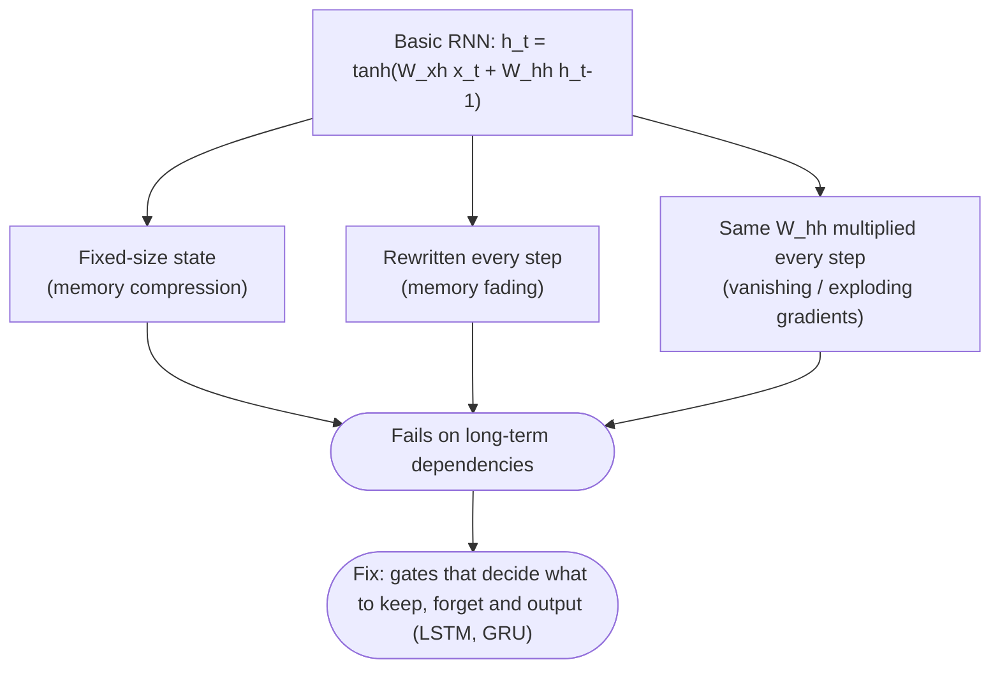

:::tip[TL;DR (30-Second Interview Pitch)]
A **many-to-one** RNN reads the whole sequence and predicts from the **final hidden state** ($\pred{y} = \param{W_{hy}}\pred{h_T} + \param{b_y}$); a **many-to-many** RNN emits an output, usually a **softmax** over the vocabulary, at **every** step. Untrained, both give random answers; training needs a loss, **full BPTT** (the gradient must reach $\param{W_{hh}}$ and every time step, not just the last one) and gradient descent, or simply `nn.RNN` + autograd. Pick the loss to match the output: **`BCEWithLogitsLoss`** for a binary label, never MSE followed by a sigmoid at prediction time. Basic RNNs then hit three walls: a **fixed-size memory** must compress the whole sequence, old information **fades** under repeated tanh updates, and gradients **vanish** ($0.5^{15} = 0.000031$) or **explode** ($1.5^{15} = 437.89$) through time. **LSTM** and **GRU** fix this with **gates** that learn what to keep, forget and output, along an additive memory path.
:::

<FormulaKey />

:::info[Where this page sits]
**Before:** [RNN Architecture, Forward Pass and BPTT](./02-rnn-architecture-forward-pass-bptt.md) derived the equations, shapes, weight sharing and backpropagation through time.
**This page:** the practical notebook (*12 RNN 3*): many-to-one and many-to-many RNNs from scratch in NumPy, training from scratch (with a corrected, gradient-checked BPTT), training `nn.RNN` in PyTorch (with a corrected loss), what the notebook's long-sequence test really shows, vanishing and exploding gradients, and why we need LSTM and GRU.
**Next:** the LSTM notebook (*13 LSTM Implementation*): the gated cell in full.
:::

## 🧭 Start Here

The last two pages were theory. This one follows the notebook's path: **practical implementation → observation → theory → limitation → LSTM/GRU intuition**.

1. **Recall** the hidden-state update with a tiny worked example.
2. Build a **many-to-one** RNN (sentiment-style: a sequence of "good"/"bad" → one label) from scratch.
3. Build a **many-to-many** RNN (next-character style: a prediction at every step) from scratch.
4. **Train** the many-to-one RNN from scratch, first with the notebook's shortcut gradient, then with full BPTT, checked against PyTorch's autograd.
5. Train a **real** `nn.RNN` in PyTorch, and fix a loss-function mistake that silently distorts its predictions.
6. **Test on longer sequences**, and see why the notebook's test can't tell whether the RNN remembers.
7. Understand **vanishing** and **exploding** gradients with numbers.
8. Summarize **why basic RNNs fail** and how **LSTM/GRU** gates fix it.

| New concept | One-line meaning |
|---|---|
| **Many-to-one** | Read the whole sequence, output one prediction from the final hidden state $\pred{h_T}$ |
| **Many-to-many** | Output a prediction at every time step from each $\pred{h_t}$ |
| **Softmax** | Turns a vector of scores into probabilities that sum to 1 |
| **Logit** | A raw, unbounded score before sigmoid/softmax |
| **`BCEWithLogitsLoss`** | Binary cross-entropy that takes logits and applies the sigmoid inside, stably |
| **Gradient check** | Comparing a hand-written gradient with autograd (or finite differences) |
| **Memory compression** | A fixed-size hidden state must summarize an arbitrarily long sequence |
| **Vanishing / exploding gradient** | The gradient shrinks towards 0 / blows up as it travels back through many steps |
| **Gradient clipping** | Rescaling a gradient whose norm is above a threshold |
| **Gate** | A learned number between 0 and 1 that controls how much information passes |
| **LSTM / GRU** | Gated recurrent cells (3 gates + a cell state / 2 gates) that keep long-term memory |

:::analogy[A basic RNN is a whiteboard, an LSTM is a whiteboard with a manager]
A basic RNN's memory is a small whiteboard that gets partly rubbed out and rewritten with every new word, whether or not the word matters. After 50 words, whatever was written first is long gone. An LSTM adds a manager who decides, at every step, which notes to keep, which to erase and which to read out, so an important note from the first word can stay on the board untouched.
:::

## 1. Quick Recall: The Hidden State Evolves

An RNN keeps a **hidden state** that acts as a running memory. At each step it reads the current input, combines it with past memory and updates the memory:

<Formula name="Hidden-state update (notebook notation)" tag="Recall" words="The new hidden state is tanh of the input-to-hidden contribution plus the hidden-to-hidden contribution plus a bias. An output, if needed, is a linear read of the hidden state." remember="Read, combine, squash, pass on.">

$$
\pred{h_t} = \tanh\big(\param{W_{xh}}\,\data{x_t} + \param{W_{hh}}\,\pred{h_{t-1}} + \param{b_h}\big), \qquad \pred{y_t} = \param{W_{hy}}\,\pred{h_t} + \param{b_y}
$$

- $\param{W_{xh}}$ ($H \times D$), $\param{W_{hh}}$ ($H \times H$), $\param{W_{hy}}$ ($O \times H$): the same matrices as $\param{W_x}, \param{W_h}, \param{W_y}$ on the previous page
- $\pred{h_{t-1}}$: carries information forward from earlier steps

**Example:** sequence length 4, input size 2, hidden size 3, no bias. The input $\data{x_1} = [1, 0]$ gives $\pred{h_1} = [0.462, 0.291, -0.537]$, and after $\data{x_4} = [1, 1]$ the state is $\pred{h_4} = [0.464, 0.878, -0.771]$.

</Formula>

The full four-step trace (the notebook's first cell, verified):

| $t$ | $\data{x_t}$ | $\pred{h_t}$ |
|---|---|---|
| 0 | — | [0, 0, 0] |
| 1 | [1, 0] | [0.462, 0.291, −0.537] |
| 2 | [0.5, 1] | [0.355, 0.733, −0.498] |
| 3 | [0, 1] | [0.114, 0.769, −0.398] |
| 4 | [1, 1] | [0.464, 0.878, −0.771] |

Two output styles come from the same recurrence: **many-to-one** (take an output only at the final step: sentiment, sequence classification) and **many-to-many** (take an output at every step: next-character prediction, POS tagging, sequence labelling).

:::tip[🎯 Interview angle]
**"What does $h_{t-1}$ do in the update?"** It injects the memory of all earlier steps into step $t$; without it each step would be processed in isolation. **"Many-to-one vs many-to-many?"** Same recurrence; the difference is only where you read outputs: once from $h_T$, or from every $h_t$.
:::

## 2. Many-to-One RNN from Scratch

**Many-to-one: the entire sequence → a single output.** Examples: sentiment classification, sequence classification, time-series classification. "I love this movie" is read word by word (I → love → this → movie), and only then is one label produced: Positive.

The model processes the sequence step by step with the usual update, and after the last step the **final hidden state** becomes the representation of the whole sequence:

<Formula name="Many-to-one output" tag="Predict from the last state" words="Run the recurrence over every input, then apply one linear layer to the final hidden state. Only one output is produced, after the whole sequence has been read." remember="Read it all, then decide once.">

$$
\pred{y} = \param{W_{hy}}\,\pred{h_T} + \param{b_y}
$$

- $\pred{h_T}$: the hidden state after the last input, a summary of the entire sequence
- Flow: sequence → hidden states → final hidden state → output

**Example:** with the notebook's random weights (seed 42), the sequence good, good, good, good ends at $\pred{h_4} = [0.290, -0.165, -0.371, 0.467]$ and gives $\pred{y} = 0.213$.

</Formula>

The notebook's toy setup: a two-word vocabulary encoded one-hot (good = [1, 0], bad = [0, 1]), hidden size 4, output size 1, small random weights. Running the **untrained** network (seed 42):

| Sequence | Output $\pred{y}$ | True label |
|---|---|---|
| good, good, good, good | 0.213 | 1 |
| bad, bad, bad, bad | 0.150 | 0 |
| good, bad, good | −0.142 | 1 |
| bad, good, bad | 0.472 | 0 |

What to observe:

- **The output comes only at the end.** The hidden states at $t = 1, 2, 3$ are computed but not read out.
- **Same start, same first state.** "good, good, good, good" and "good, bad, good" both begin with "good", so both have $\pred{h_1} = [0.243, 0.313, -0.117, 0.658]$. They diverge from $t = 2$ as their inputs differ. The state is a function of the *prefix* seen so far.
- **The state never grows.** Whether the sequence has 3 or 4 words (or 400), $\pred{h_t}$ has 4 numbers; a longer sequence means more updates, not a bigger state. The state keeps changing with each input, and earlier inputs have been mixed through more tanh updates.
- **The outputs are meaningless**: the weights are random, so the predictions don't match the labels (good, bad, good scores lowest). Nothing has been learned yet; that's Chapter 4.

:::tip[🎯 Interview angle]
**"Why use the final hidden state for classification?"** It is the only state that has seen the **entire** sequence; it acts as a learned, fixed-size summary. Alternatives worth naming: **mean/max pooling** over all $h_t$ (less biased towards the end of the sequence), concatenating forward and backward final states in a **bidirectional** RNN, or **attention pooling**.
:::

## 3. Many-to-Many RNN from Scratch

**Many-to-many: an input sequence → an output at every time step.** Examples: next-character or next-token prediction, part-of-speech tagging, sequence labelling. Instead of waiting for the end, the model produces an output after every input:

$$
\data{x_1} \to \pred{h_1} \to \pred{y_1}, \qquad \data{x_2} \to \pred{h_2} \to \pred{y_2}, \qquad \data{x_3} \to \pred{h_3} \to \pred{y_3}, \;\ldots
$$

For next-character prediction each $\pred{y_t}$ is a vector of scores, one per character, turned into probabilities by softmax:

<Formula name="Per-step softmax" tag="A distribution at every step" words="At each time step, turn the output scores into probabilities that are positive and sum to 1. The most probable symbol is the prediction for this step, typically the next character." remember="Scores in, probabilities out, every step.">

$$
\pred{p_t} = \operatorname{softmax}(\pred{y_t}), \qquad \pred{p_{t,i}} = \frac{e^{\pred{y_{t,i}}}}{\sum_j e^{\pred{y_{t,j}}}}
$$

- $\pred{y_t} = \param{W_{hy}}\pred{h_t} + \param{b_y}$: one score per vocabulary symbol
- Prediction: $\arg\max_i \pred{p_{t,i}}$; subtract $\max(\pred{y_t})$ before exponentiating for numerical stability (the result is unchanged)

**Example:** at step 1 (input A) the notebook's untrained model gives $\pred{p_1} = [0.486, 0.232, 0.282]$ over A, B, C, so it predicts A.

</Formula>

The notebook's toy: vocabulary \{A, B, C\} one-hot, input sequence A, B, C, A, hidden size 4, seed 7, untrained:

| $t$ | Input | $P(A), P(B), P(C)$ | Predicted |
|---|---|---|---|
| 1 | A | 0.486, 0.232, 0.282 | A |
| 2 | B | 0.259, 0.442, 0.299 | B |
| 3 | C | 0.462, 0.272, 0.265 | A |
| 4 | **A** | 0.331, 0.195, 0.474 | **C** |

What to observe:

1. **The hidden state keeps evolving** through time, and **an output is produced at every step**.
2. **Later outputs depend on earlier inputs.** The input at $t = 1$ and $t = 4$ is the same token A, yet the predictions differ (A vs C), because $\pred{h_4}$ also carries the memory of B and C. That's the whole point of recurrence.
3. Many-to-many is more expressive than many-to-one for **sequence generation and labelling**: it gives a training signal at every position.

This is not yet a language model: the weights are random, and a real next-character model is trained with **cross-entropy** between $\pred{p_t}$ and the actual next character at every step, i.e. the target sequence is the input shifted by one (input "ABC" → targets "BCA").

:::analogy[Many-to-many is a live sports commentator]
A commentator speaks after every play, not just at the end of the match. What they say about the current play depends on the whole game so far: the same pass gets a very different call at 0–0 in the first minute than at 2–2 in injury time. Many-to-one is the newspaper journalist who writes a single verdict after the final whistle.
:::

:::tip[🎯 Interview angle]
**"Why can a many-to-many RNN do next-token prediction?"** It outputs a softmax distribution at every step, conditioned on all tokens so far through $h_t$; trained with cross-entropy against the input shifted by one, it learns $P(x_{t+1} \mid x_1, \ldots, x_t)$. **"Does $h_t$ depend only on $x_t$?"** No: on $x_1 \ldots x_t$, which is why a repeated token can get a different prediction.
:::

## 4. Training an RNN from Scratch

So far the predictions were random because the weights were random and **no learning happened**. Training needs four components: a **loss function**, a **forward pass**, a **backward pass** and a **weight update**.

| # | Step | Equation |
|---|---|---|
| 1 | Forward pass through time | $\pred{h_t} = \tanh(\param{W_{xh}}\data{x_t} + \param{W_{hh}}\pred{h_{t-1}} + \param{b_h})$ |
| 2 | Final prediction (many-to-one) | $\pred{y} = \param{W_{hy}}\pred{h_T} + \param{b_y}$ |
| 3 | Loss | $\loss{L} = (\pred{y} - \data{y_{\text{true}}})^2$ |
| 4 | Backward pass (BPTT) | $\loss{\nabla W}$ for every weight, through every time step |
| 5 | Update | $\param{W} \leftarrow \param{W} - \hyper{\eta}\,\loss{\nabla W}$ |

<Formula name="Squared-error loss and gradient descent" tag="Learn from the error" words="The loss is the squared distance between the prediction and the target. Each weight then moves a small step against its gradient, with the learning rate setting the step size." remember="Measure the miss, step downhill.">

$$
\loss{L} = (\pred{y} - \data{y_{\text{true}}})^2, \qquad \frac{\partial \loss{L}}{\partial \pred{y}} = 2(\pred{y} - \data{y_{\text{true}}}), \qquad \param{W} \leftarrow \param{W} - \hyper{\eta}\,\frac{\partial \loss{L}}{\partial \param{W}}
$$

- $\hyper{\eta}$: the learning rate (0.01 in the notebook)
- The gradient reaches $\param{W_{hy}}$ directly and reaches $\param{W_{hh}}$, $\param{W_{xh}}$, $\param{b_h}$ through every time step (BPTT)

**Example:** the untrained model outputs 0.213 for a positive sequence, so $\loss{L} = (0.213 - 1)^2 = 0.619$ and $\partial \loss{L} / \partial \pred{y} = -1.574$: increase the output.

</Formula>

**What the notebook's training loop actually does.** Its backward pass is a shortcut: it computes the gradient for $\param{W_{hy}}$ correctly, but for $\param{W_{xh}}$ it uses only the **last** time step's input and never updates $\param{W_{hh}}$ or the biases at all:

```python title="❌ The notebook's shortcut gradient (not BPTT)"
dW_hy = dy @ states[-1].T
dh = W_hy.T @ dy
dtanh = (1 - states[-1] ** 2) * dh
# error-start
dW_xh = dtanh @ word_to_vec[sequence[-1]].T        # ❌ last step only
W_hy -= learning_rate * dW_hy
W_xh -= learning_rate * dW_xh                       # ❌ W_hh and b_h never updated
# error-end
```

It still reduces the loss on this toy (the last word happens to equal the label in every training sequence), but **it isn't training a recurrent network**: the recurrent weights $\param{W_{hh}}$ never change, so the model can't learn anything about order or memory. Full BPTT walks back through every step, accumulating the gradient of each shared weight (implementation block 3). Its gradients match PyTorch's autograd to $2.2 \times 10^{-16}$ (float64 rounding).

Same data, same initial weights (seed 1), learning rate 0.01, 50 epochs:

| | Epoch 1 | Epoch 10 | Epoch 25 | Epoch 50 | Predictions (labels 1, 0, 1, 0) |
|---|---|---|---|---|---|
| Notebook shortcut | 1.9237 | 0.4715 | 0.0779 | 0.0165 | 0.965, −0.089, 0.942, 0.056 |
| **Full BPTT** | 1.9757 | 0.3262 | 0.0447 | **0.0080** | 1.010, −0.043, 0.954, 0.053 |

What to observe: the **loss falls steadily** (learning is happening), the **predictions move towards the labels**, and full BPTT reaches about half the loss because it trains every weight. Training runs for **many epochs** because each update moves the weights only a small step ($\hyper{\eta} = 0.01$); the learning rate controls that step size (too large and the loss oscillates or diverges, too small and training crawls).

:::danger[Interview Trap: "My from-scratch RNN learns, so my gradients are right"]
A wrong gradient can still lower the loss, as the notebook's shortcut shows. The only reliable test is a **gradient check**: compare your gradients with autograd or with finite differences, $\frac{L(W + \epsilon) - L(W - \epsilon)}{2\epsilon}$, on a tiny example. Agreement to ~$10^{-7}$ (float32) or ~$10^{-12}$ (float64) means the backward pass is right.
:::

:::tip[🎯 Interview angle]
**"Implement backprop for an RNN."** Store all $h_t$ in the forward pass. Start with $\partial L / \partial y$; get $\partial L / \partial W_{hy}$ and $dh_T = W_{hy}^\top \partial L / \partial y$. Then for $t = T \ldots 1$: $da_t = (1 - h_t^2) \odot dh_t$; accumulate $dW_{xh} \mathrel{+}= da_t x_t^\top$, $dW_{hh} \mathrel{+}= da_t h_{t-1}^\top$, $db_h \mathrel{+}= da_t$; pass back $dh_{t-1} = W_{hh}^\top da_t$ (plus any loss gradient at step $t-1$). Verify with a gradient check.
:::

## 5. Training a Real RNN with PyTorch

Writing loops and gradients by hand is great for understanding, but in practice you use `nn.RNN`: an efficient implementation, **automatic** backpropagation (autograd does BPTT for you), GPU support and stable kernels. The many-to-one sentiment model:

| # | Step | PyTorch |
|---|---|---|
| 1 | Words → ids → vectors | `nn.Embedding(2, 4)` |
| 2 | Run the RNN | `nn.RNN(4, 8, batch_first=True)` |
| 3 | Take the final hidden state | `hidden.squeeze(0)` |
| 4 | Linear layer → one score | `nn.Linear(8, 1)` |
| 5 | Loss | `nn.BCEWithLogitsLoss()` (see below) |
| 6 | Backprop | `loss.backward()` |
| 7 | Update | `optimizer.step()` (Adam, lr 0.01) |

**The loss must match the output.** The notebook trains the model with **MSE** on the raw output (so it learns to output exactly 1.0 for positive and 0.0 for negative), then at prediction time passes that output through a **sigmoid**. But $\sigma(1) = 0.731$ and $\sigma(0) = 0.5$, so after training, every "positive" prediction shows up as 0.731 and every "negative" one as 0.5. The model is right, but the reported probabilities are wrong, and a 0.5 threshold misclassifies every negative.

<Formula name="Binary cross-entropy with logits" tag="The right loss for a yes/no label" words="Treat the model's raw score as a logit, turn it into a probability with the sigmoid, and penalise the log of the probability given to the true class. The fused version applies the sigmoid inside the loss in a numerically stable way." remember="Logit in, sigmoid inside, log loss.">

$$
\loss{L} = -\big[\data{y}\,\log \sigma(\pred{z}) + (1 - \data{y})\,\log\big(1 - \sigma(\pred{z})\big)\big], \qquad \sigma(\pred{z}) = \frac{1}{1 + e^{-\pred{z}}}
$$

- $\pred{z}$: the model's raw output (logit); $\data{y} \in \{0, 1\}$: the label
- `nn.BCEWithLogitsLoss` takes $\pred{z}$ directly; apply `torch.sigmoid` only when you want a probability out

**Example:** after training with this loss, the four training sequences get logits 6.075, −6.056, 6.015, −5.976, i.e. probabilities 0.998, 0.002, 0.998, 0.003: confident and correct.

</Formula>

| | Loss at epoch 0 → 99 | Training outputs | Reported as probability |
|---|---|---|---|
| ❌ Notebook: MSE, sigmoid at prediction | 2.2086 → 0.0000 | raw 1.0, 0.0, 1.0, −0.0 | 0.731, 0.5, 0.731, 0.5 |
| ✅ `BCEWithLogitsLoss` | 3.0452 → 0.0097 | logits 6.075, −6.056, 6.015, −5.976 | 0.998, 0.002, 0.998, 0.003 |

Both fit the four training sequences. The loss values aren't comparable across the two rows (different loss functions); what matters is that the second model's outputs are genuine probabilities.

:::tip[🎯 Interview angle]
**"Which loss for binary sequence classification, and why not MSE + sigmoid?"** `BCEWithLogitsLoss` on the raw logit: it is the maximum-likelihood loss for a Bernoulli label, gives strong gradients when the model is confidently wrong, and is numerically stable (log-sum-exp inside). MSE treats the label as a regression target, and applying a sigmoid at inference to a model that never saw one during training distorts every probability. For multi-class: `CrossEntropyLoss` on logits (it includes the softmax).
:::

## 6. Testing on Longer Sequences: What the Experiment Really Shows

The notebook then asks: **can the RNN remember long sequences?** It tests the trained model on 7-word sequences it never saw, expecting, for example, "good, bad, bad, bad, bad, bad, good" to be positive "because the first and last words are good". The model (MSE version) reports 0.72, 0.517, 0.496 and 0.731, and the notebook reads the uncertain-looking numbers as memory failure.

Reproduced exactly, and looked at more carefully:

| Test sequence | MSE model: raw output | → sigmoid (notebook) | BCE model: probability |
|---|---|---|---|
| good, bad × 5, good | 0.945 | 0.72 | 0.062 |
| bad, good × 5, bad | 0.069 | 0.517 | 0.961 |
| good, bad × 6 | −0.016 | 0.496 | 0.002 |
| bad, good × 6 | 1.000 | 0.731 | 0.998 |

Two lessons, both more important than the notebook's conclusion:

- **The "uncertainty" was the sigmoid bug.** The MSE model's raw outputs are confident (0.945, 0.069, −0.016, 1.0); squashing them through a sigmoid it was never trained with turned them into numbers around 0.5–0.73.
- **The test can't measure memory, because the training data is ambiguous.** In all four training sequences the label equals the **first** word, the **last** word *and* the **majority** word. Any of those rules fits the data perfectly, so the model is free to learn whichever is easiest. The MSE model learned "**last** word" (its raw outputs follow the last word exactly); the BCE model learned "**majority**" (good, bad × 5, good → 0.062, mostly bad). Neither failed; they answered a question the training set never asked.

To actually test long-term memory, the label must depend on something **far back** and **only** on that, with distractors in between (e.g. the label is the first token, followed by $L$ random tokens), and you compare accuracy as $L$ grows. Even then results on tiny models vary with initialization and training budget. The cleaner evidence is the gradient measurement from the previous page: with $\param{W_{hh}}$ at scale 0.5, the gradient reaching step 1 of a 20-step sequence is 600,000× smaller than at step 20, so the early steps receive almost no learning signal.

Still, the notebook's underlying point is right: **hidden states do not perfectly remember the past.** Every step rewrites the state, earlier information is diluted through more and more tanh updates, and as sequences grow the gradients that should teach the model to keep old information vanish. That is the **long-term dependency problem**.

:::danger[Interview Trap: "The model got the long test wrong, so it can't remember"]
First rule out **ambiguous training data** (several rules fit the labels), a **train/inference mismatch** (MSE training + sigmoid inference, different preprocessing), and **distribution shift** (7-word test, 3-word training). Only a controlled task, where the label depends solely on a distant token, isolates memory.
:::

:::tip[🎯 Interview angle]
**"How would you test whether an RNN captures long-range dependencies?"** Build a synthetic task where the label depends only on an early token (copy/recall, adding problem, delayed XOR), sweep the gap length, and plot accuracy versus distance; also measure $\lVert \partial L / \partial h_t \rVert$ across time. Compare against an LSTM/GRU and a Transformer on the same task.
:::

## 7. Vanishing Gradients

We observed that long sequences are hard and early information fades. **Why?** The RNN updates its hidden state again and again, so information from step 1 must pass through many transformations to reach step $T$. Training has the mirror-image problem: the gradient must travel back through the same chain, and each step **multiplies** it by a factor.

Intuition with numbers: multiply by 0.5 repeatedly. $0.5 \times 0.5 \times 0.5 \times 0.5 \times 0.5 = 0.03125$, and after 15 steps it is 0.000031. An RNN behaves the same way when its per-step factor (roughly the size of $\param{W_{hh}}$ times tanh's slope) is below 1.

<Formula name="Repeated multiplication" tag="Why gradients vanish or explode" words="If the gradient is scaled by roughly the same factor at every step back, after k steps it has been scaled by that factor to the power k. Below one it shrinks exponentially, above one it grows exponentially." remember="Factor to the power of distance.">

$$
\loss{g_{T-k}} \approx \hyper{\gamma}^{\,k}\,\loss{g_T}, \qquad \hyper{\gamma} \approx \big\lVert \operatorname{diag}(1 - \pred{h}^2)\,\param{W_{hh}} \big\rVert
$$

- $\loss{g_T}$: the gradient at the last step; $\loss{g_{T-k}}$: the gradient $k$ steps back
- $\hyper{\gamma} < 1$: vanishing; $\hyper{\gamma} > 1$: exploding

**Example:** $\hyper{\gamma} = 0.5$: $0.5^{5} = 0.03125$, $0.5^{10} = 0.000977$, $0.5^{15} = 0.000031$. $\hyper{\gamma} = 1.5$: $1.5^{5} = 7.59$, $1.5^{10} = 57.67$, $1.5^{15} = 437.89$.

</Formula>

<Animation src="rnn/vanishing-exploding" caption="Two gradients start at 1 and are multiplied once per step back in time, on a log scale. Watch the 0.5 line fall to 0.000031 and the 1.5 line climb to 437.89 after 15 steps." />

| Steps back | 1 | 5 | 10 | 15 |
|---|---|---|---|---|
| $0.5^k$ | 0.5 | 0.03125 | 0.000977 | 0.000031 |
| $1.5^k$ | 1.5 | 7.5938 | 57.665 | 437.8939 |

**What happens when the gradient is near zero?** The weight updates driven by early time steps are near zero, so **learning slows down** and the model never learns to use information from far back: **memory fading**, **learning difficulty**, **long-term dependency failure**. Long sequences suffer more simply because there are more factors in the product. Note that the model still *trains*: short-range patterns (few factors) get healthy gradients, so the loss goes down while long-range patterns are silently ignored.

:::tip[🎯 Interview angle]
**"What is the vanishing gradient problem in RNNs?"** In BPTT the gradient to step $k$ is a product of $T - k$ Jacobians $\text{diag}(1 - h^2) W_{hh}$; when their norms are below 1 it shrinks exponentially with distance, so early steps get almost no signal and long-term dependencies aren't learned. tanh's slope ($\le 1$, near 0 when saturated) makes it worse. Fixes: LSTM/GRU, orthogonal init, skip connections, attention.
:::

## 8. Exploding Gradients

The opposite case: if each step back multiplies the gradient by a factor **above 1** ($1.5 \times 1.5 \times 1.5 \times 1.5 \times 1.5 = 7.59$), it grows very fast: 437.89 after 15 steps. That is the **exploding gradient problem**.

Consequences:

- **Very large gradients** → enormous weight updates in a single step.
- **Unstable training**: sudden **loss spikes**, the model **diverges**, the loss becomes `inf`, and the weights become `NaN`.

It is commonly observed in RNN training, but it is **not only an RNN problem**: any very deep network (deep MLPs, deep CNNs without normalization or residual connections) multiplies gradients through many layers and can explode or vanish. RNNs are especially prone because the *same* matrix $\param{W_{hh}}$ is multiplied in at every step, so if it amplifies, it amplifies consistently.

The standard fix is **gradient clipping**: if the gradient's norm exceeds a threshold, rescale it to the threshold, keeping its direction. In PyTorch: `torch.nn.utils.clip_grad_norm_(model.parameters(), max_norm=1.0)` between `loss.backward()` and `optimizer.step()`. Clipping fixes **exploding** gradients but does nothing for **vanishing** ones.

| | **Vanishing** | **Exploding** |
|---|---|---|
| Per-step factor | < 1 | > 1 |
| Symptom | Loss plateaus; model ignores distant context; early-layer/time-step gradients ≈ 0 | Loss spikes, `inf`/`NaN`, weights blow up |
| Easy to notice? | **No** (training looks fine) | **Yes** (training breaks) |
| Main fixes | LSTM/GRU, orthogonal init, attention, skip connections | **Gradient clipping**, smaller learning rate, careful init |

:::analogy[Gradients through time are a whispering game]
In the telephone game, a message passes down a line of people. If each person whispers a bit too quietly, the message fades to nothing by the end of the line (vanishing). If each one exaggerates a little, it turns into a wild, distorted shout (exploding). A long line makes either problem worse. LSTM gives the line a written note that can be passed along unchanged.
:::

:::tip[🎯 Interview angle]
**"How do you detect and fix exploding gradients?"** Detect: loss spikes or `NaN`s; log the global gradient norm each step. Fix: **gradient-norm clipping** (`clip_grad_norm_`, max norm 1–5), a lower learning rate, better initialization (orthogonal $W_{hh}$), and gated cells. **"Only in RNNs?"** No, any deep network, but RNNs are prone because the same $W_{hh}$ is applied at every step.
:::

## 9. Why the Basic RNN Fails

Summing up the observations: a basic RNN works well for **short** sequences, struggles with **long** ones, its **memory fades** over time, and its **gradients vanish or explode**. Three underlying problems:

**Problem 1: memory compression.** The hidden state has a **fixed size**. With hidden size 8 and a sequence of 50 steps, the model must compress 50 time steps into 8 numbers. Some information is inevitably lost, and the model has no mechanism to decide *which* information to protect.

**Problem 2: memory fading.** The state is transformed again and again by $\pred{h_t} = f(\pred{h_{t-1}})$. With no new input and a contracting update, a state shrinks to almost nothing. The notebook's demo applies $\tanh(0.5\,\pred{h})$ ten times to a random 4-number state: [1.764, 0.400, 0.979, 2.241] becomes [0.00131, 0.00038, 0.00087, 0.00147]. Early information disappears because it has to survive every later update.

**Problem 3: gradient problems.** In training, the gradient flows back $\pred{h_T} \to \pred{h_{T-1}} \to \pred{h_{T-2}} \to \ldots$, and the repeated multiplication makes it vanish or explode (Chapters 7–8).

**Result:** basic RNNs struggle with long-term dependencies, long sequences and complex patterns. Example: "The movie was boring at first but became amazing later" is positive, and so is "The movie was horrible in the first half but the latter half was good". A model that only learned short-range patterns, or whose memory is dominated by a strong early word, may latch onto "boring" or "horrible". The model needs to **keep** the contrast word "but" and **weight** the later clause, which means controlling memory, not just accumulating it.



:::tip[🎯 Interview angle]
**"Why isn't a basic RNN sufficient?"** A fixed-size state must summarize everything (**compression**), every step overwrites it with no control (**fading**), and BPTT multiplies by the same $W_{hh}$ at every step (**vanishing/exploding gradients**). So it handles short dependencies but not long ones. LSTM/GRU add gates and an additive memory path.
:::

## 10. Why We Need LSTM and GRU

Can we design a better memory? A better model should:

1. **remember** important information,
2. **forget** unimportant information,
3. **update** memory intelligently.

The basic RNN can't do any of this selectively. Its update $\pred{h_t} = \tanh(\param{W}\data{x} + \param{U}\pred{h})$ treats everything equally: no control over memory, no selective remembering. Human memory works differently: you don't remember everything; you keep what's important, forget what isn't, and update when needed. We want networks to behave the same way.

**The solution: gated memory.** Instead of a simple memory update, use a **controlled** one. A **gate** is a vector of numbers between 0 and 1 (a sigmoid output) that is multiplied element-wise into a signal: 1 lets it through, 0 blocks it. The gates are computed from the current input and the previous state, so the model **learns** when to remember, forget and update.

**LSTM** (Long Short-Term Memory) introduces a separate **memory cell** $\pred{c_t}$ plus three gates:

| Gate | Question it answers |
|---|---|
| **Forget gate** $\pred{f_t}$ | How much of the old cell memory to keep? |
| **Input gate** $\pred{i_t}$ | How much of the new candidate information to write? |
| **Output gate** $\pred{o_t}$ | How much of the cell to expose as the hidden state? |

The crucial equation is the cell-state update. It is **additive**, not a repeated matrix multiplication:

<Formula name="LSTM cell-state update (preview)" tag="Gated, additive memory" words="The new cell memory is the old memory scaled by the forget gate, plus new candidate information scaled by the input gate. Because the old memory is only scaled, not pushed through a weight matrix and tanh, it can survive many steps." remember="Keep some old, add some new.">

$$
\pred{c_t} = \pred{f_t} \odot \pred{c_{t-1}} + \pred{i_t} \odot \pred{\tilde c_t}, \qquad \frac{\partial \pred{c_t}}{\partial \pred{c_{t-1}}} \approx \operatorname{diag}(\pred{f_t})
$$

- $\pred{f_t}, \pred{i_t} \in (0, 1)$: sigmoid gates computed from $\data{x_t}$ and $\pred{h_{t-1}}$; $\pred{\tilde c_t}$: candidate memory (a tanh layer)
- $\odot$: element-wise multiplication; the hidden state is $\pred{h_t} = \pred{o_t} \odot \tanh(\pred{c_t})$
- The gradient along the cell path is multiplied only by the forget gate, which the model can learn to keep near 1

**Example:** a signal carried for 20 steps keeps $0.95^{20} = 0.358$ of its size with a forget gate of 0.95, but only $0.5^{20} = 9.54 \times 10^{-7}$ if multiplied by 0.5 each step as in the vanishing RNN.

</Formula>

<Animation src="rnn/gated-memory" caption="Two memories are carried for 20 steps. Watch the plain RNN path, multiplied by 0.5 each step, vanish to 0.000000954, while the gated path with a forget gate of 0.95 still holds 0.358." />

The notebook's "smart memory" simulation mimics this with random gates: memory = memory × forget gate (0.7–1.0) + input gate (0.0–0.3). Seeded for reproducibility, the memory is 1.08 after step 1, 1.30 after step 5 and 1.21 after step 10: instead of fading, it holds steady, because the forget gate keeps most of the old value and the input gate tops it up.

**GRU** (Gated Recurrent Unit) is a simpler version with two gates and no separate cell:

| Gate | Role |
|---|---|
| **Update gate** $\pred{z_t}$ | How much of the old state to keep vs replace with the new candidate: $\pred{h_t} = (1 - \pred{z_t}) \odot \pred{h_{t-1}} + \pred{z_t} \odot \pred{\tilde h_t}$ (PyTorch's convention swaps the roles of $z$ and $1 - z$) |
| **Reset gate** $\pred{r_t}$ | How much of the old state to use when computing the candidate |

| | **Basic RNN** | **LSTM** | **GRU** |
|---|---|---|---|
| Memory | Simple: $\pred{h_t}$ only | Smart: cell $\pred{c_t}$ + hidden $\pred{h_t}$ | Smart: $\pred{h_t}$ with gated interpolation |
| Gates | None | 3 (forget, input, output) | 2 (update, reset) |
| Parameters (same $H$, $D$) | $1\times$ | $4\times$ | $3\times$ |
| Long-term dependencies | Poor | Good | Good |
| Speed | Fastest | Slowest | In between; often performs similarly to LSTM |

**Key insight:** basic RNN = **simple** memory; LSTM/GRU = **smart** memory. The next notebook covers the LSTM architecture, intuition and equations in full, GRU, and an implementation. This completes the **basic RNN → LSTM** transition.

:::analogy[The forget gate is a fridge clear-out]
Every evening you decide what stays in the fridge (forget gate), what new groceries go in (input gate) and what you take out for dinner (output gate). Good food can stay for days, untouched, while yesterday's leftovers get thrown out. A basic RNN instead empties half of everything into a blender every evening and adds today's shopping: by Friday, nothing from Monday is recognizable.
:::

:::tip[🎯 Interview angle]
**"How does an LSTM solve the vanishing gradient problem?"** Its cell state is updated **additively**, $c_t = f_t \odot c_{t-1} + i_t \odot \tilde c_t$, so the gradient along the cell path is multiplied by the **forget gate** (element-wise, learnable, can stay ≈ 1) instead of by $W_{hh}$ and a tanh slope at every step. The gates learn what to keep, write and expose. **"LSTM vs GRU?"** GRU merges the cell and hidden state and uses 2 gates (3× RNN params vs 4×): faster, often equally accurate; LSTM can be better on very long or complex dependencies.
:::

## ⚙️ Going Deeper (Training Practice)

**Teacher forcing.** When training a many-to-many generator, feed the **true** previous token as the next input, not the model's own prediction. Training is faster and stable, but at inference the model must consume its own (possibly wrong) outputs, a mismatch called **exposure bias**. Scheduled sampling gradually mixes in the model's predictions during training.

**Sampling from a next-token model.** Greedy argmax tends to repeat itself. Sample from $\operatorname{softmax}(\pred{y_t} / \hyper{\tau})$ with a **temperature** $\hyper{\tau}$ (below 1 = safer, above 1 = more random), or restrict to the top-$k$ / top-$p$ tokens.

**Loss choices.** Binary: `BCEWithLogitsLoss` on logits. Multi-class per sequence or per step: `CrossEntropyLoss` on logits (it applies log-softmax itself, so don't apply softmax first). Regression/forecasting: `MSELoss` or `L1Loss`/Huber for robustness to outliers. Mask padded positions out of a per-step loss (`ignore_index` for the pad id).

**Detecting vanishing gradients in practice.** Log per-layer gradient norms, and for RNNs the norm of $\partial \loss{L} / \partial \pred{h_t}$ at several $t$ (as on the previous page). A healthy model has comparable norms across time; a vanishing one shows exponential decay going back.

**Initialization tricks.** Orthogonal $\param{W_{hh}}$ for vanilla RNNs; for LSTMs, set the **forget-gate bias to 1** (Jozefowicz et al., 2015) so the cell starts out remembering, which noticeably helps long dependencies.

**Parameter counts.** For input size $D$ and hidden size $H$: `nn.RNN` has $HD + H^2 + 2H$, `nn.GRU` has $3(HD + H^2 + 2H)$, `nn.LSTM` has $4(HD + H^2 + 2H)$: one set of weights per gate plus the candidate.

**When to still use an RNN/LSTM today.** Streaming and on-device inference (constant memory per step), small time-series problems, and as a baseline. For most NLP, Transformers (attention) win because every position connects directly to every other, with no long multiplicative chain, and training parallelizes across time.

## 💻 Python Implementation

:::tip[Run it yourself]
Verified on Python 3.13 with NumPy 2.5 and PyTorch 2.15 (CPU). Outputs are copied from real runs into the trailing comments. The NumPy blocks use the notebook's seeds, so their numbers match the notebook exactly.
:::

### 1. Many-to-one forward pass (untrained)

The final hidden state feeds a single output. Sequences that start with the same word share their first hidden state.

```python title="many_to_one.py" showLineNumbers
import numpy as np
np.set_printoptions(precision=3, suppress=True)
np.random.seed(42)

word_to_vec = {"good": np.array([[1.0], [0.0]]), "bad": np.array([[0.0], [1.0]])}
dataset = [(["good", "good", "good", "good"], 1), (["bad", "bad", "bad", "bad"], 0),
           (["good", "bad", "good"], 1), (["bad", "good", "bad"], 0)]

input_size, hidden_size, output_size = 2, 4, 1
W_xh = np.random.randn(hidden_size, input_size) * 0.5
W_hh = np.random.randn(hidden_size, hidden_size) * 0.5
W_hy = np.random.randn(output_size, hidden_size) * 0.5
b_h, b_y = np.zeros((hidden_size, 1)), np.zeros((output_size, 1))

def forward(sequence):
    h = np.zeros((hidden_size, 1))
    states = []
    for word in sequence:
        h = np.tanh(W_xh @ word_to_vec[word] + W_hh @ h + b_h)
        states.append(h)
    # highlight-next-line
    y = W_hy @ h + b_y                                  # one output, from the final state only
    return y, states

for sequence, label in dataset:
    y, states = forward(sequence)
    print(sequence, round(y.item(), 3), label)
# ['good', 'good', 'good', 'good'] 0.213 1
# ['bad', 'bad', 'bad', 'bad'] 0.15 0
# ['good', 'bad', 'good'] -0.142 1
# ['bad', 'good', 'bad'] 0.472 0      untrained: outputs don't match labels

_, s1 = forward(["good", "good", "good", "good"])
_, s2 = forward(["good", "bad", "good"])
print(s1[0].ravel(), s2[0].ravel())                     # [ 0.243  0.313 -0.117  0.658] [ 0.243  0.313 -0.117  0.658]
```

### 2. Many-to-many forward pass: a softmax at every step

The repeated token A gets a different prediction at $t = 4$ than at $t = 1$, because $\pred{h_4}$ remembers B and C.

```python title="many_to_many.py" showLineNumbers
import numpy as np
np.set_printoptions(precision=3, suppress=True)
np.random.seed(7)

char_to_vec = {"A": np.array([[1.0], [0.0], [0.0]]),
               "B": np.array([[0.0], [1.0], [0.0]]),
               "C": np.array([[0.0], [0.0], [1.0]])}
idx_to_char = {0: "A", 1: "B", 2: "C"}

input_size, hidden_size, output_size = 3, 4, 3
W_xh = np.random.randn(hidden_size, input_size) * 0.4
W_hh = np.random.randn(hidden_size, hidden_size) * 0.4
W_hy = np.random.randn(output_size, hidden_size) * 0.4
b_h, b_y = np.zeros((hidden_size, 1)), np.zeros((output_size, 1))

def softmax(z):
    e = np.exp(z - np.max(z))                           # subtract the max: same result, no overflow
    return e / e.sum()

h = np.zeros((hidden_size, 1))
for t, token in enumerate(["A", "B", "C", "A"], start=1):
    h = np.tanh(W_xh @ char_to_vec[token] + W_hh @ h + b_h)
    # highlight-next-line
    p = softmax(W_hy @ h + b_y)                         # an output at every step
    print(t, token, p.ravel(), idx_to_char[int(np.argmax(p))])
# 1 A [0.486 0.232 0.282] A
# 2 B [0.259 0.442 0.299] B
# 3 C [0.462 0.272 0.265] A
# 4 A [0.331 0.195 0.474] C       same input as t=1, different prediction
```

### 3. ✅ Training from scratch with full BPTT

The corrected version of the notebook's training loop: every weight gets its gradient, accumulated over every time step.

```python title="train_bptt_numpy.py" showLineNumbers
import numpy as np

word_to_vec = {"good": np.array([[1.0], [0.0]]), "bad": np.array([[0.0], [1.0]])}
dataset = [(["good", "good", "good"], 1), (["bad", "bad", "bad"], 0),
           (["good", "bad", "good"], 1), (["bad", "good", "bad"], 0)]
H = 4

def init():
    np.random.seed(1)
    return {"W_xh": np.random.randn(H, 2) * 0.5, "W_hh": np.random.randn(H, H) * 0.5,
            "W_hy": np.random.randn(1, H) * 0.5, "b_h": np.zeros((H, 1)), "b_y": np.zeros((1, 1))}

def forward(P, seq):
    xs, hs = [], [np.zeros((H, 1))]
    for w in seq:
        xs.append(word_to_vec[w])
        hs.append(np.tanh(P["W_xh"] @ xs[-1] + P["W_hh"] @ hs[-1] + P["b_h"]))
    return xs, hs, P["W_hy"] @ hs[-1] + P["b_y"]

def bptt(P, seq, label):
    xs, hs, y = forward(P, seq)
    dy = 2 * (y - label)                                  # d/dy of (y - label)^2
    G = {k: np.zeros_like(v) for k, v in P.items()}
    G["W_hy"], G["b_y"] = dy @ hs[-1].T, dy
    dh = P["W_hy"].T @ dy                                 # gradient arriving at h_T
    # highlight-start
    for t in reversed(range(len(xs))):                    # walk back through time
        da = (1 - hs[t + 1] ** 2) * dh                    # through tanh
        G["W_xh"] += da @ xs[t].T                         # accumulate: shared weights
        G["W_hh"] += da @ hs[t].T
        G["b_h"] += da
        dh = P["W_hh"].T @ da                             # pass to h_{t-1}
    # highlight-end
    return ((y - label) ** 2).item(), G

P, lr = init(), 0.01
for epoch in range(1, 51):
    total = 0.0
    for seq, label in dataset:
        loss, G = bptt(P, seq, label)
        for k in P:
            P[k] -= lr * G[k]
        total += loss
    if epoch in (1, 10, 25, 50):
        print(epoch, round(total, 4))                     # 1 1.9757 · 10 0.3262 · 25 0.0447 · 50 0.008
print([round(forward(P, s)[2].item(), 3) for s, _ in dataset])   # [1.01, -0.043, 0.954, 0.053]
```

### 4. Gradient check against PyTorch autograd

Same weights in float64, same sequence: the hand-written BPTT gradients agree with autograd to rounding error.

```python title="gradient_check.py" showLineNumbers
import numpy as np
import torch
# (reuses word_to_vec, H, init and bptt from train_bptt_numpy.py)

P = init()
_, G = bptt(P, ["good", "bad", "good"], 1)

T = {k: torch.tensor(v, requires_grad=True) for k, v in P.items()}
h = torch.zeros(H, 1, dtype=torch.float64)
for w in ["good", "bad", "good"]:
    h = torch.tanh(T["W_xh"] @ torch.tensor(word_to_vec[w]) + T["W_hh"] @ h + T["b_h"])
((T["W_hy"] @ h + T["b_y"] - 1) ** 2).sum().backward()

# highlight-next-line
print(max(np.abs(G[k] - T[k].grad.numpy()).max() for k in P))    # 2.220446049250313e-16
```

### 5. ❌ MSE + sigmoid vs ✅ `BCEWithLogitsLoss` in PyTorch

The notebook's model and data, trained twice. The MSE run reproduces the notebook's long-sequence numbers exactly.

```python title="train_nn_rnn.py" showLineNumbers
import torch
import torch.nn as nn
import torch.optim as optim

word_to_idx = {"good": 0, "bad": 1}
dataset = [(["good", "good", "good"], 1), (["bad", "bad", "bad"], 0),
           (["good", "bad", "good"], 1), (["bad", "good", "bad"], 0)]
encode = lambda seq: torch.tensor([word_to_idx[w] for w in seq])
X = [encode(seq) for seq, _ in dataset]
y = torch.tensor([label for _, label in dataset]).float().unsqueeze(1)

class SimpleRNN(nn.Module):
    def __init__(self):
        super().__init__()
        self.embedding = nn.Embedding(2, 4)
        self.rnn = nn.RNN(4, 8, batch_first=True)
        self.fc = nn.Linear(8, 1)

    def forward(self, x):
        _, hidden = self.rnn(self.embedding(x))
        return self.fc(hidden.squeeze(0))                    # raw score (a logit)

def train(criterion):
    torch.manual_seed(0)
    model = SimpleRNN()
    optimizer = optim.Adam(model.parameters(), lr=0.01)
    for epoch in range(100):
        total = 0.0
        for i in range(len(X)):
            optimizer.zero_grad()
            loss = criterion(model(X[i].unsqueeze(0)), y[i].unsqueeze(0))
            loss.backward()
            optimizer.step()
            total += loss.item()
        if epoch in (0, 10, 99):
            print(epoch, round(total, 4))
    return model

tests = [["good"] + ["bad"] * 5 + ["good"], ["bad"] + ["good"] * 5 + ["bad"],
         ["good"] + ["bad"] * 6, ["bad"] + ["good"] * 6]

def report(model):
    with torch.no_grad():
        train_raw = [round(model(x.unsqueeze(0)).item(), 3) for x in X]
        test_raw = torch.tensor([model(encode(s).unsqueeze(0)).item() for s in tests])
    print(train_raw)
    print([round(v, 3) for v in test_raw.tolist()])
    print([round(v, 3) for v in torch.sigmoid(test_raw).tolist()])

# error-next-line
report(train(nn.MSELoss()))
# 0 2.2086 · 10 0.0036 · 99 0.0
# [1.0, 0.0, 1.0, -0.0]                ❌ trained to output exactly 1 / 0 ...
# [0.945, 0.069, -0.016, 1.0]          follows the LAST word of each test sequence
# [0.72, 0.517, 0.496, 0.731]          ❌ ... so sigmoid maps them to 0.731 / 0.5

# success-next-line
report(train(nn.BCEWithLogitsLoss()))
# 0 3.0452 · 10 0.4571 · 99 0.0097
# [6.075, -6.056, 6.015, -5.976]       ✅ logits: sigmoid gives 0.998 / 0.002
# [-2.713, 3.195, -6.056, 6.075]
# [0.062, 0.961, 0.002, 0.998]         follows the MAJORITY word: the training data can't tell the rules apart
```

### 6. Memory fading vs gated memory

The notebook's fading demo, plus the two paths from the gated-memory animation.

```python title="memory_fade.py" showLineNumbers
import numpy as np
np.set_printoptions(precision=5, suppress=True)

np.random.seed(0)
hidden = np.random.randn(4, 1)
print(hidden.ravel())                                   # [1.76405 0.40016 0.97874 2.24089]
for step in range(10):
    # error-next-line
    hidden = np.tanh(hidden * 0.5)                      # ❌ repeated contraction, no gate
print(hidden.ravel())                                   # [0.00131 0.00038 0.00087 0.00147]

rnn_path, gated_path = 1.0, 1.0
for step in range(20):
    rnn_path *= 0.5
    # success-next-line
    gated_path = 0.95 * gated_path + 0.0                # ✅ forget gate 0.95, nothing new written
print(f"{rnn_path:.3g} {gated_path:.3f}")               # 9.54e-07 0.358
```

### 7. The notebook's "smart memory" simulation, made reproducible

The notebook's version is unseeded, so its printed numbers can't be reproduced. Seeded:

```python title="smart_memory.py" showLineNumbers
import numpy as np

np.random.seed(0)
memory = 1.0
for step in range(1, 11):
    forget_gate = np.random.uniform(0.7, 1.0)           # keep 70–100 % of the old memory
    input_gate = np.random.uniform(0.0, 0.3)            # write a little new information
    # highlight-next-line
    memory = memory * forget_gate + input_gate          # the LSTM cell-update shape
    if step in (1, 5, 10):
        print(step, round(memory, 4))                   # 1 1.0792 · 5 1.2966 · 10 1.212
```

In a real LSTM the gates aren't random: they are sigmoid layers of $\data{x_t}$ and $\pred{h_{t-1}}$, trained by BPTT, and the written candidate is bounded by tanh.

## 🚨 Interview Gotchas & Edge Cases

:::warning[The Most Common Question]
**"Why do vanilla RNNs struggle with long sequences, and how do LSTMs fix it?"**

1. The hidden state is **fixed-size** and **rewritten every step**, so early information is compressed and overwritten.
2. BPTT multiplies the gradient by $\text{diag}(1 - h_t^2) W_{hh}$ at every step back: it **vanishes** if the factor is below 1 ($0.5^{15} = 0.000031$) and **explodes** if above 1 ($1.5^{15} = 437.89$).
3. Exploding → **gradient clipping**. Vanishing → architecture change.
4. LSTM adds a **cell state** updated **additively**, $c_t = f_t \odot c_{t-1} + i_t \odot \tilde c_t$, so the gradient along it is scaled by a learnable forget gate (≈ 1 to remember) instead of $W_{hh}$ × tanh slope. Forget/input/output gates decide what to keep, write and expose. GRU does the same with 2 gates.
:::

- **Loss/activation mismatch.** Training with MSE and adding a sigmoid at inference distorts every probability (1 → 0.731, 0 → 0.5). Use `BCEWithLogitsLoss` and apply sigmoid only for reporting.
- **Sigmoid followed by `BCELoss`** works but is less numerically stable than `BCEWithLogitsLoss`; never apply softmax before `CrossEntropyLoss`.
- **A shortcut gradient can still reduce the loss.** The notebook's from-scratch loop never updates $W_{hh}$, yet the loss falls. Gradient-check any hand-written backward pass.
- **Ambiguous training data.** If several rules (first word, last word, majority) all fit the labels, the model picks one arbitrarily; tests on new patterns then measure the data, not memory.
- **Untrained outputs are noise.** Don't interpret predictions before training.
- **The same token gets different outputs at different positions** in a many-to-many RNN: expected, since $h_t$ carries context.
- **Clip after `backward()`, before `step()`**, and clipping only helps exploding, not vanishing, gradients.
- **Exploding gradients aren't RNN-only**: any deep network can suffer them.
- **Unseeded simulations** (the notebook's smart-memory cell) can't be reproduced; seed every example you plan to quote.
- **LSTM ≠ immune.** It greatly reduces vanishing along the cell path, but very long dependencies (thousands of steps) still fade; attention handles those better.

## ⚡ Essential Interview Recall

A one-screen revision list. Every point is explained in the chapters above.

**Many-to-one vs many-to-many**
- Many-to-one: $\pred{y} = \param{W_{hy}}\pred{h_T} + \param{b_y}$, output only after the last step; $\pred{h_T}$ summarizes the sequence (alternatives: pooling, bidirectional, attention).
- Many-to-many: $\pred{p_t} = \operatorname{softmax}(\param{W_{hy}}\pred{h_t} + \param{b_y})$ at every step; the same token can get different predictions because $\pred{h_t}$ depends on $x_1 \ldots x_t$.

**Training**
- Loss → forward → **full BPTT** (accumulate $dW_{xh}, dW_{hh}, db_h$ over every step) → $\param{W} \leftarrow \param{W} - \hyper{\eta}\,\loss{\nabla W}$.
- Notebook shortcut (last step only, $W_{hh}$ frozen) reaches loss 0.0165; full BPTT 0.0080; gradient-check error $2.2 \times 10^{-16}$.
- PyTorch: `nn.Embedding` → `nn.RNN` → final hidden → `nn.Linear` → **`BCEWithLogitsLoss`** → `backward()` → `step()`.

**Testing memory**
- Notebook's long test: the 0.5–0.73 numbers come from the sigmoid mismatch; the training data can't separate first/last/majority rules. Test memory with controlled long-gap tasks and gradient norms.

**Gradients**
- Vanishing: factor < 1, $0.5^{15} = 0.000031$; silent (loss still falls on short patterns). Exploding: factor > 1, $1.5^{15} = 437.89$; loss spikes/`NaN`. **Clipping** fixes exploding only. Not RNN-only.

**Why basic RNNs fail**
- **Compression** (fixed-size state), **fading** ($\tanh(0.5h)$ ×10: 2.241 → 0.00147), **gradient problems**.

**LSTM / GRU**
- Gates in $(0, 1)$ learn to remember, forget, update. LSTM: forget/input/output + cell; $c_t = f_t \odot c_{t-1} + i_t \odot \tilde c_t$; gradient along $c$ ≈ $f_t$. GRU: update/reset, no cell, 3× vs LSTM's 4× params.
- 20 steps: gate 0.95 keeps 0.358; factor 0.5 keeps $9.54 \times 10^{-7}$.

## 📐 Formula Sheet

Every equation on this page in one place.

| Concept | Formula | In plain words |
|---|---|---|
| Hidden-state update | $\pred{h_t} = \tanh(\param{W_{xh}}\data{x_t} + \param{W_{hh}}\pred{h_{t-1}} + \param{b_h})$ | Input plus memory, squashed |
| Per-step output | $\pred{y_t} = \param{W_{hy}}\pred{h_t} + \param{b_y}$ | Linear read of the memory |
| Many-to-one output | $\pred{y} = \param{W_{hy}}\pred{h_T} + \param{b_y}$ | Decide once, from the final state |
| Per-step softmax | $\pred{p_{t,i}} = e^{\pred{y_{t,i}}} / \sum_j e^{\pred{y_{t,j}}}$ | Scores to probabilities at every step |
| Squared-error loss | $\loss{L} = (\pred{y} - \data{y_{\text{true}}})^2$, $\;\partial \loss{L} / \partial \pred{y} = 2(\pred{y} - \data{y_{\text{true}}})$ | Penalize the squared miss |
| Gradient descent | $\param{W} \leftarrow \param{W} - \hyper{\eta}\,\partial \loss{L} / \partial \param{W}$ | Step against the gradient |
| BPTT step (by hand) | $da_t = (1 - \pred{h_t}^2) \odot dh_t$, $\;dW_{xh} \mathrel{+}= da_t \data{x_t}^\top$, $\;dW_{hh} \mathrel{+}= da_t \pred{h_{t-1}}^\top$, $\;dh_{t-1} = \param{W_{hh}}^\top da_t$ | Through tanh, accumulate, pass back |
| Binary cross-entropy with logits | $\loss{L} = -[\data{y}\log\sigma(\pred{z}) + (1 - \data{y})\log(1 - \sigma(\pred{z}))]$ | Log loss on the sigmoid of the logit |
| Sigmoid | $\sigma(\pred{z}) = 1 / (1 + e^{-\pred{z}})$, $\;\sigma(0) = 0.5$, $\;\sigma(1) = 0.731$ | Squash a score into $(0, 1)$ |
| Repeated multiplication | $\loss{g_{T-k}} \approx \hyper{\gamma}^{k}\,\loss{g_T}$ | Below 1 vanishes, above 1 explodes |
| LSTM cell update | $\pred{c_t} = \pred{f_t} \odot \pred{c_{t-1}} + \pred{i_t} \odot \pred{\tilde c_t}$, $\;\pred{h_t} = \pred{o_t} \odot \tanh(\pred{c_t})$ | Keep some old, add some new |
| Gradient along the cell | $\partial \pred{c_t} / \partial \pred{c_{t-1}} \approx \operatorname{diag}(\pred{f_t})$ | Scaled by the forget gate only |
| GRU update | $\pred{h_t} = (1 - \pred{z_t}) \odot \pred{h_{t-1}} + \pred{z_t} \odot \pred{\tilde h_t}$ | Blend old state and candidate |

## Concept-Check Answers (from the notebook)

### Quick recall

<details>
<summary><strong>Q1. Why can a normal feedforward neural network struggle with sequence data?</strong></summary>

It needs a fixed-size input, processes each input independently with no memory, and has no notion of order, while sequences are variable-length, ordered and depend on earlier elements.
</details>

<details>
<summary><strong>Q2. In an RNN, what does the hidden state represent?</strong></summary>

A running memory: a fixed-size vector summarizing the information from all previous time steps, updated at each step with the new input.
</details>

<details>
<summary><strong>Q3. In $h_t = \tanh(W_{xh} x_t + W_{hh} h_{t-1} + b_h)$, what role does $h_{t-1}$ play?</strong></summary>

It carries the past into the present: through $W_{hh} h_{t-1}$, the memory of all earlier inputs influences the new state. Without it, each step would be computed from $x_t$ alone.
</details>

<details>
<summary><strong>Q4. Which setup is many-to-one: (a) sentiment classification of a sentence or (b) predicting one output for every character?</strong></summary>

**(a)**: a whole sentence produces a single sentiment label. (b) is many-to-many.
</details>

<details>
<summary><strong>Q5. Which setup is many-to-many: (a) one movie review → one sentiment label or (b) one input sequence → one output at each time step?</strong></summary>

**(b)**: an output at each time step. (a) is many-to-one.
</details>

### Many-to-one RNN

<details>
<summary><strong>Q1. In a many-to-one RNN, when is the output generated?</strong></summary>

Only once, **after the final time step**, from the last hidden state $h_T$. Earlier hidden states are computed but not read out.
</details>

<details>
<summary><strong>Q2. Why do we use the final hidden state for prediction?</strong></summary>

It is the only state that has processed the **entire** sequence, so it serves as a learned fixed-size summary of it. (Pooling over all states or attention are common alternatives when the end of the sequence shouldn't dominate.)
</details>

<details>
<summary><strong>Q3. If the sequence length increases, what happens to the hidden state?</strong></summary>

Its **size stays the same**; it is simply updated more times. Each extra step mixes more information into the same number of values, so earlier inputs are diluted further, and their gradients must travel back through more steps.
</details>

<details>
<summary><strong>Q4. In sentiment classification, why is many-to-one suitable?</strong></summary>

The input is a sequence of words but the answer is a single label for the whole text, and the label depends on all the words, so the model should read everything first and decide once.
</details>

<details>
<summary><strong>Q5. What does the hidden state represent after processing the full sequence?</strong></summary>

A compressed representation of the whole sequence (its content and order, as far as the model has learned to keep them), which the output layer maps to the prediction.
</details>

### Many-to-many RNN

<details>
<summary><strong>Q1. In a many-to-many RNN, when is output generated?</strong></summary>

At **every** time step: $y_t = W_{hy} h_t + b_y$ (followed by softmax for classification) after each input.
</details>

<details>
<summary><strong>Q2. What is the main difference between many-to-one and many-to-many?</strong></summary>

Many-to-one reads the whole sequence and outputs **once** from $h_T$; many-to-many outputs **at every step** from each $h_t$. The recurrence is identical.
</details>

<details>
<summary><strong>Q3. Why can a many-to-many RNN be used for next-token prediction?</strong></summary>

At each step it outputs a probability distribution over the vocabulary conditioned on all previous tokens (via $h_t$). Trained with targets equal to the input shifted by one, it learns $P(x_{t+1} \mid x_1, \ldots, x_t)$.
</details>

<details>
<summary><strong>Q4. Does the hidden state at time $t$ depend only on $x_t$?</strong></summary>

No. It depends on $x_t$ **and** $h_{t-1}$, and therefore on every earlier input $x_1, \ldots, x_t$.
</details>

<details>
<summary><strong>Q5. Why might later outputs differ even if the current input token repeats?</strong></summary>

Because the hidden state differs: it carries the context of everything seen before. In the notebook, input A at $t = 1$ predicts A, but A at $t = 4$ (after B, C) predicts C.
</details>

### Training from scratch

<details>
<summary><strong>Q1. Why do we compute the loss?</strong></summary>

To measure how wrong the predictions are with one number that can be differentiated; its gradient tells each weight which direction reduces the error.
</details>

<details>
<summary><strong>Q2. What does a decreasing loss indicate?</strong></summary>

That the predictions are getting closer to the targets on the training data, i.e. the model is learning (on this data; generalization needs a separate validation set). As the shortcut gradient shows, it does not by itself prove the gradients are correct.
</details>

<details>
<summary><strong>Q3. Why do we update the weights?</strong></summary>

The weights determine the predictions; moving them against the gradient ($W \leftarrow W - \eta \nabla W$) lowers the loss. Without updates the model stays at its random initialization.
</details>

<details>
<summary><strong>Q4. Why is training done over multiple epochs?</strong></summary>

Each update moves the weights only a small step, so one pass over the data isn't enough to reach a low loss; repeated passes keep refining them (loss 1.98 → 0.33 → 0.045 → 0.008 at epochs 1, 10, 25, 50 here).
</details>

<details>
<summary><strong>Q5. What is the learning rate controlling?</strong></summary>

The size of each weight update. Too large: the loss oscillates or diverges (and RNNs are prone to explosions). Too small: training is very slow. 0.01 with plain gradient descent here; 0.01 with Adam in the PyTorch version.
</details>

### Long sequences

<details>
<summary><strong>Q1. Why does an RNN struggle with long sequences?</strong></summary>

Its fixed-size state must summarize more and more information, each step overwrites it, and during training the gradient to early steps is a product of many per-step factors that vanishes (or explodes), so long-range patterns aren't learned.
</details>

<details>
<summary><strong>Q2. What is long-term dependency?</strong></summary>

When the information needed at the current step appeared many steps earlier, e.g. "I grew up in France … I speak fluent ___" or a review whose verdict comes at the end.
</details>

<details>
<summary><strong>Q3. Why does earlier information fade?</strong></summary>

It must survive every later update: each step mixes the old state with a new input through $W_{hh}$ and tanh, which dilutes and squashes it (the notebook's demo shrinks a state from 2.24 to 0.0015 in 10 steps). And because its gradients vanish, the model never learns to protect it.
</details>

<details>
<summary><strong>Q4. Does the hidden state perfectly remember the past?</strong></summary>

No. It is a lossy, fixed-size summary; recent inputs dominate and distant ones are diluted. (Note: the notebook's 7-word test can't show this by itself; its training data is ambiguous, and its sigmoid step distorts the outputs.)
</details>

<details>
<summary><strong>Q5. What happens as sequence length increases?</strong></summary>

More updates dilute early information further, the backward path gets longer (more multiplicative factors, so gradients vanish or explode more), memory and compute grow linearly with length, and performance on long-range dependencies drops.
</details>

### Vanishing gradient

<details>
<summary><strong>Q1. What is a vanishing gradient?</strong></summary>

A gradient that becomes extremely small as it is propagated back through many steps (or layers), so the earliest steps receive almost no learning signal.
</details>

<details>
<summary><strong>Q2. Why does the gradient shrink in an RNN?</strong></summary>

Each step back multiplies it by $\text{diag}(1 - h_t^2) W_{hh}$; tanh's slope is at most 1, and if $W_{hh}$'s scale is below 1 the product shrinks exponentially, like $0.5^{15} = 0.000031$.
</details>

<details>
<summary><strong>Q3. Why does a vanishing gradient affect long sequences more?</strong></summary>

The gradient to a step $k$ positions back has $k$ factors in its product, and longer sequences mean larger $k$ for the earliest steps, so their gradients shrink exponentially more.
</details>

<details>
<summary><strong>Q4. What happens when the gradient becomes near zero?</strong></summary>

The weight updates driven by those steps become negligible, so the model stops learning from them: long-range patterns are never learned, even though training on short-range patterns continues.
</details>

<details>
<summary><strong>Q5. Why does learning slow down?</strong></summary>

The update is learning rate × gradient; with a tiny gradient each update barely changes the weights, so many more steps are needed (or the long-range signal is effectively never learned).
</details>

### Exploding gradient

<details>
<summary><strong>Q1. What is an exploding gradient?</strong></summary>

A gradient that grows extremely large as it is propagated back through many steps, e.g. $1.5^{15} = 437.89$.
</details>

<details>
<summary><strong>Q2. Why do gradients explode?</strong></summary>

Each step back multiplies the gradient by a factor; if those factors (driven by $W_{hh}$'s largest singular value) are above 1, the product grows exponentially with the number of steps.
</details>

<details>
<summary><strong>Q3. What happens to training when gradients explode?</strong></summary>

Huge weight updates: sudden loss spikes, divergence, `inf` losses and `NaN` weights. Training becomes unstable or fails outright.
</details>

<details>
<summary><strong>Q4. Why is an exploding gradient harmful?</strong></summary>

One oversized update can throw the weights far from any good solution, undoing earlier progress, and overflow to `NaN` corrupts the model permanently. Gradient clipping prevents this.
</details>

<details>
<summary><strong>Q5. Does the exploding gradient happen only in RNNs?</strong></summary>

No. Any deep network can suffer from it (deep MLPs, deep CNNs without normalization or residual connections). RNNs are especially prone because the same $W_{hh}$ is applied at every time step.
</details>

### Why basic RNN fails

<details>
<summary><strong>Q1. Why does a basic RNN struggle with long sequences?</strong></summary>

Memory compression (fixed-size state), memory fading (overwritten every step), and vanishing/exploding gradients through time.
</details>

<details>
<summary><strong>Q2. What is memory compression?</strong></summary>

Squeezing an arbitrarily long sequence into a fixed-size hidden state, e.g. 50 time steps into 8 numbers, which inevitably loses information.
</details>

<details>
<summary><strong>Q3. Why does information fade?</strong></summary>

The state is repeatedly transformed ($h_t = f(h_{t-1}, x_t)$); each transformation dilutes and squashes older information, and without gating there's no way to protect it.
</details>

<details>
<summary><strong>Q4. What are the two gradient problems?</strong></summary>

**Vanishing** gradients (too small, so long-range learning stops) and **exploding** gradients (too large, so training becomes unstable).
</details>

<details>
<summary><strong>Q5. Why is a basic RNN not sufficient?</strong></summary>

It has no control over its memory: it can't choose what to keep, forget or update, so it fails on long-term dependencies. Gated models (LSTM, GRU) add that control.
</details>
