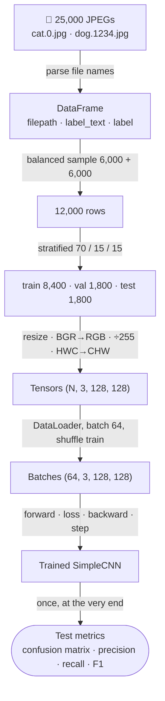
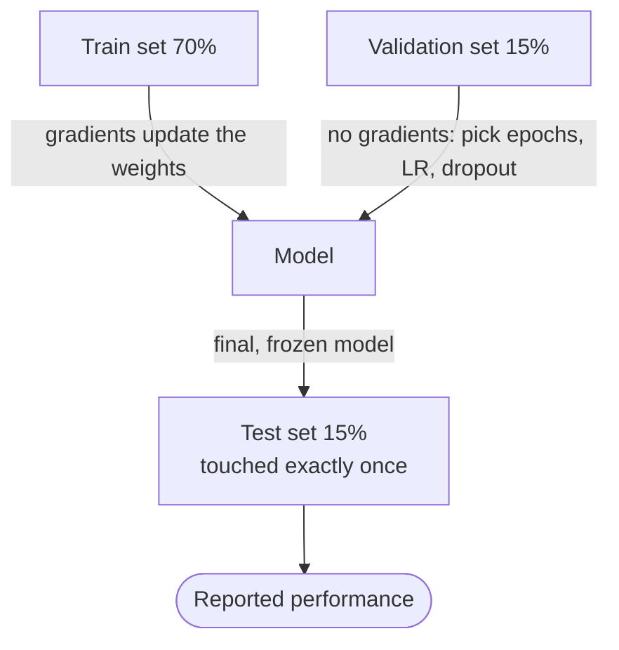
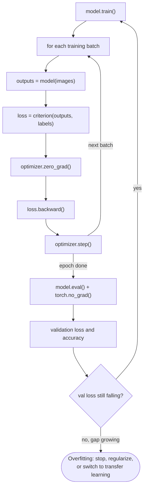

:::tip[TL;DR (30-Second Interview Pitch)]
A real image classifier is **80% data pipeline**: turn a folder of JPEGs into a labelled table, make a **balanced, stratified train / validation / test split**, preprocess every image the same way (**resize → BGR→RGB → scale → HWC→CHW**), and feed **shuffled mini-batches** through a `DataLoader` to a model on the **same device**. A 3-block CNN trained from scratch on 8,400 cat/dog images reaches only **~81% validation accuracy** while its training accuracy climbs past 90%. That gap is **overfitting**. You judge the model on a **held-out test set**, using a **confusion matrix, precision, recall and F1**, never on training accuracy.
:::

<FormulaKey />

:::info[Where this page sits]
**Before:** [CNN Fundamentals](./03-cnn-fundamentals.md) (convolution, pooling) and [CNN Architecture & Training](./04-cnn-architecture-training-alexnet.md) (full model, loss, dropout).
**This page:** the first **end-to-end project** on real images (notebook *CNN Implementation 1*).
**Next:** [Transfer Learning with ResNet18](./06-transfer-learning-resnet18.md) takes the same data from ~81% to ~98%.
:::

## 🧭 Start Here

So far, every CNN you built ate random tensors like `torch.randn(4, 3, 32, 32)`. Real projects don't start with tensors. They start with **a folder of 25,000 JPEG files** of different sizes, taken in different lighting, with the label hidden inside the file name (`cat.0.jpg`, `dog.1234.jpg`). The model can't read a file name and can't open a JPEG. Everything between "folder of files" and "tensor of shape `(64, 3, 128, 128)`" is your job, and it is where most real-world bugs live.

This page walks the whole journey once, in the order you would do it at work:

1. **Pick the hardware** (CPU or GPU) and make sure the model and data live on the same one.
2. **Turn files into a table**: one row per image, with its path and a numeric label.
3. **Split the table** into train, validation and test sets that never overlap and keep the 50/50 cat/dog ratio.
4. **Preprocess each image** into a fixed-size, correctly ordered, scaled tensor.
5. **Batch and shuffle** with `DataLoader`.
6. **Look at what convolution does** to a real photo, so the learned filters feel less magical.
7. **Build and train a CNN from scratch**, watching training and validation curves.
8. **Evaluate honestly** on the test set and study the mistakes.

The punchline sets up the next page: even done carefully, a CNN trained from scratch on 8,400 images tops out around **81%** on validation, because it has to learn *everything* (edges, fur, ears, faces) from that small dataset.

| New concept | One-line meaning |
|---|---|
| **Device** | Where tensors live and math runs: `cpu` or `cuda` (GPU). Model and data must match |
| **Label encoding** | Turning text labels into numbers: cat → 0, dog → 1 |
| **Stratified split** | A split that keeps the class ratio the same in every subset |
| **Data leakage** | Information from the validation/test data sneaking into training, which makes scores look better than they are |
| **Preprocessing** | The fixed recipe that turns any image into a model-ready tensor |
| **`Dataset` / `DataLoader`** | "How to fetch sample *i*" / "serve samples in shuffled mini-batches" |
| **Epoch** | One full pass over the training set |
| **Overfitting** | Training score keeps rising while validation score stalls or falls |
| **Confusion matrix** | A 2×2 table of actual vs predicted classes: where the right and wrong answers are |
| **Precision / Recall / F1** | Of the predicted positives, how many were right / of the real positives, how many were found / their balance |

:::analogy[A restaurant kitchen]
The model is the chef. It is talented, but it only cooks with ingredients that arrive **washed, cut to the same size and laid out in the same order** (preprocessing), delivered **one tray at a time** (mini-batches), on the **same counter** it works at (device). The train/validation/test split is the difference between **practising recipes**, **tasting during practice**, and the **food critic's single visit**. If the critic's dish was secretly practised in advance (leakage), the review means nothing.
:::

## ⚡ Essential Interview Recall

**Problem framing**
- An image is just numbers: OpenCV gives `(H, W, 3)` **uint8** in **BGR** order, values **0–255**. The model learns $f(\data{X};\param{\theta}) \to \{0, 1\}$ (cat = 0, dog = 1).
- Two output logits + `CrossEntropyLoss` (the notebook) and one logit + `BCEWithLogitsLoss` are equivalent ways to do binary classification.

**Device**
- `device = torch.device("cuda" if torch.cuda.is_available() else "cpu")`; move **both** model (`model.to(device)`) and every batch (`x.to(device)`). A mismatch raises a `RuntimeError`.
- GPU timing needs a **warm-up** and `torch.cuda.synchronize()`. CUDA calls are **asynchronous** and the first call pays a one-off start-up cost. The notebook's naive test showed GPU *slower* (2.15 s vs 0.09 s); done properly it was **~14× faster** (0.0227 s vs 0.3164 s per 4000×4000 matmul).
- `tensor.to(device)` returns a **copy**; `module.to(device)` moves **in place**.

**Data preparation**
- Labels come from file names (`"cat.0.jpg".split(".")[0]`). Balanced subset: **6,000 cats + 6,000 dogs = 12,000**.
- Two calls to `train_test_split(..., stratify=label)` give **70 / 15 / 15** = **8,400 / 1,800 / 1,800**, each exactly 50/50.
- **Train** fits weights, **validation** picks hyperparameters/epochs, **test** is touched **once** at the end. The sets must not overlap: $\data{D_{train}} \cap \data{D_{val}} = \data{D_{train}} \cap \data{D_{test}} = \data{D_{val}} \cap \data{D_{test}} = \emptyset$.

**Preprocessing**
- `cv2.imread` → `cv2.resize(img, (W, H))` (**width first**) → `cv2.cvtColor(BGR2RGB)` → `/ 255.0` → `np.transpose(img, (2, 0, 1))` (HWC→CHW) → `float32` tensor.
- `cv2.imread` returns **`None`** for a missing or corrupt file (no exception); it only fails later inside `resize`.
- Scaling to [0, 1] keeps inputs small and similar so gradients are stable. **Mean-std** standardization $(\data{x} - \mu)/\sigma$ centres them on 0, and is **required** for pretrained models (ImageNet mean/std).
- Eagerly preprocessing 8,400 images at 128×128 as float32 costs **1.54 GiB of RAM** ($8400 \cdot 3 \cdot 128 \cdot 128 \cdot 4$ bytes). Saving `.pt` files skips re-decoding but **blocks random augmentation**.

**Batching**
- `DataLoader(dataset, batch_size=64, shuffle=True)` → $\lceil 8400/64 \rceil$ = **132** batches (the last has 16 images). Shuffle **train only**; val/test `shuffle=False`.
- The model sees batches of shape `(B, C, H, W)` = `(64, 3, 128, 128)`. Labels `(64,)` int64.

**Model (SimpleCNN)**
- 3 × [Conv 3×3, pad 1 → ReLU → MaxPool 2] with channels **32 → 64 → 128**; spatial **128 → 64 → 32 → 16**; flatten **128·16·16 = 32,768** → FC 128 → Dropout 0.3 → FC 2.
- **4,287,938** params, of which `fc1` holds **4,194,432 (97.8%)**. Conv layers: 896 + 18,496 + 73,856.
- `CrossEntropyLoss` + `Adam(lr=1e-4)`.

**Training & evaluation**
- Each epoch: `model.train()` → for each batch: forward → loss → `zero_grad` → `backward` → `step`; then `model.eval()` + `torch.no_grad()` for validation.
- Notebook run: train accuracy **0.88 → 0.90**, validation stuck at **~0.80–0.81**, validation loss rising (0.43 → 0.45). That is overfitting.
- `torch.max(outputs, 1)` returns `(values, indices)`; the **indices** are the predicted classes (same as `argmax`).
- sklearn's `confusion_matrix`: **rows = actual, columns = predicted**, ordered by label. With dog (1) as the positive class: `[[TN, FP], [FN, TP]]`.
- Precision $= TP/(TP+FP)$, Recall $= TP/(TP+FN)$, F1 = their harmonic mean. Accuracy alone hides **which** class fails and is useless on imbalanced data.

## 📐 Formula Sheet

Every equation on this page in one place. Each one is explained in a card further down.

| Concept | Formula | In plain words |
|---|---|---|
| Image as a tensor | $\data{X} \in \mathbb{R}^{H \times W \times 3} \;\to\; \mathbb{R}^{3 \times H \times W}$ | OpenCV stores channels last; PyTorch wants them first |
| Model objective | $f(\data{X};\param{\theta}) \to \{0, 1\}$ | Learn a function from pixels to cat/dog |
| Min-max scaling | $\data{x'} = \data{x} / 255$ | Squash 0–255 into 0–1 |
| Standardization | $\data{x'} = (\data{x} - \mu_c)/\sigma_c$ | Centre each channel on 0, unit spread |
| Disjoint splits | $\data{D} = \data{D_{tr}} \cup \data{D_{val}} \cup \data{D_{te}}$, pairwise $\cap = \emptyset$ | Every image in exactly one set |
| Batches per epoch | $\lceil N / \hyper{B} \rceil$ | Last batch can be smaller |
| Tensor memory | $N \cdot C \cdot H \cdot W \cdot 4$ bytes | float32 = 4 bytes per number |
| Conv / pool output size | $\left\lfloor \frac{H + 2\hyper{P} - \hyper{K}}{\hyper{S}} \right\rfloor + 1$ | 3×3 pad 1 keeps size; pool 2 halves it |
| Flatten size | $\hyper{C} \cdot H \cdot W = 128 \cdot 16 \cdot 16 = 32{,}768$ | Must equal `fc1.in_features` |
| Parameter counts | conv $\hyper{C_{out}}(\hyper{C_{in}}\hyper{K}^2 + 1)$, FC $d_{out}(d_{in} + 1)$ | The first FC layer dominates |
| Mini-batch gradient | $\nabla_{\param{\theta}} \loss{L_B} = \frac{1}{\hyper{B}} \sum_{i \in B} \nabla_{\param{\theta}} \loss{\ell_i}$ | Average the per-image gradients |
| Prediction | $\pred{\hat y} = \arg\max_k \pred{z_k}$ | Pick the class with the biggest logit |
| Accuracy | $\frac{TP + TN}{TP + TN + FP + FN}$ | Share of all predictions that are right |
| Precision | $\frac{TP}{TP + FP}$ | When it says dog, how often is it a dog? |
| Recall | $\frac{TP}{TP + FN}$ | Of all real dogs, how many did it find? |
| F1 score | $2 \cdot \frac{P \cdot R}{P + R}$ | One number that punishes a weak P or R |

## The Mental Model

### 1. The end-to-end pipeline



### 2. Who uses which split, and when



### 3. One epoch of training



## The Paradigm / Core Concepts

### Part A: Framing the problem

#### 📖 Understand it

When you look at a photo of a dog, you see ears, fur and a snout immediately. The computer sees none of that. It sees a grid of numbers: a 374×500 photo is **374 rows × 500 columns × 3 colour values**, each an integer from 0 (none of that colour) to 255 (full intensity). The notebook prints the top-left corner of one image as `[203, 164, 87]` repeated: a warm brown, stored as three numbers.

So the whole task is: **find a function that maps a grid of numbers to the word "cat" or "dog"**. Nobody writes that function by hand. We choose its *shape* (the CNN architecture) and let training find the millions of numbers inside it (the parameters $\theta$) by showing it thousands of labelled examples. The CNN is expected to discover, layer by layer, that certain number patterns are edges, certain combinations of edges are fur and whiskers, and certain combinations of those are faces.

This is exactly the ANN training loop you already know (prediction → loss → backpropagation → update). The only differences are the input (a structured 3-D grid instead of a flat vector) and the layer type (convolutions that respect that structure).

<Formula name="The learning problem" tag="Binary image classification" words="A CNN with parameters theta takes an image tensor and outputs a class. Training adjusts theta so the output matches the label on as many training images as possible, in a way that also works on new images." remember="Pixels in, cat-or-dog out.">

$$
\data{X} \in \mathbb{R}^{H \times W \times 3}
\qquad\qquad
f(\data{X};\,\param{\theta}) \;\rightarrow\; \{0 = \text{cat},\; 1 = \text{dog}\}
$$

- $\data{X}$: the image, height × width × 3 colour channels, values 0–255
- $\param{\theta}$: every conv kernel, bias and FC weight in the network
- The output is really **two logits**; the predicted class is whichever is larger

</Formula>

:::info[Two logits + CrossEntropy, or one logit + BCE?]
The notebook ends the model with `nn.Linear(128, 2)` and uses `CrossEntropyLoss` (softmax over 2 classes). The other standard option is `nn.Linear(128, 1)` + `BCEWithLogitsLoss` (sigmoid on 1 score) with **float** labels of shape `(B, 1)`. They are mathematically equivalent for two classes: softmax over $[z_0, z_1]$ equals sigmoid of $z_1 - z_0$. The two-logit version generalizes to more classes without changing the code; the one-logit version has 129 fewer parameters. Either answer is fine in an interview if you match the loss to the output shape.
:::

### Part B: CPU vs GPU, and the same-device rule

#### 📖 Understand it

Training a CNN is mostly **huge numbers of multiply-adds**: every conv layer slides its kernels over every position of every image in the batch. These operations are independent of each other, so they can run in parallel. A CPU has a handful of powerful cores built for doing *different* things one after another. A GPU has thousands of simpler cores built for doing the *same* thing to lots of data at once. That is exactly the shape of deep-learning math, which is why a GPU is the standard for training.

PyTorch makes you say **where** each tensor lives. A tensor on the CPU and a tensor on the GPU sit in physically different memory chips, so an operation that mixes them can't run. PyTorch refuses with a `RuntimeError` ("Expected all tensors to be on the same device"). The habit to build: create one `device` object at the top, move the **model** to it once, and move **every batch** to it inside the loop.

The notebook also shows a classic benchmarking trap. Its first quick test made the GPU look **24× slower** than the CPU (2.15 s vs 0.09 s). Two things went wrong. First, the very first CUDA call pays a one-time start-up cost (creating the CUDA context, loading kernels). Second, GPU calls are **asynchronous**: Python queues the work and moves on, so a timer can stop before the GPU has finished. The fixed benchmark **warms up** with a few throwaway multiplications and calls `torch.cuda.synchronize()` before stopping the clock. Then the GPU averaged **0.0227 s** per 4000×4000 matrix multiply against **0.3164 s** on the CPU: about **14× faster**.

| | CPU | GPU |
|---|---|---|
| Cores | Few (4–32), powerful, general-purpose | Thousands, simple, run the same instruction on many numbers |
| Best at | Branchy logic, data loading, preprocessing | Large matrix multiplies and convolutions |
| Notebook 4000×4000 matmul | **0.3164 s** (≈ 0.40 TFLOP/s) | **0.0227 s** (≈ 5.6 TFLOP/s) |
| Typical role | Data pipeline, small-model inference | Training, large-batch inference |

<RuleCard name="The same-device rule" tag="PyTorch device placement" why="An operation can only read memory on one device, so all of its inputs must already be there." remember="One device object, everything goes to it.">

Pick the device once, then move the **model once** and **every batch inside the loop**:
`model = model.to(device)` and `images, labels = images.to(device), labels.to(device)`.
Move results back with `.cpu()` before converting to NumPy or plotting.

</RuleCard>

:::analogy[CPU vs GPU is one chef vs a thousand line cooks]
One brilliant chef (CPU) can cook any dish, one step at a time. A thousand line cooks (GPU) can each only chop, but give them a mountain of onions and they finish in seconds. Deep learning is a mountain of onions. But calling the line cooks in takes time (warm-up), and if you stop your stopwatch the moment you *shout the order* rather than when the onions are chopped (no `synchronize`), you will measure nonsense.
:::

### Part C: From a folder of files to clean splits

#### 📖 Understand it

The Kaggle Dogs vs Cats folder has no CSV and no label column. The only place the answer is written is the **file name**: `cat.0.jpg`, `dog.1234.jpg`. So the first step is to scan the folder (`glob`), take each file's base name, split it on `"."`, and keep the first piece. That gives a text label, which we then **label-encode** as a number (cat → 0, dog → 1) because the loss function needs integers. Putting this into a **pandas DataFrame** (one row per image: path, text label, numeric label) turns a messy folder into a table you can count, filter, shuffle and split like any other dataset.

Next, the notebook takes a **balanced subset**: 6,000 cats and 6,000 dogs out of 12,500 each. Smaller means faster experiments. *Balanced* matters because a model trained on, say, 90% dogs can score 90% accuracy by answering "dog" every time while learning nothing. With a 50/50 dataset, the trivial baseline is 50%, so any score above that is real learning.

Then comes the most important step: **splitting**. The data is cut into three disjoint parts, each with its own job:

- **Training set (70%)**: the only data whose gradients change the weights.
- **Validation set (15%)**: checked after every epoch, with no weight updates. You use it to choose things *you* control: how many epochs, which learning rate, how much dropout. Because you make decisions based on it, it is no longer a perfectly unbiased judge.
- **Test set (15%)**: locked away and used **once**, at the very end, to report how the final model does on truly unseen data.

The split is done with two calls to `train_test_split`: first 70% vs 30%, then the 30% is halved. Both calls pass `stratify=label`, which makes every subset keep the same class ratio (exactly 4,200/4,200, 900/900 and 900/900). Without stratification, random chance could leave the test set at, say, 52/48, which slightly distorts the metrics. On an imbalanced dataset it could leave the rare class almost missing from validation.

<Formula name="Three disjoint splits" tag="Train / validation / test" words="Every image goes into exactly one of the three sets. No image, and no near-duplicate of an image, may appear in two of them, or the validation and test scores become optimistic lies." remember="Practise, check, then one final exam.">

$$
\data{D} = \data{D_{train}} \cup \data{D_{val}} \cup \data{D_{test}},
\qquad
\data{D_{train}} \cap \data{D_{val}} = \data{D_{train}} \cap \data{D_{test}} = \data{D_{val}} \cap \data{D_{test}} = \emptyset
$$

- 70 / 15 / 15 of 12,000 → **8,400 / 1,800 / 1,800**
- With `stratify`, each subset is **exactly 50% cats**

</Formula>

<Animation src="cnn/stratified-split" caption="From 25,000 files to a balanced 12,000, then two stratified splits. Watch the cat and dog shares stay exactly 50/50 in every subset: 4,200/4,200, 900/900 and 900/900." />

:::danger[Interview Trap: Data leakage]
**Leakage** means information from the evaluation data leaks into training, so the score looks better than the model really is. Common forms in image projects: tuning hyperparameters on the **test** set, computing normalization statistics (mean/std) on **all** data before splitting, and **near-duplicate images** (the same pet photographed twice, or augmented copies) landing in both train and test. Medical and face datasets add a subtler version: different images of the **same patient or person** across splits. Split **by person/patient**, not by image.
:::

:::analogy[Train / validation / test is homework, mock exams and the final exam]
You learn from **homework** (train). You take **mock exams** to decide how to study (validation), and because you adjust to them, a good mock score is a slightly hopeful estimate. The **final exam** (test) is sat once. If you saw the final's questions while studying, your grade says nothing about what you know.
:::

### Part D: Preprocessing: every image into the same shape and scale

#### 📖 Understand it

A batch is one tensor, and a tensor must be rectangular. So **every image must have exactly the same size** before it can be stacked with others. Raw photos come in all sizes (the notebook's samples are 374×500 and 333×500). The simplest fix is `cv2.resize` to 128×128. Note that this **stretches** non-square photos and distorts their aspect ratio. Production pipelines usually resize the short side and then **crop** the centre instead.

OpenCV has a historical quirk: `cv2.imread` stores colour channels as **Blue, Green, Red**, not RGB. Every other tool (Matplotlib, PIL, torchvision, and every pretrained model) assumes RGB. If you forget `cv2.cvtColor(img, cv2.COLOR_BGR2RGB)`, nothing crashes, but red and blue are swapped: brown fur looks blue in plots and a pretrained network receives colours it was never trained on.

Next, **scaling**. Raw values run from 0 to 255. Dividing by 255 maps them to 0–1. This matters because of how gradient descent works: the size of each weight update is proportional to the size of the inputs. Large, uneven inputs give large, uneven gradients, which force a tiny learning rate and slow, unstable training. Small, similar-sized inputs let one learning rate suit every weight.

**Standardization** goes one step further: subtract each channel's mean and divide by its standard deviation, so every channel is centred on 0 with a spread of about 1. Centred inputs help optimization because positive and negative values balance out, so gradients don't all push weights in one direction. For **pretrained** models it is not optional: the network learned its filters on inputs standardized with the **ImageNet** mean and std, and you must feed it numbers on the same scale (next page).

Finally, the **layout**. OpenCV and NumPy store an image as `(H, W, C)`, "channels last": the three colour values of a pixel sit next to each other in memory. PyTorch's `Conv2d` expects `(C, H, W)`, "channels first": the whole red plane, then the whole green plane, then the whole blue plane. `np.transpose(img, (2, 0, 1))` reorders the axes. Forget it and a `(128, 128, 3)` image is read as **128 channels** of 128×3 pixels, giving an error about expecting 3 input channels. Or, worse, if the numbers happen to line up, the model trains on garbage.

<Formula name="Min-max scaling" tag="0–255 → 0–1" words="Divide every pixel value by the largest possible value, 255, so every input lies between 0 and 1." remember="Divide by 255.">

$$
\data{x'} = \frac{\data{x}}{255}
$$

**Example:** the RGB pixel $(203, 164, 87)$ becomes $(0.796,\ 0.643,\ 0.341)$.

</Formula>

<Formula name="Per-channel standardization" tag="Mean-std normalization" words="Subtract the channel's average and divide by its spread, so each channel is centred on zero with a spread of about one. Pretrained ImageNet models require the ImageNet mean and std." remember="Subtract the mean, divide by the spread.">

$$
\data{x'_c} = \frac{\data{x_c} - \mu_c}{\sigma_c}
\qquad
\mu = [0.485,\ 0.456,\ 0.406],\quad \sigma = [0.229,\ 0.224,\ 0.225]
$$

- $\data{x_c}$: pixel value of channel $c$ **after** scaling to 0–1
- $\mu_c, \sigma_c$: per-channel mean and standard deviation (here the ImageNet values, for R, G, B)

**Example:** $(0.796, 0.643, 0.341)$ → $\big(\tfrac{0.796 - 0.485}{0.229}, \ldots\big) = (1.358,\ 0.835,\ -0.288)$. Pure black maps to about −2.1 and pure white to about +2.4.

</Formula>

<Animation src="cnn/pixel-to-tensor" caption="One stored pixel becomes model input: OpenCV hands over 87, 164, 203 in BGR order, it is flipped to RGB, scaled by 255, and finally the interleaved RGB values of each row are regrouped into three separate channel planes, which is HWC to CHW." />

| Step | Code | Shape after | dtype / range | Why |
|---|---|---|---|---|
| 1. Read | `cv2.imread(path)` | `(374, 500, 3)` | uint8, 0–255, **BGR** | Decode the JPEG. Returns `None` if the file is missing |
| 2. Resize | `cv2.resize(img, (128, 128))` | `(128, 128, 3)` | uint8 | Batches need equal sizes. `dsize` is **(width, height)** |
| 3. Colour order | `cv2.cvtColor(img, cv2.COLOR_BGR2RGB)` | `(128, 128, 3)` | uint8, **RGB** | Match every other tool and every pretrained model |
| 4. Scale | `img / 255.0` | `(128, 128, 3)` | float64, 0–1 | Small, similar-sized inputs → stable gradients |
| 5. Layout | `np.transpose(img, (2, 0, 1))` | `(3, 128, 128)` | float64 | `Conv2d` wants channels first |
| 6. Tensor | `torch.tensor(img, dtype=torch.float32)` | `(3, 128, 128)` | float32 | Model weights are float32 |
| 7. Stack | `torch.stack(images)` | `(8400, 3, 128, 128)` | float32 | One big tensor per split |

<Formula name="Tensor memory" tag="Why eager preprocessing gets expensive" words="Every number in a float32 tensor costs 4 bytes, so multiply all the dimensions and then by 4." remember="Count the numbers, times four bytes.">

$$
\text{bytes} = N \cdot C \cdot H \cdot W \cdot 4
$$

**Example:** the training tensor: $8400 \cdot 3 \cdot 128 \cdot 128 \cdot 4 = 1{,}651{,}507{,}200$ bytes ≈ **1.54 GiB**. Storing the same pixels as uint8 would take a quarter of that (394 MiB). At ResNet's 224×224 the float32 tensor would be 3× bigger again.

</Formula>

**Saving to `.pt`.** Decoding 12,000 JPEGs took the notebook about 80 seconds. `torch.save` writes the finished tensors to disk so later sessions load them in a second with `torch.load`. The trade-off: images frozen as tensors are **identical every epoch**, so you can't apply **random augmentation**. That is why the next page switches to a custom `Dataset` that loads and transforms each image on the fly.

| Approach | Pros | Cons | Use when |
|---|---|---|---|
| **Eager**: preprocess everything once, save `.pt` | Fastest epochs, simple, reproducible | RAM ∝ dataset size (1.54 GiB here), no random augmentation | Small datasets, quick experiments, teaching |
| **Lazy**: `Dataset.__getitem__` loads + transforms per sample | Constant memory, fresh augmentation every epoch, scales to millions of images | JPEG decoding every epoch (use `num_workers`) | Real projects and transfer learning |

:::analogy[Preprocessing is mise en place]
A professional kitchen washes, peels and cuts every ingredient to the same size *before* service, so the chef never stops to deal with a muddy carrot. Resizing, colour-fixing and scaling are the same chores for images. And mixing up BGR and RGB is like a supplier labelling the salt jar "sugar": nothing explodes, but every dish tastes wrong.
:::

### Part E: Dataset, DataLoader and mini-batches

#### 📖 Understand it

You could push all 8,400 images through the network in one go, but it would need gigabytes of GPU memory for the activations and would give you **one** weight update per pass over the data. At the other extreme, one image at a time gives 8,400 updates per pass, but each is based on a single, noisy example and the GPU sits mostly idle. **Mini-batches** (here 64 images) are the practical middle: big enough to keep the GPU busy and to average out noise, small enough to fit in memory and to update the weights 132 times per epoch.

The mini-batch gradient is just the **average** of the per-image gradients in the batch. It is a noisy estimate of the true full-dataset gradient. That noise is not purely bad: it jiggles the weights out of sharp, narrow minima, which tends to generalize better.

PyTorch splits this job into two objects. A **`Dataset`** answers two questions: *how many samples are there?* (`__len__`) and *give me sample number i* (`__getitem__`). `TensorDataset(X_train, y_train)` is a ready-made Dataset that just indexes two tensors. A **`DataLoader`** wraps a Dataset and handles the rest: it shuffles the indices each epoch, groups them into batches, fetches each sample, stacks them into one batch tensor (`collate_fn`) and, if asked, does all this in parallel worker processes (`num_workers`).

**Why shuffle the training set?** The DataFrame might be ordered (all cats, then all dogs). Without shuffling, the first half of an epoch would teach "always say cat" and the second half "always say dog", and the weights would zig-zag. Shuffling makes every batch a fair mix and every epoch a different sequence. **Validation and test are not shuffled**, because order doesn't change their metrics and a fixed order makes runs reproducible and easy to compare.

<Formula name="Batches per epoch" tag="DataLoader length" words="Divide the dataset size by the batch size and round up. The leftover images form a smaller final batch unless you pass drop_last=True." remember="Divide and round up.">

$$
\text{batches} = \left\lceil \frac{N}{\hyper{B}} \right\rceil
$$

**Example:** $\lceil 8400 / 64 \rceil = 132$ batches: 131 full batches + one of **16** images. With `batch_size=32` (next page): $\lceil 8400/32 \rceil = 263$ train and $\lceil 1800/32 \rceil = 57$ validation batches.

</Formula>

<Formula name="Mini-batch gradient" tag="What one optimizer step uses" words="The gradient used for one update is the average of the gradients from each image in the batch. More images per batch means a less noisy, but more expensive, estimate." remember="Average the votes of the batch.">

$$
\nabla_{\param{\theta}}\, \loss{L_B} \;=\; \frac{1}{\hyper{B}} \sum_{i \in B} \nabla_{\param{\theta}}\, \loss{\ell}\big(f(\data{x_i};\param{\theta}),\, \data{y_i}\big)
$$

- $\hyper{B}$: batch size, which you choose
- $\loss{\ell}$: per-image cross-entropy; `CrossEntropyLoss` averages it over the batch by default (`reduction="mean"`)

</Formula>

| `DataLoader` argument | Train | Val / Test | What it does |
|---|---|---|---|
| `batch_size` | 64 | 64 | Images per step. Bigger → smoother gradient, more memory |
| `shuffle` | **True** | **False** | New random order every epoch |
| `num_workers` | 2–8 | 2–8 | Parallel processes loading data, so the GPU isn't waiting. Default **0** = load in the main process |
| `pin_memory` | True on GPU | True on GPU | Page-locked RAM → faster, async host→GPU copies |
| `drop_last` | sometimes | False | Drop the smaller last batch (useful with BatchNorm, which dislikes tiny batches) |

:::analogy[A DataLoader is a dealer at a card table]
The Dataset is the deck: it knows how many cards there are and can hand you card number *i*. The DataLoader is the dealer: it shuffles the deck before every round (epoch), deals hands of 64 cards (batches), and with `num_workers` hires extra dealers so the players (the GPU) never wait between hands.
:::

### Part F: What convolution does to a real photo

#### 📖 Understand it

Before training anything, the notebook applies three **hand-made** 3×3 filters to a greyscale cat photo with `cv2.filter2D`. This is the clearest way to see what a single convolution kernel does. Each filter is a small grid of weights; at every pixel, the output is the weighted sum of that pixel's 3×3 neighbourhood.

- The **edge** filter has 8 in the centre and −1 around it. Its weights **sum to 0**. On a flat region (all neighbours equal) the output is 0. Where brightness changes, the centre differs from its neighbours and the output is large. So it lights up outlines and fur texture and blacks out smooth areas.
- The **sharpen** filter is "identity + edges": 5 in the centre, −1 at the four sides. Its weights **sum to 1**, so flat regions keep their brightness while edges get exaggerated.
- The **blur** filter is all 1/9: it replaces each pixel with the average of its neighbourhood. The weights sum to 1, so overall brightness is kept but fine detail and noise are smoothed away.

The point for CNNs: a convolutional layer is a *bank* of filters like these, except **nobody designs the numbers**. They start random and backpropagation shapes them into whatever detectors reduce the loss. First-layer filters of trained CNNs really do end up looking like edge and colour-blob detectors.

Max pooling (2×2, stride 2) then keeps the strongest response in each 2×2 block. The 333×500 edge map becomes **166×250** (floor division drops the odd last row). Each output pixel now summarizes a larger patch of the original, so the next layer "sees" more of the image at the same kernel size.

| Filter | Kernel | Weight sum | Effect |
|---|---|---|---|
| Edge (Laplacian-style) | `[[-1,-1,-1],[-1,8,-1],[-1,-1,-1]]` | **0** | Flat areas → 0; outlines and texture light up |
| Sharpen | `[[0,-1,0],[-1,5,-1],[0,-1,0]]` | **1** | Original image + its edges: crisper detail |
| Blur (box) | all `1/9` | **1** | Neighbourhood average: smooth, less noise |

:::danger[Interview Trap: filter2D on uint8 silently clips]
`cv2.filter2D(gray, -1, kernel)` with `ddepth=-1` keeps the input type, **uint8**, so results are **clipped to 0–255**. On a dark→bright step (50 → 200) the edge filter's true responses are **−450** and **+450**, but uint8 stores **0** and **255**: half of every edge (the negative side) vanishes, and strong edges all look the same. For analysis, convert first (`gray.astype(np.float32)`) or pass `ddepth=cv2.CV_32F`. Also note `filter2D` computes **correlation** (no kernel flip), which is what deep-learning "convolution" layers compute too.
:::

### Part G: Building SimpleCNN

#### 📖 Understand it

The model follows the pattern from the previous page: a **feature extractor** made of three identical blocks, then a small **classifier**. Each block is Conv(3×3, padding 1) → ReLU → MaxPool(2). The padded 3×3 conv **keeps** the height and width; the pool **halves** them. So the spatial size goes 128 → 64 → 32 → 16, while the number of channels (feature types) doubles 32 → 64 → 128. Early blocks see small patches and learn many simple patterns; deeper blocks see larger regions and combine them into more complex ones.

After the third block, each image is a `(128, 16, 16)` stack of feature maps. `x.view(x.size(0), -1)` flattens everything except the batch dimension into a vector of **32,768** numbers. `fc1` maps that to 128 hidden features, dropout (p = 0.3) randomly zeroes 30% of them during training, and `fc2` produces the 2 logits.

Now count the parameters, because it explains this model's behaviour. The three conv layers together have only **93,248** parameters. `fc1` alone has $128 \times (32{,}768 + 1)$ = **4,194,432**, which is **97.8%** of the whole model. That giant, data-hungry layer is where the memorization happens, and it is why this model overfits 8,400 images. (A global-average-pooling head, `AdaptiveAvgPool2d(1)` + `Linear(128, 2)`, would shrink the whole model to **93,506** parameters.)

:::warning[The notebook's dimension-flow notes don't match its code]
The markdown cell describes channels 16 → 32 → 64 (flatten 16,384), but the `SimpleCNN` that was actually trained uses **32 → 64 → 128** (flatten **32,768**, 4.29 M params), as `print(model)` confirms. The 16/32/64 version is notebook 7's `SmallCNN` (flatten 16,384, **2,121,122** params). The table below is the real trained model.
:::

| Layer | Output shape (B = 64) | Parameters | Formula |
|---|---|---|---|
| Input | `(64, 3, 128, 128)` | — | |
| conv1 3→32, k3, p1 + ReLU | `(64, 32, 128, 128)` | **896** | 32 × (3·9 + 1) |
| MaxPool 2 | `(64, 32, 64, 64)` | 0 | |
| conv2 32→64 + ReLU | `(64, 64, 64, 64)` | **18,496** | 64 × (32·9 + 1) |
| MaxPool 2 | `(64, 64, 32, 32)` | 0 | |
| conv3 64→128 + ReLU | `(64, 128, 32, 32)` | **73,856** | 128 × (64·9 + 1) |
| MaxPool 2 | `(64, 128, 16, 16)` | 0 | |
| Flatten | `(64, 32768)` | 0 | 128 × 16 × 16 |
| fc1 32768→128 + ReLU + Dropout(0.3) | `(64, 128)` | **4,194,432** | 128 × (32,768 + 1) |
| fc2 128→2 | `(64, 2)` | **258** | 2 × (128 + 1) |
| **Total** | | **4,287,938** | **fc1 = 97.8%** |

<Formula name="Shape and parameter formulas" tag="Recap from the fundamentals page" words="A padded 3x3 convolution keeps the size, a 2x2 pool halves it. Conv parameters depend only on channels and kernel size, while the first FC layer's parameters grow with the flattened image." remember="Conv is cheap, the flatten-FC is expensive.">

$$
\begin{aligned}
H_{out} &= \left\lfloor \frac{H + 2\hyper{P} - \hyper{K}}{\hyper{S}} \right\rfloor + 1 \\[4pt]
\#\text{conv} &= \hyper{C_{out}}\big(\hyper{C_{in}}\hyper{K}^2 + 1\big) \qquad \#\text{FC} = d_{out}\big(d_{in} + 1\big)
\end{aligned}
$$

**Example:** conv, $H = 128, \hyper{P} = 1, \hyper{K} = 3, \hyper{S} = 1$ → $\lfloor 127/1 \rfloor + 1 = 128$; pool, $\hyper{K} = \hyper{S} = 2, \hyper{P} = 0$ → $\lfloor 126/2 \rfloor + 1 = 64$. Flatten: $128 \cdot 16 \cdot 16 = 32{,}768$.

</Formula>

:::danger[Interview Trap: the flatten size is tied to the input size]
`fc1 = nn.Linear(128 * 16 * 16, 128)` silently assumes **128×128** inputs. Feed 224×224 images (as you might for ResNet) and the flatten becomes 128 × 28 × 28 = 100,352, and you get `mat1 and mat2 shapes cannot be multiplied (2x100352 and 32768x128)`. Fixes: compute the size with a dummy forward pass, use `nn.LazyLinear(128)`, or use global average pooling so the head no longer cares about H and W.
:::

### Part H: Training, and reading the curves

#### 📖 Understand it

Training repeats one simple loop. For every batch: run the images forward to get logits, compute the cross-entropy loss against the true labels, clear the old gradients (`zero_grad`), backpropagate (`backward`) to get a gradient for every kernel and weight, and let the optimizer nudge each parameter downhill (`step`). One pass over all 132 batches is an **epoch**. The notebook uses **Adam** with a small learning rate (**1e-4**), a safe choice for a 4.3 M-parameter model.

After each epoch the model is checked on the validation set, in a different mode. `model.eval()` switches layers that behave differently at test time (dropout stops dropping; BatchNorm uses its stored statistics). `torch.no_grad()` tells autograd not to record the computation graph, which saves memory and time because no backward pass will follow. They do **different** jobs and you need **both**. And `model.train()` must be called again at the start of the next epoch, or dropout stays off for the rest of training.

The two curves (train and validation, loss and accuracy) are how you diagnose the model:

- **Both improving** → keep training.
- **Training improving, validation flat or worse** → **overfitting**: the model is memorizing training images instead of learning general cat/dog features.
- **Both poor** → **underfitting**: the model is too small, the learning rate is wrong, or there's a bug.

Here is what the notebook's run printed (first 6 of 30 epochs):

| Epoch | Train loss | Train acc | Val loss | Val acc |
|---|---|---|---|---|
| 1 | 0.2804 | 0.8832 | 0.4457 | 0.7953 |
| 2 | 0.2746 | 0.8862 | 0.4471 | 0.7985 |
| 3 | 0.2647 | 0.8899 | **0.4298** | 0.8077 |
| 4 | 0.2541 | 0.8933 | 0.4307 | **0.8109** |
| 5 | 0.2484 | 0.8987 | 0.4350 | 0.7996 |
| 6 | 0.2386 | 0.9015 | 0.4512 | 0.8077 |

Training loss falls every epoch, but validation loss bottoms out at epoch 3 and then **rises**, while validation accuracy stalls around **0.80–0.81**. The ~10-point gap between train (0.90) and val (0.81) accuracy is textbook overfitting. More epochs would only widen it.

:::info[Why does epoch 1 already show 88% training accuracy?]
A freshly initialized binary classifier starts near **50%** accuracy with a loss near $\ln 2 = 0.693$ (a fresh `SimpleCNN` scores 0.6931 / 0.5000 on its first validation pass). 88% at "epoch 1" means this cell was **re-run on a model that had already been trained**: in a notebook, re-running the training cell *continues* from the current weights unless you re-create the model and optimizer. It is a common source of confusing results. Always rebuild `model` and `optimizer` before a fresh run.
:::

<Formula name="From logits to a predicted class" tag="torch.max / argmax" words="The predicted class is simply the position of the largest logit. Softmax is not needed for this, because it never changes which value is biggest." remember="Biggest logit wins.">

$$
\pred{\hat y} = \arg\max_{k} \; \pred{z_k}
$$

**Example:** logits $[2.1,\ -0.3]$ → class **0** (cat); $[0.2,\ 1.7]$ → class **1** (dog). `torch.max(outputs, 1)` returns `values=[2.1, 1.7]`, `indices=[0, 1]`; the **indices** are the predictions.

</Formula>

:::analogy[Overfitting is memorizing the answer key]
A student who memorizes last year's exam answers scores 100% on that paper (training accuracy) and fails this year's (validation). The validation curve is your early warning: the moment it stops improving while the training score keeps rising, the extra "learning" is memorization.
:::

### Part I: Evaluating honestly

#### 📖 Understand it

Once training is finished and every choice is made, the test set is used **once**. A single accuracy number is a start, but it hides *which* mistakes the model makes. With two classes there are exactly four possible outcomes per image, and a **confusion matrix** counts each of them. sklearn's `confusion_matrix(y_true, y_pred)` puts **actual classes on the rows** and **predicted classes on the columns**, in label order (0 = cat, 1 = dog). The diagonal holds the correct answers; everything off the diagonal is an error, and its position tells you the kind of error.

To talk about precision and recall you must pick a **positive class**. sklearn's default (`pos_label=1`) is **dog**. Then:

- **TP** (true positive): a dog predicted as dog. **TN**: a cat predicted as cat.
- **FP** (false positive): a cat wrongly called a dog. **FN** (false negative): a dog the model missed (called it a cat).

**Precision** asks: *when the model says "dog", how often is it right?* It is hurt by false alarms (FP). **Recall** asks: *of all the real dogs, how many did the model catch?* It is hurt by misses (FN). The two usually trade off: a model that calls everything a dog has perfect recall and poor precision. **F1** is their harmonic mean, which is only high when **both** are high (the harmonic mean is dragged down by the smaller value).

Which one matters depends on the cost of each mistake. A cancer screen cares most about **recall** (a missed tumour is far worse than an extra check-up). A spam filter cares most about **precision** (binning a real email is worse than letting one spam through). For balanced cats vs dogs both errors cost the same, so accuracy and F1 tell similar stories. On imbalanced data, accuracy becomes actively misleading: with 950 cats and 50 dogs, a model that always says "cat" scores **95% accuracy** and **0% dog recall**.

<Formula name="Precision, recall and F1" tag="Binary classification metrics" words="Precision is the share of predicted positives that are correct. Recall is the share of actual positives that were found. F1 is their harmonic mean, which is high only when both are high." remember="Precision fears false alarms, recall fears misses.">

$$
\begin{aligned}
\text{Accuracy} &= \frac{TP + TN}{TP + TN + FP + FN} \\[4pt]
\text{Precision} &= \frac{TP}{TP + FP}
\qquad
\text{Recall} = \frac{TP}{TP + FN} \\[4pt]
F_1 &= 2 \cdot \frac{\text{Precision} \cdot \text{Recall}}{\text{Precision} + \text{Recall}}
\end{aligned}
$$

- Positive class = **dog (1)**, sklearn's default `pos_label`
- **Example** (an illustrative 1,800-image test set): TN = 780, FP = 120, FN = 90, TP = 810 → accuracy $1590/1800 = 0.883$; precision $810/930 = 0.871$; recall $810/900 = 0.900$; F1 $= 0.885$

</Formula>

**Confusion matrix layout** (sklearn, labels `[0, 1]`, positive = dog):

| | **Predicted cat (0)** | **Predicted dog (1)** |
|---|---|---|
| **Actual cat (0)** | **TN** = 780 ✅ | **FP** = 120 ❌ cat called dog |
| **Actual dog (1)** | **FN** = 90 ❌ dog missed | **TP** = 810 ✅ |

<Animation src="cnn/confusion-metrics" caption="An example test set fills the confusion matrix cell by cell. Precision reads down the predicted-dog column, 810 of 930; recall reads across the actual-dog row, 810 of 900; F1 combines them into 0.885." />

`classification_report` prints these numbers for **each** class (treating each class as positive in turn), plus two averages: **macro** (plain mean over classes, so every class counts equally) and **weighted** (mean weighted by each class's `support`, its number of true samples). On a balanced test set they are nearly identical; on an imbalanced one, macro exposes a weak minority class that weighted hides.

| Situation | Trust | Why |
|---|---|---|
| Balanced classes, equal error costs (cats vs dogs) | Accuracy, F1 | Both errors matter equally |
| Missing a positive is costly (disease, fraud) | **Recall** | False negatives are the disaster |
| False alarms are costly (spam, alerts) | **Precision** | False positives annoy or harm |
| Imbalanced classes | Per-class recall, macro F1, PR curves | Accuracy is inflated by the majority class |

**Error analysis.** The notebook ends by plotting the **misclassified** test images. Common culprits: blurry or dark photos, the animal tiny in the frame, unusual poses, both animals in one picture, or simply a mislabelled file. These are worth more than the correct predictions, because they tell you what to fix next: more data of that kind, augmentation, a better model, or cleaner labels.

:::analogy[Precision and recall are a fishing net]
**Recall** is how many of the fish in the lake ended up in your net. **Precision** is how much of what's in your net is actually fish, not old boots. A giant net catches every fish (high recall) and a lot of boots (low precision). A tiny, careful net is all fish (high precision) but misses most of them (low recall). F1 rewards a net that does both.
:::

### Part J: Is a scratch CNN enough?

#### 📖 Understand it

Our CNN had to learn **everything** from 8,400 images: what an edge is, what fur texture looks like, what an ear is, and finally what separates cats from dogs. That is a lot to ask of a small dataset, and the curves show the result: ~81% validation accuracy with a growing overfitting gap.

A human asked to sort cats from dogs doesn't start from zero; they already know what shapes, textures and animals look like and only need to learn the final distinction. **Transfer learning** gives a model that same head start: take a CNN already trained on 1.2 million ImageNet photos, keep its learned feature extractor, and train only a new final layer on our data. On this exact dataset that lifts validation accuracy from ~81% to ~98%. That is the [next page](./06-transfer-learning-resnet18.md).

## ⚙️ Under the Hood (The Math & PyTorch Internals)

**OpenCV vs PIL vs torchvision**
- `cv2.imread` → NumPy array, `(H, W, C)`, uint8, **BGR**. `PIL.Image.open(...).convert("RGB")` → PIL image, **RGB**. torchvision transforms work on PIL images (and tensors), which is why the next page switches to PIL.
- `cv2.resize(img, dsize)` takes `dsize = (width, height)`, the **reverse** of NumPy's `(rows, cols)` shape. For non-square targets, `cv2.resize(img, (5, 8))` returns shape `(8, 5, 3)`.
- `img / 255.0` silently promotes uint8 to **float64** (8 bytes per value). Converting to float32 early halves the temporary memory.

**What a `DataLoader` does per batch**
1. The **sampler** produces indices (`RandomSampler` if `shuffle=True`, else `SequentialSampler`); the **batch sampler** groups them into lists of 64.
2. For each index, `dataset[i]` → `(image, label)`. With `num_workers > 0` this runs in separate processes, a few batches ahead (`prefetch_factor`).
3. `collate_fn` stacks the 64 samples into `images (64, 3, 128, 128)` and `labels (64,)`.
4. With `pin_memory=True`, the batch is placed in page-locked RAM so `.to(device, non_blocking=True)` can copy it to the GPU asynchronously.

**`model.eval()` vs `torch.no_grad()`**
- `eval()` flips `module.training = False` on every submodule: **Dropout** becomes the identity and **BatchNorm** uses running statistics. It does **not** stop gradient tracking.
- `no_grad()` stops autograd from recording operations: no graph, so less memory, faster forward, and `loss.backward()` would fail. It does **not** change layer behaviour. For evaluation you want **both**. (`torch.inference_mode()` is a slightly faster `no_grad` for pure inference.)

**Why `optimizer.zero_grad()` is needed**
- `.backward()` **adds** into `param.grad`; it never overwrites. Without `zero_grad()` every step uses the sum of all previous gradients. The usual order is `zero_grad → forward → loss → backward → step` (the notebook's `forward → loss → zero_grad → backward → step` is equally correct: what matters is clearing before `backward`).

**Averaging metrics over an epoch**
- The notebook averages **per-batch** loss and accuracy: `running_loss / len(train_loader)`. The last batch has only 16 images but counts as much as a full batch of 64. If it happened to score 1.5 while the other 131 scored 0.5, the batch average is **0.5076** but the true per-image average is **0.5019**. The exact version accumulates `loss.item() * images.size(0)` and `correct` counts, then divides by `len(dataset)`.

**GPU timing internals**
- CUDA kernel launches are **asynchronous**: Python returns immediately and the GPU works through a queue. `time.time()` without `torch.cuda.synchronize()` measures the *launch*, not the work. The first call also pays a one-off cost (CUDA context creation, cuBLAS initialization, kernel loading), hence the misleading 2.15 s.
- A 4000×4000 matmul is $2 \cdot 4000^3 = 1.28 \times 10^{11}$ floating-point operations: ≈ **5.6 TFLOP/s** on the RTX 4060 Laptop GPU vs ≈ **0.40 TFLOP/s** on the CPU.

**Saving tensors**
- `torch.save` uses Python's pickle format. Since PyTorch 2.6 `torch.load` defaults to `weights_only=True`, which safely loads tensors and state dicts but refuses arbitrary pickled objects. Loading a pickle from an untrusted source with `weights_only=False` can execute code.

:::danger[Interview Trap: "Normalize with statistics from the whole dataset"]
Mean/std (or any learned preprocessing: PCA, vocabulary, scalers) must be computed on the **training split only** and then **applied** to validation and test. Computing them on all data lets test-set information shape the inputs: a small but real leak. For pretrained models you use the **fixed ImageNet** statistics, which avoids the question entirely.
:::

## 💻 PyTorch Implementation

:::tip[Run it yourself]
The code assumes the Kaggle *Dogs vs Cats* `train` folder (`cat.0.jpg` … `dog.12499.jpg`). Every shape and count below was verified on PyTorch 2.14 with a synthetic folder of the same layout. Training numbers are the notebook's own logged run (RTX 4060 Laptop GPU).
:::

### 1. Device setup and an honest GPU benchmark

Time GPU work only after a warm-up, and synchronize before stopping the clock.

```python showLineNumbers
import time
import torch

device = torch.device("cuda" if torch.cuda.is_available() else "cpu")
print("Using device:", device)                       # cuda (or cpu)

a_cpu, b_cpu = torch.randn(4000, 4000), torch.randn(4000, 4000)
t0 = time.time()
for _ in range(20):
    torch.matmul(a_cpu, b_cpu)
print(f"CPU: {(time.time() - t0) / 20:.4f} s/run")   # notebook: 0.3164

if device.type == "cuda":
    a, b = a_cpu.to(device), b_cpu.to(device)
    for _ in range(5):                               # warm-up: pays CUDA start-up cost
        torch.matmul(a, b)
    # highlight-next-line
    torch.cuda.synchronize()                         # wait until the GPU queue is empty
    t0 = time.time()
    for _ in range(20):
        torch.matmul(a, b)
    # highlight-next-line
    torch.cuda.synchronize()                         # otherwise you time the *launch*, not the work
    print(f"GPU: {(time.time() - t0) / 20:.4f} s/run")   # notebook: 0.0227 (~14× faster)
```

### 2. From file names to a labelled DataFrame

The label is the part of the file name before the first dot.

```python showLineNumbers
import glob, os
import pandas as pd

dataset_path = "dogs-vs-cats/train"
image_paths = glob.glob(os.path.join(dataset_path, "*.jpg"))
print(len(image_paths))                              # 25000

rows = []
for path in image_paths:
    label_text = os.path.basename(path).split(".")[0]    # "cat.0.jpg" → "cat"
    rows.append([path, label_text, 0 if label_text == "cat" else 1])

df = pd.DataFrame(rows, columns=["filepath", "label_text", "label"])
print(df["label_text"].value_counts().to_dict())     # {'cat': 12500, 'dog': 12500}
```

### 3. Balanced subset and stratified 70 / 15 / 15 split

Sample equally per class, then split twice with `stratify` so every subset stays 50/50.

```python showLineNumbers
from sklearn.model_selection import train_test_split

per_class = 6000
df_sampled = (
    df.groupby("label_text", group_keys=False)
      .sample(n=per_class, random_state=42)          # 6,000 cats + 6,000 dogs
      .sample(frac=1, random_state=42)               # shuffle the rows
      .reset_index(drop=True)
)

# highlight-start
train_df, temp_df = train_test_split(df_sampled, test_size=0.30,
                                     stratify=df_sampled["label"], random_state=42)
val_df, test_df = train_test_split(temp_df, test_size=0.50,
                                   stratify=temp_df["label"], random_state=42)
# highlight-end

print(len(train_df), len(val_df), len(test_df))      # 8400 1800 1800
print(train_df["label"].value_counts().to_dict())    # {0: 4200, 1: 4200}
print(test_df["label"].value_counts().to_dict())     # {0: 900, 1: 900}
```

### 4. Preprocess one image into a tensor

Read, resize, fix the colour order, scale, then move channels first.

```python title="preprocess.py" showLineNumbers
import cv2
import numpy as np
import torch

IMG_SIZE = 128

def preprocess_image(path: str) -> torch.Tensor:
    img = cv2.imread(path)                            # (H, W, 3) uint8, BGR, or None!
    if img is None:
        raise FileNotFoundError(f"Unreadable image: {path}")
    img = cv2.resize(img, (IMG_SIZE, IMG_SIZE))       # dsize = (width, height)
    # highlight-next-line
    img = cv2.cvtColor(img, cv2.COLOR_BGR2RGB)        # OpenCV is BGR; everything else is RGB
    img = img.astype(np.float32) / 255.0              # 0–255 → 0–1, float32 (not float64)
    # highlight-next-line
    img = np.transpose(img, (2, 0, 1))                # (H, W, C) → (C, H, W)
    return torch.from_numpy(img)                      # shares memory, no copy

def process_dataframe(df):
    X = torch.stack([preprocess_image(p) for p in df["filepath"]])
    y = torch.tensor(df["label"].values, dtype=torch.long)
    return X, y

X_train, y_train = process_dataframe(train_df)
X_val, y_val = process_dataframe(val_df)
X_test, y_test = process_dataframe(test_df)
print(X_train.shape, X_train.dtype)                   # torch.Size([8400, 3, 128, 128]) torch.float32
print(X_train.numel() * 4 / 2**30)                    # 1.538... GiB in RAM

torch.save((X_train, y_train), "train.pt")            # reload later with torch.load("train.pt")
```

### 5. `TensorDataset` and `DataLoader`

Shuffle the training batches only.

```python showLineNumbers
from torch.utils.data import TensorDataset, DataLoader

train_loader = DataLoader(TensorDataset(X_train, y_train), batch_size=64, shuffle=True)
val_loader   = DataLoader(TensorDataset(X_val, y_val),     batch_size=64, shuffle=False)
test_loader  = DataLoader(TensorDataset(X_test, y_test),   batch_size=64, shuffle=False)

print(len(train_loader))                              # 132 = ceil(8400 / 64), last batch has 16
images, labels = next(iter(train_loader))
print(images.shape, labels.shape, labels.dtype)       # (64, 3, 128, 128) (64,) torch.int64

# To display: back to CPU and channels-last
img_for_plot = images[0].cpu().permute(1, 2, 0)       # (128, 128, 3) for plt.imshow
```

### 6. Hand-made filters, and the uint8 clipping trap

The same edge filter gives different answers depending on the output dtype.

```python showLineNumbers
import cv2
import numpy as np

edge = np.array([[-1, -1, -1], [-1, 8, -1], [-1, -1, -1]], dtype=np.float32)
step = np.array([[50, 50, 50, 200, 200, 200]] * 6, dtype=np.uint8)   # dark → bright

# error-next-line
print(cv2.filter2D(step, -1, edge)[2])                # ❌ [  0   0   0 255   0   0]: clipped to uint8
# success-next-line
print(cv2.filter2D(step.astype(np.float32), -1, edge)[2])   # ✅ [   0.    0. -450.  450.    0.    0.]

def max_pool(img, size=2):                            # the notebook's manual 2×2 max pool
    h, w = img.shape[0] // size, img.shape[1] // size
    return img[:h * size, :w * size].reshape(h, size, w, size).max(axis=(1, 3))

print(max_pool(np.zeros((333, 500))).shape)           # (166, 250): odd last row dropped
```

### 7. SimpleCNN with a shape trace and parameter count

Three Conv → ReLU → Pool blocks, then a dropout-regularized classifier.

```python title="simple_cnn.py" showLineNumbers
import torch
import torch.nn as nn

class SimpleCNN(nn.Module):
    def __init__(self, num_classes=2):
        super().__init__()
        self.features = nn.Sequential(
            nn.Conv2d(3, 32, 3, padding=1),   nn.ReLU(), nn.MaxPool2d(2),   # → (32, 64, 64)
            nn.Conv2d(32, 64, 3, padding=1),  nn.ReLU(), nn.MaxPool2d(2),   # → (64, 32, 32)
            nn.Conv2d(64, 128, 3, padding=1), nn.ReLU(), nn.MaxPool2d(2),   # → (128, 16, 16)
        )
        self.classifier = nn.Sequential(
            nn.Flatten(),                                                   # → 32,768
            # highlight-next-line
            nn.Linear(128 * 16 * 16, 128), nn.ReLU(),                       # 97.8% of all params
            nn.Dropout(0.3),
            nn.Linear(128, num_classes),                                    # raw logits
        )

    def forward(self, x):
        return self.classifier(self.features(x))

model = SimpleCNN().to(device)
print(model(torch.randn(64, 3, 128, 128, device=device)).shape)    # torch.Size([64, 2])

count = lambda m: sum(p.numel() for p in m.parameters())
print(f"{count(model):,}")                                          # 4,287,938
print(f"{count(model.classifier[1]):,}")                            # 4,194,432 (fc1)
```

### 8. Train and validate, with exact per-epoch averages

Accumulate sums weighted by batch size, so the smaller last batch doesn't skew the average.

```python title="train_loop.py" showLineNumbers
import torch
import torch.nn as nn

def run_epoch(model, loader, criterion, optimizer=None):
    training = optimizer is not None
    # highlight-next-line
    model.train(training)                             # train() or eval(): dropout on/off
    total_loss, correct, seen = 0.0, 0, 0
    with torch.set_grad_enabled(training):            # = no_grad() during validation
        for images, labels in loader:
            images, labels = images.to(device), labels.to(device)
            outputs = model(images)
            loss = criterion(outputs, labels)
            if training:
                optimizer.zero_grad()
                loss.backward()
                optimizer.step()
            total_loss += loss.item() * labels.size(0)          # sum, not mean of means
            correct += (outputs.argmax(dim=1) == labels).sum().item()
            seen += labels.size(0)
    return total_loss / seen, correct / seen

model = SimpleCNN().to(device)                        # fresh model for every new run
criterion = nn.CrossEntropyLoss()
optimizer = torch.optim.Adam(model.parameters(), lr=1e-4)

for epoch in range(1, 31):
    tr_loss, tr_acc = run_epoch(model, train_loader, criterion, optimizer)
    va_loss, va_acc = run_epoch(model, val_loader, criterion)
    print(f"{epoch:2d}  train {tr_loss:.4f}/{tr_acc:.4f}  val {va_loss:.4f}/{va_acc:.4f}")
# notebook (epochs 1–6): train acc 0.883 → 0.902, val acc ≈ 0.80–0.81, val loss rising after epoch 3
```

### 9. Test-set evaluation: confusion matrix and report

Collect every prediction once, then let sklearn count.

```python showLineNumbers
import numpy as np
import torch
from sklearn.metrics import confusion_matrix, classification_report

model.eval()
all_preds, all_labels = [], []
with torch.no_grad():
    for images, labels in test_loader:
        preds = model(images.to(device)).argmax(dim=1)          # same as torch.max(...)[1]
        all_preds.append(preds.cpu())
        all_labels.append(labels)
y_pred = torch.cat(all_preds).numpy()
y_true = torch.cat(all_labels).numpy()

cm = confusion_matrix(y_true, y_pred)                 # rows = actual, cols = predicted
tn, fp, fn, tp = cm.ravel()                           # positive class = 1 (dog)
print(classification_report(y_true, y_pred, target_names=["Cat", "Dog"], digits=3))

# With the page's example counts [[780, 120], [90, 810]]:
#               precision    recall  f1-score   support
#          Cat      0.897     0.867     0.881       900
#          Dog      0.871     0.900     0.885       900
#     accuracy                          0.883      1800
#    macro avg      0.884     0.883     0.883      1800
# weighted avg      0.884     0.883     0.883      1800
```

### 10. Find the mistakes

Error analysis starts with looking at what the model got wrong.

```python showLineNumbers
import matplotlib.pyplot as plt

wrong = np.flatnonzero(y_pred != y_true)[:6]          # indices of misclassified test images
names = ["Cat", "Dog"]
fig, axes = plt.subplots(2, 3, figsize=(12, 6))
for ax, i in zip(axes.flat, wrong):
    ax.imshow(X_test[i].permute(1, 2, 0))             # (C, H, W) → (H, W, C) for display
    ax.set_title(f"True: {names[y_true[i]]} | Pred: {names[y_pred[i]]}")
    ax.axis("off")
plt.tight_layout()
plt.show()
```

## 🚨 Interview Gotchas & Edge Cases

:::warning[The Most Common Question]
**"Walk me through building an image classifier from a folder of images."**

1. **Data → table:** parse labels (file names or folders), check class balance, look at a few images.
2. **Split first:** stratified train / val / test (e.g. 70/15/15), no overlap, no near-duplicates across splits; split by subject if one exists.
3. **Preprocess identically:** resize (or resize + crop), RGB order, scale to 0–1, standardize with **train** (or ImageNet) stats, channels-first float32.
4. **Load:** `Dataset` + `DataLoader`, shuffle train only, `num_workers` for speed, augmentation on train only.
5. **Model:** small CNN baseline, or (usually better) a pretrained backbone with a new head.
6. **Train:** cross-entropy on raw logits, Adam, `train()`/`eval()` + `no_grad()`, watch train vs val curves, keep the best checkpoint, stop early.
7. **Evaluate once on test:** confusion matrix, per-class precision/recall/F1, then look at the mistakes.
:::

- **BGR vs RGB:** OpenCV loads BGR. Forgetting the conversion doesn't crash; it silently swaps red and blue, which hurts pretrained models badly.
- **`cv2.imread` returns `None`** for missing or corrupt files; the crash happens later: `(-215:Assertion failed) !ssize.empty() in function 'resize'`. Check for `None` right after reading.
- **`cv2.resize` takes `(width, height)`**, not `(height, width)`. Square sizes hide the bug until someone tries 224×160.
- **HWC vs CHW:** NumPy/OpenCV/Matplotlib are channels-last; PyTorch conv layers are channels-first. Use `np.transpose(img, (2, 0, 1))` going in and `tensor.permute(1, 2, 0)` for plotting.
- **Model on GPU, data on CPU** → `RuntimeError: Expected all tensors to be on the same device`. Move every batch; move tensors back with `.cpu()` before `.numpy()`.
- **Re-running a notebook training cell continues training.** Rebuild the model and optimizer for a fresh run, or your "epoch 1" numbers are meaningless.
- **Forgetting `model.train()` after validation** leaves dropout off for the rest of training; forgetting `model.eval()` makes validation noisy and pessimistic.
- **`eval()` ≠ `no_grad()`:** one changes layer behaviour, the other stops graph building. Use both for evaluation.
- **Hard-coded flatten size** breaks the moment input resolution changes. Use a dummy forward pass, `nn.LazyLinear`, or global average pooling.
- **Shuffling validation/test** does no harm to metrics but makes debugging runs harder to compare. Shuffling is for training.
- **Accuracy on imbalanced data:** 95% cats → "always cat" scores 95% accuracy with 0% dog recall. Report per-class recall and macro F1.
- **Averaging batch means** over an epoch slightly mis-weights the smaller last batch. Weight by batch size, or use `drop_last=True` for training.
- **Eagerly preprocessing large datasets** exhausts RAM (1.54 GiB for 8,400 small images) and rules out random augmentation. Load lazily in a `Dataset` for real projects.
- **`.pt` files from untrusted sources:** `torch.load(..., weights_only=False)` unpickles arbitrary objects and can execute code. Keep the default `weights_only=True`.

### Concept-Check Answers (from the notebook)

#### Setup and framing

<details>
<summary><strong>Why can't we feed .jpg/.png files directly into a CNN?</strong></summary>

A CNN does arithmetic on tensors. A JPEG file is compressed bytes, so it must be **decoded** into a pixel array, resized to a fixed shape, scaled and converted to a float tensor in `(C, H, W)` order first.
</details>

<details>
<summary><strong>What is the shape of a colour image tensor? How does ANN input differ from CNN input?</strong></summary>

`(H, W, 3)` as loaded by OpenCV/NumPy, `(3, H, W)` in PyTorch, `(B, 3, H, W)` per batch. An ANN takes a **flat vector** (spatial structure destroyed); a CNN takes the **structured grid**, so it can exploit locality and weight sharing.
</details>

<details>
<summary><strong>What does a CNN actually learn from images?</strong></summary>

The values of its kernels and weights, which end up as a hierarchy of feature detectors: **edges → textures → shapes/parts → object-level patterns**. It never "understands" objects; it learns which number patterns predict the label.
</details>

<details>
<summary><strong>Why do we need both validation and test sets?</strong></summary>

Validation is used **repeatedly** to make decisions (epochs, learning rate, dropout), so it gradually stops being unbiased. The test set is used **once** at the end for an honest estimate on unseen data.
</details>

#### Device

<details>
<summary><strong>Why is a GPU preferred? Is it always required?</strong></summary>

Deep learning is dominated by large, parallel matrix multiplies and convolutions, which thousands of GPU cores run simultaneously (~14× faster in the notebook's benchmark). Not required: small models, small data and most inference run fine on a CPU, just slower to train.
</details>

<details>
<summary><strong>Model on GPU, data on CPU: what happens? What do <code>torch.cuda.is_available()</code> and <code>.to(device)</code> do?</strong></summary>

A `RuntimeError` (tensors on different devices). `is_available()` checks for a usable CUDA GPU and driver. `.to(device)` moves a module's parameters (in place) or returns a copy of a tensor on the target device.
</details>

#### Data preparation

<details>
<summary><strong>How do we extract labels from file names, and why use a DataFrame?</strong></summary>

`os.path.basename(path).split(".")[0]` → `"cat"`/`"dog"`, then encode to 0/1. A DataFrame turns an unstructured folder into a table you can inspect, balance, shuffle, split and preprocess systematically.
</details>

<details>
<summary><strong>Why subset the dataset? What if it is imbalanced?</strong></summary>

A subset trains faster for experiments and teaching. With imbalance the model is pulled towards the majority class, and accuracy becomes misleading (always predicting the majority scores high).
</details>

<details>
<summary><strong>Why stratified splitting? Can we use test data during training?</strong></summary>

Stratifying keeps the class ratio identical in train, validation and test, so metrics are comparable and no subset is starved of a class. Test data must **never** influence training or tuning; that is leakage and makes the reported score optimistic.
</details>

#### Preprocessing

<details>
<summary><strong>Why resize, why BGR→RGB, why normalize, why HWC→CHW, why save .pt?</strong></summary>

**Resize:** batches need identical shapes. **BGR→RGB:** OpenCV loads BGR, while every other library and every pretrained model expects RGB. **Normalize:** small, comparable input scales give stable gradients and faster convergence. **HWC→CHW:** `Conv2d` expects channels first. **.pt:** skip re-decoding thousands of JPEGs on every run.
</details>

#### Batching

<details>
<summary><strong>Why batches? What does a DataLoader do? What is the batch shape?</strong></summary>

Full-dataset steps don't fit in memory and update rarely; single-image steps are noisy and waste the GPU. Mini-batches balance both. A DataLoader handles batching, shuffling, iteration, collation and parallel loading. Batch shape: `(B, C, H, W)`, e.g. `(64, 3, 128, 128)`.
</details>

<details>
<summary><strong>Why shuffle training data? Why must data and model be on the same device?</strong></summary>

Shuffling prevents order effects (all cats then all dogs) and gives each epoch a different sequence of mixed batches. Same device: an operation can only read memory on one device, so mismatched inputs raise a runtime error.
</details>

#### Convolution on real images

<details>
<summary><strong>What does convolution do? Why multiple filters? What does pooling do?</strong></summary>

Convolution computes a weighted sum over each neighbourhood, highlighting one pattern (edges, sharp detail, smooth areas) and suppressing the rest. Multiple filters capture multiple different features in parallel. Pooling downsamples (333×500 → 166×250 for 2×2), keeping the strongest responses, cutting computation and adding a little shift tolerance.
</details>

<details>
<summary><strong>Why convert to grayscale here? Does a CNN use fixed filters?</strong></summary>

Grayscale gives one channel, so a 2-D filter's effect is easy to see. A CNN does **not** use fixed filters: it starts with random kernels and learns them by backpropagation.
</details>

#### Model and training

<details>
<summary><strong>Why multiple conv layers? Why flatten before the FC layer?</strong></summary>

Stacked layers build a hierarchy (simple → complex features) with a growing receptive field. `nn.Linear` expects a vector per sample, so the `(C, H, W)` feature maps are flattened to `C·H·W` values (32,768 here).
</details>

<details>
<summary><strong>What does CrossEntropyLoss do? Why use dropout?</strong></summary>

It applies log-softmax to the raw logits and takes the negative log-probability of the true class: low when the model is confidently right, high when it is confidently wrong. Dropout randomly zeroes activations during training so neurons can't co-adapt, reducing overfitting in the large FC layer.
</details>

<details>
<summary><strong>What happens during training? Why <code>model.train()</code> and <code>torch.no_grad()</code>?</strong></summary>

Forward pass → loss → backward pass → optimizer step, repeated for every batch. `train()` enables training behaviour (dropout active, BatchNorm batch statistics). `no_grad()` skips graph construction during validation, saving memory and time.
</details>

<details>
<summary><strong>What indicates overfitting? Why track both loss and accuracy?</strong></summary>

Training accuracy rising (loss falling) while validation accuracy stalls or validation loss rises, as in the notebook (0.90 vs 0.81). Loss is the smooth signal the optimizer actually minimizes and reveals confidence; accuracy is the coarse, human-meaningful outcome. Loss can worsen while accuracy holds steady (the model is becoming over-confident on its mistakes).
</details>

#### Evaluation

<details>
<summary><strong>Why evaluate on test data? What does a confusion matrix show?</strong></summary>

The test set estimates real-world performance on data that influenced nothing. The confusion matrix counts every actual/predicted combination: diagonal = correct, off-diagonal = each kind of error.
</details>

<details>
<summary><strong>Why is accuracy not enough? What is precision? Why analyze wrong predictions?</strong></summary>

Accuracy hides which class fails and is inflated on imbalanced data. Precision = TP / (TP + FP): of everything predicted positive, the share that really is. Wrong predictions reveal systematic weaknesses (blur, scale, pose, label noise) and tell you what data or model change to make next.
</details>
