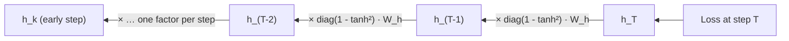
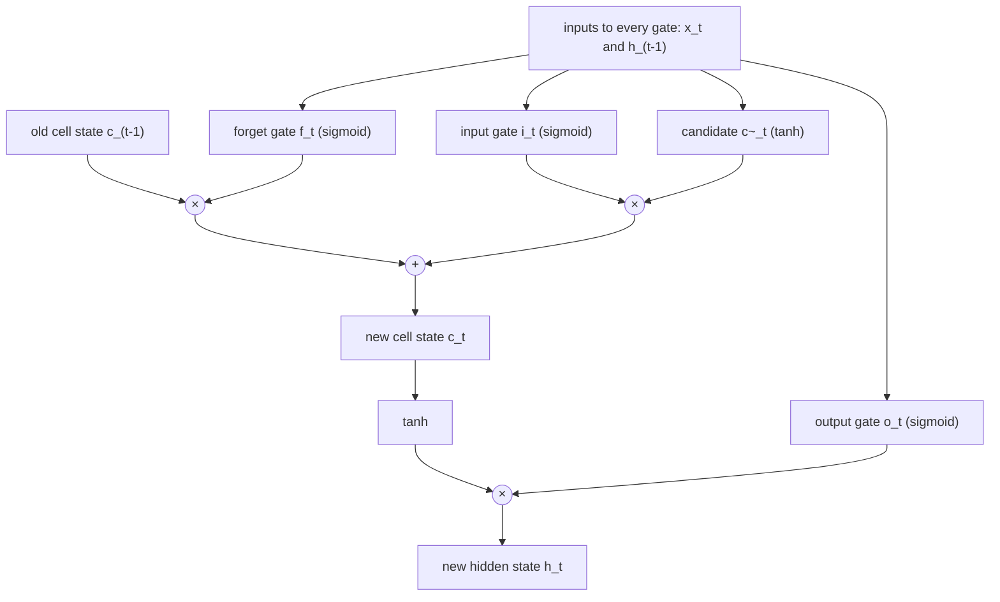
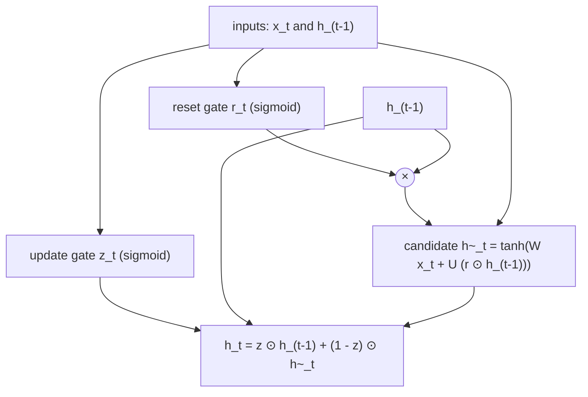
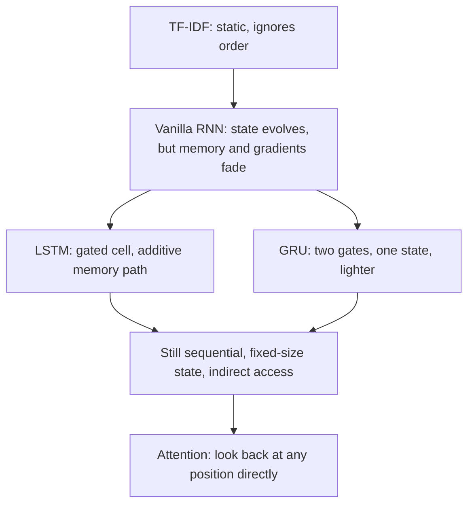

import {GruBlendPlayground, LstmCellPlayground, TfidfPlayground} from '@site/src/components/Widgets';

:::tip[TL;DR (30-Second Interview Pitch)]
A vanilla RNN keeps all of its memory in one hidden state that is pushed through $\tanh(\param{W_h}\pred{h_{t-1}} + \ldots)$ at every step. Old information fades, and in backprop the gradient is multiplied by $\operatorname{diag}(1 - \tanh^2)\,\param{W_h}$ once per step, so it **vanishes** (or **explodes**). An **LSTM** separates **storing** from **showing**. A **cell state** $\pred{c_t}$ is updated **additively**, $\pred{c_t} = \pred{f_t} \odot \pred{c_{t-1}} + \pred{i_t} \odot \pred{\tilde c_t}$, and a **hidden state** $\pred{h_t} = \pred{o_t} \odot \tanh(\pred{c_t})$ exposes part of it. Three sigmoid **gates** decide what to forget, what to write and what to reveal. Along the cell path the gradient is scaled only by the forget gate, so it survives when $\pred{f_t} \approx 1$. Measured over 50 steps, $3.2 \times 10^{-14}$ reaches the first input of an untrained RNN, but $0.053$ reaches it in an LSTM whose forget gates sit near 0.95. A **GRU** keeps the gating with 2 gates and no separate cell, $\pred{h_t} = \pred{z_t} \odot \pred{h_{t-1}} + (1 - \pred{z_t}) \odot \pred{\tilde h_t}$, using 3× an RNN's parameters instead of the LSTM's 4×.
:::

<FormulaKey />

:::info[Where this page sits]
**Before:** [RNNs in Practice](../04-rnns/03-rnns-in-practice-training-and-limits.md) trained RNNs, measured vanishing and exploding gradients, and previewed gates.
**This page:** the theory half of notebook *13 LSTM Implementation* (sections 1–4 and the consolidation): why order matters, why vanilla RNN memory is fragile, the LSTM cell gate by gate, why the additive path helps gradients (with measurements), GRU, and how to choose.
**Next:** [LSTM in Practice: Character-Level Text Generation and Temperature Sampling](./02-lstm-text-generation-temperature-sampling.md) builds the notebook's character-level LSTM in PyTorch, generates text and explains temperature.
:::

## 🧭 Start Here

The previous section built a recurrent neural network and showed where it breaks: its single hidden state is rewritten at every step, and the learning signal that has to travel back through those steps either shrinks to nothing or blows up. This page is about the fix that made recurrent networks practical for language, speech and time series for most of the 2010s: **gated memory**. Instead of one vector that is overwritten every step, the network gets a protected memory channel and a set of learned "valves" that decide, number by number, what to keep, what to erase, what to write and what to show.

The page follows the notebook's arc. First, a short reminder of *why* we need sequence models at all: TF-IDF cannot see word order. Second, a precise look at *why* the vanilla RNN's memory is fragile: the Jacobian chain through time. Then the LSTM cell is built one gate at a time, with the notebook's numbers at each step. The central question gets its own chapter: why does an additive update help gradients? We answer it with real gradient measurements, including one surprise: an LSTM with default initialization loses its gradient almost as fast as a vanilla RNN. Finally, the GRU, a lighter gated cell, and a comparison of all three that ends with the limitation that leads to attention.

The chain of ideas:

1. Meaning depends on **order**, so we need a state that evolves as we read.
2. A vanilla RNN's state and gradient both pass through a **repeated nonlinear transform**, so they fade.
3. LSTM splits memory into a **cell state** (store) and a **hidden state** (show).
4. **Gates** (sigmoids in $(0, 1)$) control forgetting, writing and exposing.
5. The cell update is **additive**, so its gradient is scaled only by the forget gate.
6. **GRU** gets most of the benefit with 2 gates and one state.
7. Recurrence is still **sequential** and **bottlenecked**, which is the motivation for attention.

| New concept | One-line meaning |
|---|---|
| **Static representation** | One fixed vector for a whole document (TF-IDF), blind to order |
| **Long-term dependency** | A prediction at step $t$ that needs information from many steps earlier |
| **Local Jacobian** | $\partial \pred{h_t} / \partial \pred{h_{t-1}}$: how one step changes the previous state; the gradient is multiplied by it once per step |
| **Saturation** | tanh/sigmoid input so large that the curve is flat and the derivative is ≈ 0 |
| **Cell state** $\pred{c_t}$ | The LSTM's internal long-term memory channel, updated additively |
| **Hidden state** $\pred{h_t}$ | The LSTM's exposed working state: what it shows the next layer and the next step |
| **Gate** | A sigmoid vector in $(0, 1)$, multiplied element-wise into a signal to let a fraction of it through |
| **Forget / input / output gate** | How much old memory to keep / how much new memory to write / how much memory to reveal |
| **Candidate memory** $\pred{\tilde c_t}$ | The proposed new content, a tanh vector in $(-1, 1)$ |
| **Additive path** | $\pred{c_t} = \pred{f_t} \odot \pred{c_{t-1}} + \ldots$: the old memory is scaled, not squashed |
| **GRU** | Gated Recurrent Unit: update gate + reset gate, no separate cell |
| **Forget-gate bias** | A bias initialized to 1 or more so the cell starts out remembering |

:::analogy[Memory as a notebook instead of a whiteboard]
A vanilla RNN is a student who keeps everything on one small whiteboard and must wipe and rewrite the whole board after every sentence of the lecture. An LSTM student has a **notebook** (cell state) and a **whiteboard** (hidden state). After each sentence they decide which old notes to cross out (forget gate), which new notes to add (input gate, candidate), and what to copy onto the whiteboard for the class to see right now (output gate). A note written in week one can sit in the notebook, untouched, until the exam.
:::

## 1. Why Word Order Needs a Sequence Model

In the NLP pages we classified sentiment with **TF-IDF** plus a classical classifier, and it worked well. TF-IDF turns a whole document into one fixed-length vector $\data{x} \in \mathbb{R}^{V}$, with one weight per vocabulary word: how often the word occurs in this document, discounted by how common it is across the corpus. That is a **static representation**: it is computed once, from counts, and is the same whatever order the words came in.

That is fine when *which* words appear carries the signal: "excellent", "amazing", "worst" and "poor" are strong sentiment cues on their own, and spam filtering, topic tagging and document retrieval work the same way. But a lot of meaning lives in **order**. The notebook's examples make this concrete. "man bites dog" and "dog bites man" contain exactly the same words, so TF-IDF gives them **identical** vectors (cosine similarity 1.0), even though they describe different events. "good movie" and "not good movie" differ by one word, and their vectors are still quite close (cosine 0.744), although their sentiment is opposite. The vectorizer sees that "not" is present. It cannot see that "not" applies to "good".

A **sequence model** reads the tokens one at a time, $\data{x_1}, \data{x_2}, \ldots, \data{x_T}$, and keeps a state that evolves as it reads, $\pred{h_t} = f(\data{x_t}, \pred{h_{t-1}})$. The state after "not" is different from the state after "very", so the model reaches "good" in a different context. Take the notebook's sentence: "I thought the movie would be great, but it was disappointing". A word counter sees both "great" and "disappointing". A reader builds an expectation (positive), sees "but" (reversal coming) and ends negative. Meaning lives in the **trajectory** of the words, not just in which words are present. Next-word prediction, translation, text generation, sequence labelling, question answering and summarization all need this order-sensitive memory.

<Formula name="Static vs dynamic representation" tag="Why sequence models" words="TF-IDF compresses a whole document into one frozen vector of word weights. A sequence model instead updates a state one token at a time, so the state depends on what came before and in what order." remember="Bag of words vs running story.">

$$
\data{x_{\text{doc}}} = [x_1, x_2, \ldots, x_V] \qquad \text{vs} \qquad \pred{h_t} = f(\data{x_t}, \pred{h_{t-1}})
$$

- $V$: vocabulary size; each $x_j$ is the TF-IDF weight of word $j$ in this document
- $\pred{h_t}$: the state after reading the first $t$ tokens; it changes if the tokens are reordered

**Example:** TF-IDF on the notebook's four sentences gives a $4 \times 6$ matrix. The rows for man bites dog and dog bites man are identical (all three words weigh 0.5774), and good movie vs not good movie have cosine similarity 0.744.

</Formula>

| Pair | Same words? | TF-IDF cosine | Same meaning? |
|---|---|---|---|
| "man bites dog" / "dog bites man" | Yes, reordered | **1.0** (identical vectors) | No: different event |
| "good movie" / "not good movie" | One extra word | **0.744** | No: opposite sentiment |

The vanilla RNN, $\pred{h_t} = \tanh(\param{W_x}\data{x_t} + \param{W_h}\pred{h_{t-1}} + \param{b})$, was the first deep-learning answer to this. So why do we need anything more?


**Try it yourself.** Edit the sentences: reorder the words of any line and its TF-IDF row doesn't change.

<TfidfPlayground />

:::tip[🎯 Interview angle]
**"Why not just use TF-IDF for every NLP task?"** TF-IDF is a static bag-of-words vector: it captures which words matter but not their order, so "dog bites man" and "man bites dog" get the identical vector, and negation scope is invisible. It is a strong, cheap baseline for document-level classification and retrieval. Tasks where meaning depends on order (generation, translation, tagging, question answering) need a model whose state evolves token by token: RNN/LSTM, or today, a Transformer.
:::

## 2. Long-Term Dependencies: Why Vanilla RNN Memory Is Fragile

A **long-term dependency** is a prediction at step $t$ that needs information seen many steps earlier. The notebook's example is "I grew up in France … I speak fluent ___". To fill the blank, the model must still have "France" in its state, possibly dozens of words later. In principle the RNN's hidden state can carry it there. In practice it usually doesn't, for two connected reasons, one in the forward pass and one in the backward pass.

**Forward: repeated transformation.** The state at step $t$ is built from the previous state by a matrix multiplication and a tanh, and that state from the one before, and so on: $\pred{h_t} \leftarrow \pred{h_{t-1}} \leftarrow \cdots \leftarrow \pred{h_1}$. Anything stored at step 1 has been multiplied by $\param{W_h}$ and squashed by tanh $t - 1$ times by the time it reaches step $t$. Each pass can distort it, shrink it, or (less often) amplify it. The notebook's toy recurrence shows the shrinking: it runs $h \leftarrow \tanh(0.8\,h)$ from two very different starting values, 0.1 and 2.0. They begin 1.9 apart; after 5 steps they are 0.244 apart, after 10 steps 0.076, after 20 steps 0.008. The recurrence **washes out** the difference: after enough steps, the state no longer remembers where it started.

**Backward: the gradient walks the same chain.** Training needs the loss at a late step to send a learning signal back to early steps. If $\loss{L_T}$ depends on $\pred{h_T}$, which depends on $\pred{h_{T-1}}$, and so on back to $\pred{h_k}$, the chain rule multiplies one factor per step:

<Formula name="Gradient through time (chain rule)" tag="Why the gradient travels" words="The gradient of a late loss with respect to an early hidden state is a product of one local Jacobian per step in between. The longer the gap, the more factors are multiplied together." remember="One factor per step back.">

$$
\frac{\partial \loss{L_T}}{\partial \pred{h_k}} = \frac{\partial \loss{L_T}}{\partial \pred{h_T}}\,\frac{\partial \pred{h_T}}{\partial \pred{h_{T-1}}}\,\frac{\partial \pred{h_{T-1}}}{\partial \pred{h_{T-2}}} \cdots \frac{\partial \pred{h_{k+1}}}{\partial \pred{h_k}}, \qquad \loss{L} = \sum_{t=1}^{T} \loss{L_t}
$$

- $\partial \pred{h_{j}} / \partial \pred{h_{j-1}}$: the local Jacobian of one step ($H \times H$)
- There are $T - k$ such factors between step $k$ and step $T$

**Example:** if each factor had size 0.8, the gradient would keep $0.8^{10} = 0.107$ of its size after 10 steps and $0.8^{30} = 0.00124$ after 30. If each had size 1.2, it would grow to $1.2^{30} = 237.4$.

</Formula>



What does each factor look like? Write the pre-activation as $\pred{a_t} = \param{W_x}\data{x_t} + \param{W_h}\pred{h_{t-1}} + \param{b}$ and the state as $\pred{h_t} = \tanh(\pred{a_t})$. Differentiating gives two pieces: how the state responds to its pre-activation (the tanh slope), and how the pre-activation responds to the previous state ($\param{W_h}$).

<Formula name="Local Jacobian of one RNN step" tag="The repeated factor" words="One step back in time multiplies the gradient by a diagonal matrix of tanh slopes and by the recurrent weight matrix. Repeating this many times is what makes gradients vanish or explode." remember="Tanh slope times W_h, every step.">

$$
\frac{\partial \pred{h_t}}{\partial \pred{h_{t-1}}} = \operatorname{diag}\big(1 - \tanh^2(\pred{a_t})\big)\,\param{W_h}, \qquad \frac{d}{dz}\tanh(z) = 1 - \tanh^2(z) \in (0, 1]
$$

- $\operatorname{diag}(\cdot)$: a matrix with the vector on its diagonal and zeros elsewhere
- $1 - \tanh^2$ equals 1 only at $z = 0$ and falls fast: 0.420 at $z = 1$, 0.0707 at $z = 2$, 0.00987 at $z = 3$, 0.00018 at $z = 5$

**Example:** a neuron whose pre-activation sits at $z = 3$ passes back less than 1% of the gradient through its tanh at every step, whatever $\param{W_h}$ is.

</Formula>

**Why is the tanh part a *diagonal* matrix?** Because tanh is applied **element-wise**: $h_1 = \tanh(a_1)$, $h_2 = \tanh(a_2)$, and so on. Output $h_i$ depends only on its own input $a_i$, so every cross-derivative $\partial h_i / \partial a_j$ with $i \ne j$ is zero, and only the diagonal entries $1 - \tanh^2(a_i)$ survive. The notebook's memory trick: element-wise activation → each output depends only on its own input → cross-derivatives are zero → diagonal Jacobian. The same reasoning applies to sigmoid, ReLU and every other element-wise activation, and it will matter again for the LSTM's gates.

**Vanishing and exploding.** Multiply many of these factors and the product behaves like a number raised to a power. If the effective size of each factor is below 1, the gradient shrinks exponentially with the distance $T - k$, and early steps receive almost no learning signal: the **vanishing gradient problem**. If it is above 1, the gradient grows exponentially and training becomes unstable, with loss spikes and `NaN`s: the **exploding gradient problem**. **Saturation** makes vanishing worse. When a pre-activation is large in magnitude, tanh is flat there, the forward signal is compressed (big changes in input barely change the output) and the backward slope is near zero. The notebook calls the result **unstable memory**: there is no mechanism that says "keep this", "erase that" or "protect this signal from being overwritten". Everything is mixed into the same hidden state by the same update.

:::danger[Interview Trap: "RNNs fail on long sequences because they can't represent long dependencies"]
The weaker claim is the accurate one. A vanilla RNN *can* represent long-range behaviour (with the right weights it can carry a value indefinitely). The problem is **optimization**: gradient descent can't *find* those weights, because the gradient that would teach them vanishes before it reaches the early steps. That is why the fix is an architecture with a better **gradient path**, not just a bigger hidden state. (A fixed-size state is a separate, second limitation: it caps how much can be remembered.)
:::

:::tip[🎯 Interview angle]
**"Explain the vanishing gradient problem in RNNs mathematically."** The gradient from a loss at step $T$ to state $h_k$ is a product of $T - k$ local Jacobians, each equal to $\operatorname{diag}(1 - \tanh^2(a_t))\,W_h$. The tanh slope is at most 1 and close to 0 when saturated, so if the factors' norms are below 1, the product shrinks exponentially ($0.8^{30} = 0.00124$) and early steps get no learning signal. If the norms are above 1, it explodes ($1.2^{30} = 237$). Clipping fixes exploding; vanishing needs a different architecture, such as gated cells.
:::

## 3. The LSTM Idea: Separate Memory from Output, and Add Gates

**LSTM** (Long Short-Term Memory, Hochreiter and Schmidhuber, 1997; the forget gate was added by Gers et al., 2000) attacks both problems with one design decision: **do not keep everything in one vector**. At every time step an LSTM carries **two** states forward:

- the **cell state** $\pred{c_t}$: the long-term memory channel. It is changed only by element-wise scaling and addition, so information on it is protected from repeated squashing;
- the **hidden state** $\pred{h_t}$: the working state the cell exposes. It is the output that the next layer (or the classifier) reads, and it is also fed back into the gate computations at the next step.

A useful split from the notebook: $\pred{c_t}$ is the **memory bank**, $\pred{h_t}$ is **what the model chooses to say right now**.

At every step the cell must answer four questions. What old information should be **kept**? What old information should be **erased**? What new information should be **written**? What part of memory should be **revealed**? It answers each with a **gate**: a vector computed by a small layer with a sigmoid output, $\sigma(z) = 1 / (1 + e^{-z}) \in (0, 1)$, that multiplies another vector **element-wise**. A gate entry near 0 blocks that dimension, near 1 passes it, and anything in between passes a fraction. Gates are *soft*, not binary switches, which is exactly what makes them differentiable and therefore learnable by backprop. Every gate is computed from the same two things: the current input $\data{x_t}$ and the previous hidden state $\pred{h_{t-1}}$. So the network learns *when* to keep, write and reveal, depending on what it is reading.




*How to read it:* the top line is the cell state $\pred{c_{t-1}} \to \pred{c_t}$, the bottom line carries $\pred{h_{t-1}}$ joined by $\data{x_t}$. The four yellow boxes, left to right, are $\pred{f_t}$ (σ), $\pred{i_t}$ (σ), $\pred{\tilde c_t}$ (tanh) and $\pred{o_t}$ (σ), each a layer $\sigma$ or $\tanh$ of $\param{W}\data{x_t} + \param{U}\pred{h_{t-1}} + \param{b}$. On the top line, × is $\pred{f_t} \odot \pred{c_{t-1}}$ and + adds $\pred{i_t} \odot \pred{\tilde c_t}$; on the right, $\pred{h_t} = \pred{o_t} \odot \tanh(\pred{c_t})$ leaves both upward and to the next step. Chapters 4–7 light up one part at a time.

Read the diagram from the top. Four small layers look at $\data{x_t}$ and $\pred{h_{t-1}}$. Two of them scale the old memory and the new proposal, and the results are **added** into the new cell state. The cell state is then squashed and filtered by the third gate to produce the hidden state. The only operations on the horizontal path from $\pred{c_{t-1}}$ to $\pred{c_t}$ are one element-wise multiplication and one addition. There is no weight matrix and no tanh on it. That single fact is the reason LSTMs train on long sequences, and Chapter 7 proves it with measurements.

:::analogy[Gates are dimmer switches, not on/off switches]
A light switch is either on or off, so you can't learn how bright a room should be by nudging it. A dimmer can be turned a little at a time, and you can feel which direction makes things better. Sigmoid gates are dimmers on each memory dimension: 0.98 lets almost everything through, 0.3 lets a third through. Because they turn smoothly, gradient descent can adjust them a little at a time.
:::

:::tip[🎯 Interview angle]
**"What is the difference between the cell state and the hidden state in an LSTM?"** The cell state $c_t$ is the internal long-term memory: updated additively ($f \odot c_{t-1} + i \odot \tilde c$), never multiplied by a weight matrix along its own path, so information and gradients survive many steps. The hidden state $h_t = o_t \odot \tanh(c_t)$ is the filtered, bounded view of that memory that the cell exposes: it goes to the output layer and is fed back into all four gate computations at the next step. "$c$ stores, $h$ reveals."
:::

## 4. The Forget Gate, the Input Gate and Candidate Memory

The cell update needs three ingredients, each produced by its own small layer with its own weights. All three look at the same inputs, $\data{x_t}$ and $\pred{h_{t-1}}$, and all three output a vector of hidden size $H$, one number per memory dimension.

**The forget gate** decides how much of each dimension of the old cell state survives. It is a sigmoid layer, so each entry is between 0 and 1. An entry close to 1 means "keep this memory", and close to 0 means "erase it". Think of a language model tracking the grammatical subject: when a new sentence starts with a new subject, the forget gate should clear the old subject's dimensions. The **input gate** is a second sigmoid layer with the same shape. It does not create any content. It only decides how strongly the new proposal is allowed in, dimension by dimension.

**Candidate memory** is the content itself: a tanh layer that proposes new values in $(-1, 1)$, positive or negative, to add to the memory. The split is deliberate: the input gate decides **how much** to write, the candidate decides **what** to write. The interview question bank puts it well: the candidate writes a draft, and the input gate decides how much of the draft enters memory. Why tanh for the candidate and sigmoid for the gates? A gate is a *fraction* (0 to 1, a proportion to let through), while content needs a *sign*. Memory must be able to move up or down. A sigmoid candidate could only ever push the cell state upwards. Tanh is also zero-centred, which keeps the cell state from drifting in one direction.

<Formula name="Forget gate" tag="How much old memory to keep" words="A sigmoid layer looks at the current input and the previous hidden state and outputs one number between 0 and 1 for each memory dimension: the fraction of the old cell state to keep." remember="Near 1 keep, near 0 erase.">

$$
\pred{f_t} = \sigma\big(\param{W_f}\,\data{x_t} + \param{U_f}\,\pred{h_{t-1}} + \param{b_f}\big)
$$

- $\param{W_f}$ ($H \times D$): input weights; $\param{U_f}$ ($H \times H$): recurrent weights; $\param{b_f}$ ($H$): bias
- The interview-bank form $\sigma(\param{W_f}[\pred{h_{t-1}}, \data{x_t}] + \param{b_f})$ is the same thing, with $\param{W_f}$ and $\param{U_f}$ stacked side by side and the two vectors concatenated

**Example:** in the notebook's random cell (seed 42) the forget gate is $[0.006, 0.296, 0.98, 0.054]$: dimension 3 keeps 98% of its old memory, and dimension 1 keeps 0.6%.

</Formula>


*How to read it:* only the forget path is lit: $\pred{h_{t-1}}$ and $\data{x_t}$ feed the first σ box, and its output $\pred{f_t}$ meets the cell-state line at ×, scaling every dimension of $\pred{c_{t-1}}$.

<Formula name="Input gate" tag="How much new memory to write" words="A second sigmoid layer, with its own weights, outputs a fraction between 0 and 1 per dimension: how strongly the new candidate content is written into memory." remember="Decides how much, not what.">

$$
\pred{i_t} = \sigma\big(\param{W_i}\,\data{x_t} + \param{U_i}\,\pred{h_{t-1}} + \param{b_i}\big)
$$

- Same shapes as the forget gate, but independent weights: keeping and writing are separate decisions
- $\pred{i_t}$ on its own changes nothing; it only scales $\pred{\tilde c_t}$

**Example:** the notebook's cell has $\pred{i_t} = [0.966, 0.427, 0.114, 0.448]$: dimension 1 accepts almost all of its candidate, and dimension 3 accepts about a ninth.

</Formula>

<Formula name="Candidate memory" tag="What new content to write" words="A tanh layer proposes new memory content between minus 1 and 1 for each dimension. It is the draft; the input gate decides how much of the draft is actually written." remember="The draft, signed and bounded.">

$$
\pred{\tilde c_t} = \tanh\big(\param{W_c}\,\data{x_t} + \param{U_c}\,\pred{h_{t-1}} + \param{b_c}\big)
$$

- tanh, not sigmoid: content must be able to push memory **down** as well as up
- In PyTorch this is the gate called **g** (the "cell gate")

**Example:** the notebook's candidate is $[0.058, 0.805, -0.98, 0.933]$: dimension 3 proposes a strongly negative value, but its input gate (0.114) lets only a little of it in.

</Formula>


*How to read it:* the σ box produces $\pred{i_t}$ and the tanh box produces $\pred{\tilde c_t}$; their product at the pink × is the new content $\pred{i_t} \odot \pred{\tilde c_t}$, which rises to the + on the cell-state line.

| | Forget gate $\pred{f_t}$ | Input gate $\pred{i_t}$ | Candidate $\pred{\tilde c_t}$ |
|---|---|---|---|
| Activation | sigmoid | sigmoid | tanh |
| Range | $(0, 1)$ | $(0, 1)$ | $(-1, 1)$ |
| Role | Fraction of **old** memory to keep | Fraction of **new** content to write | The new content itself |
| Acts on | $\pred{c_{t-1}}$ | $\pred{\tilde c_t}$ | (multiplied by $\pred{i_t}$) |

:::danger[Interview Trap: "The forget gate makes a hard keep-or-delete decision"]
It doesn't. It outputs a continuous fraction per dimension, so it performs **soft filtering**: 0.296 keeps about 30% of that memory. Hard 0/1 decisions would have zero gradient almost everywhere and couldn't be learned with backprop. A gate also isn't one number per cell: it is a **vector**, a separate decision for every memory dimension.
:::

:::tip[🎯 Interview angle]
**"Why do we need both the input gate and the candidate memory?"** They separate *what* from *how much*. The candidate (tanh, $-1$ to 1) proposes signed content; the input gate (sigmoid, 0 to 1) decides per dimension how much of it is written. With only a candidate, every step would write everything it proposes; with only a gate, there'd be nothing to write. The forget gate is a third, independent decision about old memory, so the cell can keep old content *and* add new content in the same step.
:::

## 5. The Cell-State Update: Keep Some Old, Add Some New

Now the three ingredients combine into the most important equation of the LSTM. The old memory is scaled by the forget gate, the candidate is scaled by the input gate, and the two are **added**:

<Formula name="LSTM cell-state update" tag="The heart of the LSTM" words="The new memory is the old memory scaled by the forget gate plus the new candidate scaled by the input gate, dimension by dimension. Old memory is only scaled, never pushed through a weight matrix or a squashing function." remember="Keep some old, add some new.">

$$
\pred{c_t} = \pred{f_t} \odot \pred{c_{t-1}} + \pred{i_t} \odot \pred{\tilde c_t}
$$

- $\odot$: element-wise (Hadamard) product; every dimension is updated independently
- $\pred{f_t} \odot \pred{c_{t-1}}$: retained old memory; $\pred{i_t} \odot \pred{\tilde c_t}$: selected new memory

**Example:** the notebook's demo with $\pred{c_{t-1}} = [0.9, 0.2, -0.8, 0.5]$, $\pred{f_t} = [1, 0.9, 0.1, 0]$, $\pred{i_t} = [0, 0.2, 0.8, 1]$ and $\pred{\tilde c_t} = [0.3, 0.7, 0.4, -0.6]$ gives kept $[0.9, 0.18, -0.08, 0]$ plus written $[0, 0.14, 0.32, -0.6]$, so $\pred{c_t} = [0.9, 0.32, 0.24, -0.6]$.

</Formula>


*How to read it:* along the top line, × applies the forget gate and + adds the gated candidate: $\pred{c_t} = \pred{f_t} \odot \pred{c_{t-1}} + \pred{i_t} \odot \pred{\tilde c_t}$. Nothing else touches this line.

<Animation src="lstm/cell-update" caption="The notebook demo, one dimension per row. Watch the old memory get scaled by the forget gate, the candidate get scaled by the input gate, and the two add into the new cell state: dimension 1 is kept untouched, dimension 4 is fully replaced." />

The notebook's demo is hand-picked so that each of the four dimensions shows a different behaviour:

| Dimension | $\pred{c_{t-1}}$ | $\pred{f_t}$ | $\pred{i_t}$ | $\pred{\tilde c_t}$ | Kept | Written | $\pred{c_t}$ | What happened |
|---|---|---|---|---|---|---|---|---|
| 1 | 0.9 | 1.0 | 0.0 | 0.3 | 0.9 | 0.0 | **0.9** | Preserved exactly: nothing forgotten, nothing written |
| 2 | 0.2 | 0.9 | 0.2 | 0.7 | 0.18 | 0.14 | **0.32** | Mostly kept, a little added |
| 3 | −0.8 | 0.1 | 0.8 | 0.4 | −0.08 | 0.32 | **0.24** | Mostly rewritten: the sign flips |
| 4 | 0.5 | 0.0 | 1.0 | −0.6 | 0.0 | −0.6 | **−0.6** | Fully replaced by the candidate |

Dimension 1 is the case that matters for long-term memory. With $f = 1$ and $i = 0$ the value passes through unchanged, and a run of such steps would carry it unchanged for as long as the gates stay that way. A vanilla RNN cannot do this: its state always goes through $\tanh(\param{W_h}\pred{h} + \ldots)$, and even with $\param{W_h} = 1$ and no input, $\tanh(0.9) = 0.716$, so the value shrinks at every step.

The notebook's second example is a full random cell (seed 42, input size 3, hidden size 4), which shows the same mechanics with less tidy numbers:

| Quantity | Dim 1 | Dim 2 | Dim 3 | Dim 4 |
|---|---|---|---|---|
| $\pred{c_{t-1}}$ | 0.767 | −0.469 | 0.543 | −0.463 |
| $\pred{f_t}$ | 0.006 | 0.296 | **0.980** | 0.054 |
| $\pred{f_t} \odot \pred{c_{t-1}}$ | 0.004 | −0.139 | 0.532 | −0.025 |
| $\pred{i_t}$ | 0.966 | 0.427 | 0.114 | 0.448 |
| $\pred{\tilde c_t}$ | 0.058 | 0.805 | −0.980 | 0.933 |
| $\pred{i_t} \odot \pred{\tilde c_t}$ | 0.056 | 0.344 | −0.112 | 0.418 |
| $\pred{c_t}$ | **0.060** | **0.205** | **0.420** | **0.393** |

Dimension 3 keeps 98% of its old value (0.543 × 0.98 = 0.532) and lets in only a small negative correction. Dimension 1 forgets almost everything and takes on its small candidate instead. One update does both kinds of thing at once, in different dimensions. That is the point of having vector-valued gates.


**Try it yourself.** Pick one of the notebook's four dimensions, or set the gates yourself, and watch the cell update and how much memory survives $k$ steps.

<LstmCellPlayground />

:::tip[🎯 Interview angle]
**"Write the LSTM cell-state update and explain each term."** $c_t = f_t \odot c_{t-1} + i_t \odot \tilde c_t$. The first term is the retained old memory (forget gate × old cell), the second is the selected new memory (input gate × candidate), and $\odot$ makes every dimension an independent decision. It is additive, so with $f \approx 1$ and $i \approx 0$ a value is carried forward unchanged, which a vanilla RNN's $\tanh(W h + \ldots)$ can never do.
:::

## 6. The Output Gate and the Hidden State

The cell state is the memory, but not all memory is relevant at every step. A model reading a long document may store "the subject is plural" for many words, but it only needs to *use* that fact when it reaches a verb. So the LSTM has a third gate, the **output gate**, which decides which parts of the memory become visible in the hidden state. The memory is first passed through tanh to bound it to $(-1, 1)$, because the cell state itself is unbounded: additions can push it above 1 or below −1. Then it is filtered by the gate:

<Formula name="Output gate and hidden state" tag="How much memory to reveal" words="A third sigmoid layer decides, per dimension, how much of the squashed cell state is exposed as the hidden state. The cell state keeps the memory; the hidden state is the filtered view everyone else sees." remember="c stores, h reveals.">

$$
\pred{o_t} = \sigma\big(\param{W_o}\,\data{x_t} + \param{U_o}\,\pred{h_{t-1}} + \param{b_o}\big), \qquad \pred{h_t} = \pred{o_t} \odot \tanh(\pred{c_t})
$$

- $\tanh(\pred{c_t})$: a bounded copy of the memory, in $(-1, 1)$
- $\pred{h_t}$ goes to the output layer **and** back into all four gates at step $t + 1$; $\pred{c_t}$ goes only to the next step's cell update

**Example:** in the notebook's cell, dimension 2 stores $\pred{c_t} = 0.205$, but its output gate is 0.002, so $\pred{h_t}$ shows 0.000 for it: the memory is kept but hidden. Dimension 1 has $\pred{o_t} = 0.993$, so its memory 0.060 is shown almost in full.

</Formula>


*How to read it:* the fourth σ box produces $\pred{o_t}$; the cell state is copied down, squashed by the pink tanh, and multiplied by $\pred{o_t}$ to give $\pred{h_t}$, which goes up as the output and right as the next step's hidden state.

The notebook's cell, finished:

| Quantity | Dim 1 | Dim 2 | Dim 3 | Dim 4 |
|---|---|---|---|---|
| $\pred{c_t}$ (memory) | 0.060 | 0.205 | 0.420 | 0.393 |
| $\tanh(\pred{c_t})$ | 0.060 | 0.202 | 0.397 | 0.374 |
| $\pred{o_t}$ | 0.993 | **0.002** | 0.110 | 0.620 |
| $\pred{h_t}$ (shown) | 0.060 | **0.000** | 0.044 | 0.232 |

This is the "store versus show" idea in numbers. Dimension 2 has non-trivial memory that is completely invisible to the rest of the network at this step, but it is still in the cell and can be revealed later, when an output gate opens.

Putting the six equations together gives the standard LSTM cell (the notebook's notation; $\param{W}$ multiplies the input, $\param{U}$ the previous hidden state):

| # | Step | Equation |
|---|---|---|
| 1 | Forget gate | $\pred{f_t} = \sigma(\param{W_f}\data{x_t} + \param{U_f}\pred{h_{t-1}} + \param{b_f})$ |
| 2 | Input gate | $\pred{i_t} = \sigma(\param{W_i}\data{x_t} + \param{U_i}\pred{h_{t-1}} + \param{b_i})$ |
| 3 | Candidate memory | $\pred{\tilde c_t} = \tanh(\param{W_c}\data{x_t} + \param{U_c}\pred{h_{t-1}} + \param{b_c})$ |
| 4 | Cell update | $\pred{c_t} = \pred{f_t} \odot \pred{c_{t-1}} + \pred{i_t} \odot \pred{\tilde c_t}$ |
| 5 | Output gate | $\pred{o_t} = \sigma(\param{W_o}\data{x_t} + \param{U_o}\pred{h_{t-1}} + \param{b_o})$ |
| 6 | Hidden state | $\pred{h_t} = \pred{o_t} \odot \tanh(\pred{c_t})$ |

| | Cell state $\pred{c_t}$ | Hidden state $\pred{h_t}$ |
|---|---|---|
| Role | Internal long-term memory | Exposed working state / output |
| Update | Additive: $\pred{f_t} \odot \pred{c_{t-1}} + \pred{i_t} \odot \pred{\tilde c_t}$ | $\pred{o_t} \odot \tanh(\pred{c_t})$ |
| Range | Unbounded | $(-1, 1)$ |
| Goes to | The next step's cell update only | Output layer, next layer, and all four gates at the next step |
| PyTorch | `c_n` in `out, (h_n, c_n) = lstm(x)` | `out` (every step) and `h_n` (last step) |
| Analogy | Memory bank | What the model says right now |

:::analogy[The output gate is a news editor]
The cell state is the newsroom's full archive: everything the reporters have filed, kept for as long as it might matter. The output gate is the editor who decides what goes into today's paper. A story can sit in the archive for weeks without being printed, and the day it becomes relevant, the editor runs it.
:::

:::tip[🎯 Interview angle]
**"How is the LSTM hidden state produced, and why the tanh?"** $h_t = o_t \odot \tanh(c_t)$. The cell state is unbounded (additions accumulate), so tanh squashes it to $(-1, 1)$ to keep $h_t$ on a stable scale for the gates and the next layer; the output gate, a per-dimension sigmoid, then decides how much of each memory dimension to reveal. A dimension can be stored in $c_t$ but hidden ($o \approx 0$) until it becomes relevant.
:::

## 7. Why the Additive Path Fixes Vanishing Gradients

Chapter 2 showed that the vanilla RNN's gradient is multiplied by $\operatorname{diag}(1 - \tanh^2)\,\param{W_h}$ at every step back. What is the corresponding factor along the LSTM's cell path? Differentiate $\pred{c_t} = \pred{f_t} \odot \pred{c_{t-1}} + \pred{i_t} \odot \pred{\tilde c_t}$ with respect to $\pred{c_{t-1}}$. The first term is element-wise, so (exactly as with tanh in Chapter 2) its Jacobian is diagonal, with the forget gate on the diagonal. Carrying the gradient back $k$ steps along the cell path multiplies $k$ of these diagonals, which is simply the element-wise product of the forget gates:

<Formula name="Gradient along the cell path" tag="Why LSTMs remember" words="Going back one step along the cell state multiplies the gradient by the forget gate, element by element, and by nothing else on the direct path. Over many steps the factor is the product of the forget gates, which stays large if the gates stay near 1." remember="Forget gate is the gradient's toll.">

$$
\frac{\partial \pred{c_t}}{\partial \pred{c_{t-1}}} \approx \operatorname{diag}(\pred{f_t}), \qquad \frac{\partial \pred{c_t}}{\partial \pred{c_{t-k}}} \approx \operatorname{diag}\Big(\prod_{j=t-k+1}^{t} \pred{f_j}\Big)
$$

- No $\param{W}$ matrix and no tanh slope on this path, unlike the RNN's $\operatorname{diag}(1 - \tanh^2)\,\param{W_h}$
- "≈" because $\pred{f_t}$, $\pred{i_t}$ and $\pred{\tilde c_t}$ also depend on $\pred{h_{t-1}} = \pred{o_{t-1}} \odot \tanh(\pred{c_{t-1}})$, which adds a second, smaller path

**Example:** with forget gates of 0.95 a gradient keeps $0.95^{20} = 0.358$ of its size over 20 steps; with forget gates of 0.5 it keeps $0.5^{20} = 9.5 \times 10^{-7}$, no better than a vanishing RNN.

</Formula>


*How to read it:* the lit top line is the only path from $\pred{c_{t-1}}$ to $\pred{c_t}$, and on it the only operations are × by $\pred{f_t}$ and + of new content. Differentiate along it and you get $\operatorname{diag}(\pred{f_t})$; no $\param{W}$ and no tanh slope.

The example in that card hides the most important practical point: **the additive path only helps if the forget gate is actually close to 1**. The gate is learned, and at initialization its pre-activation is close to zero, so $\sigma(0) = 0.5$. An untrained LSTM therefore forgets half of each memory dimension at every step, and its gradient vanishes almost as fast as a vanilla RNN's. We can measure this directly. Feed 50 random input vectors into untrained models (input size 8, hidden size 32), take a loss that depends only on the last hidden state, and measure how much gradient reaches each input:

| Model | 0 steps back | 10 back | 20 back | 30 back | 49 back |
|---|---|---|---|---|---|
| Vanilla RNN | 1.9 | $3.2 \times 10^{-3}$ | $5.6 \times 10^{-6}$ | $7.3 \times 10^{-9}$ | $\mathbf{3.2 \times 10^{-14}}$ |
| GRU, default init | 1.1 | $1.4 \times 10^{-3}$ | $1.0 \times 10^{-5}$ | $6.3 \times 10^{-8}$ | $1.1 \times 10^{-11}$ |
| LSTM, default init (mean $\pred{f}$ ≈ 0.5) | 0.50 | $1.1 \times 10^{-3}$ | $1.2 \times 10^{-5}$ | $9.1 \times 10^{-8}$ | $1.8 \times 10^{-11}$ |
| LSTM, forget bias +1 | 0.45 | $2.7 \times 10^{-2}$ | $4.0 \times 10^{-3}$ | $7.9 \times 10^{-4}$ | $1.6 \times 10^{-5}$ |
| LSTM, forget bias +3 (mean $\pred{f}$ ≈ 0.95) | 0.19 | $4.5 \times 10^{-2}$ | $4.0 \times 10^{-2}$ | $3.5 \times 10^{-2}$ | $\mathbf{5.3 \times 10^{-2}}$ |

<Animation src="lstm/gradient-highway" caption="Gradient reaching each of 50 inputs, log scale, for untrained models. Watch the vanilla RNN and the default LSTM fall by more than ten orders of magnitude, while the LSTM whose forget gates sit near 0.95 stays almost flat." />

Three lessons come out of this table, and each one is a good interview answer:

1. **The architecture makes long memory possible, the gate values make it happen.** The default-initialized LSTM is barely better than the RNN. With the forget gate biased towards remembering, the gradient 49 steps back is about 12 orders of magnitude larger than the RNN's.
2. **That is why the forget-gate bias is usually initialized to 1** (Gers et al., 2000; Jozefowicz et al., 2015), so the cell starts out remembering and learns when to forget. PyTorch does *not* do this by default: it initializes every weight and bias uniformly in $\pm 1/\sqrt{H}$, so you set it yourself (implementation block 7).
3. **During training, the gates learn the right values.** A trained LSTM keeps $\pred{f} \approx 1$ on dimensions that hold long-term information and lower values on dimensions that should turn over quickly. The gradient flows along the dimensions that need it.

How good is the "≈" in the card? Computing the full one-step Jacobian $\partial \pred{c_t} / \partial \pred{c_{t-1}}$ with autograd, including the extra path through $\pred{h_{t-1}}$ and the gates, the part that is *not* $\operatorname{diag}(\pred{f_t})$ makes up 23% of the Jacobian's size when the mean forget gate is 0.49, and 12% when it is 0.95 (implementation block 8). So the direct path dominates, and it dominates most when the cell is in "remember" mode.

:::danger[Interview Trap: "LSTMs solve the vanishing gradient problem"]
They **mitigate** it, and only along the cell path, and only when the forget gates are near 1. The measurements above show an untrained LSTM with default init losing its gradient almost as fast as a vanilla RNN. Very long dependencies (hundreds or thousands of steps) still fade, because a product of many gates slightly below 1 still shrinks. And LSTMs can still have **exploding** gradients through the hidden-state path, so gradient clipping is standard in LSTM training too. The honest answer: "an additive, gated memory path whose per-step factor is the learned forget gate, so the gradient *can* survive."
:::

:::analogy[The cell state is a conveyor belt]
Picture a conveyor belt running through a factory, with workers standing beside it. A box placed on the belt at one end arrives at the other end unchanged unless a worker deliberately takes it off (forget) or adds something to it (input). In a vanilla RNN there is no belt: every box is unpacked, run through a machine and repacked at every station, and after twenty stations nothing of the original is recognizable. The belt only works if the workers mostly leave the boxes alone, which is exactly what a forget gate near 1 means.
:::

:::tip[🎯 Interview angle]
**"How exactly does an LSTM help with vanishing gradients?"** The cell update is additive, so $\partial c_t / \partial c_{t-1} \approx \operatorname{diag}(f_t)$: no weight matrix and no tanh slope on that path. Over $k$ steps the gradient is scaled by the product of forget gates, which stays large if the gates are near 1. Add the caveats: gates are learned and start near 0.5, so initialize the forget-gate bias to 1 or more. In my measurement over 50 steps, a forget bias of +3 kept $5.3 \times 10^{-2}$ of the gradient at the first input, against $3.2 \times 10^{-14}$ for a vanilla RNN. Very long ranges still fade, and clipping is still used for explosions.
:::

## 8. GRU: A Simpler Gated Recurrent Unit

The LSTM works, but it is heavy: three gates plus a candidate means four weight sets, two state vectors to carry, and four matrix products per step. The **GRU** (Gated Recurrent Unit, Cho et al., 2014) asks whether we can keep the main idea, gated additive memory, with fewer moving parts. It makes two simplifications. There is **no separate cell state**: the hidden state $\pred{h_t}$ carries the memory itself. And the forget and input decisions are **merged into one update gate** that interpolates between the old state and a new candidate. If you keep more of the old, you automatically write less of the new.

The GRU has two gates. The **update gate** $\pred{z_t}$ decides, per dimension, how much of the previous hidden state to keep. In the notebook's convention (which is also PyTorch's), $\pred{z_t}$ near 1 means "keep the old value" and near 0 means "take the new candidate". The **reset gate** $\pred{r_t}$ decides how much of the previous state is used when *forming* the candidate. With $\pred{r_t}$ near 0, the candidate is computed almost from the current input alone, as if the past were reset. That is useful at boundaries, such as the start of a new sentence or a new event in a time series.

<Formula name="GRU gates" tag="Update and reset" words="The update gate decides how much of the old hidden state to keep; the reset gate decides how much of the old hidden state is used when proposing new content. Both are sigmoid layers on the current input and the previous hidden state." remember="z keeps, r filters the past.">

$$
\pred{z_t} = \sigma\big(\param{W_z}\data{x_t} + \param{U_z}\pred{h_{t-1}} + \param{b_z}\big), \qquad \pred{r_t} = \sigma\big(\param{W_r}\data{x_t} + \param{U_r}\pred{h_{t-1}} + \param{b_r}\big)
$$

- $\pred{z_t}$ plays the role of LSTM's forget and input gates together; there is no output gate
- In the notebook's random GRU (seed 7): $\pred{z_t} = [0.002, 0.213, 0.337, 0.988]$, $\pred{r_t} = [0.121, 0.877, 0.028, 0.963]$

**Example:** dimension 4 has $\pred{z_t} = 0.988$, so it keeps 98.8% of its old value; dimension 1 has $\pred{z_t} = 0.002$ and is almost fully replaced by its candidate.

</Formula>

<Formula name="GRU candidate and update" tag="Gated interpolation" words="The candidate is a tanh layer that sees the previous state only through the reset gate. The new hidden state is a per-dimension blend: the update gate's share of the old state plus the rest from the candidate." remember="Blend old and new with one dial.">

$$
\pred{\tilde h_t} = \tanh\big(\param{W_h}\data{x_t} + \param{U_h}(\pred{r_t} \odot \pred{h_{t-1}}) + \param{b_h}\big), \qquad \pred{h_t} = \pred{z_t} \odot \pred{h_{t-1}} + (1 - \pred{z_t}) \odot \pred{\tilde h_t}
$$

- $\pred{r_t} \odot \pred{h_{t-1}}$: the past, filtered before it shapes the proposal
- $\pred{z_t} \odot \pred{h_{t-1}}$: a direct gated path from the old state, the GRU's version of the additive cell path

**Example:** the notebook's demo with $\pred{h_{t-1}} = [0.9, 0.2, -0.7, 0.5]$, $\pred{z_t} = [0.95, 0.70, 0.20, 0.05]$ and $\pred{\tilde h_t} = [0.1, 0.8, 0.4, -0.6]$ gives $\pred{h_t} = [0.86, 0.38, 0.18, -0.545]$.

</Formula>

<Animation src="lstm/gru-blend" caption="Each line is one dimension from minus 1 to 1, with the old state and the candidate marked. Watch the new state slide between them: with z = 0.95 it stays next to the old value, with z = 0.05 it lands almost on the candidate." />




*How to read it:* the top line carries $\pred{h_{t-1}}$ to $\pred{h_t}$. The left × keeps $\pred{z_t} \odot \pred{h_{t-1}}$, the right × lets in $(1 - \pred{z_t}) \odot \pred{\tilde h_t}$ (the pink 1− turns $\pred{z_t}$ into $1 - \pred{z_t}$), and + adds them. Below, the reset gate's × filters $\pred{h_{t-1}}$ before it joins $\data{x_t}$ in the tanh that makes $\pred{\tilde h_t}$.

**Two conventions, same model.** Some textbooks and blogs (and the [RNNs in Practice](../04-rnns/03-rnns-in-practice-training-and-limits.md) page) write $\pred{h_t} = (1 - \pred{z_t}) \odot \pred{h_{t-1}} + \pred{z_t} \odot \pred{\tilde h_t}$, where $\pred{z_t}$ near 1 means "update". That is just $\pred{z_t}$ relabelled as $1 - \pred{z_t}$. The notebook, the original GRU paper and PyTorch all use "$\pred{z_t}$ near 1 keeps the old state". In an interview, say which convention you are using. One more PyTorch detail: `nn.GRU` applies the reset gate *after* the recurrent matrix product, $\tanh(\param{W_h}\data{x_t} + \param{b} + \pred{r_t} \odot (\param{U_h}\pred{h_{t-1}} + \param{b_{hn}}))$. That variant is faster on GPUs, and implementation block 6 matches it exactly.


**Try it yourself.** Slide the update gate $z$ and watch the new state move between the old state and the candidate.

<GruBlendPlayground />

:::tip[🎯 Interview angle]
**"How does a GRU differ from an LSTM?"** GRU has no separate cell state: the hidden state is the memory. It has two gates instead of three. The update gate $z_t$ interpolates between the old state and the candidate, so keeping and writing are a single decision, and the reset gate $r_t$ controls how much of the past feeds the candidate. There is no output gate, since all of $h_t$ is exposed. That gives 3 weight sets instead of 4 (3× an RNN's parameters vs 4×), and it is often just as accurate. The direct gated path $z_t \odot h_{t-1}$ plays the role of the LSTM's additive cell path.
:::

## 9. RNN vs LSTM vs GRU, and the Limits of Recurrence

All three are recurrent: one cell, the same weights at every step, a state carried forward. What differs is how that state is protected. The vanilla RNN has no protection. The LSTM has a separate cell with three gates. The GRU has one state with two gates. Parameter counts follow from the number of weight sets. For input size $D$ and hidden size $H$, each weight set has $HD + H^2$ weights plus biases (PyTorch keeps two bias vectors, $2H$). The RNN has one set, the GRU three and the LSTM four. For $D = 300$ (a word-embedding size) and $H = 512$, that is 416,768 parameters for `nn.RNN`, 1,250,304 for `nn.GRU` and 1,667,072 for `nn.LSTM`.

| | **Vanilla RNN** | **LSTM** | **GRU** |
|---|---|---|---|
| State carried | $\pred{h_t}$ | $\pred{h_t}$ and $\pred{c_t}$ | $\pred{h_t}$ |
| Gates | None | Forget, input, output (+ candidate) | Update, reset (+ candidate) |
| Memory update | $\tanh(\param{W_x}\data{x} + \param{W_h}\pred{h} + \param{b})$: full rewrite | Additive: $\pred{f} \odot \pred{c} + \pred{i} \odot \pred{\tilde c}$ | Interpolation: $\pred{z} \odot \pred{h} + (1 - \pred{z}) \odot \pred{\tilde h}$ |
| Weight sets | 1 | 4 | 3 |
| Params, $D = 300$, $H = 512$ | 416,768 | 1,667,072 | 1,250,304 |
| Long dependencies | Weak | Strong (relative to RNN) | Strong (relative to RNN) |
| Speed per step | Fastest | Slowest | In between |
| Typical use | Teaching, tiny problems | Long or complex dependencies, explicit memory control | Good default when compute or data is limited |

**Which one should you use?** There is no universal winner. Empirical comparisons (Chung et al., 2014; Jozefowicz et al., 2015) found GRU and LSTM close on most tasks, with the LSTM slightly ahead on some language-modelling tasks once its forget-gate bias is set to 1. In practice: use a vanilla RNN only for teaching or very simple problems. Use an LSTM when long-range memory is central and you can afford the compute. Use a GRU when you want a lighter model, have less data, or need faster training. Sequence length, dataset size, compute budget and task complexity decide it, and with a small budget it is worth trying both.

**What recurrence still can't fix.** Gating fixes the *optimization* problem, but four structural limits remain, and the notebook ends on them because they motivate the next lecture:

1. **Sequential computation.** Step $t$ needs $\pred{h_{t-1}}$, so the time steps of one sequence can't be computed in parallel. Training is slow on long sequences, even on a GPU.
2. **Indirect long-range access.** Information from step 1 reaches step 500 only by surviving 499 cell updates. There is no way to "look back" directly.
3. **Fixed-size bottleneck.** The whole past is compressed into $H$ numbers (or $2H$ for an LSTM), however long the sequence.
4. **Very long sequences are still hard.** Gates help, but products of many gates slightly below 1 still shrink.

The natural next question: instead of forcing useful information to travel step by step, can a model **look back directly** at whichever earlier positions are relevant? That is **attention**, and it is where the course goes next.



:::tip[🎯 Interview angle]
**"LSTM or GRU, and why did Transformers replace both?"** GRU and LSTM perform similarly on most benchmarks. GRU has 25% fewer recurrent parameters (3 vs 4 weight sets) and is faster; LSTM gives finer memory control and is sometimes better on long, complex dependencies, so try both if it matters. Transformers replaced them for most NLP because recurrence is sequential (no parallelism over time), compresses the past into a fixed-size state, and reaches distant tokens only through a long chain of updates, while self-attention connects every position to every other in one step and trains in parallel.
:::

## ⚙️ Going Deeper (LSTM and GRU Internals)

**PyTorch's LSTM weight layout.** `nn.LSTM(D, H)` doesn't store eight separate matrices. It stacks the four input matrices into `weight_ih_l0` of shape $(4H, D)$ and the four recurrent matrices into `weight_hh_l0` of shape $(4H, H)$, with two bias vectors `bias_ih_l0` and `bias_hh_l0` of shape $(4H)$. The gate order inside each stack is **input, forget, cell (candidate), output** (`i, f, g, o`). One step is then two matrix products, `W_ih @ x + W_hh @ h + b`, followed by `.chunk(4)`. Fusing the gates into one big matmul is much faster than four small ones, and it is why the forget-gate bias lives in the slice `[H:2H]`. `nn.GRU` stacks three blocks in the order **reset, update, new** (`r, z, n`). Implementation blocks 5 and 6 rebuild both cells by hand and match PyTorch to about $10^{-8}$ (float32 rounding).

**Two bias vectors.** PyTorch (following cuDNN) keeps separate input and recurrent biases, so its LSTM has $4(HD + H^2 + 2H)$ parameters. The textbook equations have one bias per gate, $4(HD + H^2 + H)$. For the notebook's $D = H = 16$ that is 2,176 vs 2,112. Mathematically the two biases are redundant (only their sum matters), so don't be surprised when parameter counts from other frameworks differ by exactly $4H$.

**Initialization.** PyTorch initializes every LSTM/GRU weight and bias from $U(-1/\sqrt{H}, 1/\sqrt{H})$ (±0.25 for $H = 16$). For the LSTM, add 1 (common) or more to the forget slice of a bias vector so the cell starts by remembering (Chapter 7). Orthogonal initialization of the recurrent matrices is another common choice, because orthogonal matrices preserve norms in the hidden-state path.

**The cell state is unbounded.** Because $\pred{c_t} = \pred{f_t} \odot \pred{c_{t-1}} + \pred{i_t} \odot \pred{\tilde c_t}$ adds up to $\pm 1$ per step, $|\pred{c_t}|$ can grow towards $t$ over $t$ steps if the gates stay open. That is why $\pred{h_t}$ uses $\tanh(\pred{c_t})$, and why very large cell values saturate that tanh (the output path's gradient then vanishes even though the cell path's doesn't).

**Variants.** **Peephole connections** (Gers and Schmidhuber, 2000) let the gates also look at $\pred{c_{t-1}}$. **Coupled input-forget gates** (CIFG) set $\pred{i_t} = 1 - \pred{f_t}$, an idea that the GRU's update gate adopts. A large study of LSTM variants (Greff et al., 2017) found none consistently better than the standard cell, and found the **forget gate** and **output activation** to be the most critical components.

**Stacked and bidirectional.** `nn.LSTM(D, H, num_layers=2, bidirectional=True, dropout=0.2)` feeds layer 1's hidden sequence into layer 2 and runs a second LSTM right-to-left. Shapes: `out` is $(B, T, 2H)$ (both directions concatenated), and `h_n` and `c_n` are $(\text{num\_layers} \times 2, B, H)$. The `dropout` argument applies between layers only, never on the recurrent connection and never after the last layer. Bidirectional models are for tagging and classification, where the whole sequence is known. They can't generate, because generation can't look at the future.

**Cost per step.** An LSTM step costs about $4 \times 2H(D + H)$ multiply-adds (four gate blocks), a GRU step about three quarters of that, and a vanilla RNN step a quarter. The state memory to keep per sequence is $2H$ for an LSTM (both $h$ and $c$) and $H$ for a GRU. For inference on a stream, that constant per-step memory is the main remaining advantage of recurrent models over attention, whose memory grows with the context.

**Gradient clipping still applies.** The cell path tames *vanishing*, but the hidden-state path still goes through $\param{U}$ matrices and can *explode*. `torch.nn.utils.clip_grad_norm_(model.parameters(), 1.0)` between `backward()` and `step()` is standard in LSTM training.

## 💻 Python Implementation

:::tip[Run it yourself]
Verified on Python 3.13 with NumPy 2.5, scikit-learn 1.9 and PyTorch 2.15 (CPU). Outputs are copied from real runs into the trailing comments. The NumPy blocks use the notebook's seeds (42 for the LSTM cell, 7 for the GRU cell), so their numbers match the notebook exactly.
:::

**What was corrected from the notebook.** The notebook says "good movie" and "not good movie" become *very similar* under TF-IDF. In fact they are similar (cosine 0.744) but not identical, while "man bites dog" and "dog bites man" *are* identical (cosine 1.0). Block 1 measures both. It writes $\partial \pred{c_t} / \partial \pred{c_{t-1}} = \pred{f_t}$. That is the direct-path term, and block 8 measures the remaining path (12–23% of the Jacobian). It implies that the additive path helps from the start, but with default initialization the forget gate starts near 0.5 and the gradient vanishes almost as fast as in an RNN. Block 7 measures this and fixes it with a forget-gate bias. Finally, the notebook's GRU candidate applies the reset gate *before* the recurrent matrix (the original paper's form), while PyTorch applies it *after*. Both are valid GRUs, but only the second matches `nn.GRU` (block 6).

### 1. TF-IDF can't see word order

```python title="tfidf_order.py" showLineNumbers
from sklearn.feature_extraction.text import TfidfVectorizer
from sklearn.metrics.pairwise import cosine_similarity

sentences = ["good movie", "not good movie", "man bites dog", "dog bites man"]
X = TfidfVectorizer().fit_transform(sentences)

print(X.shape)                                            # (4, 6): 4 documents, 6 vocabulary words
print(round(cosine_similarity(X[0], X[1])[0, 0], 4))      # 0.7444: close, though the sentiment flips
# error-next-line
print(round(cosine_similarity(X[2], X[3])[0, 0], 4))      # ❌ 1.0: identical vectors, different events
```

### 2. Repeated tanh updates wash out the starting state

The notebook's toy recurrence $h \leftarrow \tanh(0.8\,h)$ from two different starts.

```python title="washout.py" showLineNumbers
import numpy as np

def run_recurrence(h0, steps=20, w=0.8):
    hs = [h0]
    for _ in range(steps):
        hs.append(np.tanh(w * hs[-1]))
    return np.array(hs)

a, b = run_recurrence(0.1), run_recurrence(2.0)
for t in (0, 1, 5, 10, 20):
    print(t, round(a[t], 5), round(b[t], 5), round(b[t] - a[t], 5))
# 0 0.1 2.0 1.9
# 1 0.07983 0.92167 0.84184
# 5 0.0326 0.27648 0.24389
# 10 0.01068 0.08713 0.07646
# highlight-next-line
# 20 0.00115 0.00931 0.00817                ← a 1.9 difference has almost vanished
```

### 3. One LSTM step from scratch in NumPy

The notebook's cell: input size 3, hidden size 4, random weights. One loop creates all four weight sets.

```python title="lstm_step_numpy.py" showLineNumbers
import numpy as np
np.random.seed(42)
np.set_printoptions(precision=3, suppress=True)

def sigmoid(x):
    return 1 / (1 + np.exp(-x))

input_dim, hidden_dim = 3, 4
x_t = np.random.randn(input_dim, 1)
h_prev = np.random.randn(hidden_dim, 1)
c_prev = np.random.randn(hidden_dim, 1)

W, U, b = {}, {}, {}
for g in "fico":                                         # forget, input, candidate, output
    W[g] = np.random.randn(hidden_dim, input_dim)
    U[g] = np.random.randn(hidden_dim, hidden_dim)
    b[g] = np.random.randn(hidden_dim, 1)

f_t = sigmoid(W["f"] @ x_t + U["f"] @ h_prev + b["f"])
i_t = sigmoid(W["i"] @ x_t + U["i"] @ h_prev + b["i"])
c_tilde = np.tanh(W["c"] @ x_t + U["c"] @ h_prev + b["c"])
# highlight-next-line
c_t = f_t * c_prev + i_t * c_tilde                       # the additive cell update
o_t = sigmoid(W["o"] @ x_t + U["o"] @ h_prev + b["o"])
h_t = o_t * np.tanh(c_t)

for name, v in [("c_prev", c_prev), ("f_t", f_t), ("i_t", i_t), ("c_tilde", c_tilde),
                ("c_t", c_t), ("o_t", o_t), ("h_t", h_t)]:
    print(f"{name:8}", v.ravel())
# c_prev   [ 0.767 -0.469  0.543 -0.463]
# f_t      [0.006 0.296 0.98  0.054]       dim 3 keeps 98% of its memory
# i_t      [0.966 0.427 0.114 0.448]
# c_tilde  [ 0.058  0.805 -0.98   0.933]
# c_t      [0.06  0.205 0.42  0.393]
# o_t      [0.993 0.002 0.11  0.62 ]       dim 2 is almost fully hidden...
# h_t      [0.06  0.    0.044 0.232]       ...so h shows 0 although c holds 0.205
```

### 4. Reading the cell update dimension by dimension

```python title="cell_update_demo.py" showLineNumbers
import numpy as np

c_prev = np.array([0.9, 0.2, -0.8, 0.5])
f_t = np.array([1.0, 0.9, 0.1, 0.0])
i_t = np.array([0.0, 0.2, 0.8, 1.0])
c_tilde = np.array([0.3, 0.7, 0.4, -0.6])

kept, written = f_t * c_prev, i_t * c_tilde
print(kept)                                   # [ 0.9   0.18 -0.08  0.  ]
print(written)                                # [ 0.    0.14  0.32 -0.6 ]
print(kept + written)                         # [ 0.9   0.32  0.24 -0.6 ]  kept / blended / rewritten / replaced
```

### 5. Rebuilding `nn.LSTM` by hand (gate order `i, f, g, o`)

Five time steps through PyTorch's LSTM and through a hand-written loop using PyTorch's own weights.

```python title="match_nn_lstm.py" showLineNumbers
import torch
import torch.nn as nn

torch.manual_seed(0)
D, H = 3, 4
lstm = nn.LSTM(D, H, batch_first=True)
for name, p in lstm.named_parameters():
    print(name, tuple(p.shape))
# weight_ih_l0 (16, 3)                        4H x D: the four input matrices stacked
# weight_hh_l0 (16, 4)                        4H x H: the four recurrent matrices stacked
# bias_ih_l0 (16,)
# bias_hh_l0 (16,)

x = torch.randn(1, 5, D)                                  # batch 1, 5 time steps
out, (h_n, c_n) = lstm(x)

W_ih, W_hh = lstm.weight_ih_l0, lstm.weight_hh_l0
b = lstm.bias_ih_l0 + lstm.bias_hh_l0
h, c = torch.zeros(H), torch.zeros(H)
outs = []
for t in range(5):
    gates = W_ih @ x[0, t] + W_hh @ h + b
    # highlight-next-line
    i, f, g, o = gates.chunk(4)                           # PyTorch order: input, forget, cell, output
    i, f, g, o = i.sigmoid(), f.sigmoid(), g.tanh(), o.sigmoid()
    c = f * c + i * g
    h = o * c.tanh()
    outs.append(h)

print((torch.stack(outs) - out[0]).abs().max().item())    # 1.4901161193847656e-08  (float32 rounding)
print((c - c_n[0, 0]).abs().max().item())                 # 2.9802322387695312e-08
print(torch.equal(out[:, -1], h_n[0]))                    # True: h_n is the last step of out
```

### 6. GRU from scratch, then matching `nn.GRU`

The notebook's GRU cell (seed 7), in the notebook's form with the reset gate applied before $\param{U_h}$:

```python title="gru_step_numpy.py" showLineNumbers
import numpy as np
np.random.seed(7)
np.set_printoptions(precision=3, suppress=True)

def sigmoid(x):
    return 1 / (1 + np.exp(-x))

input_dim, hidden_dim = 3, 4
x_t = np.random.randn(input_dim, 1)
h_prev = np.random.randn(hidden_dim, 1)
W, U, b = {}, {}, {}
for g in "zrh":                                          # update, reset, candidate
    W[g] = np.random.randn(hidden_dim, input_dim)
    U[g] = np.random.randn(hidden_dim, hidden_dim)
    b[g] = np.random.randn(hidden_dim, 1)

z_t = sigmoid(W["z"] @ x_t + U["z"] @ h_prev + b["z"])
r_t = sigmoid(W["r"] @ x_t + U["r"] @ h_prev + b["r"])
h_tilde = np.tanh(W["h"] @ x_t + U["h"] @ (r_t * h_prev) + b["h"])
# highlight-next-line
h_t = z_t * h_prev + (1 - z_t) * h_tilde                 # z near 1 keeps the old state

for name, v in [("h_prev", h_prev), ("z_t", z_t), ("r_t", r_t), ("h_tilde", h_tilde), ("h_t", h_t)]:
    print(f"{name:8}", v.ravel())
# h_prev   [ 0.408 -0.789  0.002 -0.001]
# z_t      [0.002 0.213 0.337 0.988]
# r_t      [0.121 0.877 0.028 0.963]
# h_tilde  [-0.698  0.66   0.934 -0.438]
# h_t      [-0.695  0.351  0.62  -0.006]   dim 1 ≈ candidate (z = 0.002); dim 4 stays near old (z = 0.988)
```

PyTorch's `nn.GRU` puts the reset gate after the matrix product:

```python title="match_nn_gru.py" showLineNumbers
import torch
import torch.nn as nn

torch.manual_seed(0)
D, H = 3, 4
gru = nn.GRU(D, H, batch_first=True)
x = torch.randn(1, 5, D)
out, h_n = gru(x)

h = torch.zeros(H)
outs = []
for t in range(5):
    gi = gru.weight_ih_l0 @ x[0, t] + gru.bias_ih_l0
    gh = gru.weight_hh_l0 @ h + gru.bias_hh_l0
    i_r, i_z, i_n = gi.chunk(3)                           # PyTorch order: reset, update, new
    h_r, h_z, h_n_ = gh.chunk(3)
    r = (i_r + h_r).sigmoid()
    z = (i_z + h_z).sigmoid()
    # highlight-next-line
    n = (i_n + r * h_n_).tanh()                           # reset applied AFTER the matmul
    h = (1 - z) * n + z * h
    outs.append(h)

print((torch.stack(outs) - out[0]).abs().max().item())    # 5.960464477539063e-08  (float32 rounding)
```

### 7. ✅ Measuring gradient flow, and fixing it with a forget-gate bias

The experiment behind Chapter 7's table and animation.

```python title="gradient_flow.py" showLineNumbers
import torch
import torch.nn as nn

T, D, H = 50, 8, 32

def input_grad_norms(model):
    torch.manual_seed(1)
    x = torch.randn(1, T, D, requires_grad=True)
    out, _ = model(x)
    out[0, -1].sum().backward()                           # a loss that depends on h_T only
    return x.grad[0].norm(dim=1)                          # ||dL/dx_k|| for k = 1..T

def make(cls, forget_bias=0.0):
    torch.manual_seed(0)
    m = cls(D, H, batch_first=True)
    if forget_bias:
        with torch.no_grad():
            # success-next-line
            m.bias_ih_l0[H:2 * H] += forget_bias          # ✅ the forget-gate slice (order i, f, g, o)
    return m

models = {"RNN": make(nn.RNN), "GRU": make(nn.GRU), "LSTM": make(nn.LSTM),
          "LSTM fb=1": make(nn.LSTM, 1.0), "LSTM fb=3": make(nn.LSTM, 3.0)}
for name, m in models.items():
    g = input_grad_norms(m)
    print(f"{name:10}", " ".join(f"{g[k].item():.1e}" for k in (49, 39, 29, 19, 0)))
#             0 back  10 back  20 back  30 back  49 back
# RNN        1.9e+00 3.2e-03 5.6e-06 7.3e-09 3.2e-14
# GRU        1.1e+00 1.4e-03 1.0e-05 6.3e-08 1.1e-11
# error-next-line
# LSTM       5.0e-01 1.1e-03 1.2e-05 9.1e-08 1.8e-11       ❌ default init: f ≈ 0.5, vanishes like an RNN
# LSTM fb=1  4.5e-01 2.7e-02 4.0e-03 7.9e-04 1.6e-05
# success-next-line
# LSTM fb=3  1.9e-01 4.5e-02 4.0e-02 3.5e-02 5.3e-02       ✅ f ≈ 0.95: the gradient survives 49 steps
```

### 8. How good is $\partial c_t / \partial c_{t-1} \approx \operatorname{diag}(f_t)$?

The full one-step Jacobian, including the path through $\pred{h_{t-1}} = \pred{o_{t-1}} \odot \tanh(\pred{c_{t-1}})$ and the gates.

```python title="cell_jacobian.py" showLineNumbers
import torch
import torch.nn as nn
from torch.autograd.functional import jacobian

torch.manual_seed(0)
H = 16
lstm = nn.LSTM(8, H)
W_ih, W_hh = lstm.weight_ih_l0, lstm.weight_hh_l0

torch.manual_seed(2)
c_prev, o_prev, x_t = torch.randn(H) * 0.5, torch.rand(H), torch.randn(8)

for forget_bias in (0.0, 3.0):
    b = lstm.bias_ih_l0.detach() + lstm.bias_hh_l0.detach()
    b[H:2 * H] = forget_bias                              # set the forget-gate bias

    def gates(c_prev):
        h_prev = o_prev * torch.tanh(c_prev)              # h_(t-1) also depends on c_(t-1)
        i, f, g, o = (W_ih @ x_t + W_hh @ h_prev + b).chunk(4)
        return i.sigmoid(), f.sigmoid(), g.tanh()

    def cell(c_prev):
        i, f, g = gates(c_prev)
        return f * c_prev + i * g

    J = jacobian(cell, c_prev)                            # full dc_t / dc_(t-1), 16 x 16
    f = gates(c_prev)[1]
    share = ((J - torch.diag(f)).norm() / J.norm()).item()
    print(forget_bias, round(f.mean().item(), 3), round(share, 3))
# 0.0 0.494 0.233        the extra path is 23% of the Jacobian when f ≈ 0.5
# highlight-next-line
# 3.0 0.948 0.121        and 12% when f ≈ 0.95: diag(f) dominates
```

### 9. Parameter counts: RNN vs GRU vs LSTM

```python title="param_counts.py" showLineNumbers
import torch.nn as nn

count = lambda m: sum(p.numel() for p in m.parameters())
for D, H in [(3, 4), (16, 16), (300, 512)]:
    print(D, H, count(nn.RNN(D, H)), count(nn.GRU(D, H)), count(nn.LSTM(D, H)))
# 3 4 36 108 144                             D, H, RNN, GRU, LSTM: exactly 1 : 3 : 4
# 16 16 544 1632 2176
# 300 512 416768 1250304 1667072
```

## 🚨 Interview Gotchas & Edge Cases

:::warning[The Most Common Question]
**"How does an LSTM solve the vanishing gradient problem of RNNs?"**

1. A vanilla RNN multiplies the gradient by $\operatorname{diag}(1 - \tanh^2(a_t))\,W_h$ at every step back, so it shrinks (or grows) exponentially with distance.
2. An LSTM adds a **cell state** updated **additively**: $c_t = f_t \odot c_{t-1} + i_t \odot \tilde c_t$.
3. Along that path $\partial c_t / \partial c_{t-1} \approx \operatorname{diag}(f_t)$, with no weight matrix and no tanh slope, so over $k$ steps the gradient is scaled by the product of forget gates.
4. The gates are **learned**: near 1 on dimensions that should remember. **Initialize the forget bias to 1+**, because at default init $f \approx 0.5$ and the gradient vanishes like an RNN's (measured: $1.8 \times 10^{-11}$ vs $5.3 \times 10^{-2}$ 49 steps back).
5. It **mitigates** rather than eliminates the problem: very long ranges still fade, and exploding gradients still need clipping.
:::

- **The forget gate is misnamed.** $f_t$ near 1 means **keep**, near 0 means **forget**. Some people call it the "keep gate" for that reason.
- **The GRU update-gate convention varies.** Notebook and PyTorch: $h_t = z \odot h_{t-1} + (1 - z) \odot \tilde h_t$ ($z \approx 1$ keeps). Many blogs: $(1 - z) \odot h_{t-1} + z \odot \tilde h_t$ ($z \approx 1$ updates). Name your convention.
- **PyTorch's gate order** is `i, f, g, o` for LSTM and `r, z, n` for GRU. Setting the "forget bias" on the wrong slice silently biases a different gate.
- **Two bias vectors in PyTorch** make parameter counts $4H$ (LSTM) or $3H$ (GRU) larger than the single-bias textbook formula. Only their sum matters.
- **`h_n` vs `out`.** `out` holds $h_t$ for every step (top layer only), and `h_n`/`c_n` hold the last step for every layer and direction. For padded batches, `out[:, -1]` is a padding position. Use `pack_padded_sequence` or index by length.
- **The cell state is unbounded**, the hidden state isn't. Don't feed $c_t$ to a classifier expecting values in $(-1, 1)$.
- **Gates are vectors, not scalars.** Each memory dimension gets its own keep/write/show decision. That is what lets one step preserve some dimensions and rewrite others.
- **`dropout=` in `nn.LSTM` only works with `num_layers > 1`** (it applies between layers), and PyTorch warns otherwise.
- **Bidirectional LSTMs can't generate text**: the backward direction needs the future.
- **TF-IDF isn't useless.** For document-level classification it is a strong, cheap baseline. Order-sensitive tasks are where it fails.

## ⚡ Essential Interview Recall

A one-screen revision list. Every point is explained in the chapters above.

**Why sequence models**
- TF-IDF = static bag of words: "dog bites man" and "man bites dog" have cosine 1.0, and "good movie" vs "not good movie" 0.744. Sequence models update a state, $h_t = f(x_t, h_{t-1})$.

**Why vanilla RNN memory is fragile**
- Gradient = product of local Jacobians $\operatorname{diag}(1 - \tanh^2(a_t))\,W_h$, one per step. Diagonal because tanh is element-wise.
- tanh' ≤ 1: 0.420 at 1, 0.0707 at 2, 0.00987 at 3. $0.8^{30} = 0.00124$ vanishes; $1.2^{30} = 237$ explodes.
- Forward washout: $\tanh(0.8h)$ shrinks a 1.9 gap to 0.008 in 20 steps. The real problem is optimization, not representation.

**LSTM cell**
- $f, i, o = \sigma(Wx + Uh + b)$; $\tilde c = \tanh(\ldots)$; $c_t = f \odot c_{t-1} + i \odot \tilde c$; $h_t = o \odot \tanh(c_t)$.
- $c$ = memory (additive, unbounded); $h$ = exposed state (bounded, feeds the gates). Gates are soft, per-dimension fractions.
- Candidate (tanh) = *what* to write; input gate = *how much*. Output gate can hide memory ($o = 0.002$ → $h = 0$ while $c = 0.205$).

**Gradient path**
- $\partial c_t / \partial c_{t-1} \approx \operatorname{diag}(f_t)$; over $k$ steps, the product of forget gates. The extra path is 12–23% of the Jacobian.
- 49 steps back: RNN $3.2 \times 10^{-14}$, default LSTM $1.8 \times 10^{-11}$, forget bias +3 $5.3 \times 10^{-2}$. Initialize the forget bias to 1+.

**GRU**
- $z, r = \sigma(\ldots)$; $\tilde h = \tanh(W x + U(r \odot h_{t-1}))$; $h_t = z \odot h_{t-1} + (1 - z) \odot \tilde h$. No cell, no output gate.
- PyTorch puts $r$ after the matmul; the gate order is `r, z, n`.

**Choosing**
- Params 1 : 3 : 4 (RNN : GRU : LSTM); $D = 300$, $H = 512$ → 416,768 / 1,250,304 / 1,667,072.
- GRU ≈ LSTM on most tasks; try both. Recurrence limits: sequential, fixed-size state, indirect long-range access → attention.

## 📐 Formula Sheet

Every equation on this page in one place.

| Concept | Formula | In plain words |
|---|---|---|
| Static vs dynamic | $\data{x_{\text{doc}}} = [x_1, \ldots, x_V]$ vs $\pred{h_t} = f(\data{x_t}, \pred{h_{t-1}})$ | Frozen word weights vs a state that evolves |
| Vanilla RNN | $\pred{h_t} = \tanh(\param{W_x}\data{x_t} + \param{W_h}\pred{h_{t-1}} + \param{b})$ | Full rewrite every step |
| Gradient through time | $\partial \loss{L_T} / \partial \pred{h_k} = \partial \loss{L_T} / \partial \pred{h_T} \prod_{j=k+1}^{T} \partial \pred{h_j} / \partial \pred{h_{j-1}}$ | One factor per step back |
| Local Jacobian | $\partial \pred{h_t} / \partial \pred{h_{t-1}} = \operatorname{diag}(1 - \tanh^2(\pred{a_t}))\,\param{W_h}$ | Tanh slope times recurrent weights |
| tanh derivative | $\frac{d}{dz}\tanh z = 1 - \tanh^2 z \in (0, 1]$ | 1 at 0, near 0 when saturated |
| Sigmoid | $\sigma(z) = 1 / (1 + e^{-z}) \in (0, 1)$ | A soft fraction: the gate activation |
| Forget gate | $\pred{f_t} = \sigma(\param{W_f}\data{x_t} + \param{U_f}\pred{h_{t-1}} + \param{b_f})$ | How much old memory to keep |
| Input gate | $\pred{i_t} = \sigma(\param{W_i}\data{x_t} + \param{U_i}\pred{h_{t-1}} + \param{b_i})$ | How much new content to write |
| Candidate memory | $\pred{\tilde c_t} = \tanh(\param{W_c}\data{x_t} + \param{U_c}\pred{h_{t-1}} + \param{b_c})$ | What new content to write |
| Cell update | $\pred{c_t} = \pred{f_t} \odot \pred{c_{t-1}} + \pred{i_t} \odot \pred{\tilde c_t}$ | Keep some old, add some new |
| Output gate | $\pred{o_t} = \sigma(\param{W_o}\data{x_t} + \param{U_o}\pred{h_{t-1}} + \param{b_o})$ | How much memory to reveal |
| Hidden state | $\pred{h_t} = \pred{o_t} \odot \tanh(\pred{c_t})$ | Filtered, bounded view of memory |
| Cell-path gradient | $\partial \pred{c_t} / \partial \pred{c_{t-k}} \approx \operatorname{diag}(\prod_j \pred{f_j})$ | Scaled only by the forget gates |
| GRU update gate | $\pred{z_t} = \sigma(\param{W_z}\data{x_t} + \param{U_z}\pred{h_{t-1}} + \param{b_z})$ | How much old state to keep |
| GRU reset gate | $\pred{r_t} = \sigma(\param{W_r}\data{x_t} + \param{U_r}\pred{h_{t-1}} + \param{b_r})$ | How much past feeds the candidate |
| GRU candidate | $\pred{\tilde h_t} = \tanh(\param{W_h}\data{x_t} + \param{U_h}(\pred{r_t} \odot \pred{h_{t-1}}) + \param{b_h})$ | Proposal from input and filtered past |
| GRU update | $\pred{h_t} = \pred{z_t} \odot \pred{h_{t-1}} + (1 - \pred{z_t}) \odot \pred{\tilde h_t}$ | Blend old and new with one dial |
| Parameter counts (PyTorch) | RNN $HD + H^2 + 2H$; GRU $3(\ldots)$; LSTM $4(\ldots)$ | One weight set per gate or candidate |

## Concept-Check Answers (from the notebook)

### From TF-IDF to sequence models

<details>
<summary><strong>Q1. Why is TF-IDF called a static representation?</strong></summary>

Each document is turned into one fixed vector of word weights, computed once from counts. It doesn't change as the text is read, and it is the same whatever order the words appear in.
</details>

<details>
<summary><strong>Q2. Give one NLP task where TF-IDF can work reasonably well.</strong></summary>

Document-level classification where word presence carries the signal: spam filtering, topic classification, search/retrieval, or a sentiment baseline (words like "excellent" and "worst" are strong cues).
</details>

<details>
<summary><strong>Q3. Give one NLP task where TF-IDF is fundamentally limited.</strong></summary>

Any task where order matters: next-word prediction, text generation, machine translation, named-entity or part-of-speech tagging, question answering. "dog bites man" and "man bites dog" get identical TF-IDF vectors.
</details>

<details>
<summary><strong>Q4. Why are "good movie" and "not good movie" a useful comparison?</strong></summary>

They share most of their words and have opposite meanings. TF-IDF puts them close together (cosine 0.744) because it can see that "not" is present but not that it negates "good". That is a scope/order effect. N-grams help a little, but the general fix is a model that reads in order.
</details>

<details>
<summary><strong>Q5. What is the main conceptual difference between a document vector representation and a sequence state representation?</strong></summary>

A document vector is one global summary built by counting, independent of order, and available only for the whole text. A sequence state $h_t = f(x_t, h_{t-1})$ is updated token by token, so it depends on order, exists at every position, and can represent context built up so far ("after 'not'").
</details>

<details>
<summary><strong>Q6. In one line, why do we need sequence models?</strong></summary>

Because meaning depends on word order and on context accumulated across positions, which a static bag-of-words vector cannot represent.
</details>

### Why vanilla RNN fails on long dependencies

<details>
<summary><strong>Q1. What do we mean by a long-term dependency in sequence modeling?</strong></summary>

A prediction at step $t$ that depends on information from a much earlier step: "I grew up in France … I speak fluent ___" needs "France" from many words back.
</details>

<details>
<summary><strong>Q2. Why does the gradient from a late loss have to pass through many time steps?</strong></summary>

The late loss depends on early inputs only through the chain of hidden states $h_k \to h_{k+1} \to \cdots \to h_T$. By the chain rule its gradient with respect to $h_k$ is the product of every local Jacobian $\partial h_j / \partial h_{j-1}$ along that chain.
</details>

<details>
<summary><strong>Q3. In one line, why can repeated multiplication cause vanishing gradients?</strong></summary>

Multiplying many factors smaller than 1 shrinks the product exponentially: $0.8^{30} = 0.00124$.
</details>

<details>
<summary><strong>Q4. What is the derivative of $\tanh(z)$?</strong></summary>

$1 - \tanh^2(z)$, which lies in $(0, 1]$: 1 at $z = 0$, 0.420 at $z = 1$, 0.0707 at $z = 2$.
</details>

<details>
<summary><strong>Q5. Why does $\tanh$ saturation worsen the vanishing gradient problem?</strong></summary>

When $|z|$ is large, tanh is flat, so its derivative is near zero (0.00987 at $z = 3$). Each saturated step multiplies the gradient by that tiny slope, on top of whatever $W_h$ does, and the forward signal is compressed too, since large input changes barely change the output.
</details>

<details>
<summary><strong>Q6. Can vanilla RNN suffer only from vanishing gradients, or also exploding gradients?</strong></summary>

Both. If the effective norm of the recurrent Jacobian is above 1, the product grows exponentially ($1.2^{30} = 237$), causing loss spikes and `NaN`s. Exploding gradients are handled with gradient clipping; vanishing gradients need an architectural fix.
</details>

<details>
<summary><strong>Q7. What is the deeper issue here: lack of expressive power only, or difficulty of optimization through time?</strong></summary>

Mainly **optimization through time**. An RNN can represent long-range behaviour with the right weights, but gradient descent can't find them, because the gradient that would teach them vanishes or explodes over many steps. The fixed-size state is a secondary capacity limit.
</details>

### LSTM as a solution to fragile memory

<details>
<summary><strong>Q1. Why is one hidden state not enough for robust long-term memory?</strong></summary>

The same vector must both store the memory and serve as the current output, and it is rewritten through $\tanh(W_h h + \ldots)$ at every step. There is no protected storage and no separate control over keeping, writing and exposing, so old information fades and gradients vanish.
</details>

<details>
<summary><strong>Q2. What is the role of the cell state $c_t$?</strong></summary>

It is the long-term memory channel. It is updated only by gated scaling and addition ($c_t = f_t \odot c_{t-1} + i_t \odot \tilde c_t$), so information and gradients can pass through many steps largely unchanged.
</details>

<details>
<summary><strong>Q3. What does the forget gate $f_t$ control?</strong></summary>

The fraction of each dimension of the previous cell state $c_{t-1}$ that is kept: near 1 keep, near 0 erase. It is a soft, per-dimension decision computed from $x_t$ and $h_{t-1}$.
</details>

<details>
<summary><strong>Q4. What is the difference between $i_t$ and $\tilde c_t$?</strong></summary>

$\tilde c_t$ (tanh, $-1$ to 1) is the proposed new content: **what** to write. $i_t$ (sigmoid, 0 to 1) is **how much** of that proposal is written into each memory dimension.
</details>

<details>
<summary><strong>Q5. Write the LSTM cell update equation.</strong></summary>

$c_t = f_t \odot c_{t-1} + i_t \odot \tilde c_t$
</details>

<details>
<summary><strong>Q6. Why is the cell update called an additive memory path?</strong></summary>

The new memory is the old memory scaled by a gate *plus* new content, instead of being recomputed through a weight matrix and a nonlinearity. So $\partial c_t / \partial c_{t-1} \approx \operatorname{diag}(f_t)$: the memory and its gradient pass straight through when $f_t \approx 1$.
</details>

<details>
<summary><strong>Q7. What does the output gate $o_t$ do?</strong></summary>

It decides, per dimension, how much of the squashed memory $\tanh(c_t)$ is exposed in the hidden state $h_t = o_t \odot \tanh(c_t)$. Memory can be stored but hidden until it is relevant.
</details>

<details>
<summary><strong>Q8. In one line, how is $h_t$ different from $c_t$?</strong></summary>

$c_t$ stores the memory (internal, additive, unbounded); $h_t$ reveals a gated, bounded view of it (used for outputs and fed to the gates at the next step).
</details>

<details>
<summary><strong>Q9. Why does LSTM usually handle long dependencies better than vanilla RNN?</strong></summary>

Its gates learn what to keep, write and expose, and its additive cell path scales the gradient only by the forget gate, not by $W_h$ and a tanh slope. With forget gates near 1 the gradient survives. Measured 49 steps back: $5.3 \times 10^{-2}$ for an LSTM with forget bias +3, against $3.2 \times 10^{-14}$ for a vanilla RNN.
</details>

### GRU as a simpler gated recurrent model

<details>
<summary><strong>Q1. Why was GRU introduced after LSTM?</strong></summary>

To keep the benefit of gating with a simpler cell: fewer gates, no separate cell state, fewer parameters and less computation per step (Cho et al., 2014).
</details>

<details>
<summary><strong>Q2. What is the main structural difference between LSTM and GRU?</strong></summary>

The GRU has no separate cell state (the hidden state carries the memory) and two gates instead of three. The update gate merges the LSTM's forget and input decisions, and there is no output gate.
</details>

<details>
<summary><strong>Q3. What does the update gate $z_t$ control?</strong></summary>

How much of the previous hidden state is kept versus replaced by the candidate. In the notebook/PyTorch convention, $z_t$ near 1 keeps the old value and near 0 takes the candidate.
</details>

<details>
<summary><strong>Q4. What does the reset gate $r_t$ control?</strong></summary>

How much of the previous hidden state is used when forming the candidate $\tilde h_t$. Near 0, the candidate is built almost from the current input alone, as if the past were reset.
</details>

<details>
<summary><strong>Q5. Write the GRU hidden state update equation.</strong></summary>

$h_t = z_t \odot h_{t-1} + (1 - z_t) \odot \tilde h_t$, with $\tilde h_t = \tanh(W_h x_t + U_h(r_t \odot h_{t-1}) + b_h)$.
</details>

<details>
<summary><strong>Q6. Why is the GRU update considered more stable than vanilla RNN?</strong></summary>

It contains a direct gated path $z_t \odot h_{t-1}$ from the old state, with no weight matrix or tanh on it, so (like the LSTM's cell path) information and gradients can pass through many steps when $z_t$ is near 1, instead of being rewritten every step.
</details>

<details>
<summary><strong>Q7. In practice, when might GRU be preferred over LSTM?</strong></summary>

When compute, memory or training time is limited, when the dataset is small (fewer parameters, less overfitting), for on-device or streaming models, or simply when validation shows it matches the LSTM, which it often does.
</details>

<details>
<summary><strong>Q8. Does GRU completely solve all limitations of recurrence?</strong></summary>

No. It still processes tokens one at a time (no parallelism over time), compresses the whole past into a fixed-size state, reaches distant tokens only through many updates, and still struggles on very long sequences. These limits motivate attention.
</details>
