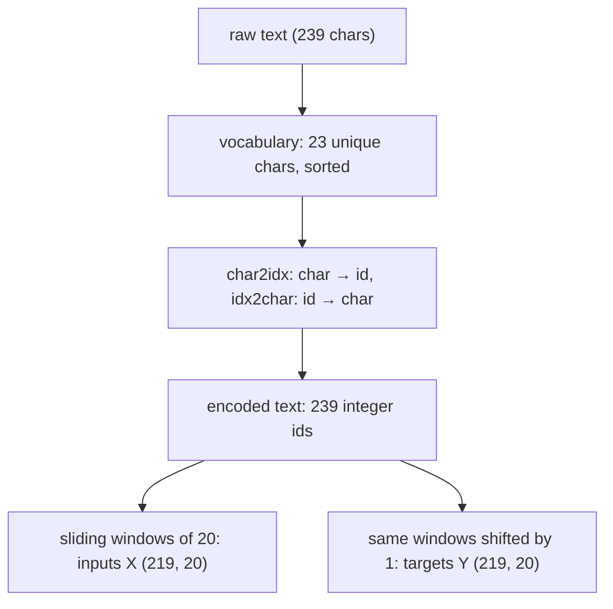
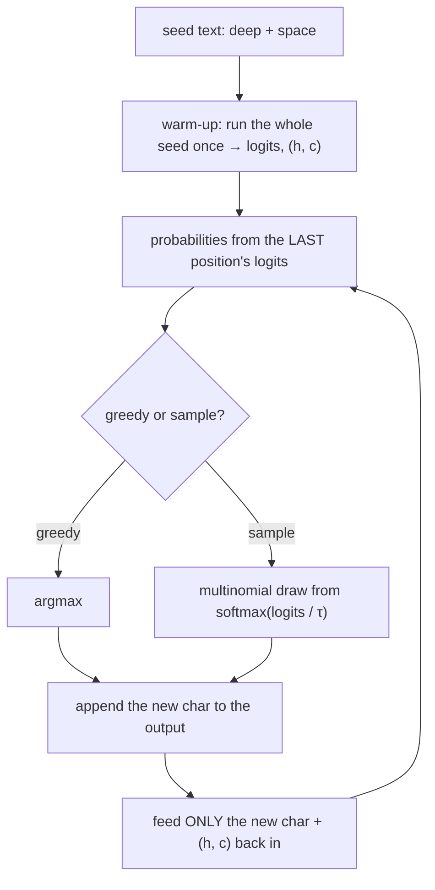

import {SoftmaxPlayground} from '@site/src/components/Widgets';

:::tip[TL;DR (30-Second Interview Pitch)]
A **character-level language model** learns $P(\text{next char} \mid \text{previous chars})$. The text is cut into sliding windows, and the **target is the input shifted by one** ("hello" → "ello "). The model is **Embedding → LSTM → Linear**: ids $(B, T)$ become vectors $(B, T, E)$, then hidden states $(B, T, H)$, then logits $(B, T, V)$. It is trained with **cross-entropy at every position**, logits flattened to $(BT, V)$. On the notebook's 239-character corpus a 2,935-parameter LSTM reaches 98.7% next-character accuracy everywhere except position 0, where it has no context and can't be better than a guess. To **generate**, warm the state up on a seed, then repeat: softmax the last logits, pick a character, feed **only that character** back in. Greedy argmax replays the corpus in a loop. Sampling from $\operatorname{softmax}(\pred{z} / \hyper{\tau})$ trades certainty for diversity. In our runs, $\hyper{\tau} = 0.5$ gives 0.2% invented words, $\hyper{\tau} = 1.5$ gives 21% and $\hyper{\tau} = 3$ gives 91%. Temperature changes decoding only, never training.
:::

<FormulaKey />

:::info[Where this page sits]
**Before:** [LSTM and GRU: Gated Memory for Long Sequences](./01-lstm-and-gru-gated-memory.md) built the LSTM cell gate by gate and explained why it keeps gradients alive.
**This page:** the practical half of notebook *13 LSTM Implementation* (sections 5–7): a character-level LSTM text generator in PyTorch, what it actually learns, greedy decoding vs temperature sampling, and a correction to the notebook's generation loop.
**Next:** the Transformer notebook (*14 Transformer 1*): attention, the idea that replaced recurrence.
:::

## 🧭 Start Here

The previous page was theory: gates, cell states and gradient paths. This page puts an LSTM to work on the simplest generative task in NLP: **read some characters, predict the next one, and repeat to write new text**. The same recipe, scaled up from characters to subword tokens and from LSTMs to Transformers, is how every modern large language model produces text. So the pipeline here is worth knowing step by step: data preparation, tensor shapes, the loss, the training loop, and the decoding loop.

The notebook deliberately uses a **tiny corpus**: four sentences, repeated twice, 239 characters in all. That lets training finish in seconds, but it also means the model mostly memorizes. So besides building the pipeline, this page reads the model's behaviour carefully. It explains why one position in every window is always wrong, what the loss can and can't go down to, why greedy decoding loops through the corpus, and what temperature really does to the output. It also fixes a small but instructive bug in the notebook's generation function.

The chain of ideas:

1. Next-character prediction is a classification problem **at every time step**.
2. Text → **vocabulary** → integer ids → **sliding windows** (inputs, and targets shifted by one).
3. **Embedding → LSTM → Linear** produces logits over the vocabulary at every step.
4. **Cross-entropy** on flattened logits trains all positions at once.
5. Generation is **autoregressive**: each output becomes the next input.
6. **Greedy** decoding is deterministic and repetitive; **temperature sampling** controls the trade-off between safety and diversity.

| New concept | One-line meaning |
|---|---|
| **Language model** | A model of $P(x_{t+1} \mid x_1, \ldots, x_t)$: the next symbol given the ones before |
| **Character-level** | The symbols are single characters; the vocabulary is tiny (23 here) |
| **Shift-by-one targets** | Target sequence = input sequence moved one position left |
| **Embedding** | A learned lookup table: character id → dense vector |
| **Logits** | Raw scores, one per vocabulary symbol, before softmax |
| **Autoregressive generation** | Generate one symbol, append it, feed it back, repeat |
| **Warm-up** | Running the seed text through the model once to build the hidden state |
| **Greedy decoding** | Always pick the most probable next symbol (argmax) |
| **Sampling** | Draw the next symbol at random according to the predicted probabilities |
| **Temperature** $\hyper{\tau}$ | Divide the logits by $\hyper{\tau}$ before softmax: below 1 sharpens, above 1 flattens |
| **Perplexity** | $e^{\text{loss}}$: the effective number of choices the model is unsure between |

:::analogy[Autocomplete, one keystroke at a time]
Your phone keyboard suggests the next word from what you've typed so far. Tap the suggestion, and the keyboard immediately suggests another, now based on the longer text. A character-level LSTM is that keyboard working one letter at a time, tapping its own suggestion every time. Temperature is how adventurous it is allowed to be: always tap the top suggestion, or sometimes pick the second or third.
:::

## 1. The Task: Next-Character Prediction

The goal is simple to state: **given a sequence of characters, predict the next character**. It is one of the simplest sequence-generation tasks, which makes it ideal for seeing four ideas at once. The input is processed **sequentially**. The LSTM's **memory** carries what has been read. The training signal is **next-step prediction**. And generation is **autoregressive**, with each prediction becoming the next input.

Why characters rather than words? The vocabulary is tiny (here 23 symbols: letters, space, full stop, newline), preprocessing is trivial (no tokenizer, no unknown words), training is fast, and the model's behaviour is easy to inspect one step at a time. The trade-off is that the model must learn spelling, word boundaries and punctuation from scratch, and that sequences get long, because one word is several steps. Real systems use **subword** tokens (byte-pair encoding and similar) as a middle ground.

The key detail is the **alignment** between inputs and targets. With the text "hello world" and a window of length 5, one training example is input "hello" and target "ello ". At every position the target is simply the *next* character: the model sees "h" and must predict "e", sees "e" (with "h" in its memory) and must predict "l", and so on. If the input ids are $[x_1, x_2, x_3, x_4, x_5]$, the targets are $[x_2, x_3, x_4, x_5, x_6]$. So one window gives five training signals, one per position: a **many-to-many** setup in the RNN terminology.

<Formula name="Character-level language model" tag="What the model learns" words="At every position the model outputs a probability for each possible next character, given all the characters so far. Training makes the probability of the character that actually comes next as high as possible." remember="Predict the next one, every step.">

$$
\pred{p_t} = \operatorname{softmax}(\pred{z_t}) \approx P(\data{x_{t+1}} \mid \data{x_1}, \ldots, \data{x_t}), \qquad \text{targets} = [\data{x_2}, \ldots, \data{x_{T+1}}]
$$

- $\pred{z_t} \in \mathbb{R}^{V}$: the logits at position $t$, one per vocabulary character
- The target at position $t$ is the input at position $t + 1$: the window shifted by one

**Example:** the notebook's first window is the newline followed by deep learning is po, and its target is deep learning is pow: each target character is the input character one place to the right.

</Formula>

:::tip[🎯 Interview angle]
**"How do you set up the training data for a next-token language model?"** Slide a window of length $T$ over the encoded text; each window is an input, and the same window shifted by one position is its target. The model is many-to-many: it predicts at every position, so one window gives $T$ classification targets. "hello" → "ello ". The same setup, with subword tokens and a Transformer, is how GPT-style models are pre-trained.
:::

## 2. From Text to Tensors

Neural networks work with numbers, so the first job is to turn text into integers and back. The **vocabulary** at character level is just the set of unique characters in the corpus. Sorting it makes the mapping reproducible. Each character gets an index (`char2idx`), and the reverse table (`idx2char`) turns the model's predicted indices back into text. The notebook's corpus is 239 characters long (it starts and ends with a newline) and has **23 unique characters**: newline, space, full stop and 20 letters. Newline is index 0, space 1, full stop 2, then the letters a, b, c, d …



Encoding the full text gives a vector of 239 ids. A window of length 20 can start at any position from 0 to 218 (the last window needs one extra character for its target), so there are $239 - 20 = 219$ input windows and 219 target windows, each of length 20. Note that the windows **overlap**: window 0 covers characters 0–19 and window 1 covers 1–20. Overlapping windows multiply the number of training examples from a small text, at the cost of showing the model the same characters many times.

| # | Step | Result in the notebook |
|---|---|---|
| 1 | Lower-case the text | 239 characters |
| 2 | `sorted(set(text))` | 23 characters: newline, space, full stop, a … w |
| 3 | `char2idx`, `idx2char` | newline → 0, space → 1, full stop → 2, a → 3, … |
| 4 | Encode | 239 ids, `int64` |
| 5 | Windows of 20 | inputs (219, 20), targets (219, 20) |
| 6 | `torch.tensor(..., dtype=torch.long)` | ids as `LongTensor` (what `nn.Embedding` and `CrossEntropyLoss` expect) |

:::tip[🎯 Interview angle]
**"Why does the vocabulary need a reverse mapping, and why sort it?"** The model works only with integer ids: it reads ids and predicts ids. `idx2char` turns predictions back into readable text, which you need for generation and for debugging. Sorting `set(text)` makes the id assignment deterministic: a Python set's iteration order can change between runs, and a model trained with one mapping is garbage under another, so the mapping must be saved with the model.
:::

## 3. The Model: Embedding → LSTM → Linear

The model has three layers, each with a clear job. The **embedding layer** is a learned lookup table with one row per character. It turns each id into a dense vector of size $E = 16$, so similar characters can end up with similar vectors. That is cheaper and more expressive than a 23-wide one-hot vector. The **LSTM** reads the 20 embedded characters in order and produces a hidden state $\pred{h_t}$ of size $H = 16$ at every position, each one summarizing the characters up to that point. The **linear layer** maps every hidden state to $V = 23$ scores, the logits for "which character comes next". Softmax isn't part of the model: the loss applies it internally.

Keeping the tensor shapes straight is most of the battle. With batch size $B$, sequence length $T$, embedding size $E$, hidden size $H$ and vocabulary size $V$:

| # | Stage | Shape | Notebook ($B = 4$) |
|---|---|---|---|
| 1 | Input ids | $(B, T)$ | (4, 20) |
| 2 | After `nn.Embedding(23, 16)` | $(B, T, E)$ | (4, 20, 16) |
| 3 | `out` from `nn.LSTM(16, 16, batch_first=True)` | $(B, T, H)$ | (4, 20, 16) |
| 4 | `h_n`, `c_n` (last step, per layer) | $(1, B, H)$ | (1, 4, 16) each |
| 5 | Logits from `nn.Linear(16, 23)` | $(B, T, V)$ | (4, 20, 23) |
| 6 | Flattened for the loss | $(BT, V)$ and targets $(BT)$ | (80, 23) and (80) |


*How to read it:* bottom to top at each step: character id → `Embedding` → LSTM (passing $\pred{h_t}$ and $\pred{c_t}$ right) → `Linear` → logits $\pred{z_t}$. The purple targets are the inputs shifted one place left, so each step is trained to predict the next character.

<Formula name="Per-step logits" tag="Embedding, LSTM, Linear" words="Each character id is looked up in the embedding table, the LSTM turns the sequence of embeddings into a hidden state at every position, and a linear layer turns each hidden state into one score per vocabulary character." remember="Look up, remember, score.">

$$
\data{e_t} = \param{E}[\data{x_t}], \qquad \pred{h_t}, \pred{c_t} = \operatorname{LSTM}(\data{e_t}, \pred{h_{t-1}}, \pred{c_{t-1}}), \qquad \pred{z_t} = \param{W_y}\,\pred{h_t} + \param{b_y}
$$

- $\param{E}$: the $V \times E$ embedding table (23 × 16); $\param{W_y}$: $V \times H$ (23 × 16)
- `h_n` has a leading dimension of 1 because it stores one state per layer (and per direction)

**Example:** the notebook's model has 2,935 parameters: 368 in the embedding, 2,176 in the LSTM ($4 \times (16 \cdot 16 + 16 \cdot 16 + 2 \cdot 16)$) and 391 in the linear layer ($23 \cdot 16 + 23$).

</Formula>

| Layer | Parameters | Count |
|---|---|---|
| `embedding.weight` | (23, 16) | 368 |
| `lstm.weight_ih_l0` | (64, 16): four gates × 16 | 1,024 |
| `lstm.weight_hh_l0` | (64, 16) | 1,024 |
| `lstm.bias_ih_l0`, `lstm.bias_hh_l0` | (64,) each | 128 |
| `fc.weight`, `fc.bias` | (23, 16), (23,) | 391 |
| **Total** | | **2,935** |

:::danger[Interview Trap: "batch_first=True changes everything about the LSTM"]
It only changes the layout of `out` and of the input: $(B, T, \cdot)$ instead of $(T, B, \cdot)$. The returned `h_n` and `c_n` are **always** $(\text{num\_layers} \times \text{num\_directions}, B, H)$, whatever `batch_first` says, which is why the notebook prints `(1, 4, 16)`. Mixing the two layouts up is a classic silent bug: the shapes still multiply, but time and batch are swapped.
:::

:::tip[🎯 Interview angle]
**"Walk me through the tensor shapes of a character-level LSTM."** Ids $(B, T)$ → embedding $(B, T, E)$ → LSTM output $(B, T, H)$ (one hidden state per position) plus `h_n`, `c_n` $(\text{layers}, B, H)$ → linear $(B, T, V)$ logits → reshape to $(BT, V)$ with targets $(BT)$ for `CrossEntropyLoss`. The embedding replaces one-hot vectors with learned dense ones, and the linear layer is applied independently at every time step.
:::

## 4. Training with Cross-Entropy at Every Position

At every position the model faces a 23-way classification problem: which character comes next? The standard loss for multi-class classification is **cross-entropy**: the negative log of the probability the model gave to the correct class. For a whole batch we average it over every position of every sequence. In practice that means **flattening**: `CrossEntropyLoss` expects logits of shape $(N, V)$ and targets of shape $(N)$, so the $(B, T, V)$ logits are reshaped to $(BT, V)$ and the $(B, T)$ targets to $(BT)$. Each of the $BT$ rows is then just an independent classification example. The model is not predicting a whole sentence at once; it is learning one next step at a time, at every position in parallel.

<Formula name="Sequence cross-entropy" tag="The training loss" words="At each position, take the negative log of the probability the model gave to the character that really comes next, and average over every position of every sequence in the batch." remember="Average surprise at the true next char.">

$$
\loss{L} = -\frac{1}{BT}\sum_{b=1}^{B}\sum_{t=1}^{T} \log \pred{p_{b,t}}[\data{y_{b,t}}], \qquad \pred{p_{b,t}} = \operatorname{softmax}(\pred{z_{b,t}})
$$

- $\data{y_{b,t}}$: the id of the true next character; $\pred{p_{b,t}}[\data{y_{b,t}}]$: the probability the model gave it
- `nn.CrossEntropyLoss` applies log-softmax itself, so it takes **raw logits**, never softmax outputs

**Example:** a uniform guess over 23 characters gives $\loss{L} = \ln 23 = 3.135$. The notebook's model starts at 2.514 after one epoch and ends at 0.117.

</Formula>

The training loop is the standard PyTorch loop, with mini-batches of 4 windows, the Adam optimizer at learning rate 0.009, and 50 epochs. Re-run on CPU with `torch.manual_seed(0)`:

| Epoch | 1 | 10 | 20 | 30 | 40 | 50 |
|---|---|---|---|---|---|---|
| Average loss | 2.5136 | 0.2041 | 0.1389 | 0.1265 | 0.1168 | 0.1169 |
| Perplexity $e^{\loss{L}}$ | 12.35 | 1.23 | 1.15 | 1.13 | 1.12 | 1.12 |

The notebook's GPU run shows the same shape (2.4526 → 0.1109). The exact numbers differ because random initialization and shuffling differ between devices. **Perplexity**, $e^{\loss{L}}$, is the more intuitive reading. A perplexity of 12.35 after one epoch means the model is about as unsure as if it were choosing uniformly among 12 characters. A perplexity of 1.12 means it is nearly certain at most positions. Note that the loss stops improving around 0.117 instead of going to zero, even though the corpus is tiny and fully memorizable. The next chapter explains why.

One small correction to the notebook: it computes the epoch's average as `epoch_loss / (num_samples / batch_size)`, i.e. divided by $219 / 4 = 54.75$. But the loop runs **55** batches (the last batch has 3 windows), so the reported average is slightly too high. Counting the batches fixes it (implementation block 3). The difference is tiny here, but the habit matters: with a large final batch remainder, or when averaging per sample, it isn't tiny.

:::danger[Interview Trap: "Apply softmax, then CrossEntropyLoss"]
`nn.CrossEntropyLoss` = log-softmax + negative log-likelihood. Feeding it probabilities applies softmax twice, which flattens the distribution, weakens the gradients and silently hurts training. Pass **raw logits**. Also mind the class dimension: it must be the **second** dimension, so either flatten to $(BT, V)$ as the notebook does, or `permute` the logits to $(B, V, T)$. Passing $(B, T, V)$ directly raises a shape error or, worse, treats time as classes.
:::

:::tip[🎯 Interview angle]
**"Why do we flatten the logits and targets before the loss?"** `CrossEntropyLoss` expects $(N, C)$ logits and $(N)$ class indices. Every (sequence, position) pair is an independent next-character classification, so reshaping $(B, T, V) \to (BT, V)$ and $(B, T) \to (BT)$ averages the loss over all $BT$ predictions in one call. The equivalent alternative is `logits.permute(0, 2, 1)` with $(B, T)$ targets.
:::

## 5. What the Model Learned, and Why Position 0 Is Always Wrong

After training, the notebook prints predictions for a few windows and finds them nearly perfect, except for one character at the start. For the first window the target is "deep learning is pow" and the prediction is "geep learning is pow" (the notebook's run) or "deep learning is pow" (ours). For window 25 the target starts with a full stop and the prediction starts with "s". Measured over all 219 windows of the training set, the model predicts the next character correctly **98.7%** of the time at positions 1–19, but only **37.0%** of the time at **position 0**.

Position 0 is different for a structural reason, not a training failure. At position 0 the LSTM starts from a **zero state**, so it has seen exactly one character, and one character is often not enough to determine the next. Take the first window: its first character is a newline. In the corpus a newline is followed by "d" (deep) twice, "l" (lstm) twice, "g" (gru) twice and "s" (sequence) twice. Given only a newline, those four continuations are **equally likely**, so no model can do better than a guess. The trained model spreads its probability accordingly: d 0.403, g 0.281, s 0.181, l 0.124. It happened to rank "d" first in our run and "g" first in the notebook's. Window 25 is the same story: its first character is "l", which in the corpus is followed by "s" six times (lstm, models), "e" four times (learning, simpler) and a full stop only twice (powerful.), so "s" is the best possible guess, and it is wrong for this window, which starts at the "l." of "powerful."

That also explains the **loss floor**. On the training windows, the average cross-entropy is 1.555 at position 0 but only 0.031 at positions 1–19. Position 0 contributes $1.555 / 20 \approx 0.078$ of the overall average of about 0.107. The remaining loss is mostly the **irreducible uncertainty** of predicting from a single character, not a lack of training. Once the model has a few characters of context, the corpus is deterministic, and it is nearly perfect.

What, then, has the model actually learned? The notebook's summary is accurate: **local character transitions** (after "l" in "lstm" comes "s"), **repeated substrings** (whole words and phrases), **spacing and punctuation patterns** (a full stop ends a line, a newline follows), and small sequential regularities. It is a next-character predictor that has essentially **memorized** a four-sentence corpus. There is no validation set, the corpus is the same four sentences twice, and 2,935 parameters are plenty for 239 characters. So the 98.7% accuracy says nothing about generalization. On a real corpus you would hold out text and watch validation loss or perplexity.

| Position | Context the LSTM has seen | Accuracy | Mean loss |
|---|---|---|---|
| 0 | One character | 37.0% | 1.555 |
| 1–19 | 2 to 20 characters | 98.7% | 0.031 |
| All | | 95.6% | ≈ 0.107 |

:::analogy[Guessing the next word after hearing one syllable]
Someone says "the …" and stops. You can't know whether "cat", "car" or "committee" comes next, however good your English is. Let them say "the cat sat on the …" and you'll say "mat" every time. Position 0 is always the first case. No amount of training can fix a lack of context, only a longer context can.
:::

:::tip[🎯 Interview angle]
**"Your sequence model's training loss plateaus well above zero on a tiny dataset. Why?"** Check whether the task is deterministic given the context the model has. Here, at position 0 the LSTM has seen one character, and a newline is followed by four different letters equally often, so the best achievable loss there is a guess; it accounts for most of the floor (1.555 at position 0 vs 0.031 elsewhere). Fixes are about context, not training: pass the previous window's hidden state forward (stateful training), use longer windows, or exclude the first few positions from the loss.
:::

## 6. From Logits to Text: Greedy Decoding and the Generation Loop

The trained model outputs **logits**, not characters. To write text we need a decoding loop, and the notebook's version is the standard **autoregressive** procedure. First, **warm up**: run the seed text (say "deep ") through the model once, which builds the hidden state $(\pred{h}, \pred{c})$ and gives logits for the character after the seed. Then repeat: take the logits at the **last** position, turn them into probabilities, choose a character, append it to the output, and feed **only that new character** (with the carried hidden state) back into the model for the next step. Each prediction becomes part of the future input. That is the meaning of *autoregressive*.

<Animation src="lstm/autoregressive-loop" caption="Greedy generation from the trained model. Watch each predicted character, with its probability, get appended to the text and fed back as the only new input, while the LSTM state carries everything before it: deep becomes deep learning." />

How do we choose the character? The simplest strategy is **greedy decoding**, $\hat\imath = \arg\max_i \pred{p_i}$: always take the most probable character. It is deterministic and safe, and on this model it produces the corpus verbatim. From "deep " it writes "deep learning is powerful.", newline, "lstm can remember patterns.", newline, "gru is sim…" and would keep cycling through the four sentences forever. That is the classic failure of greedy decoding: **repetition and low diversity**. The model always takes the single safest path, and once it is in a loop the same context always produces the same continuation. On larger models greedy output gets stuck repeating a phrase. The alternative is to **sample** the next character at random according to $\pred{p}$, so likely characters are usually chosen but not always. Sampling has its own dial, and that is temperature.




*How to read it:* the state arrives already warmed up on the seed. At each step the logits go through $\operatorname{softmax}(\pred{z} / \hyper{\tau})$, one character is sampled, and the blue line feeds that character back as the next step's only input.

:::tip[🎯 Interview angle]
**"How does an LSTM text generator produce text after training?"** Warm the state up on a seed, then loop: take the last position's logits, convert to probabilities, choose a token (argmax, or sample, optionally with temperature, top-k or top-p), append it, and feed it back with the carried hidden state. Greedy is deterministic and tends to repeat itself; sampling adds diversity. Carrying the state means each new token costs one LSTM step, instead of re-reading the whole text.
:::

## 7. Temperature Sampling

Before applying softmax, we can divide the logits by a **temperature** $\hyper{\tau} > 0$. Dividing by a number below 1 *stretches* the gaps between logits, so the largest one dominates even more and the distribution gets **sharper**. Dividing by a number above 1 *compresses* the gaps, so the distribution gets **flatter** and less likely characters get a real chance. In the limit, $\hyper{\tau} \to 0$ concentrates all probability on the argmax (greedy decoding), and $\hyper{\tau} \to \infty$ makes every character equally likely (uniform noise). $\hyper{\tau} = 1$ is the model's own distribution. The ordering of the characters never changes, only how far apart their probabilities are.

<Formula name="Temperature-scaled softmax" tag="Certainty vs diversity" words="Divide every logit by the temperature, then apply softmax. A temperature below 1 sharpens the distribution towards the top choice; above 1 flattens it towards uniform. The model and its training are unchanged." remember="Low T safe, high T wild.">

$$
\pred{p_i}(\hyper{\tau}) = \frac{e^{\pred{z_i} / \hyper{\tau}}}{\sum_{j=1}^{V} e^{\pred{z_j} / \hyper{\tau}}}, \qquad \hyper{\tau} \to 0: \text{argmax}, \qquad \hyper{\tau} \to \infty: \text{uniform}
$$

- $\pred{z_i}$: the logit for character $i$; $\hyper{\tau}$: chosen at generation time only
- The ranking of characters is the same at every $\hyper{\tau}$; only the gaps between their probabilities change

**Example:** for the notebook's logits $[2.5, 1.2, 0.5, -0.3]$ the top probability is 0.912 at $\hyper{\tau} = 0.5$, 0.681 at $\hyper{\tau} = 1$, 0.468 at $\hyper{\tau} = 2$, and 0.290 at $\hyper{\tau} = 10$ (uniform would be 0.25).

</Formula>

| $\hyper{\tau}$ | $p$ for logits $[2.5, 1.2, 0.5, -0.3]$ | Shape |
|---|---|---|
| 0.1 | [1.0, 0.0, 0.0, 0.0] | Effectively greedy |
| 0.5 | [0.9122, 0.0678, 0.0167, 0.0034] | Sharp |
| 1.0 | [0.6809, 0.1856, 0.0921, 0.0414] | The model's own distribution |
| 1.5 | [0.5439, 0.2286, 0.1434, 0.0841] | Flatter |
| 2.0 | [0.4681, 0.2443, 0.1722, 0.1154] | Flatter still |
| 10.0 | [0.2896, 0.2543, 0.2371, 0.2189] | Nearly uniform |

<Animation src="lstm/temperature" caption="The same four logits under T = 1, 0.5, 1.5 and 2. Watch the top bar grow to 0.91 when T is small and shrink towards the others when T is large, while the order of the bars never changes." />

What does this do to generated text? We generated 20 samples of 200 characters from "deep " at each temperature and counted how many generated words do **not** exist in the corpus (invented words such as "leleataen"):

| $\hyper{\tau}$ | Invented words | First sample (first 60 characters) |
|---|---|---|
| 0.2 | 0.0% | deep learning is powerful. / lstm can remember patterns. / gru i |
| 0.5 | 0.2% | deep learning is powerful. / lstm can remember patterns. / gru i |
| 0.7 | 0.8% | deep learning is powerful. / lstm can remember patterns. / gru i |
| 1.0 | 2.2% | deep learning is powerful. / lstm can remember patterns. / gru i |
| 1.5 | 21.4% | deep leler than regru is simpler than lstm. / gru is r process |
| 2.0 | 54.9% | deep leleataen remember pattern simg remhmbern pattr. / dees p |
| 3.0 | 90.6% | deep leleataeantcegsu iwr proce seogorderube nisttfr moces o |

(Newlines are shown as " / ".) Up to $\hyper{\tau} = 1$ the model reproduces its corpus almost perfectly, because it is very confident: most of its top probabilities are above 0.99. At 1.5 it starts splicing sentences together and misspelling, and at 3 it is close to random letters with the occasional real fragment ("powerful"). Notice the notebook's own sample at $\hyper{\tau} = 1.5$, "pattterns": one sampled "t" too many.

**Temperature does not retrain the model.** It only changes how model scores are converted into sampling probabilities at generation time. Training, weights and loss are identical. On a model this sure of itself, temperatures between 0.5 and 1 all look the same. On a real language model with genuine uncertainty, low temperature gives **safe but repetitive** text, high temperature gives **diverse but incoherent** text, and the useful range is usually around 0.7–1.0.

:::analogy[Temperature is how bold a chef is with a recipe]
At low temperature the chef follows the recipe exactly, every time: reliable, and the same dish every night. At high temperature they improvise, swapping ingredients they would normally rank lower: sometimes inspired, often inedible. At extreme temperature they pick ingredients at random. The recipe book (the trained model) never changes, only how strictly it is followed.
:::


**Try it yourself.** Change the temperature and the logits, then sample 100 tokens to see how often each one is picked.

<SoftmaxPlayground mode="temperature" />

:::tip[🎯 Interview angle]
**"What is temperature in text generation, and does it affect training?"** It divides the logits before softmax: $p_i \propto e^{z_i / \tau}$. $\tau < 1$ sharpens towards the top token (→ greedy as $\tau \to 0$), $\tau > 1$ flattens towards uniform. The ranking never changes. It is purely an inference-time decoding knob that trades certainty for diversity, and training is untouched. In practice it is combined with top-k or top-p (nucleus) truncation so that high temperatures can't pick absurd tokens.
:::

## 8. A Generation Bug: Feeding the Last Seed Character Twice

The notebook's `generate_text` warms up on the whole seed, `logits, hidden = model(input_ids, hidden)`, which leaves the hidden state having read every seed character, last one included. But then it sets `current_input = input_ids[:, -1:]`, the last seed character, and **feeds it again** before sampling the first new character. The model is therefore conditioned on the seed with its last character doubled. For the seed "deep ", the first character is generated as if the text were "deep  " (two spaces), a string that never occurs in the corpus. The warm-up's own logits, which are the correct prediction for the character after the seed, are thrown away.

On this model the effect is small, but it is measurable. After the correct context "deep ", the model gives "l" probability 0.997. After the doubled context "deep  " it gives "l" 0.956 and "o" 0.030: the extra space has made a non-existent continuation 30 times more likely. Greedy decoding still produces the same text here, because the model is very confident. With a less confident model, or a seed ending in a character whose doubling changes the meaning (such as a newline or a letter), the generated text starts from the wrong context. The bug is invisible in a quick look, which makes it instructive.

The fix is to **use the warm-up logits** for the first prediction and, after that, feed only the newly generated character (implementation block 6). An alternative that also works is to re-run the model on the *entire* growing text at every step without carrying any state. That is correct, but each step re-reads everything, so generating $n$ characters costs $O(n^2)$ LSTM steps instead of $O(n)$. Carrying the hidden state is the whole point of a recurrent generator.

:::danger[Interview Trap: "Off-by-one in autoregressive generation"]
After any warm-up or prefill pass, the prediction for the next token is already in the **last position's logits**. Feeding the last prompt token again double-counts it. The same bug appears with Transformer KV caches, where the prompt is "prefilled" and only new tokens are fed afterwards. Test a generator by checking that its first predicted distribution equals the model's output on the prompt alone.
:::

:::tip[🎯 Interview angle]
**"How do you make generation with an RNN efficient?"** Run the prompt once to get the hidden state and the first prediction, then feed only one new token per step together with the carried state $(h, c)$: $O(1)$ work per token, $O(n)$ total. Re-encoding the whole text each step is $O(n^2)$. The Transformer analogue is the KV cache. Don't re-feed the last prompt token: its information is already in the state.
:::

## 9. The Big Picture: What Recurrence Gave Us, and What It Didn't

The notebook ends by consolidating the whole arc. Starting from **TF-IDF**, a useful static representation that ignores order, we moved to **sequence models** that read token by token. The **vanilla RNN** introduced a sequential state, but its memory fades and its gradients vanish or explode through time. The **LSTM** introduced controlled memory: forget, input and output gates, a candidate, and a separate cell state with the additive update $\pred{c_t} = \pred{f_t} \odot \pred{c_{t-1}} + \pred{i_t} \odot \pred{\tilde c_t}$. The **GRU** kept the gating with one state and two gates. On this page, a small **character-level LSTM** learned next-character prediction, and **temperature** showed that output quality depends on the decoding strategy as well as on the trained model.

| Stage | Key idea | What it fixed | What it left open |
|---|---|---|---|
| TF-IDF | Static weighted bag of words | Strong document-level baseline | Order, context |
| Vanilla RNN | State $\pred{h_t} = \tanh(\param{W_x}\data{x_t} + \param{W_h}\pred{h_{t-1}} + \param{b})$ | Reads in order, carries context | Fading memory, vanishing/exploding gradients |
| LSTM | Gated, additive cell state | Long-range learning becomes practical | Heavy; still sequential |
| GRU | Two gates, one state | Lighter, often as accurate | Still sequential |
| Char LSTM + temperature | Autoregressive next-token generation | Text generation | Fixed-size state, slow generation |
| **Next: attention** | Look back at any position directly | Direct long-range access, parallel training | (next lecture) |

The remaining limitations are structural, and they are the reason the field moved on. **Sequential computation**: tokens are processed one step at a time, so training can't be parallelized over time. **Indirect long-range access**: information from a distant position must survive every step in between. **Fixed-size state**: the entire past is compressed into $H$ numbers. **Very long sequences remain hard to optimize**: gating helps but doesn't eliminate the problem. So the natural next question is: instead of forcing useful past information to travel step by step through recurrence, can a model **look back directly** at the relevant parts of the sequence? That is **attention**, the subject of the next notebook.

:::tip[🎯 Interview angle]
**"What are the limitations of LSTMs that Transformers address?"** LSTMs compute step by step, so they can't parallelize over the sequence during training; they reach distant tokens only through a long chain of state updates; and they squeeze the whole past into a fixed-size state. Self-attention lets every position attend to every other directly in one layer, trains in parallel over the sequence, and keeps all positions available instead of one summary vector. The costs are memory that grows quadratically with context length and no built-in notion of order (hence positional encodings).
:::

## ⚙️ Going Deeper (Training and Decoding Internals)

**Teacher forcing and exposure bias.** During training the model always receives the **true** previous character as input (that is what the shifted targets do). This is called teacher forcing. At generation time it receives its **own** predictions, which can be wrong, and it has never been trained to recover from its own mistakes. This train/test mismatch is called **exposure bias**. Scheduled sampling, which gradually feeds the model its own predictions during training, is one mitigation. Large datasets and strong models make it less of a problem in practice.

**Top-k and top-p (nucleus) sampling.** Temperature alone still gives every token a non-zero probability, and at high $\hyper{\tau}$ the long tail of unlikely tokens adds up. **Top-k** keeps only the $k$ most probable tokens and renormalizes. **Top-p** keeps the smallest set of tokens whose probabilities sum to at least $p$ (e.g. 0.9), so the candidate set adapts to how confident the model is. Production LLM decoding typically combines temperature with top-p and a **repetition penalty** that down-weights recently generated tokens.

**Stateful training and truncated BPTT.** The notebook trains on independent, shuffled windows, each starting from a zero state. That is exactly why position 0 has no context. For long texts the alternative is **stateful** training: split the text into consecutive chunks, carry `(h, c)` from one chunk to the next, but call `.detach()` on them between chunks, so backprop stops at the chunk boundary. This is **truncated backpropagation through time**: context flows forward across the whole text, gradients flow back only $T$ steps. It requires batches to be laid out so that row $b$ of batch $k + 1$ continues row $b$ of batch $k$.

**Perplexity.** $\text{PPL} = e^{\loss{L}}$, with $\loss{L}$ the mean cross-entropy in nats. It is the effective number of equally likely choices: 23 for a uniform guess over this vocabulary ($e^{\ln 23}$), 12.35 after epoch 1, 1.12 at the end. It is the standard way to report language-model quality, always on **held-out** text.

**Numerical details.** `CrossEntropyLoss` uses the log-sum-exp trick inside log-softmax, so it is stable for large logits. Never compute `log(softmax(x))` yourself. In the notebook, probabilities print as summing to 0.99999994: that is float32 rounding, not a bug. Very small temperatures make $\pred{z} / \hyper{\tau}$ huge, but softmax subtracts the max internally, so even $\hyper{\tau} = 0.1$ works. For exact greedy behaviour, use `argmax` instead of a tiny temperature.

**Evaluation mode and gradients.** Generation should run under `model.eval()` and `torch.no_grad()`. Here there is no dropout or batch norm, so `eval()` changes nothing numerically, but it is the correct habit, and `no_grad()` avoids building a graph for every generated character. The notebook's `generate_text` switches back to `model.train()` at the end. Some of its later cells comment that line out, leaving the model in eval mode, which is harmless here and a bug if the model had dropout.

**Reproducibility.** `torch.multinomial` draws from PyTorch's global random number generator, so seed it (`torch.manual_seed`) before generating if you want repeatable samples. Training results also depend on the device: the notebook's CUDA run and our CPU run start from different random weights and end at slightly different losses (0.1109 vs 0.1169).

**Character vs subword vs word tokens.** Characters give a tiny vocabulary and no unknown tokens, but long sequences. Words give short sequences, but a huge vocabulary and unknown words. Subword schemes (BPE, WordPiece, SentencePiece) are the standard compromise in modern models: frequent words stay whole, and rare ones split into pieces.

## 💻 Python Implementation

:::tip[Run it yourself]
Verified on Python 3.13 with NumPy 2.5 and PyTorch 2.15 (CPU). Outputs are copied from real runs into the trailing comments. The blocks build on each other: run them in order in one session (a notebook or one script). The notebook trained on a GPU, so its losses and samples differ slightly from these CPU numbers.
:::

**What was corrected from the notebook.** The epoch-average loss is divided by the real number of batches (55), not by $219 / 4 = 54.75$ (block 3). The generation function uses the warm-up logits for the first character instead of feeding the last seed character a second time (block 6). Training and sampling are seeded so that the numbers on this page are reproducible.

### 1. Vocabulary, encoding and sliding windows

```python title="char_data.py" showLineNumbers
import numpy as np
import torch

text = """
deep learning is powerful.
lstm can remember patterns.
gru is simpler than lstm.
sequence models process ordered data.
deep learning is powerful.
lstm can remember patterns.
gru is simpler than lstm.
sequence models process ordered data.
""".lower()

chars = sorted(set(text))
vocab_size = len(chars)
char2idx = {ch: i for i, ch in enumerate(chars)}
idx2char = {i: ch for ch, i in char2idx.items()}
print(len(text), vocab_size)                       # 239 23
print(chars[:6])                                   # ['\n', ' ', '.', 'a', 'b', 'c']

encoded = np.array([char2idx[ch] for ch in text], dtype=np.int64)
seq_len = 20
inputs = np.array([encoded[i:i + seq_len] for i in range(len(encoded) - seq_len)])
# highlight-next-line
targets = np.array([encoded[i + 1:i + seq_len + 1] for i in range(len(encoded) - seq_len)])   # shifted by 1
X, Y = torch.tensor(inputs), torch.tensor(targets)
print(X.shape, Y.shape)                            # torch.Size([219, 20]) torch.Size([219, 20])
print(repr("".join(idx2char[i] for i in inputs[0])))    # '\ndeep learning is po'
print(repr("".join(idx2char[i] for i in targets[0])))   # 'deep learning is pow'
```

### 2. The model: Embedding → LSTM → Linear

```python title="char_lstm_model.py" showLineNumbers
import torch.nn as nn

class CharLSTM(nn.Module):
    def __init__(self, vocab_size, embed_dim, hidden_dim):
        super().__init__()
        self.embedding = nn.Embedding(vocab_size, embed_dim)
        self.lstm = nn.LSTM(embed_dim, hidden_dim, batch_first=True)
        self.fc = nn.Linear(hidden_dim, vocab_size)

    def forward(self, x, hidden=None):
        x = self.embedding(x)                   # (B, T) -> (B, T, E)
        out, hidden = self.lstm(x, hidden)      # (B, T, H), and (h_n, c_n)
        return self.fc(out), hidden             # logits (B, T, V)

model = CharLSTM(vocab_size, 16, 16)
for name, p in model.named_parameters():
    print(name, tuple(p.shape), p.numel())
# embedding.weight (23, 16) 368
# lstm.weight_ih_l0 (64, 16) 1024             4 gates x 16
# lstm.weight_hh_l0 (64, 16) 1024
# lstm.bias_ih_l0 (64,) 64
# lstm.bias_hh_l0 (64,) 64
# fc.weight (23, 16) 368
# fc.bias (23,) 23
print(sum(p.numel() for p in model.parameters()))   # 2935
```

### 3. ✅ Training, with the correct epoch average

```python title="train_char_lstm.py" showLineNumbers
torch.manual_seed(0)
model = CharLSTM(vocab_size, embed_dim=16, hidden_dim=16)
criterion = nn.CrossEntropyLoss()
optimizer = torch.optim.Adam(model.parameters(), lr=0.009)
num_samples, batch_size = X.shape[0], 4

for epoch in range(50):
    permutation = torch.randperm(num_samples)
    epoch_loss, num_batches = 0.0, 0
    for i in range(0, num_samples, batch_size):
        idx = permutation[i:i + batch_size]
        xb, yb = X[idx], Y[idx]
        optimizer.zero_grad()
        logits, _ = model(xb)                               # (B, T, V)
        B, T, V = logits.shape
        # highlight-next-line
        loss = criterion(logits.reshape(B * T, V), yb.reshape(B * T))   # (BT, V) vs (BT)
        loss.backward()
        optimizer.step()
        epoch_loss += loss.item()
        num_batches += 1
    # success-next-line
    avg_loss = epoch_loss / num_batches                     # ✅ 55 batches, not 219 / 4 = 54.75
    if epoch + 1 in (1, 10, 20, 30, 40, 50):
        print(epoch + 1, round(avg_loss, 4))
# 1 2.5136
# 10 0.2041
# 20 0.1389
# 30 0.1265
# 40 0.1168
# 50 0.1169
print(num_batches)                                          # 55
```

### 4. Shapes, accuracy by position, and the loss floor

```python title="inspect_char_lstm.py" showLineNumbers
import torch.nn.functional as F
from collections import Counter

model.eval()
with torch.no_grad():
    logits, (h_n, c_n) = model(X[:4])
    print(logits.shape, h_n.shape, c_n.shape)
    # torch.Size([4, 20, 23]) torch.Size([1, 4, 16]) torch.Size([1, 4, 16])

    logits = model(X)[0]                                    # all 219 windows
    preds = logits.argmax(-1)
    print(round((preds == Y).float().mean().item(), 4))                  # 0.9559  overall
    # error-next-line
    print(round((preds[:, 0] == Y[:, 0]).float().mean().item(), 4))      # 0.3699  ❌ position 0: one char of context
    print(round((preds[:, 1:] == Y[:, 1:]).float().mean().item(), 4))    # 0.9868  positions 1-19

    loss_per_pos = F.cross_entropy(logits.permute(0, 2, 1), Y, reduction="none").mean(0)
    print(round(loss_per_pos[0].item(), 4), round(loss_per_pos[1:].mean().item(), 4))   # 1.5548 0.0308

    p0 = F.softmax(logits[0, 0], dim=0)
    top = p0.topk(4)
    print([(idx2char[i.item()], round(p.item(), 4)) for p, i in zip(top.values, top.indices)])
    # [('d', 0.4026), ('g', 0.2809), ('s', 0.1812), ('l', 0.124)]

# highlight-next-line
print(Counter(text[i + 1] for i in range(len(text) - 1) if text[i] == "\n"))
# Counter({'d': 2, 'l': 2, 'g': 2, 's': 2})         after a newline, 4 equally likely letters
```

### 5. Temperature on a fixed logits vector

```python title="temperature.py" showLineNumbers
logits_example = torch.tensor([2.5, 1.2, 0.5, -0.3])
for temp in [0.1, 0.5, 1.0, 1.5, 2.0, 10.0]:
    probs = F.softmax(logits_example / temp, dim=0)
    print(temp, [round(v, 4) for v in probs.tolist()], probs.sum().item())
# 0.1 [1.0, 0.0, 0.0, 0.0] 1.0                              effectively greedy
# 0.5 [0.9122, 0.0678, 0.0167, 0.0034] 0.9999999403953552     float32 rounding, not a bug
# 1.0 [0.6809, 0.1856, 0.0921, 0.0414] 1.0
# 1.5 [0.5439, 0.2286, 0.1434, 0.0841] 0.9999999403953552
# 2.0 [0.4681, 0.2443, 0.1722, 0.1154] 1.0
# 10.0 [0.2896, 0.2543, 0.2371, 0.2189] 1.0                 nearly uniform (0.25)
```

### 6. ❌ The notebook's generator vs ✅ the corrected one

```python title="❌ The last seed character is fed twice" showLineNumbers
def generate_text_buggy(model, start_text, length=100, temperature=1.0):
    input_ids = torch.tensor([[char2idx[ch] for ch in start_text]])
    generated = start_text
    with torch.no_grad():
        logits, hidden = model(input_ids)                   # warm-up: reads the whole seed
        # error-next-line
        current_input = input_ids[:, -1:]                   # ❌ ...then feeds the last seed char AGAIN
        for _ in range(length):
            logits, hidden = model(current_input, hidden)
            probs = F.softmax(logits[0, -1] / temperature, dim=0)
            next_idx = torch.multinomial(probs, 1).item()
            generated += idx2char[next_idx]
            current_input = torch.tensor([[next_idx]])
    return generated
```

```python title="generate.py" showLineNumbers
def generate_text(model, start_text, length=100, temperature=1.0, greedy=False):
    input_ids = torch.tensor([[char2idx[ch] for ch in start_text]])
    generated = start_text
    with torch.no_grad():
        logits, hidden = model(input_ids)                   # warm-up: reads the whole seed once
        for _ in range(length):
            # success-next-line
            last = logits[0, -1]                            # ✅ the prediction AFTER the last seed char
            if greedy:
                next_idx = last.argmax().item()
            else:
                next_idx = torch.multinomial(F.softmax(last / temperature, dim=0), 1).item()
            generated += idx2char[next_idx]
            logits, hidden = model(torch.tensor([[next_idx]]), hidden)   # feed only the new char
    return generated

with torch.no_grad():
    for seed in ["deep ", "deep  "]:
        p = F.softmax(model(torch.tensor([[char2idx[c] for c in seed]]))[0][0, -1], dim=0)
        top = p.topk(2)
        print(repr(seed), [(idx2char[i.item()], round(v.item(), 3)) for v, i in zip(top.values, top.indices)])
# 'deep ' [('l', 0.997), ('d', 0.001)]          the correct context
# error-next-line
# 'deep  ' [('l', 0.956), ('o', 0.03)]          ❌ what the buggy generator conditions on

print(repr(generate_text(model, "deep ", length=60, greedy=True)))
# 'deep learning is powerful.\nlstm can remember patterns.\ngru is sim'     greedy replays the corpus
```

### 7. Sweeping the temperature

20 samples of 200 characters per temperature, counting words that never occur in the corpus.

```python title="temperature_sweep.py" showLineNumbers
import re

corpus_words = set(re.findall(r"[a-z]+", text))
for temp in [0.2, 0.5, 0.7, 1.0, 1.5, 2.0, 3.0]:
    torch.manual_seed(0)
    unseen = total = 0
    for k in range(20):
        sample = generate_text(model, "deep ", length=200, temperature=temp)
        if k == 0:
            first = sample
        words = re.findall(r"[a-z]+", sample[5:])[:-1]      # drop the last, possibly cut-off word
        total += len(words)
        unseen += sum(w not in corpus_words for w in words)
    print(temp, round(unseen / total, 3), repr(first[:60]))
# 0.2 0.0 'deep learning is powerful.\nlstm can remember patterns.\ngru i'
# 0.5 0.002 'deep learning is powerful.\nlstm can remember patterns.\ngru i'
# 0.7 0.008 'deep learning is powerful.\nlstm can remember patterns.\ngru i'
# 1.0 0.022 'deep learning is powerful.\nlstm can remember patterns.\ngru i'
# highlight-next-line
# 1.5 0.214 'deep leler than regru is simpler than lstm.\ngru is r process'
# 2.0 0.549 'deep leleataen remember pattern simg remhmbern pattr.\ndees p'
# 3.0 0.906 'deep leleataeantcegsu iwr proce seogorderube nisttfr moces o'
```

## 🚨 Interview Gotchas & Edge Cases

:::warning[The Most Common Question]
**"How does an LSTM generate text, and what does temperature do?"**

1. Train a next-token model: input windows, targets shifted by one, cross-entropy at every position.
2. Generate autoregressively: warm up on a prompt, then repeatedly take the **last** position's logits, pick a token, append it, and feed only that token back with the carried $(h, c)$.
3. Greedy (argmax) is deterministic and repetitive (here it replays the corpus forever); sampling adds diversity.
4. Temperature: $p_i \propto e^{z_i / \tau}$. $\tau < 1$ is sharper and safer, $\tau > 1$ is flatter and more random ($\tau = 1.5$ → 21% invented words, $\tau = 3$ → 91%). The ranking never changes, and it is inference-only.
5. In practice: temperature combined with top-k/top-p and a repetition penalty.
:::

- **Softmax before `CrossEntropyLoss`** double-applies softmax. Pass logits.
- **Class dimension placement:** `CrossEntropyLoss` wants $(N, V)$ or $(B, V, T)$. Flatten or `permute`; never pass $(B, T, V)$ as is.
- **`h_n` ignores `batch_first`:** it is always $(\text{layers} \times \text{directions}, B, H)$.
- **Position 0 has no context** when every window starts from a zero state, so its loss sets a floor. Use stateful training (carry and `detach` the state) or longer windows.
- **Feeding the last prompt token twice** after a warm-up is an off-by-one that conditions generation on text that never existed.
- **Epoch averages:** divide by the number of batches (or weight by batch size), not by `num_samples / batch_size`.
- **Training accuracy on a memorized corpus means nothing.** Without a held-out set, 98.7% only measures recall of four sentences.
- **Tiny temperatures:** use `argmax` for greedy decoding; temperature 0 is a division by zero.
- **Reproducibility:** `torch.multinomial` uses the global RNG, so seed it. CPU and GPU runs start from different weights.
- **Temperature doesn't fix a bad model.** It reshapes the model's distribution; it can't add knowledge the model doesn't have.

## ⚡ Essential Interview Recall

A one-screen revision list. Every point is explained in the chapters above.

**Data**
- Characters → sorted vocabulary (23) → ids → windows of 20: $X$ and $Y$ are (219, 20) each; $Y$ = $X$ shifted by one ("hello" → "ello ").

**Model and shapes**
- Embedding (23 × 16) → LSTM(16, 16) → Linear(16, 23); 2,935 parameters (368 + 2,176 + 391).
- $(B, T) \to (B, T, E) \to (B, T, H) \to (B, T, V)$; `h_n`, `c_n` = $(1, B, H)$; flatten to $(BT, V)$ for the loss.

**Training**
- Cross-entropy on logits at every position; Adam lr 0.009, batch 4, 50 epochs: 2.514 → 0.117 (perplexity 12.35 → 1.12; uniform = 23).
- Position 0: 37% accuracy, loss 1.555 (a newline is followed by d/l/g/s equally often); positions 1–19: 98.7%, loss 0.031. The floor comes from missing context.

**Generation**
- Warm up on the seed, then loop: last logits → choose → append → feed only the new char + $(h, c)$. $O(n)$, versus $O(n^2)$ re-reading.
- Bug: re-feeding the last seed char ("deep " → "deep  " shifts p(l) from 0.997 to 0.956).
- Greedy replays the corpus; sampling adds diversity.

**Temperature**
- $p_i \propto e^{z_i / \tau}$; $\tau \to 0$ argmax, $\tau \to \infty$ uniform; logits [2.5, 1.2, 0.5, −0.3]: top p 0.912 / 0.681 / 0.468 at τ = 0.5 / 1 / 2.
- Invented words: 0.2% (τ 0.5), 2.2% (1.0), 21% (1.5), 55% (2.0), 91% (3.0). Inference only.

**Big picture**
- TF-IDF → RNN → LSTM → GRU → generation → recurrence is sequential, fixed-size and indirect → attention.

## 📐 Formula Sheet

Every equation on this page in one place.

| Concept | Formula | In plain words |
|---|---|---|
| Language model | $\pred{p_t} = \operatorname{softmax}(\pred{z_t}) \approx P(\data{x_{t+1}} \mid \data{x_1}, \ldots, \data{x_t})$ | Next-character distribution given the prefix |
| Shift-by-one targets | inputs $[\data{x_1}, \ldots, \data{x_T}]$, targets $[\data{x_2}, \ldots, \data{x_{T+1}}]$ | The target is the next character |
| Embedding | $\data{e_t} = \param{E}[\data{x_t}]$ | Look up a dense vector per id |
| Per-step logits | $\pred{z_t} = \param{W_y}\pred{h_t} + \param{b_y}$ | One score per vocabulary character |
| Softmax | $\pred{p_i} = e^{\pred{z_i}} / \sum_j e^{\pred{z_j}}$ | Scores to probabilities |
| Sequence cross-entropy | $\loss{L} = -\frac{1}{BT}\sum_{b,t} \log \pred{p_{b,t}}[\data{y_{b,t}}]$ | Average surprise at the true next char |
| Perplexity | $\text{PPL} = e^{\loss{L}}$ (uniform over $V$: $\text{PPL} = V$) | Effective number of choices |
| Greedy decoding | $\hat\imath = \arg\max_i \pred{p_i}$ | Always the top choice |
| Temperature softmax | $\pred{p_i}(\hyper{\tau}) = e^{\pred{z_i} / \hyper{\tau}} / \sum_j e^{\pred{z_j} / \hyper{\tau}}$ | Below 1 sharper, above 1 flatter |
| Temperature limits | $\hyper{\tau} \to 0$: argmax; $\hyper{\tau} \to \infty$: uniform $1/V$ | Certainty vs diversity |
| LSTM parameters | $4(HE + H^2 + 2H)$ | 2,176 for $E = H = 16$ |

## Concept-Check Answers (from the notebook)

### Building a character-level LSTM text generator

<details>
<summary><strong>Q1. Why is next-character prediction a sequence learning problem?</strong></summary>

The correct next character depends on the characters before it and their order ("lst" → "m", "ls" → "t"), so the model has to read the sequence in order and remember what came before. One prediction is made at every position.
</details>

<details>
<summary><strong>Q2. If the input sequence is `hello`, what is the aligned target sequence?</strong></summary>

`ello` followed by the next character of the text, e.g. `ello ` (with a space) for "hello world": the input shifted left by one.
</details>

<details>
<summary><strong>Q3. Why do we need a character-to-index mapping?</strong></summary>

Neural networks operate on numbers. `char2idx` turns characters into integer ids that the embedding layer can look up and the loss can use as class labels. `idx2char` turns predicted ids back into text.
</details>

<details>
<summary><strong>Q4. What is the role of the embedding layer?</strong></summary>

It is a learned lookup table that maps each character id to a dense vector (size 16 here), giving the LSTM a compact, trainable representation instead of a sparse one-hot vector. Characters that behave similarly can end up with similar vectors.
</details>

<details>
<summary><strong>Q5. If input tensor shape is $(B, T)$, what is the shape after embedding?</strong></summary>

$(B, T, E)$: every id becomes an $E$-dimensional vector. In the notebook, (4, 20) → (4, 20, 16).
</details>

<details>
<summary><strong>Q6. What is the shape of the LSTM output tensor?</strong></summary>

$(B, T, H)$ with `batch_first=True`: one hidden state per position, (4, 20, 16) in the notebook. The final states `h_n` and `c_n` are separate, with shape $(\text{num\_layers}, B, H)$ = (1, 4, 16).
</details>

<details>
<summary><strong>Q7. Why do we flatten logits and targets before cross-entropy loss?</strong></summary>

`CrossEntropyLoss` expects logits of shape $(N, C)$ and targets of shape $(N)$. Every (sequence, position) pair is an independent next-character classification, so $(B, T, V) \to (BT, V)$ and $(B, T) \to (BT)$ average the loss over all $BT$ predictions in one call.
</details>

<details>
<summary><strong>Q8. Does the model predict the whole sentence at once, or one next step at each position?</strong></summary>

One next step at each position. During training all positions are computed in one forward pass, but each output is the prediction of the single next character given the prefix.
</details>

<details>
<summary><strong>Q9. What kinds of patterns can a small character-level LSTM learn from a tiny corpus?</strong></summary>

Local character transitions and spelling, repeated words and substrings, spacing and punctuation (a full stop then a newline), and, with enough context, the exact continuation of each memorized sentence. It does not learn general language: with four sentences it mostly memorizes, which is why position 0, with no context, is only 37% accurate.
</details>

### Temperature sampling

<details>
<summary><strong>Q1. What does the model output at each time step: characters or logits?</strong></summary>

Logits: one raw score per vocabulary character. Characters come only after decoding (softmax plus a choice).
</details>

<details>
<summary><strong>Q2. Why do we apply softmax to logits?</strong></summary>

To turn unbounded scores into a valid probability distribution (non-negative, summing to 1) that we can sample from or compare.
</details>

<details>
<summary><strong>Q3. What is greedy decoding?</strong></summary>

Always choosing the most probable next character, $\arg\max_i p_i$, at every step. It is deterministic.
</details>

<details>
<summary><strong>Q4. Why can greedy decoding produce repetitive text?</strong></summary>

It always takes the single safest continuation, so the same context always leads to the same output. Once the text returns to a context it has seen, it loops. Here greedy decoding replays the four corpus sentences forever.
</details>

<details>
<summary><strong>Q5. Write the temperature-scaled softmax formula.</strong></summary>

$p_i(\tau) = \dfrac{e^{z_i / \tau}}{\sum_{j=1}^{V} e^{z_j / \tau}}$, with $\tau > 0$.
</details>

<details>
<summary><strong>Q6. What happens to the probability distribution when temperature is very low?</strong></summary>

It becomes very sharp, approaching a one-hot on the most likely character (greedy decoding). For logits [2.5, 1.2, 0.5, −0.3], $\tau = 0.1$ gives [1.0, 0.0, 0.0, 0.0]. The output is safe but repetitive.
</details>

<details>
<summary><strong>Q7. What happens when temperature is very high?</strong></summary>

It flattens towards uniform: $\tau = 10$ gives [0.290, 0.254, 0.237, 0.219]. Unlikely characters are sampled often, so the output becomes diverse but noisy (91% invented words at $\tau = 3$ in our run).
</details>

<details>
<summary><strong>Q8. Does temperature affect training, inference, or both?</strong></summary>

Only inference (decoding). The model is trained with the ordinary softmax and cross-entropy; temperature changes how its logits are turned into sampling probabilities at generation time.
</details>

<details>
<summary><strong>Q9. In one line, what does temperature control during generation?</strong></summary>

The trade-off between certainty and diversity: how sharply sampling concentrates on the model's top choices.
</details>
