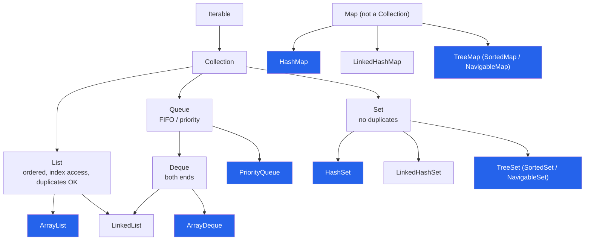

:::tip[TL;DR]
The **Java Collections Framework (JCF)** is Java's equivalent of C++'s STL: ready-made lists, sets, queues, deques, heaps and maps in `java.util`. In DSA, half the battle is picking the right one. Declare variables by **interface** (`List`, `Map`, `Deque`), create them with the **implementation** that has the complexity you need (`ArrayList`, `HashMap`, `ArrayDeque`).
:::

## The Imports You Need

Put these at the top of every DSA file and forget about them.

```java showLineNumbers
import java.util.*;            // collections, Arrays, Collections
import java.util.function.*;   // Function, Predicate (lambdas)
import java.util.stream.*;     // IntStream, Collectors
import java.io.*;              // BufferedReader, PrintWriter
```

## The Family Tree



The blue boxes are the ones you will use in 95% of problems. `Map` is part of the framework but does **not** extend `Collection`.

## Program to the Interface

```java showLineNumbers
List<Integer> list = new ArrayList<>();          // swap to LinkedList without touching other code
Deque<Integer> stack = new ArrayDeque<>();       // a stack
Queue<Integer> queue = new ArrayDeque<>();       // a FIFO queue
Map<String, List<Integer>> graph = new HashMap<>();
```

- The `<>` (**diamond**) lets the compiler infer the type arguments from the left side.
- Collections hold **objects only**. `List<int>` does not compile; use `List<Integer>`. Java **autoboxes** `int` → `Integer` on the way in and **unboxes** on the way out, which costs time and memory. For hot loops over numbers, a plain `int[]` beats `List<Integer>`.

## Which Structure for Which Job

| I need to… | Use | Key methods | Cost |
| --- | --- | --- | --- |
| Store items, access by index | `ArrayList` | `add`, `get(i)`, `set(i, x)`, `size` | O(1) amortised add, O(1) get |
| Check "have I seen this?" | `HashSet` | `add`, `contains`, `remove` | O(1) average |
| Count / map key → value | `HashMap` | `getOrDefault`, `merge`, `computeIfAbsent` | O(1) average |
| Stack (LIFO) | `ArrayDeque` | `push`, `pop`, `peek` | O(1) |
| Queue (FIFO), BFS | `ArrayDeque` | `offer`, `poll`, `peek` | O(1) |
| Both ends (sliding window) | `ArrayDeque` | `offerFirst/Last`, `pollFirst/Last`, `peekFirst/Last` | O(1) |
| Always get the min / max | `PriorityQueue` | `offer`, `poll`, `peek` | O(log n) / O(log n) / O(1) |
| Sorted unique items + "next bigger / smaller" | `TreeSet` | `floor`, `ceiling`, `lower`, `higher`, `first`, `last` | O(log n) |
| Sorted keys + range queries | `TreeMap` | `floorKey`, `ceilingKey`, `firstKey`, `headMap`, `tailMap` | O(log n) |
| Remember insertion order | `LinkedHashMap` / `LinkedHashSet` | same as Hash versions | O(1) average |
| LRU cache | `LinkedHashMap(cap, 0.75f, true)` | override `removeEldestEntry` | O(1) |

## Big-O Cheat Sheet

| Structure | Add | Remove | Search / contains | Get by index | Ordered? |
| --- | --- | --- | --- | --- | --- |
| `ArrayList` | O(1)* at end, O(n) in middle | O(n) (shift), O(1) at end | O(n) | **O(1)** | insertion |
| `LinkedList` | O(1) at ends | O(1) at ends, O(n) by value | O(n) | O(n) | insertion |
| `ArrayDeque` | O(1)* at ends | O(1) at ends | O(n) | n/a | insertion |
| `PriorityQueue` | O(log n) | O(log n) `poll`, **O(n)** `remove(x)` | O(n) | n/a | **heap order only** |
| `HashSet` / `HashMap` | O(1) avg | O(1) avg | O(1) avg | n/a | none |
| `LinkedHashSet` / `LinkedHashMap` | O(1) avg | O(1) avg | O(1) avg | n/a | insertion (or access) |
| `TreeSet` / `TreeMap` | O(log n) | O(log n) | O(log n) | n/a | **sorted** |

\* amortised: the backing array occasionally grows (ArrayList by 1.5×; ArrayDeque doubles while small, then grows by 1.5×), which is O(n) once but averages out to O(1).

:::info[Hash worst case]
Since Java 8, a `HashMap` bucket that collects 8 or more colliding keys (in a table of at least 64 buckets) turns into a **red-black tree**, so the worst case per operation is **O(log n)**, not O(n). In interviews, still quote **O(1) average**.
:::

## Legacy Classes: Know Them, Don't Use Them

| Legacy | Why avoid | Use instead |
| --- | --- | --- |
| `Vector` | Every method is `synchronized`, so it is slower for single-threaded code | `ArrayList` |
| `Stack` | Extends `Vector` (synchronized), and iterates bottom → top, which surprises people | `ArrayDeque` (`push`/`pop`/`peek`) |
| `Hashtable` | Synchronized, no `null` keys or values | `HashMap` (single thread), `ConcurrentHashMap` (multi-thread) |

`Stack` still works and plenty of solutions use it, so you should be able to read it. The javadoc itself recommends `Deque` for new code.

## Storing Your Own Classes

Collections can hold any object, including your own classes.

```java title="Person.java" showLineNumbers
class Person {
    String name;
    int age;

    Person(String name, int age) {
        this.name = name;
        this.age = age;
    }

    @Override
    public String toString() {                 // controls how println shows it
        return name + " (" + age + ")";
    }
}
```

```java showLineNumbers
List<Person> people = new ArrayList<>();
people.add(new Person("John", 30));
people.add(new Person("Alice", 25));
System.out.println(people);                    // [John (30), Alice (25)]
```

Without `toString()` you would see something like `Person@1b6d3586`.

### Hash-based collections need `equals` + `hashCode`

`HashSet`, `HashMap` keys and `contains` use **`hashCode()` to find the bucket and `equals()` to compare**. The defaults from `Object` compare **identity** (same object in memory), so two objects with the same fields count as different.

```java title="❌ No equals/hashCode: duplicates sneak in" showLineNumbers
class BadPoint { int x, y; BadPoint(int x, int y) { this.x = x; this.y = y; } }

Set<BadPoint> set = new HashSet<>();
set.add(new BadPoint(1, 2));
set.add(new BadPoint(1, 2));
// error-next-line
System.out.println(set.size());                        // ❌ 2
// error-next-line
System.out.println(set.contains(new BadPoint(1, 2)));  // ❌ false
```

```java title="✅ Override both" showLineNumbers
class Point {
    int x, y;
    Point(int x, int y) { this.x = x; this.y = y; }

    // success-start
    @Override public boolean equals(Object o) {
        if (this == o) return true;
        if (!(o instanceof Point p)) return false;
        return x == p.x && y == p.y;
    }
    @Override public int hashCode() { return Objects.hash(x, y); }
    // success-end
}
// set.size() -> 1, set.contains(new Point(1, 2)) -> true
```

### The shortcut: `record` <Since v="16" />

A **record** generates the constructor, getters, `equals`, `hashCode` and `toString` for you. It is the cleanest way to make a pair / tuple / grid cell key in DSA.

```java showLineNumbers
record Cell(int r, int c) {}

Set<Cell> seen = new HashSet<>();
seen.add(new Cell(0, 0));
// highlight-next-line
System.out.println(seen.contains(new Cell(0, 0)));     // true
System.out.println(new Cell(2, 3));                    // Cell[r=2, c=3]

Map<Cell, Integer> dist = new HashMap<>();
dist.put(new Cell(1, 1), 5);
System.out.println(dist.get(new Cell(1, 1)));          // 5
System.out.println(new Cell(2, 3).r());                // accessor is r(), not getR()
```

A record can be declared inside a method or as a nested class in your `Solution`, which is handy on LeetCode.

### Other ways to use a pair as a key

| Key type | Works as a HashSet / HashMap key? | Notes |
| --- | --- | --- |
| `record Cell(int r, int c)` | ✅ yes | Best choice on Java 16+ |
| `List.of(r, c)` / `Arrays.asList(r, c)` | ✅ yes | `List.equals` compares elements; boxing makes it slower |
| `r + "," + c` (String) | ✅ yes | Easy but slow (builds a String every time) |
| `r * cols + c` (int) | ✅ yes | Fastest; decode with `id / cols`, `id % cols` |
| `(long) r << 32 \| c` (long) | ✅ yes | Fast, works for large coordinates (needs `c ≥ 0`) |
| `int[] {r, c}` | ❌ **no** | Arrays use identity `equals`: `contains(new int[]{1, 2})` is `false` |

```java showLineNumbers
int r = 3, c = 4, cols = 10;
int id = r * cols + c;                                 // 34
System.out.println(id / cols + " " + id % cols);       // 3 4   (back to r and c)
```

:::danger[Never mutate a key after inserting it]
If a field used by `hashCode` changes after the object is in a `HashSet` / `HashMap`, the object sits in the wrong bucket and can no longer be found, not even with itself:

```java showLineNumbers
Point p = new Point(1, 1);
Set<Point> s = new HashSet<>();
s.add(p);
p.x = 9;                                     // mutate the key
// error-next-line
System.out.println(s.contains(p));           // ❌ false, though p is in the set
System.out.println(s.size());                // 1
```

Records are immutable, which is another reason to prefer them as keys.
:::

## Common Interview Traps

:::warning[ArrayList vs LinkedList]
"Use `LinkedList` for fast insertion" is only true **if you already hold an iterator at that position**. Reaching the position is O(n), and `LinkedList` has poor cache locality, so `ArrayList` wins almost every real benchmark. For a queue or deque, use `ArrayDeque` over both.
:::

- `HashMap` / `HashSet` iteration order is **not** insertion order and not sorted. Never rely on it in output. If the problem wants sorted output, use `TreeMap`, or sort at the end.
- `HashMap` allows one `null` key and `null` values. `TreeMap` throws `NullPointerException` on a `null` key (it can't compare it). `ArrayDeque` and `PriorityQueue` reject `null` elements.
- Interface methods like `List.of`, `Set.of`, `Map.of` return **immutable** collections: `add` throws `UnsupportedOperationException`. Wrap them (`new ArrayList<>(List.of(1, 2))`) if you need to modify.
