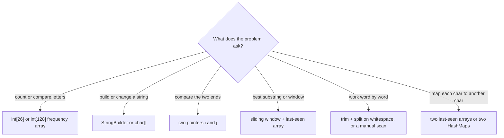

:::tip[TL;DR]
This page is a **lookup by intent**: find the row that says what you want to do ("count each letter", "drop the last char", "split into words") and copy the one-liner, so all your attention goes to the logic. Most string problems reduce to five tools: a **frequency array** (`int[26]` / `int[128]`), **two pointers**, a **`StringBuilder`** (or a `char[]`) for building, **`trim().split("\\s+")`** for words, and **char arithmetic** (`c - 'a'`, `c - '0'`). The method-by-method reference is [Strings, Characters & StringBuilder](./02-strings-and-characters.md).
:::

:::tip[Run it yourself]
Every snippet runs in `jshell` (JDK 21). Outputs in the trailing comments are copied from a real run.
:::

## Complexity at a Glance

`n` = length of the string, `k` = number of distinct characters, `L` = length of a word.

| Operation / idiom | Time | Extra space | Note |
| --- | --- | --- | --- |
| `s.charAt(i)`, `s.length()` | O(1) | O(1) | |
| Loop over all chars with `charAt` | O(n) | O(1) | no copy |
| `for (char c : s.toCharArray())` | O(n) | O(n) | copies into a `char[]` |
| Frequency array `int[26]` / `int[128]` | O(n) | **O(1)** | fixed size = O(alphabet) |
| `HashMap<Character, Integer>` counting | O(n) average | O(k) | boxing makes it ~5–10× slower than an array |
| `toCharArray()` + `Arrays.sort` + `new String` | O(n log n) | O(n) | anagram keys, sorted strings |
| `new StringBuilder(s).reverse().toString()` | O(n) | O(n) | |
| `trim().split("\\s+")` | O(n) | O(n) | compiles a regex each call |
| `replaceAll(regex, x)` / `matches(regex)` | O(n) typical | O(n) | **compiles the regex every call**, avoid inside loops |
| `split(",")` (one plain char) | O(n) | O(n) | fast path, no regex engine |
| `(s + s).contains(goal)` | O(n²) worst, ~O(n) typical | O(n) | rotation check |
| `s.chars().distinct().count()` | O(n) average | O(k) | unique-character check |
| `String.join` / `Collectors.joining` | O(total length) | O(total length) | |
| `s.substring(0, i) + c + s.substring(i + 1)` | O(n) | O(n) | one-char edit; use a `char[]` for many edits |
| `Integer.parseInt(s)` / manual digit loop | O(digits) | O(1) | |

Big-O for sorting and the master theorem lives in the [Complexity cheat sheet](../../00-complexity-analysis.md).

## Pick the Tool



## Fundamentals in 60 Seconds

| Idea | Java | Why it matters in DSA |
| --- | --- | --- |
| Declare | `String s = "Hello";` | double quotes = `String` |
| A single character | `char c = 'H';` | single quotes = `char` (a 16-bit number) |
| Mutability | **immutable**: every "change" makes a new object | `s += x` in a loop is O(n²); use `StringBuilder` |
| Read index `i` | `s.charAt(i)` (0-based) | `s[i]` does not compile on a `String` |
| Length | `s.length()` (a method) | arrays use `arr.length` (a field) |
| Character array | `char[] ch = s.toCharArray();` | mutable copy you can swap / sort in place |
| Substring | `s.substring(begin, end)`: **end is exclusive** | C++ `substr(pos, len)` takes a **length** instead |
| Frequency table | `int[] freq = new int[256]; freq['c']++;` | a `char` widens to an `int` index |

### Immutability: the new object

```java showLineNumbers
String s = "raj";
String t = s;                           // t points to the same "raj"
// highlight-next-line
s = s + 'j';                            // builds a NEW string "rajj"; "raj" is untouched
s;                                      // "rajj"
t;                                      // "raj"
s == t;                                 // false  (two different objects now)
```

In C++, `std::string` is mutable, so `s = s + 'j'` (or `s += 'j'`) changes that string's own buffer. In Java you never edit a `String`; you edit a `char[]` or a `StringBuilder` and convert back.

### Substring: Java vs C++

| Language | Call on `"string"` | Meaning of the 2nd argument | Result |
| --- | --- | --- | --- |
| Java | `substring(2, 4)` | end index, **exclusive** | `"ri"` |
| Java | `substring(2, 2 + 3)` | end = start + length | `"rin"` |
| C++ | `substr(2, 3)` | **length** (count of chars) | `"rin"` |

:::warning[Translating from C++ or Python notes]
C++ `s.substr(pos, len)` → Java `s.substring(pos, pos + len)`. Python `s[i:j]` → Java `s.substring(i, j)` (both end-exclusive). Python `s[-1]` → Java `s.charAt(s.length() - 1)`.
:::

### Traversing a string

```java showLineNumbers
String w = "abc";
for (int i = 0; i < w.length(); i++) { char c = w.charAt(i); }   // forward, no copy
for (int i = w.length() - 1; i >= 0; i--) { char c = w.charAt(i); }   // backward: c, b, a
for (char c : w.toCharArray()) { }                                // for-each, copies the chars
```

### ASCII values worth memorising

| Character(s) | Code(s) | Trick |
| --- | --- | --- |
| `' '` (space) | 32 | |
| `'0'` … `'9'` | 48 … 57 | `c - '0'` → digit 0–9 |
| `'A'` … `'Z'` | 65 … 90 | `c - 'A'` → 0–25 |
| `'a'` … `'z'` | 97 … 122 | `c - 'a'` → 0–25 |
| `'a' - 'A'` | 32 | upper and lower case differ by one bit: `(char) (c ^ 32)` toggles a **letter's** case |

Uppercase codes are **smaller** than lowercase ones, so `"Z".compareTo("a")` is `-7` and `Arrays.sort` puts `"B"` before `"a"`.

## The Lookup Tables: "I want to…"

Examples use `s = "Hello World"` unless the row says otherwise. `c` is a `char`, `i`, `j`, `k` are ints.

### Look at characters

| I want to… | Write this | Example → result |
| --- | --- | --- |
| first char | `s.charAt(0)` | `'H'` |
| last char | `s.charAt(s.length() - 1)` | `'d'` |
| k-th char from the end (1-based) | `s.charAt(s.length() - k)` | k = 3 → `'r'` |
| a mutable copy of the chars | `char[] ch = s.toCharArray();` | `[H, e, l, l, o, ...]` |
| chars as a `List<Character>` | `s.chars().mapToObj(c -> (char) c).toList()` | `"abc"` → `[a, b, c]` |
| the set of distinct chars | `s.chars().mapToObj(c -> (char) c).collect(Collectors.toSet())` | `"banana"` → `[a, b, n]` |
| each char as a one-letter `String` | `s.split("")` | `"abc"` → `[a, b, c]` |

### Search

| I want to… | Write this | Example → result |
| --- | --- | --- |
| does it contain char `c`? | `s.indexOf(c) >= 0` | `'o'` → `true` |
| does it contain a substring? | `s.contains("World")` | `true` |
| first position of `c` | `s.indexOf('o')` | `4` (`-1` if absent) |
| next position after index `i` | `s.indexOf('o', i)` | `i = 5` → `7` |
| last position | `s.lastIndexOf('o')` | `7` |
| how many times `c` occurs | `s.chars().filter(x -> x == 'l').count()` | `3` (a `long`) |
| how many times `c` occurs (no streams) | `s.length() - s.replace("a", "").length()` | `"banana"` → `3` |
| does a word start at index `i`? | `s.startsWith("World", 6)` | `true` |
| compare a region, ignoring case | `s.regionMatches(true, 6, "WORLD", 0, 5)` | `true` |
| does the **whole** string match a pattern? | `s.matches("[A-Za-z ]+")` | `true` |

Find **every** position of a pattern (the loop shape matters):

```java showLineNumbers
String text = "abababa", pat = "aba";
List<Integer> pos = new ArrayList<>();
// highlight-next-line
for (int i = text.indexOf(pat); i >= 0; i = text.indexOf(pat, i + 1)) pos.add(i);
pos;                                                    // [0, 2, 4]  overlapping matches

int cnt = 0;
// highlight-next-line
for (int i = text.indexOf(pat); i >= 0; i = text.indexOf(pat, i + pat.length())) cnt++;
cnt;                                                    // 2          non-overlapping matches
```

**Time:** O(n · m) worst case (naive matching per call); **space:** O(1) besides the result list.

### Classify a character

| I want to know if `c` is… | Write this | Note |
| --- | --- | --- |
| an ASCII digit | `c >= '0' && c <= '9'` | strict; `Character.isDigit` also accepts non-ASCII digits |
| a lowercase ASCII letter | `c >= 'a' && c <= 'z'` | |
| an uppercase ASCII letter | `c >= 'A' && c <= 'Z'` | |
| any letter | `Character.isLetter(c)` | |
| a letter or digit | `Character.isLetterOrDigit(c)` | `'_'` → `false`; the "valid palindrome" filter |
| upper / lower case | `Character.isUpperCase(c)` / `Character.isLowerCase(c)` | |
| whitespace | `Character.isWhitespace(c)` | true for `' '`, `'\t'`, `'\n'` |
| a vowel | `"aeiouAEIOU".indexOf(c) >= 0` | `'e'` → `true`, `'x'` → `false` |

### Convert characters

| I want to… | Write this | Example → result |
| --- | --- | --- |
| letter → index 0..25 | `c - 'a'` | `'c'` → `2` |
| index 0..25 → letter | `(char) ('a' + i)` | `2` → `'c'` |
| digit char → int | `c - '0'` | `'7'` → `7` |
| int 0..9 → digit char | `(char) ('0' + d)` | `3` → `'3'` |
| change case | `Character.toUpperCase(c)` / `Character.toLowerCase(c)` | `'a'` → `'A'` |
| toggle a letter's case | `(char) (c ^ 32)` | `'a'` → `'A'`, `'Q'` → `'q'` (letters only!) |
| char → ASCII code | `(int) c` | `'A'` → `65` |
| ASCII code → char | `(char) code` | `65` → `'A'` |
| char → `String` | `String.valueOf(c)` or `Character.toString(c)` | `'x'` → `"x"` |
| `String` → char | `s.charAt(0)` | |
| `char[]` → `String` | `new String(ch)` or `String.valueOf(ch)` | never `ch.toString()` |
| `List<Character>` → `String` | `list.stream().map(String::valueOf).collect(Collectors.joining())` | `[j, a, v, a]` → `"java"` |
| hex / base-b digit → value | `Character.digit(c, 16)` | `'f'` → `15`; invalid → `-1` |
| value → base-b digit | `Character.forDigit(v, 16)` | `11` → `'b'` |

### Extract pieces

Examples use `e = "interview"`, `k = 3`.

| I want to… | Write this | Example → result |
| --- | --- | --- |
| first `k` chars | `e.substring(0, k)` | `"int"` |
| last `k` chars | `e.substring(e.length() - k)` | `"iew"` |
| drop the first char | `e.substring(1)` | `"nterview"` |
| drop the last char | `e.substring(0, e.length() - 1)` | `"intervie"` |
| chars `i..j` **inclusive** | `e.substring(i, j + 1)` | `2..4` → `"ter"` |
| words (any spacing) | `s.trim().split("\\s+")` | `"  the sky  is blue "` → `[the, sky, is, blue]` |
| only the digits | `s.replaceAll("\\D", "")` | `"a1b22c"` → `"122"` |
| only the letters | `s.replaceAll("[^A-Za-z]", "")` | `"a1b22c!"` → `"abc"` |

:::danger[Two split traps]
```java showLineNumbers
// error-next-line
" a b".split(" ");                      // ❌ [, a, b]   a leading delimiter gives an empty first word
// success-next-line
" a b".trim().split("\\s+");            // ✅ [a, b]
// error-next-line
"   ".trim().split("\\s+").length;      // ❌ 1          splitting "" gives [""], not []
```
Check `s.isBlank()` first when the input may contain no words.
:::

### Clean and transform

| I want to… | Write this | Example → result |
| --- | --- | --- |
| lowercase everything | `s.toLowerCase()` | `"hello world"` |
| keep letters/digits, lowercased | `s.replaceAll("[^A-Za-z0-9]", "").toLowerCase()` | `"A man, a plan"` → `"amanaplan"` |
| remove all spaces | `s.replace(" ", "")` | `"a b  c"` → `"abc"` |
| collapse runs of spaces | `s.trim().replaceAll("\\s+", " ")` | `"  a   b  "` → `"a b"` |
| strip leading zeros (keep one `0`) | `s.replaceFirst("^0+(?!$)", "")` | `"000120"` → `"120"`, `"0000"` → `"0"` |
| replace every `'l'` | `s.replace('l', 'L')` | `"HeLLo WorLd"` |
| replace the char at index `i` | `s.substring(0, i) + c + s.substring(i + 1)` | `"hello"`, i = 1, `'a'` → `"hallo"` |
| capitalise the first letter | `s.substring(0, 1).toUpperCase() + s.substring(1)` | `"java"` → `"Java"` |
| repeat | `"ab".repeat(3)` | `"ababab"` |
| pad left / right to width 5 | `String.format("%5s", x)` / `String.format("%-5s", x)` | `"ab"` → `"   ab"` / `"ab   "` |
| zero-pad a number | `String.format("%05d", 42)` | `"00042"` |
| fixed-width binary | `String.format("%8s", Integer.toBinaryString(5)).replace(' ', '0')` | `"00000101"` |

### Build and modify

| I want to… | Write this | Example → result |
| --- | --- | --- |
| start building | `StringBuilder sb = new StringBuilder();` | `new StringBuilder(n)` presizes it |
| add at the end | `sb.append(x)` | `"hello"` + `'!'` → `"hello!"` |
| add part of a string | `sb.append(s, start, end)` | `("interview", 0, 5)` → `"inter"` |
| add at the front | `sb.insert(0, x)` | O(n): shifts everything |
| change one char | `sb.setCharAt(i, c)` | O(1) |
| remove the last char | `sb.deleteCharAt(sb.length() - 1)` | O(1); the backtracking "undo" |
| reverse in place | `sb.reverse()` | `">Hello"` → `"olleH>"` |
| clear and reuse | `sb.setLength(0)` | length → `0` |
| reverse a `String` | `new StringBuilder(s).reverse().toString()` | `"abc"` → `"cba"` |
| swap two chars | `char[] a = s.toCharArray();` swap `a[i]`, `a[j]`; `new String(a)` | `"abcd"`, swap 0 and 3 → `"dbca"` |
| join with a separator | `String.join(" ", list)` | `[a, b, c]` → `"a b c"` |
| join with prefix/suffix | `stream.collect(Collectors.joining(",", "[", "]"))` | `"[a,b,c]"` |
| reverse word order | `Collections.reverse(words); String.join(" ", words)` | `"the sky is blue"` → `"blue is sky the"` |

:::danger[char arithmetic inside append]
```java showLineNumbers
StringBuilder sb = new StringBuilder();
// error-next-line
sb.append('a' + 1);                     // ❌ "98"  ('a' + 1 is the int 98)
// success-next-line
sb.append((char) ('a' + 1));            // ✅ "b"
```
:::

### Count

| I want to… | Write this | Example → result |
| --- | --- | --- |
| count lowercase letters | `int[] f = new int[26]; for (char c : s.toCharArray()) f[c - 'a']++;` | `"banana"` → `f[0]=3, f[1]=1, f[13]=2` |
| count any ASCII char | `int[] f = new int[128]; ... f[c]++;` | `"Hi, Hi!"` → `f['H']=2, f[' ']=1` |
| count with a map | `map.merge(c, 1, Integer::sum);` | `"banana"` → `{a=3, b=1, n=2}` |
| read a count safely | `map.getOrDefault(c, 0)` | missing → `0` |
| counts in first-seen order | `groupingBy(x -> x, LinkedHashMap::new, Collectors.counting())` | `"banana"` → `{b=1, a=3, n=2}` |
| counts in sorted order | `new TreeMap<Character, Integer>()` + `merge` | `{a=3, b=1, n=2}` |
| number of distinct chars | `s.chars().distinct().count()` | `"banana"` → `3` |
| number of vowels | `s.chars().filter(c -> "aeiou".indexOf(c) >= 0).count()` | `"interview"` → `4` |
| first non-repeating char | count with `int[26]`, then scan `s` again for `f[c - 'a'] == 1` | `"leetcode"` → index `0` |

Full stream form of a character count (handy when you need a `Map` in one line):

```java showLineNumbers
"banana".chars()
        .mapToObj(c -> (char) c)
        .collect(Collectors.groupingBy(c -> c, Collectors.counting()));   // {a=3, b=1, n=2}
```

**Time:** O(n) average; **space:** O(k). Prefer the `int[]` version in hot loops: no boxing.

### Compare and sort

| I want to… | Write this | Example → result |
| --- | --- | --- |
| same characters? | `a.equals(b)` (never `==`) | |
| same, ignoring case | `a.equalsIgnoreCase(b)` | |
| dictionary order | `a.compareTo(b) < 0` means `a` first | `"apple"` vs `"banana"` → `-1`; `"app"` vs `"apple"` → `-2` |
| sort a string's chars | `char[] ch = s.toCharArray(); Arrays.sort(ch); new String(ch)` | `"dcba"` → `"abcd"` |
| sort chars descending | sort, then `new StringBuilder(sorted).reverse()` | `"abcd"` → `"dcba"` |
| sort words A→Z | `Arrays.sort(arr)` | `[apple, fig, kiwi, pear]` |
| sort words by length | `Arrays.sort(arr, Comparator.comparingInt(String::length))` | `[fig, pear, kiwi, apple]` (stable) |
| by length, then A→Z | `Comparator.comparingInt(String::length).thenComparing(Comparator.naturalOrder())` | `[fig, kiwi, pear, apple]` |
| longest first | `Comparator.comparingInt(String::length).reversed()` | `[apple, pear, kiwi, fig]` |
| ignore case when sorting | `Arrays.sort(arr, String.CASE_INSENSITIVE_ORDER)` | `[b, A, a, B]` → `[A, a, b, B]` |
| smallest / longest in a list | `Collections.min(list)` / `Collections.max(list, Comparator.comparingInt(String::length))` | `"apple"` / `"apple"` |
| "which concatenation is bigger" | `(y + x).compareTo(x + y)` as the comparator | `[3, 30, 34, 5, 9]` → `"9534330"` (Largest Number) |

`char[]` cannot take a `Comparator` (it is a primitive array). For a custom char order, sort an `Integer[]` or `Character[]`, or count with `int[26]` and rebuild.

### Numbers inside strings

| I want to… | Write this | Example → result |
| --- | --- | --- |
| parse an int / long | `Integer.parseInt(s)` / `Long.parseLong(s)` | `"-123"` → `-123`, `"+7"` → `7` |
| parse a number of any size | `new BigInteger(s)` | `"123456789012345678901234"` + 1 → `...235` |
| int → string | `String.valueOf(n)` | |
| number of digits | `String.valueOf(n).length()` | `90210` → `5` |
| sum of the digits in a digit string | `s.chars().map(c -> c - '0').sum()` | `"90210"` → `12` |
| is digit char `c` odd? | `(c - '0') % 2 == 1` | `'7'` → `true` |
| parse by hand (no overflow surprises) | `long v = 0; for (char c : s.toCharArray()) v = v * 10 + (c - '0');` | `"4096"` → `4096` |
| to / from binary | `Integer.toBinaryString(n)` / `Integer.parseInt(b, 2)` | `10` ↔ `"1010"` |

:::warning[parseInt is strict]
```java showLineNumbers
// error-start
Integer.parseInt("99999999999");        // ❌ NumberFormatException: For input string: "99999999999"  (too big for int)
Integer.parseInt(" 42");                // ❌ NumberFormatException: For input string: " 42"  (no trimming)
Integer.parseInt("");                   // ❌ NumberFormatException: For input string: ""
// error-end
```
For a digit string that can be longer than 9–10 digits (like "Largest Odd Number"), **never parse it**: work on the characters.
:::

### Quick yes/no checks

| Check | One-liner | Time / space |
| --- | --- | --- |
| palindrome | two pointers (below), or `new StringBuilder(s).reverse().toString().equals(s)` | O(n) / O(1) vs O(n) |
| rotation of each other | `a.length() == b.length() && (a + a).contains(b)` | O(n²) worst / O(n) |
| anagrams | `int[26]` counts equal, or sorted `char[]`s equal with `Arrays.equals` | O(n) / O(1), or O(n log n) / O(n) |
| all characters unique | `s.chars().distinct().count() == s.length()` | O(n) / O(k) |
| pangram | `s.toLowerCase().chars().filter(Character::isLetter).distinct().count() == 26` | O(n) / O(1) |
| `small` is a subsequence of `big` | two pointers: advance `i` in `small` only on a match | O(n) / O(1) |
| empty or only spaces | `s.isBlank()` | O(n) / O(1) |

```java showLineNumbers
static boolean isSubsequence(String small, String big) {
    int i = 0;
    for (int j = 0; j < big.length() && i < small.length(); j++)
        // highlight-next-line
        if (small.charAt(i) == big.charAt(j)) i++;      // only move in small on a match
    return i == small.length();
}
// isSubsequence("ace", "abcde") → true,  isSubsequence("aec", "abcde") → false
```

**Time:** O(n) where n = `big.length()`; **space:** O(1).

## Practice Problems, Solved

Each problem: the idea in one line, the code, and its time and space.

### Reverse a String II

Two different problems go by this name; know both.

**Version A (LeetCode 541):** for every block of `2k` characters, reverse the first `k`. If fewer than `k` are left, reverse them all.

```java title="ReverseStrII.java" showLineNumbers
static String reverseStr(String s, int k) {
    char[] a = s.toCharArray();                         // Strings are immutable: work on a char[]
    for (int start = 0; start < a.length; start += 2 * k) {
        // highlight-next-line
        int i = start, j = Math.min(start + k, a.length) - 1;   // clamp the end for a short tail
        while (i < j) {
            char t = a[i]; a[i++] = a[j]; a[j--] = t;   // two-pointer swap
        }
    }
    return new String(a);
}
// reverseStr("abcdefg", 2) → "bacdfeg"
// reverseStr("abcd", 4)    → "dcba"
```

**Time:** O(n); **space:** O(n) for the `char[]` (unavoidable, since the result is a new string).

**Version B (Reverse Words in a String, LeetCode 151):** reverse the order of words, with single spaces and no leading or trailing space.

```java title="ReverseWords.java" showLineNumbers
static String reverseWords(String s) {
    // highlight-next-line
    String[] w = s.trim().split("\\s+");                // trim first, or w[0] is ""
    StringBuilder sb = new StringBuilder();
    for (int i = w.length - 1; i >= 0; i--) {
        sb.append(w[i]);
        if (i > 0) sb.append(' ');
    }
    return sb.toString();
}
// reverseWords("  the sky  is blue ") → "blue is sky the"
```

If the interviewer says "no `split`", scan from the right and copy each word with `append(s, start, end)`:

```java title="ReverseWordsManual.java" showLineNumbers
static String reverseWordsManual(String s) {
    StringBuilder sb = new StringBuilder();
    int i = s.length() - 1;
    while (i >= 0) {
        while (i >= 0 && s.charAt(i) == ' ') i--;       // skip spaces
        if (i < 0) break;
        int end = i;
        while (i >= 0 && s.charAt(i) != ' ') i--;       // walk to the word's start
        if (sb.length() > 0) sb.append(' ');
        // highlight-next-line
        sb.append(s, i + 1, end + 1);                   // copy the word s[i+1 .. end]
    }
    return sb.toString();
}
// reverseWordsManual("  the sky  is blue ") → "blue is sky the"
// reverseWordsManual("hello")               → "hello"
```

**Time:** O(n) for both; **space:** O(n) for the output (the `split` version also holds the word array).

### Palindrome Check

**Plain palindrome:** compare the two ends and move inwards.

```java showLineNumbers
static boolean isPalindrome(String s) {
    int i = 0, j = s.length() - 1;
    while (i < j) if (s.charAt(i++) != s.charAt(j--)) return false;
    return true;
}
// isPalindrome("racecar") → true,  isPalindrome("abca") → false
```

**Valid Palindrome (LeetCode 125):** ignore non-alphanumeric characters and case. Skip junk with the pointers instead of building a cleaned copy.

```java showLineNumbers
static boolean validPalindrome(String s) {
    int i = 0, j = s.length() - 1;
    while (i < j) {
        char a = s.charAt(i), b = s.charAt(j);
        // highlight-start
        if (!Character.isLetterOrDigit(a)) i++;                 // skip junk on the left
        else if (!Character.isLetterOrDigit(b)) j--;            // skip junk on the right
        // highlight-end
        else if (Character.toLowerCase(a) != Character.toLowerCase(b)) return false;
        else { i++; j--; }
    }
    return true;
}
// validPalindrome("A man, a plan, a canal: Panama") → true
// validPalindrome("race a car")                     → false
// validPalindrome(" ")                              → true
```

**Time:** O(n); **space:** O(1). The "clean then reverse" version (`replaceAll` + `StringBuilder.reverse`) is also O(n) time but O(n) space.

### Largest Odd Number in a String

A number is odd iff its **last digit** is odd, so the answer is the prefix ending at the **rightmost odd digit**. Some versions of the problem also allow leading zeros in the input, which must not appear in the answer.

```java showLineNumbers
static String largestOdd(String num) {
    int end = num.length() - 1;
    // highlight-next-line
    while (end >= 0 && (num.charAt(end) - '0') % 2 == 0) end--;   // rightmost odd digit
    if (end < 0) return "";                                         // no odd digit at all
    int start = 0;
    while (start < end && num.charAt(start) == '0') start++;      // drop leading zeros
    return num.substring(start, end + 1);
}
// largestOdd("52")      → "5"
// largestOdd("4206")    → ""
// largestOdd("35427")   → "35427"
// largestOdd("0214638") → "21463"
// largestOdd("0003")    → "3"
```

**Time:** O(n); **space:** O(n) for the returned substring, O(1) otherwise. Brute force (try every substring, parse it) is O(n³) and overflows `long` for long inputs.

### Longest Common Prefix

**Vertical scan:** compare column `i` of every word with the first word; stop at the first mismatch or the first word that runs out.

```java showLineNumbers
static String lcp(String[] strs) {
    if (strs.length == 0) return "";
    String first = strs[0];
    for (int i = 0; i < first.length(); i++) {
        char c = first.charAt(i);
        for (int j = 1; j < strs.length; j++)
            // highlight-next-line
            if (i == strs[j].length() || strs[j].charAt(i) != c) return first.substring(0, i);
    }
    return first;
}
// lcp(["flower", "flow", "flight"]) → "fl"
// lcp(["dog", "racecar", "car"])    → ""
// lcp(["alone"])                    → "alone"
```

**Time:** O(S), where S = total characters in all words (stops early at the first mismatch); **space:** O(1) besides the answer.

**Sort trick:** after sorting, the common prefix of the **first and last** words is the common prefix of all words.

```java showLineNumbers
static String lcpSort(String[] strs) {
    String[] a = strs.clone();
    Arrays.sort(a);
    String lo = a[0], hi = a[a.length - 1];
    int i = 0;
    while (i < lo.length() && lo.charAt(i) == hi.charAt(i)) i++;
    return lo.substring(0, i);
}
// lcpSort(["interview", "internet", "interval", "internal"]) → "inter"
```

**Time:** O(L · n log n) for the sort (each comparison costs up to L); **space:** O(n) for the copy. Shorter to write, slower than the vertical scan.

### Isomorphic Strings

`s` and `t` are isomorphic if each character of `s` can be replaced to get `t`, with a **one-to-one** mapping. Instead of storing the mapping, store **where each char was last seen**: two matched chars must always have the same history.

```java showLineNumbers
static boolean isIsomorphic(String s, String t) {
    if (s.length() != t.length()) return false;
    int[] seenS = new int[256], seenT = new int[256];  // last position + 1 (0 = never seen)
    for (int i = 0; i < s.length(); i++) {
        char a = s.charAt(i), b = t.charAt(i);
        // highlight-next-line
        if (seenS[a] != seenT[b]) return false;        // different histories → mapping breaks
        seenS[a] = i + 1;
        seenT[b] = i + 1;
    }
    return true;
}
// isIsomorphic("egg", "add")     → true
// isIsomorphic("foo", "bar")     → false   (o would map to both a and r)
// isIsomorphic("paper", "title") → true
// isIsomorphic("badc", "baba")   → false   (b and d would both map to b)
```

**Time:** O(n); **space:** O(1) (two fixed 256-slot arrays). For full Unicode, use two `HashMap<Character, Character>`s (s→t and t→s) and check both directions; one map alone misses the `"badc"`/`"baba"` case.

### Rotate String

`goal` is a rotation of `s` iff they have the same length **and** `goal` appears inside `s + s` (every rotation is a window of the doubled string).

```java showLineNumbers
static boolean rotateString(String s, String goal) {
    // highlight-next-line
    return s.length() == goal.length() && (s + s).contains(goal);
}
// rotateString("abcde", "cdeab") → true
// rotateString("abcde", "abced") → false
// rotateString("aa", "a")        → false   (the length check matters)
```

**Time:** O(n²) worst case (naive `contains`), O(n) with KMP; **space:** O(n) for `s + s`. Brute force (build every rotation with `substring(shift) + substring(0, shift)` and compare) is O(n²) time and creates n new strings.

### Valid Anagram

Same letters, same counts. Count up for one string, down for the other, and check everything returns to zero.

```java showLineNumbers
static boolean isAnagram(String a, String b) {
    if (a.length() != b.length()) return false;
    int[] f = new int[26];
    for (int i = 0; i < a.length(); i++) {
        f[a.charAt(i) - 'a']++;
        f[b.charAt(i) - 'a']--;
    }
    for (int x : f) if (x != 0) return false;
    return true;
}
// isAnagram("anagram", "nagaram") → true,  isAnagram("rat", "car") → false
```

**Time:** O(n); **space:** O(1). The sort version (`Arrays.sort` both `char[]`s, then `Arrays.equals`) is O(n log n) time, O(n) space. For Unicode input, swap `int[26]` for a `HashMap<Character, Integer>`.

### Sort Characters by Frequency

Count, then order the characters by count. With a fixed alphabet, sorting the 128 slots costs O(1), so the whole thing is O(n).

```java title="FrequencySort.java" showLineNumbers
static String frequencySort(String s) {
    int[] f = new int[128];
    for (char c : s.toCharArray()) f[c]++;
    Integer[] order = new Integer[128];                 // boxed, so it can take a Comparator
    for (int c = 0; c < 128; c++) order[c] = c;
    // highlight-next-line
    Arrays.sort(order, (x, y) -> f[y] - f[x]);          // most frequent first
    StringBuilder sb = new StringBuilder(s.length());
    for (int c : order) {
        if (f[c] == 0) break;                           // the rest never appear
        sb.append(String.valueOf((char) c).repeat(f[c]));
    }
    return sb.toString();
}
// frequencySort("tree")   → "eert"
// frequencySort("cccaaa") → "aaaccc"
// frequencySort("Aabb")   → "bbAa"
```

**Time:** O(n) (+ O(128 log 128) = constant for the sort); **space:** O(n) for the output. Ties come out in ASCII order because object sorting is stable.

**Bucket-sort variant** (works for any alphabet): bucket `i` holds the chars that occur exactly `i` times; read the buckets from high to low.

```java showLineNumbers
static String frequencySortBucket(String s) {
    int[] f = new int[128];
    for (char c : s.toCharArray()) f[c]++;
    List<List<Character>> bucket = new ArrayList<>();
    for (int i = 0; i <= s.length(); i++) bucket.add(new ArrayList<>());
    for (int c = 0; c < 128; c++) if (f[c] > 0) bucket.get(f[c]).add((char) c);
    StringBuilder sb = new StringBuilder(s.length());
    for (int cnt = s.length(); cnt >= 1; cnt--)
        for (char c : bucket.get(cnt)) sb.append(String.valueOf(c).repeat(cnt));
    return sb.toString();
}
// frequencySortBucket("tree") → "eert"
```

**Time:** O(n); **space:** O(n). A `HashMap` + `PriorityQueue` version is O(n + k log k), the most common answer when the alphabet is unbounded.

## Pattern Complexity Summary

| Problem | Pattern | Time | Extra space | Brute force |
| --- | --- | --- | --- | --- |
| Reverse String II (every 2k) | two-pointer swap on `char[]` | O(n) | O(n) output | n/a |
| Reverse Words | `trim().split` + reverse join, or right-to-left scan | O(n) | O(n) | n/a |
| Palindrome / Valid Palindrome | two pointers, skip junk | O(n) | O(1) | clean + reverse: O(n) space |
| Largest Odd Number | scan from the right for an odd digit | O(n) | O(1) | all substrings: O(n³) |
| Longest Common Prefix | vertical scan | O(S) | O(1) | sort trick: O(L · n log n) |
| Isomorphic Strings | two last-seen arrays | O(n) | O(1) | two HashMaps: O(k) space |
| Rotate String | `(s + s).contains(goal)` | O(n²) worst, O(n) with KMP | O(n) | all rotations: O(n²) |
| Valid Anagram | `int[26]` up/down count | O(n) | O(1) | sort both: O(n log n) |
| Sort Characters by Frequency | count + sort alphabet / buckets | O(n) | O(n) | heap: O(n + k log k) |

## Gotchas

- **Strings never change in place:** `s.toUpperCase();` on its own line does nothing. Write `s = s.toUpperCase();`.
- **`'a' + 1` is the int `98`**, not `'b'`. Cast it back: `(char) ('a' + 1)`. (`c += 1` on a `char` variable is fine: compound assignment casts automatically.)
- **`s.chars()` gives ints:** `"ab".chars().forEach(sb::append)` appends `"9798"`. Use `mapToObj(c -> (char) c)` first.
- **`Arrays.asList(charArray)`** is a `List<char[]>` of size **1**, not a list of characters.
- **`"Z".compareTo("a")` is `-7`:** all uppercase letters sort before all lowercase ones. Use `String.CASE_INSENSITIVE_ORDER` or lowercase first.
- **`(char) (c ^ 32)` only toggles letters:** on `'5'` it gives a control character.
- **`replace` vs `replaceAll`:** `replace` is literal (`"a.b".replace(".", "$")` → `"a$b"`); `replaceAll` is a regex, and `"$"` in its replacement throws `IllegalArgumentException: Illegal group reference: group index is missing`.
- **Index errors quote the range:** `"abc".substring(2, 5)` throws `StringIndexOutOfBoundsException: Range [2, 5) out of bounds for length 3`; `"abc".charAt(3)` → `Index 3 out of bounds for length 3`.
- **`Character.getNumericValue('a')` is `10`** (hex-style), so it is not a safe "is this a digit" test. Use `c - '0'` after checking `c >= '0' && c <= '9'`.
- **`"ß".toUpperCase()` is `"SS"`:** case changes can change the length. Interview inputs are usually ASCII, but don't assume `s.toUpperCase().length() == s.length()` in production code.
- **Regex calls inside loops** (`split("\\s+")`, `replaceAll`, `matches`) recompile the pattern each time. Hoist a `Pattern` out of the loop or use a manual scan.
